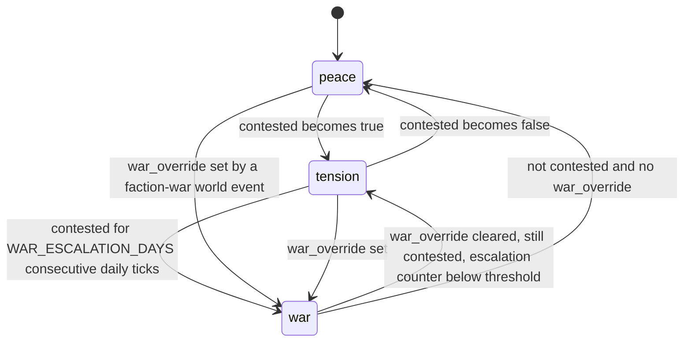
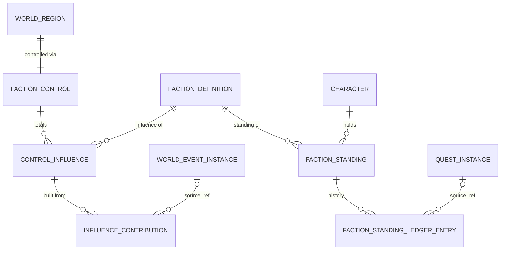

# Legends of the Shattered Frontier — AI: Factions and Faction Service

Version 1.0 — Expanded Technical Design Authority edition (2026-10-17)

Status: Design target; not implemented. Names per Shared Registry v1.0.

Back-links: [AI entry](../Legends_Shattered_Frontier_AI_Architecture_v1.0.md) · [Shared Registry](../Legends_Shattered_Frontier_Shared_Registry_v1.0.md)

---

This part has two halves. **Faction AI** is the strategic behavior of NPC factions, which runs inside `ai-director-service`. **Faction service** is the ratified durable contract of `faction-service` (standings, tiers, regional control). Faction AI never writes faction state directly: it acts through world events and the `faction-service` RPCs, under the same bounds as every other caller.

## 1. Faction AI

### 1.1 Faction content

Faction definitions (`faction/<slug>`) carry the service fields of F10 below plus these AI fields:

```json
{
  "id": "faction/free_prospectors",
  "has_reputation": true,
  "base_standing": 0,
  "ai_controlled": true,
  "relations": { "faction/greenhold_wardens": "hostile", "faction/wild_beasts": "hostile", "faction/ironroot_traders": "allied" },
  "home_regions": ["world_region/desert_wastes_east"],
  "goals": [
    { "kind": "territory", "world_region_id": "world_region/greenlands_south", "weight": 0.8 },
    { "kind": "resource", "resource_id": "resource/iron_ore", "weight": 0.6 }
  ],
  "strategic_actions": {
    "expand":    { "world_event_ids": ["world_event/prospector_uprising"] },
    "fortify":   { "world_event_ids": ["world_event/prospector_holdout"] },
    "reinforce": { "spawn_tags": ["prospector"] }
  },
  "npc_influence_on_outcome": 15
}
```

| Field | Type | Meaning |
| --- | --- | --- |
| `ai_controlled` | bool (default false) | The faction acts on its own (strategic tick). Player-aligned factions without goals set false. |
| `relations` | `{faction_id: faction_stance}` | Authored diplomacy (§1.4). Missing pairs are `neutral`. Relations are symmetric; content validation rejects asymmetric pairs. |
| `home_regions` | `world_region` ids | Regions the faction defends with higher priority |
| `goals[]` | objects | `territory` (a region) or `resource` (a resource kind), weight 0–1 |
| `strategic_actions` | object | World event definitions and spawn tags the faction may use |
| `npc_influence_on_outcome` | number ≤ `INFLUENCE_MAX_PER_CALL` | Influence granted by a world event outcome attributed to the faction (§1.5) |

### 1.2 Strategic tick

Every `tune.director.faction_tick_s` (300 s) the director evaluates every `ai_controlled` faction `f` against every candidate region `r` (its goal regions, home regions, and contestable regions adjacent to regions it controls).

```text
P(f, r) = W_T × g_t(f, r) × (1 − I(f, r) / INFLUENCE_MAX)
        + W_D × threat(f, r) × (1 + home(f, r))
        + W_R × g_r(f, r) × s(r)

threat(f, r) = clamp( (I_X − (I_f − CONTEST_MARGIN)) / CONTEST_MARGIN, 0, 1 )   if f controls r, else 0
s(r)         = max over goal resources of scarcity_index(resource, r) / 2      (0–1)
home(f, r)   = 1 if r ∈ home_regions(f), else 0
```

| Symbol | Default | Tuning key | Meaning |
| --- | --- | --- | --- |
| `g_t(f, r)` | goal weight, 0 if no territory goal for `r` | content | Territorial ambition |
| `g_r(f, r)` | resource goal weight if `r` produces the resource, else 0 | content | Resource ambition |
| `I(f, r)`, `I_f`, `I_X` | influence from `GetControl` | — | `I_X` = strongest challenger (F3.3) |
| `scarcity_index` | World projection (World spec, Resource regeneration; 0–2) | — | Same index Quest uses |
| `W_T`, `W_D`, `W_R` | 1.0, 1.5, 0.5 | `tune.director.faction_w_territory`, `tune.director.faction_w_defense`, `tune.director.faction_w_resource` | |

Action utility per (f, r), using the action scoring form of the NPC Behavior part (Utility AI):

| Action | Precondition | Fit | Effect |
| --- | --- | --- | --- |
| `fortify` | `f` controls `r` and `threat ≥ 0.5` | `threat(f, r)` | Director schedules a `fortify` world event (defense; players aligned with `f` defend) and requests `faction_pressure` quests (World Director and Dynamic Events part, Agentic quest generation) |
| `expand` | `f` does not control `r`; stance of `f` toward the controller is `hostile`; region `war_state ≠ peace` or `r` is a territory goal with `g_t ≥ 0.5` | `g_t × (1 − I(f, r) / INFLUENCE_MAX)` | Director schedules an `expand` world event (assault) in `r` |
| `reinforce` | any candidate | `0.5 × P(f, r) / P_max` | Spawn-pressure bias +0.25 for the faction's `spawn_tags` in `r` for 2 h (World and Director part, Spawn pressure) |
| `none` | always | 0.3 | Do nothing |

`U(action) = P(f, r) × fit`; the best action above `U_MIN_STRATEGIC` 0.3 (`tune.director.faction_action_min`) is taken. Limits: at most `tune.director.faction_actions_daily` (6) actions per faction per realm per day, one per region per 2 h (`tune.director.faction_region_cooldown_s` 7200), and world events requested this way still pass the director's normal budget and pacing checks (they are candidates with a strategic boost, not forced starts).

### 1.3 Worked example

`faction/free_prospectors` (`ai_controlled`), goal territory `greenlands_south` weight 0.8, resource `iron_ore` weight 0.6; region `greenlands_south` is controlled by `faction/greenhold_wardens` (420) with prospectors at 301 (`war_state = tension`); iron scarcity index 1.4.

```text
P = 1.0 × 0.8 × (1 − 301/1000) + 1.5 × 0 + 0.5 × 0.6 × (1.4 / 2)
  = 0.559 + 0 + 0.21 = 0.769
expand fit = 0.8 × 0.699 = 0.559 → U = 0.430
reinforce fit = 0.5 × 0.769 / 0.769 = 0.5 → U = 0.385
none → 0.3
```

The director adds `world_event/prospector_uprising` as a strategically boosted candidate in `greenlands_south`. For the Wardens (`ai_controlled`, home region): `threat = clamp((301 − (420 − 100)) / 100, 0, 1) = 0` → no fortify yet. If prospectors reach 380, `threat = 0.6`, `P = W_D × 0.6 × 2 = 1.8`, and the Wardens fortify.

### 1.4 Diplomacy

Proposed enum `faction_stance`: `allied`, `neutral`, `hostile`.

| Stance | NPC behavior | Influence rules |
| --- | --- | --- |
| `allied` | NPCs assist each other (assist and call-for-help cross faction lines); guards protect allied civilians | No effect on control math |
| `neutral` | Ignore each other; during regional `war` between them, engage on sight (NPC Behavior part, Hostility rule) | — |
| `hostile` | Engage on sight | Only hostile factions may take `expand` actions against each other |

Stances are authored content at launch. Dynamic diplomacy (stances changing from simulation) is out of scope (Open issues). Regional conflict intensity is expressed by `faction_war_state` per region (F3.3), not by changing stances.

### 1.5 NPC-attributed influence

When a world event whose content names an `attributed_faction_id` ends, the director calls `AddControlInfluence` (source `world_event`, no `character_id`, key `<wev_id>:realm:outcome`) for:

- `resolved` (players succeeded): the defending faction named in the event (`defender_faction_id`) gains `npc_influence_on_outcome` of that faction.
- `failed` (players failed): the attacking faction (`attacker_faction_id`) gains its `npc_influence_on_outcome`.

NPC-attributed influence is capped by the director at `tune.director.npc_influence_weekly_cap` (60) per faction per region per week, before faction-service's `REGION_WEEKLY_INFLOW_CAP` (300) applies to all sources. Player-attributed sources (quests, raids) therefore always have most of the regional budget; NPC factions alone cannot flip a region in under roughly 3 weeks (`CONTROL_MIN 250 / 60 per week` with decay).

### 1.6 War-state machine (per region)

States are the registry `faction_war_state` values; transitions are F3.3 rule 4.



Effects of `war` consumed by the AI: hostility between neutral-stance warring factions (NPC Behavior part), spawn-pressure bonus for both factions' tags (+0.25), `faction_war` world-event category weight ×2 (World Director and Dynamic Events part, Event selection), and quest-service `FactionContext.war_state` (Quest spec).

### 1.7 Faction data relationships



---

# Faction service

This section is the ratified `faction-service` contract that the Quest, Itemization and Raid specs call (Registry RPC table: AI spec, Faction service). Names follow Shared Registry v1.0 (Service registry; Entity registry: `FactionStanding`, `FactionControl`, `FactionStandingLedgerEntry`; content kind `faction`; events `faction.reputation.changed`, `faction.control.changed`). Its normative content is unchanged from the 2026-10-17 contract patch; this edition adds privacy participation (F4.1), the realm-transfer contract side (F12), and clarifications marked "Clarified".

## F1. Ownership and boundaries

| Item | Value |
| --- | --- |
| Service | `faction-service` (stateless + DB) |
| gRPC package | `lsf.faction_service.v1` |
| Database schema | `faction` (PostgreSQL), one database per realm like other character-scoped stores |
| Publishes | domain `faction`: `faction.reputation.changed` (topic `domain.faction`, key `character_id`), `faction.control.changed` (topic `domain.faction`, key `world_region_id`) |
| Consumes | `raid.world_effect.applied` (`faction_influence` effects), `progression.attribute.changed` (`cha` cache), `config.tuning.published` (`tune.faction.*`), content packs (`faction/*`, `world_region/*`) |
| Owns | `FactionStanding` (keyed `character_id` + `faction_id`), `FactionControl` (keyed `world_region_id` within a realm), influence totals, standing ledger, idempotency records |
| Does not own | Faction AI strategy and world events (`ai-director-service`), quest consequences and per-quest bounds (Quest spec), reward bundles (Itemization), raid influence formula (Raid spec, Weekly influence formula), attribute formulas (Combat spec) |

Callers and what they send:

| Caller | RPC | Typical source | Idempotency key convention (as callers already use) |
| --- | --- | --- | --- |
| reward-service | `AdjustStanding` | `reward_grant` | `<rwg_id>:<line_no>`; revocation `<rwg_id>:<line_no>:revoke` with `reverses_idempotency_key = <rwg_id>:<line_no>` (Itemization spec, Loot and Rewards part, Delivery saga and Revocation) |
| quest-service | `AdjustStanding` | `quest_reward`, `quest_choice` | `<qst_id>:rep:<faction_id>` (Quest spec, Model and Objectives part, Turn-in saga, shown as `qst:rep:<faction>`) |
| quest-service | `AddControlInfluence` | `quest_choice` | `<qst_id>:inf:<world_region_id>:<faction_id>` |
| quest-service, other readers | `GetStanding` | — | read only (fallback for the `faction_standing_at_least` prerequisite) |
| faction-service (raid consumer) | `AddControlInfluence` (internal path) | `raid_world_effect` | `event_id` of `raid.world_effect.applied`; reversals pass `reverses_idempotency_key = reversal_of` (Raid spec, Application flow) |
| ai-director-service | `AdjustStanding`, `AddControlInfluence` | `world_event` | `<wev_id>:<character_id or realm>:<step>` |
| ai-director-service | `GetControl` | — | read only (strategic tick, event eligibility, generation `FactionContext`) |
| enforcement-service | `AdjustStanding`, `AddControlInfluence` | `enforcement_rollback` | `<cas_id>:<target>` with `reverses_idempotency_key` |
| admin-portal | all | `gm_adjust` | `<ticket_ref>:<n>`; every call audited |

Clarified (2026-10-17, phase 2): reputation earned from world-event *participation* is a reputation line in the event's reward bundle and therefore flows through reward-service (`reward_grant`), like every other reward (Registry authority rule 4). ai-director-service calls `AdjustStanding` directly only for non-reward standing effects authored on an event (for example a betrayal penalty), and calls `AddControlInfluence` for NPC-attributed outcome influence (Faction AI §1.5) and `war_override`.

Resolved (2026-10-17): faction-service is not a quest-service caller at launch. It supplies faction state to ai-director-service, which proxies `reason = faction_pressure` requests (Quest spec, Generation and campaigns, Inputs; Quest spec, Service interfaces, Allowed callers).

## F2. Reputation range and tiers

Standing is a signed integer per (character, faction). A row that does not exist reads as the faction's `base_standing` (content, default 0).

| Constant | Default | Tuning key |
| --- | --- | --- |
| `REPUTATION_MIN` | −45,000 | `tune.faction.reputation_min` |
| `REPUTATION_MAX` | +45,000 | `tune.faction.reputation_max` |
| `REP_MAX_SINGLE_DELTA` | 2,000 (non-GM, non-reversal calls) | `tune.faction.max_single_delta` |

Enum `faction_standing_tier` (registry), with inclusive bounds:

| Tier | From | To |
| --- | --- | --- |
| `hated` | −45,000 | −21,001 |
| `hostile` | −21,000 | −6,001 |
| `unfriendly` | −6,000 | −1 |
| `neutral` | 0 | 2,999 |
| `friendly` | 3,000 | 8,999 |
| `honored` | 9,000 | 20,999 |
| `revered` | 21,000 | 41,999 |
| `exalted` | 42,000 | 45,000 |

Tier thresholds are published as `tune.faction.tier_thresholds`; reordering or renaming tiers is a registry change. At the Quest per-option cap (500) and a typical quest line of 250, `neutral → exalted` takes roughly 170 standard quest rewards, matching a long-term goal. Values are clamped to the range; a clamped call reports `clamped = true` and the actually applied delta. Reputation does not decay.

Tier function (normative): `tier(v)` = the tier whose `[From, To]` contains `v` after clamping, evaluated against the thresholds in effect at commit time. The stored `tier` column is recomputed on every write and by a backfill job when `tune.faction.tier_thresholds` changes.

### Charisma effect

(F2.1.) Combat spec, Charisma lists "Faction Reputation" as a Charisma effect and ratifies this multiplier. Faction-service applies one capped multiplier to **positive** deltas whose source is `quest_reward`, `quest_choice`, `reward_grant` or `world_event`:

```text
cha_mult      = 1 + CHA_REP_MAX_BONUS × min(cha, CHA_REP_REFERENCE) / CHA_REP_REFERENCE
applied_delta = floor(delta × cha_mult)            (then clamped to the range)
```

| Symbol | Default | Tuning key |
| --- | --- | --- |
| `cha` | character's natural `cha` attribute value (progression-service `AttributeValue`; cached from `progression.attribute.changed`, fallback `GetProgression`) | — |
| `CHA_REP_MAX_BONUS` | 0.10 (+10% at reference) | `tune.faction.cha_rep_max_bonus` |
| `CHA_REP_REFERENCE` | 150 (= `ATTRIBUTE_NATURAL_CAP`) | `tune.faction.cha_rep_reference` |

Negative deltas, `gm_adjust`, `enforcement_rollback` and reversals are never multiplied. Example: delta 250, `cha` 90 → `cha_mult = 1.06`, applied 265. Combat owns attribute formulas (Registry, Concept ownership); the multiplier is tunable to 0.

## F3. Regional control model

Each contestable `world_region` (content flag `contestable = true`) holds an influence total per faction.

| Constant | Default | Tuning key | Meaning |
| --- | --- | --- | --- |
| `INFLUENCE_MAX` | 1,000.00 | `tune.faction.influence_max` | Per faction per region; totals are `numeric(8,2)` |
| `INFLUENCE_MAX_PER_CALL` | 25.00 (non-GM, non-reversal) | `tune.faction.influence_max_per_call` | Raid weekly cap is 15, Quest option example 5 |
| `CHARACTER_INFLUENCE_WEEKLY_CAP` | 20.00 per character per region per week | `tune.faction.character_influence_weekly_cap` | Backstop of Quest's `tune.quest.max_control_influence_weekly`; sums all character-attributed sources |
| `REGION_WEEKLY_INFLOW_CAP` | 300.00 per faction per region per week | `tune.faction.region_weekly_inflow_cap` | All positive sources combined; stops large realms saturating control |
| `INFLUENCE_DECAY_DAILY` | 0.05 | `tune.faction.influence_decay_daily` | Applied at each dc_region daily reset (Registry, Resets) |
| `CONTROL_MIN` | 250.00 | `tune.faction.control_min` | Minimum influence to capture |
| `CAPTURE_MARGIN` | 100.00 | `tune.faction.capture_margin` | Lead over the controller needed to capture |
| `CONTEST_MARGIN` | 100.00 | `tune.faction.contest_margin` | Challenger within this of the controller → contested |
| `CONTROL_FLOOR` | 100.00 | `tune.faction.control_floor` | Below this, a controller with no qualifying challenger loses control to neutral |
| `WAR_ESCALATION_DAYS` | 3 | `tune.faction.war_escalation_days` | Consecutive contested daily ticks before `war` |

Week boundaries are the dc_region weekly reset; `week_key` = ISO week of the reset (`2026-W42`), same as Raid's `week_key`.

### F3.1 Influence bounds

`AddControlInfluence` applies, in order: per-call cap (`|points| ≤ INFLUENCE_MAX_PER_CALL`, else `INVALID_ARGUMENT`), character weekly cap (when `character_id` is set), region weekly inflow cap, then the `[0, INFLUENCE_MAX]` clamp. The response returns `applied_points` and the first `cap_reason` that reduced it; capping is not an error. Negative points are accepted only from `gm_adjust`, `enforcement_rollback` and reversals; reversals subtract exactly the original `applied_points` (floored at 0) and release the matching weekly-cap usage.

### F3.2 Decay

At each daily reset of the realm's dc_region, for every (region, faction):

```text
I ← round2(B + (I − B) × (1 − INFLUENCE_DECAY_DAILY))
```

`B` is the faction's `baseline_influence` for that region from `world_region` content (home factions typically 300, others 0). Influence above the baseline decays toward it; influence below it (after GM or rollback) recovers toward it at the same rate.

### F3.3 Control-change rule (normative)

Let `C` be the controller (nullable), `I_f` the influence of faction `f`, and `X` the challenger with the highest influence (`X ≠ C`; ties → lowest `faction_id` lexically, so evaluation is deterministic).

1. **Contested flag** (evaluated after every influence change and every tick): `contested = C ≠ null and I_X ≥ I_C − CONTEST_MARGIN`, or `C = null and I_X ≥ CONTROL_MIN − CONTEST_MARGIN`.
2. **Capture** (evaluated only at the daily tick, after decay): if `I_X ≥ CONTROL_MIN` and `I_X ≥ I_C + CAPTURE_MARGIN` (with `I_C = 0` when `C = null`), then `C ← X`. A region changes controller at most once per day.
3. **Loss to neutral** (daily tick): if `C ≠ null`, `I_C < CONTROL_FLOOR`, and no faction meets rule 2, then `C ← null`.
4. **War state**: `peace` when not contested; `tension` when contested; `war` when contested for `WAR_ESCALATION_DAYS` consecutive ticks, or while `ai-director-service` has an active faction-war world event for the region (it sets `war_override` via `AddControlInfluence` with zero points and source `world_event`).
5. Regions with `contestable = false` keep their authored controller; influence calls on them fail with `REGION_NOT_CONTESTABLE`.

Any change to `controlling_faction_id`, `contested` or `war_state` commits the new `FactionControl` row and an outbox record for `faction.control.changed` in one transaction. Influence changes that alter none of the three emit no event.

Worked example (defaults; daily tick decays then evaluates): `world_region/greenlands_south` is held by `faction/greenhold_wardens` (baseline 300, influence 420). `faction/free_prospectors` (baseline 0) receives the full regional inflow cap, 300 per week (≈42.86 per day), and the Wardens receive none. After day 8, prospectors 274.07 vs wardens 379.61: not contested (274.07 < 279.61). Day 9: 301.08 vs 375.63 → `contested`, `tension` (event emitted). Day 11: third consecutive contested tick → `war` (event). Day 16: 455.90 ≥ 250 and ≥ 352.82 + 100 → captured; controller becomes `free_prospectors` with `contested = false` because the Wardens are now more than 100 behind (event `controller_changed`). Quest-service reacts per Quest spec, Model and Objectives part (giver `when_unavailable` policies).

Clarified: `contested_ticks` counts consecutive daily ticks ending contested and resets to 0 at a tick ending uncontested; a capture resets it to 0. `war_override` is cleared by the director when the faction-war event ends (same RPC, `war_override = false`).

## F4. Data model (schema `faction`)

```sql
CREATE SCHEMA faction;

CREATE TABLE faction.standings (
  character_id   text        NOT NULL,             -- chr_
  faction_id     text        NOT NULL,             -- faction/<slug>
  value          integer     NOT NULL CHECK (value BETWEEN -45000 AND 45000),
  tier           text        NOT NULL,             -- faction_standing_tier
  version        bigint      NOT NULL DEFAULT 1,   -- optimistic concurrency
  updated_at     timestamptz NOT NULL DEFAULT now(),
  PRIMARY KEY (character_id, faction_id)
);

CREATE TABLE faction.standing_ledger (            -- append-only
  ledger_entry_id   text        PRIMARY KEY,      -- fsl_
  character_id      text        NOT NULL,
  faction_id        text        NOT NULL,
  source            text        NOT NULL,         -- faction_change_source
  source_ref        text        NULL,             -- qst_, rwg_, wev_, cas_, ticket
  requested_delta   integer     NOT NULL,
  applied_delta     integer     NOT NULL,
  cha_mult          numeric(4,3) NOT NULL DEFAULT 1.000,
  value_before      integer     NOT NULL,
  value_after       integer     NOT NULL,
  idempotency_key   text        NOT NULL UNIQUE,
  reverses_key      text        NULL REFERENCES faction.standing_ledger (idempotency_key),
  actor             text        NOT NULL,         -- mTLS service identity or staff id
  correlation_id    text        NULL,
  causation_id      text        NULL,
  occurred_at       timestamptz NOT NULL DEFAULT now()
);
CREATE INDEX ON faction.standing_ledger (character_id, occurred_at);
CREATE UNIQUE INDEX standing_ledger_one_reversal ON faction.standing_ledger (reverses_key) WHERE reverses_key IS NOT NULL;

CREATE TABLE faction.control (
  realm_id               text        NOT NULL,
  world_region_id        text        NOT NULL,      -- world_region/<slug>
  controlling_faction_id text        NULL,
  contested              boolean     NOT NULL DEFAULT false,
  war_state              text        NOT NULL DEFAULT 'peace',  -- faction_war_state
  contested_ticks        integer     NOT NULL DEFAULT 0,
  war_override           boolean     NOT NULL DEFAULT false,
  controller_since       timestamptz NULL,
  version                bigint      NOT NULL DEFAULT 1,
  updated_at             timestamptz NOT NULL DEFAULT now(),
  PRIMARY KEY (realm_id, world_region_id)
);

CREATE TABLE faction.control_influence (
  realm_id         text          NOT NULL,
  world_region_id  text          NOT NULL,
  faction_id       text          NOT NULL,
  influence        numeric(8,2)  NOT NULL CHECK (influence BETWEEN 0 AND 1000),
  updated_at       timestamptz   NOT NULL DEFAULT now(),
  PRIMARY KEY (realm_id, world_region_id, faction_id)
);

CREATE TABLE faction.influence_contributions (    -- append-only
  idempotency_key   text          PRIMARY KEY,
  realm_id          text          NOT NULL,
  world_region_id   text          NOT NULL,
  faction_id        text          NOT NULL,
  character_id      text          NULL,
  source            text          NOT NULL,
  source_ref        text          NULL,
  week_key          text          NOT NULL,
  requested_points  numeric(8,2)  NOT NULL,
  applied_points    numeric(8,2)  NOT NULL,
  cap_reason        text          NOT NULL,       -- influence_cap_reason
  reverses_key      text          NULL UNIQUE,
  occurred_at       timestamptz   NOT NULL DEFAULT now()
);
CREATE INDEX ON faction.influence_contributions (realm_id, world_region_id, faction_id, week_key);
CREATE INDEX ON faction.influence_contributions (character_id, world_region_id, week_key) WHERE character_id IS NOT NULL;

CREATE TABLE faction.idempotency (
  idempotency_key  text        PRIMARY KEY,
  rpc              text        NOT NULL,
  request_hash     bytea       NOT NULL,
  response         bytea       NOT NULL,          -- serialized original response
  created_at       timestamptz NOT NULL DEFAULT now()  -- purged after IDEMPOTENCY_RETENTION (7 days)
);

CREATE TABLE faction.outbox (
  event_id     text        PRIMARY KEY,          -- evt_
  event_name   text        NOT NULL,
  partition_key text       NOT NULL,
  envelope     jsonb       NOT NULL,
  created_at   timestamptz NOT NULL DEFAULT now(),
  published_at timestamptz NULL
);
```

Weekly cap usage is computed from `influence_contributions` (indexed sums); a per-week rollup table is an optimisation to add only if the query becomes hot. The ledger and contributions are permanent (they are the audit trail for rollbacks); the idempotency table is purged after 7 days, after which replays are still detected through the `UNIQUE` keys on the ledger and contributions and return the stored result.

### F4.1 Privacy participation

Faction-service implements `PrivacyParticipant.ExportSubject` and `PrivacyParticipant.EraseSubject` (Backend spec, Account deletion and privacy request workflow).

| Operation | Effect |
| --- | --- |
| `ExportSubject` | `standings` rows and the subject's `standing_ledger` rows (source, deltas, timestamps; `actor` omitted for staff) |
| `EraseSubject` (phase 2) | Delete `standings` rows; pseudonymize `standing_ledger.character_id` and `influence_contributions.character_id` to the Backend tombstone pseudonym; keep amounts so regional totals and rollback math stay correct |

Influence totals are not personal data and are unchanged by erasure.

## F5. gRPC contract — `lsf.faction_service.v1`

```proto
syntax = "proto3";
package lsf.faction_service.v1;

service FactionService {
  rpc GetStanding(GetStandingRequest) returns (GetStandingResponse);
  rpc AdjustStanding(AdjustStandingRequest) returns (AdjustStandingResponse);
  rpc AddControlInfluence(AddControlInfluenceRequest) returns (AddControlInfluenceResponse);
  rpc GetControl(GetControlRequest) returns (GetControlResponse);   // read only
}

enum FactionChangeSource {          // registry enum faction_change_source
  FACTION_CHANGE_SOURCE_UNSPECIFIED = 0;
  QUEST_REWARD = 1; QUEST_CHOICE = 2; REWARD_GRANT = 3; WORLD_EVENT = 4;
  RAID_WORLD_EFFECT = 5; GM_ADJUST = 6; ENFORCEMENT_ROLLBACK = 7; REVERSAL = 8;
}

message Standing {
  string faction_id = 1; int32 value = 2; string tier = 3;   // faction_standing_tier
  string updated_at = 4; int64 version = 5; bool is_default = 6;  // true = no row, base_standing
}
message GetStandingRequest {
  string character_id = 1;
  repeated string faction_ids = 2;   // empty = every faction with a row
}
message GetStandingResponse { string character_id = 1; repeated Standing standings = 2; }

message AdjustStandingRequest {
  string idempotency_key = 1;        // ≤ 128 chars
  string character_id = 2;
  string faction_id = 3;
  int32  delta = 4;                  // signed; reward bundle `amount` and quest `delta` map here
  FactionChangeSource source = 5;
  string source_ref = 6;             // qst_ / rwg_ / wev_ / cas_ / ticket
  string reward_grant_id = 7;        // set by reward-service
  int32  line_no = 8;                // set by reward-service
  string reverses_idempotency_key = 9;  // reverse exactly that call's applied_delta; delta ignored
  string correlation_id = 10;
  string causation_id = 11;
}
message AdjustStandingResponse {
  Standing standing = 1;             // after
  int32 value_before = 2;
  int32 requested_delta = 3;
  int32 applied_delta = 4;           // after charisma and clamping
  double cha_mult = 5;
  bool clamped = 6;
  string tier_before = 7;
  bool tier_changed = 8;
  string ledger_entry_id = 9;        // fsl_
  bool replayed = 10;                // original result returned
}

message AddControlInfluenceRequest {
  string idempotency_key = 1;
  string realm_id = 2;
  string world_region_id = 3;
  string faction_id = 4;
  double points = 5;                 // rounded half-up to 2 decimals server-side
  FactionChangeSource source = 6;
  string source_ref = 7;             // qst_, wev_, raid event_id, cas_
  string character_id = 8;           // required for QUEST_*; counts toward CHARACTER_INFLUENCE_WEEKLY_CAP
  string reverses_idempotency_key = 9;
  bool   war_override = 10;          // WORLD_EVENT only; toggles F3.3 rule 4 override
  string correlation_id = 11;
  string causation_id = 12;
}
message RegionControl {
  string realm_id = 1; string world_region_id = 2; string controlling_faction_id = 3;
  bool contested = 4; string war_state = 5;            // faction_war_state
  map<string, double> influence = 6;                   // faction_id → influence
  string controller_since = 7; int64 version = 8;
}
message AddControlInfluenceResponse {
  double requested_points = 1;
  double applied_points = 2;
  string cap_reason = 3;             // influence_cap_reason
  double character_week_used = 4;    // when character_id set
  double region_week_used = 5;
  RegionControl control = 6;         // after the call
  bool control_changed = 7;          // contested or war_state changed now (controller changes only at ticks)
  bool replayed = 8;
}

message GetControlRequest { string realm_id = 1; repeated string world_region_ids = 2; }  // empty = all
message GetControlResponse { repeated RegionControl regions = 1; }
```

Rules:

1. **Idempotency.** Same `idempotency_key` + same request hash → original response with `replayed = true`. Same key + different hash → `ALREADY_EXISTS / IDEMPOTENCY_MISMATCH`. Per Quest's turn-in saga, the reputation step is retried independently and is idempotent per faction; per Itemization, each reward line is idempotent per `rwg_id:line_no`.
2. **Reversal.** `reverses_idempotency_key` must name an earlier call of the same RPC for the same character/faction (or region/faction). Faction-service applies the negative of the original `applied_delta` / `applied_points`, never re-multiplies by charisma, clamps to range, and allows one reversal per original (unique index). Reward-service revocation and Raid's `reversal_of` both use this path, so a revoked grant removes exactly what it added.
3. **Atomicity.** One transaction per call: standing or influence row update (optimistic `version`), ledger or contribution row, idempotency row, outbox row(s).
4. **Raid consumer.** Faction-service consumes `raid.world_effect.applied` with `effect_type = faction_influence` and calls its own `AddControlInfluence` handler with `idempotency_key = event_id`, `points = influence_points`, `source = RAID_WORLD_EFFECT`, no `character_id`, and `reverses_idempotency_key = reversal_of` when present. The raid weekly cap (15) is below `INFLUENCE_MAX_PER_CALL`.
5. **Unknown standing.** `GetStanding` returns `is_default = true` with `base_standing` for factions without a row; it never creates rows.

Error model (`google.rpc.ErrorInfo.reason`):

| Status | Reasons |
| --- | --- |
| `INVALID_ARGUMENT` | `DELTA_OUT_OF_BOUNDS` (\|delta\| > `REP_MAX_SINGLE_DELTA` for non-GM), `POINTS_OUT_OF_BOUNDS`, `NEGATIVE_NOT_ALLOWED_FOR_SOURCE`, `CHARACTER_REQUIRED_FOR_SOURCE`, `KEY_TOO_LONG`, `SOURCE_UNSPECIFIED` |
| `NOT_FOUND` | `CHARACTER_NOT_FOUND`, `FACTION_NOT_FOUND` (not in the active content pack), `REGION_NOT_FOUND`, `REVERSAL_TARGET_NOT_FOUND` |
| `FAILED_PRECONDITION` | `FACTION_HAS_NO_REPUTATION` (content `has_reputation = false`), `REGION_NOT_CONTESTABLE`, `REVERSAL_ALREADY_APPLIED` (returns the existing reversal) |
| `PERMISSION_DENIED` | `CALLER_NOT_ALLOWED`, `SOURCE_NOT_ALLOWED_FOR_CALLER` |
| `ALREADY_EXISTS` | `IDEMPOTENCY_MISMATCH` |
| `ABORTED` | `VERSION_CONFLICT` (internal retry exhausted; caller retries with the same key) |
| `UNAVAILABLE` | transient; caller retries with the same key |

### F5.1 AdjustStanding sequence

```mermaid
sequenceDiagram
    participant RS as reward-service
    participant FS as faction-service
    participant DB as PostgreSQL faction
    participant BUS as event-bus
    RS->>FS: AdjustStanding(key rwg_..:2, chr_, faction/greenhold_wardens, +250, REWARD_GRANT)
    FS->>DB: lookup idempotency / ledger by key
    alt replay
        DB-->>FS: stored response
        FS-->>RS: response (replayed = true)
    else new
        FS->>FS: validate caller/source matrix, bounds, content
        FS->>FS: cha_mult from cached cha; clamp; tier()
        FS->>DB: BEGIN; UPDATE standings (version); INSERT ledger fsl_; INSERT idempotency; INSERT outbox; COMMIT
        FS-->>RS: response (applied_delta, tier_changed)
        DB-->>BUS: outbox relay → faction.reputation.changed
    end
```

## F6. Event payloads

Envelope per Registry, Envelope; `character_id` sits in the envelope (`p1_pseudonymous`) for `faction.reputation.changed`. Both events are produced from the outbox after commit.

### F6.1 `faction.reputation.changed`

Topic `domain.faction`, key `character_id`. Emitted on every committed `AdjustStanding` with `applied_delta ≠ 0` (not on replays).

| Field | Type | Required | Description | privacy_class |
| --- | --- | --- | --- | --- |
| `faction_id` | string | yes | `faction/<slug>` | p0_public |
| `value_before` | int | yes | Standing before the change | p1_pseudonymous |
| `value` | int | yes | Standing after the change (Quest `reach_standing` and `faction_standing_at_least` read this) | p1_pseudonymous |
| `requested_delta` | int | yes | Delta as sent by the caller | p1_pseudonymous |
| `applied_delta` | int | yes | Delta after charisma and clamping | p1_pseudonymous |
| `tier_before` | string | yes | `faction_standing_tier` | p1_pseudonymous |
| `tier` | string | yes | `faction_standing_tier` after (Quest `faction_threshold` trigger) | p1_pseudonymous |
| `tier_changed` | bool | yes | `tier ≠ tier_before` | p1_pseudonymous |
| `cha_mult` | number | yes | 1.0 when not applied | p1_pseudonymous |
| `clamped` | bool | yes | Range clamp reduced the delta | p1_pseudonymous |
| `source` | string | yes | `faction_change_source` | p0_public |
| `source_ref` | string | no | `qst_`, `rwg_`, `wev_`, `cas_` | p1_pseudonymous |
| `reward_grant_id` | string | no | Set for reward-service calls | p1_pseudonymous |
| `ledger_entry_id` | string | yes | `fsl_` | p1_pseudonymous |
| `reversal_of` | string | no | Ledger entry reversed | p1_pseudonymous |
| `version` | int | yes | Standing row version (consumers keep the highest) | p0_public |

### F6.2 `faction.control.changed`

Topic `domain.faction`, key `world_region_id`; `realm_id` in the envelope; no `character_id`.

| Field | Type | Required | Description | privacy_class |
| --- | --- | --- | --- | --- |
| `world_region_id` | string | yes | `world_region/<slug>` | p0_public |
| `change_kinds` | string[] | yes | Any of `controller_changed`, `contested_changed`, `war_state_changed` | p0_public |
| `controlling_faction_id` | string | no | After; absent = neutral | p0_public |
| `previous_controlling_faction_id` | string | no | Before; absent = neutral | p0_public |
| `contested` | bool | yes | After | p0_public |
| `war_state` | string | yes | `faction_war_state` after | p0_public |
| `previous_war_state` | string | yes | Before | p0_public |
| `influence` | object | yes | `{faction_id: number}` snapshot after the change | p0_public |
| `trigger` | string | yes | `daily_tick`, `influence_call`, `gm_adjust`, `war_override` | p0_public |
| `causation_ref` | string | no | Idempotency key or tick id that caused it | p0_public |
| `version` | int | yes | Control row version | p0_public |

Quest-service uses `controlling_faction_id`, `contested` and `war_state` for `region_controlled_by`, generated-quest `FactionContext`, and expiring generated quests; Analytics uses it for the faction control map (Analytics spec, Dashboards Alerting Privacy part). ai-director-service uses it for strategic ticks, war-state effects and generated-quest invalidation.

## F7. Security considerations

1. **Server-only service.** No gateway route mutates faction state. Players read their own standings through gateway → `GetStanding` with `character_id` taken from the session token, never from the request.
2. **Caller allowlist (mTLS identity) and source matrix.**

| Caller | `AdjustStanding` sources | `AddControlInfluence` sources |
| --- | --- | --- |
| reward-service | `reward_grant`, `reversal` | — |
| quest-service | `quest_reward`, `quest_choice`, `reversal` | `quest_choice`, `quest_reward`, `reversal` |
| ai-director-service | `world_event` | `world_event` |
| faction-service (raid consumer) | — | `raid_world_effect`, `reversal` |
| enforcement-service | `enforcement_rollback` | `enforcement_rollback` |
| admin-portal | `gm_adjust` (requires `senior_game_master` or higher; reason and ticket mandatory) | `gm_adjust` (`liveops_lead` or higher) |

   zone-server and instance-server have no direct write access; kill and event reputation flows through reward bundles or the director. `GetControl` is readable by every internal service with an mTLS identity.
3. **Bounds as a second line of defence.** Per-call delta and point caps, the character weekly influence cap, and the region weekly inflow cap hold even if a caller is compromised or misconfigured. Quest's own caps stay authoritative for quest design.
4. **Audit.** Every `gm_adjust` and `enforcement_rollback` call writes an `audit-service` record (actor, before/after, ticket or case). Ledger rows are append-only (no UPDATE/DELETE grants for the service role; the F4.1 pseudonymization runs as a separate privileged job role).
5. **Rollback support.** Enforcement rollbacks use reversals keyed by the original idempotency keys, so reverting a reward or a quest never needs to guess amounts. Standing reached via reverted sources is recomputed exactly; downstream unlocks (e.g., vendor access) re-check on next use.
6. **Abuse signals.** Influence capping rates (`cap_reason = character_weekly`) and reputation gain velocity per account feed Security as features for `detector/bot_*` and exploit detectors (Security spec, Detection Risk and Enforcement part); faction-service raises no detections itself.
7. **Denial of service.** `GetStanding` is cached per character in memory (5 s); `GetControl` from a replica. Write rate per character is bounded by its callers.

## F8. Analytics hooks

| Hook | Source | Use |
| --- | --- | --- |
| `faction.reputation.changed` | domain event | Reputation gain per active hour by source; tier distribution per faction; time to `exalted` |
| `faction.control.changed` | domain event | Control map, flips per week, time contested, war duration |
| Daily snapshot export | `faction.control_influence` at each daily tick | Influence trends per region and faction |

Metrics (Analytics to register): `m_faction_tier_distribution` (share of active characters per tier and faction), `m_region_control_flips_weekly` (controller changes per realm per week; alert if > 25% of contestable regions flip in a week), `m_influence_cap_hit_share` (share of influence calls reduced by `character_weekly` or `region_weekly`), `m_npc_influence_share` (share of applied influence per region-week from `world_event` sources; target ≤ 25 %). Payload fields are p0/p1 only; no p2 data is produced.

Balancing targets:

| Target | Value |
| --- | --- |
| `neutral → exalted` for a quest-focused character | ≈ 170 standard quest rewards (F2) |
| Median contestable-region controller tenure | 3–8 weeks |
| Regions in `war` at any time per realm | 5–15 % of contestable regions |
| Weekly controller flips | ≤ 10 % of contestable regions (alert at 25 %) |

## F9. Tuning keys

`tune.faction.reputation_min` (−45000), `tune.faction.reputation_max` (45000), `tune.faction.tier_thresholds`, `tune.faction.max_single_delta` (2000), `tune.faction.cha_rep_max_bonus` (0.10), `tune.faction.cha_rep_reference` (150), `tune.faction.influence_max` (1000), `tune.faction.influence_max_per_call` (25), `tune.faction.character_influence_weekly_cap` (20), `tune.faction.region_weekly_inflow_cap` (300), `tune.faction.influence_decay_daily` (0.05), `tune.faction.control_min` (250), `tune.faction.capture_margin` (100), `tune.faction.contest_margin` (100), `tune.faction.control_floor` (100), `tune.faction.war_escalation_days` (3).

Faction AI keys (director): `tune.director.faction_tick_s` (300), `tune.director.faction_w_territory` (1.0), `tune.director.faction_w_defense` (1.5), `tune.director.faction_w_resource` (0.5), `tune.director.faction_action_min` (0.3), `tune.director.faction_actions_daily` (6), `tune.director.faction_region_cooldown_s` (7200), `tune.director.npc_influence_weekly_cap` (60).

## F10. Content fields used (kind `faction`, `world_region`)

| Kind | Field | Meaning |
| --- | --- | --- |
| `faction` | `has_reputation` (bool, default true) | Whether characters hold standing |
| `faction` | `base_standing` (int, default 0) | Starting value read when no row exists |
| `world_region` | `contestable` (bool) | Whether influence and control rules apply |
| `world_region` | `initial_controller` (faction ID or null) | Controller at realm creation |
| `world_region` | `baseline_influence` (`{faction_id: number}`) | Decay target per faction |

Faction AI content fields (`ai_controlled`, `relations`, `home_regions`, `goals`, `strategic_actions`, `npc_influence_on_outcome`) are read only by ai-director-service (§1.1).

## F11. Registry additions (proposed)

> **Merge status (2026-10-17):** merged into the Shared Registry (see its change log). The registry is now authoritative for these names; rows here remain as justification. New phase-2 proposals are in the entry file's Registry additions.

| Kind | Addition |
| --- | --- |
| Enum | `faction_standing_tier`: `hated`, `hostile`, `unfriendly`, `neutral`, `friendly`, `honored`, `revered`, `exalted` |
| Enum | `faction_war_state`: `peace`, `tension`, `war` (the Quest `FactionContext.war_state` values) |
| Enum | `faction_change_source`: `quest_reward`, `quest_choice`, `reward_grant`, `world_event`, `raid_world_effect`, `gm_adjust`, `enforcement_rollback`, `reversal` |
| Enum | `influence_cap_reason`: `none`, `per_call`, `character_weekly`, `region_weekly`, `influence_max`, `floor_zero` |
| Entity / prefix | `FactionStandingLedgerEntry` `fsl_` — faction-service, AI, PostgreSQL `faction` (append-only) |
| Constants | `REPUTATION_MIN` −45,000, `REPUTATION_MAX` 45,000, `INFLUENCE_MAX` 1,000, `CHARACTER_INFLUENCE_WEEKLY_CAP` 20, `REGION_WEEKLY_INFLOW_CAP` 300 (keys in F9) |
| RPC table | `faction-service`: `GetStanding`, `AdjustStanding`, `AddControlInfluence` — ratified; `GetControl` (read only) |
| Content fields | `faction.has_reputation`, `faction.base_standing`, `world_region.contestable`, `world_region.initial_controller`, `world_region.baseline_influence` |
| Tuning domain | `tune.faction.*` |

## F12. Open issues

1. **Charisma ratification.** Resolved (2026-10-17): Combat spec, Charisma ratifies the multiplier.
2. **Reputation spillover.** Decided (phase 2): no automatic allied/rival spillover at launch. Content expresses it with explicit multi-line reward bundles and quest consequences, which are bounded and reversible line by line. Revisit only if Analytics shows content authors duplicating the same paired lines in > 30 % of bundles.
3. **Natural vs effective `cha`.** Resolved (2026-10-17): Combat keeps natural Charisma for reputation.
4. **Building and territory.** Still open (Building spec owner): guild-held settlements may need their own influence source (`territory`); add to `faction_change_source` when that spec defines it.
5. **Cross-realm transfer.** Faction side defined (phase 2): a realm transfer moves the character's `standings` rows unchanged (value, tier, version reset to 1) and writes one ledger row per faction on the destination with source `realm_transfer` (registered `faction_change_source`; Shared Registry, Phase-2 enums), `source_ref = <transfer reference>`, `requested_delta = applied_delta = value`; source-realm rows are deleted after the destination commit. Influence contributions are realm-scoped and never move (regional control belongs to the source realm). Backend owns the transfer workflow and participant interface.
6. **Region weekly inflow cap scale.** 300 per faction per week is sized for a 2–5k concurrent realm; Analytics `m_region_control_flips_weekly` should validate it during PTR.
