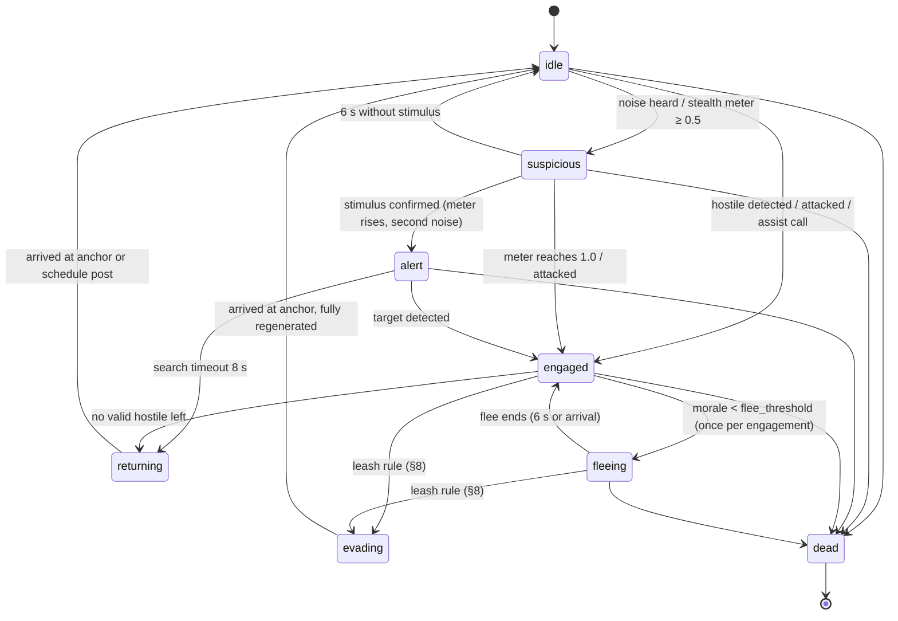
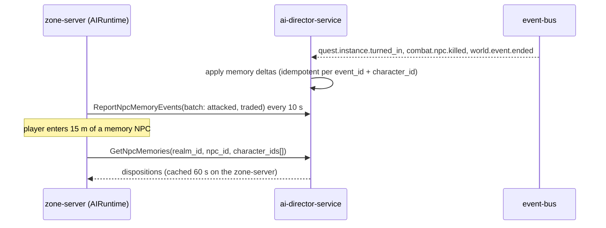

# Legends of the Shattered Frontier — AI: NPC Behavior and Memory

Version 1.0 — Expanded Technical Design Authority edition (2026-10-17)

Status: Design target; not implemented. Names per Shared Registry v1.0.

Back-links: [AI entry](../Legends_Shattered_Frontier_AI_Architecture_v1.0.md) · [Shared Registry](../Legends_Shattered_Frontier_Shared_Registry_v1.0.md)

---

This part defines how every open-world NPC perceives, decides, fights, socializes, follows schedules, flees, leashes and remembers. It is the base layer that the Dungeon spec (Encounters and NPC behavior part, Encounter scripting and NPC behavior models) and the Raid spec (Groups, scaling and encounters part) specialize for instances. When an instance rule and a rule here disagree inside an instance, the instance rule wins; everywhere else this part is authoritative (Registry, Concept ownership: NPC behavior → AI).

Combat owns stats, damage, mitigation and threat generation (Combat spec, NPC Attribute Generation; Threat & Aggro System). World owns spawn tables, population and placement (World spec). This part never changes a number those specs own; it decides *what the NPC does with them*.

## 1. Runtime architecture on zone-server

### 1.1 Components

| Component | Runs in | Responsibility |
| --- | --- | --- |
| `AIRuntime` (subsystem) | zone-server, instance-server (same build) | Owns all NPC brains in the process, the decision scheduler, LOD tiers, budget governor |
| Brain (per `ent_` NPC) | `AIRuntime` | Behavior tree instance + blackboard + utility selectors + working memory |
| Perception service | `AIRuntime` | Sight, hearing, stealth awareness, damage awareness; batched line-of-sight queries |
| Pack coordinator | `AIRuntime` | Shared blackboard for a pack (`pack_id`), slot assignment, assist and call-for-help |
| Navigation adapter | `AIRuntime` → UE navigation | Path requests (time-sliced), crowd avoidance, stuck recovery |
| Director link | zone-server ↔ `ai-director-service` | Receives spawn-pressure and event commands; reports event progress and memory events (World and Director part) |

Brains are memory-only (`WorldEntity` `ent_`, Registry entity registry). Nothing in a brain is durable except the long-term memory deltas described in §9.

### 1.2 Decision tick

All behavior-tree ticks and utility evaluations run on the **decision tick** of 10 Hz (`tune.ai.decision_hz`, default 10), aligned with the Dungeon spec's fixed decision tick. The 30 Hz simulation frame (First MVP milestone, Server simulation budget) executes movement and ability timelines between decision ticks. LOD tiers (§10) reduce the decision rate for NPCs far from players.

### 1.3 NPC AI content block

NPC definitions (`npc/<slug>`) are published by `content-catalog-service`. Combat owns the stat fields; AI owns the `ai` block below. Values are illustrative except where a default is named.

```json
{
  "id": "npc/ash_wolf",
  "npc_tier": "common",
  "level_range": { "min": 18, "max": 22 },
  "faction_id": "faction/wild_beasts",
  "tags": ["beast", "wolf"],
  "ai": {
    "archetype": "beast",
    "behavior_tree": "behavior_tree/beast_pack_hunter",
    "utility_profile_set": "utility_profile/beast_default",
    "aggression": "aggressive",
    "perception": { "fov_deg": 160, "hearing_mult": 1.2 },
    "courage": 0.45,
    "can_flee": true,
    "flee_threshold": 0.20,
    "flee_to_allies": false,
    "leash": { "anchor": "spawn", "radius_m": 60 },
    "social": { "pack_role": "member", "assist": true, "call_for_help_radius_m": 0 },
    "schedule_id": null,
    "memory": false,
    "essential": false
  }
}
```

| Field | Type | Default | Meaning |
| --- | --- | --- | --- |
| `archetype` | `npc_archetype` (registered enum; Shared Registry, Phase-2 enums, §5 union) | — | Default tree, utility profile and combat role |
| `behavior_tree` | `behavior_tree/<slug>` asset | archetype default | Overrides the archetype tree |
| `utility_profile_set` | `utility_profile/<slug>` asset | archetype default | Action and target weights |
| `aggression` | `npc_aggression` (registered enum; Shared Registry, Phase-2 enums): `aggressive`, `defensive`, `passive` | `aggressive` for hostile factions | Whether detection alone starts combat (§3.1) |
| `perception.fov_deg` | int | humanoid 120, beast 160 | Sight cone |
| `perception.hearing_mult` | number | 1.0 | Multiplies noise radii |
| `courage` | 0–1 | 0.5 | Morale base (§7) |
| `can_flee` | bool | true for `common` beasts and humanoids, false otherwise | Allows flee |
| `flee_threshold` | 0–1 | 0.20 | Morale below which the NPC flees |
| `flee_to_allies` | bool | false | Humanoids may flee toward allies and trigger assist |
| `leash` | object | §8 | Anchor kind (`spawn`, `patrol_node`, `volume`) and radius |
| `social.pack_role` | `leader`, `member` | `member` | Pack coordination |
| `social.call_for_help_radius_m` | number | humanoid 20, else 0 | §6.2 |
| `schedule_id` | `schedule/<slug>` asset or null | null | Daily routine (§6.5) |
| `memory` | bool | false | Long-term per-character memory (§9.3) |
| `essential` | bool | false | Cannot be killed (§6.6); the flag the Quest spec cites |

`behavior_tree/`, `utility_profile/` and `schedule/` are registered AI asset kinds shipped inside content packs (Shared Registry, Content definition kinds).

## 2. NPC AI layers in the runtime

The layered model (AI spec, NPC AI layers) maps to code as follows:

```
Brain
 ├─ Perception (sight, hearing, stealth meter, damage events)      → writes blackboard
 ├─ Awareness state machine (§3.2)                                 → selects the active subtree
 ├─ Behavior tree (behavior_tree/<slug>)                                      → structure and priorities
 │    └─ Utility selector nodes (utility_profile/<slug>)                        → choose action / target / position
 ├─ Combat decision layer: ability queue + target scoring (§4)     → issues ability requests to Combat
 └─ Navigation (path, crowd, stuck recovery)                       → movement intents
```

The behavior tree decides *which kind* of thing is relevant (fight, flee, return, follow schedule); utility selectors decide *which specific* action, target or position. Encounter bosses add the Dungeon spec's Encounter Director above the tree.

### 2.1 Behavior tree node set

| Node | Kind | Semantics |
| --- | --- | --- |
| `selector` | composite | Runs children in order until one returns `running` or `success` |
| `sequence` | composite | Runs children in order until one returns `failure` |
| `parallel` | composite | Runs all children; policy `require_one` or `require_all` |
| `utility_select` | composite | Scores child actions with a utility profile (§4.1), runs the best; re-scores on the decision tick if the running child is interruptible |
| `condition` | leaf | Blackboard predicate (e.g. `awareness == engaged`, `hp_frac < 0.3`) |
| `action` | leaf | Primitive: `move_to`, `use_ability`, `play_anim`, `bark`, `wait`, `call_for_help`, `set_bb` |
| `decorator.cooldown` | decorator | Child may run once per `ms` |
| `decorator.timeout` | decorator | Child fails after `ms` |
| `decorator.once_per_engagement` | decorator | Child runs at most once between engage and reset |

Trees are data (`behavior_tree/<slug>` JSON); no tree contains arbitrary script. Dungeon and Raid encounter scripts use the same node set plus their encounter nodes.

```json
{
  "id": "behavior_tree/beast_pack_hunter",
  "root": { "selector": [
    { "sequence": [ { "condition": "awareness == evading" }, { "action": "evade_return" } ] },
    { "sequence": [ { "condition": "awareness == fleeing" }, { "action": "flee_move" } ] },
    { "sequence": [ { "condition": "awareness == engaged" },
                    { "utility_select": { "profile": "utility_profile/beast_default#combat",
                                          "children": ["attack_primary", "flank_reposition", "howl_buff", "flee"] } } ] },
    { "sequence": [ { "condition": "awareness in [suspicious, alert]" }, { "action": "investigate" } ] },
    { "utility_select": { "profile": "utility_profile/beast_default#ambient", "children": ["wander", "rest", "patrol"] } }
  ] }
}
```

## 3. Perception and awareness

### 3.1 Hostility rule

Whether an NPC treats a character as an enemy on detection:

| NPC `aggression` | Character's standing tier with the NPC's faction (`faction_standing_tier`) | Behavior on detection |
| --- | --- | --- |
| `aggressive` | any (factionless monsters) or `hated`, `hostile` | Engage |
| `aggressive` | `unfriendly` | Engage only if the character is within half the aggro radius ("too close") |
| `aggressive` | `neutral` or better | Ignore (non-hostile) |
| `defensive` | any | Engage only after being attacked, or when an ally within assist radius is attacked |
| `passive` | any | Never engages; flees if `can_flee` |

NPC-versus-NPC hostility uses the faction stance from content (Factions part, Faction AI, Diplomacy) and the region's `faction_war_state`: `hostile` stance NPCs engage each other; during `war` in a region, `neutral`-stance NPCs of the two warring factions also engage when within aggro radius.

**Grey rule (open world only).** A `common` NPC does not initiate combat with a character whose level exceeds the NPC's by at least `tune.ai.gray_level_delta` (10). It still defends itself.

### 3.2 Awareness state machine

AI-internal states (not registry enums, not published):



`evading` NPCs are immune and non-targetable (§8.2). `returning` differs from `evading`: the NPC is attackable and keeps no threat; it re-engages if attacked.

### 3.3 Aggro radius

Same base values as the Dungeon spec so trash in open-world dungeons and in instances feels identical.

```text
R_aggro(tier, ΔL) = clamp(R_tier − ΔL, R_MIN, R_tier + R_MAX_BONUS)
ΔL = L_character − L_npc        (positive: character is higher level)
```

| Symbol | Default | Tuning key |
| --- | --- | --- |
| `R_tier` | `common` 12 m, `elite` 15 m, `mini_boss` 18 m, `world_boss` 0 (script or arena trigger only) | `tune.ai.aggro_radius_<npc_tier>` |
| `R_MIN` | 4 m | `tune.ai.aggro_radius_min` |
| `R_MAX_BONUS` | 6 m | `tune.ai.aggro_radius_max_bonus` |

Examples: common NPC level 20, character level 23 → `R = clamp(12 − 3, 4, 18) = 9 m`; character level 14 → `clamp(12 + 6, 4, 18) = 18 m`; `mini_boss` against a character 2 levels higher → 16 m. Inside instances the Dungeon spec's `tune.dungeon.aggro_radius_<tier>` keys apply instead (identical defaults; `mini_boss` keeps no level slope there).

### 3.4 Sight

A character is **visible** to an NPC when all hold:

1. Distance `d ≤ R_aggro` (non-stealthed) or `d ≤ R_det` (stealthed, §3.6).
2. Inside the field of view: angle between the NPC's facing and the direction to the target ≤ `fov_deg / 2`, **or** `d ≤ R_PROXIMITY` (1.5 m, `tune.ai.proximity_radius_m`) regardless of facing.
3. Line of sight: a ray from the NPC's eye socket to the target's head or chest socket is unobstructed (two rays; either suffices). Results are cached for 200 ms per pair.

A visible, hostile (§3.1), non-stealthed character is detected immediately and the NPC moves to `engaged`. Damage taken always detects the source, regardless of sight.

### 3.5 Hearing

Noise events have a radius; an NPC hears a noise when `d ≤ radius × hearing_mult`.

| Source | Radius | Key |
| --- | --- | --- |
| Walk | 3 m | `tune.ai.noise_walk_m` |
| Run | 6 m | `tune.ai.noise_run_m` |
| Sprint | 10 m | `tune.ai.noise_sprint_m` |
| Mounted | 12 m | `tune.ai.noise_mounted_m` |
| Crouch, swim | 0 | — |
| Ability cast or weapon hit | 20 m | `tune.ai.noise_combat_m` |
| Ability flagged `loud` (explosions) | 30 m | `tune.ai.noise_loud_m` |

Movement modes use the registry `movement_mode` enum. Hearing moves an `idle` NPC to `suspicious` (turn and investigate the noise position). Hearing alone never engages, except combat noise from a fight involving an ally within assist radius (that is an assist, §6.1).

### 3.6 Stealth detection

The Dungeon spec cites this rule as AI-owned. A character in a stealth state (ability-granted; skill `stealth`) is detected through an awareness meter `a ∈ [0, 1]` per (NPC, character).

```text
R_det  = R_aggro × (1 − s / STEALTH_DIVISOR) × tier_mult × m_still × m_light
v      = 1 − d / R_det                      (only when d ≤ R_det, in FOV and in LOS; else v = 0)
a(t+Δ) = min(1, a + Δ × v / T_DETECT)       when v > 0
a(t+Δ) = max(0, a − Δ × A_DECAY)            when v = 0
```

| Symbol | Default | Tuning key | Meaning |
| --- | --- | --- | --- |
| `s` | character's `stealth` skill value 0–1000 | — | progression-service value cached on the zone-server |
| `STEALTH_DIVISOR` | 1500 | `tune.ai.stealth_divisor` | At skill 1000 the radius is one third |
| `tier_mult` | `common` 1.0, `elite` 1.2, `mini_boss` 1.5, `world_boss` 1.5 | `tune.ai.stealth_tier_mult_<npc_tier>` | Matches the Dungeon table |
| `m_still` | 0.7 when the character has not moved for ≥ 1 s, else 1.0 | `tune.ai.stealth_still_mult` | |
| `m_light` | 0.8 (dark volume) – 1.2 (bright volume), default 1.0 | content light volumes | |
| `T_DETECT` | 2.0 s | `tune.ai.stealth_detect_time_s` | Time to full awareness at `v = 1` |
| `A_DECAY` | 0.25 per s | `tune.ai.stealth_meter_decay` | |

Thresholds: `a ≥ 0.5` → `suspicious` (the NPC turns toward the character and investigates); `a ≥ 1.0` → detected (engage if hostile). `d ≤ R_PROXIMITY` detects instantly. Attacking from stealth always detects.

Worked example: equal level, common NPC, `R_aggro = 12 m`, stealth 600. `R_det = 12 × (1 − 0.4) = 7.2 m`. Moving character at 4 m: `v = 1 − 4/7.2 = 0.444`, so `a` rises 0.222/s and detection takes 4.5 s (suspicious after 2.25 s). Standing still at 4 m: `R_det = 5.04 m`, `v = 0.206`, 9.7 s to detect. At 600 skill against an elite: `R_det = 8.64 m` moving.

### 3.7 Investigation and search

`suspicious`: walk to the stimulus position (noise origin or last seen position), look around for 3 s. `alert`: move to the last known position, then sample up to 3 random navmesh points within 10 m and visit them, total 8 s (`tune.ai.search_duration_s`). Perception keeps running; any detection moves the NPC to `engaged`.

## 4. Utility AI

The Raid spec cites this section for target selection (AI spec, Utility AI). Two scoring forms exist: **action scoring** (multiplicative, with veto) and **target scoring** (additive, the Dungeon form). Both are deterministic for the same inputs and seed.

### 4.1 Action scoring

For a `utility_select` node with candidate actions `a`:

```text
U(a) = w_a × G(a) × (1 + μ × [a is the running action]) + ε
G(a) = ( Π_{k=1..K_a} c_k(a) )^(1 / K_a)       (geometric mean of considerations; any c_k = 0 → G = 0, a veto)
c_k  = curve_k( normalize_k(input_k) )          ∈ [0, 1]
```

| Symbol | Default | Tuning key | Meaning |
| --- | --- | --- | --- |
| `w_a` | profile value (typ. 0.5–1.5) | content (`utility_profile/<slug>`) | Action weight |
| `μ` | 0.25 | `tune.ai.utility_momentum` | Hysteresis: a running action keeps a 25 % bonus so NPCs do not dither |
| `ε` | `[0, 0.001)` | — | Tie-break from the brain's deterministic stream `hash(srvi_id, ent_id, decision_tick, "utility")` |
| `K_a` | number of considerations of the action | — | The geometric mean keeps actions with many considerations comparable to actions with few |

The action with the highest `U` runs. Re-scoring happens on the decision tick only when the running action is complete or flagged `interruptible`. An action whose `U` is below `U_MIN` (0.05, `tune.ai.utility_min`) never runs; if all actions are below it the node fails and the tree falls through.

**Normalization.** Each input has `min` and `max` in the profile: `x = clamp((input − min) / (max − min), 0, 1)`.

**Response curves** (all clamp output to `[0, 1]`):

| Curve | Formula | Parameters |
| --- | --- | --- |
| `linear` | `y = m × (x − c) + b` | `m`, `c`, `b` |
| `poly` | `y = m × (x − c)^k + b` | `m`, `c`, `k`, `b` |
| `logistic` | `y = k / (1 + e^(−m × (x − c))) + b` | `m` (steepness), `c` (midpoint), `k`, `b` |
| `inverse` | `y = 1 − x` | — |
| `step` | `y = (x ≥ c) ? 1 : 0` | `c` |
| `bool` | `y = input ? 1 : 0` | — |

### 4.2 Consideration inputs

| Input | Definition | Typical curve |
| --- | --- | --- |
| `self_hp_frac` | own health fraction | `inverse` for defensive actions |
| `self_resource_frac` | own mana/stamina fraction (Combat spec resources) | `linear` |
| `target_hp_frac` | current target's health fraction | `inverse` for finishers |
| `target_distance_m` | distance to current target | `logistic` (close → high) or its inverse |
| `ability_ready` | ability off cooldown and affordable | `bool` |
| `in_range` | target within the ability's range | `bool` (veto) |
| `threat_on_self` | top threat on this NPC's table / own max health | `linear` |
| `allies_nearby` | same-pack NPCs alive within 15 m / pack size | `linear` |
| `ally_lowest_hp_frac` | lowest health fraction among pack members within heal range | `inverse` |
| `morale` | `M` from §7 | `step` / `logistic` |
| `time_since_last_use_s` | seconds since this action last ran | `logistic` (encourages variety) |
| `path_clear` | navigation query succeeded within budget | `bool` |
| `schedule_match` | 1 if the action matches the current schedule activity | `bool` |

### 4.3 Target scoring

Default melee target selection is **threat-based** (Combat spec, Threat & Aggro System). An NPC changes its melee target only when a challenger's threat exceeds the current target's by 110 % in melee range (≤ 5 m) or 130 % otherwise (`tune.ai.threat_switch_melee` 1.10, `tune.ai.threat_switch_ranged` 1.30; the Dungeon spec's `tune.dungeon.threat_switch_*` keys override inside instances with the same defaults). Taunt follows Combat.

Abilities with `target: "utility:<profile>"` score every valid candidate `p`:

```text
U(p) = Σ_k w_k × f_k(p) + ε
```

This is the Dungeon spec's formula; the feature catalog below is the canonical superset (Dungeon's eight features keep their exact definitions):

| Feature `f_k` | Definition (0–1) | Source |
| --- | --- | --- |
| `threat_rank` | `1 − rank / (n − 1)`; rank 0 = top threat (`n = 1` → 1) | Dungeon |
| `distance_far` | `min(1, dist / 40 m)` | Dungeon |
| `distance_near` | `1 − distance_far` | Dungeon |
| `observed_healer` | share of the group's healing done by `p` in the last 15 s | Dungeon |
| `observed_damage` | share of damage done by `p` in the last 15 s | Dungeon |
| `low_health` | `1 − health_pct(p)` | Dungeon |
| `recently_targeted` | 1 if `p` was this ability's target within its last 2 uses | Dungeon |
| `in_los` | 1 if in line of sight (hard filter when the ability needs LoS) | Dungeon |
| `observed_tank` | share of this NPC's incoming melee hits absorbed by `p` in the last 15 s | AI |
| `debuffed` | 1 if `p` carries a debuff applied by this NPC's faction | AI (Raid "debuff state") |
| `is_attacker` | 1 if `p` has non-zero threat on this NPC | AI |
| `standing_hated` | 1 if `p`'s standing tier with this NPC's faction is `hated` | AI |

Hard filters before scoring: target validity per Security (Threat model and server authority, Combat validation: `combat_target`), range, LoS when required, not `evading`/untargetable. Fairness caps apply in the open world exactly as in the Dungeon spec: no player is the target of more than 3 consecutive utility-targeted abilities from the same NPC, and `execute`-style profiles skip targets that received a targeted ability in the last 3 s. Role-aware targeting uses **observed** behavior, never declared `combat_role` (Registry glossary, Combat Role).

### 4.4 Worked example (action scoring)

A `caster` NPC (current action `cast_primary` just completed, so no momentum) has 60 % health, 80 % mana; its target has closed to 4 m. Profile `utility_profile/caster_default#combat`:

| Action | `w_a` | Considerations (values) | `G` | `U` |
| --- | --- | --- | --- | --- |
| `cast_primary` | 1.0 | `ability_ready` 1, `in_range` 1, `self_resource_frac` linear 0.8, `not_in_melee` = linear `d / 8` → 0.5 | `(1 × 1 × 0.8 × 0.5)^(1/4) = 0.795` | 0.795 |
| `kite_back` | 1.1 | `target_close` logistic `m = 1, c = 8` on `d` reversed → `1 / (1 + e^(−(8−4))) = 0.982`, `path_clear` 1, `ability_ready(blink_back)` 1 | `(0.982)^(1/3) = 0.994` | 1.093 |
| `melee_fallback` | 0.6 | `in_range(melee)` 0 | 0 (veto) | 0 |
| `flee` | 1.0 | `morale` step at `flee_threshold` 0.2 with `M = 0.55` → 0 | 0 (veto) | 0 |

`kite_back` runs. Next decision tick after the blink, the target is 14 m away: `not_in_melee` = 1, `target_close` = 0.0025, so `cast_primary` (`U = 0.946`) wins over `kite_back` (`U = 1.1 × 0.0025^(1/3) = 0.150`).

## 5. Combat roles (NPC archetypes)

Registry enum `npc_archetype` (merged 2026-10-17; attribute weights: Character spec, NPC parity: NPC progression templates; damage coefficients: Combat spec, NPC Attribute Generation). `brute`, `caster`, `skirmisher`, `guardian`, `shaman`, `healer`, `beast` and `commander` keep the Dungeon and Character behavior; `champion`, `guard` and `civilian` are open-world additions.

| `npc_archetype` | Typical tier | Preferred range | Default tree | Combat role behavior |
| --- | --- | --- | --- | --- |
| `brute` | common | melee | `behavior_tree/melee_threat_top` | Melee on threat top; occasional frontal cleave (Dungeon values) |
| `caster` | common | 20–30 m | `behavior_tree/caster_kite` | Keeps range; interruptible cast every 6–8 s; blinks away when a target is within 6 m (cooldown 15 s) |
| `skirmisher` | common | mixed | `behavior_tree/skirmisher_harass` | Leaps to far targets every 12 s (`ranged_preference`) |
| `guardian` | elite | melee | `behavior_tree/guardian_shield` | Shields allies, protects casters; body-blocks the path to the pack's casters |
| `shaman` | elite | 15–25 m | `behavior_tree/shaman_support` | Heals pack 15 % every 10 s, hex via `disrupt_healer` (≤ once per 20 s) |
| `healer` | elite | 15–25 m | `behavior_tree/shaman_support` | Same tree as `shaman` without the hex; heals the most-damaged ally |
| `champion` | mini_boss | melee | encounter framework | Uses the Dungeon encounter framework (`kind: mini_boss`) |
| `beast` | common/elite | melee | `behavior_tree/beast_pack_hunter` | Pack hunting: flanking slots, howl buff, flees at low morale |
| `guard` | elite | melee/ranged | `behavior_tree/guard_post` | Defends settlement volume, protects civilians, punishes offenders (§6.3) |
| `civilian` | common | — | `behavior_tree/civilian_routine` | Schedule-driven; cowers or flees from combat; vendors and quest givers are civilians |
| `commander` | elite/mini_boss | 10–20 m | `behavior_tree/commander_rally` | Leader of invasion waves: rally buff, calls reinforcements (World and Director part), pack leader for morale (§7) |

### 5.1 Pack positioning

A pack coordinator assigns **slots** around the shared target for melee members so packs surround rather than stack:

```text
θ_i = θ_0 + (i − (n − 1)/2) × SLOT_SPACING        i = 0..n−1, n = melee members engaged on that target
slot_i = target_pos + r × (cos θ_i, sin θ_i),     r = target_radius + 1.0 m
```

`θ_0` is the bearing from the target to the pack centroid; `SLOT_SPACING` 50° (`tune.ai.pack_slot_spacing_deg`). Beasts take the outer slots first (flanking). Slots are recomputed at 2 Hz; a member more than 2 m from its slot repositions only if the move costs ≤ 1 s.

### 5.2 Ability use

NPC abilities come from Combat definitions. Ability choice is either a behavior-tree priority list (bosses, scripted trash) or a `utility_select` (default for open-world NPCs). An NPC never uses an ability the Combat spec's validation would reject for a player in the same state (range, LoS, cooldown, resource), so server validation is symmetric.

## 6. Social behavior

### 6.1 Assist

An engaged NPC that has survived at least 2 s pulls the pack of any non-engaged, non-`passive` NPC of the same faction within the assist radius: 8 m for `common`, 10 m for `elite` (`tune.ai.assist_radius_<npc_tier>`). This is the Dungeon spec's rule applied to the open world. Patrol packs link only when the patrol is within the stationary pack's aggro radius of a player at engage time.

### 6.2 Call for help

Humanoid NPCs with `call_for_help_radius_m > 0` (default 20 m) call for help once per engagement when `self_hp_frac < 0.5` or morale `M < 0.4`. Up to `tune.ai.call_for_help_max_responders` (4) same-faction NPCs within the radius, nearest first, that are `idle` or `suspicious` and not `passive`, move to engage. Responders never leave their own leash (§8).

### 6.3 Guards and offenders

Guards (`archetype = guard`) hold a settlement or post volume.

| Trigger | Guard reaction |
| --- | --- |
| A hostile NPC engages anyone within `tune.ai.guard_response_radius_m` (40 m) of the guard | Engage the NPC |
| A character attacks a civilian or guard of the guard's faction (or of an `allied` faction) | The character becomes an **offender** in that zone for `tune.ai.guard_grudge_s` (600 s); guards engage offenders on sight |
| A character's standing tier with the guard's faction is `hated` or `hostile` | Engage on detection (hostility rule §3.1) |
| A hostile NPC is dragged into a `safe_zone` volume (not event-owned) | That NPC evades (§8); guards engage it until it leaves |

Offender lists are zone-server memory (§9.2), not durable. PvP flagging rules (who may attack whom) belong to Security and Combat; guards only react.

### 6.4 Civilians: cower and flee

A civilian within 15 m (`tune.ai.civilian_panic_radius_m`) of combat moves to the nearest authored `safe_spot` within 40 m, or cowers in place if none exists. It returns to its schedule after 20 s without combat nearby (`tune.ai.civilian_calm_s`). Quest givers follow their quest binding's `when_unavailable = flee` policy (Quest spec, Quest-giver NPC behaviour): the AI moves the NPC to its `safe_spot`, and the zone-server reports it as unavailable until the region calms or the NPC respawns.

### 6.5 Schedules

Schedules (`schedule/<slug>`) are lists of blocks on the world clock (World spec, World clock):

```json
{
  "id": "schedule/greenhold_smith",
  "blocks": [
    { "from": "06:00", "to": "12:00", "activity": "work", "location": "poi/greenhold_forge", "post": true },
    { "from": "12:00", "to": "13:00", "activity": "eat",  "location": "poi/greenhold_tavern" },
    { "from": "13:00", "to": "21:00", "activity": "work", "location": "poi/greenhold_forge", "post": true },
    { "from": "21:00", "to": "06:00", "activity": "sleep", "location": "poi/greenhold_smith_house" }
  ]
}
```

Activities: `work`, `eat`, `sleep`, `patrol`, `wander`, `post` (stand at a fixed spot), `vendor_open`. The current block's activity gets `schedule_match = 1` in the ambient utility profile; perception and combat preempt it through the tree. Travel between blocks uses navigation; NPCs in LOD L3/L4 (§10) move **virtually** (position interpolated along the cached path by elapsed time) and snap into place when a player approaches.

**Validator rule (AI-owned content check).** For every quest giver binding with an `availability.schedule` (Quest spec), the NPC's schedule must place it at a `post: true` block covering every availability window. Mismatches fail content publication.

### 6.6 Essential NPCs

`essential: true` NPCs are non-attackable by characters (target validity rejects them) and take no damage from area effects. Hostile NPCs do not target them. During invasions they move to their `safe_spot`. Content validation forbids `essential` NPCs as event objectives, escort targets or kill targets (consistent with the Quest spec, Generation constraints).

## 7. Morale and flee

```text
M = clamp( courage + 0.5 × (h − 0.5) + 0.3 × (a − 1) + 0.15 × o − 0.25 × ℓ , 0, 1 )
h = self_hp_frac
a = allies_alive / allies_at_engage        (pack members including self)
o = clamp( (allies_engaged − hostiles_engaged) / max(1, hostiles_engaged), −1, 1 )
ℓ = 1 if the pack leader (pack_role = leader, or a commander) died this engagement, else 0
```

| Constant | Default | Tuning key |
| --- | --- | --- |
| HP weight | 0.5 | `tune.ai.morale_hp_weight` |
| Ally-loss weight | 0.3 | `tune.ai.morale_ally_weight` |
| Outnumber weight | 0.15 | `tune.ai.morale_outnumber_weight` |
| Leader-loss penalty | 0.25 | `tune.ai.morale_leader_penalty` |
| Flee duration | 6 s | `tune.ai.flee_duration_s` |
| Flee distance | 20 m | `tune.ai.flee_distance_m` |

Flee rules:

1. Only when `can_flee`, `M < flee_threshold`, and the NPC has not fled this engagement. Never for `elite` and higher tiers unless content opts in, never inside encounter arenas, never for event-owned NPCs marked `hold_ground`.
2. Destination: the reachable navmesh point up to 20 m away, maximizing distance from the hostile centroid; with `flee_to_allies`, the nearest same-faction NPC within 40 m instead, where the arrival triggers an assist (§6.1).
3. The flee path is clipped to the leash radius; fleeing never causes an evade by itself.
4. A fleeing NPC keeps its threat table, moves at normal run speed, and can be attacked.
5. After the flee ends the NPC re-engages ("cornered"); it does not flee again.

Worked examples (wolf, `courage = 0.45`):

- Pack of 3, leader dead, one wolf left at 25 % health, fighting 2 characters: `h = 0.25`, `a = 1/3`, `o = (1 − 2)/2 = −0.5`, `ℓ = 1`. `M = 0.45 − 0.125 − 0.2 − 0.075 − 0.25 = −0.2 → 0` → flees.
- Same wolf, full pack alive, 60 % health, 3 wolves against 1 character: `o = 1`, so `M = 0.45 + 0.05 + 0 + 0.15 − 0 = 0.65` → fights.

## 8. Leashing and evade

### 8.1 Open-world leash rules

| NPC kind | Anchor | Radius | Additional evade trigger |
| --- | --- | --- | --- |
| `common`, `elite` | Spawn point (patrols: nearest path node at engage) | 60 m (`tune.ai.leash_radius_common`, `tune.ai.leash_radius_elite`) | No damage dealt or taken for 10 s while the target is unreachable (`tune.ai.unreachable_evade_s`) |
| `mini_boss` (open world) | Spawn point | 40 m (`tune.ai.leash_radius_mini_boss`) | Same, 6 s |
| `world_boss` | Authored arena volume | volume | Leaving the volume evades; the world event's encounter attempt ends (World and Director part) |
| Event-owned NPCs (invasion waves) | Event area volume | volume | Never evade inside `safe_zone` volumes while the event is active |
| Any hostile NPC not event-owned | — | — | Entering a `safe_zone` volume evades immediately |

Inside instances the Dungeon spec's leash table applies.

### 8.2 Evade behavior

Identical to the Dungeon spec: drop the threat table, become immune and non-targetable, run back at 1.5× speed, regenerate to full health on arrival, restore authored position and facing. An evade during a world-boss attempt resets the encounter and the attempt ends `wiped` (players alive) per the encounter framework.

### 8.3 Leash abuse signal

≥ 3 evades of the same NPC or pack within 120 s whose threat tables had the same top character produce a `leash_abuse` signal to `anticheat-service` (same signal as the Dungeon spec; Security spec, Detection risk and enforcement part, owns the detector). Training NPCs onto other players is covered by the same signal plus `safe_zone` evade.

## 9. NPC memory

Three tiers, from cheapest to durable. The "AI Memory" section of the entry file covers region and world memory held by the director.

### 9.1 Working memory (per brain, memory only)

| Item | Retention | Used by |
| --- | --- | --- |
| Threat table | Engagement | Combat target selection |
| Last known position per perceived actor | 8 s | Search, LoS loss handling |
| Recent attackers | 60 s after reset | A recent attacker seen again gets initial threat 1 and is engaged on sight even if `defensive` |
| Combat history window (damage, heals, hits absorbed per actor) | 15 s rolling | `observed_*` target features |
| Ability and action history | Engagement | Momentum, `time_since_last_use_s`, fairness caps |

### 9.2 Zone memory (per zone-server, memory only)

| Item | Retention | Used by |
| --- | --- | --- |
| Offender list (character, faction, expires_at) | `tune.ai.guard_grudge_s` (600 s) | Guards (§6.3) |
| Danger markers (positions where combat occurred) | 120 s | Civilian path costs (avoid), schedule detours |
| Noise events | 1 s | Hearing |

Zone memory is lost when a zone-server restarts; that is acceptable because it only drives short-term reactions. Offender entries travel with the character on zone handoff as part of the handoff payload's `ai_flags` (cross-spec request to World, entry file Registry additions).

### 9.3 Long-term memory (durable, `ai-director-service`)

Only NPC definitions with `memory: true` (named NPCs, quest givers, vendors, faction leaders) remember characters. Memory is **flavor and social context only**: it never gates rewards, prices, quest availability or combat hostility, which belong to faction standing, quest state and economy rules.

Record per `(realm_id, npc_id, character_id)`:

| Field | Meaning |
| --- | --- |
| `disposition` | `d ∈ [−100, 100]` |
| `interactions` | Counter of memory events |
| `last_event_kind` | Last `npc_memory_event_kind` |
| `last_seen_at` | Last interaction time |

Memory events (proposed internal enum `npc_memory_event_kind`) and their disposition deltas:

| Kind | Source | Δd | Key |
| --- | --- | --- | --- |
| `quest_turned_in` | `quest.instance.turned_in` where the turn-in NPC is this NPC | +5 | `tune.ai.memory_delta_quest` |
| `helped_defend` | `world.event.ended` outcome `resolved` where the event lists this NPC as `protected_npc_ids` and the character is an eligible participant | +8 | `tune.ai.memory_delta_defend` |
| `traded` | Vendor purchase reported by zone-server | +1 (max +5 per day) | `tune.ai.memory_delta_trade` |
| `attacked` | zone-server: character damaged this NPC | −15 | `tune.ai.memory_delta_attacked` |
| `killed` | `combat.npc.killed` with `npc_definition_id` = this NPC: `killing_character_id` −40, other credited characters −10 | −40 / −10 | `tune.ai.memory_delta_killed` |

Decay toward zero, computed lazily on read and on write:

```text
d(t) = clamp(d_0 × 2^(−(t − t_0) / HALF_LIFE) + Δd, −100, 100)
HALF_LIFE = 14 days (tune.ai.memory_half_life_days)
```

Example: a character killed a named NPC (`d = −40`) 14 days ago and now turns in a quest to it: `d = −40 × 0.5 + 5 = −15`.

Effects: bark and greeting selection (`d ≥ 50` warm, `20 ≤ d < 50` friendly, `−20 < d < 20` neutral, `d ≤ −20` wary, `d ≤ −50` hostile bark), and optional dialog variants. Rows with `|d| < 1` and `last_seen_at` older than 90 days are purged (`tune.ai.memory_purge_days`).

Data flow:



Schema: `director.npc_memories` (World Director and Dynamic Events part, Data model). Privacy: `character_id` makes these rows `p1_pseudonymous`. `ai-director-service` implements `PrivacyParticipant.ExportSubject` and `PrivacyParticipant.EraseSubject` (Registry RPC table; Backend spec, Account deletion and privacy request workflow) and deletes the subject's rows in phase 2.

## 10. AI scaling and tick budgets (zone-server)

### 10.1 LOD tiers

Distances use the nearest player; cell distance uses `CELL_SIZE_M` 64 m (Registry constants).

| LOD | Condition | Decision rate | Perception | Movement |
| --- | --- | --- | --- | --- |
| L0 engaged | `engaged`, `fleeing`, `evading`, or event-owned and active | 10 Hz | full, 10 Hz | full navigation and crowd |
| L1 aware | player within 60 m, or `suspicious`/`alert` | 5 Hz | full, 5 Hz | full |
| L2 near | player within the NPC's cell or the 8 neighbors | 1 Hz | sight only when a player is within `R_aggro + 5 m`; no hearing | full, no crowd avoidance |
| L3 far | player within the 5 × 5 cell block | 0.2 Hz | none | virtual (path interpolation) |
| L4 dormant | no player within the 5 × 5 cell block | 0 | none | none; state advanced analytically on wake (schedule block, regen to full) |

Promotion is immediate on any trigger (damage, assist call, player entering range); demotion waits 5 s (`tune.ai.lod_demote_delay_s`) to avoid thrash.

### 10.2 Budgets

| Budget | Default | Tuning key | Measured as |
| --- | --- | --- | --- |
| AI share of the 33.3 ms simulation frame | ≤ 6.0 ms p95 | `tune.ai.frame_budget_ms` | `AIRuntime` frame time |
| Behavior tree tick per NPC | ≤ 20 µs mean | — | profiler |
| Utility evaluation per `utility_select` | ≤ 30 µs mean (≤ 8 candidates × ≤ 6 considerations) | — | profiler |
| Line-of-sight rays per frame | ≤ 400 | `tune.ai.los_rays_per_frame` | queue length |
| Path requests started per frame | ≤ 64 (time-sliced) | `tune.ai.path_requests_per_frame` | queue length |
| NPCs at L0 + L1 per zone | design target ≤ 600 at 250 players (`tune.world.zone_capacity_hard`) | — | `ops.zone.load_sampled` |
| Total NPC brains per zone | design target ≤ 4,000 | — | spawn tables (World) |

**Budget governor.** When AI frame time exceeds the budget for 30 consecutive frames, the governor shrinks the L1/L2 promotion distances by 20 % steps (minimum 50 % of default) and restores them in 10 % steps after 300 frames under 80 % of budget. L0 NPCs are never degraded, so combat quality does not drop under load. Governor steps are reported in `ops.server.tick_sampled` (cross-spec request to Analytics: fields `ai_frame_ms_p95`, `npc_count_by_lod`, `ai_governor_step`).

### 10.3 Navigation

UE navmesh with crowd avoidance for L0/L1. Stuck detection: no progress for 3 s → repath; 3 consecutive failures → if no player within 50 m, teleport to the last valid path node (a server-internal move that issues a teleport token with cause `unstuck`, World spec, Teleport tokens); otherwise evade (§8).

## 11. Determinism and testing hooks

Each brain draws randomness from named streams seeded by `hash(srvi_id, ent_id, stream_name)` (`utility`, `target`, `schedule`, `bark`). Open-world determinism is for replay debugging only; the Dungeon spec's stricter decision-layer determinism applies inside instances. A decision log (ring buffer, last 30 s per NPC: tick, chosen action, top-3 utilities) is dumpable by GM tools (Game Master Architecture, NPC interaction: inspect NPC state).

## 12. GM adjustments

Per the Game Master Architecture, GMs never write raw behavior values. Allowed requests, validated by `AIRuntime`: switch an NPC to another **approved** utility profile or behavior tree from its definition's `gm_variants` list; force a state (`returning`, `evading`, `idle`); toggle `essential` for 60 minutes; temporary multipliers 0.5–2.0 on aggro radius or courage for at most 60 minutes. Each request carries the GM audit reference and expires automatically.

## 13. Balancing targets (NPC behavior)

| Target | Value | Measured by |
| --- | --- | --- |
| Open-world NPC evade rate per engagement | < 3 % | `m_npc_evade_rate` |
| Flee rate per engagement of flee-capable NPCs | 5–15 % | `m_npc_flee_rate` |
| Time to detect a moving stealth-600 character at 4 m (common, equal level) | 4.5 s (§3.6) | stealth test fixture |
| Accidental adds from assist per pull (open world) | ≤ 0.5 NPC median | `m_npc_assist_adds_per_pull` |
| AI frame time | ≤ 6 ms p95 at 250 players | `m_npc_ai_frame_ms_p95` |
| Leash abuse signals per 1,000 player-hours | < 2 | Security dashboards |
