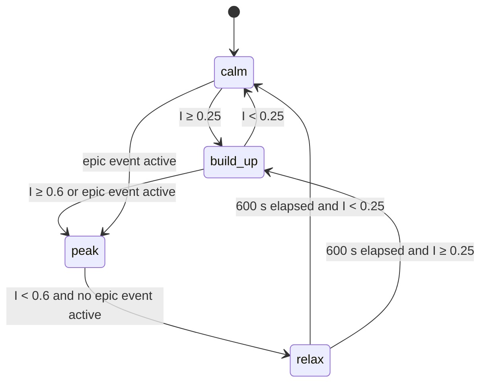
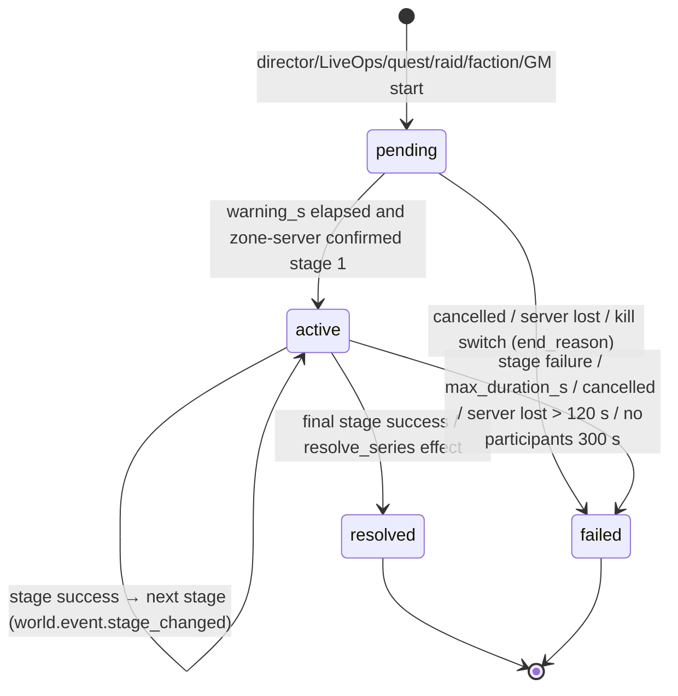
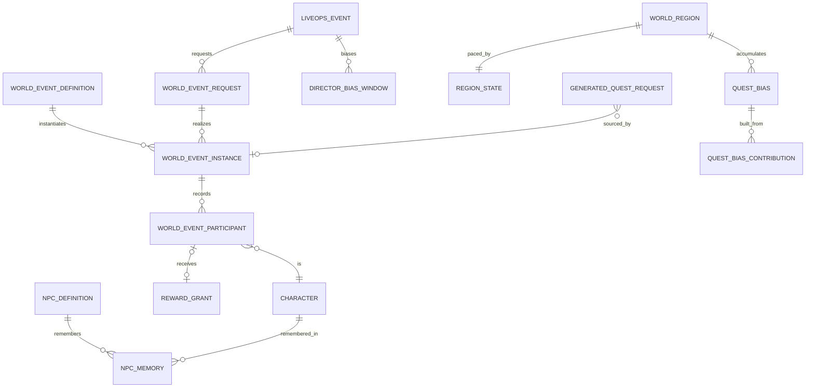

# Legends of the Shattered Frontier — AI: World Director and Dynamic Events

Version 1.0 — Expanded Technical Design Authority edition (2026-10-17)

Status: Design target; not implemented. Names per Shared Registry v1.0.

Back-links: [AI entry](../Legends_Shattered_Frontier_AI_Architecture_v1.0.md) · [Shared Registry](../Legends_Shattered_Frontier_Shared_Registry_v1.0.md)

---

`ai-director-service` is the realm's strategic AI. It reads world state, decides *when, where and which* world events run, sets spawn pressure, runs faction strategy (Factions part, Faction AI), asks quest-service for generated quests, and remembers what happened. It owns `WorldEventInstance` (`wev_`) and publishes `world.event.*`. zone-servers execute event stages and spawns under World's population rules; quest-service owns quest generation and text; LiveOps may request or bias events but never runs them (LiveOps spec, Interplay with ai-director-service).

## 1. Service architecture

| Item | Value |
| --- | --- |
| Service | `ai-director-service` (stateful) |
| gRPC package | `lsf.ai_director_service.v1` |
| Database schema | `director` (PostgreSQL), per realm database |
| Topology | One active leader per realm (lease in PostgreSQL advisory lock, renewed every 5 s, expiry 15 s); hot standby replicas |
| Tick | Region tick every `tune.director.tick_s` (30 s); faction strategic tick every 300 s |
| Publishes | `world.event.started`, `world.event.stage_changed`, `world.event.ended` (topic `domain.world`, key `world_event_instance_id`); registered telemetry `world.director.decided` (Shared Registry, World / faction events) |
| Consumes | `faction.control.changed`, `combat.npc.killed`, `quest.instance.turned_in`, `quest.campaign.stage_reached`, `raid.world_effect.applied`, `world.server.lost`, `liveops.event.ended`, `config.tuning.published`, `config.flag.changed`, content packs (`world_event/*`, `npc/*`, `faction/*`, `world_region/*`) |
| Calls | quest-service `ProposeGeneratedQuests`, `InvalidateSource`; faction-service `GetControl`, `AddControlInfluence`, `AdjustStanding`; reward-service `IssueGrant`; world-service `GetWorldClock`, `GetServer` |

Call graph: entry file, Architecture and service ownership.

**Recovery.** At the end of every region tick the leader writes `director.region_state` (intensity, phase, budget window, cooldown clocks). A new leader loads region state and all non-terminal `world_event_instances`, then waits for zone-servers to reconnect their `ZoneLink` streams (≤ 30 s) before ticking. Ticks missed during failover are not replayed; intensity decays as if time passed.

## 2. Region inputs

zone-servers send a `RegionSample` per (zone, region) every tick over `ZoneLink`:

| Field | Meaning |
| --- | --- |
| `players` | Characters in the region now |
| `players_in_combat` | Characters in combat during the last 30 s |
| `deaths` | Character deaths in the last 30 s |
| `level_histogram` | Counts per progression band |
| `kills_by_tag` | NPC kills by NPC tag in the last 30 s |
| `spawn_points_by_tag` | Live spawn points by tag (from World's spawn tables) |
| `active_npcs` | NPC brains in L0–L2 |

Derived per region `r` (all over the samples of the last 15 minutes unless stated):

```text
P_r            = mean(players)                                     (15-min average)
q_combat       = Σ players_in_combat / max(1, Σ players)            (last tick)
death_rate     = deaths per player-hour (15-min window)
k_r(tag)       = kills per spawn point per hour for tag (15-min window)
level_band_r   = 10th and 90th percentile of character level
s_r(resource)  = scarcity_index from World's regeneration projection (0–2)
```

## 3. Pacing model

### 3.1 Intensity

```text
X_r = clamp( 0.5 × q_combat + 0.3 × min(1, death_rate / DEATH_REF) + 0.2 × E_major, 0, 1 )
α   = 1 − e^(−Δt / τ_I)
I_r ← I_r × (1 − α) + α × X_r
```

| Symbol | Default | Tuning key |
| --- | --- | --- |
| `E_major` | 1 if a `major` or `epic` event is active in `r`, else 0 | — |
| `DEATH_REF` | 6 deaths per player-hour | `tune.director.death_ref_per_hour` |
| `τ_I` | 600 s | `tune.director.intensity_tau_s` |
| `Δt` | tick length, 30 s → `α = 0.0488` | `tune.director.tick_s` |

### 3.2 Phases

Phases are director-internal (not registry enums); they appear in telemetry only.



| Phase | Start rate `λ` | Phase fit `minor` / `major` / `epic` | Spawn-pressure term `b_phase` |
| --- | --- | --- | --- |
| `calm` | 1 / 600 s | 0.6 / 1.0 / 1.0 | 0 |
| `build_up` | 1 / 900 s | 1.0 / 0.7 / 0.3 | +0.1 |
| `peak` | 0 | 0 / 0 / 0 | 0 |
| `relax` | 0 | 0 / 0 / 0 | −0.2 |

Keys: `tune.director.start_rate_<phase>_s`, `tune.director.phase_fit_<phase>`, `tune.director.relax_min_s` (600). Forced starts (§5.4, §6.3) ignore phase.

Per tick, if the region is eligible to start an event (budget, concurrency, `P_r ≥ P_MIN`), the director rolls `p_start = 1 − e^(−λ × Δt)` with the region's deterministic stream (`hash(realm_id, world_region_id, tick_seq)`). In `calm` that is 4.9 % per tick, a mean wait of 10 minutes.

`P_MIN` = 3 players (`tune.director.region_min_players`): emptier regions get no director-initiated events (LiveOps and quest-triggered starts still apply when they name the region).

### 3.3 Event budget and concurrency

```text
B_r = clamp( B_BASE + P_r / B_PER_PLAYERS, B_MIN, B_MAX )     event points per rolling 60 minutes
can_start(e, r) ⇔ spent_r(last 60 min) + cost(e) ≤ B_r  and concurrency rules hold
```

| Symbol | Default | Tuning key |
| --- | --- | --- |
| `B_BASE` | 4 | `tune.director.budget_base` |
| `B_PER_PLAYERS` | 10 (one point per 10 players) | `tune.director.budget_players_per_point` |
| `B_MIN` / `B_MAX` | 4 / 20 | `tune.director.budget_min`, `tune.director.budget_max` |
| `cost` | `minor` 2, `major` 5, `epic` 12 (content may override) | `tune.director.cost_<intensity>` |

Concurrency: per region at most 1 `major` or `epic` plus 2 `minor` events; per realm at most `tune.director.realm_epic_max` (2) `epic` events; every definition has `cooldown_region_s` and `cooldown_realm_s`. An `invasion` in a region blocks new `invasion` starts in that region for `tune.director.invasion_cooldown_s` (5,400 s) after it ends.

### 3.4 Spawn pressure

World owns spawn tables and population caps; the director only sends a respawn-rate multiplier per (region, NPC tag) in each `RegionDirective` over `ZoneLink`:

```text
m(r, tag) = clamp( 1 + K_P × (k_r(tag) / k_ref(tag) − 1) + b_phase + b_war(tag) + b_reinforce(tag), M_MIN, M_MAX )
```

| Symbol | Default | Tuning key | Meaning |
| --- | --- | --- | --- |
| `k_ref` | 6 kills per spawn point per hour (spawn-table override) | `tune.director.spawn_kill_ref` | Expected harvest of a spawn point |
| `K_P` | 0.5 | `tune.director.spawn_gain` | Heavily farmed tags respawn faster so regions do not empty |
| `b_war` | +0.25 for tags of factions at `war` in `r` | `tune.director.spawn_war_bonus` | |
| `b_reinforce` | +0.25 during a faction `reinforce` action (2 h) | `tune.director.spawn_reinforce_bonus` | |
| `M_MIN` / `M_MAX` | 0.5 / 2.0 | `tune.director.spawn_mult_min`, `tune.director.spawn_mult_max` | |

Example: wolves farmed at 12 kills per spawn point per hour in `build_up`: `m = 1 + 0.5 × (2 − 1) + 0.1 = 1.6`. zone-server multiplies respawn rates (never maximum population) and falls back to 1.0 if no directive arrived for 120 s. The directive also carries the region's **quest spawn allowance** (≤ 60 NPCs, `tune.director.quest_spawn_allowance`) used by zone-server for generated-quest targets (§8.4).

## 4. Event selection

### 4.1 Eligibility

A definition `e` is a candidate in region `r` when: biome and `region_tags` match; `level_range` overlaps `level_band_r`; region and realm cooldowns have passed; prerequisites hold (narrative flags, `war_state`, controller); `can_start(e, r)`; the event's `requires_contestable` matches; and no kill switch (`ff.director.world_events_enabled`, per-definition `ff.director.event_<slug>_enabled`) is off.

### 4.2 Score

```text
S(e, r) = base_weight(e) × bias(e, r) × fit_phase(e, r) × fresh(e, r) × reason(e, r) × strategic(e, r) × urgency(e, r)

fresh(e, r)     = clamp( t_since_last(e, r) / (3 × cooldown_region_s(e)), 0.1, 1 )      (never run → 1)
reason(e, r)    = (category = faction_war and war_state(r) = war ? 2 : 1)
                × (category = resource_shortage ? 1 + max(0, s_max(r) − 1) : 1)
                × (1 + min(1, B_q(e, r) / θ_q(e)))                                        (quest bias, §6.2)
strategic(e, r) = 1.5 if a Faction AI action selected e for r in the last 2 h, else 1
bias(e, r)      = min(3.0, Π weights of active SetDirectorBias windows matching e's category or id in scope)
urgency(e, r)   = 1 + 4 × clamp(expected_done − done_today, 0, 1)    for LiveOps-requested e; else 1
```

`expected_done = min_per_day × (elapsed part of today's request window / today's request window)`. Candidates with `S < 0.01` are dropped. If the start roll succeeds, the director samples one candidate with probability `S / ΣS` using the region stream, and creates the instance in `pending`.

### 4.3 Worked example

`world_region/greenlands_south`, `P_r = 30`, `I_r = 0.15` (`calm`), nothing spent: `B_r = clamp(4 + 3, 4, 20) = 7`. War state `tension`, iron scarcity 1.4. Candidates:

| Candidate | Class / cost | base | phase fit | reason | strategic | urgency | `S` |
| --- | --- | --- | --- | --- | --- | --- | --- |
| `world_event/caravan_attack` | major / 5 | 1.0 | 1.0 | 1 | 1 | 1 | 1.00 |
| `world_event/harvest_raiders` (LiveOps request, min 2/day, 0 done, half the window gone → expected 1) | minor / 2 | 0.8 | 0.6 | 1 | 1 | 5 | 2.40 |
| `world_event/prospector_uprising` (faction_war, strategic pick from Factions part example) | major / 5 | 0.7 | 1.0 | 1 (not `war`) | 1.5 | 1 | 1.05 |

`ΣS = 4.45`: harvest raiders 53.9 %, uprising 23.6 %, caravan attack 22.5 %. With `p_start` 4.9 % per tick, harvest raiders typically starts within ~20 minutes; after it starts, 5 points remain, so one major event still fits this hour.

## 5. LiveOps requests and bias

### 5.1 RequestWorldEvent

LiveOps sends a request per modifier `world_event_request` (LiveOps spec, Event modifier kinds). The director validates synchronously and returns `accepted` with a `request_id` (`wer_`) or `declined` with a `director_decline_reason` (Shared Registry, Phase-2 enums):

world-service is the second caller: for fixed world-boss windows (World spec, World boss scheduling) it sends `trigger_kind = world_schedule`, leaves `liveops_event_id` empty and sets `min_per_day = max_per_day = 1` for the window. The director applies the same validation except `invalid_window` is checked against the world-boss window, not a LiveOps event. LiveOps requests carry `trigger_kind = liveops_request` (default when the field is absent).

| Reason | Condition |
| --- | --- |
| `definition_not_found` | `world_event_id` not in the active content pack |
| `definition_not_requestable` | Content flag `liveops_requestable = false` (world bosses tied to raid narrative, faction-war events) |
| `no_eligible_region` | Scope (biomes, regions, dc_regions, realms) contains no region the definition can ever run in |
| `conflicts_faction_war` | The definition's category is `invasion` or `caravan_attack` and every scoped region is at `war` |
| `invasion_cooldown` | Every scoped region is inside an invasion cooldown for the whole window |
| `exceeds_daily_cap` | `max_per_day > 12` (LiveOps hard cap per region per day) or `min_per_day > max_per_day` |
| `kill_switch` | `ff.director.world_events_enabled` or the definition flag is off |
| `invalid_window` | Window empty, in the past, or longer than the LiveOps event |

Accepted requests become candidates in every scoped region (with `urgency`) for each day of the window. `max_per_day` is a hard cap across the scope; `min_per_day` is a target pursued through `urgency` and forced starts. LiveOps never retries a declined request more than once per day (LiveOps spec); the director treats a duplicate `idempotency_key` as a replay.

### 5.2 Forced starts for minimum occurrences

If `remaining_window_s ≤ 1.2 × deficit × (warning_s + max_duration_s)` the director force-starts the request's event in the scoped region with the best `R = sqrt(P_r) × (1 − I_r) × fresh(e, r)`. Forced starts ignore phase and budget but never concurrency, cooldowns or kill switches. A day that still misses `min_per_day` counts against `m_world_event_request_fulfillment_rate` (LiveOps; target ≥ 80 %).

### 5.3 SetDirectorBias

A bias window multiplies `bias(e, r)` for events of one category (or one definition) inside a scope and time window. Weight is validated `0 < weight ≤ 3.0` (LiveOps hard cap); overlapping windows multiply and the product is capped at 3.0. Bias never bypasses eligibility or concurrency. Returns `bias_id` (`dbw_`).

### 5.4 CancelWorldEventRequests

Cancels all open requests and bias windows of a `liveops_event_id`. Active instances run to their natural end unless `end_active = true`, in which case they end `failed` with `end_reason = cancelled` and participants receive the consolation rule (§7.5). LiveOps calls it at event end (LiveOps spec, Interplay with ai-director-service).

## 6. Quest and raid inputs

### 6.1 SubmitQuestOutcome

quest-service sends one call per `world_event_bias` consequence (Quest spec, Consequence kinds) with `points ∈ (0, 1]`, the target `world_event_id`, region and character. Single players cannot force events:

```text
accepted   = min(points, QB_CHAR_DAILY − used_today(character, world_event_id))
B_q(e, r) ← B_q(e, r) × e^(−Δt / τ_Q) + accepted
θ_q(e)     = quest_bias_threshold(e) × max(1, sqrt(DAU_realm / 1000))
```

| Symbol | Default | Tuning key |
| --- | --- | --- |
| `QB_CHAR_DAILY` | 1.0 per character per definition per day | `tune.director.quest_bias_per_character_daily` |
| `τ_Q` | 3 days | `tune.director.quest_bias_tau_s` (259,200) |
| `quest_bias_threshold` | content, e.g. 40 | — |
| `DAU_realm` | distinct characters active in the realm yesterday | — |

While `B_q < θ_q` the bias raises `reason(e, r)` up to ×2. When `B_q ≥ θ_q`, the event is **triggered**: it is force-started (trigger kind `quest_outcome`) at the next tick where concurrency and cooldown allow, then `B_q` resets to 0.

Worked example: `world_event/prospector_uprising` threshold 40 on a realm with 4,000 DAU → `θ_q = 40 × 2 = 80`. 30 characters per day each contribute 1.0; after day 1 `B_q ≈ 30`, after day 2 `30 × e^(−1/3) + 30 = 51.5`, after day 3 `51.5 × 0.7165 + 30 = 66.9`, after day 4 `77.9`, day 5 `85.8 ≥ 80` → triggered.

### 6.2 Raid world effects

The director consumes `raid.world_effect.applied` (Raid spec, World integration), deduplicated by `event_id`:

| `effect_type` | Director action |
| --- | --- |
| `narrative_flag` | Upsert `director.narrative_flags (realm_id, flag)`; prerequisites and eligibility see it from the next tick |
| `world_event_trigger`, `action = resolve_series` | End every active instance in the series with state `resolved`, `end_reason = resolved_by_effect`; set flag `series_resolved:<series_id>`, which removes the series from eligibility |
| `world_event_trigger`, `action = start_series` | Force-start the series' first definition in its linked region (trigger kind `raid_effect`) |
| any, with `reversal_of` | Clear the flag set by the original effect. Ended events are not restarted; instance-service decides whether a reversal is sent at all (Raid spec, Application flow) |

`faction_influence` effects go to faction-service, not the director. `quest.campaign.stage_reached` with `world_effect_hint` of the form `spawn_world_event:<world_event_id>` force-starts that definition (trigger kind `quest_outcome`, `trigger_ref` = campaign id) when it is eligible.

## 7. Dynamic events

### 7.1 Definition

```json
{
  "id": "world_event/caravan_attack",
  "category": "caravan_attack",
  "intensity_class": "major",
  "cost": 5,
  "biomes": ["greenlands", "desert_wastes"],
  "region_tags": ["trade_route"],
  "level_range": { "min": 10, "max": 100 },
  "base_weight": 1.0,
  "cooldown_region_s": 3600,
  "cooldown_realm_s": 0,
  "warning_s": 120,
  "max_duration_s": 1500,
  "liveops_requestable": true,
  "prerequisites": { "all": [ { "kind": "narrative_flag_absent", "flag": "south_road.collapsed" } ] },
  "attacker_faction_id": "faction/free_prospectors",
  "defender_faction_id": "faction/greenhold_wardens",
  "protected_npc_ids": ["npc/caravan_master"],
  "stages": [
    { "key": "ambush", "objective": { "type": "defend_npc", "npc_ref": "npc/caravan_master", "duration_s": 300 },
      "spawn_sets": [ { "set": "spawnset/bandit_ambush", "waves": 3, "scale": "participants" } ],
      "on_success": "escort", "on_failure": "fail" },
    { "key": "escort", "objective": { "type": "escort", "route_ref": "route/south_road_3" },
      "on_success": "resolve", "on_failure": "fail" }
  ],
  "reward": { "bundle_id": "reward/world_event_major", "w_event": 1.0 },
  "quest_generation": { "templates": ["quest_template/caravan_escort"] },
  "narrative_flags_on_resolve": [],
  "war_override": false,
  "series_id": null
}
```

Proposed enum `world_event_category`: `invasion`, `world_boss`, `caravan_attack`, `faction_war`, `resource_shortage`, `discovery`, `seasonal`, `ambient`. Proposed enum `world_event_intensity`: `minor`, `major`, `epic`. Both appear in payloads and in LiveOps bias scopes.

Stage objective types (director content, executed by zone-server): `defend_area`, `defend_npc`, `defend_structure`, `kill_count`, `kill_boss` (Dungeon encounter framework, open-world attempt with null `run_id` per Registry note), `escort`, `gather_deliver`, `capture_point`, `survive_waves`, `discover`. One event runs in one primary zone at launch (`ponytail:` multi-zone events need cross-server progress merge; add when an event design needs it).

### 7.2 Lifecycle

States are the registry `world_event_state` values.



| Transition | Side effects (one transaction: instance row, participants, outbox) |
| --- | --- |
| create → `pending` | Instance row with `seed`; `ZoneLink` `StartWorldEvent(stage 0 staging)`; region budget debited |
| `pending → active` | `world.event.started`; `war_override = true` via `AddControlInfluence` when the definition sets it; quest generation request (§8) |
| stage change | `world.event.stage_changed` |
| → `resolved` / `failed` | Contribution computed (§7.4); `world.event.ended`; reward worker queued; NPC-attributed influence (Factions part, NPC-attributed influence); narrative flags; `war_override = false`; quest-service is informed through `world.event.ended` (generated quests with this `source_ref` expire per Quest spec) |

`end_reason` (`world_event_end_reason`, Shared Registry, Phase-2 enums): `objectives_completed`, `objectives_failed`, `timeout`, `cancelled`, `resolved_by_effect`, `server_lost`, `no_participants`. Trigger kind (`world_event_trigger_kind`): `director`, `liveops_request`, `faction_ai`, `quest_outcome`, `raid_effect`, `world_schedule`, `gm` (World schedules use `world_schedule`; World spec, World boss scheduling).

**Server loss.** On `world.server.lost` for the event's zone server, the instance keeps its state; if a replacement zone-server reconnects within 120 s (`tune.director.server_loss_grace_s`) the director re-issues the current stage with the last reported progress. Otherwise it ends `failed` with `server_lost`, and every participant with `c ≥ C_MIN` receives the consolation weight (§7.5) at 0.5 instead of 0.25.

### 7.3 Participant scaling

```text
N_eff      = characters in the event area with any presence in the last 60 s
wave_size  = ceil( base_count × clamp(N_eff / N_REF, 0.5, 4)^0.75 )
npc_level  = clamp( median level of present participants, level_range )
hp_mult    = clamp( (N_eff / N_REF_BOSS)^0.9, 0.5, 8 )            (world bosses; raised every 30 s, never lowered during an attempt)
```

`N_REF` 5 (`tune.director.event_ref_players`), `N_REF_BOSS` 10 (`tune.director.boss_ref_players`). NPC tier multipliers stay Combat's (`npc_tier`: health × T, archetype damage × √T); `hp_mult` multiplies health on top for world bosses only. Example: base 4 bandits per wave, 20 participants: `clamp(4, 0.5, 4)^0.75 = 2.83` → 12 bandits per wave. A world boss at 35 participants: `(3.5)^0.9 = 3.09` × tier health.

### 7.4 Participation and contribution

zone-server reports per character in `EventProgress` messages: presence seconds in the event area during `active`, credited kills of event-owned NPCs (from the same credit rule as `combat.npc.killed`), boss damage share, healing share on participants, and objective actions.

```text
A_c = Σ_{credited event kills} T(npc_tier) + 20 × boss_damage_share_c + 10 × healing_share_c + objective_points_c
a_c = min(1, A_c / (0.5 × median(A over participants with A > 0)))       (a_c = 0 if no one has A > 0)
p_c = min(1, presence_s_c / active_duration_s)
c   = 0.4 × p_c + 0.6 × a_c
eligible ⇔ c ≥ C_MIN and p_c ≥ 0.1 and not afk_flagged
```

| Symbol | Default | Tuning key |
| --- | --- | --- |
| `T(npc_tier)` | Registry `npc_tier` multipliers: 1.0 / 2.5 / 5.0 / 20.0 | — |
| `objective_points` | delivery 1 per unit (max 20), capture 5, escort `10 × presence_ratio`, discover 3 | content |
| `C_MIN` | 0.25 | `tune.director.min_contribution` |
| AFK flag | no movement or ability input for 120 s while inside the area | `tune.director.afk_s` |

Reward tier (`world_event_reward_tier`, Shared Registry, Phase-2 enums: `gold`, `silver`, `bronze`): `c ≥ 0.75` → `gold` (factor 1.0), `≥ 0.5` → `silver` (0.75), `≥ 0.25` → `bronze` (0.5).

Worked example: 30 participants, median `A` = 10. A character present 90 % of the time with 6 common and 1 elite credited kills: `A = 8.5`, `a = min(1, 8.5 / 5) = 1`, `c = 0.36 + 0.6 = 0.96` → `gold`. A character present 40 % with 2 kills: `a = 0.4`, `c = 0.16 + 0.24 = 0.40` → `bronze`.

### 7.5 Rewards

Rewards use the Registry shared reward scaling functions with weight:

```text
w = w_event × tier_factor × outcome_factor × repeat_factor
outcome_factor = 1.0 (resolved) | 0.25 consolation (failed, eligible, final stage not reached) | 0.5 (failed by server_lost)
repeat_factor  = 1.0 for the first EVENT_DAILY_FULL eligible rewards of the character today, then 0.25
```

| Intensity | `w_event` default | Gold at L 60, `gold` tier | Marks (L ≥ 60) | Item ilvl / rarity ceiling (Registry power ladder) |
| --- | --- | --- | --- | --- |
| `minor` | 0.5 | 23,821 c | 25 | `4 × L`, at cap 405 / `rare` |
| `major` | 1.0 | 47,642 c (≈ 4.76 g) | 50 | `4 × L`, at cap 405 / `rare` |
| `epic` (non-boss) | 1.5 | 71,464 c | 75 | at cap 405 / `rare` |
| `epic` world boss | 2.0 | 95,285 c | 100 | at cap 415 / `epic` |

`gold_reward(60, 1.0) = round(100 × 61^1.5) = 47,642` copper. `EVENT_DAILY_FULL` = 12 (`tune.director.event_daily_full_reward`). All weights stay below 5.0, so no LiveOps economy review is required (Registry, Shared reward scaling functions).

Issuance: a reward worker calls reward-service `IssueGrant` per eligible character with `idempotency_key = <wev_id>:<character_id>`, `context_id = wev_` (Itemization spec, Loot and Rewards part), the definition's bundle and `w`. reward-service applies source code `world_event_reward`. Reputation for participants is a reputation line of the bundle (Factions part, F1 clarification). Grants are retried with the same key until `delivered` or permanently `failed` (ops alert).

### 7.6 World bosses

World bosses are `epic` events with one `kill_boss` stage using the Dungeon encounter framework in the open world: attempts are `EncounterAttempt` rows with null `run_id` and cooldown lockouts per the Dungeon spec, Lockout framework. Defaults: realm cooldown per definition 4 h (`cooldown_realm_s`), at most 4 world-boss spawns per realm per day (`tune.director.world_boss_daily_max`), warning 300 s (announced to the region and adjacent regions). Leaving the arena volume evades and ends the attempt (NPC Behavior part, Leashing and evade); the event fails only on `max_duration_s` or no participants.

## 8. Agentic quest generation

The director is the "agent" that decides that a region needs quests and why; quest-service turns that into validated quests (Quest spec, Dynamic quest generation). The contract below is normative for the director side.

### 8.1 When the director requests quests

| `reason` | Trigger | `source_ref` | `desired_count` | `ttl_s` | Invalidation |
| --- | --- | --- | --- | --- | --- |
| `world_event` | Event enters `active` and has `quest_generation` | `wev_` | `min(20, max(1, ceil(0.3 × P_r / 5)))` | `max_duration_s + 600` | Automatic on `world.event.ended` (Quest) |
| `resource_shortage` | `s_r(resource) ≥ 1.3` for 15 min; once per 30 min per (region, resource) | `resource/<slug>` | `min(6, 1 + floor(P_r / 10))` | 3600 | `InvalidateSource` when `s_r < 1.0` for 30 min |
| `faction_pressure` | Faction AI `fortify` action | `faction/<slug>` | `min(8, 2 + floor(P_r / 10))` | 7200 | `InvalidateSource` when `threat < 0.2` or controller changes |
| `population_gap` | `G_current < G_target − 2`, checked every 5 min | null | `G_target − G_current` | 2700 | expiry |
| `ambient` | Every 15 min per region with `P_r ≥ P_MIN` | null | 1–2 | 1800 | expiry |

`G_target = min(gen_region_active_max, ceil(P_r / 8))` where `gen_region_active_max` is quest-service's regional cap (`tune.quest.gen_region_active_max`), read from config; `G_current` is the published count returned in `GenerationResult.remaining_region_budget` bookkeeping.

Request fields come from director state: `faction_context` from `GetControl` (`controlling_faction_id`, `contested`, `war_state`); `resource_context` from World's scarcity projection; `level_min`/`level_max` = `level_band_r`; `active_players_estimate = round(P_r)`; `template_hints` from the event definition's `quest_generation.templates`; `request_id` = a `gqr_` id persisted before sending and reused on every retry.

### 8.2 Rate, retry and fallback

- Self-limit: 2 requests per region per minute (`tune.director.gen_requests_per_region_min`), below quest-service's 6.
- `RESOURCE_EXHAUSTED`: per-region backoff `30 s × 2^n` up to 15 minutes; the request is dropped, not queued (Quest spec, Rate limits).
- `UNAVAILABLE` or timeout (2 s): retry the same `request_id` up to 3 times, then drop. World events never depend on generated quests: an event without quests still runs.
- Rejections (`GenerationResult.rejected`) are recorded in `director.generation_requests` and counted (`m_generated_quest_request_yield`); the director never re-sends the same candidate set for the same source within 15 minutes.
- Kill switch `ff.director.quest_requests_enabled` (default true) stops all requests; quest-service's `ff.quest.generation_enabled` stops generation on its side.

### 8.3 Safety contract for agentic and model-assisted behavior

1. **Typed actions only.** Every director output is one of a closed set: start or end a world event from content, send a `GenerationRequest`, set a spawn-pressure directive within `[M_MIN, M_MAX]`, call faction-service with source `world_event` within F3 bounds, issue a reward grant from the event's bundle. No free text crosses a service boundary from the director.
2. **No model in the loop at launch.** Director decisions are the formulas in this part, seeded and replayable from `world.director.decided` plus region state.
3. **Future model planner (gated).** A model-based planner (LLM or learned policy) may be added behind `ff.director.model_planner_enabled` (default false). It may only *propose* typed actions; each proposal passes the identical eligibility, budget, concurrency, cooldown and bound checks as rule-based selection (same code path). Timeout 200 ms, error, malformed output or validation failure → rule-based selection for that tick (fail closed). Its input is aggregated, non-personal region state only: no character ids, names, chat or player-authored text. Every decision logs `planner = model` with the rule-based alternative for comparison.
4. **Text belongs to quest-service.** LLM-assisted quest text runs only in quest-service's text worker with its precomputed fallback, entity allowlist, mechanics consistency and safety classifier (Quest spec, LLM-assisted text and guardrails). The director sends ids, never prompts or narrative.
5. **Validation is quest-service's.** The director treats rejections as information and never bypasses or retries around a validator decision.

### 8.4 Generated-quest target spawns

Spawning targets for generated quests (Quest template flag `spawn_on`) is executed by zone-server under World's population rules for both `accept` and `generation`. The director's role is the per-region **quest spawn allowance** in each `RegionDirective` (§3.4): zone-server refuses quest spawns beyond it, and the quest falls back to existing spawns (quest-service's feasibility check already required them).

## 9. AI Memory: world and region history

| Store | Content | Retention | Used by |
| --- | --- | --- | --- |
| `director.world_event_instances` | Every event: definition, region, trigger, stages, outcome, timings | 25 months (partitioned by month) | Freshness, cooldowns, analytics export |
| `director.world_event_participants` | Contribution per character | 400 days (`p1_pseudonymous`) | Rewards, appeals, Security investigations |
| `director.narrative_flags` | Realm narrative flags with setter reference | permanent (cleared rows keep `cleared_at`) | Prerequisites, quest-service (via `GetNarrativeFlags`) |
| `director.region_history` | Controller changes, war periods, notable outcomes (from `faction.control.changed` and event ends) | permanent | Faction AI context, aftermath events |
| `director.npc_memories` | Long-term NPC memory (NPC Behavior part, NPC memory) | until decayed and purged | Barks, dialog variants |

## 10. Data model (schema `director`)



```sql
CREATE SCHEMA director;

CREATE TABLE director.world_event_instances (
  world_event_instance_id text PRIMARY KEY CHECK (world_event_instance_id LIKE 'wev\_%'),
  realm_id            text        NOT NULL,
  world_event_id      text        NOT NULL CHECK (world_event_id LIKE 'world_event/%'),
  category            text        NOT NULL,              -- world_event_category
  intensity_class     text        NOT NULL,              -- world_event_intensity
  world_region_id     text        NOT NULL,
  zone_id             text        NOT NULL,
  state               text        NOT NULL CHECK (state IN ('pending','active','resolved','failed')),
  stage_index         integer     NOT NULL DEFAULT 0,
  stage_key           text        NULL,
  trigger_kind        text        NOT NULL,              -- world_event_trigger_kind
  trigger_ref         text        NULL,                  -- wer_, lop_, qst_, cmp_, raid event_id, ticket
  liveops_event_id    text        NULL,                  -- lop_
  seed                bigint      NOT NULL,
  level_min           integer     NOT NULL,
  level_max           integer     NOT NULL,
  server_instance_id  text        NULL,                  -- srvi_
  created_at          timestamptz NOT NULL DEFAULT now(),
  started_at          timestamptz NULL,
  max_end_at          timestamptz NULL,
  ended_at            timestamptz NULL,
  end_reason          text        NULL,                  -- world_event_end_reason
  participant_count   integer     NOT NULL DEFAULT 0,
  eligible_count      integer     NOT NULL DEFAULT 0,
  version             bigint      NOT NULL DEFAULT 1
) PARTITION BY RANGE (created_at);
CREATE INDEX ON director.world_event_instances (realm_id, world_region_id, world_event_id, ended_at);
CREATE INDEX ON director.world_event_instances (state) WHERE state IN ('pending','active');

CREATE TABLE director.world_event_participants (
  world_event_instance_id text        NOT NULL,
  character_id            text        NOT NULL,          -- chr_
  presence_s              integer     NOT NULL DEFAULT 0,
  action_points           numeric(8,2) NOT NULL DEFAULT 0,
  contribution            numeric(4,3) NULL,             -- c, set at end
  eligible                boolean     NULL,
  reward_tier             text        NULL,              -- world_event_reward_tier
  reward_weight           numeric(5,3) NULL,
  reward_grant_id         text        NULL,              -- rwg_
  afk_flagged             boolean     NOT NULL DEFAULT false,
  first_seen_at           timestamptz NOT NULL,
  last_seen_at            timestamptz NOT NULL,
  PRIMARY KEY (world_event_instance_id, character_id)
);
CREATE INDEX ON director.world_event_participants (character_id, last_seen_at);

CREATE TABLE director.world_event_requests (
  request_id        text PRIMARY KEY CHECK (request_id LIKE 'wer\_%'),
  idempotency_key   text NOT NULL UNIQUE,
  liveops_event_id  text NOT NULL,                       -- lop_
  world_event_id    text NOT NULL,
  scope             jsonb NOT NULL,                      -- realms, dc_regions, biomes, world_region_ids
  window_start      timestamptz NOT NULL,
  window_end        timestamptz NOT NULL,
  min_per_day       integer NOT NULL CHECK (min_per_day >= 0),
  max_per_day       integer NOT NULL CHECK (max_per_day BETWEEN 1 AND 12),
  status            text NOT NULL CHECK (status IN ('accepted','declined','cancelled','expired')),
  decline_reason    text NULL,                           -- director_decline_reason
  created_at        timestamptz NOT NULL DEFAULT now(),
  cancelled_at      timestamptz NULL
);

CREATE TABLE director.bias_windows (
  bias_id           text PRIMARY KEY CHECK (bias_id LIKE 'dbw\_%'),
  idempotency_key   text NOT NULL UNIQUE,
  liveops_event_id  text NOT NULL,
  scope             jsonb NOT NULL,
  category          text NULL,
  world_event_id    text NULL,
  weight            numeric(3,2) NOT NULL CHECK (weight > 0 AND weight <= 3.0),
  starts_at         timestamptz NOT NULL,
  ends_at           timestamptz NOT NULL,
  cancelled_at      timestamptz NULL,
  CHECK (category IS NOT NULL OR world_event_id IS NOT NULL)
);

CREATE TABLE director.quest_bias (
  realm_id text NOT NULL, world_region_id text NOT NULL, world_event_id text NOT NULL,
  value numeric(10,3) NOT NULL DEFAULT 0, updated_at timestamptz NOT NULL DEFAULT now(),
  PRIMARY KEY (realm_id, world_region_id, world_event_id)
);
CREATE TABLE director.quest_bias_contributions (          -- append-only
  idempotency_key text PRIMARY KEY, realm_id text NOT NULL, world_region_id text NOT NULL,
  world_event_id text NOT NULL, character_id text NOT NULL, quest_instance_id text NOT NULL,
  requested numeric(4,3) NOT NULL, accepted numeric(4,3) NOT NULL, day_key date NOT NULL,
  occurred_at timestamptz NOT NULL DEFAULT now()
);
CREATE INDEX ON director.quest_bias_contributions (character_id, world_event_id, day_key);

CREATE TABLE director.narrative_flags (
  realm_id text NOT NULL, flag text NOT NULL, set_by_ref text NOT NULL,
  set_at timestamptz NOT NULL DEFAULT now(), cleared_at timestamptz NULL, cleared_by_ref text NULL,
  PRIMARY KEY (realm_id, flag)
);

CREATE TABLE director.region_state (
  realm_id text NOT NULL, world_region_id text NOT NULL,
  intensity numeric(5,4) NOT NULL, phase text NOT NULL, phase_since timestamptz NOT NULL,
  budget_spent jsonb NOT NULL,            -- [{at, cost, wev_id}] last 60 min
  cooldowns jsonb NOT NULL,               -- {world_event_id: last_end_at}
  last_tick_seq bigint NOT NULL, snapshot_at timestamptz NOT NULL,
  PRIMARY KEY (realm_id, world_region_id)
);

CREATE TABLE director.region_history (
  realm_id text NOT NULL, world_region_id text NOT NULL, kind text NOT NULL,   -- controller_changed, war_started, war_ended, event_outcome
  ref text NULL, details jsonb NOT NULL, occurred_at timestamptz NOT NULL
);
CREATE INDEX ON director.region_history (realm_id, world_region_id, occurred_at);

CREATE TABLE director.generation_requests (
  request_id text PRIMARY KEY CHECK (request_id LIKE 'gqr\_%'),
  realm_id text NOT NULL, world_region_id text NOT NULL, reason text NOT NULL, source_ref text NULL,
  desired_count integer NOT NULL, status text NOT NULL CHECK (status IN ('sent','succeeded','rate_limited','failed','dropped')),
  generated_quest_ids text[] NOT NULL DEFAULT '{}', rejected jsonb NULL,
  created_at timestamptz NOT NULL DEFAULT now(), completed_at timestamptz NULL
);

CREATE TABLE director.npc_memories (
  realm_id text NOT NULL, npc_id text NOT NULL, character_id text NOT NULL,
  disposition numeric(6,2) NOT NULL CHECK (disposition BETWEEN -100 AND 100),
  interactions integer NOT NULL DEFAULT 0, last_event_kind text NOT NULL,
  last_seen_at timestamptz NOT NULL, updated_at timestamptz NOT NULL DEFAULT now(),
  PRIMARY KEY (realm_id, npc_id, character_id)
);
CREATE INDEX ON director.npc_memories (character_id);
CREATE TABLE director.memory_event_dedupe (dedupe_key text PRIMARY KEY, created_at timestamptz NOT NULL DEFAULT now());

CREATE TABLE director.idempotency (
  idempotency_key text PRIMARY KEY, rpc text NOT NULL, request_hash bytea NOT NULL,
  response bytea NOT NULL, created_at timestamptz NOT NULL DEFAULT now()   -- purged after 7 days
);
CREATE TABLE director.outbox (
  event_id text PRIMARY KEY, event_name text NOT NULL, partition_key text NOT NULL,
  envelope jsonb NOT NULL, created_at timestamptz NOT NULL DEFAULT now(), published_at timestamptz NULL
);
```

## 11. gRPC contract — `lsf.ai_director_service.v1`

```proto
syntax = "proto3";
package lsf.ai_director_service.v1;

service AiDirectorService {
  // liveops-service
  rpc RequestWorldEvent(RequestWorldEventRequest) returns (RequestWorldEventResponse);
  rpc CancelWorldEventRequests(CancelWorldEventRequestsRequest) returns (CancelWorldEventRequestsResponse);
  rpc SetDirectorBias(SetDirectorBiasRequest) returns (SetDirectorBiasResponse);
  // quest-service
  rpc SubmitQuestOutcome(SubmitQuestOutcomeRequest) returns (SubmitQuestOutcomeResponse);
  // readers (quest-service, gateway for the world map, admin-portal)
  rpc GetActiveWorldEvents(GetActiveWorldEventsRequest) returns (GetActiveWorldEventsResponse);
  rpc GetNarrativeFlags(GetNarrativeFlagsRequest) returns (GetNarrativeFlagsResponse);
  // zone-server / instance-server
  rpc ZoneLink(stream ZoneToDirector) returns (stream DirectorToZone);
  rpc GetNpcMemories(GetNpcMemoriesRequest) returns (GetNpcMemoriesResponse);
  // admin-portal (audited)
  rpc AdminStartWorldEvent(AdminStartWorldEventRequest) returns (WorldEventSummary);
  rpc AdminAdvanceWorldEvent(AdminAdvanceWorldEventRequest) returns (WorldEventSummary);
  rpc AdminEndWorldEvent(AdminEndWorldEventRequest) returns (WorldEventSummary);
  rpc AdminGetRegionState(AdminGetRegionStateRequest) returns (RegionDirectorState);
}

message Scope { repeated string realm_ids = 1; repeated string dc_regions = 2; repeated string biomes = 3; repeated string world_region_ids = 4; }

message RequestWorldEventRequest {
  string idempotency_key = 1; string liveops_event_id = 2; string world_event_id = 3; Scope scope = 4;
  string window_start = 5; string window_end = 6; int32 min_per_day = 7; int32 max_per_day = 8;
  string trigger_kind = 9;   // world_event_trigger_kind: liveops_request (default) | world_schedule
}
message RequestWorldEventResponse { string request_id = 1; string status = 2; string decline_reason = 3; bool replayed = 4; }

message CancelWorldEventRequestsRequest { string idempotency_key = 1; string liveops_event_id = 2; bool end_active = 3; }
message CancelWorldEventRequestsResponse { repeated string cancelled_request_ids = 1; repeated string cancelled_bias_ids = 2; repeated string ended_world_event_instance_ids = 3; }

message SetDirectorBiasRequest {
  string idempotency_key = 1; string liveops_event_id = 2; Scope scope = 3;
  string category = 4; string world_event_id = 5; double weight = 6; string starts_at = 7; string ends_at = 8;
}
message SetDirectorBiasResponse { string bias_id = 1; bool replayed = 2; }

message SubmitQuestOutcomeRequest {
  string idempotency_key = 1;          // <qst_id>:bias:<world_event_id>
  string realm_id = 2; string world_region_id = 3; string world_event_id = 4;
  string character_id = 5; string quest_instance_id = 6; double points = 7;   // (0, 1]
  string correlation_id = 8; string causation_id = 9;
}
message SubmitQuestOutcomeResponse { double accepted_points = 1; double bias_value = 2; double threshold = 3; bool triggered = 4; bool replayed = 5; }

message WorldEventSummary {
  string world_event_instance_id = 1; string world_event_id = 2; string category = 3; string intensity_class = 4;
  string world_region_id = 5; string zone_id = 6; string state = 7; int32 stage_index = 8; string stage_key = 9;
  string started_at = 10; string max_end_at = 11; int32 level_min = 12; int32 level_max = 13;
}
message GetActiveWorldEventsRequest { string realm_id = 1; repeated string world_region_ids = 2; }
message GetActiveWorldEventsResponse { repeated WorldEventSummary events = 1; }
message GetNarrativeFlagsRequest { string realm_id = 1; repeated string flags = 2; } // empty flags requests all active flags
message GetNarrativeFlagsResponse { map<string, bool> flags = 1; } // keyed by requested flag; absent flags are false

message ZoneToDirector {
  oneof msg {
    ZoneHello hello = 1;                         // srvi_id, zone_id, regions hosted, build
    RegionSample region_sample = 2;              // §2, every tick
    EventProgress event_progress = 3;            // stage progress, per-character presence/actions
    EventStageResult stage_result = 4;           // success | failure for the current stage
    ReportNpcMemoryEvents memory_events = 5;     // attacked, traded (NPC Behavior part)
  }
}
message DirectorToZone {
  oneof msg {
    RegionDirective region_directive = 1;        // spawn multipliers by tag, quest spawn allowance, phase
    StartWorldEvent start_event = 2;             // wev_id, definition, seed, stage index, scaling inputs
    StopWorldEvent stop_event = 3;               // wev_id, end_reason (despawn event NPCs)
  }
}
message GetNpcMemoriesRequest { string realm_id = 1; string npc_id = 2; repeated string character_ids = 3; }
message GetNpcMemoriesResponse { map<string, double> disposition = 1; }

message AdminStartWorldEventRequest { string idempotency_key = 1; string realm_id = 2; string world_region_id = 3; string world_event_id = 4; string ticket_ref = 5; }
message AdminAdvanceWorldEventRequest { string idempotency_key = 1; string world_event_instance_id = 2; string ticket_ref = 3; }
message AdminEndWorldEventRequest { string idempotency_key = 1; string world_event_instance_id = 2; bool refund = 3; string ticket_ref = 4; }
message AdminGetRegionStateRequest { string realm_id = 1; string world_region_id = 2; }
message RegionDirectorState { double intensity = 1; string phase = 2; double budget = 3; double budget_spent = 4; repeated WorldEventSummary active = 5; map<string, double> spawn_multipliers = 6; }
```

The `RegionSample`, `EventProgress`, `EventStageResult`, `ReportNpcMemoryEvents`, `RegionDirective`, `StartWorldEvent`, `StopWorldEvent`, and `ZoneHello` messages use the fields defined in §2, §3.4, §7.3–7.4, and NPC Behavior, NPC memory.

Error model (`google.rpc.ErrorInfo.reason`): `INVALID_ARGUMENT` (`WEIGHT_OUT_OF_BOUNDS`, `POINTS_OUT_OF_BOUNDS`, `WINDOW_INVALID`, `KEY_TOO_LONG`), `NOT_FOUND` (`DEFINITION_NOT_FOUND`, `REGION_NOT_FOUND`, `INSTANCE_NOT_FOUND`), `FAILED_PRECONDITION` (`INSTANCE_TERMINAL`, `NOT_ELIGIBLE`, `CONCURRENCY_LIMIT`), `PERMISSION_DENIED` (`CALLER_NOT_ALLOWED`, `ZONE_NOT_OWNED`), `ALREADY_EXISTS` (`IDEMPOTENCY_MISMATCH`), `UNAVAILABLE` (not leader / failover; retry with the same key). A declined `RequestWorldEvent` is a successful call with `status = declined`, not an error.

Caller allowlist (mTLS):

| RPC | Callers |
| --- | --- |
| `RequestWorldEvent`, `CancelWorldEventRequests`, `SetDirectorBias` | liveops-service |
| `SubmitQuestOutcome` | quest-service |
| `GetActiveWorldEvents`, `GetNarrativeFlags` | quest-service, gateway (read-only world map, realm from session), liveops-service, admin-portal |
| `ZoneLink`, `GetNpcMemories` | zone-server, instance-server (`srvi_` identity; regions must match world-service's allocation for that server) |
| `Admin*` | admin-portal: start/advance/end approved definitions require `game_master` or higher; `AdminGetRegionState` any staff role with `world:read`; every call writes an audit record |

## 12. Event payloads

Envelope per Registry, Envelope. Producer `ai-director-service`; topic `domain.world`, key `world_event_instance_id`; envelope `realm_id` and `zone_id` set; no envelope `character_id`. `causation_id` is the request id (`wer_`), quest instance, raid `event_id` or GM audit id that started the event; `correlation_id` is the `lop_` id for LiveOps-requested events (LiveOps spec sequence).

### 12.1 `world.event.started`

| Field | Type | Required | Description | privacy_class |
| --- | --- | --- | --- | --- |
| `world_event_instance_id` | string | yes | `wev_` | p0_public |
| `world_event_id` | string | yes | `world_event/<slug>` | p0_public |
| `category` | string | yes | `world_event_category` | p0_public |
| `intensity_class` | string | yes | `world_event_intensity` | p0_public |
| `world_region_id` | string | yes | Quest `world_event` trigger uses region membership | p0_public |
| `zone_id` | string | yes | Primary zone | p0_public |
| `stage_index` | int | yes | 1 at activation | p0_public |
| `stage_key` | string | yes | Authored stage key | p0_public |
| `trigger_kind` | string | yes | `world_event_trigger_kind` | p0_public |
| `trigger_ref` | string | no | `wer_`, `qst_`, `cmp_`, raid `event_id`, audit id | p0_public |
| `liveops_event_id` | string | no | `lop_` | p0_public |
| `level_min`, `level_max` | int | yes | NPC level band | p0_public |
| `max_end_at` | string | yes | RFC 3339 deadline | p0_public |
| `attacker_faction_id`, `defender_faction_id` | string | no | From definition | p0_public |
| `protected_npc_ids` | string[] | no | NPCs whose defense counts as `helped_defend` memory | p0_public |
| `series_id` | string | no | Series membership | p0_public |

### 12.2 `world.event.stage_changed`

| Field | Type | Required | Description | privacy_class |
| --- | --- | --- | --- | --- |
| `world_event_instance_id`, `world_event_id`, `world_region_id` | string | yes | As above | p0_public |
| `stage_index_from`, `stage_index_to` | int | yes | | p0_public |
| `stage_key_from`, `stage_key_to` | string | yes | | p0_public |
| `stage_outcome` | string | yes | `success` (next stage) | p0_public |
| `participant_count` | int | yes | Characters with presence so far | p0_public |
| `elapsed_s` | int | yes | Since activation | p0_public |

### 12.3 `world.event.ended`

| Field | Type | Required | Description | privacy_class |
| --- | --- | --- | --- | --- |
| `world_event_instance_id`, `world_event_id`, `category`, `intensity_class`, `world_region_id`, `zone_id` | string | yes | As above | p0_public |
| `outcome` | string | yes | `resolved` or `failed` (`world_event_state`; Quest `participate_event` reads this) | p0_public |
| `end_reason` | string | yes | `world_event_end_reason` | p0_public |
| `stages_completed` | int | yes | | p0_public |
| `duration_s` | int | yes | Activation to end (0 if never active) | p0_public |
| `participants` | object[] | yes | `{character_id, contribution, eligible, reward_tier}` for every participant; bounded by the single-zone rule (§7.1) and `tune.world.zone_capacity_hard` (250) | p1_pseudonymous |
| `participant_count`, `eligible_count` | int | yes | Totals | p0_public |
| `reward_bundle_id` | string | no | Bundle used for grants | p0_public |
| `influence_applied` | object[] | no | `{faction_id, applied_points, cap_reason}` | p0_public |
| `narrative_flags_set` | string[] | no | | p0_public |
| `protected_npc_ids` | string[] | no | Repeated from start | p0_public |
| `trigger_kind` | string | yes | | p0_public |

Itemization's `world_event_participation` legendary criterion and Quest's `participate_event` use `participants[].eligible = true` as "contribution ≥ threshold". When multi-zone events are added, the list must be split into chunked events (`ponytail:` single list is ≤ 250 entries today, ≈ 20 KB).

### 12.4 `world.director.decided` (proposed telemetry)

Topic `telemetry.server`. Emitted when a start roll succeeds, a forced start happens, a candidate set is empty in a region with `P_r ≥ P_MIN` for 10 consecutive ticks, or a LiveOps request is declined. Fields: `world_region_id`, `tick_seq`, `phase`, `intensity`, `budget`, `budget_spent`, `candidates` (`[{world_event_id, score}]`, top 8), `chosen_world_event_id`, `forced` (bool), `planner` (`rules`, `model`), `decline_reason`. All `p0_public`.

## 13. Director scaling and budgets

| Budget | Default |
| --- | --- |
| Regions per realm | 40–120 |
| CPU per region tick | ≤ 50 ms p95 (selection, pacing, spawn directive) |
| Region tick period | 30 s; a realm tick (all regions) must finish within 10 s or regions are processed round-robin across ticks |
| ZoneLink message rate | ≤ 1 `RegionSample` per (zone, region) per tick; `EventProgress` ≤ 1 per event per 5 s |
| Reward fan-out | ≤ 200 `IssueGrant` per second per realm (reward worker, retry with backoff) |
| Failover | Lease expiry 15 s; first tick after takeover ≤ 45 s |

## 14. Balancing targets

| Target | Value | Metric |
| --- | --- | --- |
| A player in a populated region (`P_r ≥ 10`) sees a `major` event | every 30–45 min | `m_world_events_per_region_hour` |
| World bosses per realm per day | 2–4 | `m_world_boss_spawns_daily` |
| Event success rate (`resolved`) | 60–75 % overall; world bosses 70–85 % | `m_world_event_success_rate` |
| Eligible share of present participants | ≥ 70 % | `m_world_event_eligible_share` |
| Frontier marks from world events, median capped player | 150–300 per week (the remaining ~500 of the weekly cap are shared with quests; Dungeon spec, Rewards) | `m_marks_from_world_events_per_char_week` |
| Gold from world events | ≤ 10 % of realm gold faucet | `m_world_event_gold_share` |
| LiveOps request fulfillment | ≥ 80 % (LiveOps target) | `m_world_event_request_fulfillment_rate` |
| Region time in `peak` | 10–25 % of populated time | `m_director_peak_share` |
