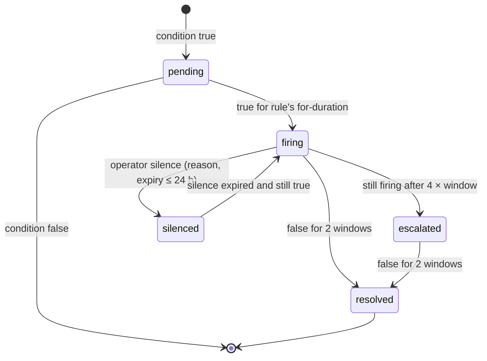

# Legends of the Shattered Frontier — Analytics Part 3: Dashboards, Alerting, Reporting, Experimentation, Privacy and Security
## Version 1.0 — Expanded Technical Design Authority edition (2026-10-17)

Status: Design target; not implemented. Names per Shared Registry v1.0.

- Entry file: [Analytics Architecture](../Legends_Shattered_Frontier_Analytics_Architecture_v1.0.md)
- Registry: [Shared Registry v1.0](../Legends_Shattered_Frontier_Shared_Registry_v1.0.md)

Metric names below are defined in the Warehouse and metrics part, Canonical metric catalog. Event payloads are in the Pipeline and telemetry part or the owning spec.

---

## 1. Dashboards

Operational boards (refresh ≤ 60 s) are served from ClickHouse through Grafana; product and economy boards (refresh hourly/daily) through Superset on the same ClickHouse metric store. Every panel is defined as code (`dashboards/`, Agent implementation guide part) and names its metric and dimensions; no panel runs ad-hoc SQL against Iceberg.

Common controls on every board: `environment` (default `prod`), `dc_region`, `realm_id`, time range, `client_build` where relevant, and an annotation track showing `liveops.event.started/ended`, `liveops.release.deployed`, `config.flag.changed` (kill switches highlighted), and `ops.alert.fired`.

### 1.1 Live Operations (realtime)

| Panel | Metric / source | Visual |
| --- | --- | --- |
| CCU now, per realm and zone | in-world heartbeats in last 2 min | stat + stacked area |
| DAU today vs same weekday 4-week median | `m_dau` partial day | line with baseline band |
| Login success | `m_login_success_rate` (5 min) | stat with 99.5 % target line |
| Logins and session starts per minute | `auth.login.*`, `auth.session.started` | area |
| Active LiveOps events with participation | `m_event_participation_rate`, `m_event_gold_created` vs budget `B_gold` (LiveOps spec, Gold faucet budget) | table |
| Guardrail status of active rollouts | config-service rollouts × guardrail metrics (z, rel) | table, red/amber/green |
| Open alerts by severity | `fact_alerts` | list |
| LFG queue health | `m_lfg_wait_time_p50_by_role`, queue sizes | bars by role |
| Instance provisioning | `m_instance_provision_p95`, `m_instance_failure_rate` | lines |
| Reward pipeline | `m_reward_delivery_latency_p99`, `m_reward_failed_grants` | lines |
| Client crash rate by build | `m_client_crash_rate` | lines |

### 1.2 Economy (near-realtime + daily)

| Panel | Metric |
| --- | --- |
| Gold created vs destroyed per hour, stacked by source/sink code | `m_gold_created`, `m_gold_destroyed` |
| Faucet/sink ratio, daily and weekly with 0.90–1.15 band | `m_gold_faucet_sink_ratio` |
| Money supply and w/w growth | `m_gold_money_supply`, `m_gold_money_supply_growth_wow` |
| Inflation index (chained) and w/w change; Economy-published vs reference | `m_inflation_index`, `m_gold_inflation_index_wow` |
| Basket item price relatives heatmap (item × day) | `snap_item_prices_daily` |
| Wealth Gini and Lorenz curve per realm | `m_wealth_gini` |
| Market velocity, sales volume, listing fees | `m_market_velocity` |
| Gold per active hour by level band vs Itemization faucet table | `m_gold_created_per_active_hour` |
| Faucet shares: quests, dungeons, raids, events, compensation | `m_quest_gold_faucet_share`, `m_compensation_gold_share`, `m_event_gold_created` |
| Repair sink share | `m_gold_repair_sink_share` |
| Frontier marks: weekly distribution, time to cap, dungeon share | `m_marks_time_to_cap_hours`, `m_marks_from_dungeons_per_char_week` |
| Season tokens earned/spent/expired | `m_season_tokens_expired_ratio` |
| Ledger residual (must be 0) | `m_gold_ledger_residual` |
| Flagged transfer value | `m_rmt_flagged_value_copper` |

### 1.3 World Health (hourly)

| Panel | Metric / source |
| --- | --- |
| Population by biome, zone, and level band | `ops.zone.load_sampled`, `m_level_distribution` |
| Zone saturation | `m_zone_population_ratio` |
| World events: active, success/failure, participation | `fact_world_events` |
| Faction control map changes | `faction.control.changed` |
| Gathering node availability by region | `ops.zone.load_sampled.gathering_nodes_available_ratio` |
| Deaths per 1,000 active hours by zone (danger heatmap) | `fact_combat_deaths` |
| Quest offers/acceptance per region | `m_quest_acceptance_rate` |
| Campaign live board: progress vs expected curve | `quest.campaign.*`, `m_campaign_participation_rate` |
| Raid world influence | `m_raid_world_influence_week` |

### 1.4 Server Performance (realtime)

| Panel | Metric |
| --- | --- |
| Tick p99 per zone vs budget | `m_zone_tick_p99_ms` |
| Tick overrun rate | `m_tick_overrun_rate` |
| Players, NPCs, replicated actors per process | `ops.server.tick_sampled` |
| Server crashes and crash loops | `m_server_crash_rate`, `fact_service_health` |
| Service health matrix (service × dc_region) | `ops.service.health_changed`, `m_server_error_rate` |
| Handoff failures | `m_handoff_failure_rate` |
| Client latency and loss by dc_region and ASN | `m_latency_rtt_p95_ms`, `m_packet_loss_p95_pct` |
| Client FPS by GPU class and preset | `m_client_fps_p50` |
| Load times by kind | `m_load_time_p95_s` |
| Top crash signatures (new in last build highlighted) | `m_crashes_per_1k_hours` by `signature_hash` |
| Pipeline health | `m_pipeline_freshness_seconds`, `m_event_loss_rate`, `m_schema_violation_rate` |

### 1.5 Security (implements Security spec, Audit, operations and interfaces part, dashboards list)

| Board | Panels |
| --- | --- |
| Anti-cheat overview | detections per 1,000 DAU by detector (`m_detections_per_1k_dau`); detector precision (`m_detector_precision`); bot prevalence (`m_bot_prevalence_estimate`); time to detect (`m_bot_time_to_detect_hours`); action rejects per 1,000 intents by zone (`m_action_reject_rate`); integrity fail rate by build (`m_integrity_fail_rate`); risk band distribution (`m_risk_band_distribution`) |
| Enforcement operations | case backlog by priority and age; `m_case_time_to_action_p50/_p95`; `m_false_positive_overturn_rate`; `m_appeal_sla_breach_rate`; sanctions by type per day |
| Economy integrity (with Economy) | `m_gold_ledger_residual`; `m_ledger_reconciliation_anomalies`; items created by source anomalies; `m_rmt_flagged_value_copper`; `m_rollback_value_removed_copper`, `m_rollback_net_created_copper`; reward outlier clusters |
| Account security | `m_login_fail_ratio` by ASN; `m_ato_rate`; `m_mfa_adoption` |

Security boards show counts and rates only; subject IDs are visible solely in the enforcement console (admin-portal), never in analytics dashboards.

### 1.6 Progression and content

| Board | Panels |
| --- | --- |
| Progression | time to level 10/25/50/75/100 (`m_time_to_level_hours`) with Character target bands; progression funnel by cohort (`m_progression_funnel`); level distribution; XP source shares; skill band distribution heatmap (skill × band); skill gains per active hour; dampening shares; specialization picks; prestige pace; LP balance |
| Quests | funnel per chain (offered → accepted → objectives → completed), abandon and fail rates, median minutes vs target, objective drop-off, choice splits, generated-quest health |
| Dungeons | completion rate and run duration per dungeon × difficulty; mythic timed rate by level; wipe rate per encounter; mechanic fail top-5; LFG waits, ready-check fails, deserters, vote-kicks; affix week delta; gear pace (`m_hours_to_ilvl_tier`, `m_days_to_ilvl_tier`) |
| Raid Tier Health / Loot Parity / Integrity (Raid spec, Analytics hooks) | wipe funnel per boss; attempts to first kill; kill rate by tier week; wipe causes; TTK; flex size distribution; items per kill by loot mode; council override rate; integrity and detections |
| Items | items created by source × rarity; drop-rate deviation; pity trigger rates; item exits and salvage share; legendary path completion; reward latency |

### 1.7 LiveOps, store and releases

Event outcomes (`m_event_dau_lift`, participation, faucet vs estimate), season health (`m_season_track_completion_rate`, `m_season_tier_p50`), config safety (`m_config_*`), release quality (`m_release_change_failure_rate`, `m_maintenance_overrun_rate`), store (`m_store_payer_conversion`, refund and chargeback rates, failure rate), sentiment (`m_survey_nps`, response rate), experiments (§4).

---

## 2. Alerting

### 2.1 Severity and routing

| Severity | Meaning | Notification | Response target |
| --- | --- | --- | --- |
| `sev1` | Player-facing outage, data integrity breach, or live duplication | page platform on-call and incident commander; route-specific on-call | acknowledge ≤ 5 min |
| `sev2` | Serious degradation or probable live exploit | page owning team on-call | acknowledge ≤ 15 min |
| `sev3` | Needs action within the business day | team channel + ticket | ≤ 1 business day |
| `sev4` | Trend / review | included in the daily report | weekly review |

Security spec labels SEV1–SEV3 map to `sev1`–`sev3`.

Routes (values of `ops.alert.fired.routes`): `oncall_platform`, `oncall_gameplay`, `economy_team`, `security_team`, `liveops_team`, `content_team`, `data_team`, `anticheat_service`, `liveops_trl`. Every alert is published on `ops.alerts`. `anticheat-service` consumes alerts routed `anticheat_service` as **context** (they carry no subject IDs); subject-level findings go to it separately through `SubmitBatchDetections` (§2.5).

### 2.2 Baselines

```text
baseline_how(m, t)  = median of m at the same hour-of-week over the previous 4 weeks,
                      excluding hours with an active LiveOps event whose modifiers touch m's domain
baseline_28d(m, d)  = median of daily m over d−28..d−1, same exclusions
ratio_to_baseline   = value / max(baseline, floor_m)       (floor_m per rule avoids tiny-denominator noise)
```

Hysteresis: an alert resolves only after its condition is false for 2 consecutive evaluation windows; it re-notifies every 60 min (`sev1`/`sev2`) while firing; it escalates one severity if still firing after 4 × window (max `sev2` for automatic escalation).

### 2.3 Alert rules

| Rule ID | Condition | Window / evaluation | Severity | Routes |
| --- | --- | --- | --- | --- |
| **Economy and inflation** | | | | |
| `economy_inflation_spike` | `m_gold_inflation_index_wow` > +3 % (any dc_region); > +5 % escalates | daily at reset + 3 h | `sev3`; `sev2` > +5 % | economy_team |
| `economy_inflation_event_band` | an event is active and `|m_gold_inflation_index_wow|` > 2 % | daily | `sev3` | economy_team, liveops_team |
| `economy_faucet_sink_imbalance` | daily `m_gold_faucet_sink_ratio` > 1.30 for 3 consecutive days, or > 1.60 on any day, or < 0.75 for 3 days | daily | `sev3`; `sev2` for > 1.60 | economy_team |
| `economy_gold_created_spike` | hourly `m_gold_created` ≥ 3 × `baseline_how` and ≥ 5,000,000 copper above it, per realm | 1 h, every 5 min | `sev2` | economy_team, security_team, anticheat_service |
| `economy_source_spike` | any single source code's hourly gold ≥ 4 × its `baseline_how` (floor 1,000,000 copper) | 1 h | `sev2` | economy_team, anticheat_service |
| `economy_money_supply_jump` | `m_gold_money_supply_growth_wow` > 5 % outside launch weeks | daily | `sev3` | economy_team |
| `economy_ledger_residual` | `m_gold_ledger_residual` ≠ 0 for any realm after the late-data window | hourly | `sev1` | economy_team, security_team, anticheat_service |
| `economy_index_divergence` | `|m_inflation_index − economy_published_value|` > 1.0 point | daily | `sev4` | economy_team, data_team |
| `economy_price_anomaly` | basket item `p_{i,d}` outside `[0.33, 3] ×` its 7-day median with ≥ 200 sales | daily | `sev4` | economy_team |
| `economy_marks_cap_breach` | any character credited `currency/frontier_marks` > `FRONTIER_MARKS_WEEKLY_CAP` in a week (INV-12) | hourly | `sev2` | security_team, anticheat_service |
| **Duplication and exploit indicators** | | | | |
| `dupe_ledger_anomaly` | `m_ledger_reconciliation_anomalies` > 0 (Itemization: "any → page") | 15 min | `sev1` | security_team, oncall_gameplay, anticheat_service |
| `dupe_items_created_spike` | `m_items_created_by_source` for any `(source, rarity)` > 3 × 7-day baseline (Itemization threshold), rarity ≥ `rare` | 1 h | `sev2` (`sev3` for `common`/`uncommon`) | security_team, anticheat_service |
| `dupe_item_id_reuse` | `event_id_conflict` or duplicate `item_id` in `item.instance.created` | 5 min | `sev1` | security_team, anticheat_service |
| `security_reward_outlier_cluster` | ≥ 20 characters with reward-rate `z ≥ 4` on the same causation content in 1 h (Security spec, Monitoring and alerts) | 1 h, every 5 min | `sev2` | security_team, liveops_team, anticheat_service |
| `exploit_drop_rate_deviation` | `|m_loot_drop_rate_deviation|` > 15 % over ≥ 10,000 rolls (Itemization) | hourly | `sev3`; `sev2` for rarity ≥ `epic` | content_team, security_team |
| `exploit_completion_time_outlier` | `m_dungeon_run_duration_p50` or `m_encounter_ttk_p50` < 0.5 × target for ≥ 30 runs in 1 h (skip/cheese) | 1 h | `sev3` | content_team, anticheat_service |
| Security spec alerts (`security_*`, incl. `security_login_failure_spike`, `security_integrity_fail_spike`, `security_reject_storm`, `security_detector_silent`, `security_case_backlog`, `security_mass_sanction_rate`) | as defined in Security spec, Audit, operations and interfaces part, Monitoring and alerts | as defined | as defined | security_team |
| **Crashes and performance** | | | | |
| `client_crash_spike` | `m_client_crash_rate` for a build > 2 × its 7-day baseline **and** > 1.5 %, with ≥ 2,000 sessions | 15 min | `sev2` | oncall_platform, liveops_team |
| `client_new_crash_signature` | a `signature_hash` first seen in the last 24 h affects > 0.2 % of sessions of a build | 1 h | `sev3` | oncall_platform |
| `server_crash_rate` | `m_server_crash_rate` > 1.0 per 1,000 process-hours, or any `crash_loop` | 15 min | `sev2` | oncall_platform |
| `zone_tick_degraded` | `m_zone_tick_p99_ms` > tick budget for 5 min; > 2 × budget for 2 min escalates | 1 min | `sev3` → `sev2` | oncall_platform |
| `login_success_low` | `m_login_success_rate` < 98 %; < 80 % escalates (LiveOps status thresholds) | 5 min | `sev2`; `sev1` < 80 % | oncall_platform, liveops_team |
| `latency_regional` | `m_latency_rtt_p95_ms` > 180 ms in a dc_region for 10 min | 1 min | `sev3` | oncall_platform |
| `service_unhealthy` | `ops.service.health_changed.to_state = unhealthy` on a critical-path service for > 2 min | 1 min | `sev1` | oncall_platform |
| `reward_delivery_slow` / `reward_failed_grants` | p99 > 10 s for 5 min / any failed grant per 15 min (Itemization) | 5 / 15 min | `sev2` / `sev3` | oncall_gameplay |
| `instance_failure_rate` | `m_instance_failure_rate` > 0.5 % hourly (Dungeon) | 1 h | `sev3` | oncall_gameplay |
| **Engagement** | | | | |
| `dau_drop` | `m_dau` ≤ −15 % vs `baseline_28d` for 2 days (LiveOps) | daily | `sev3` | liveops_team; also `liveops_trl` |
| `retention_low` | `m_d1_retention` < 38 % for 3 consecutive cohorts; `m_d7_retention` < 20 %; `m_d30_retention` < 9 % | daily | `sev4` | liveops_team |
| `time_to_level_fast` | median `m_time_to_level_hours{level=100}` < 120 h (Character) | weekly | `sev3` | content_team |
| **Data platform** | | | | |
| `pipeline_freshness` | freshness class SLA breached for 10 min (`realtime`: 5 min) | 1 min | `sev3` (`sev2` for `realtime`) | data_team |
| `event_loss` | `m_event_loss_rate` > 0.01 % daily, or a top-20 event at 0 for 15 min while CCU > 0 | 15 min | `sev2` | data_team, oncall_platform |
| `schema_violation` | `m_schema_violation_rate` > 0.1 % per producer | 15 min | `sev3` | data_team, owning team |
| `privacy_scan_hit` | DLP scan finds a p3 pattern or raw IP in a non-restricted table | nightly | `sev2` | data_team, security_team |

All thresholds are tuning values under `tune.analytics.alert.<rule_id>.<param>` and changes are audited.

### 2.4 Alert lifecycle



`ops.alert.fired` is emitted on entering `firing`, `escalated`, and `resolved` (`status` field). State names are local to `analytics-pipeline`.

```sql
CREATE TABLE analytics_pipeline.alert_rules (
  rule_id        text PRIMARY KEY,
  metric_name    text NOT NULL,
  condition      jsonb NOT NULL,       -- {op, threshold, baseline_kind, floor, min_samples}
  window_s       integer NOT NULL,
  eval_every_s   integer NOT NULL,
  for_s          integer NOT NULL DEFAULT 0,
  severity       text NOT NULL CHECK (severity IN ('sev1','sev2','sev3','sev4')),
  escalate_to    text CHECK (escalate_to IN ('sev1','sev2','sev3')),
  routes         text[] NOT NULL,
  scope_dims     text[] NOT NULL,      -- evaluated per combination, e.g. {realm_id}
  runbook_ref    text NOT NULL,
  enabled        boolean NOT NULL DEFAULT true,
  owner_team     text NOT NULL,
  updated_by     text NOT NULL,
  updated_at     timestamptz NOT NULL DEFAULT now()
);

CREATE TABLE analytics_pipeline.alert_instances (
  alert_id       text PRIMARY KEY CHECK (alert_id ~ '^alr_[0-9A-HJKMNP-TV-Z]{26}$'),
  rule_id        text NOT NULL REFERENCES analytics_pipeline.alert_rules,
  fingerprint    text NOT NULL,
  scope          jsonb NOT NULL,
  state          text NOT NULL CHECK (state IN ('pending','firing','escalated','silenced','resolved')),
  severity       text NOT NULL,
  first_fired_at timestamptz,
  last_eval_at   timestamptz NOT NULL,
  resolved_at    timestamptz,
  silence_reason text,
  silenced_by    text,
  silence_expires_at timestamptz
);
CREATE UNIQUE INDEX alert_instances_open ON analytics_pipeline.alert_instances (fingerprint)
  WHERE state <> 'resolved';
```

### 2.5 Subject-level signals to `anticheat-service`

`analytics-pipeline` hosts the **batch runtime** for Security-owned batch detectors and submits results with `SubmitBatchDetections` (Security spec, Audit, operations and interfaces part, gRPC). Detector logic, thresholds and severities belong to the Security spec; Analytics owns scheduling, feature tables, and delivery.

| Detector (Security-owned unless marked) | Feature source | Schedule |
| --- | --- | --- |
| `detector/trade_funnel`, `detector/trade_value_asymmetry` | `fact_trades`, `fact_currency_transactions` (transfer class), `fact_market_sales`, `snap_item_prices_daily` | hourly, 7-day window |
| `detector/market_wash_cycle`, `detector/market_corner`, `detector/market_spoof` | `fact_market_sales`, `fact_market_listings` | hourly |
| `detector/bot_cluster` | `dim_accounts`, HMAC device/IP clusters provided by anticheat-service, `fact_detections` | daily |
| `detector/telemetry_tamper` (**proposed**) | client telemetry inconsistent with server truth: heartbeats `in_world = true` while the zone-server has no presence for the character; perf values outside physical bounds; ≥ 500 schema rejects per account per hour | hourly |
| `detector/headless_presence` (**proposed**) | characters in world per server presence for ≥ 30 min with zero `client.session.heartbeat` (headless or modified client) | hourly |

Submissions carry `detector_id`, `detector_version`, subject, window, features (p1 only), and an `idempotency_key = detector_id ‖ window_start ‖ subject`. Analytics never applies sanctions.

---

## 3. Reporting

Reports are generated by `ap-reports` from the metric store, rendered as versioned, immutable report documents stored in object storage and listed in admin-portal; each report records the `metric_version`s and data cut time it used. Restated reports (Pipeline and telemetry part, Late and out-of-order data) are published as a new version with a change note.

| Report | When | Contents |
| --- | --- | --- |
| **Daily** (per dc_region and global) | daily reset + 3 h | KPI strip: DAU, new accounts, `m_d1_retention` of the previous complete cohort, stickiness, session length, sessions per DAU; economy: gold created/destroyed by top 5 sources/sinks, FSR, money supply, index and w/w, ledger residual; performance: crash rate by build, top 5 crash signatures, tick p99 worst zones, login success, incidents (alerts by severity); content: top 10 quests by abandon rate, dungeon completion and wipe outliers, LFG waits; security: detections, sanctions, flagged value; LiveOps: active events, participation, faucet vs budget; data quality: freshness, loss, schema violations, open `sev4` alerts |
| **Weekly** | weekly reset + 6 h | D7 retention cohort triangle (last 8 cohorts); WAU, MAU, churn, reactivation trend; progression funnel and time-to-level; skill band distribution changes; quest funnels per chain; raid tier health (wipe funnel, attempts to first kill, kill rate by tier week); mythic timed rates; gear pace vs power ladder targets; economy: FSR, inflation index trend, Gini and Lorenz, velocity, marks time-to-cap, repair sink share; store KPIs; experiment readouts (§4); top 10 crash signatures with trend; security precision, overturn rate, bot prevalence; metric catalog changes |
| **Seasonal** | season end + 7 days (after late-data restatement) | Season KPI scorecard vs targets (LiveOps KPI table); cohort D30 retention for all season cohorts; reactivation; season track completion and tier distribution; season tokens expired; seasonal economic audit (Economy spec, Inflation controls): chained index, money supply growth, Gini change, faucet/sink by source, LiveOps-attributed gold vs budgets, compensation share; basket review and next `basket_version`; power ladder adherence (`m_hours_to_ilvl_tier` vs Itemization targets); content performance league tables; raid tier summary; security summary; experiment portfolio results; analytics cost per CCU-day vs target; privacy request volumes and SLA compliance |

---

## 4. Experimentation (A/B) framework

### 4.1 Model

An **experiment** is a set of `config-service` rules on one flag or tuning key whose cohorts differ only by percentage bucket. Assignment uses the LiveOps bucket function (LiveOps spec, Config and releases part, Percentage bucketing): `bucket(account_id, key) = xxhash64(salt ‖ ":" ‖ account_id) mod 10,000`. Arms are contiguous bucket ranges built with first-match rules of ascending priority:

```text
rule p10: {percentage_bp: 1000} → value_B        arm B   = buckets [0, 1000)
rule p11: {percentage_bp: 2000} → value_A        arm A   = buckets [1000, 2000)   (explicit control)
default                                          holdout = buckets [2000, 10000) (not analyzed)
```

Each experiment uses a **fresh salt** (`exp_<id>`) so that earlier rollouts of the same key do not correlate with assignment. Analytics stores the definition in `dim_experiments` and recomputes assignment for every eligible account offline (deterministic), so no exposure event is needed for intent-to-treat analysis.

| Rule | Value |
| --- | --- |
| Unit of randomization | account (default); realm for anything that changes power, drop rates of gear, economy faucets/sinks, or shared world state (players on one realm compete and trade, so per-account variation would be unfair and leak) |
| Eligibility | the rule cohort fields (environment, dc_region, realm, min_client_build) applied to the account's activity during the experiment |
| Population analyzed | accounts with `Active` on ≥ 1 day in the window after start (intent-to-treat) |
| Minimum duration | 14 days (two weekly cycles); maximum 1 season |
| Forbidden | personalized prices or offers in `store-service`; anything that gives one arm more power, crowns value, or loot quality on the same realm; experiments on accounts under 18 where regional policy forbids; changes to Registry constants |
| Approval | economy-affecting experiments require Economy owner approval (same tier as LiveOps economy review); all experiments are audited via `config.flag.changed` |

### 4.2 Statistics

Primary metric pre-registered in `analytics_pipeline.experiments`; guardrails from the LiveOps guardrail list always included.

| Metric type | Test |
| --- | --- |
| Binary per account (e.g. D7 retained) | two-proportion z-test (same formula as LiveOps guardrail evaluation) |
| Continuous per account (active hours, gold earned) | Welch t-test on per-account values, with CUPED: `Y' = Y − θ (X − mean X)`, `θ = cov(X, Y) / var(X)`, `X` = same metric in the 14 days before start |
| Ratio of sums (crash rate per session) | delta method variance on per-account numerators and denominators |
| Cluster-randomized (realm) | per-realm means, t-test with realms as units; minimum 4 realms per arm |

Sample size per arm (two-sided α, power 1 − β, absolute MDE δ, variance σ²):

```text
n = 2 × (z_{1−α/2} + z_{1−β})² × σ² / δ²
```

Worked example: primary `m_d7_retention`, baseline p = 0.25 (σ² = p(1 − p) = 0.1875), δ = 0.015, α = 0.05 (z = 1.96), power 0.8 (z = 0.84): `n = 2 × 7.84 × 0.1875 / 0.000225 = 13,067` new accounts per arm.

Validity checks (result invalid if any fails): sample-ratio mismatch χ² test p < 0.001; pre-period imbalance on the primary metric |z| > 3; < 90 % of expected eligible accounts assigned. Secondary metrics use Benjamini–Hochberg at q = 0.10. Guardrail breaches during the run follow LiveOps automatic rollback; the analysis does not override them.

```sql
CREATE TABLE analytics_pipeline.experiments (
  experiment_id   text PRIMARY KEY CHECK (experiment_id ~ '^exp_[0-9A-HJKMNP-TV-Z]{26}$'),
  flag_key        text NOT NULL,            -- ff.* or tune.*
  salt            text NOT NULL UNIQUE,
  unit            text NOT NULL CHECK (unit IN ('account','realm')),
  arms            jsonb NOT NULL,           -- [{arm, bp_from, bp_to, value}] or [{arm, realm_ids}]
  primary_metric  text NOT NULL,
  secondary_metrics text[] NOT NULL DEFAULT '{}',
  mde             double precision NOT NULL,
  alpha           double precision NOT NULL DEFAULT 0.05,
  power           double precision NOT NULL DEFAULT 0.8,
  starts_at       timestamptz NOT NULL,
  ends_at         timestamptz NOT NULL,
  state           text NOT NULL CHECK (state IN ('draft','running','stopped','analyzed')),
  config_rule_change_ids text[] NOT NULL,   -- cfg_ IDs that implement the arms
  approved_by     text[] NOT NULL,
  created_by      text NOT NULL
);

CREATE TABLE analytics_pipeline.experiment_results (
  experiment_id text NOT NULL REFERENCES analytics_pipeline.experiments,
  metric_name   text NOT NULL,
  arm           text NOT NULL,
  n             bigint NOT NULL,
  estimate      double precision NOT NULL,
  ci_low        double precision NOT NULL,
  ci_high       double precision NOT NULL,
  p_value       double precision,
  computed_at   timestamptz NOT NULL,
  PRIMARY KEY (experiment_id, metric_name, arm, computed_at)
);
```

---

## 5. Privacy

### 5.1 Handling and retention by `privacy_class`

| Class | Examples | Where it may live in analytics | Retention | Dashboards |
| --- | --- | --- | --- | --- |
| `p0_public` | content IDs, levels, counts, durations | all layers, global | row level 25 months raw; aggregates indefinitely | yes |
| `p1_pseudonymous` | `acc_`, `chr_`, `ses_` IDs, gameplay telemetry, bucketed hardware, country, ASN | raw, clean, modeled; replicated to the global modeled store | row level 25 months (`EVENT_SCHEMA_RETENTION_RAW`), then deleted; ID-free aggregates indefinitely | aggregates only, cell n ≥ 50 |
| `p2_personal` | survey free text (redacted), XP multipliers (Character classification), IP /24 prefixes, crash `minidump_ref` | `restricted` namespace in the account's home dc_region only | 30 days (`tune.analytics.p2_retention_days`); derived p1 labels/aggregates may persist | never |
| `p3_sensitive` | `report_signature`, device keys, minidump contents | **not stored** in analytics (dropped at ingest); minidumps only in the crash store (30 days, engine-team access) | 0 in warehouse | never |

### 5.2 Erasure (GDPR right to erasure, CCPA deletion)

```mermaid
sequenceDiagram
    autonumber
    participant P as Player / support
    participant B as auth-service privacy workflow (Backend)
    participant PS as analytics-pipeline PrivacyService
    participant ES as enforcement-service
    participant W as ap-privacy-worker
    participant AU as audit-service
    P->>B: verified deletion request
    B->>PS: SubmitErasure(request_id, account_id, character_ids, idempotency_key)
    PS->>ES: legal-hold check for account (active case)
    alt hold
        PS->>W: erase except security-related rows; move those to restricted_hold
    else no hold
        PS->>W: erase all
    end
    W->>W: Iceberg row deletes in raw/clean/modeled/restricted (subject IDs), rewrite counterparty fields to "erased"
    W->>W: ClickHouse ALTER TABLE … DELETE on live tables; crash store objects by session
    W->>W: expire snapshots + rewrite data files (physical removal)
    W->>AU: append audit record (request_id, tables, row counts)
    PS-->>B: ErasureCompleted(request_id, completed_at)
```

| Rule | Value |
| --- | --- |
| SLA | complete (physically removed) ≤ 30 days from request; target 7 days |
| Scope | rows where `account_id` or any of the account's `character_id`s is the envelope subject; payload fields naming the account as counterparty are overwritten with `erased` |
| Not affected | ID-free aggregates in the metric store; reports (aggregates only) |
| Legal hold | rows needed for an open enforcement case stay in `restricted_hold` (Security access only) until the case closes, then erased (Security spec, Data classification, Data subject rights) |
| Verification | post-run query counts must be 0 for all subject IDs; failure → `sev2` `data_team` |

### 5.3 Access and portability export

`PrivacyService.SubmitExport(request_id, account_id)` builds a machine-readable JSON bundle of the account's p0/p1/p2 rows from `modeled` and `restricted` (sessions, activity days, progression, quests, runs, purchases, survey answers), grouped by table with column descriptions from the schema registry. Detection features and enforcement evidence are excluded and referred to Security's process. Delivered to the Backend privacy workflow as an encrypted object with a 7-day download link; SLA 30 days.

### 5.4 Consent and telemetry controls

| Event | Default | Player control |
| --- | --- | --- |
| `client.session.heartbeat`, `client.crash.reported`, `client.integrity.reported` | on | heartbeat and integrity are required for service operation and security (disclosed in the privacy notice); crash reports can be turned off |
| `client.perf.sampled`, `client.load.completed`, `client.ui.interacted`, `client.survey.submitted` | on where regional law allows, otherwise off until opt-in | "Share optional telemetry" setting; survey answers are always explicit |

The client sends `telemetry_consent` (`full`, `essential`) in each batch header; `telemetry-ingest` drops optional events when it is `essential`. No analytics data is sold or shared with third parties for advertising.

### 5.5 Access control

| Role | Access |
| --- | --- |
| `analytics_viewer` | dashboards and reports; aggregates only; cells with n < 50 suppressed |
| `analyst` | Trino on `modeled` (p0/p1) with `account_id`/`character_id` masked as keyed hashes; exports > 10,000 rows need data-team approval |
| `data_engineer` | `raw`, `clean`, `modeled`; no `restricted` |
| `privacy_officer` | `restricted`, privacy tooling |
| `security_analyst` | security facts with unmasked IDs, feature tables; no `restricted` except `restricted_hold` |
| service identities | per job, least privilege (e.g. `ap-batch-detectors` reads market/trade facts, calls `SubmitBatchDetections` only) |

Every query against `raw`, `restricted`, or unmasked IDs, every export, and every role grant writes an audit record to `audit-service`. Personal data (p2) stays in the account's home dc_region; only p0/p1 modeled data is replicated to the global store (consistent with Security spec, Data classification, Cross-region).

---

## 6. Analytics hooks back to other services

### 6.1 `lsf.analytics_pipeline.v1.MetricsService`

```protobuf
service MetricsService {
  rpc GetMetric(GetMetricRequest) returns (MetricValue);                // latest value at scope
  rpc GetMetricSeries(GetMetricSeriesRequest) returns (MetricSeries);   // window + grain
  rpc GetGuardrailSample(GuardrailSampleRequest) returns (GuardrailSample);
  rpc ListMetrics(ListMetricsRequest) returns (ListMetricsResponse);
}
message GetMetricRequest { string metric_name = 1; map<string,string> scope = 2; string grain = 3; }
message MetricValue { double value = 1; double numerator = 2; double denominator = 3;
                      uint64 sample_n = 4; string bucket_start = 5; string computed_at = 6;
                      bool stale = 7; uint32 metric_version = 8; }
message GuardrailSampleRequest { string metric_name = 1; string rollout_id = 2;   // config-service rollout
                                 string window_start = 3; string window_end = 4; }
message GuardrailSample { double x_treatment = 1; double n_treatment = 2;
                          double x_control = 3; double n_control = 4;
                          double mean_treatment = 5; double mean_control = 6; bool stale = 7; }
```

| Caller | Use | Constraint |
| --- | --- | --- |
| `liveops-service` | `metric(name, scope)` in trigger rules (LiveOps spec, Trigger rule language); faucet model inputs (`m_dau_characters`, `m_median_active_level`, `m_gold_created_npc`) | only `trl_allowed` metrics; all are server-sourced |
| `config-service` | guardrail evaluation per rollout (treatment = accounts/realms receiving the new value, from the enricher's rollout arm tagging) | only `guardrail_allowed`; `stale = true` when freshness SLA is breached → config-service holds (no auto-advance, no auto-rollback on missing data) |
| `economy-service` | reconciliation of `economy.index.computed` with `m_inflation_index` | daily |
| admin-portal | metric lookups in GM tools | read-only |

`m_gold_created_npc` (new) implements LiveOps' `G_base` input exactly: daily gold credits with source ∉ {`market_sale`, `trade_receive`, `vendor_sale`} (LiveOps spec, Gold faucet budget).

### 6.2 Event-driven hooks

| Consumer | Hook |
| --- | --- |
| `anticheat-service` | `SubmitBatchDetections` (§2.5); `ops.alerts` with route `anticheat_service` |
| on-call bridge, admin-portal | `ops.alerts` |
| `liveops-service` | `ops.alerts` with route `liveops_trl` (e.g. `dau_drop`) may arm triggered events |
| Owning specs | weekly target-review report per spec (metrics vs targets in `metric_targets`) |

---

## 7. Security considerations

### 7.1 Threats

| # | Threat | Mitigation |
| --- | --- | --- |
| A1 | Forged or poisoned client telemetry used to steer metrics (e.g. fake crashes to trigger rollbacks, fake heartbeats to hide bots) | Identity only from the verified token; context checked against server presence; automation (TRL, guardrails) uses server-sourced metrics only, except `m_client_crash_rate`, which counts at most 1 crash per session, requires ≥ 2,000 sessions and ≥ 500 distinct accounts, and is cross-checked against `auth.session.ended` reasons |
| A2 | Telemetry flood / DoS on ingest | gateway and per-session quotas; batch size limits; kill switch `ff.analytics.client_telemetry_enabled` per `client_build` cohort; autoscaling with hard cost ceiling |
| A3 | Insider exfiltration of player data | role model (§5.5), masking, export approvals, audit records, no laptop extracts of raw data, DLP scans |
| A4 | Re-identification from small aggregates | cell suppression n < 50; no p2 on dashboards; coarse buckets for hardware and geo |
| A5 | PII leaking via free text, crash dumps, logs | scrubbers at ingest, minidumps outside the warehouse, nightly DLP scan (`privacy_scan_hit`) |
| A6 | Market manipulation to trigger LiveOps automation (e.g. pushing a basket price to fire "resource shortage relief") | prices use trimmed volume-weighted medians excluding flagged sales; TRL price metrics require ≥ 200 sales and multi-day persistence; `detector/market_corner` runs hourly |
| A7 | Injection through the metrics API | no free-form SQL; metric name and dimensions validated against the catalog; parameterized ClickHouse queries |
| A8 | Tampering with alert rules or silences to hide an exploit | rule changes and silences are audited; silences expire ≤ 24 h; `sev1` rules cannot be silenced by a single person (two-person) |
| A9 | Compromised pipeline job writing false detections | `SubmitBatchDetections` permission only for `ap-batch-detectors` identity; anticheat-service validates detector IDs/versions; detections cannot sanction directly |
| A10 | Stale data causing wrong automated decisions | freshness flags on every metric response; consumers hold on `stale` |

### 7.2 Server-side validation rules owned by Analytics

Envelope rules E1–E9 (Pipeline and telemetry part), client identity stamping, quota enforcement, clock correction bounds, `report_signature` stripping, and per-event allowlists for `client.ui.interacted`.

### 7.3 What Analytics reports to `anticheat-service`

Subject-level: results of Security batch detectors and the proposed `detector/telemetry_tamper` and `detector/headless_presence` (§2.5). Aggregate context: alerts routed `anticheat_service` (gold and item creation spikes, ledger residuals, marks cap breaches, reward outlier clusters, completion-time outliers).
