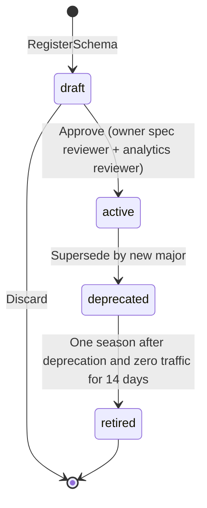
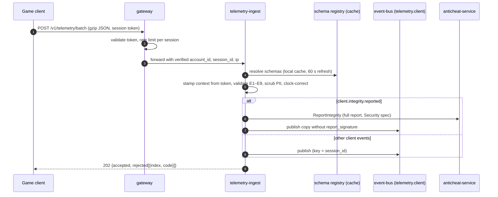
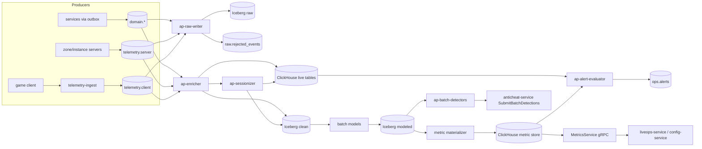

# Legends of the Shattered Frontier — Analytics Part 1: Pipeline, Telemetry and Data Quality
## Version 1.0 — Expanded Technical Design Authority edition (2026-10-17)

Status: Design target; not implemented. Names per Shared Registry v1.0.

- Entry file: [Analytics Architecture](../Legends_Shattered_Frontier_Analytics_Architecture_v1.0.md)
- Registry: [Shared Registry v1.0](../Legends_Shattered_Frontier_Shared_Registry_v1.0.md)

This part specifies how events get from producers into the lakehouse and the serving layer: the envelope implementation, the schema registry, `telemetry-ingest`, the `analytics-pipeline` stream and batch jobs, sessionization, the Iceberg layers, ClickHouse serving, the payloads of every `client.*` and `ops.*` event Analytics owns, data quality, and cost and scale targets.

---

## 1. Event envelope implementation

The envelope is fixed by the Registry (Event taxonomy, Envelope). Analytics owns its **implementation**: the `lsf-events` SDK that every producer links, and the validation rules that every consumer can rely on.

### 1.1 SDK responsibilities (`lsf-events`)

| Responsibility | Rule |
| --- | --- |
| `event_id` | `evt_` + ULID generated at emit time on the producer; never regenerated on retry. The outbox row stores it. |
| `occurred_at` | Time the fact became true (commit time for domain events, sample-window end for telemetry), UTC, millisecond precision. |
| `producer` | `service` from the Registry service list (client telemetry uses `game-client`, see Registry additions); `instance_id` = pod or process name; `build` = semantic build string. |
| Context fields | Copied from the request context (`account_id`, `character_id`, `session_id`, `realm_id`, `zone_id`, `correlation_id`, `causation_id`, `content_version`, `dc_region`, `environment`). Absent fields are **omitted**, never `null`. |
| `privacy_class` | Computed, not hand-set: the highest class among the payload fields actually present, using the field annotations in the schema registry (§2.2). Context IDs count as `p1_pseudonymous`. |
| Validation | In `dev` and `ptr` every emit is validated against the registered JSON Schema and fails loudly; in `staging`/`prod` the SDK validates a 1 % sample and counts violations (`m_schema_violation_rate`), because the pipeline re-validates everything. |
| Delivery | Domain events use the **transactional outbox**: the row is written in the same database transaction as the state change, and a relay publishes to `domain.<domain>` keyed by the aggregate ID. Telemetry from servers is published directly (at-least-once, async, bounded buffer of 50,000 events; overflow drops the oldest samples and increments a counter). |
| Encoding | UTF-8 JSON, one event per Kafka record; topic-level `zstd` compression. Kafka headers carry `event_name`, `schema_version`, `privacy_class` so routers do not parse the body. |

Consumers must treat delivery as **at-least-once** and deduplicate by `event_id` (Registry rule). Ordering is guaranteed only per partition key.

### 1.2 Topics

Per Registry (Event taxonomy, Envelope). Analytics adds no topics.

| Topic | Key | Producers | Analytics consumer | Retention |
| --- | --- | --- | --- | --- |
| `domain.<domain>` | aggregate ID (e.g. `character_id`, `run_id`) | owning service via outbox | `ap-raw-writer`, `ap-enricher` | 14 days |
| `telemetry.client` | `session_id` | `telemetry-ingest` only | `ap-raw-writer`, `ap-enricher`, `ap-sessionizer` | 3 days |
| `telemetry.server` | `producer.instance_id` (process) | zone-server, instance-server, all services (`ops.*` except alerts, `combat.*` summaries) | same | 3 days |
| `ops.alerts` | alert `fingerprint` | `analytics-pipeline` (`ap-alert-evaluator`) | admin-portal, on-call paging bridge, liveops-service, config-service | 14 days |

Rejected or unparseable records never get a topic of their own: the stream job writes them to `raw.rejected_events` (§5.2).

### 1.3 Envelope validation rules (applied by pipeline and ingest)

| # | Rule | On failure |
| --- | --- | --- |
| E1 | `event_id` matches `^evt_[0-9A-HJKMNP-TV-Z]{26}$` | reject |
| E2 | `event_name` has exactly three lowercase snake_case segments and exists in the schema registry | reject (`unknown_event`) |
| E3 | `schema_version` is registered for `event_name` and not `retired` | reject |
| E4 | `occurred_at` parses as RFC 3339 UTC with ms; not more than 5 min in the future relative to ingest time | client: clamp and flag `clock_skewed`; server: reject |
| E5 | `environment` ∈ `release_stage`, `dc_region` ∈ {`na`,`eu`,`apac`,`sa`} | reject |
| E6 | Every present ID field carries its Registry prefix (`acc_`, `chr_`, `ses_`, …) | reject |
| E7 | Payload validates against JSON Schema of (`event_name`, `schema_version`) | reject (`payload_invalid`) |
| E8 | Envelope `privacy_class` ≥ computed class (§2.2) | upgrade class, flag `privacy_upgraded` |
| E9 | No field outside the schema (`additionalProperties: false` on payload) | strip unknown fields in `prod`, flag `fields_stripped`; reject in `dev`/`ptr` |

Rejections are counted per producer and `event_name`; `m_schema_violation_rate` > 0.1 % for any producer over 15 min raises a `sev3` alert (Dashboards, alerting and privacy part, Alert rules).

---

## 2. Schema registry

The schema registry is a module of `telemetry-ingest` with its own PostgreSQL schema `telemetry_ingest`. It stores JSON Schema (draft 2020-12) documents per event and version, with field-level privacy annotations. Owning specs define payloads; Analytics registers them (Registry, Event taxonomy).

### 2.1 Version model and compatibility

`schema_version` is a positive integer, monotonic per `event_name`. Each version carries a `major` attribute.

| Change | Allowed within a major? | Notes |
| --- | --- | --- |
| Add optional field | yes | Consumers ignore unknown-to-them fields. |
| Add enum value | yes | Consumers must map unknown values to `other` in modeled tables. |
| Widen numeric type (int32 → int64) | yes | Warehouse columns are created at the wide type from the start. |
| Tighten a description, raise a field's `privacy_class` | yes | Raising class triggers back-classification of history (Dashboards, alerting and privacy part, Privacy). |
| Add required field | **no** | New major. |
| Remove or rename field, change type, narrow enum, lower `privacy_class` | **no** | New major + privacy review. |
| Change meaning of an existing field | **no** | New major, even if the type is unchanged. |

Breaking changes follow the Registry rule: new major, **dual publishing for one season** (the producer emits both versions; the new-major event sets `causation_id` to the old event's `event_id` so the pipeline can drop one during the overlap). The pipeline maps both majors into the same modeled table using a per-major projection.

Compatibility mode is `BACKWARD_TRANSITIVE` within a major: every registered version must validate the data of all earlier versions of that major after defaulting optional fields.

### 2.2 Field annotations

Each property in a payload schema carries:

```json
{
  "type": "integer",
  "description": "Seconds with player input in the interval",
  "x-privacy-class": "p1_pseudonymous",
  "x-pii-transform": "none",
  "x-warehouse-column": "input_active_s"
}
```

`x-pii-transform` ∈ `none`, `drop`, `hmac`, `truncate_ip`, `redact_free_text`, `bucket` (see §4). Fields classed `p3_sensitive` must declare `drop` unless the event's only consumer is its owning service (e.g. `report_signature` in `client.integrity.reported`, Security spec, Audit, operations and interfaces part).

### 2.3 Schema lifecycle



State names are local to the schema registry (not a Registry enum). `retired` versions are rejected at ingest (E3).

### 2.4 PostgreSQL DDL (`telemetry_ingest`)

```sql
CREATE SCHEMA IF NOT EXISTS telemetry_ingest;

CREATE TABLE telemetry_ingest.event_schemas (
  event_name       text        NOT NULL CHECK (event_name ~ '^[a-z_]+\.[a-z_]+\.[a-z_]+$'),
  schema_version   integer     NOT NULL CHECK (schema_version > 0),
  major            integer     NOT NULL CHECK (major > 0),
  owning_spec      text        NOT NULL,           -- 'Quest', 'Itemization', ...
  owning_service   text        NOT NULL,           -- Registry service name
  topic            text        NOT NULL,           -- domain.quest | telemetry.client | ...
  partition_key    text        NOT NULL,           -- JSON pointer, e.g. '/character_id'
  json_schema      jsonb       NOT NULL,
  schema_sha256    bytea       NOT NULL,
  state            text        NOT NULL CHECK (state IN ('draft','active','deprecated','retired')),
  max_privacy_class text       NOT NULL CHECK (max_privacy_class IN
                     ('p0_public','p1_pseudonymous','p2_personal','p3_sensitive')),
  registered_by    text        NOT NULL,
  approved_by      text[]      NOT NULL DEFAULT '{}',
  created_at       timestamptz NOT NULL DEFAULT now(),
  deprecated_at    timestamptz,
  retired_at       timestamptz,
  PRIMARY KEY (event_name, schema_version)
);

CREATE TABLE telemetry_ingest.schema_fields (
  event_name       text    NOT NULL,
  schema_version   integer NOT NULL,
  json_pointer     text    NOT NULL,                -- '/payload/free_text'
  privacy_class    text    NOT NULL,
  pii_transform    text    NOT NULL CHECK (pii_transform IN
                     ('none','drop','hmac','truncate_ip','redact_free_text','bucket')),
  warehouse_column text,
  PRIMARY KEY (event_name, schema_version, json_pointer),
  FOREIGN KEY (event_name, schema_version) REFERENCES telemetry_ingest.event_schemas
);

CREATE TABLE telemetry_ingest.ingest_quotas (
  scope_kind  text    NOT NULL CHECK (scope_kind IN ('session','account','client_build','global')),
  scope_value text    NOT NULL,                     -- '*' for default
  events_per_s numeric NOT NULL,
  burst        integer NOT NULL,
  PRIMARY KEY (scope_kind, scope_value)
);
```

### 2.5 Schema registry API (`lsf.telemetry_ingest.v1`)

| RPC | Caller | Behavior |
| --- | --- | --- |
| `RegisterSchema(event_name, json_schema, owning_spec, idempotency_key)` | CI pipeline of the owning repo | Validates naming, annotations, compatibility against the latest version of the same major; stores as `draft`. |
| `ApproveSchema(event_name, schema_version)` | analytics reviewer + owning-spec reviewer (two approvals) | `draft → active`. |
| `GetSchema(event_name, schema_version)` | SDKs, pipeline | Returns schema and annotations; cacheable (immutable once `active`). |
| `ListActive(topic?)` | pipeline, dashboards tooling | All `active` and `deprecated` versions. |
| `CheckCompatibility(event_name, json_schema)` | CI (pre-merge) | Dry run; returns violations without storing. |

Every registry change is written to `audit-service` (`audit.record.appended`).

---

## 3. `telemetry-ingest` (client and server telemetry intake)

### 3.1 Client path



| Rule | Value / behavior |
| --- | --- |
| Batch limits | ≤ 500 events and ≤ 256 KB compressed per POST (`tune.analytics.client_batch_max_events`, `tune.analytics.client_batch_max_kb`) |
| Upload cadence | client flushes every 30 s or at 200 buffered events, and on clean exit |
| Offline buffer | ≤ 10 MB on disk, ≤ 7 days; oldest `client.ui.interacted` dropped first, `client.crash.reported` never dropped |
| Rate limit | 20 events/s sustained, burst 400 per session (`telemetry_ingest.ingest_quotas`); over-quota events get `429` per batch |
| Identity | `account_id`, `session_id` come **only** from the verified token; client-supplied values are overwritten. `character_id`, `realm_id`, `zone_id` are accepted only if consistent with the session's presence record (`character-service` cache); mismatches are stripped and flagged `context_mismatch`. |
| Clock correction | `offset = ingest_received_at − client_sent_at` (from batch header). If `|offset| > 2 s`, every `occurred_at` in the batch is shifted by `offset`; the original is kept in `raw` as `_client_occurred_at`. |
| `producer` | `{service: "game-client", instance_id: <install_id_hmac>, build: <client_build>}`; `install_id_hmac = HMAC-SHA256(k_install, install_id)` truncated to 16 hex chars |
| Response | `202` with per-index rejections; never echoes payloads |

### 3.2 Server path

Servers and services publish `telemetry.server` events directly with the SDK (they are trusted producers on the internal network, authenticated by mTLS service identity). `telemetry-ingest` is not in that path; the pipeline performs validation (§1.3). `ops.alert.fired` is published only by `analytics-pipeline`.

### 3.3 Service metrics bridge

Some metrics come from counters, not events (Character spec: `m_trivial_practice_share`, `m_cap_blocked_gains`; LiveOps: `m_server_error_rate`; Quest: `m_quest_event_lag_ms`). Services expose OpenTelemetry metrics to the observability stack; `ap-metrics-bridge` scrapes a declared allowlist of counters and histograms every 60 s and writes them to ClickHouse `ops_counters_1m` and Iceberg `clean.service_counters`. A counter enters the warehouse only if it is declared in the metric catalog (Warehouse and metrics part) with an owning spec.

---

## 4. PII scrubbing

Scrubbing happens **before** data reaches any durable analytics store. For client events it happens in `telemetry-ingest`; for server and domain events it happens in `ap-raw-writer` before the Iceberg commit (the event bus itself holds unscrubbed domain events for its 14-day retention, protected by topic ACLs).

| Transform | Applies to | Algorithm |
| --- | --- | --- |
| `drop` | all `p3_sensitive` fields; any field annotated `drop` | removed; event flagged `fields_dropped` |
| `hmac` | stable personal identifiers that analytics needs only for joins (e.g. device or install IDs) | `HMAC-SHA256(k_purpose_month, value)`, hex, 32 chars; key rotated monthly so long-term linkage is impossible beyond 25 months raw retention |
| `truncate_ip` | IP addresses | IPv4 → /24, IPv6 → /48 for the `p1` geo column; the full IP never enters the warehouse. Country and ASN are derived at ingest (`geo_country`, `geo_asn`) and stored as `p1_pseudonymous`. Security keeps its own `ip_hmac` (Security spec, Data classification). |
| `redact_free_text` | survey free text, any `free_text` field | regex + dictionary detection of e-mail, phone, URL, payment-card pattern, character/account names (from `character-service` name index bloom filter); matches replaced with `[redacted:<kind>]`. Result stays `p2_personal` in the restricted zone (§7.3). |
| `bucket` | quasi-identifiers (hardware model, exact resolution, OS build) | mapped to coarse classes (`gpu_class`, `resolution_class`, `os_family`) |

Scrubber invariants (tested, see the Agent implementation guide part): no `p3_sensitive` value is ever written to Iceberg or ClickHouse; no raw IP is written; all `free_text` passes through `redact_free_text`.

---

## 5. `analytics-pipeline` jobs

Stream jobs run on Apache Flink; batch jobs on Spark against Iceberg; orchestration by Airflow; modeled SQL as versioned dbt-style models. All jobs are part of `analytics-pipeline`.

### 5.1 Topology



| Job | Kind | Input | Output | Latency target |
| --- | --- | --- | --- | --- |
| `ap-raw-writer` | stream | all topics | `raw.events_<topic_family>` (Iceberg, append) | commit every 60 s |
| `ap-enricher` | stream | all topics | `clean.*` per-event tables, ClickHouse `events_live` | p95 ≤ 30 s end-to-end |
| `ap-sessionizer` | stream | `auth.session.*`, `character.world.*`, `character.zone.changed`, `client.session.heartbeat` | `clean.play_sessions`, `clean.activity_minutes` | p95 ≤ 2 min |
| `ap-dedup-compactor` | batch, hourly | `clean.*` partitions of last 72 h | dedup by `event_id` (§8.3) | hourly |
| `ap-models` | batch, hourly and daily | `clean.*`, snapshots | `modeled.*` facts and dimensions | hourly facts by H+20 min; daily by reset+2 h |
| `ap-metric-materializer` | batch + stream | `modeled.*`, ClickHouse live | ClickHouse `metric_values` | per metric freshness class (Warehouse and metrics part) |
| `ap-alert-evaluator` | stream, every 60 s | ClickHouse | `ops.alerts` | rule window + ≤ 60 s |
| `ap-batch-detectors` | batch | `modeled.*` | `SubmitBatchDetections` | per detector (Security spec) |
| `ap-metrics-bridge` | stream | service metrics endpoints | `ops_counters_1m` | 60 s |
| `ap-privacy-worker` | batch | erasure/export requests | Iceberg deletes, export bundles | Dashboards, alerting and privacy part |

### 5.2 Ingest validation in the pipeline

`ap-raw-writer` applies §1.3 to every record. Valid records go to `raw.events_domain`, `raw.events_client` or `raw.events_server` (one Iceberg table per topic family, envelope columns plus `payload` as a JSON string, partitioned by `days(occurred_at)`, `event_name`). Invalid records go to `raw.rejected_events` with `reason_code`, `producer`, the original bytes (scrubbed by a conservative "drop everything not in the envelope" rule because the schema is unknown), retained 30 days.

### 5.3 Stream enrichment (`ap-enricher`)

Enrichment joins each event with slowly changing reference data held in Flink broadcast state, refreshed from the sources below. It never calls services synchronously per event.

| Added column | Source | Refresh |
| --- | --- | --- |
| `activity_day` | `dc_region` + `tune.liveops.reset_schedule` (Registry, Resets): the reset-aligned day containing `occurred_at` | on `config.tuning.published` |
| `iso_week_reset` | weekly reset boundary per dc_region | same |
| `character_level`, `progression_band` | latest `progression.level.reached` per `character_id` (keyed state) | streaming |
| `account_age_days`, `account_cohort_day` | `auth.account.created` (keyed state) | streaming |
| `content_kind`, `content_slug` | split of content IDs | static |
| `content_attributes` (dungeon type, difficulty range, quest_type, rarity) | `content-catalog-service` pack manifest for `content_version` | on new pack |
| `active_liveops_event_ids` | `liveops.event.started/ended` per realm | streaming |
| `config_version`, `experiment_arms` | `config.flag.changed`, `config.tuning.published` + deterministic bucketing (Dashboards, alerting and privacy part, Experimentation) | streaming |
| `client_build`, `platform` | latest heartbeat per `session_id` | streaming |
| `geo_country`, `geo_asn` | ingest derivation (§4) | — |
| `is_test_account` | `auth` allowlist of QA accounts (exported daily) | daily |
| `risk_band` | `security.score.changed` (latest band only, never the score) | streaming |

Enriched rows carry `_enrichment_version` so that late-corrected reference data can trigger partition rebuilds.

### 5.4 Sessionization (`ap-sessionizer`)

Three nested notions:

| Concept | Start | End | Table |
| --- | --- | --- | --- |
| Auth session | `auth.session.started` (`ses_`) | `auth.session.ended`, or last heartbeat + `interval_s` if no end within `T_close` = 15 min | `clean.auth_sessions` |
| Play session | first of: `character.world.entered`, heartbeat with `in_world = true` | `character.world.left`, or `T_idle_gap` = 10 min without any heartbeat | `clean.play_sessions` |
| Merged session (metric unit) | auth sessions of one account whose gap < `T_merge` = 5 min are merged (reconnects, zone crashes) | — | `clean.merged_sessions` |

Active time is measured from heartbeats:

```text
active_seconds(heartbeat h) = min(h.input_active_s, h.interval_s)   if h.in_world and h.foreground
                            = 0                                     otherwise
active_hours(entity, window) = Σ active_seconds(h) / 3600 over heartbeats in window
played_hours(entity, window) = Σ h.interval_s / 3600 over heartbeats with in_world = true
```

| Constant | Default | Tuning key |
| --- | --- | --- |
| `T_close` | 15 min | `tune.analytics.session_close_timeout_s` (900) |
| `T_idle_gap` | 10 min | `tune.analytics.play_session_gap_s` (600) |
| `T_merge` | 5 min | `tune.analytics.session_merge_gap_s` (300) |
| Heartbeat interval | 60 s | `tune.analytics.heartbeat_interval_s` (60) |
| Input-active threshold | input event within the last 300 s counts the second as active | `tune.analytics.input_idle_s` (300) |

"Active hours" is the denominator for every `*_per_active_hour` metric and for time-to-X metrics in the Character spec (Character spec, Service interfaces part, Analytics hooks). "Played hours" (in world, idle included) is used only where a spec says "played hours" (Itemization, `m_hours_to_ilvl_tier`).

Worked example. Account `acc_A` logs in at 18:00:00 (`ses_1`), enters the world at 18:02, crashes at 19:10 (no `auth.session.ended`; last heartbeat 19:09:30), logs in again at 19:13 (`ses_2`), plays until 20:30 and logs out. `ses_1` closes at 19:10:30 (last heartbeat + 60 s) after `T_close`. Gap 19:10:30 → 19:13:00 = 2.5 min < `T_merge` → one merged session 18:00:00–20:30:00 = 150 min. The client crash ends play session 1 (68 min); play session 2 starts 19:14. 133 heartbeats in world, of which 110 report `input_active_s = 60` and 23 report 0 (AFK at a vendor): active hours = 110 × 60 / 3600 = 1.83 h; played hours = 133/60 = 2.22 h.

### 5.5 Iceberg lakehouse layers

| Layer | Namespace | Content | Format, partitioning | Retention |
| --- | --- | --- | --- | --- |
| Raw | `raw` | Exact accepted envelope + payload JSON after PII scrubbing; rejected events | Parquet/zstd; `days(occurred_at)`, `event_name` | 25 months (`EVENT_SCHEMA_RETENTION_RAW`); rejected 30 days |
| Clean | `clean` | One typed table per event family (columns from `x-warehouse-column`), deduplicated, enriched; sessions; service counters | Parquet; `days(occurred_at)`, `realm_id` bucketed (16) | 25 months; `p2` columns live only in `restricted` (§7.3) |
| Modeled | `modeled` | Facts, dimensions, snapshots (Warehouse and metrics part) | Parquet; by fact grain | 25 months at row level, then aggregated to anonymous daily aggregates kept indefinitely |
| Restricted | `restricted` | `p2_personal` columns split out of clean (survey free text, XP multipliers per Character spec classification, geo `/24` prefixes) | Parquet, separate bucket and KMS key | 30 days (`tune.analytics.p2_retention_days`) |

All tables use Iceberg format v2 with merge-on-read deletes (needed for erasure, Dashboards, alerting and privacy part). Snapshots expire after 7 days so deleted rows physically disappear within the erasure SLA. The catalog is an Iceberg REST catalog whose metadata lives in PostgreSQL schema `analytics_warehouse`.

### 5.6 ClickHouse serving layer

ClickHouse holds two kinds of data: **live tables** fed by stream jobs (short TTL, for operational dashboards and alert evaluation) and the **metric store** (long TTL, all catalog metrics). Analysts query history through Trino on Iceberg; dashboards query ClickHouse only.

```sql
-- live events for operations (7 days)
CREATE TABLE analytics.events_live
(
    event_id        String,
    event_name      LowCardinality(String),
    occurred_at     DateTime64(3, 'UTC'),
    activity_day    Date,
    dc_region       LowCardinality(String),
    realm_id        LowCardinality(String),
    zone_id         LowCardinality(String),
    account_id      String,
    character_id    String,
    content_version UInt32,
    privacy_class   LowCardinality(String),
    num_1           Nullable(Float64),       -- per-event projection, see projection map
    num_2           Nullable(Float64),
    str_1           LowCardinality(Nullable(String)),
    str_2           LowCardinality(Nullable(String)),
    payload         String CODEC(ZSTD(3))    -- p0/p1 fields only
)
ENGINE = ReplacingMergeTree
PARTITION BY toDate(occurred_at)
ORDER BY (event_name, realm_id, occurred_at, event_id)
TTL toDateTime(occurred_at) + INTERVAL 7 DAY;

-- metric store
CREATE TABLE analytics.metric_values
(
    metric_name   LowCardinality(String),
    metric_version UInt16,
    grain         LowCardinality(String),    -- 1m, 5m, 1h, day, week, season
    bucket_start  DateTime('UTC'),
    dims          Map(LowCardinality(String), String),
    dims_hash     UInt64,
    value         Float64,
    numerator     Nullable(Float64),
    denominator   Nullable(Float64),
    sample_n      UInt64,
    computed_at   DateTime('UTC')
)
ENGINE = ReplacingMergeTree(computed_at)
PARTITION BY (grain, toYYYYMM(bucket_start))
ORDER BY (metric_name, grain, dims_hash, bucket_start)
TTL bucket_start + INTERVAL 25 MONTH WHERE grain IN ('1m','5m','1h');
```

Numerator and denominator are stored for every ratio metric so that rollups recompute ratios from sums and never average ratios.

---

## 6. Telemetry payloads owned by Analytics

All use the Registry envelope. `client.integrity.reported` is defined by Security (Security spec, Audit, operations and interfaces part) and is only routed here. Topic: `client.*` → `telemetry.client`; `ops.server.*`, `ops.zone.*`, `ops.service.*` → `telemetry.server`; `ops.alert.fired` → `ops.alerts`. All are `schema_version` 1, major 1.

### 6.1 `client.session.heartbeat`

Emitted every `tune.analytics.heartbeat_interval_s` (60 s) while the client runs, from login onwards.

| Name | Type | Required | Description | privacy_class |
| --- | --- | --- | --- | --- |
| `seq` | int32 | yes | Monotonic per `session_id`, starts at 1; gaps reveal loss | p1_pseudonymous |
| `interval_s` | int32 | yes | Seconds covered by this heartbeat | p0_public |
| `client_state` | string | yes | `login`, `character_select`, `loading`, `in_world`, `cutscene`, `menu` | p0_public |
| `in_world` | bool | yes | Character is in a zone or instance | p0_public |
| `foreground` | bool | yes | Game window focused for ≥ 50 % of the interval | p1_pseudonymous |
| `input_active_s` | int32 | yes | Seconds in the interval counted active (input within `tune.analytics.input_idle_s`) | p1_pseudonymous |
| `client_build` | string | yes | Client build | p0_public |
| `platform` | string | yes | `windows`, `linux`, `macos` | p0_public |
| `character_level` | int32 | no | Client view of level (diagnostic only; warehouse uses server value) | p0_public |
| `party_size` | int32 | no | 0 when solo | p0_public |
| `rtt_ms_p50` | int32 | no | Median round trip to the zone-server over the interval | p1_pseudonymous |
| `server_instance_id` | string | no | `srvi_` connected | p0_public |

### 6.2 `client.perf.sampled`

Emitted every 30 s in world, at sample rate `tune.analytics.perf_sample_rate` (1.0 in phase 1, 0.25 from phase 3; sampling by `hash(session_id)` so a sampled session is sampled throughout).

| Name | Type | Required | Description | privacy_class |
| --- | --- | --- | --- | --- |
| `window_s` | int32 | yes | Sample window | p0_public |
| `fps_p50` | float | yes | Median frames per second | p0_public |
| `fps_p01` | float | yes | 1st-percentile FPS ("1 % low") | p0_public |
| `frame_ms_p99` | float | yes | 99th-percentile frame time | p0_public |
| `hitch_count` | int32 | yes | Frames > 100 ms | p0_public |
| `cpu_game_ms_p50`, `gpu_ms_p50` | float | yes | Median game-thread and GPU time | p0_public |
| `rtt_ms_p50`, `rtt_ms_p95` | int32 | yes | Round trip to server | p1_pseudonymous |
| `packet_loss_pct` | float | yes | Lost / sent UDP packets × 100 | p1_pseudonymous |
| `jitter_ms` | float | yes | Mean absolute RTT delta | p1_pseudonymous |
| `mem_used_mb`, `vram_used_mb` | int32 | yes | Process memory, video memory | p0_public |
| `visible_entities` | int32 | yes | Replicated actors in relevance set | p0_public |
| `graphics_preset` | string | yes | `low`, `medium`, `high`, `epic`, `custom` | p0_public |
| `resolution_class` | string | yes | `720p`, `1080p`, `1440p`, `2160p`, `other` (bucketed) | p0_public |
| `gpu_class`, `cpu_class` | string | yes | Bucketed hardware class IDs from the client hardware table | p1_pseudonymous |
| `server_instance_id` | string | yes | `srvi_` | p0_public |

### 6.3 `client.crash.reported`

Sent by the crash reporter immediately, or on next launch if the process died. Minidumps go to the crash store (object storage, restricted, 30 days) and never to the warehouse.

| Name | Type | Required | Description | privacy_class |
| --- | --- | --- | --- | --- |
| `crash_kind` | string | yes | `crash`, `gpu_hang`, `out_of_memory`, `assert`, `hang` | p0_public |
| `signature_hash` | string | yes | Hash of the symbolicated top-N frames (bucket key) | p0_public |
| `faulting_module` | string | yes | Module name (game, engine, driver, third-party) | p0_public |
| `client_build` | string | yes | Build that crashed (may differ from envelope build on next-launch upload) | p0_public |
| `crashed_session_id` | string | yes | `ses_` of the crashed session (envelope `session_id` is the uploading session) | p1_pseudonymous |
| `crashed_at` | timestamp | yes | Crash time (client clock, corrected at ingest) | p1_pseudonymous |
| `uptime_s` | int32 | yes | Seconds since process start | p0_public |
| `client_state` | string | yes | As heartbeat | p0_public |
| `zone_id` | string | no | Zone at crash (envelope carries uploading-session zone) | p0_public |
| `run_id` | string | no | `run_` if inside an instance | p1_pseudonymous |
| `gpu_class`, `os_family`, `driver_version` | string | yes | Bucketed | p1_pseudonymous |
| `minidump_ref` | string | no | Crash-store object key; dump content may contain memory → handled as `p3_sensitive` outside the warehouse | p2_personal |

### 6.4 `client.load.completed`

| Name | Type | Required | Description | privacy_class |
| --- | --- | --- | --- | --- |
| `load_kind` | string | yes | `boot`, `login`, `character_select`, `world_enter`, `zone_transfer`, `instance_enter`, `respawn` | p0_public |
| `outcome` | string | yes | `success`, `failed`, `cancelled` | p0_public |
| `duration_ms` | int32 | yes | From request to first interactive frame | p0_public |
| `from_zone_id`, `to_zone_id` | string | no | Content IDs | p0_public |
| `run_id` | string | no | `run_` for `instance_enter` (Dungeon spec asks for instance load times) | p1_pseudonymous |
| `shader_compile_ms` | int32 | no | Time spent compiling PSOs during the load | p0_public |
| `storage_class` | string | no | `ssd`, `hdd`, `unknown` | p1_pseudonymous |
| `failure_code` | string | no | When `outcome = failed` | p0_public |

### 6.5 `client.ui.interacted`

Only allowlisted surfaces and elements are emitted (`tune.analytics.ui_allowlist`); sampled at `tune.analytics.ui_sample_rate` (0.2 default; 1.0 for surfaces in an active experiment). Never carries typed text.

| Name | Type | Required | Description | privacy_class |
| --- | --- | --- | --- | --- |
| `surface` | string | yes | e.g. `lfg_queue`, `lfg_listing_search`, `market_search`, `store`, `quest_log`, `skill_panel`, `mastery_tree`, `settings` | p0_public |
| `element_id` | string | yes | Stable UI element ID | p0_public |
| `action` | string | yes | `open`, `close`, `click`, `select`, `submit`, `search`, `filter`, `dismiss` | p0_public |
| `value` | string | no | Allowlisted enum value only (e.g. selected `combat_role`, filter name); never free text | p0_public |
| `result_count` | int32 | no | Results shown after search/filter | p0_public |
| `dwell_ms` | int32 | no | Time surface was open (on `close`) | p0_public |
| `ui_seq` | int32 | yes | Order within session | p1_pseudonymous |

### 6.6 `client.survey.submitted`

LiveOps defines surveys (LiveOps spec, Store, compensation and community part, Surveys); Analytics defines the response payload.

| Name | Type | Required | Description | privacy_class |
| --- | --- | --- | --- | --- |
| `survey_id` | string | yes | `srv_` | p1_pseudonymous |
| `completion` | string | yes | `completed`, `partial`, `dismissed` | p0_public |
| `seconds_to_complete` | int32 | yes | Shown → submit | p0_public |
| `trigger_moment` | string | yes | As published | p0_public |
| `locale` | string | yes | Client locale | p1_pseudonymous |
| `answers` | array<object> | yes | `{question_id, kind, value_int?, choices?[]}` for `single_choice`, `multi_choice`, `scale_1_5`, `nps_0_10` | p1_pseudonymous |
| `free_text_answers` | array<object> | no | `{question_id, text ≤ 500 chars}`; `redact_free_text` at ingest; stored in `restricted` | p2_personal |

Free text is classified into topic labels (`p1_pseudonymous`, kept 25 months) by a batch classifier inside the restricted zone; the text itself is deleted after 30 days.

### 6.7 `ops.server.tick_sampled`

Every 10 s per zone-server and instance-server process.

| Name | Type | Required | Description | privacy_class |
| --- | --- | --- | --- | --- |
| `server_instance_id` | string | yes | `srvi_` | p0_public |
| `server_kind` | string | yes | `zone`, `instance` (registry `server_kind`) | p0_public |
| `window_s` | int32 | yes | 10 | p0_public |
| `tick_rate_target_hz` | int32 | yes | Configured tick rate | p0_public |
| `tick_ms_p50`, `tick_ms_p95`, `tick_ms_p99`, `tick_ms_max` | float | yes | Server frame time distribution over window | p0_public |
| `overrun_ticks` | int32 | yes | Ticks exceeding `1000 / tick_rate_target_hz` ms | p0_public |
| `players`, `npcs`, `replicated_actors` | int32 | yes | Counts at window end | p0_public |
| `cpu_pct`, `mem_mb` | float | yes | Process resource usage | p0_public |
| `net_in_kbps`, `net_out_kbps` | float | yes | Average over window | p0_public |
| `run_id` | string | no | Instance servers | p1_pseudonymous |

### 6.8 `ops.zone.load_sampled`

Every 60 s per active zone (zone-server).

| Name | Type | Required | Description | privacy_class |
| --- | --- | --- | --- | --- |
| `server_instance_id` | string | yes | `srvi_` | p0_public |
| `players`, `player_capacity` | int32 | yes | Current and configured soft cap | p0_public |
| `cells_active`, `cells_total` | int32 | yes | World cells simulated (World spec) | p0_public |
| `npcs_active` | int32 | yes | | p0_public |
| `world_events_active` | int32 | yes | `wev_` in state `active` | p0_public |
| `handoffs_in`, `handoffs_out`, `handoffs_failed` | int32 | yes | Zone transfers during window | p0_public |
| `gathering_nodes_available_ratio` | float | no | Available / total gathering nodes (scarcity signal) | p0_public |

### 6.9 `ops.service.health_changed`

On every health transition of a service instance (emitted by the service's health supervisor).

| Name | Type | Required | Description | privacy_class |
| --- | --- | --- | --- | --- |
| `service` | string | yes | Registry service name | p0_public |
| `instance_id` | string | yes | Pod/process | p0_public |
| `from_state`, `to_state` | string | yes | `healthy`, `degraded`, `unhealthy`, `unknown` | p0_public |
| `reason` | string | yes | `error_rate`, `latency`, `dependency`, `saturation`, `crash_loop`, `manual` | p0_public |
| `error_rate_1m` | float | no | 5xx/gRPC-error share over last minute | p0_public |
| `latency_p99_ms_1m` | float | no | | p0_public |
| `dependency` | string | no | Failing dependency service | p0_public |
| `exit_code` | int32 | no | For `crash_loop` and process exits (counts as a server crash) | p0_public |

### 6.10 `ops.alert.fired`

Published by `ap-alert-evaluator` on `ops.alerts` when an alert starts firing, escalates, or resolves.

| Name | Type | Required | Description | privacy_class |
| --- | --- | --- | --- | --- |
| `alert_id` | string | yes | `alr_` ULID (registered prefix; Shared Registry, Phase-2 additions); stable across escalate/resolve | p0_public |
| `rule_id` | string | yes | e.g. `economy_inflation_spike` | p0_public |
| `status` | string | yes | `firing`, `escalated`, `resolved` | p0_public |
| `severity` | string | yes | `sev1`, `sev2`, `sev3`, `sev4` | p0_public |
| `fingerprint` | string | yes | `sha256(rule_id ‖ scope)`; partition key and dedup key | p0_public |
| `scope` | object | yes | Any of `{dc_region, realm_id, zone_id, content_id, service, client_build, detector_id}` | p0_public |
| `metric_name` | string | yes | Catalog metric evaluated | p0_public |
| `value`, `threshold`, `baseline` | float | yes | Observed, configured, baseline (if any) | p0_public |
| `window_s` | int32 | yes | Evaluation window | p0_public |
| `routes` | string[] | yes | e.g. `oncall_platform`, `economy_team`, `security_team`, `anticheat_service`, `liveops_trl` | p0_public |
| `runbook_ref` | string | yes | Runbook ID | p0_public |
| `first_fired_at` | timestamp | yes | | p0_public |
| `subject_count` | int32 | no | Number of accounts/characters behind the signal (IDs are never in the alert; they go to `anticheat-service`) | p0_public |
| `related_ids` | string[] | no | Non-personal IDs: `lop_`, `cfg_`, `rel_`, `srvi_`, `det_` | p0_public |

---

## 7. Data sources by domain

Every Registry event family is consumed. Payload fields come from the owning spec; the warehouse table each feeds is listed in the Warehouse and metrics part.

| Domain | Events (Registry catalog) | Payload defined in | Primary use |
| --- | --- | --- | --- |
| auth | `auth.account.created`, `auth.login.*`, `auth.session.*`, `auth.mfa.enrolled` | Backend / Security (envelope fields only; sufficient for activity) | cohorts, sessions, login success, MFA adoption |
| character | `character.profile.*`, `character.world.*`, `character.zone.changed` | Backend, Identity, gateway and characters part | activity, play sessions, zone population |
| progression | all 13 events | Character spec, Service interfaces part, Domain events | levels, XP sources, skills, LP, mastery, achievements |
| item / inventory | all 12 events | Itemization spec, Item model and lifecycle part, Events | item creation by source, exits, ilvl pace |
| loot / reward | all 9 events | Itemization spec, Loot and rewards part, Events | drop-rate deviation, pity, grant latency |
| crafting / gathering | 4 events | Crafting, Data, API and implementation guide part | crafting volume, gathering yield (bot detector input) |
| economy / market | 8 events | Economy, Ledger, wallets and data part; Markets, trade and vendors part | faucets, sinks, money supply, prices, velocity, Gini |
| quest | all 13 events | Quest spec, Rewards, data and API part, Domain events | funnels, completion/abandon, campaigns |
| group | 8 events | Dungeon spec, Groups, security and implementation part, Events | LFG waits, ready checks, deserters |
| instance / encounter / raid | 17 events | Dungeon spec, Instance runtime part and Encounters part; Raid spec, Data, API, events part (raid extensions) | completion, wipes, funnels, TTK |
| combat | 5 events | Combat, Abilities, effects and runtime part | deaths, kills, PvP |
| world / faction | 5 events | AI, Factions and faction service part; World Director and dynamic events part | world-event participation, faction control |
| security / enforcement / audit | 12 events | Security spec, Audit, operations and interfaces part, Events | security dashboards, batch-detector features |
| liveops / config / store | 14 events | LiveOps spec, APIs, events and implementation part, Domain events | event lift, guardrails, store KPIs, experiments |
| client | 7 events | this part (§6); `client.integrity.reported` by Security | activity, performance, crashes, UX, surveys |
| ops | 4 events | this part (§6) | server health, alerts |

---

## 8. Data quality

### 8.1 Data contracts

Each event family has a contract record in `analytics_pipeline.data_contracts` (DDL in the Warehouse and metrics part): owner service, expected volume band per CCU, freshness class, required envelope fields, and invariants. Contracts are checked continuously by `ap-dq-checks` and published as metrics.

| Check | Definition | Default threshold | Alert |
| --- | --- | --- | --- |
| Volume | events per hour vs same hour previous 4 weeks, per `event_name` and realm | outside [0.5×, 2×] of median | `sev3` (`sev2` if 0 for a top-20 event for 15 min while CCU > 0) |
| Required context | share of events missing a contract-required envelope field (e.g. `character_id` on progression) | > 0.1 % | `sev3` |
| Referential | `character_id` in fact with no `character.profile.created` ever seen | > 0.01 % daily | `sev4` |
| Invariant | domain-specific, e.g. `quest.instance.completed` without prior `accepted` for same `quest_instance_id`; `reward.grant.delivered` without `issued` | > 0.05 % daily | `sev4` |
| Ledger reconciliation | per realm/hour: Σ `economy.currency.credited` − Σ `debited` vs Δ money-supply snapshot (mirror of Security INV-8) | any residual ≠ 0 after late-data window | `sev2` + route to `anticheat_service` |
| Schema violation | `m_schema_violation_rate` | > 0.1 % per producer, 15 min | `sev3` |

### 8.2 Freshness SLAs

| Freshness class | Serving latency (event → queryable in ClickHouse) | Used by |
| --- | --- | --- |
| `realtime` | p95 ≤ 60 s, p99 ≤ 120 s | config guardrails (LiveOps requires ≤ 2 min), live ops and server dashboards, alert rules |
| `near_realtime` | ≤ 15 min | economy live board, LFG, encounter live tuning |
| `hourly` | ≤ H+30 min | most domain metrics |
| `daily` | ≤ daily reset + 3 h per dc_region | retention, KPIs, Gini, inflation index, reports |

`m_pipeline_freshness_seconds{table}` is measured by a canary: the pipeline emits a synthetic `ops.service.health_changed` with `service = analytics-pipeline` and `reason = manual` every 30 s in each environment and measures arrival in each layer. Breach of a class SLA for 10 min → `sev3`; `realtime` breach for 5 min also **freezes guardrail-driven automatic rollbacks** (config-service treats missing guardrail data as "hold", per LiveOps spec, Config and releases part).

### 8.3 Deduplication by `event_id`

- **Stream:** `ap-enricher` keeps a keyed state of seen `event_id`s with TTL 24 h (RocksDB state backend); duplicates are dropped and counted (`m_duplicate_event_rate`).
- **Batch:** `ap-dedup-compactor` runs `MERGE INTO clean.<table> USING (new rows) ON t.event_id = s.event_id AND t.occurred_day BETWEEN s.occurred_day − 3 AND s.occurred_day + 3 WHEN NOT MATCHED THEN INSERT`. Different payloads under one `event_id` are a producer bug: the first-ingested row wins and the conflict is written to `raw.rejected_events` with `reason_code = event_id_conflict` (`sev3` if > 0).
- **ClickHouse:** `ReplacingMergeTree` ordered by `event_id`; queries that need exact counts in the last hour use `FINAL` or `uniqExact(event_id)`.

### 8.4 Late and out-of-order data

| Lateness (`ingest_time − occurred_at`) | Handling |
| --- | --- |
| ≤ 2 h | Stream watermark is `occurred_at − 2 h` (`tune.analytics.stream_watermark_s` = 7200). Windows emit early results every minute and final results at watermark. |
| 2 h – 7 days | Accepted into `raw` and `clean`; the affected `activity_day` partitions are marked dirty and hourly/daily models and metrics for those partitions are recomputed in the next batch run. Metrics carry `computed_at`; consumers see restatements. |
| > 7 days | Accepted into `raw` only, flagged `too_late`; excluded from modeled tables unless a manual backfill is approved. Typical source: client offline buffers (capped at 7 days, §3.1). |
| `occurred_at` in future > 5 min | client: clamped to ingest time; server: rejected (E4) |

Daily reports are produced at reset + 3 h and **restated** once at reset + 7 days if any input partition changed by more than 0.5 %.

---

## 9. Cost and scale targets

Event-rate model per concurrent user (CCU), from producer cadences in this part and the event catalog:

| Stream | Events/s per CCU | Basis |
| --- | --- | --- |
| Client telemetry | 0.06 | heartbeat 1/60 s, perf 1/30 s × sample rate, UI ≈ 0.01/s after sampling, loads and crashes negligible |
| Domain events | 0.35 | XP/skill gains (batched by progression-service), quest progress, combat summaries, item moves, currency credits/debits, market |
| Server telemetry | 0.01 | tick samples 1/10 s per process and zone load 1/60 s, amortized over ≈ 80 players per process |
| **Total** | **≈ 0.42 average** | peak factor 3× at raid resets, event starts and maintenance re-login waves |

World spec scalability goals (Phase 1: 500 CCU, Phase 2: 5,000 CCU, Phase 3: 10,000+ CCU) give:

| Phase | CCU (design point) | Avg events/s | Peak events/s | Ingest capacity target (3× headroom over peak) | Raw volume/day (≈ 650 B JSON per event) | Compressed Parquet/day (≈ 8:1) | 25-month raw footprint |
| --- | --- | --- | --- | --- | --- | --- | --- |
| 1 | 500 | 210 | 630 | 2,000 | 11.8 GB | 1.5 GB | ≈ 1.1 TB |
| 2 | 5,000 | 2,100 | 6,300 | 20,000 | 118 GB | 15 GB | ≈ 11 TB |
| 3 | 10,000 (plan for 25,000) | 4,200 (10,500) | 12,600 (31,500) | 40,000 per dc_region cluster, 100,000 global | 236 GB (590 GB) | 30 GB (74 GB) | ≈ 22 TB (55 TB) |

| Target | Value |
| --- | --- |
| `telemetry-ingest` p99 request latency | ≤ 150 ms at capacity target |
| Event loss (accepted then not in `raw`) | ≤ 0.01 % per day (`m_event_loss_rate`, measured from heartbeat `seq` gaps and outbox sequence numbers) |
| ClickHouse hot storage | live tables 7 days; metric store 25 months at hourly grain, indefinitely at day grain |
| Dashboard query p95 | ≤ 2 s for live boards, ≤ 5 s for daily boards |
| Analytics infrastructure cost | ≤ 0.08 USD per CCU-day at Phase 2 and ≤ 0.05 USD per CCU-day at Phase 3 (storage + compute + serving), reviewed each season |
| Scaling rule | Kafka partitions per telemetry topic = `ceil(peak_eps / 1,500)`, minimum 12; Flink parallelism = partitions; add a ClickHouse shard per 15,000 sustained inserts/s |

Cost levers, in order of use: lower `tune.analytics.perf_sample_rate`, lower `tune.analytics.ui_sample_rate`, raise `combat.damage.summarized` batching window (Combat owner), shorten ClickHouse live TTL. Domain events are never sampled.
