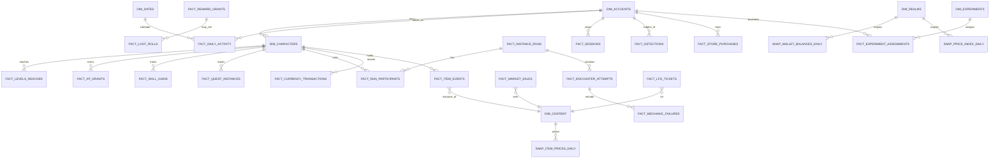

# Legends of the Shattered Frontier — Analytics Part 2: Warehouse Data Model and Canonical Metric Catalog
## Version 1.0 — Expanded Technical Design Authority edition (2026-10-17)

Status: Design target; not implemented. Names per Shared Registry v1.0.

- Entry file: [Analytics Architecture](../Legends_Shattered_Frontier_Analytics_Architecture_v1.0.md)
- Registry: [Shared Registry v1.0](../Legends_Shattered_Frontier_Shared_Registry_v1.0.md)

This part defines the `modeled` layer of the lakehouse (facts, dimensions, snapshots), the control-plane tables that describe metrics and data contracts, and the **canonical metric catalog**: one definition per `m_<snake>` name, with exact formulas, grains, targets, and the resolution of duplicate names proposed by sibling specs.

---

## 1. Modeling conventions

| Convention | Rule |
| --- | --- |
| Table naming | `modeled.dim_<entity_plural>`, `modeled.fact_<process_plural>`, `modeled.snap_<entity_plural>_<grain>` (snake_case, plural per Registry) |
| Time | Every fact has `occurred_at timestamp` (UTC) and `activity_day date` (reset-aligned day of the event's `dc_region`, Pipeline and telemetry part, Stream enrichment) |
| IDs | Registry runtime IDs stored as `string` exactly as emitted; content IDs as `<kind>/<slug>` |
| Money | `bigint` copper (Registry, Naming conventions); never float |
| Test traffic | `is_test_account` on every fact; all metrics filter `is_test_account = false` and `environment = 'prod'` unless the metric says otherwise |
| Late data | Facts are partitioned by `activity_day`; dirty partitions are rebuilt (Pipeline and telemetry part, Late and out-of-order data) |
| Lineage | Every fact row keeps `source_event_id` (the `event_id` that produced it) or `source_event_ids` for accumulating facts |
| Privacy | Modeled tables contain only `p0_public` and `p1_pseudonymous` columns; `p2_personal` lives in `restricted` |

DDL below is Iceberg (Spark SQL dialect) for lakehouse tables and PostgreSQL for control-plane tables (schema `analytics_pipeline`, per Registry naming for `analytics-pipeline`).

---

## 2. Entity relationships (modeled layer)



---

## 3. Dimensions

```sql
CREATE TABLE modeled.dim_accounts (
  account_id            string    NOT NULL,   -- acc_
  created_at            timestamp NOT NULL,   -- auth.account.created occurred_at
  home_dc_region        string    NOT NULL,
  first_active_day      date,                 -- first activity_day with Active(a, d) (§6.1)
  last_active_day       date,
  geo_country           string,               -- derived at ingest, p1
  is_test_account       boolean   NOT NULL,
  first_purchase_at     timestamp,            -- store.purchase.completed first_purchase = true
  permanently_banned_at timestamp,            -- enforcement.sanction.applied, sanction_type = permanent_ban, not lifted
  ban_offense_category  string,
  mfa_enrolled          boolean   NOT NULL,
  current_risk_band     string,               -- from security.score.changed (band only)
  valid_from            timestamp NOT NULL,   -- SCD2
  valid_to              timestamp,
  is_current            boolean   NOT NULL
) USING iceberg PARTITIONED BY (bucket(16, account_id));

CREATE TABLE modeled.dim_characters (
  character_id       string    NOT NULL,      -- chr_
  account_id         string    NOT NULL,
  realm_id           string    NOT NULL,
  created_at         timestamp NOT NULL,      -- character.profile.created
  deleted_at         timestamp,               -- character.profile.deleted
  current_level      int       NOT NULL,      -- latest progression.level.reached.level
  progression_band   int       NOT NULL,
  prestige_rank      int       NOT NULL,
  level_100_at       timestamp,
  primary_combat_role string,                 -- most-queued combat_role, last 30 days (group.queue.joined)
  skill_total        int       NOT NULL,      -- global_total_after of latest progression.skill.gained
  is_test_account    boolean   NOT NULL,
  valid_from         timestamp NOT NULL,
  valid_to           timestamp,
  is_current         boolean   NOT NULL
) USING iceberg PARTITIONED BY (realm_id);

CREATE TABLE modeled.dim_content (
  content_id       string NOT NULL,           -- <kind>/<slug>
  content_kind     string NOT NULL,
  content_version  int    NOT NULL,           -- first pack where these attributes hold
  attributes       map<string,string>,        -- rarity, ilvl, category, quest_type, dungeon_type, difficulty set, track ...
  valid_to_version int
) USING iceberg PARTITIONED BY (content_kind);
ALTER TABLE modeled.dim_content SET IDENTIFIER FIELDS content_id, content_version;

CREATE TABLE modeled.dim_realms (
  realm_id   string NOT NULL,                 -- 'na-1'
  dc_region  string NOT NULL,
  realm_role string NOT NULL,                 -- canary | standard (LiveOps)
  opened_at  timestamp NOT NULL,
  closed_at  timestamp
) USING iceberg;

CREATE TABLE modeled.dim_dates (
  activity_day   date   NOT NULL,
  dc_region      string NOT NULL,
  day_start_utc  timestamp NOT NULL,          -- daily reset (Registry, Resets)
  week_start_day date   NOT NULL,             -- weekly reset day containing activity_day
  season_id      string,                      -- ssn_ active at day_start
  tier_week      int,                         -- weeks since raid tier start (Raid analytics dimension)
  is_event_day   boolean NOT NULL             -- ≥ 1 liveops event active on any realm of the region
) USING iceberg;

CREATE TABLE modeled.dim_experiments (
  experiment_id  string NOT NULL,             -- exp_ (proposed prefix)
  flag_key       string NOT NULL,             -- ff.* or tune.* key in config-service
  salt           string NOT NULL,
  arms           array<struct<arm:string, bp_from:int, bp_to:int, value:string>>,
  starts_at      timestamp NOT NULL,
  ends_at        timestamp,
  primary_metric string NOT NULL
) USING iceberg;
```

---

## 4. Facts and snapshots

### 4.1 Engagement

```sql
CREATE TABLE modeled.fact_daily_activity (       -- grain: account × realm × activity_day
  account_id      string NOT NULL,
  realm_id        string NOT NULL,
  dc_region       string NOT NULL,
  activity_day    date   NOT NULL,
  characters_active int  NOT NULL,
  sessions        int    NOT NULL,              -- merged sessions started this day
  played_seconds  bigint NOT NULL,
  active_seconds  bigint NOT NULL,
  max_level       int    NOT NULL,
  client_build    string,
  is_new_account  boolean NOT NULL,             -- activity_day = first_active_day
  is_test_account boolean NOT NULL
) USING iceberg PARTITIONED BY (activity_day);

CREATE TABLE modeled.fact_sessions (             -- grain: merged session
  merged_session_id string NOT NULL,           -- first ses_ of the merge group
  account_id      string NOT NULL,
  dc_region       string NOT NULL,
  started_at      timestamp NOT NULL,
  ended_at        timestamp NOT NULL,
  end_reason      string NOT NULL,             -- logout | timeout | client_crash | server_disconnect
  auth_session_ids array<string> NOT NULL,
  play_sessions   int    NOT NULL,
  played_seconds  bigint NOT NULL,
  active_seconds  bigint NOT NULL,
  crashed         boolean NOT NULL,            -- ≥ 1 client.crash.reported with crashed_session_id in auth_session_ids
  client_build    string,
  platform        string,
  activity_day    date   NOT NULL              -- of started_at
) USING iceberg PARTITIONED BY (activity_day);
```

### 4.2 Progression (Character spec, Service interfaces part, Domain events)

```sql
CREATE TABLE modeled.fact_levels_reached (
  source_event_id string NOT NULL,
  character_id    string NOT NULL,
  account_id      string NOT NULL,
  realm_id        string NOT NULL,
  level           int    NOT NULL,              -- progression.level.reached.level
  previous_level  int    NOT NULL,
  progression_band int   NOT NULL,
  seconds_since_previous_level bigint,
  active_hours_since_creation double NOT NULL,  -- from clean.activity_minutes
  calendar_days_since_creation int NOT NULL,
  cause           string NOT NULL,
  occurred_at     timestamp NOT NULL,
  activity_day    date NOT NULL
) USING iceberg PARTITIONED BY (activity_day);

CREATE TABLE modeled.fact_xp_grants (
  source_event_id string NOT NULL,
  character_id    string NOT NULL,
  realm_id        string NOT NULL,
  source_kind     string NOT NULL,
  reward_grant_id string,
  base_amount     bigint NOT NULL,
  amount          bigint NOT NULL,
  applied_to      string NOT NULL,              -- level | prestige
  level_after     int    NOT NULL,
  liveops_event_id string,                      -- envelope correlation_id when it is lop_
  occurred_at     timestamp NOT NULL,
  activity_day    date NOT NULL
) USING iceberg PARTITIONED BY (activity_day);
-- multipliers (p2_personal per Character spec) are kept in restricted.xp_multipliers for 30 days

CREATE TABLE modeled.fact_skill_gains (           -- one row per progression.skill.gained (already batched by producer)
  source_event_id string NOT NULL,
  character_id    string NOT NULL,
  skill_id        string NOT NULL,
  track           string NOT NULL,
  delta           int    NOT NULL,
  value_after     int    NOT NULL,
  band_after      string NOT NULL,
  gain_checks     int    NOT NULL,
  dampened_fatigue boolean NOT NULL,            -- dampening.dr_min < 1
  dampened_antimacro boolean NOT NULL,          -- dampening.am_min < 1
  donor_skill_id  string,
  global_total_after int NOT NULL,
  occurred_at     timestamp NOT NULL,
  activity_day    date NOT NULL
) USING iceberg PARTITIONED BY (activity_day, track);
```

`modeled.snap_skill_values_daily` (character × skill × day: latest `value_after`, `band_after`) is derived from `fact_skill_gains` by carry-forward and feeds skill distributions.

### 4.3 Quests (Quest spec, Rewards, data and API part, Domain events)

```sql
CREATE TABLE modeled.fact_quest_instances (       -- accumulating snapshot, grain: quest_instance_id (qst_)
  quest_instance_id string NOT NULL,
  quest_id        string NOT NULL,              -- quest/<slug> or generated gqd_
  quest_type      string NOT NULL,
  character_id    string NOT NULL,
  realm_id        string NOT NULL,
  chain_id        string,
  chain_step      int,
  offered_at      timestamp,
  accepted_at     timestamp,
  ready_at        timestamp,                    -- last quest.objective.completed with instance_ready = true
  completed_at    timestamp,
  turned_in_at    timestamp,
  final_state     string,                       -- quest_instance_state when terminal
  terminal_at     timestamp,
  failure_reason  string,
  abandon_from_state string,
  progress_ratio_at_exit double,
  duration_s      int,                          -- quest.instance.completed.duration_s
  completion_mode string,
  reward_grant_id string,
  w_eff           double,
  level_at_accept int,
  source_event_ids array<string> NOT NULL,
  activity_day    date NOT NULL                 -- of accepted_at, else offered_at
) USING iceberg PARTITIONED BY (activity_day);
```

`modeled.fact_quest_objectives` (quest_instance_id × objective_key: `seconds_since_accept` at completion) supports `m_quest_objective_dropoff`; `modeled.fact_campaign_stages` mirrors `quest.campaign.stage_reached`.

### 4.4 Dungeons and raids (Dungeon spec, Instance runtime and Encounters parts; Raid spec, Data, API, events part)

```sql
CREATE TABLE modeled.fact_instance_runs (          -- grain: run_id
  run_id          string NOT NULL,
  content_id      string NOT NULL,              -- dungeon/<slug> or raid/<slug>
  content_kind    string NOT NULL,              -- dungeon | raid
  dungeon_type    string,
  difficulty      string NOT NULL,
  mythic_level    int,
  group_size_class string NOT NULL,
  formed_by       string NOT NULL,              -- lfg | premade (instance.run.created.formed_by)
  realm_id        string NOT NULL,
  season_id       string,
  affix_ids       array<string>,
  created_at      timestamp NOT NULL,
  started_at      timestamp,
  provisioning_ms int,
  terminal_state  string,                       -- completed | failed | abandoned (instance_run_state)
  terminal_reason string,
  duration_ms     bigint,                       -- instance.run.completed.duration_ms
  mythic_timed    boolean,
  deaths          int,
  wipes           int,
  encounters_defeated int,
  closed_at       timestamp,
  activity_day    date NOT NULL
) USING iceberg PARTITIONED BY (activity_day, content_kind);

CREATE TABLE modeled.fact_encounter_attempts (     -- grain: attempt_id (att_)
  attempt_id      string NOT NULL,
  run_id          string NOT NULL,
  encounter_id    string NOT NULL,
  content_id      string NOT NULL,
  content_kind    string NOT NULL,
  difficulty      string NOT NULL,
  mythic_level    int,
  attempt_index   int NOT NULL,
  group_size      int NOT NULL,                 -- raid: raid.n_eng
  outcome         string,                       -- encounter_attempt_outcome
  duration_ms     bigint,
  final_phase     string,                       -- dungeon final_phase or raid.phase_reached
  boss_health_pct double,
  enrage_reached  string,
  wipe_cause      string,                       -- raid.wipe_cause (raids only)
  deaths          int,
  mechanic_failures int,
  rpr_id          string,                       -- raid progress record
  pull_number     int,
  tuning_version  int,
  resolve_pct     double,
  ready_check_passed_within_120s boolean,
  started_at      timestamp NOT NULL,
  ended_at        timestamp,
  activity_day    date NOT NULL
) USING iceberg PARTITIONED BY (activity_day, content_kind);
```

Also: `modeled.fact_run_participants` (run_id × character_id, from `members`), `modeled.fact_encounter_phases` (attempt × `to_phase` with `elapsed_ms`), `modeled.fact_mechanic_failures` (attempt × mechanic_id × character_id, count), `modeled.fact_lockouts`, `modeled.fact_lfg_tickets` (ticket_id: joined_at, roles, bucket, matched_at, left_reason, wait_ms, from `group.queue.*`), `modeled.fact_ready_checks`, `modeled.fact_group_leaves` (deserter and vote-kick flags from `group.member.left.reason`).

### 4.5 Items, loot and rewards (Itemization spec, Item model and lifecycle part; Loot and rewards part)

```sql
CREATE TABLE modeled.fact_item_events (            -- grain: event; covers created/destroyed/bound/broken/repaired/salvaged/modified/quarantined
  source_event_id string NOT NULL,
  event_kind      string NOT NULL,              -- created | destroyed | bound | broken | repaired | salvaged | modified | quarantined
  item_id         string NOT NULL,
  definition_id   string NOT NULL,
  rarity          string NOT NULL,
  category        string NOT NULL,
  ilvl            int,
  quantity        int NOT NULL,
  character_id    string,
  realm_id        string NOT NULL,
  source_or_sink  string,                       -- Registry source/sink code
  reward_grant_id string,
  loot_roll_id    string,
  cost_copper     bigint,                       -- repaired
  vendor_value_copper bigint,                   -- destroyed
  reason          string,
  occurred_at     timestamp NOT NULL,
  activity_day    date NOT NULL
) USING iceberg PARTITIONED BY (activity_day, event_kind);
```

Also `modeled.fact_loot_rolls` (`loot.table.rolled` + `loot.drop.created`), `modeled.fact_loot_assignments`, `modeled.fact_pity_triggers`, `modeled.fact_reward_grants` (accumulating: issued → delivered/failed/revoked with `latency_ms`, gold, marks, xp, lp), `modeled.fact_equip_snapshots` (`inventory.item.equipped.equipped_ilvl_avg` latest per character per day), `modeled.fact_legendary_progress`.

### 4.6 Economy

```sql
CREATE TABLE modeled.fact_currency_transactions (  -- grain: txn_ (one row per credit or debit)
  txn_id          string NOT NULL,
  direction       string NOT NULL,              -- credit | debit
  currency_id     string NOT NULL,              -- currency/gold ...
  amount          bigint NOT NULL,              -- positive minor units
  balance_after   bigint,
  source_sink     string NOT NULL,              -- Registry source or sink code
  flow_class      string NOT NULL,              -- faucet | sink | transfer | correction (§6.6)
  owner_kind      string NOT NULL,              -- character | account | guild
  owner_id        string NOT NULL,
  account_id      string,
  realm_id        string NOT NULL,
  level_band      int,
  reward_grant_id string,
  liveops_event_id string,                      -- correlation_id when lop_
  compensation_id string,                       -- causation_id when cmpg_
  config_version  bigint,
  occurred_at     timestamp NOT NULL,
  activity_day    date NOT NULL
) USING iceberg PARTITIONED BY (activity_day, currency_id);

CREATE TABLE modeled.fact_market_sales (           -- grain: market.listing.sold
  listing_id      string NOT NULL,              -- lst_
  item_definition_id string NOT NULL,
  quantity        int    NOT NULL,
  unit_price_copper bigint NOT NULL,
  total_copper    bigint NOT NULL,
  fee_copper      bigint NOT NULL,
  market_scope    string NOT NULL,              -- global_exchange | regional
  dc_region       string NOT NULL,
  realm_id        string NOT NULL,
  seller_account_id string NOT NULL,
  buyer_account_id  string NOT NULL,
  flagged         boolean NOT NULL,             -- security.trade.flagged with transfer_ref = listing_id
  occurred_at     timestamp NOT NULL,
  activity_day    date NOT NULL
) USING iceberg PARTITIONED BY (activity_day);

CREATE TABLE modeled.snap_wallet_balances_daily (  -- from economy-service nightly export (§5)
  snapshot_day    date   NOT NULL,
  realm_id        string NOT NULL,
  owner_kind      string NOT NULL,
  owner_id        string NOT NULL,
  account_id      string,
  currency_id     string NOT NULL,
  balance         bigint NOT NULL
) USING iceberg PARTITIONED BY (snapshot_day, currency_id);

CREATE TABLE modeled.snap_item_prices_daily (
  price_day       date   NOT NULL,
  dc_region       string NOT NULL,
  item_definition_id string NOT NULL,
  vw_median_unit_price_copper bigint,           -- §6.6
  units_sold      bigint NOT NULL,
  sales           int    NOT NULL,
  imputed         boolean NOT NULL
) USING iceberg PARTITIONED BY (price_day);

CREATE TABLE modeled.snap_price_index_daily (
  index_day       date   NOT NULL,
  dc_region       string NOT NULL,
  basket_version  int    NOT NULL,
  index_value     double NOT NULL,              -- m_inflation_index
  economy_published_value double,               -- economy.index.computed, for reconciliation
  items_imputed   int    NOT NULL
) USING iceberg PARTITIONED BY (index_day);
```

Also `modeled.fact_trades` (`economy.trade.completed`), `modeled.fact_market_listings` (created/expired/cancelled for spoofing features), `modeled.fact_crafting` and `modeled.fact_gathering` (Crafting events).

### 4.7 Security, LiveOps, store, client and server

| Table | Grain | Source events (owning spec section) |
| --- | --- | --- |
| `fact_detections` | `det_` | `security.detection.raised`, later labels (Security spec, Audit, operations and interfaces part, Events) |
| `fact_enforcement_cases` | `cas_` accumulating | `enforcement.case.opened/resolved`, `enforcement.appeal.submitted` |
| `fact_sanctions` | `snc_` | `enforcement.sanction.applied/lifted` |
| `fact_rollbacks` | rollback_id | `enforcement.rollback.executed` |
| `fact_action_rejects_hourly` | realm × zone × reason × hour | `security.action.rejected` (rollups) |
| `fact_liveops_events` | `lop_` accumulating | `liveops.event.scheduled/started/ended` (LiveOps spec, APIs, events and implementation part) |
| `fact_seasons` | `ssn_` × dc_region | `liveops.season.started/ended` |
| `fact_config_changes` | `cfg_` | `config.flag.changed`, `config.tuning.published` |
| `fact_releases` | `rel_` | `liveops.release.deployed` |
| `fact_compensations` | `cmpg_` | `liveops.compensation.granted` |
| `fact_store_purchases` | `pur_` accumulating | `store.purchase.completed/refunded` |
| `fact_store_offer_views` | event | `store.offer.viewed` |
| `fact_survey_responses` | survey × account | `client.survey.submitted` (answers only; text in `restricted`) |
| `fact_client_perf_5m` | session × 5-min | `client.perf.sampled` |
| `fact_crashes` | crash report | `client.crash.reported` |
| `fact_loads` | event | `client.load.completed` |
| `fact_ui_interactions` | event | `client.ui.interacted` |
| `fact_server_ticks_5m` | `srvi_` × 5-min | `ops.server.tick_sampled` |
| `fact_zone_load_5m` | zone × 5-min | `ops.zone.load_sampled` |
| `fact_service_health` | transition | `ops.service.health_changed` |
| `fact_alerts` | `alr_` accumulating | `ops.alert.fired` |
| `fact_world_events` | `wev_` | `world.event.*` |
| `fact_combat_deaths` | event | `combat.character.died` |
| `fact_experiment_assignments` | experiment × account | deterministic re-bucketing (Dashboards, alerting and privacy part, Experimentation) |

---

## 5. Canonical event and snapshot inputs

Payload contracts are canonical in their owning expanded specs. These rows locate each producer definition and state the Analytics projection/warehouse consumers; the producer contract itself is not redefined here.

| Event | Fields Analytics requires | Metrics blocked without them |
| --- | --- | --- |
| `economy.currency.credited` / `debited`, `market.listing.sold`, `economy.trade.completed`, `economy.index.computed` | Economy spec, Economy Balancing, Inflation and Events, Event payloads | `fact_currency_transactions`, `fact_market_sales`, `fact_trades`, price and inflation snapshots |
| Nightly wallet export / `economy.snapshot.exported` | Economy spec, Economy Balancing, Inflation and Events, Wallet snapshot export and `economy.snapshot.exported` | `snap_wallet_balances_daily`, money supply and Gini |
| `auth.login.failed`, `auth.session.ended` | Backend spec, Identity, Gateway and Characters, Backend events; Backend spec, Privacy, Transfers and Operations, Auth events | login success and crash attribution |
| `character.world.entered` / `left` | Backend spec, Identity, Gateway and Characters, Character events | play sessions |
| `combat.character.died`, `combat.damage.summarized`, `combat.npc.killed` | Combat spec, Combat events | death heatmaps and combat metrics |
| `gathering.node.harvested`, `crafting.*` | Crafting spec, Data, API and implementation guide, Event production; Crafting spec, Gathering and Resources, Event payloads | gathering and crafting facts/metrics |
| `world.poi.discovered`, `world.terrain.modified`, `world.realm.state_changed`, `world.weather.changed` | World spec, Terrain, resources and population, Event payloads; World spec, Server fleet and realms, Event payloads | world-operation metrics |
| `world.event.*`, `world.director.decided` | AI spec, World Director and Dynamic Events, Event payloads | director and event metrics |

---

## 6. Canonical metric catalog

### 6.0 Catalog rules

1. One name = one definition = one SQL model in `metrics/` (Agent implementation guide part). Definitions are versioned (`metric_version`); changing a formula bumps the version and the old series stays queryable.
2. Ratios are computed from summed numerators and denominators at the requested grain, never by averaging finer-grain ratios.
3. Default filters: `environment = 'prod'`, `is_test_account = false`. Population "active" = `Active(a, d)` (§6.1).
4. Default dimensions available on every metric where meaningful: `dc_region`, `realm_id`, `activity_day`, `content_version`, `client_build`, `level_band` (= `progression_band`), `season_id`, `experiment arm`.
5. Every metric has a freshness class (Pipeline and telemetry part, Freshness SLAs) and an owner spec (who sets targets). Analytics owns the formula.
6. Cohort metrics are reported with sample size `n`; cells with `n < 50` are suppressed on dashboards (Dashboards, alerting and privacy part, Access control).

Metrics defined by the expanded specs are registered in this catalog by domain: Combat spec, Combat events and Analytics hooks; Economy spec, Analytics hooks; World spec, Analytics hooks; AI spec, Analytics hooks; Crafting spec, Analytics hooks; Backend spec, Analytics hooks. Their owned metric names, formulas and targets remain in those cited hooks; the catalog resolves duplicates and names listed below.

| Domain | Canonical metric source | Catalog pointer |
| --- | --- | --- |
| Combat | Combat spec, Abilities, Effects and Runtime, Durable outbox and event emission; Combat spec, Combat events | Combat payloads and profile metrics |
| Economy | Economy Agent implementation guide, Analytics hooks | Economy event payloads and wallet snapshot export |
| World | World spec, Terrain, resources and population; Server fleet and realms; Cells, movement and handoffs, Analytics hooks | `m_*` hooks in each World part |
| AI | AI spec, Factions and faction service, Analytics hooks | Faction, director and event metrics in their owning parts |
| Crafting | Crafting spec, Salvage and economic balancing, Balancing targets, metrics and alerts; Gathering and resources, Other targets | Crafting and gathering metrics in the owning parts |
| Backend | Backend spec, Privacy, transfers and operations, Platform metrics | Backend service and privacy metrics in the owning part |

### 6.1 Engagement and retention

Definitions:

```text
Active(a, d)  ⇔ account a has, on activity_day d, ≥ 1 character.world.entered
                 or ≥ 1 client.session.heartbeat with in_world = true
                 (excluding test accounts; d is the reset-aligned day of the account's home_dc_region)
A(d1..d2)     = { a : ∃ d ∈ [d1, d2] with Active(a, d) }
Cohort C(d)   = { a : first_active_day(a) = d }, excluding accounts permanently banned for
                 offense_category ∈ {botting, rmt, exploit} within 30 days of creation (cohorts restate)
```

| Metric | Formula | Grain / freshness | Target (owner) |
| --- | --- | --- | --- |
| `m_dau` | `|A(d..d)|` | day; `realtime` partial-day, final `daily` | per plan (LiveOps) |
| `m_dau_characters` | distinct characters with world entry or in-world heartbeat on d | day | — (LiveOps faucet model input) |
| `m_wau` | `|A(d−6..d)|` | day | — |
| `m_mau` | `|A(d−29..d)|` | day | ≥ 0 % season-over-season (LiveOps) |
| `m_dau_mau_ratio` (stickiness) | `(1/7) Σ_{k=0..6} m_dau(d−k) / m_mau(d−k)` | day | ≥ 0.30, alert < 0.22 (LiveOps) |
| `m_d1_retention`, `m_d7_retention`, `m_d30_retention` | `R_N(d) = |{a ∈ C(d) : Active(a, d+N)}| / |C(d)|`, N = 1, 7, 30; headline value = cohort-size-weighted mean over the last 7 cohorts with complete data | cohort day; `daily` (available d+N+1) | ≥ 45 % / ≥ 25 % / ≥ 12 % (LiveOps) |
| `m_churn_rate_30d` | `|A(d−59..d−30) \ A(d−29..d)| / |A(d−59..d−30)|` | day | ≤ 30 %, alert > 38 % (LiveOps) |
| `m_reactivation_rate_30d` | per season s: `|{a lapsed at season start (no activity for ≥ 30 days) and Active on ≥ 1 day in s}| / |lapsed at season start|` | season | ≥ 8 % (LiveOps) |
| `m_session_length_minutes_p50` | median of `(ended_at − started_at)` over `fact_sessions` ending in window, sessions ≥ 1 min | day; `hourly` | 60–120 min (LiveOps) |
| `m_sessions_per_dau` | merged sessions started on d / `m_dau(d)` | day | ≥ 1.4 |
| `m_weekly_hours_per_wau` | Σ `played_seconds`/3600 over the weekly-reset week / `m_wau` at week end | week | 8–14 h |
| `m_event_dau_lift` | `m_dau(event days) / mean m_dau(same weekdays, 28 days before event) − 1` per realm cohort | event | LiveOps targets |
| `m_event_participation_rate` | characters with ≥ 1 credit, grant, or contribution correlated to `lop_` / `m_dau_characters` averaged over event days | event | ≥ 50 % major, ≥ 25 % minor (LiveOps) |

Churn definition (canonical): an account is **churned** on the first day it has been inactive for 30 consecutive activity days; it is **reactivated** on its next active day. `m_churn_rate_30d` is the population rate; per-account state lives in `modeled.dim_accounts.last_active_day`.

Worked example (retention). Cohort `C(2026-11-02)` on `eu` has 1,000 accounts after removing 18 accounts banned for botting in their first week. 452 are active on 11-03 → `R_1` = 45.2 %; 241 on 11-09 → `R_7` = 24.1 %; 118 on 12-02 → `R_30` = 11.8 % (below the 12 % target, above the 9 % alert line). Stickiness: DAU 32,000, MAU 104,000 → 0.308 that day.

### 6.2 Progression (adopted from Character spec, Service interfaces part, Analytics hooks)

| Metric | Formula | Grain |
| --- | --- | --- |
| `m_time_to_level_hours` (dim `level` ∈ {10, 25, 50, 75, 100}) | median over characters created in a cohort season of `active_hours_since_creation` at first `fact_levels_reached.level = level`; reported together with `reach_share` = reached / cohort | season cohort, weekly |
| `m_progression_funnel` (dim `milestone` ∈ {5, 10, 20, 30, 50, 75, 100}, `within_days` ∈ {7, 30, 90}) | share of first characters of cohort `C(d)` reaching level `milestone` within `within_days` calendar days | cohort |
| `m_level_distribution` | count of `Active` characters by `current_level` and band on day d | day |
| `m_median_active_level` | median `current_level` of characters active on d (LiveOps input `L̄`) | day |
| `m_xp_source_share` | Σ `amount` by `source_kind` / Σ `amount`, per band, `applied_to = level` | week |
| `m_quest_xp_share` | `m_xp_source_share` restricted to XP whose `reward_grant_id` belongs to a grant with `source = quest_reward` | week |
| `m_skill_gains_per_active_hour` | Σ `delta` (> 0) / active hours, by skill and band | week |
| `m_time_to_skill_band_hours` (dim `band` ∈ {master, legendary}) | median active hours from character creation to first `progression.skill.band_reached` with that band and `first_time = true` | season cohort |
| `m_skill_band_distribution` | characters per `skill_id × band_after` in `snap_skill_values_daily`, active characters level ≥ 20 | day |
| `m_fatigue_dampened_share`, `m_antimacro_dampened_share` | share of `fact_skill_gains` rows with the flag | day |
| `m_rested_xp_share`, `m_diversity_mean` | computed daily inside `restricted` from `multipliers` (p2 per Character spec); only the aggregates leave | day |
| `m_lp_balance_p50` | median `balance_after` of latest `progression.lp.*` among level-100 actives | week |
| `m_specialization_pick_share` | picks per `specialization_id` / picks in its track | season |
| `m_prestige_ranks_per_100h` | ranks reached / active hours at cap × 100 | week |
| `m_achievement_completion_rate` | earned / active characters eligible, per achievement and season | season |
| `m_trivial_practice_share`, `m_cap_blocked_gains` | from service counters (Pipeline and telemetry part, Service metrics bridge) | day |

Targets come from the Character spec (Leveling part): median `m_time_to_level_hours{level=100}` in 165–190 active hours; alert if < 120 h. Alerts on `m_antimacro_dampened_share` > 8 % and any XP source share > 60 % (Character spec, Service interfaces part, Analytics hooks).

Worked example (time to level). Season cohort of 20,000 characters; 4,100 reached level 100 by season end (`reach_share` 20.5 %); their median active hours at level 100 = 172.4 h → inside the 165–190 band. Censoring is explicit: the median is over reachers only and is never extrapolated.

### 6.3 Quests (adopted from Quest spec, Rewards, data and API part, Analytics hooks)

| Metric | Formula |
| --- | --- |
| `m_quest_acceptance_rate` | accepted / offered per `quest_id` (instances with `offered_at` in window) |
| `m_quest_completion_rate` | instances with `completed_at` ≤ `accepted_at` + 14 d / accepted, for accept cohorts at least 14 d old (`tune.analytics.quest_completion_horizon_days`) |
| `m_quest_abandon_rate` | `final_state = abandoned` and `abandon_from_state = active` / accepted |
| `m_quest_fail_rate` (new) | `final_state = failed` / accepted |
| `m_quest_median_minutes` | median `duration_s` / 60 by `quest_id` and `quest_type` |
| `m_quest_objective_dropoff` | for a quest with objectives ordered by median completion time `o_1..o_k`: `max_i (n(o_i) − n(o_{i+1})) / n(o_i)` where `n(o)` = instances completing `o` |
| `m_quest_gold_faucet_share` | Σ gold credits `source = quest_reward` / Σ gold credits with `flow_class = faucet`, 7 days, by band (Quest spec, Gold faucet share, divides by all sources; see §7) |
| `m_quest_marks_share` | marks credited `source = quest_reward` / all marks credited, per week |
| `m_quest_choice_split` | share per `option` within `choice_key` |
| `m_generated_quest_rejection_rate`, `m_generated_quest_uptake` | per Quest definitions from `quest.template.generated` |
| `m_campaign_participation_rate`, `m_campaign_stage_hours`, `m_campaign_cap_hit_rate` | per Quest definitions from `quest.campaign.*` |
| `m_llm_text_fallback_rate`, `m_llm_text_cache_hit_rate`, `m_llm_text_reject_rate`, `m_quest_turn_in_pending_age`, `m_quest_event_lag_ms` | service counters via the metrics bridge |

Worked example (completion/abandon). Quest `quest/frontier_founder`, accept cohort of week 45: offered 12,400, accepted 11,160 (acceptance 90.0 %), completed within 14 d 9,820 (88.0 %), abandoned from active 640 (5.7 %), failed 85 (0.8 %); remaining 615 still active at horizon count as neither.

### 6.4 Dungeons, raids and groups (adopted from Dungeon and Raid specs, Analytics hooks)

| Metric | Formula |
| --- | --- |
| `m_dungeon_completion_rate` | runs with `terminal_state = completed` / runs with `terminal_state` ∈ {completed, abandoned, failed}, per `content_id`, `difficulty`, `content_kind = dungeon`, by run close time |
| `m_raid_completion_rate` (new) | same for `content_kind = raid`, counting a run completed when every encounter of the wing was defeated |
| `m_encounter_wipe_rate` | attempts with `outcome = wiped` / attempts with `outcome` ∈ {defeated, wiped}, per encounter, difficulty, M (dungeons and raids; `abandoned` and `invalidated` excluded) |
| `m_encounter_ttk_p50` | median `duration_ms` of defeated attempts vs encounter TTK target (dungeons and raids) |
| `m_dungeon_run_duration_p50` | median `duration_ms` of completed runs |
| `m_instance_provision_p95`, `m_instance_failure_rate` | per Dungeon definitions |
| `m_mythic_timed_rate_by_level` | `mythic_timed = true` / completed per `mythic_level` |
| `m_mechanic_fail_rate` | Σ `count` of `encounter.mechanic.failed` / attempts, per mechanic |
| `m_raid_wipe_funnel` | per encounter and difficulty, for phase step `k`: attempts with any `encounter.phase.changed.to_phase ≥ k` / attempts started; final step = defeated / started |
| `m_raid_wipe_cause_share` | wipes by `raid.wipe_cause` / wipes |
| `m_raid_attempts_to_first_kill` | `pull_number` of the first defeated attempt per `rpr_id` × encounter × difficulty |
| `m_raid_kill_rate_first_week` | groups (`rpr_id`) with a kill / groups with ≥ 10 pulls, in `tier_week = 1` |
| `m_raid_weekly_participation` | level-100 weekly actives with ≥ 1 raid kill / level-100 weekly actives |
| other `m_raid_*` | as defined in Raid spec, Data, API, events part, Analytics hooks |
| `m_lfg_wait_time_p50_by_role` | median `wait_ms` of matched tickets per role and bucket |
| `m_ready_check_fail_rate`, `m_deserter_rate`, `m_vote_kick_rate` | per Dungeon definitions |

Worked example (wipe rate). `encounter/ashen_citadel_warden` heroic, tier week 2: 1,240 attempts started, 36 abandoned, 4 invalidated, 1,050 wiped, 150 defeated → `m_encounter_wipe_rate` = 1,050 / 1,200 = 87.5 %. Funnel: 1,240 started, 890 reach phase 2 (71.8 %), 410 reach phase 3 (33.1 %), 150 defeated (12.1 %) → phase 2→3 is the wall.

### 6.5 Items and rewards (adopted from Itemization spec, Agent implementation guide part, Analytics hooks)

All 22 Itemization metrics are adopted with their stated definitions and targets (`m_items_created_by_source` … `m_affix_utilisation`). Analytics adds:

| Metric | Formula |
| --- | --- |
| `m_items_created_per_active_hour` | Σ `quantity` of `fact_item_events` created with source ∉ {`trade_receive`, `market_sale`} / active hours (LiveOps guardrail) |
| `m_legendary_drop_rate` | `loot.drop.created` with `rarity = legendary` / `loot.table.rolled` result entries, per table (LiveOps guardrail for loot keys) |
| `m_hours_to_ilvl_tier` | played hours from `level_100_at` until the first daily `equipped_ilvl_avg` ≥ tier ∈ {405, 415, 420, 430, 445, 460} |
| `m_days_to_ilvl_tier` | same in calendar days (canonical home of Dungeon's `m_dungeon_ilvl_pace`, §7) |

### 6.6 Economy health

**Flow classes.** Every gold transaction is classified once, in `fact_currency_transactions.flow_class`:

| Class | Codes (Registry, Currencies, sources and sinks) |
| --- | --- |
| `transfer` | sources `market_sale`, `trade_receive`, `settlement_tax_income`; sinks `trade_send`, `market_purchase`, `settlement_tax_paid` (§7) |
| `correction` | sinks `enforcement_rollback`, `account_erasure`, `guild_dissolution`; any credit whose `causation_id` is a rollback (refunds) |
| `faucet` | every other source |
| `sink` | every other sink |

Gold amounts in formulas are in copper; dashboards show gold (÷ 10,000).

| Metric | Formula | Grain | Target / alert |
| --- | --- | --- | --- |
| `m_gold_created` | `F(w) = Σ amount`, credits, `currency/gold`, `flow_class = faucet` | hour/day/week | — |
| `m_gold_destroyed` | `S(w) = Σ amount`, debits, `flow_class = sink` | hour/day/week | — |
| `m_gold_faucet_sink_ratio` | `FSR(w) = F(w) / max(S(w), 1)` | day (alert), week (target) | weekly 0.90–1.15 per realm; alert §Alert rules |
| `m_gold_money_supply` | `M(t) = Σ balance` in `snap_wallet_balances_daily` for `currency/gold`, all owner kinds | day | — |
| `m_gold_money_supply_growth_wow` | `100 × (M(t) / M(t−7) − 1)` | day | ≤ +5 % in a non-launch week |
| `m_gold_ledger_residual` | `M(t) − M(t−1) − (Σ credits − Σ debits over the day)` (all flow classes) | day | must be 0 (mirror of Security INV-8) |
| `m_gold_created_per_active_hour` | `F(w)` / active hours | hour | LiveOps guardrail |
| `m_event_gold_created` | `F(w)` restricted to credits with `liveops_event_id` set | event | LiveOps budget |
| `m_inflation_index` | Laspeyres basket index (below) | day per dc_region | — |
| `m_gold_inflation_index_wow` | `100 × (I(d) / I(d−7) − 1)` | day | within ±2 % w/w during events (LiveOps); alert §Alert rules |
| `m_wealth_gini` | Gini over liquid gold per account (below) | day per realm | 0.55–0.75 (illustrative; Economy owns) |
| `m_market_velocity` | `V(w) = (Σ total_copper of fact_market_sales + Σ gold moved in fact_trades) / mean_{t∈w} M(t)` | week per realm | 0.15–0.40 per week (illustrative) |
| `m_marks_from_dungeons_per_char_week`, `m_marks_time_to_cap_hours` | per Dungeon / LiveOps definitions over `currency/frontier_marks` | week | specs |
| `m_season_tokens_expired_ratio` | per LiveOps definition | season | LiveOps |

**Inflation index (reference computation).** Economy owns the official index and publishes `economy.index.computed` using the same basket rules, weights and base period as this Analytics Laspeyres calculation (Economy spec, Inflation index). Analytics recomputes `m_inflation_index` from Economy's published basket and its own data cut-off, stores both values in `snap_price_index_daily`, and alerts on divergence > 1 index point; differences reflect data timing.

Basket (per dc_region, `basket_version` fixed for a season):

1. Candidate items: `item/` and `resource/` definitions sold on the `global_exchange`, tradeable (`binding = none`), not event-limited, not `currency/*`.
2. Eligibility in the base period (first 14 days of the season, excluding launch week of a new realm): sold on ≥ 12 of 14 days and ≥ 1,000 units per week in the region.
3. Composition target: 24 items — 8 raw resources (mining, logging, herbalism, farming/hunting outputs across `common`/`uncommon`/`rare` tiers), 6 refined crafting materials, 6 consumables (potions, food), 4 mid-level crafted gear pieces (ilvl band 200–400, `uncommon`/`rare`). If a group lacks eligible items, its weight is redistributed proportionally.
4. Weight `w_i = p_{i,0} q_{i,0} / Σ_j p_{j,0} q_{j,0}` from base-period value traded; any `w_i` > 0.15 is capped at 0.15 and the excess redistributed proportionally (`tune.analytics.basket_weight_cap`).

Daily price `p_{i,d}` = volume-weighted median unit price of `fact_market_sales` for item `i` on day `d`, after removing sales with `flagged = true` and sales with unit price outside `[0.2, 5] ×` the item's trailing 7-day median. Missing day: carry forward the last price for ≤ 3 days, then impute `p_{i,d} = p_{i,0} × (category relative of the other basket items in its group)` and set `imputed = true`.

```text
I(d) = 100 × Σ_i w_i × (p_{i,d} / p_{i,0})                     (within a season)
I_chain(d) = I_chain(season_start) × I(d) / 100                  (chained across seasons; I_chain(launch) = 100)
```

Worked example (4-item illustrative basket, eu). Base period: iron ore p₀ = 120 copper, q₀ = 50,000 → 6.0 M; oak log 80 × 60,000 = 4.8 M; minor healing potion 900 × 8,000 = 7.2 M; linen 200 × 10,000 = 2.0 M; total 20.0 M → weights 0.30, 0.24, 0.36, 0.10 (none above cap). Day d prices: 138, 82, 945, 190 → relatives 1.150, 1.025, 1.050, 0.950. `I(d) = 100 × (0.345 + 0.246 + 0.378 + 0.095) = 106.4`. With `I(d−7) = 104.0`: `m_gold_inflation_index_wow = 100 × (106.4/104.0 − 1) = +2.31 %` → above the ±2 % event band (warning-level alert if an event is active).

**Gini of wealth.** Population: accounts `Active` in the trailing 30 days on the realm; `x_a` = Σ `currency/gold` balances of the account's characters on the realm (guild wallets and test accounts excluded). Sort ascending `x_(1) ≤ … ≤ x_(n)`:

```text
G = (2 × Σ_{i=1..n} i × x_(i)) / (n × Σ_i x_(i)) − (n + 1) / n        (G = 0 if Σ x = 0)
```

Worked example: five accounts with 10, 20, 30, 40, 400 gold. `Σ i·x = 10 + 40 + 90 + 160 + 2,000 = 2,300`; `G = 4,600 / 2,500 − 6/5 = 1.84 − 1.20 = 0.64`.

Worked example (faucet/sink). Realm `na-1`, week 46: faucets F = 924,000,000 copper = 92,400 gold (quests 31 %, NPC bounties 22 %, dungeon rewards 18 %, vendor sales 17 %, other 12 %); sinks S = 840,000,000 copper = 84,000 gold (repairs 14 %, market fees 21 %, housing tax 18 %, fast travel 12 %, training 9 %, other 26 %) → FSR = 1.10 (inside 0.90–1.15). No corrections that week, so money supply grew by exactly `F − S` = 84,000,000 copper, from 6.100 B to 6.184 B copper (+1.4 %; ledger residual 0). Market sales 1.30 B copper + trades 0.22 B → velocity 1.52 / 6.14 = 0.25 per week.

### 6.7 Performance and reliability

| Metric | Formula | Grain | Target / alert |
| --- | --- | --- | --- |
| `m_zone_tick_p99_ms` | weighted 99th percentile (t-digest) of `tick_ms_p99` samples, weight `window_s`, over samples in scope and window (an upper-bound approximation of true p99) | 1 min, 5 min, hour | ≤ 0.8 × tick budget (e.g. ≤ 26.7 ms at 30 Hz); LiveOps guardrail |
| `m_tick_overrun_rate` | Σ `overrun_ticks` / Σ (`window_s` × `tick_rate_target_hz`) | 5 min | < 1 % |
| `m_client_crash_rate` | sessions with `crashed = true` / sessions, per `client_build` (merged sessions; LiveOps guardrail uses this binomial form) | hour | < 1.0 %; PTR gate ≤ prod × 1.2 (LiveOps) |
| `m_crashes_per_1k_hours` | `client.crash.reported` count / played hours × 1,000 per build and `signature_hash` | hour | < 2 |
| `m_server_crash_rate` | process exits (`ops.service.health_changed` with `exit_code ≠ 0` or `reason = crash_loop`) of zone/instance servers / server-process-hours × 1,000 | hour | < 0.5 |
| `m_server_error_rate` | Σ gRPC responses with status ∈ {`UNKNOWN`, `INTERNAL`, `UNAVAILABLE`, `DEADLINE_EXCEEDED`, `DATA_LOSS`} / Σ responses (metrics bridge) | 1 min | < 0.1 % |
| `m_login_success_rate` | `auth.login.succeeded` / (succeeded + failed with `reason` ∉ {`bad_credentials`, `mfa_failed`, `sanctioned`}) | 5 min | ≥ 99.5 % (LiveOps) |
| `m_latency_rtt_p95_ms` | 95th percentile of `client.perf.sampled.rtt_ms_p50` over samples (distribution of players' typical latency) per dc_region | 5 min | ≤ 120 ms |
| `m_packet_loss_p95_pct` | 95th percentile of `packet_loss_pct` | 5 min | ≤ 1.5 % |
| `m_client_fps_p50` | median `fps_p50` by `gpu_class` and preset | day | ≥ 60 on recommended spec |
| `m_load_time_p95_s` | 95th percentile `duration_ms` / 1000 by `load_kind`, outcome success | hour | world_enter ≤ 30 s, zone_transfer ≤ 5 s, instance_enter ≤ 20 s |
| `m_zone_population_ratio` | `players / player_capacity` per zone | 1 min | alert ≥ 0.95 for 10 min |
| `m_handoff_failure_rate` | Σ `handoffs_failed` / Σ (`handoffs_out`) | 5 min | < 0.1 % |
| `m_realm_unplanned_downtime_minutes`, `m_release_*`, `m_maintenance_overrun_rate`, `m_predownload_ratio` | per LiveOps definitions | release/season | LiveOps |
| Pipeline self-metrics: `m_pipeline_freshness_seconds`, `m_event_loss_rate`, `m_duplicate_event_rate`, `m_schema_violation_rate` | Pipeline and telemetry part | 1 min | Pipeline and telemetry part |

### 6.8 Security, LiveOps and store

Security metrics are adopted from Security spec, Audit, operations and interfaces part, Analytics hooks, with these exact denominators: `m_detections_per_1k_dau` uses `m_dau`; `m_bot_prevalence_estimate = (online characters with an active bot-category detection × detector precision) / online characters`, measured on 5-minute heartbeat snapshots; `m_ato_rate` per 100,000 `m_mau`; `m_mfa_adoption` = MFA-enrolled accounts in `A(d−29..d)` / `m_mau`.

LiveOps metrics are adopted from LiveOps spec, APIs, events and implementation part, Analytics hooks, and its KPI table (Store, compensation and community part, KPIs and targets). Store formulas: `m_store_payer_conversion` = accounts with ≥ 1 `store.purchase.completed` in 30 days / `m_mau`; `m_store_refund_rate` = refunded purchases / completed purchases by completion month; `m_survey_nps` = 100 × (share of `nps_0_10` answers 9–10 − share 0–6); `m_survey_response_rate` = `completion = completed` / surveys shown (shown = `client.ui.interacted` with `surface = survey`, `action = open`).

---

## 7. Duplicate resolution and renames

| Proposed names (spec) | Canonical | Reason |
| --- | --- | --- |
| `m_time_to_level_hours` (Character), `m_time_to_level_100_hours` (Character, Leveling part), `m_time_to_level_cap_hours` (LiveOps) | `m_time_to_level_hours{level=100}` | One metric with a `level` dimension. Others become aliases resolved by the metric API for one season, then removed. |
| `m_cap_blocked_gains` (Character, hooks), `m_skill_gain_blocked_by_cap` (Character, Skills part pseudocode) | `m_cap_blocked_gains` | Name used in the hooks table. |
| `m_raid_kill_duration_p50` (Raid), `m_encounter_ttk_p50` (Dungeon) | `m_encounter_ttk_p50` with `content_kind` dimension | Same quantity (median defeat duration per encounter). Raid's "vs `T_target`" comparison becomes a dashboard reference line. |
| `m_dungeon_ilvl_pace` (Dungeon), `m_hours_to_ilvl_tier` (Itemization) | `m_hours_to_ilvl_tier` (played hours) and new `m_days_to_ilvl_tier` (calendar days) | Dungeon defines pace in days, Itemization in hours; both kept under one naming family. `m_dungeon_ilvl_pace` is an alias of `m_days_to_ilvl_tier`. Dungeon tiers 415/430/440 vs Itemization tiers: union of tiers {405, 415, 420, 430, 440, 445, 460}. |
| `m_pity_trigger_rate` (Itemization), `m_raid_pity_trigger_rate` (Raid) | both kept; Raid's renamed `m_raid_pity_triggers_per_kill` | Different denominators (successes vs eligible kills); a shared stem with different meanings would mislead. |
| `m_mechanic_fail_rate` (Dungeon), `m_raid_mechanic_failure_rate` (Raid) | both kept | Different denominators (per attempt vs per spawned mechanic instance). Raid's requires a spawn count; until the Raid spec adds it to `encounter.attempt.*`, it is `provisional`. |
| `m_quest_gold_faucet_share` (Quest spec, Gold faucet share, divides by gold credits from **all** sources) | numerator unchanged; denominator = credits with `flow_class = faucet` | Including `market_sale` and `trade_receive` transfers in the denominator makes the share depend on market activity. Quest to confirm (open issue in the entry file). |
| `m_dau` (LiveOps; accounts) vs `m_dau_characters` (LiveOps) | both kept | Different units, explicitly named. |
| `m_case_time_to_action_p50` / `_p95` (Security) | `m_case_time_to_action_p50`, `m_case_time_to_action_p95` | Written out as two names. |

`progression.stage.changed`, `progression.mastery.tree_reset`, and `raid.first_kill.revoked` are registered and feed their corresponding metrics. The `instance.mythic_progress` snapshot event is not in the Registry catalog; `m_mythic_access_distribution` remains blocked until its payload and producer contract are registered.

---

## 8. Control-plane schema (`analytics_pipeline`)

```sql
CREATE SCHEMA IF NOT EXISTS analytics_pipeline;

CREATE TABLE analytics_pipeline.metric_definitions (
  metric_name     text        NOT NULL CHECK (metric_name ~ '^m_[a-z0-9_]+$'),
  metric_version  integer     NOT NULL CHECK (metric_version > 0),
  owner_spec      text        NOT NULL,        -- who sets targets
  kind            text        NOT NULL CHECK (kind IN ('count','sum','ratio','quantile','index','cohort','distribution')),
  model_path      text        NOT NULL,        -- metrics/<domain>/<metric>.sql
  grains          text[]      NOT NULL,
  dimensions      text[]      NOT NULL,
  freshness_class text        NOT NULL CHECK (freshness_class IN ('realtime','near_realtime','hourly','daily')),
  status          text        NOT NULL CHECK (status IN ('active','provisional','blocked','deprecated')),
  alias_of        text,                        -- for deprecated alias names
  trl_allowed     boolean     NOT NULL DEFAULT false,   -- usable in LiveOps trigger rules
  guardrail_allowed boolean   NOT NULL DEFAULT false,   -- usable by config-service rollouts
  client_sourced  boolean     NOT NULL,                 -- depends on client telemetry
  min_cell_n      integer     NOT NULL DEFAULT 50,
  description     text        NOT NULL,
  created_at      timestamptz NOT NULL DEFAULT now(),
  PRIMARY KEY (metric_name, metric_version)
);

CREATE TABLE analytics_pipeline.metric_targets (
  metric_name   text    NOT NULL,
  scope         jsonb   NOT NULL DEFAULT '{}',  -- {dc_region, content_id, level, ...}
  target_low    double precision,
  target_high   double precision,
  source_ref    text    NOT NULL,               -- 'LiveOps spec, KPIs and targets'
  PRIMARY KEY (metric_name, scope)
);

CREATE TABLE analytics_pipeline.data_contracts (
  event_name      text    NOT NULL,
  major           integer NOT NULL,
  owner_service   text    NOT NULL,
  required_context text[] NOT NULL,            -- envelope fields that must be present
  freshness_class text    NOT NULL,
  volume_per_kccu_low  double precision,       -- expected events/s per 1,000 CCU
  volume_per_kccu_high double precision,
  invariants      jsonb   NOT NULL DEFAULT '[]',
  PRIMARY KEY (event_name, major)
);
```

Metrics are served to other services through `lsf.analytics_pipeline.v1.MetricsService` (Dashboards, alerting and privacy part, Analytics hooks back to services).
