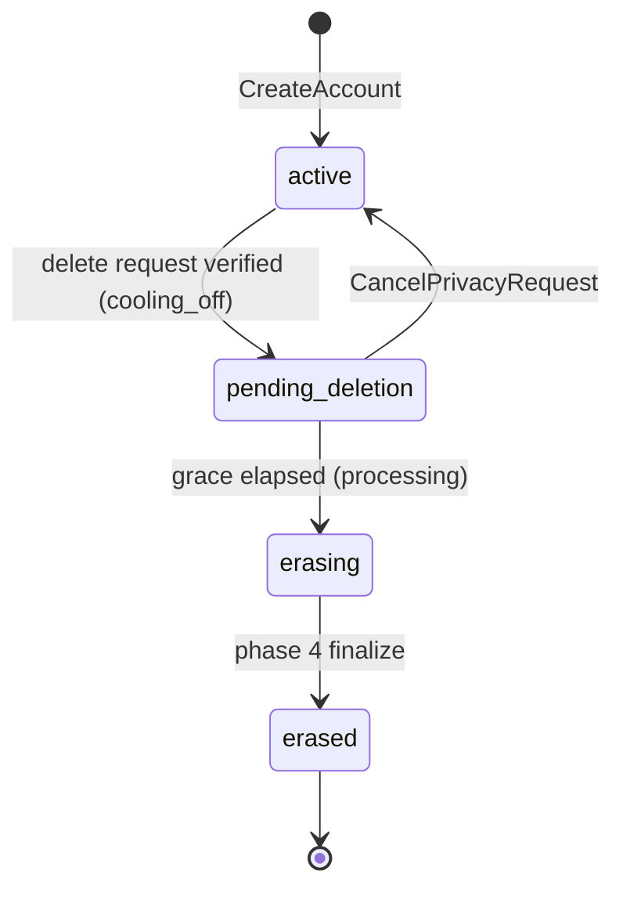
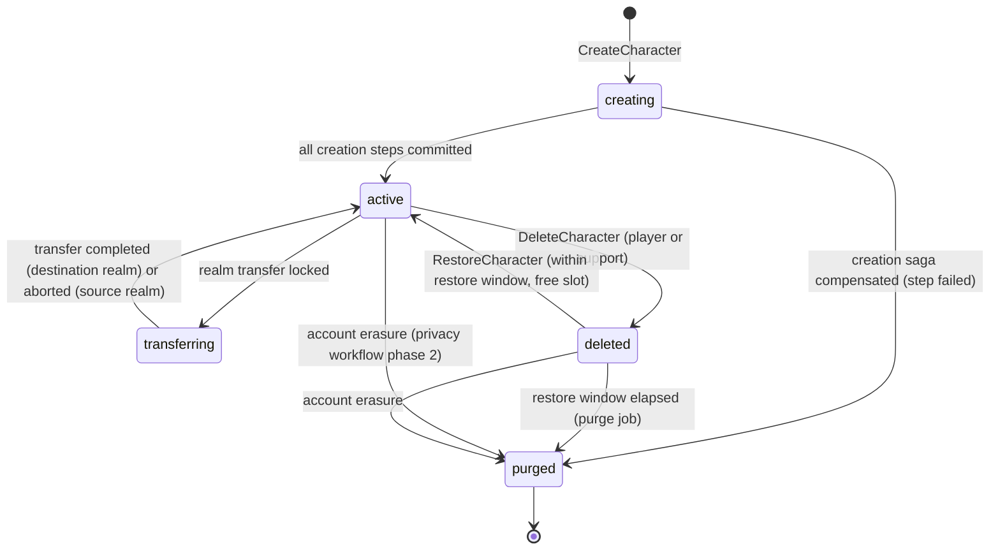

# Legends of the Shattered Frontier — Backend Part 1: Identity, Gateway and Characters
## Version 1.0 — Expanded Technical Design Authority edition (2026-10-17)

Design target; not implemented. Names per Shared Registry v1.0.

Entry file: [Backend Architecture](../Legends_Shattered_Frontier_Backend_Architecture_v1.0.md) · Registry: [Shared Registry](../Legends_Shattered_Frontier_Shared_Registry_v1.0.md)

---

## 1. Purpose of this part

This part specifies the Backend-owned halves of the player identity path: the `auth-service` **account core** (accounts, account states, session records, Backend's MFA and step-up hooks, login failure reasons), the external `gateway`, and `character-service` (character lifecycle, names, slots, world entry, location checkpoints). It ends with the event payloads for every `auth.*` and `character.*` event.

Security owns credentials, MFA factors, devices, session binding, login risk, connect tickets and staff elevation inside the same `auth-service` deployable (entry file, Service ownership contracts, `auth-service` ownership split). This part never redefines those; it names the points where Backend code calls them.

---

## 2. `auth-service` account core

### 2.1 Responsibilities

| Concern | Backend (this part) | Security (consumed) |
| --- | --- | --- |
| Account record, `account_state`, home `dc_region`, locale, age-gate band | owns | reads through `GetAccount` |
| ToS acceptance and re-acceptance gates | owns | — |
| Platform identity links (launcher, console, storefront accounts) | owns | uses link HMACs as login identifiers |
| Account directory (identifier → home region) | owns | queried by `BeginLogin` routing |
| Character slot entitlement | owns | — |
| Session record (start, end, end reason) | owns semantics | owns binding, tokens, refresh families, `ValidateSession` |
| Credentials, MFA, devices, login risk, cooling-off | — | owns |
| Privacy requests | owns (Part 3, Account deletion and privacy request workflow) | legal hold, evidence |

### 2.2 Account lifecycle

`account_state` (Registry §6) has four values. Sanctions are never account states; they come from `enforcement-service.CheckRestrictions` (Security spec, Audit Operations and Interfaces, `lsf.enforcement_service.v1`).



| State | Login | World entry | Economy / social actions | Writer |
| --- | --- | --- | --- | --- |
| `active` | allowed | allowed | allowed (subject to sanctions) | — |
| `pending_deletion` | allowed; client shows only the cancel/confirm screen | blocked | blocked (trade, market, mail, guild) | privacy workflow |
| `erasing` | `account_locked` | blocked | blocked | privacy workflow |
| `erased` | `account_locked` (identifier no longer resolves, so in practice `bad_credentials`) | — | — | privacy workflow |

Transitions are written only by the privacy workflow through the internal `SetAccountState(account_id, from, to, request_id)` method, which performs a compare-and-set on `(account_state, version)` and appends an `auth_security` audit record before committing (audit-before-act). Security may request a transition through the same method (entry file, Service ownership contracts, rule 1); it has no use for one at launch.

### 2.3 Account creation

```mermaid
sequenceDiagram
    autonumber
    participant L as Launcher / web
    participant G as gateway
    participant A as auth-service account core (Backend)
    participant S as auth-service security methods (Security)
    participant AU as audit-service
    L->>G: POST /v1/accounts (email, password, locale, birth year band, tos_version, idempotency_key)
    G->>A: CreateAccount(...)
    A->>A: normalize email, email_hmac; directory lookup in all regions (unique)
    A->>S: credential enrolment (Security credential module) + login risk at creation
    S-->>A: ok, login_risk
    A->>A: insert accounts, tos_acceptances, account_directory; outbox auth.account.created
    A->>AU: Append auth_security (account created, no personal data in body)
    A-->>L: account_id, email verification required
```

Rules:

1. **Home region.** `home_dc_region` is chosen by the player at creation (default: region of the request's edge PoP) and is the data residency region for all p2/p3 account data (Security spec, Threat Model and Server Authority, Privacy and data protection, rule 5). A region change is a support-only migration (Part 3, Multi-region deployment, Home-region migration).
2. **Uniqueness.** One account per normalized email. Normalization: trim, Unicode NFKC, lowercase the domain; the local part is kept case-sensitive for display but compared lowercased. `email_hmac = HMAC-SHA256(k_directory, normalized_lowercase_email)`; `k_directory` is a global key held in each region's KMS.
3. **Age gate.** `age_gate_band` is `under_consent_age` or `adult`, derived from the declared birth year against the regional age of digital consent (`tune.backend.consent_age_by_country`, default 16; 13 where law permits). Birth year itself is not stored. Under-consent accounts are created only with a guardian flow (open issue: legal review, entry file, Open issues).
4. **ToS.** Creation requires the current `tos_version`. A new ToS version with `requires_reacceptance = true` gates the next login after `effective_at`: the gateway returns `tos_required` and the launcher shows the acceptance screen; `AcceptTos` clears the gate. This is not a login failure.
5. **Email verification.** Accounts start unverified. Unverified accounts may play but cannot change email, submit privacy requests through the self-service channel, or receive mail attachments from other players (Security new-account limits apply on top). Verification links are single-use, 24 h.
6. **Idempotency.** `CreateAccount` stores its key like every mutating RPC (Part 2, Idempotency); a replay returns the same `account_id`.

### 2.4 Schema `auth` — account core tables

Security's tables in the same schema (`credentials`, `mfa_factors`, `devices`, `sessions`, `login_attempts`, `cooloffs`) are defined in Security spec, Audit Operations and Interfaces, `auth` (security tables only). Privacy tables (`privacy_requests`, `privacy_request_steps`, `erasure_tombstones`) are in Part 3.

```sql
CREATE SCHEMA IF NOT EXISTS auth;

CREATE TABLE auth.accounts (
  account_id         text PRIMARY KEY CHECK (account_id LIKE 'acc\_%'),
  account_state      text NOT NULL DEFAULT 'active'
                     CHECK (account_state IN ('active','pending_deletion','erasing','erased')),
  home_dc_region     text NOT NULL CHECK (home_dc_region IN ('na','eu','apac','sa')),
  email_ct           bytea,                 -- p2; envelope-encrypted with the account data key; NULL once erased
  email_hmac         bytea UNIQUE,          -- lookup key; NULL once erased
  email_verified_at  timestamptz,
  locale             text,                  -- BCP 47
  age_gate_band      text CHECK (age_gate_band IN ('under_consent_age','adult')),
  is_test_account    boolean NOT NULL DEFAULT false,
  data_key_id        text,                  -- KMS key id of the per-account data key; NULL after crypto-shred
  slot_bonus         smallint NOT NULL DEFAULT 0 CHECK (slot_bonus BETWEEN 0 AND 32),
  created_at         timestamptz NOT NULL DEFAULT now(),
  state_changed_at   timestamptz NOT NULL DEFAULT now(),
  version            bigint NOT NULL DEFAULT 1
);

CREATE TABLE auth.account_directory (            -- replicated to every dc_region; p1 only (no plaintext identifiers)
  identifier_hmac    bytea PRIMARY KEY,           -- email_hmac or platform link HMAC
  identifier_kind    text NOT NULL CHECK (identifier_kind IN ('email','platform')),
  account_id         text NOT NULL,
  home_dc_region     text NOT NULL,
  updated_at         timestamptz NOT NULL DEFAULT now()
);

CREATE TABLE auth.account_platform_links (
  platform               text NOT NULL,           -- 'steam', 'epic', 'xbox', 'psn', ...
  platform_subject_hmac  bytea NOT NULL,
  account_id             text NOT NULL REFERENCES auth.accounts,
  linked_at              timestamptz NOT NULL DEFAULT now(),
  PRIMARY KEY (platform, platform_subject_hmac)
);
CREATE INDEX ON auth.account_platform_links (account_id);

CREATE TABLE auth.tos_versions (
  tos_version            text PRIMARY KEY,
  effective_at           timestamptz NOT NULL,
  requires_reacceptance  boolean NOT NULL DEFAULT false
);

CREATE TABLE auth.tos_acceptances (
  account_id   text NOT NULL REFERENCES auth.accounts,
  tos_version  text NOT NULL REFERENCES auth.tos_versions,
  accepted_at  timestamptz NOT NULL DEFAULT now(),
  PRIMARY KEY (account_id, tos_version)
);

-- Standard platform tables (Part 2 templates): auth.idempotency_keys, auth.outbox, auth.inbox
```

`slot_bonus` is the number of extra character slots granted by account unlocks or store convenience offers (LiveOps spec owns the offer; Backend owns the counter). The directory is written in the account's home region and replicated to the other regions by the outbox (`auth.account.created` and an internal `auth-directory` topic carrying only `identifier_hmac`, `account_id`, `home_dc_region`); see Part 3, Multi-region deployment.

### 2.5 RPCs — `lsf.auth_service.v1` (Backend methods)

| RPC | Caller | Guards | Errors |
| --- | --- | --- | --- |
| `CreateAccount(email, password, locale, age_band_input, tos_version, idempotency_key)` | gateway | edge bot check passed; directory uniqueness; current ToS | `ALREADY_EXISTS` (generic message; does not reveal which field) |
| `GetAccount(account_id)` | Security methods (in-process), character-service, liveops-service, admin-portal | caller allowlist | `NOT_FOUND` |
| `UpdateAccountProfile(account_id, locale)` | gateway (own account) | session valid | `INVALID_ARGUMENT` |
| `AcceptTos(account_id, tos_version, idempotency_key)` | gateway | version exists and is current | `FAILED_PRECONDITION` |
| `LinkPlatform` / `UnlinkPlatform` | gateway | fresh `StepUp`; one link per platform | `ALREADY_EXISTS` |
| `ResolveHomeRegion(identifier_hmac)` | gateway of any region | read-only; constant-time, returns the requesting region for unknown identifiers | — |
| `EndSession(session_id, reason)` | gateway (logout), Security (revocation) | reason ∈ `auth.session.ended.reason` values | — |
| `ListSessionsOverlapping(window_start, window_end, session_kind, page_token)` | liveops-service (compensation targeting) | window ≤ 14 days; read replica; returns `account_id`, `overlap_s` | `INVALID_ARGUMENT` |
| `GetCharacterSlotEntitlement(account_id)` | character-service | — | — |
| `SetAccountState` (internal) | privacy workflow; Security by request | CAS on `(account_state, version)`; audited | `ABORTED` on CAS miss |
| `SubmitPrivacyRequest`, `ConfirmPrivacyRequest`, `CancelPrivacyRequest`, `GetPrivacyRequest`, `AuthAdmin.OpenPrivacyRequest` | see Part 3, Account deletion and privacy request workflow | | |

`ListSessionsOverlapping` confirms the LiveOps requirement (LiveOps spec, APIs Events Implementation, dependencies). Realm-scoped targeting uses `character-service.ListActiveCharacters` instead, because a session is account-scoped and does not carry a realm.

### 2.6 Sessions (record semantics)

Session tokens, refresh families, proof of possession and token lifetimes are Security's. Backend defines what a session *is* for every other service:

| Rule | Value |
| --- | --- |
| Session kinds | `launcher` (account management, patching, store) and `game` (world play). |
| Concurrency | At most one `game` session per account; a new game login ends the previous one with `reason = superseded`. Up to `tune.backend.max_launcher_sessions` (5) launcher sessions. |
| Identity in the envelope | `session_id` and `account_id` in every event are taken only from the validated token (gateway injects them; Analytics spec, Pipeline and Telemetry, identity rule). |
| End reasons | `logout`, `timeout`, `superseded`, `revoked_security`, `sanction`, `refresh_reuse`, `account_deletion`. `account_deletion` is written by the privacy workflow. |
| Idle timeout | `game` session ends after `tune.backend.game_session_idle_s` (1,800 s) without a validated request or UDP heartbeat relayed by the zone-server. |
| Hot store | Redis `auth:ses:{ses_id}` hash (`account_id`, `kind`, `device_id`, `started_at_ms`, `last_seen_ms`), TTL = idle timeout, refreshed by validation; PostgreSQL `auth.sessions` is the durable record written at start and end. |

### 2.7 Login path and Backend hooks

Security runs the credential, MFA and risk steps; Backend contributes the gates around them. Every login attempt runs the checks in this order, and **the first failing check decides the `login_failure_reason`**. This ordering is normative for both specs.

| # | Check | Executed by | Failure reason |
| --- | --- | --- | --- |
| 1 | Request deadline (10 s total, `tune.backend.login_deadline_ms`) — applies to every later step | gateway | `timeout` |
| 2 | Per-IP, per-subnet and per-account attempt buckets (Security spec, Rate limits) | gateway | `rate_limited` |
| 3 | Client build ≥ `min_client_build` (gateway runtime value, §3.5) | gateway | `client_outdated` |
| 4 | Home-region routing (`ResolveHomeRegion`); cross-region forward to the home gateway | gateway | `server_error` (`error_code = region_unreachable`) |
| 5 | Credential verification | Security `BeginLogin` | `bad_credentials` |
| 6 | Device key proof (session binding) | Security | `session_binding` |
| 7 | MFA factor (if required by risk or enrolment) | Security `CompleteLogin` | `mfa_failed` |
| 8 | Step-up challenge (email code / risk challenge) | Security | `challenge_failed` |
| 9 | Sanctions (`CheckRestrictions.login_denied`): permanent ban, then suspension | Security via enforcement-service | `banned`, `suspended` |
| 10 | `account_state` ∈ {`erasing`, `erased`}, or a progressive-delay lock, or a forced reset pending | Backend gate inside `CompleteLogin` | `account_locked` |
| 11 | Login gate (maintenance, §3.5) | gateway | not a failure: `login_gated` response with `retry_after_s`; no `auth.login.failed` event |
| 12 | ToS re-acceptance | gateway | not a failure: `tos_required` |
| — | Any internal or dependency error | any | `server_error` with `error_code` |

Steps 2–3 are decided by the gateway, but the gateway still forwards the rejected attempt to `BeginLogin` with `gateway_verdict ∈ {rate_limited, client_outdated}` so that `auth-service` remains the single producer of `auth.login.failed` (one producer per event, Registry §10.2). Attempts dropped at the edge (WAF, DDoS scrubbing) before the gateway produce no event; the edge's own counters feed Security's ATO runbook.

**Step-up hooks (Backend-owned actions).** These Backend RPCs require a Security `StepUp` proof no older than `tune.backend.step_up_max_age_s` (600 s):

| Action | Additional rule |
| --- | --- |
| `SubmitPrivacyRequest` (both kinds) | rejected while a Security cooling-off is active |
| `LinkPlatform` / `UnlinkPlatform` | — |
| `DeleteCharacter` for a character at level ≥ 20 or with any `epic`+ item equipped | confirmation also requires typing the character name |
| `RequestRealmTransfer` | rejected while cooling-off is active |
| Export bundle download | logged-in session plus `StepUp` |

**MFA hooks.** Backend consumes `auth.mfa.enrolled` to issue the MFA enrolment incentive (a cosmetic account unlock, `reward/mfa_enrolment_incentive`, issued through `reward-service.IssueGrant` with idempotency key `mfa_incentive:{account_id}`; once per account forever, so remove-and-re-enrol grants nothing). Security sets `incentive_granted` on the event from the same rule.

### 2.8 `login_failure_reason` and `m_login_success_rate`

Registry enum `login_failure_reason` (Backend; classified by Security). Security owns the classification of an attempt (which value applies, following the check order in §2.7); this spec owns the value list jointly with Security. It reconciles Security's interim `failure_reason` list (Security spec, Audit Operations and Interfaces, `auth.*` payloads) and Analytics' interim list (Analytics spec, Warehouse and Metrics, interim field requirements).

| Value | Meaning | Interim names mapped | Counts for `m_login_success_rate` |
| --- | --- | --- | --- |
| `bad_credentials` | unknown identifier or wrong password/passkey assertion (indistinguishable to the client) | same | **user error** — excluded |
| `mfa_failed` | wrong or expired MFA code / WebAuthn assertion | same | **user error** — excluded |
| `challenge_failed` | step-up challenge (email code, risk challenge) failed or abandoned | Security `challenge_failed` | **user error** — excluded |
| `account_locked` | account not loginable by state: `erasing`/`erased`, progressive-delay lock from `detector/login_anomaly`, forced password reset pending | — | **user error** — excluded |
| `suspended` | active `temporary_suspension` | Security `suspended`, Analytics `sanctioned` | **user error** (policy) — excluded |
| `banned` | active `permanent_ban` | Security `banned`, Analytics `sanctioned` | **user error** (policy) — excluded |
| `rate_limited` | per-IP or per-account attempt limit hit | same | **system failure** — included |
| `client_outdated` | client build below minimum supported build | Security `client_outdated` | **system failure** — included (the launcher should have patched first) |
| `session_binding` | device key proof missing or invalid at login/refresh | Security `binding_invalid` (renamed to match `reject_reason`) | **system failure** — included |
| `server_error` | internal or dependency error | Analytics `server_error` | **system failure** — included |
| `timeout` | attempt exceeded the server deadline (default 10 s) | Analytics `timeout` | **system failure** — included |

```text
m_login_success_rate = count(auth.login.succeeded)
                     / ( count(auth.login.succeeded)
                       + count(auth.login.failed where reason ∈ {rate_limited, client_outdated, session_binding, server_error, timeout}) )
```

Rationale: user-error and policy outcomes say nothing about service health; rate limiting, version gating, binding failures, errors and timeouts can all be caused by our own deploys or misconfiguration and must page. Credential-stuffing waves surface as `bad_credentials` volume and are watched by Security's ATO runbook (`m_login_fail_ratio`), not by this metric. Analytics should additionally alert on any single included reason exceeding 5 % of attempts for 10 minutes, so a version-gate mistake is distinguishable from an outage.

**Worked example.** In one 5-minute window on `eu`: 9,400 `auth.login.succeeded`; failures: 610 `bad_credentials`, 42 `mfa_failed`, 9 `banned`, 120 `client_outdated`, 31 `server_error`, 4 `timeout`. Included failures = 120 + 31 + 4 = 155. `m_login_success_rate = 9,400 / (9,400 + 155) = 0.9838` → 98.4 %, just above the 98 % `login_success_low` threshold (Analytics spec, Dashboards Alerting and Privacy). `client_outdated` alone is 120 / (9,400 + 916) = 1.2 % of all attempts, below the 5 % per-reason alert. A release that forgot to publish the launcher manifest would push `client_outdated` past 5 % within minutes and page before the aggregate drops below 98 %.

---

## 3. `gateway`

### 3.1 Responsibilities

The gateway is the only externally reachable HTTP/WebSocket surface (Registry §4). It is stateless apart from caches and the two runtime gates (login gate, minimum client build). It does **not** carry real-time gameplay (UDP goes client ↔ `zone-server`/`instance-server`, Network spec) and does not host business logic.

| Does | Does not |
| --- | --- |
| TLS termination behind the edge (DDoS scrubbing, WAF: Network spec, Edge Layer) | expose any gRPC service directly |
| Route versioned REST/JSON and one WebSocket push channel to internal gRPC | serve server-only content packs or definitions (entry file, Service ownership contracts, server-only content packs) |
| Validate sessions (`ValidateSession`, cached 30 s) and inject identity metadata | decide game outcomes |
| Enforce rate limits whose values Security owns | define rate-limit values |
| Hold `min_client_build` and the login gate | persist player data |
| Forward cross-region logins to the home region | store tokens |
| Generate `correlation_id` per external request | — |

Staff traffic uses a separate **staff gateway** deployment (same build, `role = staff`) reachable only through the corporate zero-trust proxy, fronting `admin-portal` APIs; it requires staff SSO plus a JIT elevation for privileged calls (Security spec, Audit Operations and Interfaces, Staff permission model).

### 3.2 External route table (v1)

| Route | Method | Backing RPC | Session | Notes |
| --- | --- | --- | --- | --- |
| `/v1/accounts` | POST | `auth.CreateAccount` | none | edge bot challenge |
| `/v1/login/begin`, `/v1/login/complete`, `/v1/login/step-up` | POST | Security `BeginLogin`, `CompleteLogin`, `StepUp` | none / partial | login deadline 10 s |
| `/v1/sessions/refresh`, `/v1/sessions/logout` | POST | Security refresh; `auth.EndSession` | yes | |
| `/v1/account`, `/v1/account/tos` | GET, PATCH, POST | `GetAccount`, `UpdateAccountProfile`, `AcceptTos` | yes | |
| `/v1/privacy-requests` | POST, GET, DELETE | `SubmitPrivacyRequest`, `GetPrivacyRequest`, `CancelPrivacyRequest` | yes + step-up | Part 3 |
| `/v1/realms` | GET | `world-service.GetRealms` (World) | yes | population band only, never exact CCU |
| `/v1/characters` | GET, POST | `character.ListCharacters`, `CreateCharacter` | yes | |
| `/v1/characters/{chr}` | GET, DELETE | `GetCharacter`, `DeleteCharacter` | yes (owner) | |
| `/v1/characters/{chr}/restore`, `/rename`, `/enter-world`, `/realm-transfer` | POST | `RestoreCharacter`, `RenameCharacter`, `EnterWorld`, `RequestRealmTransfer` | yes (owner) | |
| `/v1/progression/...` | GET, POST | progression-service player RPCs (Character spec, Service Interfaces) | yes (owner) | |
| `/v1/market/...`, `/v1/mail/...`, `/v1/guilds/...`, `/v1/store/...`, `/v1/reports`, `/v1/appeals` | various | economy, chat (mail), guild, store, enforcement RPCs | yes | owning specs define payloads |
| `/v1/push` | WebSocket | gateway push channel (§3.6) | yes | one per session |
| `/v1/status` | GET | liveops-service status | none | cached 15 s at the edge |

Route rules: every mutating route requires an `Idempotency-Key` header (≤ 128 chars), passed through as the RPC `idempotency_key`; JSON field names equal the protobuf field names; error bodies are `{ "code": "<grpc_code>", "reason": "<UPPER_SNAKE_CASE>", "retry_after_s": n? }` where `reason` is the RPC's `ErrorInfo.reason` (Part 2, gRPC conventions); player-visible messages are looked up client-side from `reason` and never contain internal IDs or server-only definition IDs.

### 3.3 Request pipeline

```text
edge (WAF, DDoS, bot management)
 → TLS → parse + size limits (64 KiB body, 8 KiB headers)
 → correlation_id = header X-Correlation-Id if from launcher and well-formed, else new ULID
 → client build check (§3.5)             → 426 upgrade_required (reason client_outdated)
 → login gate (§3.5) for login/enter-world routes → 503 login_gated + Retry-After
 → ValidateSession(token, proof) (cache 30 s per token hash)
 → rate limit buckets (per session, per account, per IP; Security values)
 → route ACL (owner checks: character_id ∈ account's characters, cached 60 s from character-service)
 → gRPC call with metadata: x-lsf-account-id, x-lsf-session-id, x-lsf-correlation-id,
   x-lsf-client-build, x-lsf-dc-region, deadline = route budget
 → response mapping
```

### 3.4 Rate limiting

Values are Security's (Security spec, Threat Model and Server Authority, Rate limits); the gateway implements them as token buckets in Redis (`gateway:rl:{scope}:{key}`), sharded per region, with a local in-process pre-filter to absorb bursts:

```text
tokens(t) = min(C, tokens(t0) + r × (t − t0))
allow     = tokens(t) ≥ 1   → tokens -= 1
retry_after_s = ceil((1 − tokens(t)) / r)
```

`C` = capacity, `r` = refill per second. **Worked example** — per-session gateway bucket `tune.security.gateway_rate_session` = 30 / 10 per s: a client that sends 45 requests in 1 s after idling is allowed 30 + 10 × 1 = 40; the remaining 5 receive `429 rate_limited` with `retry_after_s = 1`. If Redis is unavailable, the gateway falls back to per-pod local buckets at `C / pod_count` (fail-open for reads, fail-closed for login and account mutation routes).

### 3.5 Runtime gates and admin RPCs — `lsf.gateway.v1`

Confirms the LiveOps requirements (LiveOps spec, Config and Releases, Maintenance windows and Coordination with launcher patching).

| RPC | Caller | Effect | Persistence |
| --- | --- | --- | --- |
| `SetLoginGate(scope, allow_roles[], reason_code, until?, idempotency_key)` | liveops-service | `scope` = `dc_region` or list of `realm_id`; while set, login and `EnterWorld` for the scope return `login_gated` except for accounts holding a staff role in `allow_roles` (e.g. `game_master`, QA test accounts via `is_test_account`) | `gateway.gates` table in `config` style: each region's gateway fleet reads the gate row on change notification (≤ 5 s) |
| `ClearLoginGate(scope, idempotency_key)` | liveops-service | removes the gate | same |
| `SetMinClientBuild(dc_region?, min_client_build, idempotency_key)` | liveops-service (release flow) | requests from builds below the value get `426 upgrade_required`; login attempts become `client_outdated` | mirrored to `tune.security.min_client_build` through config-service so Security's checks read the same value |
| `PushClientNotice(scope, notice_kind, payload_ref, idempotency_key)` | liveops-service | broadcasts a push frame (§3.6) to every connected session in scope | none (fire-and-forget; announcements are durable in liveops-service) |

All four append `staff_action` or `release` audit records through the caller (audit-before-act is the caller's obligation; the gateway rejects calls without an `x-lsf-audit-id` metadata entry).

### 3.6 Push channel

One WebSocket per session (`/v1/push`), server-to-client only except heartbeats; JSON frames `{ "kind": ..., "at": ..., "data": {...} }`.

| `kind` | Source | Data |
| --- | --- | --- |
| `notice` | `PushClientNotice` | `notice_kind` (`maintenance_countdown`, `announcement`, `toast`), `announcement_id` (`ann_`) |
| `queue_update` | character-service | `realm_id`, `position`, `eta_s` (§4.7) |
| `session_ended` | auth-service | `reason` (generic for security reasons) |
| `mail_arrived` | chat-service | `unread_count` |
| `privacy_request_update` | auth-service | `request_id`, `state` |
| `transfer_update` | character-service | `transfer_id`, `state` |

Push fan-out uses the `gateway:push:{ses_id}` Redis pub/sub channel; a frame for a session not connected to any pod is dropped (push is advisory; clients re-fetch state on reconnect).

---

## 4. `character-service`

### 4.1 Responsibilities

`character-service` owns the character **identity and envelope**: `chr_` IDs, account and realm binding, `character_state`, name, slot, appearance, bio, location snapshot, presence (in world or not, which server), realm queue, realm transfers. It caches (never owns) the character level from `progression.level.reached` for character select (Character spec, overview). Attributes, skills, inventory, quests and achievements belong to `progression-service`, `inventory-service` and `quest-service`; the overview's older "Character Service stores Inventory, Skills, Quests" list is superseded by Registry §4.

### 4.2 Character lifecycle

Proposed enum `character_state`: `creating`, `active`, `transferring`, `deleted`, `purged`.



| State | In world | Visible at character select | Name | Slot | Other services |
| --- | --- | --- | --- | --- | --- |
| `creating` | no | no | reserved (`live`) | held | initialization in progress |
| `active` | allowed | yes | `live` | held | normal |
| `transferring` | no (kicked at lock) | yes, greyed, with transfer status | `live` on source; `transfer_hold` on destination | held on both realms | locked by `TransferParticipant.PrepareTransfer` (Part 3) |
| `deleted` | no | in "recently deleted" list until `restore_until` | `deleted_hold` | released | data kept; progression row soft-deleted (Character spec, Service Interfaces, consumed events) |
| `purged` | no | no | released into 90-day `quarantine` | released | data erased; tombstone row only |

Account erasure waits for a `transferring` character: the privacy workflow calls `AbortTransfer` first (Part 3). A character can be in `transferring` only while its account is `active`.

### 4.3 Names

| Rule | Value |
| --- | --- |
| Pattern | `^[\p{L}][\p{L}'\-]{2,15}$` after NFKC; at most one apostrophe or hyphen; no character from more than one script (Latin, Cyrillic, Greek, Han, Hangul, Kana counted as scripts). Length 3–16. |
| Uniqueness | per realm on `name_key = casefold(NFKC(name))` with confusable folding (Unicode TR39 skeleton) so `Arwen` and `Αrwen` (Greek alpha) collide |
| Policy | denylist (profanity, staff impersonation such as `gm`, `admin` prefixes, NPC names marked `reserved_name` in content packs), checked at create and rename |
| Reservation lifecycle | `live` → `deleted_hold` (until `restore_until`) → `quarantine` for `NAME_REUSE_QUARANTINE_DAYS` (90, `tune.backend.name_reuse_quarantine_days`) → free; erasure replaces the display name with `erased_<8 hex>` and puts the original key in quarantine |
| Forced rename | support (`CharacterAdmin.ForceRename`) or realm-transfer conflict sets `rename_required = true`; `EnterWorld` is refused (`FAILED_PRECONDITION RENAME_REQUIRED`) until `RenameCharacter` succeeds; one free rename per forced event |

Names never travel on events (Event payloads, note at the end of `character.*`).

### 4.4 Slots

| Constant | Value | Key |
| --- | --- | --- |
| `CHARACTER_SLOTS_PER_REALM` | 8 live characters per account per realm | `tune.backend.character_slots_per_realm` |
| Account-wide live characters | 16 + `accounts.slot_bonus` | `tune.backend.character_slots_account_base` |

`creating`, `active` and `transferring` characters occupy a slot; `deleted` do not. A restore needs a free slot on the character's realm.

### 4.5 Creation saga

`character-service` orchestrates (Part 2, Sagas). Steps are idempotent with keys `chrc:{character_id}:{step}`.

```mermaid
sequenceDiagram
    autonumber
    participant C as Client
    participant G as gateway
    participant CH as character-service
    participant PR as progression-service
    participant RW as reward-service
    C->>G: POST /v1/characters (realm_id, name, appearance, initial_skills, attributes, Idempotency-Key)
    G->>CH: CreateCharacter(...)
    CH->>CH: validate name, slots, account_state=active, ff.backend.character_creation_enabled for realm
    CH->>CH: tx: insert characters(creating), name_reservations(live), saga row
    CH->>PR: InitializeCharacter(character_id, realm_id, initial_skills, attributes, key chrc:{id}:progression)
    PR-->>CH: ProgressionSnapshot
    CH->>RW: IssueGrant(reward/new_character_starter, key chrc:{id}:starter)
    RW-->>CH: rwg_ (delivery async)
    CH->>CH: tx: state=active, location_snapshot = starting zone; outbox character.profile.created
    CH-->>C: Character
```

| Step | Compensation if a later step fails permanently |
| --- | --- |
| insert `creating` | mark `purged`, release name immediately (no quarantine: the name was never visible) |
| `InitializeCharacter` | explicit `PrivacyParticipant.EraseSubject(character_ids=[id])` on progression-service with key `chrc:{id}:undo` (no event was published, so no consumer has seen the character) |
| starter items | `inventory-service` holds them under the grant; revoked with the grant (next row) |
| starter grant | `reward-service.RevokeGrant(rwg_)` |

Retries: each step retried with backoff (100 ms → 5 s, 6 attempts) inside the request deadline (8 s); after that the saga continues asynchronously and the client receives `ABORTED CREATION_PENDING` and polls `GetCharacter`. A saga stuck in `creating` for 15 min is compensated by the saga sweeper. The starter grant uses registered source code `starter_kit` (Shared Registry, Currencies, sources and sinks) carried by the reward bundle's item and currency lines.

Inventory containers are created lazily by `inventory-service` on first use (first `GrantItems` or `GetInventory` for an unknown character creates the `equipment` and `backpack` containers); creation needs no separate inventory step (Itemization spec, Item Model and Lifecycle, Containers).

Starting zone: from `tune.backend.starting_zone_by_realm` (default `zone/greenlands_01`); starting position from the zone's content definition spawn set.

### 4.6 Deletion, restore and purge

| Operation | Rules |
| --- | --- |
| `DeleteCharacter(character_id, confirm_name?, idempotency_key)` | Character not in world (kicked first with `left_reason = character_select` if a session is in it), not `transferring`, not guild leader (must transfer leadership first unless the guild has no other member), no open trades or active market listings (player sees the list), step-up per §2.7. Sets `deleted`, `restore_until = now + CHARACTER_RESTORE_DAYS`. Emits `character.profile.deleted` (`deletion_cause = player` or `support`). |
| `RestoreCharacter(character_id, idempotency_key)` | `deleted` and `now < restore_until`, free slot, account `active`. Sets `active`; emits `character.profile.restored`. Progression consumes it and clears its soft-delete flag. |
| Purge job | Every hour: characters with `restore_until < now` → calls `PrivacyParticipant.EraseSubject(account_id, character_ids=[id], hold_scopes = GetLegalHold(account_id))` on every participant (same phases as account deletion, Part 3, restricted to the character) then sets `purged`. Emits no further `character.profile.deleted` (already emitted at deletion). |
| Account erasure | Part 3 phase 2: every non-purged character → `purged`; `character.profile.deleted` with `deletion_cause = account_deletion` for each character not already `deleted`. |

`CHARACTER_RESTORE_DAYS` = 30 (`tune.backend.character_restore_days`). Characters below level 10 skip the restore window (`tune.backend.character_restore_min_level` = 10) and go straight to purge on the next job run, which keeps throwaway characters from holding names for a month.

### 4.7 World entry, presence and the realm queue

```mermaid
sequenceDiagram
    autonumber
    participant C as Client
    participant G as gateway
    participant CH as character-service
    participant EN as enforcement-service
    participant WS as world-service
    participant S as auth-service (Security)
    participant Z as zone-server
    C->>G: POST /v1/characters/{chr}/enter-world
    G->>CH: EnterWorld(character_id)
    CH->>CH: state=active, account active, rename_required=false, no other character of the account in world
    CH->>EN: CheckRestrictions(account, character)
    CH->>CH: realm admission (queue if full)
    CH->>WS: ResolveZone(character_id, location_snapshot)
    WS-->>CH: srvi_, address
    CH->>S: IssueConnectTicket(session, character, srvi)
    S-->>CH: ticket
    CH-->>C: address, ticket (or queue position)
    C->>Z: UDP connect + ticket
    Z->>CH: ReportPresence(entered, srvi, entry_kind)
    CH->>CH: presence row; outbox character.world.entered
```

**Presence.** Redis `character:presence:{chr_}` = `{srvi, zone_id, realm_id, since_ms}`, written only through `ReportPresence` by the owning server (`entered`, `left`, `zone_changed`). `character.zone.changed` is emitted by character-service from `ReportPresence(zone_changed)` for teleports and instance transitions and from consumed `world.handoff.completed` for seamless handoffs (World spec, Zone handoffs: "character-service emits character.zone.changed"); both carry the World-supplied `handoff_ms`. A character with presence but whose `srvi` is reported `lost` by `world.server.lost` is marked left with `left_reason = server_shutdown`.

**Realm queue.** Each realm has a soft CCU cap `tune.backend.realm_ccu_soft_cap` (default 3,000 at launch phase 2) and hard cap = soft × 1.1. When `ccu ≥ soft_cap`, `EnterWorld` places the character in the realm queue (Redis sorted set `character:queue:{realm_id}`, score = enqueue time ms). Characters whose previous presence ended less than `tune.backend.reconnect_grace_s` (300 s) ago with `left_reason ∈ {disconnect, server_shutdown}` bypass the queue up to the hard cap. Every 5 s the admitter computes:

```text
admit_n   = max(0, soft_cap − ccu − in_flight_admissions)
λ_out     = EMA over 10 min of world departures per second on the realm
eta_s(p)  = p / max(λ_out + admit_n / 5, 0.01)        p = queue position (1-based)
```

**Worked example.** Realm `eu-2`: soft cap 3,000, `ccu` 3,000, `in_flight` 0, `λ_out` = 0.1/s (6 departures per minute). A player at position 120 sees `eta_s = 120 / 0.1 = 1,200 s` (20 min). If the realm's cap is raised to 3,200 by LiveOps, the next tick admits 200 at once and the remaining queue's ETA collapses. Queue position updates are pushed every 30 s (`queue_update`). A queued client must heartbeat the push channel; three missed 30 s heartbeats remove the entry. `queue_wait_s` on `character.world.entered` is the measured wait.

### 4.8 Location checkpoints

| Rule | Value |
| --- | --- |
| Writer | the server that owns the character (zone-server or instance-server) via `CheckpointCharacter(character_id, srvi, state_version, zone_id, position, yaw, safe_zone_id, safe_position)` |
| Cadence | every `tune.backend.checkpoint_interval_s` (60 s) while in world, and synchronously on handoff (World spec, Zone handoffs, step "checkpoint character state → state_version"), logout, instance entry/exit, server drain |
| Ordering | accepted iff `state_version > stored.state_version` and `srvi` is registered and not `terminated`/`lost` in world-service; otherwise `FAILED_PRECONDITION STALE_CHECKPOINT`. `state_version` is the World spec handoff counter, monotonic per character across owners. |
| Position RPO | ≤ 60 s of movement; durable state (items, currency, XP) is never in the checkpoint — it is written by its owning service immediately |
| Safe restore | on `EnterWorld`, if `zone_id` is not resolvable (zone retired, disabled by `ff.content.disabled_definitions`) or World rejects the position, the character enters at `safe_zone_id`/`safe_position` (last rest point, updated by the server on rest-point use) and `ResolveZone` receives the safe location |
| Instances | inside an instance the checkpoint stores the instance entrance as the safe location; if the run is `closed` at re-entry, the character spawns at the entrance (Dungeon spec, Instance runtime) |

### 4.9 Schema `character`

```sql
CREATE SCHEMA IF NOT EXISTS character;

CREATE TABLE character.characters (
  character_id            text PRIMARY KEY CHECK (character_id LIKE 'chr\_%'),
  account_id              text NOT NULL,
  realm_id                text NOT NULL,
  character_state         text NOT NULL
                          CHECK (character_state IN ('creating','active','transferring','deleted','purged')),
  name                    text,                      -- p0 display form; 'erased_<hex>' or NULL after purge
  name_key                text,                      -- casefold + confusable skeleton
  slot_index              smallint NOT NULL CHECK (slot_index BETWEEN 0 AND 63),
  appearance              jsonb,                     -- p0; schema owned by the client appearance system
  bio                     text,                      -- p2 player-authored; max 500 chars
  level_cache             smallint NOT NULL DEFAULT 1,
  rename_required         boolean NOT NULL DEFAULT false,
  transfer_cooldown_until timestamptz,
  created_at              timestamptz NOT NULL DEFAULT now(),
  deleted_at              timestamptz,
  restore_until           timestamptz,
  purged_at               timestamptz,
  last_entered_at         timestamptz,
  last_left_at            timestamptz,
  played_seconds          bigint NOT NULL DEFAULT 0,
  version                 bigint NOT NULL DEFAULT 1
);
CREATE INDEX ON character.characters (account_id);
CREATE UNIQUE INDEX characters_slot_live ON character.characters (account_id, realm_id, slot_index)
  WHERE character_state IN ('creating','active','transferring');
CREATE INDEX characters_purge_due ON character.characters (restore_until) WHERE character_state = 'deleted';
CREATE INDEX characters_active_window ON character.characters (realm_id, last_left_at);

CREATE TABLE character.name_reservations (
  realm_id      text NOT NULL,
  name_key      text NOT NULL,
  character_id  text,                               -- NULL for quarantine after purge
  reason        text NOT NULL CHECK (reason IN ('live','deleted_hold','quarantine','transfer_hold')),
  expires_at    timestamptz,                        -- NULL for live
  PRIMARY KEY (realm_id, name_key)
);

CREATE TABLE character.location_snapshots (
  character_id       text PRIMARY KEY REFERENCES character.characters,
  realm_id           text NOT NULL,
  zone_id            text NOT NULL,                 -- zone/<slug>
  server_instance_id text,                          -- srvi_ of the writer
  pos_x double precision NOT NULL, pos_y double precision NOT NULL, pos_z double precision NOT NULL,
  yaw                real NOT NULL DEFAULT 0,
  safe_zone_id       text NOT NULL,
  safe_pos_x double precision NOT NULL, safe_pos_y double precision NOT NULL, safe_pos_z double precision NOT NULL,
  state_version      bigint NOT NULL,
  written_at         timestamptz NOT NULL DEFAULT now()
);

CREATE TABLE character.sagas (                      -- Part 2 saga template
  saga_id        text PRIMARY KEY,                  -- 'chrc:<chr_>' or 'rtx_...'
  saga_kind      text NOT NULL CHECK (saga_kind IN ('character_creation','realm_transfer','character_purge')),
  state          text NOT NULL,
  step           text NOT NULL,
  attempts       int  NOT NULL DEFAULT 0,
  next_attempt_at timestamptz,
  context        jsonb NOT NULL,
  updated_at     timestamptz NOT NULL DEFAULT now()
);

-- character.realm_transfers: Part 3, Realm and character transfer
-- Standard platform tables (Part 2): character.idempotency_keys, character.outbox, character.inbox
```

### 4.10 RPCs — `lsf.character_service.v1`

| RPC | Caller | Guards | Errors |
| --- | --- | --- | --- |
| `CreateCharacter(realm_id, name, appearance, initial_skills[], attribute_allocation, idempotency_key)` | gateway | §4.3–4.5; Character spec validation of skills/attributes delegated to `InitializeCharacter` | `INVALID_ARGUMENT NAME_INVALID`, `ALREADY_EXISTS NAME_TAKEN`, `RESOURCE_EXHAUSTED SLOTS_FULL`, `FAILED_PRECONDITION REALM_CLOSED` |
| `ListCharacters(account_id, realm_id?)` | gateway | own account | — |
| `GetCharacter(character_id)` | gateway (owner), services | — | `NOT_FOUND` (also for `purged`) |
| `RenameCharacter(character_id, name, idempotency_key)` | gateway | `rename_required = true` | `FAILED_PRECONDITION` |
| `DeleteCharacter`, `RestoreCharacter` | gateway, admin-portal (support) | §4.6 | `FAILED_PRECONDITION <REASON>` |
| `EnterWorld(character_id)` | gateway | §4.7 | `FAILED_PRECONDITION RENAME_REQUIRED / ACCOUNT_PENDING_DELETION / RESTRICTED`, `UNAVAILABLE LOGIN_GATED` |
| `ReportPresence(character_id, srvi, kind, entry_kind?, left_reason?, from_zone_id?, transition_kind?, handoff_ms?)` | zone-server, instance-server | caller identity = `srvi` workload | `PERMISSION_DENIED` |
| `CheckpointCharacter(...)` | zone-server, instance-server | §4.8 | `FAILED_PRECONDITION STALE_CHECKPOINT` |
| `GetLocation(character_id)` | world-service, zone-server, instance-server | — | — |
| `ListActiveCharacters(realm_ids[], active_from, active_to, min_level?, max_level?, page_token)` | liveops-service | window ≤ 30 days; read replica | `INVALID_ARGUMENT` |
| `RequestRealmTransfer`, `GetRealmTransfer`, `CancelRealmTransfer` | gateway | Part 3, Realm and character transfer | |
| `CharacterAdmin.ForceRename(character_id, reason_code, ticket_ref)` | admin-portal | `staff_role ∈ {support_agent, game_master}` + JIT; audited | |
| `CharacterAdmin.GetCharacterHistory(character_id)` | admin-portal | read; audited | |
| `PrivacyParticipant.ExportSubject` / `EraseSubject`, `TransferParticipant.*` | auth-service workflow; character-service itself | Part 3 | |

`ListActiveCharacters` confirms the LiveOps requirement; "active in window" means a presence interval (`character.world.entered` … `left`) overlapping `[active_from, active_to]`, computed from a `character.presence_intervals` daily rollup kept 35 days (p1).

---

## 5. Event payloads

Envelope per Registry §10.1; envelope `privacy_class` is the maximum of the payload field classes. `auth.*` on `domain.auth` keyed by `account_id`; `character.*` on `domain.character` keyed by `character_id`. All schemas start at `schema_version = 1`. **Sec** = field defined by Security (entry file, Service ownership contracts, `auth-service` ownership split, rule 2). A login attempt (`BeginLogin` … `CompleteLogin`) shares one envelope `correlation_id` and ends in exactly one of `auth.login.succeeded` or `auth.login.failed`. Privacy workflow events (`auth.account.deletion_*`, `auth.account.deleted`, `auth.account.export_*`) are specified in Part 3, Account deletion and privacy request workflow, Workflow events.

### 5.1 `auth.*`

| Event | Field | Type | Req | Description | privacy_class |
| --- | --- | --- | --- | --- | --- |
| `auth.account.created` | `creation_channel` **Sec** | string | yes | `launcher`, `web`, `platform` | p1_pseudonymous |
| | `home_dc_region` | string | yes | data residency region (Registry `dc_region`) | p1_pseudonymous |
| | `locale` | string | yes | BCP 47 | p1_pseudonymous |
| | `age_gate_band` | string | yes | `under_consent_age`, `adult` | p2_personal |
| | `tos_version` | string | yes | accepted ToS version | p0_public |
| | `is_test_account` | bool | yes | internal/QA account | p0_public |
| | `country_code` **Sec** | string | yes | ISO 3166-1 alpha-2 from IP | p2_personal |
| | `login_risk` **Sec** | int | yes | risk at creation | p1_pseudonymous |
| | `ip_hmac` **Sec** | string | yes | keyed HMAC | p2_personal |
| `auth.login.succeeded` | `method` **Sec** | string | yes | `password`, `passkey`, `refresh` | p1_pseudonymous |
| | `mfa_method` **Sec** | string | no | if MFA used | p1_pseudonymous |
| | `login_risk` **Sec** | int | yes | 0–100 | p1_pseudonymous |
| | `risk_action` **Sec** | string | yes | `allow`, `step_up`, `cooloff` | p1_pseudonymous |
| | `device_new` **Sec** | bool | yes | | p1_pseudonymous |
| | `device_id_hmac` **Sec** | string | yes | | p3_sensitive |
| | `ip_hmac` / `country_code` / `asn` **Sec** | string/string/int | yes | | p2_personal |
| | `client_build` **Sec** | string | yes | | p0_public |
| | `account_state` | string | yes | `active` or `pending_deletion` | p1_pseudonymous |
| | `latency_ms` | int | yes | server time from `BeginLogin` to `CompleteLogin` | p0_public |
| `auth.login.failed` | `reason` | string | yes | `login_failure_reason` (§2.8); classified by Security in the §2.7 check order | p1_pseudonymous |
| | `stage` | string | yes | `begin`, `challenge`, `complete` | p0_public |
| | `login_risk` **Sec** | int | yes | | p1_pseudonymous |
| | `ip_hmac` / `asn` **Sec** | string/int | yes | envelope `account_id` omitted for unknown identifiers | p2_personal |
| | `attempts_in_window` **Sec** | int | yes | per account or per IP | p1_pseudonymous |
| | `client_build` | string | yes | | p0_public |
| | `retry_after_s` | int | no | for `rate_limited`, `timeout` | p0_public |
| | `error_code` | string | no | for `server_error`: dependency code, e.g. `db_unavailable`, `security_rpc`, `region_unreachable` | p0_public |
| | `decided_by` | string | yes | `gateway` (checks 1–4) or `auth_service` | p0_public |
| `auth.session.started` | `session_kind` **Sec** | string | yes | `launcher`, `game` | p1_pseudonymous |
| | `device_id_hmac` **Sec** | string | yes | | p3_sensitive |
| | `client_build` **Sec** | string | yes | | p0_public |
| | `platform` | string | yes | `windows`, `macos`, `linux`, `console_*` | p0_public |
| `auth.session.ended` | `reason` **Sec** | string | yes | `logout`, `timeout`, `superseded`, `revoked_security`, `sanction`, `refresh_reuse`, `account_deletion` | p1_pseudonymous |
| | `duration_s` **Sec** | int | yes | | p1_pseudonymous |
| | `session_kind` | string | yes | as started | p1_pseudonymous |
| `auth.mfa.enrolled` | `method` **Sec** | string | yes | `webauthn`, `totp` | p1_pseudonymous |
| | `factor_count` **Sec** | int | yes | active factors after enrolment | p1_pseudonymous |
| | `incentive_granted` **Sec** | bool | yes | cosmetic unlock issued (§2.7, MFA hooks) | p1_pseudonymous |
| `auth.mfa.removed` | `method` | string | yes | `webauthn`, `totp`, `recovery_codes` | p1_pseudonymous |
| | `factor_count` | int | yes | active factors after removal | p1_pseudonymous |
| | `removed_by` | string | yes | `player`, `support` | p1_pseudonymous |
| | `via_recovery` | bool | yes | removal through account recovery | p1_pseudonymous |
| | `login_risk` | int | yes | of the acting session | p1_pseudonymous |
| | `elevation_id` | string | no | `elv_` when `removed_by = support` | p1_pseudonymous |
| `auth.credential.changed` | `credential_kind` **Sec** | string | yes | `password`, `email` | p1_pseudonymous |
| | `via_recovery` **Sec** | bool | yes | | p1_pseudonymous |
| | `login_risk` **Sec** | int | yes | | p1_pseudonymous |
| | `changed_by` | string | yes | `player`, `support_reset` | p1_pseudonymous |
| | `sessions_revoked` | int | yes | other sessions revoked by the change | p0_public |

Fields on `auth.mfa.removed` beyond Security's event note are proposed here and need Security confirmation (entry file, Open issues). Analytics' interim name `end_reason` for `auth.session.ended` maps to `reason`. `decided_by` on `auth.login.failed` is added in this edition (additive, `schema_version` 1 consumers ignore it).

Example `auth.login.failed` envelope:

```json
{
  "event_id": "evt_01JA2M7Q0V3X8K4N6B2C5D7E9F",
  "event_name": "auth.login.failed",
  "schema_version": 1,
  "occurred_at": "2026-10-17T15:02:11.204Z",
  "producer": { "service": "auth-service", "instance_id": "auth-service-5d1a", "build": "1.4.2+b8812" },
  "environment": "prod",
  "dc_region": "eu",
  "account_id": "acc_01J9ZK3Q8M4V6T2N5X7B1C0D9E",
  "correlation_id": "01JA2M7PZ4H1Q8W3E5R7T9Y2U4",
  "privacy_class": "p2_personal",
  "payload": {
    "reason": "client_outdated", "stage": "begin", "decided_by": "gateway",
    "login_risk": 12, "ip_hmac": "b64:9f…", "asn": 3320, "attempts_in_window": 1,
    "client_build": "10528", "retry_after_s": 0
  }
}
```

### 5.2 `character.*`

| Event | Field | Type | Req | Description | privacy_class |
| --- | --- | --- | --- | --- | --- |
| `character.profile.created` | `slot_index` | int | yes | character slot used | p0_public |
| | `character_count_after` | int | yes | live characters on the account | p0_public |
| | `starting_zone_id` | string | yes | `zone/…` | p0_public |
| | `client_build` | string | yes | | p0_public |
| `character.profile.deleted` | `deletion_cause` | string | yes | `player`, `account_deletion`, `support` | p1_pseudonymous |
| | `character_age_days` | int | yes | days since creation | p0_public |
| | `restorable_until` | timestamp | no | present for `player`/`support` deletions inside the restore window | p0_public |
| | `request_id` | string | no | `prq_` when `deletion_cause = account_deletion` | p1_pseudonymous |
| | `elevation_id` | string | no | `elv_` when `deletion_cause = support` | p1_pseudonymous |
| `character.profile.restored` | `days_since_deleted` | int | yes | | p0_public |
| | `slot_index` | int | yes | slot after restore | p0_public |
| `character.profile.renamed` | `rename_cause` | string | yes | `transfer_conflict`, `support`, `policy` | p0_public |
| | `elevation_id` | string | no | for `support` | p1_pseudonymous |
| `character.world.entered` | `entry_kind` | string | yes | `login`, `reconnect`, `character_switch`, `realm_transfer` | p0_public |
| | `server_instance_id` | string | yes | `srvi_` | p0_public |
| | `queue_wait_s` | int | yes | login queue wait, 0 if none | p0_public |
| | `client_build` | string | yes | | p0_public |
| `character.world.left` | `left_reason` | string | yes | `logout`, `character_select`, `disconnect`, `server_shutdown`, `kicked`, `sanction`, `account_deletion`, `realm_transfer` | p1_pseudonymous |
| | `duration_s` | int | yes | since matching `character.world.entered` | p0_public |
| | `server_instance_id` | string | yes | `srvi_` | p0_public |
| `character.zone.changed` | `from_zone_id` | string | yes | `zone/…`; envelope `zone_id` is the destination | p0_public |
| | `transition_kind` | string | yes | `seamless_handoff`, `teleport`, `instance_enter`, `instance_exit`, `respawn`, `staff_move` | p0_public |
| | `from_server_instance_id` / `to_server_instance_id` | string/string | yes | `srvi_` | p0_public |
| | `handoff_ms` | int | yes | server-measured transfer time | p0_public |
| `character.transfer.requested` | `transfer_id` | string | yes | `rtx_` | p1_pseudonymous |
| | `from_realm_id` / `to_realm_id` | string/string | yes | envelope `realm_id` = source | p0_public |
| | `cross_region` | bool | yes | | p0_public |
| `character.transfer.completed` | `transfer_id` | string | yes | `rtx_` | p1_pseudonymous |
| | `from_realm_id` / `to_realm_id` | string/string | yes | envelope `realm_id` = destination | p0_public |
| | `rename_required` | bool | yes | name conflict on destination | p0_public |
| | `duration_ms` | int | yes | lock to completion | p0_public |
| | `participant_count` | int | yes | services that moved rows | p0_public |
| `character.transfer.aborted` | `transfer_id` | string | yes | `rtx_` | p1_pseudonymous |
| | `abort_reason` | string | yes | `precondition_failed`, `participant_failed`, `cancelled`, `account_deletion`, `timeout` | p0_public |
| | `failed_participant` | string | no | service name | p0_public |
| | `stage` | string | yes | `realm_transfer_state` at abort | p0_public |

`left_reason = realm_transfer` and the three `character.transfer.*` events are added by this edition (Part 3, Realm and character transfer). Character names are never carried on events (consumers needing display names call `character-service`), which keeps the event bus free of p0 identity data that erasure would otherwise have to chase.
