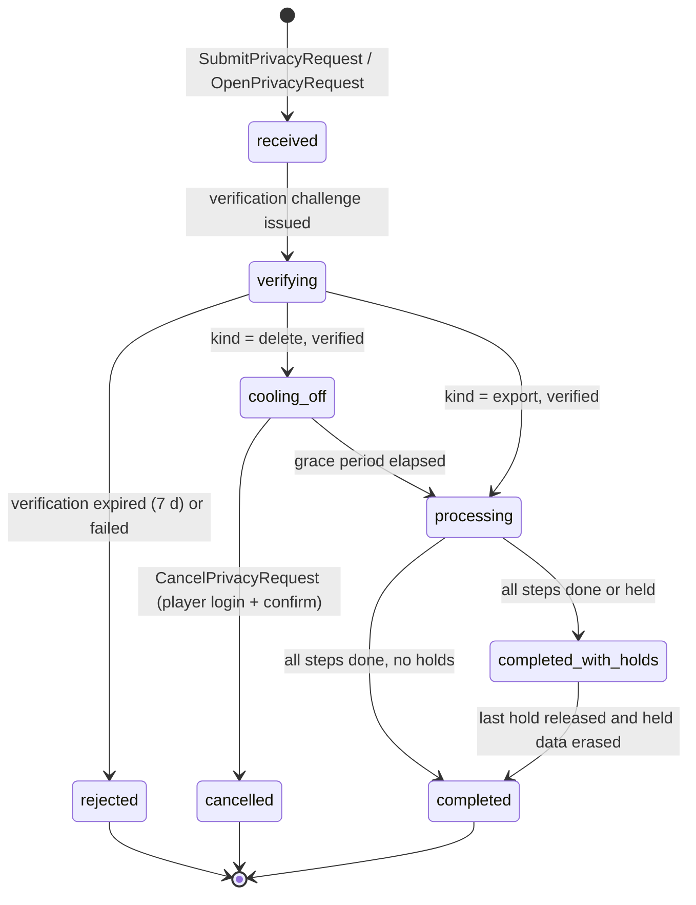

# Legends of the Shattered Frontier — Backend Part 3: Privacy, Transfers and Operations
## Version 1.0 — Expanded Technical Design Authority edition (2026-10-17)

Design target; not implemented. Names per Shared Registry v1.0.

Entry file: [Backend Architecture](../Legends_Shattered_Frontier_Backend_Architecture_v1.0.md) · Registry: [Shared Registry](../Legends_Shattered_Frontier_Shared_Registry_v1.0.md)

---

## 1. Purpose of this part

This part specifies the two cross-service data flows Backend orchestrates — the account deletion and privacy request workflow, and realm/character transfer — and the operational platform: scaling, disaster recovery, multi-region deployment, deployment, and observability.

---

## 2. Account deletion and privacy request workflow

### 2.1 Scope and ownership

The **privacy workflow** is a component of `auth-service` (Backend account core). It is the single intake and orchestrator for data subject requests of two kinds (Registry enum `privacy_request_kind`): `export` (access and portability) and `delete` (erasure). Every data-owning service is a **participant** that performs export or erasure of its own data; the workflow never writes another service's database (Registry §4, Durable authority). Analytics' part is performed by `analytics-pipeline` `PrivacyService` (Analytics spec, Dashboards Alerting and Privacy, Erasure and Access and portability export). Security's part (evidence, audit, legal hold) follows Security spec, Threat Model and Server Authority, Data subject rights.

Privacy request IDs use prefix `prq_` (Registry §3.1).

### 2.2 Intake

| Channel | How | Verification required |
| --- | --- | --- |
| Player (launcher or web account page) | `SubmitPrivacyRequest(kind, idempotency_key)` from an authenticated session | Fresh `StepUp` within 10 minutes: MFA factor if enrolled; otherwise password re-entry **and** email one-time code. Rejected while a Security cooling-off is active (account deletion is on the cooling-off high-value list, entry file, Registry additions). |
| Player without access (lost credentials) | Web form → email to the address on file containing a single-use link (24 h) | Link opens account recovery first (Security credentials flow); request proceeds only after a successful login + `StepUp`. |
| Support (ticket) | Agent calls `AuthAdmin.OpenPrivacyRequest(account_id, kind, ticket_ref)` under a JIT elevation (`elv_`) | Workflow sends the verification link to the account email; the request stays `verifying` until the player completes login + `StepUp`. Support cannot verify on the player's behalf. |
| Legal / regulator / guardian | Support with `privacy_officer` approval, `verification_method = staff_attested` | Second staff approval (two-person rule) recorded as `staff_action` audit records. |

Intake rules: one open request per `(account_id, kind)`; a duplicate submission returns the open request. A `delete` request supersedes an open `export` only if the player confirms; otherwise the export completes first (players often want their data before deletion; the UI offers "export then delete"). `ConfirmPrivacyRequest(request_id, step_up_proof)` is the verification call that moves `verifying` forward for support-opened and recovery-channel requests.

`privacy_officer` is an approval capability held by named `auditor` or `enforcement_lead` staff (Registry `staff_role`); it is not a separate role.

### 2.3 States

Registry enum `privacy_request_state`: `received`, `verifying`, `rejected`, `cooling_off`, `cancelled`, `processing`, `completed_with_holds`, `completed`.



| State | Meaning | Account effect (`delete`) |
| --- | --- | --- |
| `received` | Request recorded, `prq_` assigned | none |
| `verifying` | Waiting for identity verification | none |
| `rejected` | Verification failed or expired; terminal | none |
| `cooling_off` | Verified; grace period running | `account_state = pending_deletion`: login allowed, but after login the client shows only the cancel/confirm screen; world entry, trading, market, mail and guild actions are blocked; existing sessions revoked once at entry |
| `cancelled` | Player cancelled during grace; terminal | `account_state = active` |
| `processing` | Participant steps running | `account_state = erasing`; all sessions revoked; login returns `account_locked` |
| `completed_with_holds` | All non-held data erased; some scoped data retained under legal hold | `account_state = erased` |
| `completed` | Everything erased or pseudonymized per §2.7; terminal | `account_state = erased` (tombstone) |

Registry enum `account_state`: `active`, `pending_deletion`, `erasing`, `erased` (Part 1, Account lifecycle). Sanctions are not account states; they come from `enforcement-service.CheckRestrictions`.

### 2.4 Timing and SLA

| Item | Value | Key |
| --- | --- | --- |
| Grace period (`delete`) | 14 days from verification | `tune.backend.privacy_delete_grace_days` |
| Overall SLA (`delete`) | completed or `completed_with_holds` ≤ 30 days from **verification** (grace included); target 21 days | `PRIVACY_REQUEST_SLA` (30 days) |
| Overall SLA (`export`) | bundle delivered ≤ 30 days from verification; target 7 days | same |
| Participant deadline | each step gets `deadline_at = verified_at + 30 d − 2 d` safety margin; Analytics `SubmitErasure` is called at the start of `processing` (≈ day 14) and must finish within the remaining window (Analytics target 7 days fits) | — |
| Verification expiry | 7 days | `tune.backend.privacy_verify_expiry_days` |
| Export download link | 7 days, single account, encrypted object | — |
| KMS key deletion pending window | 7 days, scheduled at phase 4 start; counted inside the SLA | — |
| SLA risk alert | any step not `done`/`held` at `deadline_at − 5 d` → `sev3` `oncall_platform`; at `deadline_at` → `sev2` + privacy officer | — |

**Worked example.** Verified 2026-11-02 10:00 UTC. Grace ends 2026-11-16 10:00 → `processing`. `deadline_at` = 2026-12-02 − 2 d = 2026-11-30 10:00. Phases 1–2 finish 2026-11-16 11:30; Analytics reports `ErasureCompleted` on 2026-11-20; phase 4 schedules the KMS deletion the same day (key destroyed 2026-11-27). `auth.account.deleted` is published 2026-11-20 with `days_since_verified = 18`; the request counts as SLA-met for `m_privacy_request_sla_met`.

### 2.5 Legal holds — `enforcement-service.GetLegalHold` contract

Resolved (2026-10-17): Security ratifies this shared hold contract (Security spec, Audit, operations and interfaces, Enforcement service API); it is implemented by `enforcement-service` in `lsf.enforcement_service.v1`, and Analytics' own hold check (Analytics spec, Dashboards Alerting and Privacy, Erasure, "legal-hold check") uses the same call.

```text
rpc GetLegalHold(GetLegalHoldRequest) returns (LegalHoldSet);        // enforcement-service
message GetLegalHoldRequest {
  string account_id = 1;                // acc_
  repeated string character_ids = 2;    // chr_ (all characters of the subject)
  string request_id = 3;                // prq_ (for audit correlation)
}
message LegalHoldSet { repeated LegalHold holds = 1; }
message LegalHold {
  string hold_id = 1;                   // registered hld_ prefix, owner enforcement-service
  repeated string scopes = 2;           // legal_hold_scope values
  string basis = 3;                     // legal_hold_basis value
  string case_id = 4;                   // cas_ when basis = open_case
  google.protobuf.Timestamp review_at = 5;
}

// implemented by auth-service (privacy workflow), called by enforcement-service
rpc HoldReleased(HoldReleasedRequest) returns (HoldReleasedAck);
message HoldReleasedRequest {
  string hold_id = 1; repeated string scopes_released = 2;
  google.protobuf.Timestamp released_at = 3; string idempotency_key = 4;   // "hld_…:released"
}
```

| Proposed enum | Values | Meaning |
| --- | --- | --- |
| `legal_hold_scope` | `enforcement_evidence`, `chat`, `economy_ledger`, `item_ledger`, `audit`, `telemetry`, `purchase_records` | the data class a participant must not erase while the hold is active |
| `legal_hold_basis` | `open_case`, `fraud_prevention`, `legal_obligation`, `payment_dispute` | why the hold exists |

Rules: a hold names scopes, never rows; each participant maps scopes to its own tables (§2.6). Holds are subject-wide (account and all its characters). Security re-reviews each hold by `review_at` (default 90 days). If no `HoldReleased` arrives by `review_at + 30 d`, the workflow calls `GetLegalHold` again and treats holds no longer returned as released (callback-loss fallback). `GetLegalHold` is fail-closed: if it fails, the workflow does not start phase 1.

### 2.6 Orchestration

When a `delete` request enters `processing`, the workflow resolves the subject: `account_id` plus all `character_ids` ever created by the account (including previously deleted characters still within their own retention), then:

1. Revokes all sessions (`RevokeSessions(account, reason = account_deletion)`), sets `account_state = erasing`, and kicks any character in world (`character.world.left`, `left_reason = account_deletion`). Any `transferring` character's realm transfer is aborted (`AbortTransfer`, `abort_reason = account_deletion`, §3) before phase 1.
2. Calls `enforcement-service.GetLegalHold(account_id)` (§2.5) which returns `hold_id`s and `hold_scopes` for open cases, fraud prevention or legal obligation.
3. Creates one `privacy_request_steps` row per participant (registered enum `privacy_step_state`, Shared Registry, Phase-2 enums: `pending` → `in_progress` → `done` | `held` | `skipped`) and calls each participant's `PrivacyParticipant.EraseSubject` in the phase order below. A phase starts only when the previous phase's steps are `done` or `held`.
4. Publishes `auth.account.deletion_started` at entry and `auth.account.deleted` when every step is `done` or `held`.
5. Crypto-shreds the account data key last (phase 4), only when no hold covers `audit`.

Participant contract (implemented by every data-owning service in its own package `lsf.<service_snake>.v1`):

```text
service PrivacyParticipant {
  rpc ExportSubject(ExportSubjectRequest) returns (ExportSubjectResult);   // writes an encrypted part object, returns ref + row counts
  rpc EraseSubject(EraseSubjectRequest)   returns (EraseSubjectResult);    // returns erased/pseudonymized/held counts per data class
}
message EraseSubjectRequest {
  string request_id = 1;            // prq_ (or 'chrp:<chr_>' for a single-character purge, Part 1)
  string account_id = 2;            // acc_
  repeated string character_ids = 3; // chr_
  repeated string hold_scopes = 4;   // from GetLegalHold
  string deadline_at = 5;
  string idempotency_key = 6;        // "prq_…:<service>:erase"
}
message EraseSubjectResult {
  string state = 1;                  // privacy_step_state: done | held | skipped
  map<string, int64> erased = 2;     // per data class (§2.7 row names)
  map<string, int64> pseudonymized = 3;
  map<string, int64> held = 4;       // per legal_hold_scope
}
```

| Phase | Participant | Action on `delete` |
| --- | --- | --- |
| 1 Unwind | `economy-service` | Cancel open market listings and trades (escrow returned to the subject first, so nothing is lost to third parties mid-trade); settle any wallet lien or `rollback_deficit` by writing it off (Economy spec, Wallet liens: `WriteOffLien(reason = account_deleted)`) unless a hold covers `economy_ledger`, in which case the deficit record is retained; zero all wallets with sink `account_erasure`. |
| 1 Unwind | `inventory-service` | Return escrowed items per economy cancellation; then `RevokeItems(mode = destroy)` for all subject-owned items with sink code `account_erasure`; items already transferred (mail delivered, traded, guild bank deposits) belong to their new owner and are untouched. Quarantined items under a hold stay quarantined. |
| 1 Unwind | `chat-service` (mail) | Unread mail **to** the subject with attachments returns to its senders; unread mail **from** the subject keeps its attachments for the recipient. |
| 1 Unwind | `group-service`, `instance-service` | Remove from parties/queues; delete lockouts and run participation rows; run records keep a placeholder participant for group integrity. |
| 1 Unwind | `guild-service` | Remove memberships. If the subject leads a guild, leadership passes by the guild succession rule (Part 2, guild-service, Succession and dissolution); a guild with no remaining members is disbanded. Guild logs render the subject as "Former member". |
| 1 Unwind / 2 Erase | `building-service` | Resolve pending durable construction decisions before inventory erasure; safely archive/release personal property, remove grants and identify individual recovery/contribution entitlements for Inventory's account-erasure treatment. Shared guild assets survive an individual deletion. Export includes the subject's property/grants/contribution/archive records; retain decision provenance pseudonymized under existing ledger/hold rules. Construction Integration §8 owns the domain contract. |
| 2 Erase | `character-service` | Delete appearance, location snapshot, bios; replace character names with `erased_<8 hex>` and release the original name after the 90-day reuse quarantine; keep a `chr_` tombstone row (`character_state = purged`, no profile data) for referential integrity. Emits `character.profile.deleted` (`deletion_cause = account_deletion`) per character not already `deleted`. |
| 2 Erase | `progression-service`, `quest-service`, `faction-service`, `loot-service`, `crafting-service`, `reward-service` | Hard-delete state rows keyed by the subject's `chr_`/`acc_`; append-only ledgers (`pgl_`, `fsl_`, reward grants) are retained pseudonymized (§2.7). |
| 2 Erase | `chat-service` | Delete authored messages, mail bodies, friend and block lists, custom channel ownership; the sender of retained mail shows "erased". Excerpts attached to enforcement evidence are Security's (hold scope `chat`). |
| 2 Erase | `store-service`, `liveops-service` | Delete survey answers and preferences; purchase records retained pseudonymized for tax/accounting obligations (LiveOps spec owns the retention period; entry file, Open issues). |
| 3 Telemetry | `analytics-pipeline` `PrivacyService` | `SubmitErasure(request_id, account_id, character_ids, idempotency_key)`; completion via `ErasureCompleted(request_id, completed_at)` callback. Analytics performs its own legal-hold check (`restricted_hold`) with `GetLegalHold`. |
| 3 Security | `anticheat-service`, `enforcement-service` | Purge detections/evidence not covered by a hold per Security evidence retention; retained evidence remains Security-access-only and is purged by Security when the hold ends, reported back as hold release. |
| 4 Finalize | `auth-service` (self) | Delete email, platform links, credentials, MFA factors, devices (Security tables, via Security's erase routine), login attempts; convert the account row to a tombstone; remove the account's `account_directory` rows (and publish their removal on `auth-directory`); request KMS deletion of the per-account data key (crypto-shreds p2/p3 fields in audit records and backups encrypted with it) — skipped while a hold covers `audit`; write `erasure_tombstones(account_id, erased_at)`. |

`export` uses the same participants and phases 2–3 only, calling `ExportSubject` (Analytics: `SubmitExport`), then assembles one encrypted JSON bundle (§2.10) and emits `auth.account.export_completed`. Enforcement evidence is summarized per Security spec, Data subject rights (categories, sanctions, appeals), never raw detector data.

Sequence (delete):

```mermaid
sequenceDiagram
    autonumber
    participant P as Player / support
    participant G as gateway
    participant A as auth-service privacy workflow (Backend)
    participant S as auth-service security methods (Security)
    participant E as enforcement-service
    participant X as Participants (economy, inventory, guild, group, character, progression, chat, ...)
    participant PS as analytics-pipeline PrivacyService
    participant AU as audit-service
    P->>G: SubmitPrivacyRequest(kind=delete, idempotency_key)
    G->>A: forward (session validated)
    A->>S: StepUp check (fresh <= 10 min, no cooling-off)
    S-->>A: verified
    A->>AU: Append staff/auth_security record (request verified)
    A-->>P: prq_ in cooling_off (14 d), account pending_deletion
    A->>A: publish auth.account.deletion_requested
    Note over A: grace period; CancelPrivacyRequest -> cancelled
    A->>S: RevokeSessions(account, account_deletion)
    A->>A: account_state = erasing; publish auth.account.deletion_started
    A->>E: GetLegalHold(account_id)
    E-->>A: hold_ids, hold_scopes
    A->>X: Phase 1 EraseSubject (unwind escrow, wallets, items, groups, guilds)
    X-->>A: done / held
    A->>X: Phase 2 EraseSubject (character, progression, quests, chat, ...)
    X-->>A: done / held
    A->>PS: SubmitErasure(request_id, account_id, character_ids, idempotency_key)
    PS-->>A: ErasureCompleted(request_id, completed_at)
    A->>A: Phase 4 finalize: tombstone, delete credentials, KMS key deletion (if no audit hold)
    A->>AU: Append completion record (per-service counts, holds)
    A->>A: publish auth.account.deleted; state completed or completed_with_holds
    E-->>A: HoldReleased(hold_id) (later)
    A->>X: EraseSubject for released scopes
    A->>A: state completed
```

### 2.7 Hard deletion vs pseudonymization by data class

Principle: **personal data is hard-deleted; records other players or financial integrity depend on are kept only as pseudonymous rows whose IDs no longer link to any identifying data** (the account tombstone holds no email, name, IP, device or platform link, and the data key is shredded).

| Data class | Examples | Treatment | Hold scope that suspends it |
| --- | --- | --- | --- |
| Contact and identity (p2) | email, platform account links, locale, age-gate band | hard delete | — |
| Credentials and devices (p3) | password hashes, MFA secrets, recovery codes, device public keys | hard delete (Security erase routine) | `enforcement_evidence` (device HMACs only) |
| Network identifiers (p2) | raw IP (≤ 30 d), `ip_hmac`, country | hard delete in `auth`; HMAC'd forms in Analytics follow `TELEMETRY_P2_RETENTION` and erasure | `enforcement_evidence` |
| Player-authored content (p2) | chat, mail bodies, bios, survey free text | hard delete | `chat` |
| Public profile (p0) | character name, appearance, guild membership | hard delete; name replaced by `erased_<hex>` | — |
| Game state (p1) | skills, quests, inventory, wallets, lockouts | hard delete (after phase 1 unwind) | `item_ledger` keeps quarantined items |
| Append-only ledgers (p1) | `txn_`, `ilg_`, `pgl_`, `fsl_`, reward grants, trades | retained with `acc_`/`chr_` IDs (unlinked) for economy reconciliation; free-text fields nulled; counterparty rows of other players unchanged | `economy_ledger`, `item_ledger` (free text kept) |
| Telemetry (p1/p2) | warehouse rows | erased by Analytics `PrivacyService` | `telemetry` |
| Audit records (WORM, 7 years) | `auth_security`, `staff_action`, `enforcement` | retained; p2/p3 fields crypto-shredded via data key deletion (Security spec, Audit Operations and Interfaces, Record structure and hash chain) | `audit` (key not deleted) |
| Enforcement evidence | evidence bundles, detections | Security evidence retention; under hold until release | `enforcement_evidence` |
| Purchase/tax records | `pur_` | retained pseudonymized per legal obligation (LiveOps) | `purchase_records` |
| Backups | PostgreSQL backups, snapshots | not edited; expire by `BACKUP_RETENTION_DAYS` (35, §5.2). Any restore replays `erasure_tombstones` and re-runs `EraseSubject` for every erased account before the restored database serves traffic. p2/p3 values inside backups encrypted with the shredded data key are unreadable. | — |
| Event bus | `domain.*` topics (14 d), telemetry (3 d) | not edited; age out. Consumers that materialize state must honor `auth.account.deleted`. | — |

### 2.8 Idempotency and failure handling

- Every RPC in the workflow carries an `idempotency_key`; participant keys are `prq_<id>:<service>:<erase|export>` and are retained for the life of the request, overriding `IDEMPOTENCY_RETENTION` (7 days) because a request can span 30+ days; the workflow re-sends the same key on retry.
- `EraseSubject` must be safe to repeat: erasing already-erased data returns `done` with zero counts.
- Step retries: exponential backoff 1 min → 6 h cap; a step failing for 72 h pages `oncall_platform` (`sev3`). The workflow never skips a failed step; `skipped` is used only when a participant declares it holds no data for the subject.
- The workflow is a durable state machine in `privacy_requests`/`privacy_request_steps` (outbox pattern for event publication; Part 2, Sagas); a crashed worker resumes from the last committed step. Phase 1 is the pivot: once any phase 1 step has run, the request cannot return to `cooling_off`.
- Cancellation is accepted only in `cooling_off`; once `processing` starts, the request cannot be cancelled.

### 2.9 Audit records

The workflow appends `audit-service` records (audit-before-act; failure blocks the transition) in stream category `auth_security` for: request submitted, verified, cancelled, processing started, each hold received/released, completion. Support- and staff-opened requests also append `staff_action` with the `elv_` ID. Record bodies contain `request_id`, `account_id`, kind, state, per-service row counts and hold IDs — no personal data — so they survive key shredding intact.

### 2.10 Export bundle

One encrypted ZIP in `privacy-exports` (Part 2, Object storage), AES-256-GCM with a per-bundle key delivered only inside the authenticated download response.

```json
{
  "request_id": "prq_01JA3B…",
  "account_id": "acc_01J9ZK…",
  "generated_at": "2026-11-05T09:12:00.000Z",
  "format_version": 1,
  "parts": [
    { "service": "auth-service", "path": "auth.json", "rows": 14, "schema": "schemas/auth.json" },
    { "service": "character-service", "path": "character.json", "rows": 3, "schema": "schemas/character.json" },
    { "service": "inventory-service", "path": "inventory.json", "rows": 1288, "schema": "schemas/inventory.json" },
    { "service": "analytics-pipeline", "path": "telemetry.parquet", "rows": 58211, "schema": "schemas/telemetry.json" },
    { "service": "enforcement-service", "path": "enforcement_summary.json", "rows": 2, "schema": "schemas/enforcement_summary.json" }
  ],
  "excluded": ["detector internals (Security spec, Data subject rights)", "other players' personal data"]
}
```

Rows naming another player include only that player's `chr_` ID when it is already visible in-game (trade partner, guild member), never their account or personal data.

### 2.11 Schema `auth` — privacy tables

```sql
CREATE TABLE auth.privacy_requests (
  request_id          text PRIMARY KEY CHECK (request_id LIKE 'prq\_%'),
  account_id          text NOT NULL,
  kind                text NOT NULL CHECK (kind IN ('export','delete')),
  state               text NOT NULL CHECK (state IN ('received','verifying','rejected','cooling_off','cancelled',
                                                     'processing','completed_with_holds','completed')),
  channel             text NOT NULL CHECK (channel IN ('player','player_recovery','support','staff_attested')),
  verification_method text,
  ticket_ref          text,
  elevation_id        text,
  received_at         timestamptz NOT NULL DEFAULT now(),
  verified_at         timestamptz,
  grace_ends_at       timestamptz,
  deadline_at         timestamptz,
  completed_at        timestamptz,
  hold_ids            text[] NOT NULL DEFAULT '{}',
  character_ids       text[] NOT NULL DEFAULT '{}',
  version             bigint NOT NULL DEFAULT 1
);
CREATE UNIQUE INDEX privacy_one_open ON auth.privacy_requests (account_id, kind)
  WHERE state IN ('received','verifying','cooling_off','processing');

CREATE TABLE auth.privacy_request_steps (
  request_id    text NOT NULL REFERENCES auth.privacy_requests,
  participant   text NOT NULL,                   -- registry service name
  phase         smallint NOT NULL CHECK (phase BETWEEN 1 AND 4),
  state         text NOT NULL CHECK (state IN ('pending','in_progress','done','held','skipped')),
  attempts      int NOT NULL DEFAULT 0,
  next_attempt_at timestamptz,
  deadline_at   timestamptz NOT NULL,
  result        jsonb,                           -- counts per data class / held scope
  updated_at    timestamptz NOT NULL DEFAULT now(),
  PRIMARY KEY (request_id, participant)
);

CREATE TABLE auth.erasure_tombstones (           -- ID-only; also mirrored to audit-worm
  account_id    text PRIMARY KEY,
  character_ids text[] NOT NULL,
  erased_at     timestamptz NOT NULL
);
```

### 2.12 Workflow events

All on `domain.auth`, keyed by `account_id`, envelope per Registry §10.1, `privacy_class = p1_pseudonymous`.

| Event | When |
| --- | --- |
| `auth.account.deletion_requested` | delete request verified; enters `cooling_off` |
| `auth.account.deletion_cancelled` | `cooling_off` → `cancelled` |
| `auth.account.deletion_started` | enters `processing` |
| `auth.account.deleted` | `completed_with_holds` or `completed` reached the first time |
| `auth.account.export_requested` | export request verified |
| `auth.account.export_completed` | export bundle available |

| Event | Field | Type | Req | Description | privacy_class |
| --- | --- | --- | --- | --- | --- |
| all six | `request_id` | string | yes | `prq_` | p1_pseudonymous |
| | `channel` | string | yes | `player`, `player_recovery`, `support`, `staff_attested` | p0_public |
| `auth.account.deletion_requested` | `grace_ends_at` | timestamp | yes | end of cooling-off | p0_public |
| | `character_count` | int | yes | characters to be erased | p0_public |
| `auth.account.deletion_cancelled` | `days_into_grace` | int | yes | | p0_public |
| `auth.account.deletion_started` | `hold_count` | int | yes | holds returned by `GetLegalHold` | p1_pseudonymous |
| `auth.account.deleted` | `final_state` | string | yes | `completed`, `completed_with_holds` | p1_pseudonymous |
| | `days_since_verified` | int | yes | SLA tracking | p0_public |
| | `held_scopes` | string[] | no | present when holds remain | p1_pseudonymous |
| `auth.account.export_completed` | `days_since_verified` | int | yes | | p0_public |
| | `bundle_bytes` | int | yes | | p0_public |

---

## 3. Realm and character transfer

Resolves AI spec, Open issues, "Cross-realm transfer" (transfer must carry `faction.standings`) and Itemization spec's "per Backend spec rules" for legendary progress.

### 3.1 Scope

A **realm transfer** moves one character, with its durable state, from a source realm to a destination realm. The character keeps its `chr_` ID (IDs are opaque and globally unique; Registry §1). At launch, transfers are allowed only between realms in the same `dc_region` (`ff.backend.realm_transfer_enabled`); cross-region transfers use the same saga with an export/import bundle and stay disabled (`ff.backend.cross_region_transfer_enabled = false`) until data-residency review. Pricing and entitlement are LiveOps' (a `store_offer` may sell transfers; the request carries an optional `entitlement_ref` = `pur_`).

Proposed entity **RealmTransfer** (`rtx_`, character-service, PostgreSQL `character`) and enum `realm_transfer_state`: `requested`, `validating`, `rejected`, `locked`, `staging`, `committing`, `completed`, `aborting`, `aborted`.

```mermaid
stateDiagram-v2
    [*] --> requested: RequestRealmTransfer
    requested --> validating: preconditions check
    validating --> rejected: blocker found
    validating --> locked: all participants PrepareTransfer ok (character_state = transferring)
    locked --> staging: StageTransfer on all participants
    staging --> committing: all staged; pivot recorded
    committing --> completed: all participants CommitTransfer ok
    locked --> aborting: participant failure / cancel / timeout / account deletion
    staging --> aborting: participant failure / timeout
    aborting --> aborted: all AbortTransfer ok
    rejected --> [*]
    completed --> [*]
    aborted --> [*]
```



### 3.2 Preconditions

| Check | Owner of the check | Blocker reason |
| --- | --- | --- |
| Account `active`, no open `delete` privacy request, no cooling-off, `StepUp` fresh | auth-service | `ACCOUNT_NOT_ELIGIBLE` |
| No active sanction with trade or login restriction; no open enforcement case on the account (`CheckRestrictions`, `GetLegalHold` with basis `open_case`) | enforcement-service | `ENFORCEMENT_HOLD` |
| Character `active`, not in world, `transfer_cooldown_until` passed (`REALM_TRANSFER_COOLDOWN_DAYS` = 30, `tune.backend.realm_transfer_cooldown_days`) | character-service | `COOLDOWN`, `IN_WORLD` |
| Destination realm accepts transfers (realm role from `world-service.GetRealms`, World spec) and the account has a free slot there | character-service | `REALM_CLOSED`, `SLOTS_FULL` |
| Not in a party, raid group or queue | group-service | `IN_GROUP` |
| Not a guild member | guild-service | `IN_GUILD` |
| No unread mail with attachments, no pending outgoing mail | chat-service | `MAIL_PENDING` |
| No open trades, active market listings, active liens or transfer holds | economy-service | `ECONOMY_PENDING` |
| No escrowed items | inventory-service | `ITEMS_ESCROWED` |
| No reward grant in `pending` or `delivering` | reward-service | `GRANTS_PENDING` |
| Not inside an instance run | instance-service | `IN_INSTANCE` |
| Owns no placed structures or settlement plots, unresolved construction actions, contribution entitlements or construction recovery on the source realm | building-service; Inventory confirms recovery state | `STRUCTURES_OWNED` |

All blockers are collected and returned together so the player can resolve them in one pass. Name collisions are **not** blockers: a collision sets `rename_required` on the destination (Part 1, Names).

### 3.3 Participant contract

Every service that holds character-scoped durable state implements, in its own package:

```text
service TransferParticipant {
  rpc PrepareTransfer(TransferRequest) returns (PrepareResult);  // validate + lock character's rows against mutation
  rpc StageTransfer(TransferRequest)   returns (StageResult);    // make destination copy ready but invisible; returns row counts + digest
  rpc CommitTransfer(TransferRequest)  returns (CommitResult);   // make destination authoritative; remove/tombstone source rows
  rpc AbortTransfer(TransferRequest)   returns (AbortResult);    // drop staged copy; unlock
}
message TransferRequest {
  string transfer_id = 1;          // rtx_
  string character_id = 2;
  string account_id = 3;
  string from_realm_id = 4;
  string to_realm_id = 5;
  bool cross_region = 6;
  string idempotency_key = 7;      // "rtx_…:<service>:<prepare|stage|commit|abort>"
}
message PrepareResult { bool ok = 1; repeated string blockers = 2; }
message StageResult   { map<string, int64> rows = 1; bytes digest = 2; }
```

Semantics:

1. After `PrepareTransfer` succeeds, the participant rejects every mutation for the character with `FAILED_PRECONDITION CHARACTER_TRANSFERRING` until `CommitTransfer` or `AbortTransfer`. Reads stay available.
2. For `realm_column` schemas in the same region (Part 2, Realm scoping), `StageTransfer` only computes the digest (SHA-256 over the canonical row set) and `CommitTransfer` updates `realm_id` in one transaction. For `realm_sharded` schemas (`inventory`), `StageTransfer` copies rows into the destination realm database with `staged_transfer_id = rtx_` (invisible to queries) and `CommitTransfer` flips visibility and deletes the source rows in a source-then-destination order guarded by the digest. Cross-region staging writes an encrypted bundle (p1 data only) to the destination region and imports it there.
3. Ledgers (`ilg_`, `txn_`, `pgl_`, `fsl_`) are not moved; their history stays where it was written. Where a ledger must keep a running total consistent with moved state, the participant writes one opening entry on the destination (rule 4).
4. In-region, balances move by updating `realm_id` on the character's rows (for example `economy.wallets`); no ledger entry is written because no value changes hands. Cross-region, a participant whose ledger must reconcile with the moved state writes **opening entries** on the destination with the transfer as cause (`causation_id = rtx_…`) and a closing marker on the source; for currencies Economy decides the codes (cross-spec request in the entry file). No value is created or destroyed by a transfer.
5. All four RPCs are idempotent and safe to repeat; `AbortTransfer` after `CommitTransfer` returns `FAILED_PRECONDITION ALREADY_COMMITTED`.

### 3.4 What moves

| Participant | Moves with the character | Does not move |
| --- | --- | --- |
| `character-service` | profile, appearance, slot (new slot on destination), level cache, played time; location reset to the destination realm's arrival point (`tune.backend.transfer_arrival_zone_id`) | presence, queue position |
| `progression-service` | all `CharacterProgression`, attributes, skills, locks, mastery, specializations, achievements, titles (`realm_id` updated) | account unlocks (account-scoped already) |
| `inventory-service` | all character-owned containers and items (equipment, backpack, bags, bank), `LegendaryProgress` (`lgp_`) unchanged — legendary progress travels with its character and is never shared (Itemization spec, legendary progress) | account bank (account-scoped), guild bank contents, mailbox (must be empty) |
| `economy-service` | character wallets: `currency/gold`, `currency/frontier_marks`, `currency/season_tokens` (all character-owned), and the current week's marks counter | guild wallets; crowns (account-owned) |
| `faction-service` | **every `faction.standings` row of the character, unchanged** (`value`, `tier`, `version`). In-region: the table is keyed by `character_id` only (AI spec, Data model), so the rows carry as they are and no row is written. Cross-region: rows are copied exactly, and the destination `faction.standing_ledger` gets one opening entry per faction with `value_before = 0`, `requested_delta = applied_delta = value`, `value_after = value`, `source = realm_transfer` (registered `faction_change_source`; Shared Registry, Phase-2 enums), `source_ref = rtx_…`, so ledger sums reconcile with standings | `faction.control` influence contributions (realm world state) |
| `quest-service` | realm-agnostic quest instances; chain progress and choices | realm-bound generated quests (`gqd_`) are abandoned with `state_reason = realm_transfer`; campaign contributions remain in source realm (Quest spec, Generation and campaigns, Dynamic quest generation) |
| `instance-service` | lockouts (`lck_`) and mythic progress — carried so a transfer cannot reset weekly lockouts | run participation history |
| `loot-service` | pity counters | open loot drops (none can exist: not in instance) |
| `crafting-service` | recipe knowledge and crafting history rows | in-progress workshop jobs (must be collected first; blocker `CRAFTING_PENDING`) |
| `chat-service` | nothing (friends and blocks are realm-scoped and dropped; the player is told) | messages |

### 3.5 Sequence

```mermaid
sequenceDiagram
    autonumber
    participant C as Client
    participant CH as character-service (orchestrator)
    participant P as Participants (progression, inventory, economy, faction, quest, instance, loot, crafting, ...)
    participant AU as audit-service
    C->>CH: RequestRealmTransfer(character_id, to_realm_id, entitlement_ref?, idempotency_key)
    CH->>CH: rtx_ requested → validating; outbox character.transfer.requested
    CH->>P: PrepareTransfer (all, parallel)
    P-->>CH: ok / blockers
    alt any blocker
        CH->>P: AbortTransfer (those that prepared)
        CH-->>C: rejected + blockers
    else all ok
        CH->>CH: character_state = transferring; name check on destination; state locked
        CH->>P: StageTransfer (all)
        P-->>CH: row counts + digests
        CH->>AU: Append (transfer pivot: counts, digests)
        CH->>CH: state committing (pivot, durable)
        CH->>P: CommitTransfer (all; forward-only retries)
        P-->>CH: committed
        CH->>CH: realm_id = destination, character_state = active, cooldown set; outbox character.transfer.completed
        CH-->>C: transfer_update completed
    end
```

| Timeout | Value | Effect |
| --- | --- | --- |
| Prepare (all participants) | 60 s | abort |
| Staging | 10 min | abort |
| Committing | none (forward only) | `stuck` saga after 30 min pages `oncall_platform` `sev2` (character locked) |

### 3.6 Schema

```sql
CREATE TABLE character.realm_transfers (
  transfer_id     text PRIMARY KEY CHECK (transfer_id LIKE 'rtx\_%'),
  character_id    text NOT NULL REFERENCES character.characters,
  account_id      text NOT NULL,
  from_realm_id   text NOT NULL,
  to_realm_id     text NOT NULL,
  cross_region    boolean NOT NULL DEFAULT false,
  state           text NOT NULL CHECK (state IN ('requested','validating','rejected','locked','staging',
                                                 'committing','completed','aborting','aborted')),
  blockers        text[] NOT NULL DEFAULT '{}',
  abort_reason    text,
  entitlement_ref text,                            -- pur_ (optional)
  rename_required boolean NOT NULL DEFAULT false,
  requested_at    timestamptz NOT NULL DEFAULT now(),
  pivot_at        timestamptz,
  completed_at    timestamptz,
  version         bigint NOT NULL DEFAULT 1
);
CREATE UNIQUE INDEX one_open_transfer ON character.realm_transfers (character_id)
  WHERE state NOT IN ('rejected','completed','aborted');

CREATE TABLE character.realm_transfer_steps (
  transfer_id   text NOT NULL REFERENCES character.realm_transfers,
  participant   text NOT NULL,
  phase         text NOT NULL CHECK (phase IN ('prepare','stage','commit','abort')),
  state         text NOT NULL CHECK (state IN ('pending','done','failed')),
  rows          jsonb,
  digest        bytea,
  attempts      int NOT NULL DEFAULT 0,
  updated_at    timestamptz NOT NULL DEFAULT now(),
  PRIMARY KEY (transfer_id, participant, phase)
);
```

### 3.7 Security notes

Transfers are a laundering and evasion vector (move gold away from a watched realm economy, escape a local reputation). Mitigations: enforcement blockers (§3.2), 30-day cooldown, `character.transfer.*` events consumed by `anticheat-service` (Security decides detectors), every pivot audited with digests, and no currency or item creation in the flow (rule 4 above). A digest mismatch between stage and commit aborts before the pivot or, after it, freezes the character and pages Security (`INVARIANT_VIOLATION`).

---

## 4. Scaling

### 4.1 Launch phases

| Phase | Peak CCU | Topology | Realm soft cap |
| --- | --- | --- | --- |
| 1 | 100–500 | one `dc_region` (`na`), one realm, single cluster per service class | 1,000 |
| 2 | 2,000–5,000 | two regions (`na`, `eu`), 1–2 realms each | 3,000 |
| 3 | 10,000+ | four regions (`na`, `eu`, `apac`, `sa`), realms added per region by demand | 3,000 (raise only after load test) |

Zone and instance server capacity (players per `zone-server`, warm pools, splitting) is World's (World spec, server allocation). This section sizes the services around them.

### 4.2 Service capacity model

```text
rps_s(CCU)      = CCU × r_s                                    -- r_s = requests per CCU per second for service s
replicas_s      = max(min_s, ceil( rps_s × (1 + h) / cap_s ))   -- cap_s = sustained rps per pod at p99 SLO (load test)
                  × az_factor                                     -- h = headroom (0.5); az_factor = 1.5 (survive loss of 1 of 3 AZs)
db_writes_s     = CCU × w_s                                      -- durable writes per CCU per second
realms_region   = ceil( peak_CCU_region / (0.8 × realm_soft_cap) )
bus_mb_s        = CCU × e × b / 10^6                             -- e = events per CCU per s, b = bytes per event
```

Default planning rates (replace with measured values after the vertical slice; `tune` keys are not used — these are capacity-planning inputs):

| Service | `r_s` (req/CCU/s) | `w_s` (writes/CCU/s) | `cap_s` (rps/pod) | `min_s` |
| --- | --- | --- | --- | --- |
| gateway | 0.30 | — | 2,000 | 3 |
| auth-service | 0.02 | 0.002 | 1,000 | 3 |
| character-service | 0.05 (checkpoints 1/60 s + presence) | 0.02 | 1,500 | 3 |
| progression-service | 0.50 (practice batches) | 0.20 | 800 | 3 |
| inventory-service | 0.30 | 0.10 | 800 | 3 |
| economy-service | 0.05 | 0.03 | 600 | 3 |
| reward-service | 0.03 | 0.03 | 800 | 2 |
| quest-service | 0.10 | 0.05 | 1,000 | 2 |
| event bus | e = 2.0 events/CCU/s, b = 1,000 bytes | — | — | 3 brokers |

**Worked example (Phase 3, `eu` peak 4,000 CCU).** progression: `rps = 4,000 × 0.5 = 2,000`; `replicas = ceil(2,000 × 1.5 / 800) × 1.5 = ceil(3.75) × 1.5 = 4 × 1.5 = 6` pods. Durable writes across tier-0 services: `4,000 × (0.002 + 0.02 + 0.20 + 0.10 + 0.03 + 0.03 + 0.05) = 4,000 × 0.432 ≈ 1,730 writes/s`, of which `pg-progress` carries `4,000 × 0.25 = 1,000/s` — comfortably within one primary (target ≤ 60 % CPU at peak; split by moving `quest` to its own cluster if exceeded). Realms: `ceil(4,000 / 2,400) = 2`. Event bus: `4,000 × 2 × 1,000 / 10^6 = 8 MB/s` in, ~ 24 MB/s with 3 replicas; 3 brokers suffice.

### 4.3 Autoscaling and load protection

- Stateless services: horizontal autoscaling on CPU (target 60 %) and in-flight requests; scale-out stabilization 60 s, scale-in 10 min; `min_s` replicas spread across three availability zones.
- Stateful tiers (PostgreSQL, Redis, Kafka) are scaled by planned operations, not autoscalers.
- Realm caps and the realm queue (Part 1, World entry) are the backpressure valve for player load; services shed with `RESOURCE_EXHAUSTED` before degrading tick-critical paths.
- Load tests run at 2 × the phase's peak CCU (Agent implementation guide part, test matrix).

---

## 5. Disaster recovery

### 5.1 Targets

The Database spec's Recovery Targets (RPO < 15 min, RTO < 60 min) are the region-loss floor. Tiers (entry file, Service catalogue) refine them:

| Tier | Failure | RPO | RTO |
| --- | --- | --- | --- |
| 0 | pod / node | 0 | ≤ 1 min (rescheduling) |
| 0 | availability zone | 0 (synchronous standby) | ≤ 5 min (automatic failover) |
| 0 | region site loss (failover to the DR site of the same `dc_region`) | ≤ 5 min (async replica lag target ≤ 60 s, alert at 5 min) | ≤ 60 min |
| 1 | availability zone | ≤ 1 min | ≤ 15 min |
| 1 | region site loss | ≤ 15 min | ≤ 60 min |
| 2 | any | ≤ 24 h | ≤ 24 h |
| — | logical corruption (bad migration, bug) | point-in-time restore to before the fault | ≤ 4 h per schema |

Each `dc_region` consists of a **primary site** and a **DR site** in the same legal jurisdiction (so p2 data never leaves the region, Security spec, Privacy and data protection, rule 5). Cross-region replication in the overview's "Disaster Recovery" list means primary site → DR site.

### 5.2 Backups

| Item | Value | Key |
| --- | --- | --- |
| WAL archiving | continuous, segments shipped at least every 60 s (the Database spec's "hourly transaction backups" are met continuously) | — |
| Point-in-time recovery window | 7 days | `tune.backend.pitr_window_days` |
| Full snapshots | daily, retained 35 days | `BACKUP_RETENTION_DAYS` (35) |
| Weekly archival | weekly snapshot copied to the DR site's immutable bucket, retained 35 days (same ceiling, so erasure never outlives 35 days in backups) | same |
| Redis | hourly RDB for `redis-game` and `redis-world`, kept 3 days; `redis-cache`/`redis-session` not backed up | — |
| Kafka | not backed up (domain topics are regenerable facts; warehouse holds history) | — |
| Object storage | versioning on; WORM buckets per Security; DR-site replication for `content-*`, `evidence`, `audit-worm`, `backups` | — |
| Restore tests | every cluster restored monthly into an isolated environment; row counts and ledger checksums compared; failures `sev3` | — |

### 5.3 Restore rules

1. **Erasure replay first.** Before a restored database serves traffic, the restore job reads the union of `auth.erasure_tombstones` (current primary, if available) and the ID-only tombstone records in `audit-worm`, then calls `EraseSubject` for every listed subject on the restored service. A restore that cannot reach either list does not open.
2. **Consistent point.** For region-site failover, all tier-0 clusters are promoted from their DR replicas; replica lag differences (≤ 60 s target) are reconciled by the owning services' reconcilers (Economy ledger reconciliation, Itemization item ledger) and by replaying `domain.*` topics from the DR-site event bus mirror for the gap.
3. **Single-schema PITR** (logical corruption) is allowed only with the owning spec's reconciliation runbook, because other services may hold references created after the restore point; the event bus (14 d) is replayed into the restored service from the restore point using its inbox for deduplication.
4. Restores and failovers are `sev1` incidents with a named incident commander; LiveOps opens a maintenance window and evaluates compensation (LiveOps spec, Store Compensation Community, Compensation triggers).

### 5.4 Region-site failover runbook (summary)

| Step | Action | Target time |
| --- | --- | --- |
| 1 | Declare (two of: primary site health checks, provider status, `service_unhealthy` on ≥ 3 tier-0 services) | T + 5 min |
| 2 | Login gate on the region (`SetLoginGate`), status page `major_outage` | T + 7 min |
| 3 | Promote DR replicas (PostgreSQL), start Redis from latest RDB, switch event bus to DR mirror | T + 25 min |
| 4 | Scale DR-site Kubernetes workloads from warm minimum to phase capacity; world-service rebuilds the server registry | T + 40 min |
| 5 | Erasure replay check, reconcilers green, synthetic login / zone entry / trade tests | T + 50 min |
| 6 | Open canary realm, then all realms | T + 60 min |

Game days run each quarter per region in `staging` and twice a year in `prod` during a maintenance window.

---

## 6. Multi-region deployment

### 6.1 Regions and what is global

| Component | Placement |
| --- | --- |
| gateway, all game services, event bus, Redis, PostgreSQL, zone/instance server fleets | per `dc_region` (primary + DR site); no synchronous cross-region call on any gameplay or login path except home-region forwarding (§6.2) |
| Account directory (`auth.account_directory`) | written in the home region, replicated to all regions via the compacted `auth-directory` topic (HMACs and IDs only, p1) |
| Content packs | published once per environment, objects replicated to every region's buckets before `content.pack.published` |
| config-service | per region; LiveOps rollout plans coordinate regions (LiveOps spec, Config and Releases) |
| Analytics global modeled store | Analytics spec (p1 aggregates only cross regions) |
| Release signing, staff SSO, CI | global control plane, not on the player path |

### 6.2 Routing and residency

- Players reach the nearest edge PoP by anycast/GeoDNS. Login resolves `home_dc_region` from the replicated directory (`ResolveHomeRegion`); a login arriving at another region's gateway is forwarded to the home region's gateway over the private backbone (counted inside the 10 s login deadline). Unknown identifiers are handled locally with the same latency profile (Part 1, Login path) so existence is not disclosed.
- **Play region = home region at launch.** Characters can be created only on realms in the account's home region (`ff.backend.cross_region_play_enabled = false`). This keeps every p2 field and every session in one region. Cross-region play, if enabled later, requires region-scoped session attestations issued by the home region and a review of which character data (p1) may live in the realm's region.
- **Home-region migration** (support only, rare): a saga that exports account-core and all character data (same participant interfaces as §3 with `cross_region = true`), imports in the target region, flips the directory entry, then erases the source copy with `EraseSubject`. Audited; blocked by any legal hold.

---

## 7. Deployment

The DevOps spec owns pipelines (build, test, package, release) and branching; LiveOps owns release records, stages and maintenance windows (LiveOps spec, Config and Releases). Backend defines the runtime platform they deploy to.

| Concern | Rule |
| --- | --- |
| Clusters | one Kubernetes cluster per environment per region site (`release_stage`: `dev`, `ptr`, `staging`, `prod`); `prod` and `ptr` never share clusters |
| Workload classes | stateless services as Deployments (3-AZ topology spread, pod disruption budget ≥ 2/3 available); stateful infrastructure via operators or managed services; UE dedicated servers on dedicated node pools, lifecycle owned by world-service allocation (World spec) |
| Images | built once per commit, signed, SBOM attached; the same digest is promoted through stages; images contain no secrets or environment config |
| Config | static config from manifests (GitOps repository, reconciled continuously); runtime switches only through config-service (`ff.*`, `tune.*`); secrets from a KMS-backed secret store mounted at runtime |
| Rollout per service | migrations (expand step) → canary 5 % of pods for 10 min → 50 % → 100 %, with automatic rollback when the service's SLO burn rate exceeds 10× over 5 min or error rate doubles versus the previous version |
| Realm-scoped rollout | game-server builds roll by canary realms (LiveOps spec, Canary realms) |
| Compatibility | every service supports N−1 callers and N−1 event schemas (additive evolution); zone-server builds support the previous client build per LiveOps rule |
| Ownership | each service has an owning team and on-call route; Backend-owned services route to `oncall_platform` |

---

## 8. Observability

### 8.1 Signals

| Signal | Standard |
| --- | --- |
| Metrics | OpenTelemetry metrics exported to a Prometheus-compatible store; RED per RPC (rate, errors by code, duration histogram), saturation (CPU, memory, pool usage), plus the platform series in §8.3 |
| Traces | OpenTelemetry with W3C `traceparent`; `correlation_id` recorded as a span attribute on every span and copied into event envelopes; tail-based sampling keeps 100 % of error and slow (> p99) traces and 1 % of the rest |
| Logs | structured JSON with `service`, `instance_id`, `trace_id`, `correlation_id`, `account_id`/`character_id` (p1 IDs allowed), never p2/p3 values; 30 days hot |
| Ops events | each service's health supervisor emits `ops.service.health_changed` (payload: Analytics spec, Pipeline and Telemetry); servers emit `ops.server.tick_sampled` and `ops.zone.load_sampled` |

### 8.2 Service tiers, critical path and SLOs

The **critical path** used by Analytics' `service_unhealthy` alert and LiveOps' `major_outage` status rule (Analytics spec, Dashboards Alerting and Privacy; LiveOps spec, Store Compensation Community, status page rules) is the tier-0 set:

| Tier | Services | Availability SLO (monthly) | Latency SLO (p99, server side) |
| --- | --- | --- | --- |
| 0 — critical path | `gateway`, `auth-service`, `character-service`, `world-service`, `zone-server`, `instance-server`, `progression-service`, `inventory-service`, `economy-service`, `config-service` (read), `content-catalog-service` (read), `event-bus` | 99.95 % | reads ≤ 100 ms, writes ≤ 250 ms; login ≤ 2 s end to end; `EnterWorld` ≤ 3 s excluding queue |
| 1 — gameplay degraded if down | `reward-service`, `loot-service`, `quest-service`, `group-service`, `instance-service`, `crafting-service`, `faction-service`, `ai-director-service`, `chat-service`, `guild-service`, `anticheat-service`, `enforcement-service`, `audit-service`, `liveops-service`, `store-service`, `telemetry-ingest` | 99.9 % | ≤ 300 ms |
| 2 — internal | `analytics-pipeline`, `analytics-warehouse`, `admin-portal` | 99.5 % | best effort |

Availability = successful requests / valid requests, where `INVALID_ARGUMENT`, `FAILED_PRECONDITION`, `NOT_FOUND`, `PERMISSION_DENIED`, `ALREADY_EXISTS` are successes from the SLO's point of view (the service answered correctly). Error-budget burn alerts: 14.4× over 1 h and 5 min → `sev2`; 6× over 6 h and 30 min → `sev3`; routes `oncall_platform` for Backend-owned services.

### 8.3 Platform metrics

| Metric | Definition | Target / alert |
| --- | --- | --- |
| `m_service_availability` | per service, monthly SLO measure above | tier targets |
| `m_outbox_lag_p99_s` | commit → broker ack per producer | ≤ 2 s; > 30 s 5 min `sev2` |
| `m_consumer_lag_p99_s` | event `occurred_at` → consumer commit per consumer group | ≤ 10 s for gameplay consumers; > 120 s 10 min `sev3` |
| `m_saga_stuck_count` | sagas in `stuck` per orchestrator | 0; any with escrow `sev2` |
| `m_idempotent_replay_rate` | stored-response replays / mutating calls | informational; spike > 5 % `sev3` (retry storm) |
| `m_db_replication_lag_s` | async DR replica lag per cluster | ≤ 60 s; > 300 s `sev2` (RPO at risk) |
| `m_realm_queue_wait_p95_s` | from `character.world.entered.queue_wait_s` | ≤ 300 s in normal operation |
| `m_character_creation_success_rate` | `character.profile.created` / `CreateCharacter` attempts | ≥ 99.5 % |
| `m_realm_transfer_success_rate` | `character.transfer.completed` / (completed + aborted with `participant_failed` or `timeout`) | ≥ 99 % |
| `m_privacy_request_sla_met` | requests reaching `auth.account.deleted` / `export_completed` ≤ 30 days from verification / all such requests | 100 % |
| `m_backup_restore_test_pass_rate` | monthly restore tests passed / run | 100 % |
| `m_login_success_rate` | Part 1, `login_failure_reason` and `m_login_success_rate` | ≥ 98 % |

Metric definitions are registered by Analytics (Registry §9); the Backend metric names and source events are listed in the Analytics catalog pointers (Analytics spec, Warehouse and metrics, Catalog rules).
