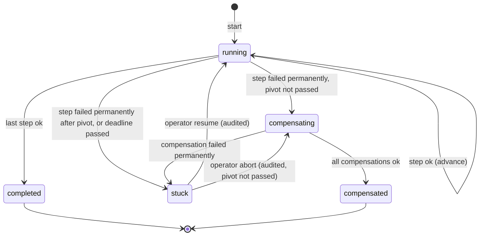
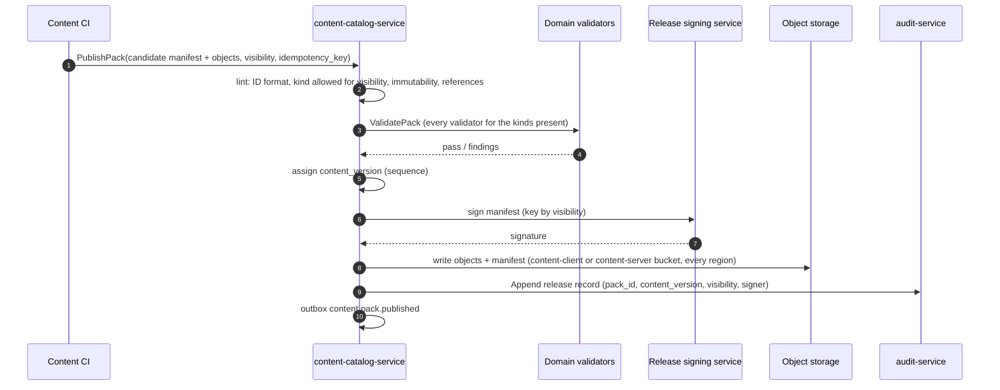

# Legends of the Shattered Frontier — Backend Part 2: Service Communication, Persistence and Content
## Version 1.0 — Expanded Technical Design Authority edition (2026-10-17)

Design target; not implemented. Names per Shared Registry v1.0.

Entry file: [Backend Architecture](../Legends_Shattered_Frontier_Backend_Architecture_v1.0.md) · Registry: [Shared Registry](../Legends_Shattered_Frontier_Shared_Registry_v1.0.md)

---

## 1. Purpose of this part

This part fixes the platform conventions every service implements: gRPC conventions, idempotency, the transactional outbox and event bus, sagas, and persistence (PostgreSQL schemas, Redis, object storage, encryption). It then specifies the remaining Backend-owned services: `content-catalog-service` (content packs and delivery to services), `chat-service` (chat and mail) and the Backend core of `guild-service`.

Database spec, Network spec and DevOps spec are earlier, shorter documents; this part refines them without contradicting their goals (RPO < 15 min, RTO < 60 min, encryption at rest and in transit, per-domain databases, UDP gameplay transport).

---

## 2. gRPC conventions

### 2.1 Naming and versioning

| Item | Rule | Example |
| --- | --- | --- |
| Package | `lsf.<service_snake>.v<major>` (Registry §1) | `lsf.character_service.v1` |
| Services | `<Name>Service` for runtime callers, `<Name>Admin` for admin-portal callers, shared interfaces (`PrivacyParticipant`, `TransferParticipant`, `ContentReferenceParticipant`) implemented in each service's own package | `lsf.inventory_service.v1.PrivacyParticipant` |
| RPC | `VerbNoun`, PascalCase | `CheckpointCharacter` |
| Fields | snake_case; IDs are `string` with registry prefix; money `int64 <name>_copper`; timestamps `google.protobuf.Timestamp` (RFC 3339 with ms in JSON) | `amount_copper` |
| Enums | `string` fields carrying registry enum values (not protobuf enums), so an additive registry value never breaks old binaries; unknown values are rejected with `INVALID_ARGUMENT` on input and passed through on output | `account_state = "erasing"` |
| Compatibility | Within a major version only additive changes (new fields, new RPCs, new enum values). A breaking change ships `v2` alongside `v1` for at least one season (`SEASON_LENGTH_WEEKS`), mirroring the event rule in Registry §10.1. |
| Limits | Max message 4 MiB; lists paged with `page_size` (default 100, max 500) and opaque `page_token`; server-streaming only for bulk exports and admin listings |

### 2.2 Metadata

| Key | Set by | Meaning |
| --- | --- | --- |
| `x-lsf-correlation-id` | gateway (external) or the flow originator | propagated unchanged across all hops and copied into envelope `correlation_id` |
| `x-lsf-causation-id` | each caller | the request ID or event ID that caused this call |
| `x-lsf-account-id`, `x-lsf-session-id`, `x-lsf-character-id` | gateway only (from the validated token) | services trust them only when the peer identity is `gateway` |
| `x-lsf-actor` | admin-portal / staff gateway | staff principal; with `x-lsf-elevation-id` (`elv_`) and `x-lsf-audit-id` |
| `x-lsf-content-version`, `x-lsf-realm-id`, `x-lsf-dc-region` | caller | context for envelope fields |
| `grpc-timeout` | caller | remaining deadline (§2.4) |

### 2.3 Authentication and authorization

- **mTLS everywhere.** Every workload has a SPIFFE identity `spiffe://lsf.<environment>/<dc_region>/<service>`; UE dedicated servers use `zone-server` or `instance-server` with the `srvi_` in a certificate URI SAN, issued at `RegisterServer` (World spec, world-service API and server allocation).
- **Per-RPC allowlists.** Each service ships `authz.yaml` mapping RPC → allowed caller identities (the "Caller" columns of every spec's RPC tables are normative inputs). Default deny. CI fails if an RPC has no entry.
- **Player context.** Player-initiated RPCs arrive only from `gateway`; the service authorizes ownership (`character_id` belongs to `x-lsf-account-id`) itself or through a cached `character-service` lookup.
- **Staff context.** Admin RPCs require `x-lsf-actor`, a valid elevation for privileged permissions, and an `audit-service.Append` before the mutation (Security spec, Audit Operations and Interfaces).

### 2.4 Deadlines, retries and failure isolation

| Rule | Value |
| --- | --- |
| Default deadline | 2,000 ms (`tune.backend.rpc_default_deadline_ms`); external routes have route budgets (login 10 s, enter-world 8 s, others 3 s) |
| Hot-path deadline | zone-server/instance-server → service on the simulation tick path (e.g. `GetCombatProfile` on entry, `SubmitPracticeBatch`) ≤ 500 ms; such calls must never block the tick (async with result applied next tick) |
| Propagation | callee deadline = caller remaining − 10 % (min 50 ms); a call with < 50 ms left is not made (`DEADLINE_EXCEEDED` locally) |
| Retries | only for `UNAVAILABLE`, `DEADLINE_EXCEEDED`, `ABORTED`, `RESOURCE_EXHAUSTED` (after `RetryInfo`); mutating calls are retried **only with the same idempotency key**; exponential backoff base 50 ms × 2ⁿ with full jitter, at most 5 attempts within the deadline |
| Circuit breaker | per (caller, callee): open when ≥ 50 % of ≥ 20 calls in 10 s fail with retryable codes; half-open after 5 s with 1 probe; open breaker → immediate `UNAVAILABLE` |
| Bulkheads | separate connection pools and concurrency limits per callee; a slow `analytics` or `audit` dependency must not exhaust the pool used for `inventory` |
| Load shedding | services reject with `RESOURCE_EXHAUSTED` when in-flight requests exceed `max_concurrency` (from load tests) rather than queueing past the deadline |

### 2.5 Errors

Canonical gRPC status codes plus `google.rpc.ErrorInfo { domain = "lsf.<service_snake>", reason = UPPER_SNAKE_CASE, metadata }` (Itemization's error reasons, e.g. `ITEM_LOCKED`, follow this form).

| Code | Use | Caller behavior |
| --- | --- | --- |
| `INVALID_ARGUMENT` | malformed or out-of-range input | do not retry; fix input |
| `FAILED_PRECONDITION` | valid request, wrong state (`ITEM_LOCKED`, `RENAME_REQUIRED`) | do not retry unchanged |
| `ALREADY_EXISTS` | duplicate creation or `IDEMPOTENCY_MISMATCH` | do not retry |
| `ABORTED` | optimistic concurrency conflict (`VERSION_CONFLICT`), saga in progress | retry with same key |
| `NOT_FOUND`, `PERMISSION_DENIED`, `UNAUTHENTICATED` | | do not retry |
| `RESOURCE_EXHAUSTED` | rate limit, load shed | retry after `RetryInfo` |
| `UNAVAILABLE`, `DEADLINE_EXCEEDED` | transient | retry (same key) |
| `INTERNAL`, `DATA_LOSS` | bug or invariant breach | page; no retry by default |

Invariant breaches (e.g. a ledger sum mismatch) return `INTERNAL` with `reason = INVARIANT_VIOLATION`, write `security.action.rejected` with `reject_reason ∈ {economy_invariant, inventory_invariant}` where the owning spec says so, and page the owning on-call.

---

## 3. Idempotency

Registry §4 requires every mutating RPC to take an `idempotency_key` (string ≤ 128 chars) retained ≥ 7 days (`IDEMPOTENCY_RETENTION`). This section is the common implementation contract.

### 3.1 Keys

| Caller | Key construction |
| --- | --- |
| Client via gateway | `Idempotency-Key` header, a client-generated ULID per user action |
| Service flows | deterministic: `<flow>:<aggregate_id>:<step>` (e.g. `chrc:chr_…:progression`, `prq_…:inventory-service:erase`, `rtx_…:faction-service:commit`) so a restarted orchestrator re-derives the same key |
| Event consumers acting on an event | `evt:<event_id>:<consumer>` |

Keys are scoped per `(service, rpc)`; two RPCs may receive the same key without conflict.

### 3.2 Table template and semantics

```sql
CREATE TABLE <schema>.idempotency_keys (
  rpc             text  NOT NULL,
  idempotency_key text  NOT NULL CHECK (length(idempotency_key) BETWEEN 1 AND 128),
  request_hash    bytea NOT NULL,      -- SHA-256 of deterministic protobuf encoding, key field cleared
  status_code     int   NOT NULL,      -- gRPC code of the stored outcome
  response        bytea,               -- serialized response (or ErrorInfo)
  created_at      timestamptz NOT NULL DEFAULT now(),
  expires_at      timestamptz NOT NULL DEFAULT now() + interval '7 days',
  PRIMARY KEY (rpc, idempotency_key)
);
CREATE INDEX ON <schema>.idempotency_keys (expires_at);
```

Economy and Itemization already publish compatible variants (Economy spec, schema; Itemization spec, Item Model and Lifecycle, schema); new services use this template.

```text
handle(rpc, key, req):
  h = sha256(deterministic(req with key cleared))
  BEGIN
    INSERT INTO idempotency_keys(rpc, key, request_hash, status_code) VALUES (rpc, key, h, -1)
      ON CONFLICT DO NOTHING
    row = SELECT … FOR UPDATE WHERE (rpc, key)          -- serializes concurrent duplicates
    if row.request_hash ≠ h:         ROLLBACK; return ALREADY_EXISTS IDEMPOTENCY_MISMATCH
    if row.status_code ≠ -1:         ROLLBACK; return stored(row)
    result = execute business change in the same transaction
    if result is deterministic (OK, INVALID_ARGUMENT, FAILED_PRECONDITION, NOT_FOUND, ALREADY_EXISTS):
       UPDATE row SET status_code, response
       COMMIT; return result
    else: ROLLBACK; return result      -- transient failures are not remembered; retry re-executes
```

Rules:

1. The key row and the business change commit in **one transaction**; there is no window where the change exists without its key or vice versa.
2. Deterministic failures are stored so that a retry cannot succeed later with a different outcome (e.g. a `Debit` rejected for insufficient funds stays rejected for that key).
3. A purge job deletes rows with `expires_at < now()` in batches of 10,000. Long-lived flows (privacy requests, realm transfers) override retention by setting `expires_at` to the flow's end + 7 days.
4. Calls that reach a service over Redis-only state (group-service queues) keep keys in Redis `<service>:idem:{rpc}:{key}` with the same 7-day TTL and the same semantics.

**Worked example.** reward-service calls `inventory-service.GrantItems(key = "rwg_01JA…:line:2")`. The call commits but the response is lost on a network timeout. reward-service retries with the same key after 100 ms; inventory-service finds the row with `status_code = 0`, returns the stored `item_ids`, and no second item is created. If a bug made reward-service retry with a different quantity under the same key, inventory-service returns `ALREADY_EXISTS IDEMPOTENCY_MISMATCH` and the reward grant goes to `failed` for investigation instead of minting an inconsistent stack.

---

## 4. Events: transactional outbox and event bus

### 4.1 Outbox

Every durable domain event is written to the producer's outbox **in the same transaction** as the state change it describes (Registry authority rules: the owning service is the only writer; an event is a fact about committed state).

```sql
CREATE TABLE <schema>.outbox (
  seq           bigserial PRIMARY KEY,
  event_id      text NOT NULL UNIQUE CHECK (event_id LIKE 'evt\_%'),
  topic         text NOT NULL,          -- 'domain.<domain>'
  partition_key text NOT NULL,          -- aggregate ID, e.g. account_id, character_id
  envelope      jsonb NOT NULL,         -- full Registry §10.1 envelope incl. payload
  created_at    timestamptz NOT NULL DEFAULT now(),
  published_at  timestamptz
);
CREATE INDEX outbox_unpublished ON <schema>.outbox (seq) WHERE published_at IS NULL;
```

The relay (one active instance per service per region, leader-elected with a Redis lease `<service>:outbox:leader`, 10 s) reads unpublished rows in `seq` order, publishes them with an idempotent Kafka producer (`acks=all`, `enable.idempotence=true`), and marks `published_at`. Published rows are deleted after 3 days. A schema check runs at outbox insert time against the generated schema of the event (Analytics registers schemas in the schema registry; Registry §10.1); a payload that fails the check fails the business transaction in non-prod and raises `sev3` (and still publishes) in prod, so a schema bug never blocks gameplay.

| Target | Value |
| --- | --- |
| Outbox lag (commit → broker ack) | p99 ≤ 2 s (`m_outbox_lag_p99_s`); > 30 s for 5 min → `sev2` to the owning on-call |
| Delivery | at least once; consumers deduplicate by `event_id` |
| Ordering | guaranteed only per `partition_key` within a topic |

### 4.2 Topics

| Topic | Key | Partitions (launch) | Retention | Replication |
| --- | --- | --- | --- | --- |
| `domain.<domain>` (one per registry domain) | aggregate ID (Registry §10.1) | 24 (48 for `domain.combat`, `domain.progression`, `domain.item`) | 14 days | 3 replicas, `min.insync.replicas = 2` |
| `telemetry.client`, `telemetry.server` | `session_id` / `srvi_` | 96 | 3 days | 3 |
| `ops.alerts` | `alert_id` | 6 | 14 days | 3 |
| `auth-directory` (internal) | `identifier_hmac` | 6 | compacted | replicated to every region (Part 3, Multi-region deployment) |
| `dlq.<consumer_group>` | original key | 6 | 30 days | 3 |

Domain topics are regional (one event-bus cluster per `dc_region`). Analytics replicates what it needs into the global modeled store (Analytics spec, Pipeline and Telemetry). Partition counts only grow; a resize keeps per-key ordering because consumers of a resized topic drain the old assignment before the new partitions take traffic (blue/green topic `domain.<d>.v2` with dual-write for one retention period if ordering across a resize is required).

### 4.3 Consumers and the inbox

```sql
CREATE TABLE <schema>.inbox (
  consumer      text NOT NULL,           -- consumer group, e.g. 'progression-service.achievements'
  event_id      text NOT NULL,
  processed_at  timestamptz NOT NULL DEFAULT now(),
  PRIMARY KEY (consumer, event_id)
);                                       -- rows older than 15 days purged (> topic retention)
```

Rules:

1. A consumer that changes durable state inserts `(consumer, event_id)` in the **same transaction** as the change; a conflict means "already processed" and the event is acknowledged without effect.
2. Consumers must tolerate reordering across keys and late events. State machines ignore events that would move them backwards (compare the aggregate `version` or `occurred_at` carried in the payload).
3. Consumer group names are `<service>.<purpose>`. Offsets are committed after the transaction commits.
4. Poison events: after 10 failed attempts with backoff (1 s → 5 min) the event goes to `dlq.<consumer_group>` and `sev3` pages the consumer's owner. DLQ replay is a manual, audited admin action.
5. Consumers that materialize subject data must honor `auth.account.deleted` and `character.profile.deleted` (Part 3, Account deletion and privacy request workflow).

### 4.4 Telemetry vs domain events

Telemetry (`telemetry.*`) goes through `telemetry-ingest` (Analytics spec) and is never used for service-to-service state. Domain events may also be telemetry sources; Analytics reads `domain.*` directly. A service must not create a second "telemetry copy" of a domain event.

---

## 5. Sagas

A flow that changes state owned by more than one service is a **saga** with exactly one orchestrator, the service that owns the flow's primary aggregate. Choreography (services reacting to each other's events to complete a multi-step change) is not used for state that must be all-or-nothing; events remain notifications.

### 5.1 Saga table template

```sql
CREATE TABLE <schema>.sagas (
  saga_id          text PRIMARY KEY,           -- flow aggregate ID (prq_, rtx_, 'chrc:<chr_>', rwg_, ...)
  saga_kind        text NOT NULL,
  state            text NOT NULL CHECK (state IN ('running','compensating','completed','compensated','stuck')),
  step             text NOT NULL,              -- current step name
  pivot_passed     boolean NOT NULL DEFAULT false,
  attempts         int NOT NULL DEFAULT 0,
  next_attempt_at  timestamptz,
  deadline_at      timestamptz,
  context          jsonb NOT NULL,             -- inputs + step outputs needed by later steps
  last_error       text,
  version          bigint NOT NULL DEFAULT 1,
  updated_at       timestamptz NOT NULL DEFAULT now()
);
CREATE INDEX sagas_due ON <schema>.sagas (next_attempt_at) WHERE state IN ('running','compensating');
```



### 5.2 Rules

1. Every step is an idempotent RPC with key `<saga_id>:<step>[:<attempt_scope>]`. Retrying a step never needs new keys.
2. Each step before the **pivot** has a compensation. After the pivot only forward recovery is allowed (retry until success or `stuck`).
3. Step advancement and the saga row update commit together; the RPC is made after the row says "about to run step X", so a crashed worker re-runs step X with the same key.
4. Workers claim due sagas with `SELECT … FOR UPDATE SKIP LOCKED`; many workers can run concurrently without double execution.
5. `stuck` sagas page the orchestrator's on-call (`sev3`; `sev2` if they hold player assets in escrow) and appear in the admin-portal saga console.
6. Saga state names above are platform-internal and not registry enums; flows with player-visible state use their registry enum (`privacy_request_state`, `realm_transfer_state`, `reward_grant_state`).

### 5.3 Saga catalogue

| Saga | Orchestrator (spec) | Steps (pivot in bold) |
| --- | --- | --- |
| Character creation | character-service (Backend, Part 1) | reserve name → `InitializeCharacter` → starter `IssueGrant` → **activate** |
| Reward grant delivery | reward-service (Itemization) | per line: `GrantItems` / `Credit` / `GrantXp` / `AdjustStanding`; idempotent fan-out, no compensation (forward only), `RevokeGrant` is a separate saga |
| Trade execution | economy-service (Economy) | lock offers → escrow items → **execute both legs** → transfer escrow |
| Mail send | chat-service (Backend, §8) | create `mal_` → escrow attachments → **deliver** |
| Privacy delete / export | auth-service (Backend, Part 3) | phases 1–4; **phase 1 unwind** is the pivot for delete |
| Realm transfer | character-service (Backend, Part 3) | prepare all → stage all → **flip realm** → finalize all |
| Rollback job | enforcement-service (Security) | plan → approve → execute per service → compensate on failure (`rollback_state`) |
| Instance provisioning | instance-service (Dungeon) | `AllocateServer` (World) → run `ready`; `ReleaseServer` on failure |
| Compensation campaign | liveops-service (LiveOps) | per recipient `IssueGrant`; forward only |

---

## 6. Persistence conventions

### 6.1 PostgreSQL topology

Each `dc_region` runs its own PostgreSQL clusters; no player row is written outside its home region (account data) or its realm's region (character data). A **schema** (Registry §1: service name without `_service`) is the unit of ownership and of portability: a schema is never split across clusters, and moving a schema to a different cluster is an operational change invisible to callers.

| Cluster (per region) | Schemas | Tier |
| --- | --- | --- |
| `pg-identity` | `auth`, `character` | 0 |
| `pg-progress` | `progression`, `quest`, `faction` | 0 |
| `pg-items` | `inventory` (realm-sharded, one database per realm), `loot`, `reward`, `crafting` | 0 |
| `pg-economy` | `economy` | 0 |
| `pg-world` | `world`, `building` | 0 |
| `pg-social` | `group`, `guild`, `chat`, `instance` | 1 |
| `pg-ops` | `liveops`, `config`, `store`, `content_catalog`, `director` | 1 |
| `pg-security` | `anticheat`, `enforcement`, `audit` | 1 (audit: append-only, WORM copy in object storage) |
| `pg-analytics` | `analytics_pipeline` | 2 |

Every cluster: one primary, one synchronous standby in another availability zone (commit waits for standby flush: `synchronous_commit = remote_apply` for tier 0, `on` for tier 1), one asynchronous replica in the region's DR pair (Part 3, Disaster recovery), and read replicas as load requires. Connection pooling through a pooler in transaction mode; services hold ≤ 20 server connections per pod by default.

### 6.2 Realm scoping

| Mode | Used by | Rule |
| --- | --- | --- |
| `realm_column` (default) | all realm-scoped schemas except `inventory` | rows carry `realm_id text NOT NULL` (or `NULL` only for account-owned rows, as in `economy.wallets`); one database per region |
| `realm_sharded` | `inventory` (Itemization spec, Item Model and Lifecycle, partitioning "per realm database") | one database per realm holding the full schema; the service routes by the realm of the owner; account-scoped queries fan out across the region's realm databases |
| `region_global` | `auth`, `content_catalog`, `config`, `liveops`, `store`, `audit`, `enforcement`, `anticheat` | no realm column unless the row is realm-specific |

### 6.3 Table conventions

1. Plural snake_case tables; IDs `text` with `CHECK (col LIKE '<prefix>\_%')`; content IDs `text` `<kind>/<slug>`.
2. Enums as `text` with a `CHECK` list (adding a registry value is an additive migration; PostgreSQL enum types are not used).
3. `created_at`/`updated_at timestamptz`; aggregates carry `version bigint` for optimistic concurrency (`UPDATE … WHERE version = $v`).
4. Money and counts `bigint`; never `numeric` floats for currency (`numeric(p,s)` is allowed for multipliers).
5. Append-only ledgers (`*_ledger`, `currency_transactions`, `audit` records) reject `UPDATE`/`DELETE` with a trigger, except the privacy pseudonymization routine which runs as a separate role and may only null free-text columns (Part 3, Hard deletion vs pseudonymization by data class). Ledgers are range-partitioned monthly on their timestamp.
6. Foreign keys only within a schema. References to other services' entities are plain IDs; integrity across services is kept by sagas and reconcilers, never by cross-schema joins.
7. `jsonb` only for content-shaped or opaque data (appearance, saga context, envelope); never for fields other services filter on.
8. p2/p3 columns are encrypted at the application level with the per-account data key (§6.7) and named `<field>_ct`; lookup columns are HMACs named `<field>_hmac`.

### 6.4 Access control

| Role | Grants |
| --- | --- |
| `svc_<schema>` | owner of its schema; used by the service at runtime; no grants on any other schema |
| `mig_<schema>` | DDL on its schema; used only by the deploy pipeline's migration step |
| `cdc_<schema>` | logical replication slot read for Analytics CDC where the Analytics spec lists the schema; p2/p3 columns excluded by publication column lists |
| `ro_<schema>` | read-only for the service's own read replicas |
| staff | no direct database access; `break_glass_admin` access via an audited bastion session that appends `staff_action` records and expires in 1 h (Security spec, staff roles) |

CI checks each service's migrations for `GRANT` statements and rejects any grant to another service's role.

### 6.5 Migrations

- Versioned SQL files per service (proposed path `BackendServices/<service>/Migrations/NNNN_<name>.sql`; Repository Structure spec requires a recorded decision on language and migration tool before the first migration), applied by the deploy pipeline before the new build receives traffic ("migrations applied" step, LiveOps spec, Config and Releases, Maintenance windows).
- **Expand → migrate → contract** across at least two releases: add nullable column / new table → backfill and dual-write → switch reads → drop old in a later release. Every migration must be compatible with build N−1 still running (rolling deploys).
- `lock_timeout = 2s`, `statement_timeout = 60s` for DDL; indexes `CREATE INDEX CONCURRENTLY`; large backfills run as throttled jobs (≤ 5 % primary CPU), never inside the migration transaction.
- Destructive steps (drop column/table) require a `release_manager` approval in the release record.

### 6.6 Redis conventions

| Cluster (per region) | Contents | Persistence |
| --- | --- | --- |
| `redis-session` | `auth:ses:*`, gateway rate buckets, push routing | AOF every second; loss = forced re-login, acceptable |
| `redis-game` | presence, realm queues, parties and raid groups (with PostgreSQL `group` as durable copy), queue tickets, idempotency keys of Redis-only flows | AOF every second, replica per shard |
| `redis-world` | world-service server registry (`srvi_`), handoffs (`hof_`), ownership keys, leader leases | AOF every second; world-service rebuilds from heartbeats within 30 s (World spec) |
| `redis-cache` | read-through caches (content definitions, restrictions, profiles) | none; may be flushed at any time |

Key format `<service>:<entity>:{<id>}:<field>` — the braces are the Redis Cluster hash tag so all keys of one aggregate share a slot (e.g. `character:presence:{chr_01J…}`). Every key has a TTL except keys the owning spec declares Redis-authoritative (Registry §3.1 store column "Redis": `ServerInstance`, `QueueTicket`, `Handoff`, Session hot copy, Party/RaidGroup live state). Redis is never the only copy of currency, items, XP or any ledger.

### 6.7 Encryption and per-account data keys

| Layer | Mechanism |
| --- | --- |
| In transit | TLS 1.3 external; mTLS internal (§2.3); PostgreSQL and Redis connections TLS |
| At rest | provider disk encryption for every volume and bucket with regional KMS keys |
| Application level | each account has a **data key** (DEK, AES-256-GCM) created at `CreateAccount`, wrapped by the region's KMS key-encryption key; `auth.accounts.data_key_id` names it. p2/p3 columns in any service (`email_ct`, chat bodies, bios, audit `sensitive_plain`, evidence) are encrypted with it. |
| Key access | services obtain the unwrapped DEK through `auth-service.GetDataKey(account_id, purpose)` (internal; allowlisted services only; cached in memory ≤ 5 min; never logged) |
| Crypto-shredding | the privacy workflow's phase 4 schedules KMS deletion of the DEK (minimum KMS pending window, 7 days, counted inside the SLA); afterwards every ciphertext for that account in databases, backups and WORM audit copies is unreadable (Security spec, Threat Model and Server Authority, Data subject rights) |

### 6.8 Object storage

Bucket names `lsf-<environment>-<dc_region>-<purpose>`; no bucket is public except the CDN origin through the CDN's private origin access.

| Purpose | Contents | Retention / lifecycle | Access |
| --- | --- | --- | --- |
| `content-client` | client-visible content pack objects | all published versions kept | CDN origin; content-catalog-service writes |
| `content-server` | server-only content packs (entry file, Service ownership contracts, server-only content packs) | all versions | workload identities listed there; separate KMS key |
| `evidence` | Security evidence bundles (`evd_`) | Security evidence retention; object lock | enforcement-service |
| `audit-worm` | audit hash-chain segments | 7 years, compliance-mode object lock | audit-service write; auditor read |
| `privacy-exports` | export bundles | 7 days then deleted | auth-service; signed single-account links |
| `backups` | PostgreSQL base backups and WAL, Redis snapshots | 35 days (`BACKUP_RETENTION_DAYS`), copied to the DR pair region | backup operator role |
| `world-snapshots` | structure and terrain delta snapshots (World and Building specs) | per World spec | zone-server, world-service |
| `crash-dumps` | client and server minidumps | 30 days | engine team (Analytics spec, privacy) |
| `logs` | structured service logs | 30 days hot, 90 days cold, then deleted; p2 fields never logged | platform on-call |
| `lakehouse` | Analytics Iceberg tables | Analytics spec | analytics roles |

---

## 7. `content-catalog-service`

### 7.1 Responsibilities

Owns content packs: validation, signing, `content_version` assignment, storage, activation per realm cohort, and delivery to services and (through the launcher) to clients. It publishes domain `content`. It holds no gameplay state; owning specs define the schema and validators of each content kind (Registry §3.2).

### 7.2 Pack model

A **content pack** is an immutable, signed set of definitions, all with the same `content_pack_visibility`. Every publication assigns the next `content_version` (monotonic per environment, shared by client-visible and server-only packs; entry file, server-only content packs, Versioning). The **content state** at version V is the union of all packs with `content_version ≤ V`, with later definitions superseding earlier ones of the same ID.

```json
{
  "pack_id": "pack_2026_10_17_s1_patch_3",
  "content_version": 1843,
  "visibility": "client_visible",
  "base_content_version": 1842,
  "kinds": ["item", "loot", "quest"],
  "definitions": { "added": 41, "changed": 12, "retired": 2 },
  "objects": [
    { "path": "item/iron_longsword.json", "sha256": "9b1f…", "bytes": 2140 },
    { "path": "loot/sunken_vault_final_boss.json", "sha256": "77ac…", "bytes": 5310 }
  ],
  "hot_reloadable": true,
  "created_at": "2026-10-17T12:00:00.000Z",
  "signing_key_id": "content-client-2026-10",
  "signature": "ed25519:…"
}
```

Content definition objects are JSON with the owning spec's schema plus a common header `{ "id": "<kind>/<slug>", "kind", "schema_version", "retired": false }`. Slugs are immutable once published (Registry §1); a pack may add and change definitions and set `retired: true`, never delete or rename (LiveOps spec, Config and Releases, Content pack publication, compatibility rule).

### 7.3 Publication pipeline



Lint rules (all fail the publication): ID pattern; kind not allowed for the visibility (`detector` only `server_only`); a `client_visible` definition references a server-only ID; a published ID missing from a later pack is treated as retained (packs are deltas), but a changed `kind` for an existing ID fails; `schema_version` downgrades fail; any object > 8 MiB fails; total pack > 2 GiB fails.

Validators are libraries contributed by owning teams and run inside the catalog's validation job (one process per kind, timeout 10 min). LiveOps validators (`liveops_event`, `season`, `store_offer`) are among them (LiveOps spec, Config and Releases, step 1).

### 7.4 Activation and delivery to services

| Step | Mechanism |
| --- | --- |
| Activation | `ActivateContentVersion(content_version, cohort, idempotency_key)` by liveops-service per release stage and realm cohort (LiveOps spec, Config and Releases). Writes `content_catalog.activations` and emits `content.version.activated`. Activation is a pointer switch; all versions stay stored. |
| Service load | each service keeps a content cache; on `content.version.activated` (or a 30 s `GetActiveVersion` poll fallback) it downloads the delta packs with `GetPack(content_version, visibility)`, verifies signature and hashes, builds indexes, then atomically swaps. Services keep the previous version for 10 min so in-flight requests stamped with it complete. |
| Readiness | services report `loaded_content_version` on their health endpoint; the release flow waits until ≥ 99 % of pods in the cohort report it (timeout 5 min → release paused) |
| Servers | zone-server and instance-server load the active version at boot; a running server hot-swaps only packs marked `hot_reloadable` (no change to navmesh, level geometry or encounter scripts); otherwise the version is applied by rolling server replacement (World spec, server allocation and draining) |
| Clients | client-visible packs are referenced by the launcher manifest (Client Delivery spec); the login handshake returns the realm's active `content_version`; clients do not receive server-only packs |
| Envelope | every event carries the producer's active `content_version` (Registry §10.1) |
| Lookup | small consumers use `GetDefinitions(ids[], content_version)` (cached in `redis-cache` 10 min) instead of loading whole packs |

**Rollback safety.** `CheckRollbackSafety(from_version, to_version)` lists definitions introduced after `to_version` and calls `ContentReferenceParticipant.CountReferences(definition_ids[])` on each service that persists content references (inventory: item definitions; quest: quest definitions and generated templates; liveops: events, seasons, offers; progression: achievements, titles; crafting: recipes; instance: dungeons, raids, affix rotations). Any non-zero count makes the rollback unsafe and the response lists the blocking definitions (LiveOps spec, Content pack publication, step 5).

### 7.5 RPCs — `lsf.content_catalog_service.v1`

| RPC | Caller | Notes |
| --- | --- | --- |
| `PublishPack` | content CI (service identity) | §7.3; idempotent per `pack_id` |
| `ValidatePack` | content CI, editors (dry run) | no side effects |
| `ActivateContentVersion(content_version, cohort{dc_regions[], realm_ids[], environment})` | liveops-service | audited by the caller |
| `GetActiveVersion(realm_id)` | all services, servers | cached 30 s |
| `GetPack(content_version, visibility)` | services, servers | `server_only` only for allowlisted workload identities; returns object refs and hashes |
| `GetDefinitions(ids[], content_version)` | services | p99 ≤ 20 ms from cache |
| `CheckRollbackSafety(from_version, to_version)` | liveops-service | §7.4 |
| `ContentAdmin.ListPacks`, `ContentAdmin.DiffVersions` | admin-portal | read-only |

### 7.6 Schema `content_catalog`

```sql
CREATE SCHEMA IF NOT EXISTS content_catalog;

CREATE TABLE content_catalog.packs (
  content_version    bigint PRIMARY KEY,
  pack_id            text NOT NULL UNIQUE,
  visibility         text NOT NULL CHECK (visibility IN ('client_visible','server_only')),
  base_content_version bigint,
  manifest_sha256    bytea NOT NULL,
  signing_key_id     text NOT NULL,
  hot_reloadable     boolean NOT NULL DEFAULT false,
  published_at       timestamptz NOT NULL DEFAULT now(),
  published_by       text NOT NULL                    -- CI identity
);

CREATE TABLE content_catalog.definitions_index (
  definition_id       text NOT NULL,                  -- <kind>/<slug>
  content_version     bigint NOT NULL REFERENCES content_catalog.packs,
  kind                text NOT NULL,
  visibility          text NOT NULL,
  object_sha256       bytea NOT NULL,
  retired             boolean NOT NULL DEFAULT false,
  PRIMARY KEY (definition_id, content_version)
);
CREATE INDEX ON content_catalog.definitions_index (kind, content_version);

CREATE TABLE content_catalog.activations (
  activation_id      bigserial PRIMARY KEY,
  environment        text NOT NULL,
  dc_region          text NOT NULL,
  realm_id           text,                            -- NULL = whole region
  content_version    bigint NOT NULL REFERENCES content_catalog.packs,
  activated_at       timestamptz NOT NULL DEFAULT now(),
  activated_by       text NOT NULL,                   -- liveops release id / actor
  previous_version   bigint
);
CREATE INDEX ON content_catalog.activations (environment, dc_region, realm_id, activated_at DESC);
```

### 7.7 Events `content.*` (registered; Shared Registry, content events)

On `domain.content`, keyed by `content_version` (as text), `privacy_class = p0_public`.

| Event | Field | Type | Req | Description | privacy_class |
| --- | --- | --- | --- | --- | --- |
| `content.pack.published` | `pack_id` | string | yes | | p0_public |
| | `content_version` | int | yes | | p0_public |
| | `visibility` | string | yes | `content_pack_visibility` | p0_public |
| | `kinds` | string[] | yes | content kinds present | p0_public |
| | `added` / `changed` / `retired` | int/int/int | yes | definition counts | p0_public |
| | `hot_reloadable` | bool | yes | | p0_public |
| `content.version.activated` | `content_version` | int | yes | | p0_public |
| | `previous_version` | int | no | | p0_public |
| | `realm_ids` | string[] | no | absent = whole `dc_region` | p0_public |
| | `is_rollback` | bool | yes | `content_version < previous_version` | p0_public |
| | `release_id` | string | no | `rel_` | p0_public |

`content.pack.published` for a `server_only` pack carries counts and kinds only, never definition IDs (entry file, server-only content packs, Observability).

---

## 8. `chat-service` and mail

### 8.1 Ownership

`chat-service` owns channels, messages, friend and block lists, and **mail messages** (header, body, read state, expiry). It does **not** own mail attachments: items in mail sit in `inventory-service` `mailbox` containers and gold attachments move through `economy-service.TransferCurrency` with `transfer_kind = mail` (Economy spec, Transfers; Itemization spec, containers). This settles Economy's open question on mail ownership (Economy spec, Open issues, Mail ownership).

| Channel | Scope | Transport | Retention |
| --- | --- | --- | --- |
| `global` | realm | chat WebSocket via gateway (`/v1/chat`) | 30 days |
| `local` | cells within 64 m (`CELL_SIZE_M`) of the speaker, from zone-server presence | relayed by zone-server, persisted by chat-service | 30 days |
| `guild`, `party` | guild / party members (guild-service, group-service membership) | chat WebSocket | 30 days |
| `trade` | realm, rate-limited 1 per 30 s (Security spec, Rate limits) | chat WebSocket | 30 days |
| `whisper` | two characters; blocked if either blocks the other | chat WebSocket | 30 days |
| `system` | server notices | push | not persisted |

Message bodies are p2: encrypted with the author's account data key, retained 30 days unless attached to enforcement evidence (Security spec, Data classification). Moderation hooks: an outbound filter (profanity mask, link and RMT pattern filter configured by `tune.backend.chat_filter_*`), mute enforcement from `CheckRestrictions.chat_muted` (fail-open per Security), and report export: `SubmitReport` attaches a signed excerpt (the reported message plus 20 preceding messages in the channel) to the `rpt_`; excerpts belong to Security from that point (hold scope `chat`). chat-service publishes **no domain events** at launch: message content must not reach the event bus, and counts are emitted as server telemetry.

### 8.2 Mail

Proposed entity **MailMessage**, prefix `mal_`, owner chat-service, PostgreSQL `chat`.

```mermaid
sequenceDiagram
    autonumber
    participant G as gateway
    participant CS as chat-service (orchestrator)
    participant IN as inventory-service
    participant EC as economy-service
    G->>CS: SendMail(to_character, subject, body, item_ids[], gold_copper, idempotency_key)
    CS->>CS: validate recipient (same realm, not blocked), rate limits; insert mal_ (pending)
    CS->>IN: EscrowItems(escrow_ref = mal_, item_ids)
    IN-->>CS: escrowed
    CS->>IN: TransferEscrow(escrow_ref = mal_, to = recipient mailbox, gold_copper) (pivot)
    IN->>EC: TransferCurrency(from sender, to recipient, transfer_kind = mail, transfer_ref = mal_) (if gold)
    EC-->>IN: txn_ids, or hold_id (Economy transfer hold)
    IN-->>CS: delivered, or held
    CS->>CS: state = delivered (or held until economy.hold.released)
    CS-->>G: mal_
```

| Rule | Value |
| --- | --- |
| Delivery delay | immediate for mail without attachments; attachments subject to Economy transfer holds (`thd_`) and Security trade rules |
| Expiry | unread mail with attachments returns to the sender after `tune.backend.mail_expiry_days` (30); returned mail that expires again is destroyed with sink `item_destroyed` and logged |
| Limits | 12 item attachments; mailbox capacity 100 messages; sender rate per Security `tune.security.mail_rate` |
| Erasure | sender erased: unread mail keeps attachments, sender shows "erased"; recipient erased: unread mail with attachments returns to sender before phase 2 (Part 3) |

How inventory-service moves gold attachments inside `EscrowItems`/`TransferEscrow` is Itemization's and Economy's contract; Backend requires only that both steps are idempotent on `escrow_ref = mal_…`.

### 8.3 Schema `chat` (core tables)

```sql
CREATE SCHEMA IF NOT EXISTS chat;

CREATE TABLE chat.mail_messages (
  mail_id          text PRIMARY KEY CHECK (mail_id LIKE 'mal\_%'),
  realm_id         text NOT NULL,
  sender_character_id    text,                       -- NULL for system mail
  recipient_character_id text NOT NULL,
  subject_ct       bytea,                            -- p2
  body_ct          bytea,                            -- p2
  has_attachments  boolean NOT NULL,
  state            text NOT NULL CHECK (state IN ('pending','held','delivered','read','returned','expired','deleted')),
  sent_at          timestamptz NOT NULL DEFAULT now(),
  expires_at       timestamptz NOT NULL,
  read_at          timestamptz,
  version          bigint NOT NULL DEFAULT 1
);
CREATE INDEX ON chat.mail_messages (recipient_character_id, state);

CREATE TABLE chat.messages (                          -- partitioned daily, dropped after 30 days
  message_id       text NOT NULL,                     -- ULID (no registry prefix: never leaves chat-service)
  channel_key      text NOT NULL,                     -- e.g. 'global:eu-2', 'guild:gld_…', 'whisper:<chr_a>:<chr_b>'
  author_character_id text NOT NULL,
  body_ct          bytea NOT NULL,
  sent_at          timestamptz NOT NULL,
  PRIMARY KEY (message_id, sent_at)
) PARTITION BY RANGE (sent_at);

CREATE TABLE chat.contacts (
  character_id     text NOT NULL,
  other_character_id text NOT NULL,
  kind             text NOT NULL CHECK (kind IN ('friend','block')),
  created_at       timestamptz NOT NULL DEFAULT now(),
  PRIMARY KEY (character_id, other_character_id, kind)
);
```

---

## 9. `guild-service` (Backend core)

The registry assigns `guild-service` to Backend and Building jointly. Backend owns the guild record, membership, ranks, permissions and succession; `building-service` owns settlements, territories, structures, upkeep, wars and sieges (Building spec and Construction Integration). Guild wallets are `economy-service` wallets with `owner_kind = guild`; guild banks are `inventory-service` `guild_bank` containers. Sharing a PostgreSQL cluster with World does not grant cross-schema writes or substitute for the construction commit protocol.

### 9.1 Model

| Element | Rule |
| --- | --- |
| Guild | `gld_`, realm-scoped; name 3–24 characters, letters, digits and single spaces, unique per realm under the character-name folding rules (Part 1, Names); tag 2–5 letters, unique per realm |
| Ranks | ordered 0–9; rank 0 is the single leader; each rank has a permission set (`invite`, `kick_lower`, `promote_lower`, `edit_ranks`, `bank_withdraw_items`, `bank_withdraw_gold_daily_copper`, `chat_officer`, `settlement_build` (Building), `declare_war` (Building)) |
| Membership | a character belongs to at most one guild; max members `tune.backend.guild_member_max` (500) |
| States | `active`, `disbanded` (internal guild-service states, not a registry enum) |

### 9.2 Succession and dissolution

Resolves the open issue on guild succession (entry file, Open issues).

1. **Succession trigger:** the leader leaves, is purged (character purge or account erasure), or is inactive for `tune.backend.guild_leader_inactivity_days` (90) with no world entry.
2. **Successor:** the member with the lowest rank number (highest rank) among characters whose account is `active`; ties broken by longest tenure in that rank, then by earliest `joined_at`, then by lowest `character_id`. The new leader receives rank 0; the old leader (if still a member) becomes rank 1.
3. **Dissolution:** a guild with no remaining member becomes `disbanded`. Its wallet and bank are frozen for `tune.backend.guild_asset_retention_days` (30) so support can restore a guild disbanded by mistake; afterwards remaining gold is debited and items destroyed with sink `guild_dissolution` (flow class `correction`; Shared Registry, Currencies, sources and sinks). Settlement abandonment uses Building's 72-hour archive-and-release lifecycle, paused for a pending siege. Guild-owned recovery stock stays subject to this 30-day dissolution policy; personal residential and contribution recovery remain individually owned. Restoring a guild does not reclaim land subsequently occupied by another owner.
4. Guild logs render erased members as "Former member".

### 9.3 Events `guild.*` (registered; Shared Registry, guild events)

On `domain.guild`, keyed by `guild_id`, `privacy_class = p1_pseudonymous`. Guild names are not carried (same rule as character names).

| Event | Field | Type | Req | Description | privacy_class |
| --- | --- | --- | --- | --- | --- |
| `guild.profile.created` | `founder_character_id` | string | yes | `chr_` | p1_pseudonymous |
| `guild.profile.disbanded` | `disband_cause` | string | yes | `leader_disbanded`, `last_member_left`, `account_erasure`, `support` | p0_public |
| | `member_count_before` | int | yes | | p0_public |
| `guild.member.joined` | `character_id` | string | yes | | p1_pseudonymous |
| | `rank` | int | yes | | p0_public |
| `guild.member.left` | `character_id` | string | yes | | p1_pseudonymous |
| | `left_cause` | string | yes | `left`, `kicked`, `character_purged`, `account_erasure`, `realm_transfer` | p0_public |
| `guild.leader.changed` | `from_character_id` / `to_character_id` | string/string | yes | | p1_pseudonymous |
| | `change_cause` | string | yes | `handover`, `leader_left`, `leader_erased`, `leader_inactive`, `support` | p0_public |

### 9.4 Schema `guild` (core)

```sql
CREATE SCHEMA IF NOT EXISTS guild;

CREATE TABLE guild.guilds (
  guild_id      text PRIMARY KEY CHECK (guild_id LIKE 'gld\_%'),
  realm_id      text NOT NULL,
  name          text NOT NULL,
  name_key      text NOT NULL,
  tag           text NOT NULL,
  state         text NOT NULL CHECK (state IN ('active','disbanded')),
  created_at    timestamptz NOT NULL DEFAULT now(),
  disbanded_at  timestamptz,
  assets_release_at timestamptz,
  version       bigint NOT NULL DEFAULT 1
);
CREATE UNIQUE INDEX guilds_name ON guild.guilds (realm_id, name_key) WHERE state = 'active';

CREATE TABLE guild.ranks (
  guild_id      text NOT NULL REFERENCES guild.guilds,
  rank          smallint NOT NULL CHECK (rank BETWEEN 0 AND 9),
  title         text NOT NULL,
  permissions   text[] NOT NULL,
  gold_withdraw_daily_copper bigint NOT NULL DEFAULT 0,
  PRIMARY KEY (guild_id, rank)
);

CREATE TABLE guild.members (
  character_id  text PRIMARY KEY,                 -- one guild per character
  guild_id      text NOT NULL REFERENCES guild.guilds,
  rank          smallint NOT NULL,
  joined_at     timestamptz NOT NULL DEFAULT now(),
  rank_since    timestamptz NOT NULL DEFAULT now()
);
CREATE UNIQUE INDEX one_leader ON guild.members (guild_id) WHERE rank = 0;
```
