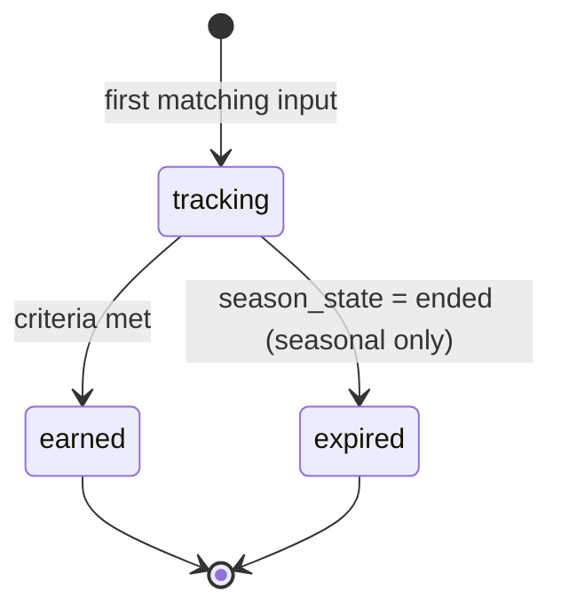

# Character Progression — Leveling, Attributes, and Endgame

Version 1.0 — Expanded Technical Design Authority edition (2026-10-17)

Status: Design target; not implemented. Names per Shared Registry v1.0.

Entry: [Character Progression Architecture](../Legends_Shattered_Frontier_Character_Progression_Architecture_v1.0.md) · Registry: [Shared Registry v1.0](../Legends_Shattered_Frontier_Shared_Registry_v1.0.md)

Names marked † are registry additions now merged into the Shared Registry (see entry file, Registry additions); the Registry is authoritative.

---

## 1. XP curve

### 1.1 Definition

`xp_to_next(L)` is the XP needed to go from level L to L+1. It is the base of every reward scaling function in the Registry (Shared reward scaling functions).

```text
xp_to_next(L) = round_to_10( XP_A × L^XP_P + XP_C )

XP_A = 400     (tune.progression.xp_curve.a)
XP_P = 1.5     (tune.progression.xp_curve.p)
XP_C = 600     (tune.progression.xp_curve.c)
round_to_10(x) = 10 × round(x / 10)      (round half away from zero)
```

The three constants are published together as the tuning table `tune.progression.xp_curve` (Registry key). The function is defined for every integer L ≥ 1, so expansions raise `LEVEL_CAP` without redefining it, and `xp_to_next(100)` is the prestige rank size (§6).

Lifetime XP to reach level L: `xp_total_for(L) = Σ_{i=1}^{L-1} xp_to_next(i)`. Level is derived: `level = max L such that xp_total ≥ xp_total_for(L)`, clamped to `LEVEL_CAP`. XP earned at the cap flows to prestige (§6).

Worked example: `xp_to_next(50) = round_to_10(400 × 50^1.5 + 600) = round_to_10(400 × 353.553 + 600) = round_to_10(142,021.4) = 142,020`.

### 1.2 Pacing model

The XP scale is cosmetic; pacing comes from how fast players earn **Standard Activity Equivalents** (SAE, one standard quest = `xp_reward(L, 1)` = `xp_to_next(L)/12`). The target time per level for an efficient, focused player is:

```text
H(L) = H0 + H1 × ((L − 1) / 99)^H_P        hours per level

H0 = 0.3   H1 = 2.2   H_P = 1.3            (tune.progression.level_pace)
SAE_minutes(L) = 60 × H(L) / 12 = 5 × H(L)
```

`SAE_minutes(L)` is the authoring contract for Quest, Dungeon, Raid, and LiveOps: content that takes an efficient player `t` minutes at level L should carry weight `w ≈ t / SAE_minutes(L)`. Example: a 15-minute level-50 quest chain step has `w = 15 / 5.9 ≈ 2.5`.

### 1.3 Level table at checkpoints

Values computed from the formulas above. "Hours" is cumulative focused play to *reach* the level.

| L | `xp_to_next(L)` | Lifetime XP to reach L | Focused hours to reach L | H(L) h/level | SAE minutes | `xp_reward(L,1)` | Common same-level kill XP |
| --- | --- | --- | --- | --- | --- | --- | --- |
| 1 | 1,000 | 0 | 0.0 | 0.30 | 1.5 | 83 | 7 |
| 5 | 5,070 | 9,210 | 1.2 | 0.33 | 1.7 | 423 | 34 |
| 10 | 13,250 | 49,820 | 3.0 | 0.40 | 2.0 | 1,104 | 88 |
| 20 | 36,380 | 279,950 | 7.7 | 0.56 | 2.8 | 3,032 | 243 |
| 25 | 50,600 | 489,650 | 10.7 | 0.65 | 3.2 | 4,217 | 337 |
| 30 | 66,330 | 773,530 | 14.1 | 0.75 | 3.7 | 5,528 | 442 |
| 40 | 101,790 | 1,592,210 | 22.5 | 0.96 | 4.8 | 8,483 | 679 |
| 50 | 142,020 | 2,787,480 | 33.0 | 1.18 | 5.9 | 11,835 | 947 |
| 60 | 186,500 | 4,404,550 | 45.9 | 1.42 | 7.1 | 15,542 | 1,243 |
| 70 | 234,860 | 6,484,140 | 61.3 | 1.68 | 8.4 | 19,572 | 1,566 |
| 75 | 260,410 | 7,709,190 | 69.9 | 1.81 | 9.0 | 21,701 | 1,736 |
| 80 | 286,820 | 9,063,710 | 79.2 | 1.94 | 9.7 | 23,902 | 1,912 |
| 90 | 342,130 | 12,178,090 | 99.9 | 2.22 | 11.1 | 28,511 | 2,281 |
| 99 | 394,620 | 15,465,330 | 120.8 | 2.47 | 12.4 | 32,885 | 2,631 |
| 100 | 400,600 | 15,859,950 | 123.3 | 2.50 | 12.5 | 33,383 | 2,671 |

### 1.4 Time-to-cap targets

| Player profile | Efficiency vs focused | Active hours to L100 | Notes |
| --- | --- | --- | --- |
| Focused leveler (quests + kills + dungeons, rested used) | 1.0 | 115–130 | Reference curve H(L). |
| Typical player (mixed, some idle/social time) | 0.7 | 165–190 | Median target for `m_time_to_level_100_hours`. |
| Crafter/gatherer (practice XP + crafting quests) | 0.55 | 210–240 | Practice XP alone ≈ 60% of focused rate (§2.3). |
| Alt with catch-up unlock | 1.5 × base | 80–90 (focused) | §2.6. |
| Unacceptable (alert) | — | < 60 or median > 260 | Indicates exploit or broken pacing. |

Milestone targets (typical player, median active hours): level 10 ≈ 4 h, level 25 ≈ 15 h, level 50 ≈ 47 h, level 75 ≈ 100 h, level 100 ≈ 176 h.

---

## 2. XP sources

### 2.1 Source catalog

| `xp_source_kind`† | Computed by | Formula | Multipliers applied by progression |
| --- | --- | --- | --- |
| `quest` | Quest spec authoring, via `reward-service` | `xp_reward(L, w)` | event, catch-up |
| `dungeon`, `raid` | Dungeon/Raid authoring via `reward-service` | `xp_reward(L, w)` | event, catch-up |
| `world_event` | AI/World authoring via `reward-service` | `xp_reward(L, w)` | event, catch-up |
| `achievement` | Reward bundle via `reward-service` | `xp_reward(L, w)` or fixed | event, catch-up |
| `liveops`, `compensation`, `gm` | LiveOps / admin | explicit amount | none |
| `kill` | progression-service (`GrantKillXp`) | §2.2 | rested, diversity, event, catch-up, focus fatigue |
| `practice` | progression-service from practice records (non-combat tracks) | §2.3 | rested, diversity, event, catch-up, focus fatigue, anti-macro |
| `discovery` | progression-service consumes `world.poi.discovered` from world-service (World spec, Points of interest; first discovery of a point of interest) | `xp_reward(L, 0.25)` per POI, once per character per POI | event, catch-up | Resolved (2026-10-17): the canonical World event triggers the discovery XP grant. |

Multiplier caps:

```text
M_reward   = min(M_COMBINED_CAP, M_event_xp × M_cu)                     M_COMBINED_CAP = 2.5
M_activity = min(M_ACTIVITY_CAP, M_rest_xp × M_div × M_reward)           M_ACTIVITY_CAP = 3.0
M_event_xp = LiveOps event XP overlay, 1.0–2.0 (tune.progression.event_xp_multiplier; non-stacking across events)
M_cu       = catch-up multiplier (§2.6)
(M_COMBINED_CAP: tune.liveops.max_combined_xp_multiplier; M_ACTIVITY_CAP: tune.progression.xp_activity_mult_cap)
```

Stacking rule (single rule shared with the LiveOps spec, Event modifiers): Character owns this formula; LiveOps owns the overlay values `M_event_xp` and `M_COMBINED_CAP`. Event × catch-up never exceeds `M_COMBINED_CAP` = 2.5 for any XP source; rested and diversity apply on top of that only for kill and practice XP, and the whole product never exceeds `M_ACTIVITY_CAP` = 3.0.

Reward XP arrives as an amount computed by the authoring domain; progression multiplies by `M_reward` and records the base and the multiplier in the ledger. Progression never re-derives `w`.

### 2.2 Kill XP

```text
kill_xp = round( xp_to_next(L_ref) / KPL × T(tier) × LD(Δ) × G(n) × M_activity × DR_xp )

L_ref     = level of the highest-level eligible party member (anti power-levelling)
KPL       = 150   kills per level (tune.progression.kills_per_level)
T(tier)   = 1.0 common, 2.5 elite, 5.0 mini_boss, 20.0 world_boss  (Combat spec tiers; tune.progression.kill_tier_mult)
Δ         = L_npc − L_ref
LD(Δ)     = 1.2                          if Δ ≥ 5
          = 1 + 0.04 × Δ                 if −5 ≤ Δ < 5
          = max(0, 0.8 − 0.15 × (−Δ − 5))  if Δ < −5   (0 at Δ ≤ −11: "grey")
G(n)      = (1 + 0.2 × (n − 1)) / n      n = eligible party members (1–5)
DR_xp     = focus fatigue of the character's highest-fatigue combat skill used in the fight (Skills part, Diminishing returns)
```

Eligibility: contributed ≥ 10% of damage or healing to the kill, or is in the same party within 60 m, alive. World bosses and raid bosses grant XP via reward bundles, not kill XP (`T` for `world_boss` applies only to unscripted open-world bosses). Summons, pets, guards, and NPCs flagged `xp_eligible: false` in their template (training dummies, NPC-spawned adds below the encounter's threshold) grant 0.

Worked example: a solo level-28 character (rested, active in 3 tracks today, no event) kills a level-30 elite.

```text
xp_to_next(28) = round_to_10(400 × 28^1.5 + 600) = round_to_10(59,862.6) = 59,860
base = 59,860 / 150 = 399.07
T = 2.5; Δ = +2 → LD = 1.08; G(1) = 1.0
M_activity = 1.5 (rested) × 1.10 (diversity) × 1.0 × 1.0 = 1.65; DR_xp = 1.0
kill_xp = round(399.07 × 2.5 × 1.08 × 1.0 × 1.65 × 1.0) = round(1,777.9) = 1,778
```

### 2.3 Practice XP (non-combat tracks)

Crafting, gathering, social, leadership, and exploration practice records also grant XP so that non-combat players level.

```text
practice_xp = round( xp_reward(L, 1) × PXW × ω × DF(d) × M_activity × DR × AM )

PXW = 0.012   (tune.progression.practice_xp_weight)
ω, DF, DR, AM as defined in Skills part, Gain formula
```

At ω-weighted 600 attempts/hour and DF = 1 this is 7.2 SAE/hour (≈ 60% of the focused rate of 12 / H(L) at mid levels). Combat practice records grant no practice XP (kills already pay).

### 2.4 Rested

```text
rested_minutes accrual while offline:
  + offline_minutes / RA_NORMAL   (RA_NORMAL = 4)   logged out elsewhere
  + offline_minutes / RA_REST     (RA_REST   = 2)   logged out inside a rest area (inn, owned house, settlement)
  capped at RESTED_CAP = 600                          (tune.progression.rested_*)
consumption: −1 per active minute (a wall-clock minute in which the character produced ≥ 1 practice record or kill)
while rested_minutes > 0:  M_rest_xp = 1.5, M_rest_gain = 1.75 (Skills part)
```

The rest-area flag comes from the simulation server's final practice batch of the session (`session_end = true, in_rest_area`). Accrual is computed lazily on the next session start from `last_session_end_at`. Bots that never log off never accrue rest; that asymmetry is deliberate.

### 2.5 Diversity

`n_tracks` = number of progression tracks in which the character committed ≥ 3 skill gains in the rolling 24 hours (current action's track included).

```text
M_div = 1 + 0.05 × (n_tracks − 1)    range 1.00–1.25  (tune.progression.diversity_step = 0.05)
```

Applies to activity XP and skill gain chance.

### 2.6 Catch-up

An account holding the `catch_up` unlock with key `level` (granted when any character on the account reaches `LEVEL_CAP`) gives other characters `M_cu = 1.5` while their level is below `LEVEL_CAP − 10`. Skill catch-up is per skill (Skills part). Catch-up never applies to prestige XP.

### 2.7 Level-up processing

On each committed XP grant progression computes the new level; for each level crossed:

1. Grant LP `lp_level(L)` (§3) — one `lp` ledger entry and `progression.lp.granted` with `source_kind = level_up`.
2. Grant 2 unallocated attribute points (`tune.progression.attribute_points_per_level`).
3. Emit `progression.level.reached`.
4. Re-evaluate specialization slot unlocks, stage, and achievement thresholds.

A single grant crossing several levels emits one event per level, in order, under the same `correlation_id`.

---

## 3. Learning Points

### 3.1 Sources

| `lp_source_kind` | Amount | Notes |
| --- | --- | --- |
| `level_up` | `lp_level(L) = 5 + floor((L − 1) / 10)` on reaching L (5 in band 1 … 14 in band 10) | 945 total from level 2 to 100 |
| `content_reward` | `lp_reward(w) = round(w × 2)` (Registry) | Carried in reward bundles from quests, dungeons, raids, world events |
| `achievement` | per definition, typically 5–25 | Via reward bundle |
| `prestige` | 10 per rank (`tune.progression.prestige_lp_per_rank`) | §6 |
| `refund` | 100% of mastery node LP; 50% of a removed specialization fee | Mastery tree reset, specialization removal |
| `compensation`, `gm` | explicit | Audited |

Cumulative LP from levels: L10 = 45, L25 = 140, L50 = 345, L75 = 615, L100 = 945.

### 3.2 Sinks

| `lp_sink_kind` | Cost | Defined in |
| --- | --- | --- |
| `skill_training` | `Σ` per 10-point step: `1 + floor(S/100)` LP, only up to 300 | Skills part, NPC trainers |
| `mastery_node` | 5 / 10 / 15 / 25 / 40 by tier (apprentice … legendary) | Skills part, Mastery trees |
| `specialization` | 100 per selection | Skills part, Specializations |

LP balance is unbounded and never expires. LP cannot be traded, bought with `currency/crowns`, or converted to anything else.

### 3.3 LP budget at cap (target)

| Item | LP |
| --- | --- |
| Levels 2–100 | 945 |
| Content rewards (≈ 6 SAE of rewarded content per level × 99 levels × 2) | ≈ 1,190 |
| Achievements by level 100 (typical) | ≈ 120 |
| **Earned by level 100 (typical)** | **≈ 2,250** |
| Training 4 skills 0 → 300 (60 LP each) | 240 |
| 3 specializations | 300 |
| 3 specialized full trees (240 each) | 720 |
| 4 unspecialized trees through master (160 each) | 640 |
| **Full cap build** | **1,900** |
| Surplus for experimentation / alternate trees | ≈ 350 |

Prestige (10 LP per rank, ~2.5 h per rank) funds alternate trees for build swapping. Since node effects are active only while the skill is in the node's band (Skills part), surplus LP buys flexibility, not stacked power.

---

## 4. Attributes

### 4.1 Values and caps

| Rule | Value |
| --- | --- |
| Attributes | `str`, `dex`, `con`, `int`, `wis`, `wil`, `cha`, `luck` (Registry) |
| Minimum natural value | 10 (`ATTRIBUTE_MIN`†) |
| Natural cap per attribute | 150 (`ATTRIBUTE_NATURAL_CAP`) |
| Natural total cap | 600 (`ATTRIBUTE_TOTAL_NATURAL_CAP`) |
| Start | 10 each (80) + 40 creation points, max +30 on one attribute → total 120 |
| Lock | `up` / `down` / `locked` per attribute (reuses `skill_lock` values†) |

"Natural" values are what progression stores. Items and effects add on top (Itemization, Combat) and are not capped by these rules.

### 4.2 Growth sources

| Source | Amount over 1–100 | Control |
| --- | --- | --- |
| Creation | 40 | Player distributes |
| Level points | 2 per level → 198 | Player allocates any time (`AllocateAttributePoints`) |
| Use-based gains | remaining ≈ 282 to reach 600 | Side effect of skill gains, steered by locks |

### 4.3 Use-based attribute gain

After each committed skill gain on skill `k` with governing attributes `(a_i, w_i)` (Skills part catalog; weights sum to 1.0), for each governing attribute with lock `up` and value `v < ATTRIBUTE_NATURAL_CAP`:

```text
P_attr = AGB × w_i × sqrt(1 − v / ATTRIBUTE_NATURAL_CAP)

AGB = 0.10                  (tune.progression.attribute_gain_base)
cooldown: at most one use-based gain per attribute per 5 minutes (tune.progression.attribute_gain_cooldown_s = 300)
```

On success, +1 subject to the total cap:

1. If `total + 1 ≤ 600`: apply.
2. Else pick the attribute with lock `down` and the highest value above `ATTRIBUTE_MIN` (ties: fixed order `str, dex, con, int, wis, wil, cha, luck`); decrement it by 1 and increment the target. Both changes share one ledger correlation and emit two `progression.attribute.changed` events.
3. Else no gain.

Manual allocation of level points follows the same total-cap rule (a `down` attribute pays).

Worked example: a smithing gain (str 0.6, int 0.4) for a character with str 60 (up), int 80 (up).

```text
P_str = 0.10 × 0.6 × sqrt(1 − 60/150) = 0.06 × 0.7746 = 0.0465
P_int = 0.10 × 0.4 × sqrt(1 − 80/150) = 0.04 × 0.6831 = 0.0273
```

At ~20 skill gains per hour this yields ≈ 1.4 natural points per hour across attributes; 282 points take ≈ 200 active hours, so attribute totals reach 600 around the same time as level cap for typical players.

### 4.4 Attribute balance targets

| Character Level | Median natural total | p90 natural total |
| --- | --- | --- |
| 10 | 150 | 165 |
| 25 | 210 | 240 |
| 50 | 320 | 370 |
| 75 | 450 | 520 |
| 100 | 560 | 600 |

Using Combat formulas, a level-100 character with `con` 150 has `Health = 100 + 150×15 + 100×25 = 4,850` before items.

---

## 5. Character Level effects summary

| Effect | Value | Owner |
| --- | --- | --- |
| Health/mana level terms | `Level × 25`, `Level × 10` | Combat |
| Armor scaling (`100 × AttackerLevel`) | — | Combat |
| Content level clamp for `xp_reward`, `gold_reward` | — | Registry |
| `marks_reward` eligibility | Level ≥ 60 | Registry |
| Levelling ilvl `4 × L` | — | Registry power ladder |
| Specialization slots | 50, 75, 100 | Skills part |
| Prestige | at `LEVEL_CAP` | §6 |

---

## 6. Prestige ranks

At `LEVEL_CAP`, XP (all sources) accrues to `prestige_xp`. Each rank requires `PRESTIGE_XP = xp_to_next(LEVEL_CAP)` = 400,600 XP (`tune.progression.prestige_xp` = "curve"), i.e. exactly 12 SAE: a standard quest at cap is 1/12 of a rank. Ranks run 1–999 (`PRESTIGE_RANK_MAX`†); XP beyond the last rank is recorded but grants nothing.

| Rank | Reward |
| --- | --- |
| Every rank | 10 LP |
| 1 | Unlocks `legendary_progression` stage condition; title `title/frontier_veteran` (illustrative, account-wide) |
| 5, 10, 25, 50, 100, 250, 500, 999 | Milestone reward bundle via `reward-service` (cosmetics, mount appearances, titles); bundle IDs `reward/prestige_rank_<n>` (illustrative) |

Rules:

- Prestige never grants attributes, skill points, or item power. Rank 999 has the same stats as rank 1.
- Prestige rank is character-scoped; the account records the highest rank as an account unlock trigger for milestone cosmetics so alts can display them.
- Rested, diversity, and event multipliers apply to prestige XP; catch-up does not (§2.6).
- Pacing: ≈ 2.5 focused hours per rank; target median rank 28 after 100 active hours at cap (typical efficiency 0.7).

Worked example: a level-100 character with `prestige_xp = 395,000` completes a `w = 1.0` quest: `xp_reward(100, 1) = round(400,600/12) = 33,383`. New prestige XP = 428,383 → rank +1 (remainder 27,783), grant 10 LP, emit `progression.prestige.rank_reached`.

---

## 7. Achievements

### 7.1 Model

`achievement/<slug>` definitions (content-catalog) contain criteria, points, optional reward bundle, optional title, optional `season_id`. Progression evaluates criteria by consuming domain events and its own state changes; rewards go through `reward-service` (`achievement_reward` source code).

| Criterion type | Meaning | Example |
| --- | --- | --- |
| `event_count` | Count events matching `event_name` + payload filter, reach `target` | 100 × `combat.npc.killed` where `npc_tier = elite` |
| `distinct_count` | Count distinct values of a payload field | 25 distinct `zone_id` from `character.zone.changed` |
| `threshold` | Progression value ≥ target | any skill ≥ 900; level ≥ 50; skills at `master` ≥ 3 |
| `all_of` | All listed achievements earned | meta-achievement |

Achievement progress states (local to this spec): `tracking` → `earned`. Seasonal achievements add `expired` when their season ends unfinished.



### 7.2 Seasonal achievements

- Carry `season_id` (`season/<slug>`) and are evaluated only while the runtime Season (`ssn_`) is `active` (consumed from `liveops.season.started` / `liveops.season.ended`).
- Progress counters are season-scoped and archived at season end; unfinished entries become `expired`.
- Earned seasonal achievements remain permanently as AchievementRecords ("feats") with `season_id` set; their reward bundles usually grant `currency/season_tokens` or season-limited titles.
- Target completion rates per season (active players): easy tier 60–80%, medium 25–40%, hard 5–12%, prestige feat < 2%.

### 7.3 Achievement points

Points per definition: 5, 10, 25, 50. Account achievement score = sum of distinct achievements earned by any character on the account (an achievement counts once per account). Points are cosmetic (leaderboards, profile) and gate only cosmetic rewards.

---

## 8. Titles

`title/<slug>` definitions: display string key, `scope` (`character` or `account`), and source. Sources: achievements, prestige milestones, seasonal feats, LiveOps grants. A character has at most one active title (`SetActiveTitle`), chosen from character-scoped titles it owns plus account-scoped titles the account owns. Titles are public (p0) and are validated against owned unlocks on every set. Revoking a title (rollback, enforcement) clears it if active.

---

## 9. Account-wide unlocks

| `account_unlock_kind`† | Key | Granted when | Consumer |
| --- | --- | --- | --- |
| `title` | `title/<slug>` | Account-scoped title earned | progression (titles) |
| `cosmetic` | content ID of cosmetic item/appearance | Achievement/prestige/season reward | inventory-service (appearance collection) |
| `mount` | `mount/<slug>` (World content kind, Shared Registry §3.2) | Reward flagged account-wide | World mount ownership check |
| `recipe` | `recipe/<slug>` | Recipe flagged account-wide learned | crafting-service; Resolved (2026-10-17): Crafting consumes account unlocks through its `KnownRecipe` projection. |
| `catch_up` | `level` or `skill/<slug>` | Any character reaches L100 / skill ≥ 700 | progression |

Rules: unique per `(account_id, unlock_kind, unlock_key)`; grants are idempotent; unlocks never carry stat power except `catch_up`, which only speeds earning up to a ceiling below what the account already achieved. Unlocks are realm-independent (account scope). Revocation only via enforcement rollback.

---

## 10. Leveling and endgame balancing targets

| Metric | Target | Alert |
| --- | --- | --- |
| XP share by source at levels 1–99 | quests 40–50%, kills 25–35%, dungeons 10–20%, practice 5–15%, other < 5% | any source > 60% |
| Median active hours L1→L100 | 165–190 | < 120 or > 240 |
| Share of levels gained with rested active | 25–40% | > 60% (rest too generous) |
| Median `M_div` on activity XP | 1.05–1.15 | — |
| LP balance (median, level 100, unspent) | 100–400 | > 800 (sinks too weak) |
| Prestige ranks per 100 active h at cap (median) | 25–40 | > 60 |
| Characters at L100 by day 90 of launch (of those reaching L20) | 25–40% | < 10% |
| Attribute natural total at L100 (median) | 540–580 | < 480 |
