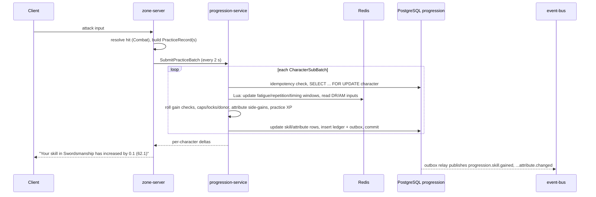
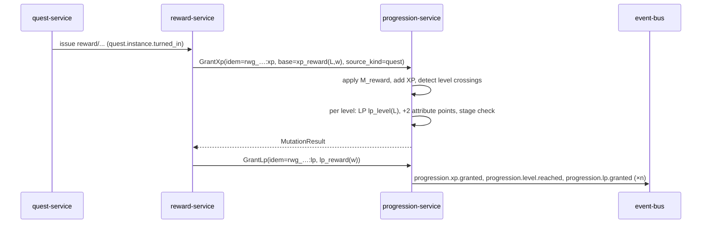
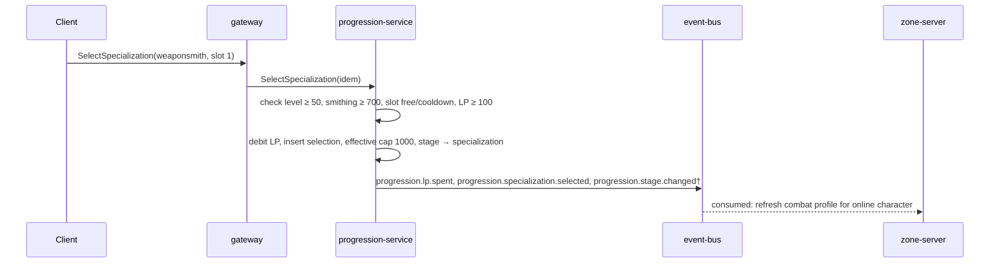

# Character Progression — Service Interfaces

Version 1.0 — Expanded Technical Design Authority edition (2026-10-17)

Status: Design target; not implemented. Names per Shared Registry v1.0.

Entry: [Character Progression Architecture](../Legends_Shattered_Frontier_Character_Progression_Architecture_v1.0.md) · Registry: [Shared Registry v1.0](../Legends_Shattered_Frontier_Shared_Registry_v1.0.md)

Names marked † are registry additions now merged into the Shared Registry (see entry file, Registry additions); the Registry is authoritative.

---

## 1. Storage overview

| Store | Contents | Durability |
| --- | --- | --- |
| PostgreSQL schema `progression` | Character aggregate, attributes, skills, specializations, mastery unlocks, achievements, titles, account unlocks, append-only ledger, idempotency keys, outbox | Authoritative |
| Redis (`prog:` keyspace) | Hot anti-grind windows: fatigue minute rings, repetition counters, 60-min gain counts, timing samples, 24-h track counts, cached risk score | Rebuildable; snapshotted to `practice_state` every 60 s |
| `event-bus` topic `domain.progression` | All `progression.*` events, keyed by `character_id` (account unlocks keyed by `account_id`) | Via transactional outbox |

Concurrency: every mutation runs in one PostgreSQL transaction that first takes `SELECT … FOR UPDATE` on `character_progressions` for the character and increments `version`. One transaction per character per practice sub-batch. Account unlock writes lock nothing but rely on the unique key.

---

## 2. PostgreSQL DDL

```sql
CREATE SCHEMA IF NOT EXISTS progression;
SET search_path = progression;

CREATE TYPE skill_lock        AS ENUM ('up', 'down', 'locked');
CREATE TYPE skill_band        AS ENUM ('novice', 'apprentice', 'journeyman', 'expert', 'master', 'legendary');
CREATE TYPE progression_track AS ENUM ('combat', 'crafting', 'gathering', 'social', 'leadership', 'exploration');
CREATE TYPE attribute_code    AS ENUM ('str', 'dex', 'con', 'int', 'wis', 'wil', 'cha', 'luck');
CREATE TYPE progression_stage AS ENUM ('new_character', 'skill_discovery', 'specialization', 'mastery', 'legendary_progression');
CREATE TYPE ledger_kind       AS ENUM ('xp', 'prestige_xp', 'lp', 'skill', 'attribute', 'attribute_points',
                                       'mastery', 'specialization', 'prestige_rank', 'stage', 'title');
CREATE TYPE achievement_state AS ENUM ('tracking', 'earned', 'expired');

CREATE TABLE character_progressions (
  character_id             text PRIMARY KEY CHECK (character_id ~ '^chr_[0-9A-HJKMNP-TV-Z]{26}$'),
  account_id               text NOT NULL CHECK (account_id ~ '^acc_[0-9A-HJKMNP-TV-Z]{26}$'),
  realm_id                 text NOT NULL,
  level                    smallint NOT NULL DEFAULT 1 CHECK (level >= 1),
  xp_total                 bigint   NOT NULL DEFAULT 0 CHECK (xp_total >= 0),
  prestige_rank            smallint NOT NULL DEFAULT 0 CHECK (prestige_rank >= 0),
  prestige_xp              bigint   NOT NULL DEFAULT 0 CHECK (prestige_xp >= 0),   -- XP toward next rank
  prestige_xp_lifetime     bigint   NOT NULL DEFAULT 0,
  lp_balance               integer  NOT NULL DEFAULT 0 CHECK (lp_balance >= 0),
  lp_lifetime_earned       integer  NOT NULL DEFAULT 0,
  attribute_points_unspent smallint NOT NULL DEFAULT 0 CHECK (attribute_points_unspent >= 0),
  stage                    progression_stage NOT NULL DEFAULT 'new_character',
  rested_minutes           integer  NOT NULL DEFAULT 0 CHECK (rested_minutes >= 0),
  last_session_end_at      timestamptz,
  last_session_rest_area   boolean NOT NULL DEFAULT false,
  active_title_id          text CHECK (active_title_id IS NULL OR active_title_id LIKE 'title/%'),
  content_version          bigint NOT NULL,
  version                  bigint NOT NULL DEFAULT 0,
  created_at               timestamptz NOT NULL DEFAULT now(),
  updated_at               timestamptz NOT NULL DEFAULT now(),
  deleted_at               timestamptz
);
CREATE INDEX ON character_progressions (account_id);

CREATE TABLE attribute_values (
  character_id     text NOT NULL REFERENCES character_progressions ON DELETE CASCADE,
  attribute        attribute_code NOT NULL,
  value            smallint NOT NULL CHECK (value >= 1),   -- ATTRIBUTE_MIN and caps enforced in code (tunable)
  lock             skill_lock NOT NULL DEFAULT 'up',
  last_use_gain_at timestamptz,
  PRIMARY KEY (character_id, attribute)
);

CREATE TABLE skill_values (
  character_id  text NOT NULL REFERENCES character_progressions ON DELETE CASCADE,
  skill_id      text NOT NULL CHECK (skill_id LIKE 'skill/%'),
  track         progression_track NOT NULL,
  value         smallint NOT NULL DEFAULT 0 CHECK (value BETWEEN 0 AND 1000),
  peak_value    smallint NOT NULL DEFAULT 0,
  lock          skill_lock NOT NULL DEFAULT 'up',
  discovered_at timestamptz,
  last_gain_at  timestamptz,
  PRIMARY KEY (character_id, skill_id)
);

CREATE TABLE specialization_selections (
  character_id      text NOT NULL REFERENCES character_progressions ON DELETE CASCADE,
  slot              smallint NOT NULL CHECK (slot BETWEEN 1 AND 3),
  specialization_id text NOT NULL CHECK (specialization_id LIKE 'specialization/%'),
  skill_id          text NOT NULL,
  selected_at       timestamptz NOT NULL,
  cooldown_until    timestamptz NOT NULL,
  PRIMARY KEY (character_id, slot),
  UNIQUE (character_id, skill_id)
);

CREATE TABLE mastery_node_unlocks (
  character_id    text NOT NULL REFERENCES character_progressions ON DELETE CASCADE,
  mastery_id      text NOT NULL CHECK (mastery_id LIKE 'mastery/%'),
  node_id         text NOT NULL,
  tier            skill_band NOT NULL,
  lp_cost         smallint NOT NULL,
  unlocked_at     timestamptz NOT NULL,
  ledger_entry_id text NOT NULL,
  PRIMARY KEY (character_id, mastery_id, node_id)
);

CREATE TABLE mastery_tree_state (
  character_id  text NOT NULL REFERENCES character_progressions ON DELETE CASCADE,
  mastery_id    text NOT NULL,
  last_reset_at timestamptz,
  PRIMARY KEY (character_id, mastery_id)
);

CREATE TABLE achievement_progress (
  character_id   text NOT NULL REFERENCES character_progressions ON DELETE CASCADE,
  achievement_id text NOT NULL CHECK (achievement_id LIKE 'achievement/%'),
  season_id      text,
  counter        bigint NOT NULL DEFAULT 0,
  distinct_keys  text[] NOT NULL DEFAULT '{}',        -- for distinct_count criteria (bounded by target)
  state          achievement_state NOT NULL DEFAULT 'tracking',
  updated_at     timestamptz NOT NULL DEFAULT now(),
  PRIMARY KEY (character_id, achievement_id)
);

CREATE TABLE achievement_records (
  character_id    text NOT NULL REFERENCES character_progressions ON DELETE CASCADE,
  achievement_id  text NOT NULL,
  account_id      text NOT NULL,
  season_id       text,
  points          smallint NOT NULL,
  earned_at       timestamptz NOT NULL,
  reward_grant_id text,                                -- rwg_ returned by reward-service
  revoked_at      timestamptz,
  PRIMARY KEY (character_id, achievement_id)
);
CREATE INDEX ON achievement_records (account_id, achievement_id);

CREATE TABLE character_titles (
  character_id text NOT NULL REFERENCES character_progressions ON DELETE CASCADE,
  title_id     text NOT NULL CHECK (title_id LIKE 'title/%'),
  granted_at   timestamptz NOT NULL,
  source_kind  text NOT NULL,
  source_ref   text,
  revoked_at   timestamptz,
  PRIMARY KEY (character_id, title_id)
);

CREATE TABLE account_unlocks (
  account_id          text NOT NULL,
  unlock_kind         text NOT NULL CHECK (unlock_kind IN ('title','cosmetic','mount','recipe','catch_up')),
  unlock_key          text NOT NULL,                  -- content ID, or 'level' / 'skill/<slug>' for catch_up
  granted_at          timestamptz NOT NULL,
  source_character_id text,
  source_kind         text NOT NULL,
  source_ref          text,
  revoked_at          timestamptz,
  PRIMARY KEY (account_id, unlock_kind, unlock_key)
);

CREATE TABLE progression_ledger (
  entry_id          text NOT NULL CHECK (entry_id ~ '^pgl_[0-9A-HJKMNP-TV-Z]{26}$'),
  character_id      text NOT NULL,
  account_id        text NOT NULL,
  kind              ledger_kind NOT NULL,
  subject           text,                 -- skill_id, attribute, mastery node, specialization, title, achievement
  delta             bigint NOT NULL,
  value_after       bigint NOT NULL,
  source_kind       text NOT NULL,        -- xp_source_kind / lp_source_kind / lp_sink_kind / cause
  source_ref        text,                 -- content ID or runtime ID (qst_, rwg_, ent_ npc def, ...)
  multipliers       jsonb,                -- {"rest":1.5,"div":1.1,"event":1,"cu":1,"dr":1,"am":1}
  reverses_entry_id text,                 -- set on rollback compensation entries
  correlation_id    text NOT NULL,
  causation_id      text,
  idempotency_key   text,
  content_version   bigint NOT NULL,
  occurred_at       timestamptz NOT NULL,
  PRIMARY KEY (entry_id, occurred_at)
) PARTITION BY RANGE (occurred_at);       -- monthly partitions; retained indefinitely (rollback, support)
CREATE INDEX ON progression_ledger (character_id, occurred_at);
REVOKE UPDATE, DELETE ON progression_ledger FROM PUBLIC;

CREATE TABLE practice_state (               -- 60-second snapshot of Redis windows
  character_id text NOT NULL,
  snapshot     bytea NOT NULL,
  updated_at   timestamptz NOT NULL,
  PRIMARY KEY (character_id)
);

CREATE TABLE idempotency_keys (
  idempotency_key text NOT NULL,
  rpc             text NOT NULL,
  request_hash    bytea NOT NULL,
  response        bytea NOT NULL,
  created_at      timestamptz NOT NULL DEFAULT now(),
  PRIMARY KEY (idempotency_key, rpc)
);                                          -- purged after IDEMPOTENCY_RETENTION (7 days)

CREATE TABLE processed_events (             -- consumer deduplication (achievements, rest, risk)
  consumer     text NOT NULL,
  event_id     text NOT NULL,
  processed_at timestamptz NOT NULL DEFAULT now(),
  PRIMARY KEY (consumer, event_id)
);

CREATE TABLE outbox (
  outbox_id    bigserial PRIMARY KEY,
  event_id     text NOT NULL UNIQUE,
  event_name   text NOT NULL,
  partition_key text NOT NULL,
  envelope     jsonb NOT NULL,
  created_at   timestamptz NOT NULL DEFAULT now(),
  published_at timestamptz
);
CREATE INDEX ON outbox (published_at) WHERE published_at IS NULL;
```

Redis keys (TTL 25 h unless noted): `prog:{chr}:fat:{skill}` (240-bit minute ring + epoch minute), `prog:{chr}:rep:{skill}` (sorted set `context_hash|minute` → count, 60-min horizon), `prog:{chr}:g60:{skill}` (sorted set of gain timestamps), `prog:{chr}:tim` (list of last 200 input intervals ms), `prog:{chr}:trk` (hash `track|hour` → gains), `prog:acc:{acc}:risk` (TTL 120 s). All updates for one character execute in a single Lua script.

---

## 3. Content definitions (JSON)

Published by `content-catalog-service`; validated at pack build.

**Skill**

```json
{
  "id": "skill/smithing",
  "track": "crafting",
  "name_key": "skill.smithing.name",
  "governing_attributes": [{ "attribute": "str", "weight": 0.6 }, { "attribute": "int", "weight": 0.4 }],
  "practice_category": "crafting",
  "practice_xp": true,
  "mastery_id": "mastery/smithing",
  "specializations": ["specialization/weaponsmith", "specialization/armorsmith"]
}
```

**Mastery tree** (abbreviated)

```json
{
  "id": "mastery/swordsmanship",
  "skill_id": "skill/swordsmanship",
  "power_budget": { "through_master_pct": 12, "with_legendary_pct": 18 },
  "nodes": [
    { "node_id": "balanced_grip", "tier": "apprentice", "lp_cost": 5,
      "effects": [{ "effect_type": "rating", "stat": "crit_rating", "value": 20, "condition": "wielding:sword" }] },
    { "node_id": "riposte", "tier": "journeyman", "lp_cost": 10,
      "effects": [{ "effect_type": "ability_unlock", "ability": "ability/riposte" }] },
    { "node_id": "duelist", "tier": "master", "lp_cost": 25, "exclusive_group": "master_capstone",
      "effects": [{ "effect_type": "percent_modifier", "stat": "single_target_damage", "value": 3 }] },
    { "node_id": "vanguard", "tier": "master", "lp_cost": 25, "exclusive_group": "master_capstone",
      "effects": [{ "effect_type": "percent_modifier", "stat": "cleave_damage", "value": 4 }] }
  ]
}
```

**Specialization**

```json
{
  "id": "specialization/weaponsmith",
  "skill_id": "skill/smithing",
  "min_skill": 700,
  "lp_cost": 100,
  "effective_cap": 1000,
  "passive": { "effect_type": "quality_bonus", "scope": "item_category:weapon", "value": 10 }
}
```

**Achievement**

```json
{
  "id": "achievement/first_legendary_skill",
  "category": "progression",
  "points": 25,
  "criteria": { "type": "threshold", "metric": "max_skill_value", "target": 900 },
  "reward_bundle_id": "reward/first_legendary_skill",
  "title_id": "title/the_unbroken",
  "season_id": null,
  "hidden": false
}
```

**Title**

```json
{ "id": "title/the_unbroken", "scope": "account", "display_key": "title.the_unbroken", "position": "suffix" }
```

**NPC progression template** (block inside an `npc/*` definition owned by AI/Combat)

```json
"progression_template": {
  "archetype": "skirmisher",
  "attribute_weights": null,
  "primary_skills": ["skill/daggers", "skill/stealth"],
  "secondary_skills": ["skill/tactics"],
  "tertiary_skills": ["skill/survival"],
  "skill_offset": 0,
  "xp_eligible": true,
  "trainer": { "skills": ["skill/daggers"], "teach_ceiling": 300 }
}
```

Publish-time validation: weights sum to 1.0 ± 0.001; every skill ID canonical; mastery trees have exactly the tier structure of the Skills part and pass the power budget; `teach_ceiling ≤ tune.progression.training_ceiling_max`; achievement criteria reference registered event names.

---

## 4. gRPC API — `lsf.progression_service.v1`

```protobuf
syntax = "proto3";
package lsf.progression_service.v1;

service ProgressionService {
  // Reads
  rpc GetProgression(GetProgressionRequest) returns (ProgressionSnapshot);
  rpc GetCombatProfile(GetCombatProfileRequest) returns (CombatProfile);
  rpc ListLedger(ListLedgerRequest) returns (ListLedgerResponse);
  rpc ListAchievements(ListAchievementsRequest) returns (ListAchievementsResponse);
  rpc ListAccountUnlocks(ListAccountUnlocksRequest) returns (ListAccountUnlocksResponse);
  rpc PreviewNpcProfile(PreviewNpcProfileRequest) returns (NpcProfile);

  // Lifecycle
  rpc InitializeCharacter(InitializeCharacterRequest) returns (ProgressionSnapshot);

  // Simulation authorities
  rpc SubmitPracticeBatch(SubmitPracticeBatchRequest) returns (SubmitPracticeBatchResponse);
  rpc GrantKillXp(GrantKillXpRequest) returns (GrantKillXpResponse);

  // Reward fan-out (reward-service, liveops via reward-service)
  rpc GrantXp(GrantXpRequest) returns (MutationResult);
  rpc GrantLp(GrantLpRequest) returns (MutationResult);
  rpc GrantTitle(GrantTitleRequest) returns (MutationResult);
  rpc GrantAccountUnlock(GrantAccountUnlockRequest) returns (MutationResult);

  // Player actions (via gateway; TrainSkill via zone-server)
  rpc ChangeLock(ChangeLockRequest) returns (MutationResult);
  rpc AllocateAttributePoints(AllocateAttributePointsRequest) returns (MutationResult);
  rpc TrainSkill(TrainSkillRequest) returns (MutationResult);
  rpc UnlockMasteryNode(UnlockMasteryNodeRequest) returns (MutationResult);
  rpc ResetMasteryTree(ResetMasteryTreeRequest) returns (MutationResult);
  rpc SelectSpecialization(SelectSpecializationRequest) returns (MutationResult);
  rpc RemoveSpecialization(RemoveSpecializationRequest) returns (MutationResult);
  rpc SetActiveTitle(SetActiveTitleRequest) returns (MutationResult);

  // Enforcement / GM (audited)
  rpc ApplyRollback(ApplyRollbackRequest) returns (ApplyRollbackResponse);
  rpc AdminAdjust(AdminAdjustRequest) returns (MutationResult);
}

message GetCombatProfileRequest { string character_id = 1; }
message EffectiveSkill { string skill_id = 1; int32 value = 2; }
message MasteryEffect {
  string effect_type = 1;
  string stat = 2;
  double value = 3;
  string condition = 4;
}
message CombatProfile {
  string character_id = 1;
  int32 level = 2;
  map<string, int32> natural_attributes = 3; // attribute code -> value
  repeated EffectiveSkill effective_skills = 4;
  repeated string ability_ids = 5; // unlocked ability content IDs
  repeated MasteryEffect mastery_effects = 6;
  repeated string specialization_ids = 7;
  int64 progression_version = 8; // monotonic snapshot version for zone-server cache ordering
  bool xp_eligible = 9; // NPC/default eligibility carried to combat when applicable
}

message PracticeRecord {
  string character_id = 1;
  string skill_id = 2;
  int32  difficulty = 3;          // 0..1100
  bool   success = 4;
  float  action_seconds = 5;
  fixed64 context_hash = 6;
  int64  input_at_unix_ms = 7;
  bool   initiated_by_input = 8;
  bool   xp_eligible = 9;
}
message SessionEnd { string character_id = 1; bool in_rest_area = 2; int64 ended_at_unix_ms = 3; }
message CharacterSubBatch {
  string idempotency_key = 1;     // "<producer_instance_id>:<batch_seq>:<character_id>"
  string character_id = 2;
  repeated PracticeRecord records = 3;   // max 500
  SessionEnd session_end = 4;            // optional
}
message SubmitPracticeBatchRequest {
  string producer_instance_id = 1;       // srvi_ or crafting-service instance
  uint64 batch_seq = 2;
  string zone_id = 3;
  repeated CharacterSubBatch characters = 4;   // max 1000
  int64  content_version = 5;
}
message SkillDelta { string skill_id = 1; int32 delta = 2; int32 value_after = 3; string band_after = 4; }
message AttributeDelta { string attribute = 1; int32 delta = 2; int32 value_after = 3; }
message CharacterBatchResult {
  string character_id = 1;
  repeated SkillDelta skills = 2;
  repeated AttributeDelta attributes = 3;
  int64  xp_granted = 4;
  int32  level_after = 5;
  int32  rejected_records = 6;
  repeated string reject_reasons = 7;    // e.g. "invalid_skill", "duration_budget_exceeded"
  string status = 8;                     // "applied" | "replayed" | "failed_retryable"
}
message SubmitPracticeBatchResponse { repeated CharacterBatchResult results = 1; }

message GrantKillXpRequest {
  string idempotency_key = 1;            // "<instance>:<npc ent_ id>:<character_id>"
  string npc_definition_id = 2;          // npc/<slug>
  string npc_entity_id = 3;              // ent_
  int32  npc_level = 4;
  string npc_tier = 5;                   // common | elite | mini_boss | world_boss
  repeated string eligible_character_ids = 6;   // 1..5
  string zone_id = 7;
}
message GrantKillXpResponse { map<string, int64> xp_by_character = 1; }

message GrantXpRequest {
  string idempotency_key = 1;            // reward-service: "<rwg_id>:xp"
  string character_id = 2;
  int64  base_amount = 3;                // from xp_reward(L, w) computed by the authoring domain
  string source_kind = 4;                // xp_source_kind
  string source_ref = 5;                 // quest/<slug>, dungeon/<slug>, liveops_event/<slug>, ...
  string reward_grant_id = 6;            // rwg_
  bool   apply_multipliers = 7;          // false for compensation/gm
}
message GrantLpRequest {
  string idempotency_key = 1; string character_id = 2; int32 amount = 3;
  string source_kind = 4; string source_ref = 5; string reward_grant_id = 6;
}
message ChangeLockRequest {
  string idempotency_key = 1; string character_id = 2;
  string target_kind = 3;                // "skill" | "attribute"
  string target_id = 4;                  // skill/<slug> | str..luck
  string lock = 5;                       // up | down | locked
}
message TrainSkillRequest {
  string idempotency_key = 1; string character_id = 2; string skill_id = 3;
  int32  target_value = 4; string trainer_npc_definition_id = 5; string trainer_entity_id = 6;
}
message ApplyRollbackRequest {
  string idempotency_key = 1; string character_id = 2; string case_id = 3;   // cas_
  oneof scope {
    int64 rollback_to_unix_ms = 4;       // everything after T
    RollbackEntries entries = 5;         // explicit pgl_ list (Security rollback saga, progression step)
    string reward_grant_id = 7;          // rwg_: all entries with source_ref = rwg_ plus titles, account
                                         // unlocks and achievements granted by it (reward-service RevokeGrant)
  }
  string actor = 6;                      // enforcement principal, or reward-service on behalf of a case
}
message RollbackEntries { repeated string entry_ids = 1; }
message ApplyRollbackResponse { int32 entries_reversed = 1; int32 nodes_revoked = 2; string stage_after = 3; }
message MutationResult { string status = 1; repeated string ledger_entry_ids = 2; ProgressionSnapshot snapshot = 3; }
// Remaining messages follow the same pattern: idempotency_key + character_id + typed fields.
```

| RPC | Allowed callers (mTLS service identity) | Key validation | Errors |
| --- | --- | --- | --- |
| `GetProgression`, `List*` | gateway (own characters), services | Caller owns character (gateway) | `NOT_FOUND`, `PERMISSION_DENIED` |
| `GetCombatProfile` | zone-server, instance-server | Character entering that server | — |
| `InitializeCharacter` | character-service | 150 points, ≤ 3 skills, ≤ 100 each; 40 attribute points, ≤ +30 each | `INVALID_ARGUMENT` |
| `SubmitPracticeBatch` | zone-server, instance-server, crafting-service | Producer registered in `world-service`; record limits; duration budget (Security considerations) | per-character `reject_reasons` |
| `GrantKillXp` | zone-server, instance-server | Tier enum; 1–5 characters; same realm | `INVALID_ARGUMENT` |
| `GrantXp`, `GrantLp`, `GrantTitle`, `GrantAccountUnlock` | reward-service | `reward_grant_id` present unless `source_kind ∈ {gm, compensation}` from liveops/admin path | `FAILED_PRECONDITION` (deleted character) |
| `ChangeLock`, `AllocateAttributePoints`, `UnlockMasteryNode`, `ResetMasteryTree`, `SelectSpecialization`, `RemoveSpecialization`, `SetActiveTitle` | gateway | Ownership, prerequisites, cooldowns, LP balance, rate limits | `FAILED_PRECONDITION` with reason code |
| `TrainSkill` | zone-server | Proximity and trainer template validated by caller; ceiling; LP; economy debit | `FAILED_PRECONDITION` |
| `ApplyRollback` | enforcement-service (any scope), reward-service (`reward_grant_id` scope only, from `RevokeGrant`) | Case ID present; audited; already-reversed entries skipped (idempotent); sets `revoked_at` on titles/unlocks/achievements in scope | `NOT_FOUND` (unknown grant) |
| `AdminAdjust` | admin-portal | Audited; adjustments > 100 LP, > 1 level, or > 50 skill points require second approver token | `PERMISSION_DENIED` |
| `PreviewNpcProfile` | admin-portal, content tooling | Read-only | — |

Every mutating RPC takes `idempotency_key` (≤ 128 chars); replays with the same key and request hash return the stored response; same key with a different hash returns `ALREADY_EXISTS`.

---

## 5. Key sequences

### 5.1 Practice batch to skill gain



### 5.2 Quest reward XP and level-up



### 5.3 Specialization selection



### 5.4 Enforcement rollback

```mermaid
sequenceDiagram
    participant E as enforcement-service
    participant P as progression-service
    participant AU as audit-service
    participant B as event-bus
    E->>P: ApplyRollback(cas_…, rollback_to=T | entries=[pgl_…] | reward_grant_id=rwg_…)
    P->>P: select ledger entries in scope (not already reversed), newest first
    P->>P: write compensating entries (reverses_entry_id), recompute level/caps
    P->>P: if LP < 0 → revoke newest mastery nodes until LP ≥ 0; recompute stage
    P->>B: events with cause = rollback
    P->>AU: audit record (via audit-service API)
    P-->>E: entries_reversed, nodes_revoked, stage_after
```

---

## 6. Events

All events use the Registry envelope (Event taxonomy, Envelope); `character_id`, `account_id`, `realm_id`, `correlation_id`, `causation_id`, and `content_version` live in the envelope, not the payload. Producer: `progression-service`; topic `domain.progression`. Default envelope `privacy_class`: `p1_pseudonymous`. All payloads are `schema_version: 1`.

Common field `cause` (string enum): `play` (default), `training`, `reward`, `allocation`, `donation`, `rollback`, `gm`, `refund`.

### 6.1 `progression.xp.granted`

| Name | Type | Req | Description | privacy_class |
| --- | --- | --- | --- | --- |
| `ledger_entry_id` | string | yes | `pgl_` entry | p1_pseudonymous |
| `source_kind` | string | yes | `xp_source_kind`† | p1_pseudonymous |
| `source_ref` | string | no | Content or runtime ID | p1_pseudonymous |
| `reward_grant_id` | string | no | `rwg_` | p1_pseudonymous |
| `base_amount` | int64 | yes | Before multipliers | p1_pseudonymous |
| `amount` | int64 | yes | Granted (may be 0 if fully dampened) | p1_pseudonymous |
| `multipliers` | object | yes | `{rest, div, event, cu, dr, am}` floats; `am` omitted when 1. Privacy: `rest`, `div`, `event`, `cu` are p1_pseudonymous; `dr`, `am` (anti-macro and diminishing-return signals) are p2_personal and are split into a restricted column at ingest (Analytics spec, PII scrubbing) | p1_pseudonymous / p2_personal |
| `applied_to` | string | yes | `level` or `prestige` | p1_pseudonymous |
| `xp_total_after` | int64 | yes | Lifetime XP | p1_pseudonymous |
| `level_after` | int32 | yes | Level after grant | p0_public |
| `cause` | string | yes | See common field | p1_pseudonymous |

Practice XP is aggregated: one event per character per sub-batch.

### 6.2 `progression.level.reached`

| Name | Type | Req | Description | privacy_class |
| --- | --- | --- | --- | --- |
| `level` | int32 | yes | New level | p0_public |
| `previous_level` | int32 | yes | | p0_public |
| `progression_band` | int32 | yes | 1–10 | p0_public |
| `xp_total` | int64 | yes | | p1_pseudonymous |
| `lp_granted` | int32 | yes | `lp_level(L)` | p1_pseudonymous |
| `attribute_points_granted` | int32 | yes | 2 by default | p1_pseudonymous |
| `seconds_since_previous_level` | int64 | no | Wall clock | p1_pseudonymous |
| `cause` | string | yes | | p1_pseudonymous |

### 6.3 `progression.lp.granted`

| Name | Type | Req | Description | privacy_class |
| --- | --- | --- | --- | --- |
| `ledger_entry_id` | string | yes | | p1_pseudonymous |
| `amount` | int32 | yes | | p1_pseudonymous |
| `source_kind` | string | yes | `level_up`, `content_reward`, `achievement`, `prestige`, `refund`, `compensation`, `gm` | p1_pseudonymous |
| `source_ref` | string | no | | p1_pseudonymous |
| `reward_grant_id` | string | no | | p1_pseudonymous |
| `balance_after` | int32 | yes | | p1_pseudonymous |
| `lifetime_earned_after` | int32 | yes | | p1_pseudonymous |

### 6.4 `progression.lp.spent`

| Name | Type | Req | Description | privacy_class |
| --- | --- | --- | --- | --- |
| `ledger_entry_id` | string | yes | | p1_pseudonymous |
| `amount` | int32 | yes | Positive | p1_pseudonymous |
| `sink_kind` | string | yes | `skill_training`, `mastery_node`, `specialization` | p1_pseudonymous |
| `target_ref` | string | yes | Skill, node (`mastery/<slug>#<node_id>`), or specialization ID | p1_pseudonymous |
| `balance_after` | int32 | yes | | p1_pseudonymous |

### 6.5 `progression.skill.gained`

| Name | Type | Req | Description | privacy_class |
| --- | --- | --- | --- | --- |
| `skill_id` | string | yes | | p1_pseudonymous |
| `track` | string | yes | `progression_track` | p1_pseudonymous |
| `delta` | int32 | yes | Net change in this sub-batch; negative only when `cause ∈ {rollback, gm}` | p1_pseudonymous |
| `value_after` | int32 | yes | | p1_pseudonymous |
| `band_after` | string | yes | `skill_band` | p1_pseudonymous |
| `gain_checks` | int32 | yes | Rolls made for this skill in the sub-batch | p1_pseudonymous |
| `mean_difficulty_delta` | int32 | no | Mean `d` of rolled records | p1_pseudonymous |
| `mean_gain_chance` | float | no | Mean P | p1_pseudonymous |
| `dampening` | object | no | `{dr_min, am_min}` when < 1 | p2_personal |
| `donor_skill_id` | string | no | Skill decreased by cap donation | p1_pseudonymous |
| `donor_delta` | int32 | no | Negative | p1_pseudonymous |
| `donor_value_after` | int32 | no | | p1_pseudonymous |
| `global_total_after` | int32 | yes | | p1_pseudonymous |
| `track_total_after` | int32 | yes | | p1_pseudonymous |
| `cause` | string | yes | `play`, `training`, `rollback`, `gm` | p1_pseudonymous |

### 6.6 `progression.skill.band_reached`

| Name | Type | Req | Description | privacy_class |
| --- | --- | --- | --- | --- |
| `skill_id` | string | yes | | p1_pseudonymous |
| `band` | string | yes | New band (upward crossing only) | p0_public |
| `previous_band` | string | yes | | p1_pseudonymous |
| `value` | int32 | yes | | p1_pseudonymous |
| `first_time` | bool | yes | First time this character reached the band in this skill | p1_pseudonymous |

### 6.7 `progression.skill.lock_changed`

| Name | Type | Req | Description | privacy_class |
| --- | --- | --- | --- | --- |
| `target_kind` | string | yes | `skill` or `attribute` | p1_pseudonymous |
| `target_id` | string | yes | Skill ID or attribute code | p1_pseudonymous |
| `lock_before` | string | yes | `skill_lock` | p1_pseudonymous |
| `lock_after` | string | yes | `skill_lock` | p1_pseudonymous |

### 6.8 `progression.attribute.changed`

| Name | Type | Req | Description | privacy_class |
| --- | --- | --- | --- | --- |
| `attribute` | string | yes | `str` … `luck` | p1_pseudonymous |
| `delta` | int32 | yes | | p1_pseudonymous |
| `value_after` | int32 | yes | Natural value | p1_pseudonymous |
| `total_after` | int32 | yes | Natural total | p1_pseudonymous |
| `cause` | string | yes | `play` (use-gain), `allocation`, `donation`, `rollback`, `gm` | p1_pseudonymous |
| `related_skill_id` | string | no | Skill whose gain triggered it | p1_pseudonymous |
| `unspent_points_after` | int32 | no | For `allocation` | p1_pseudonymous |

### 6.9 `progression.mastery.node_unlocked`

| Name | Type | Req | Description | privacy_class |
| --- | --- | --- | --- | --- |
| `mastery_id` | string | yes | | p1_pseudonymous |
| `node_id` | string | yes | | p1_pseudonymous |
| `skill_id` | string | yes | | p1_pseudonymous |
| `tier` | string | yes | `skill_band` | p1_pseudonymous |
| `lp_cost` | int32 | yes | | p1_pseudonymous |
| `exclusive_group` | string | no | Capstone group | p1_pseudonymous |
| `ledger_entry_id` | string | yes | | p1_pseudonymous |
| `nodes_in_tree_after` | int32 | yes | | p1_pseudonymous |

### 6.10 `progression.specialization.selected`

| Name | Type | Req | Description | privacy_class |
| --- | --- | --- | --- | --- |
| `specialization_id` | string | yes | | p0_public |
| `skill_id` | string | yes | | p1_pseudonymous |
| `slot` | int32 | yes | 1–3 | p1_pseudonymous |
| `lp_cost` | int32 | yes | | p1_pseudonymous |
| `effective_cap_after` | int32 | yes | 1000 | p1_pseudonymous |
| `skill_value` | int32 | yes | At selection | p1_pseudonymous |
| `character_level` | int32 | yes | | p1_pseudonymous |

### 6.11 `progression.prestige.rank_reached`

| Name | Type | Req | Description | privacy_class |
| --- | --- | --- | --- | --- |
| `rank` | int32 | yes | | p0_public |
| `previous_rank` | int32 | yes | | p1_pseudonymous |
| `lp_granted` | int32 | yes | | p1_pseudonymous |
| `milestone_reward_bundle_id` | string | no | `reward/<slug>` when a milestone | p1_pseudonymous |
| `prestige_xp_lifetime` | int64 | yes | | p1_pseudonymous |

### 6.12 `progression.achievement.earned`

| Name | Type | Req | Description | privacy_class |
| --- | --- | --- | --- | --- |
| `achievement_id` | string | yes | | p0_public |
| `category` | string | yes | | p1_pseudonymous |
| `points` | int32 | yes | | p1_pseudonymous |
| `season_id` | string | no | `season/<slug>` for seasonal | p1_pseudonymous |
| `runtime_season_id` | string | no | `ssn_` | p1_pseudonymous |
| `first_on_account` | bool | yes | Counts toward account score | p1_pseudonymous |
| `reward_bundle_id` | string | no | | p1_pseudonymous |
| `title_id` | string | no | | p0_public |
| `trigger_event_id` | string | no | `evt_` that completed the criteria | p1_pseudonymous |

### 6.13 `progression.account_unlock.granted`

Partition key `account_id`; envelope `character_id` is the source character when present.

| Name | Type | Req | Description | privacy_class |
| --- | --- | --- | --- | --- |
| `unlock_kind` | string | yes | `account_unlock_kind`† | p1_pseudonymous |
| `unlock_key` | string | yes | Content ID or catch-up key | p1_pseudonymous |
| `source_kind` | string | yes | `achievement`, `prestige`, `reward`, `progression_threshold`, `gm` | p1_pseudonymous |
| `source_ref` | string | no | | p1_pseudonymous |
| `reward_grant_id` | string | no | | p1_pseudonymous |

### 6.14 Registered progression events

`progression.stage.changed`: `stage_before` (string, req, p1), `stage_after` (string, req, p1), `cause` (string, req, p1), `level` (int32, req, p0), `hours_since_creation` (float, no, p1).

`progression.mastery.tree_reset`: `mastery_id` (string, req, p1), `tier_scope` (string, req: `all` or `legendary`, p1), `nodes_removed` (int32, req, p1), `lp_refunded` (int32, req, p1), `copper_cost` (int64, no, p1), `cause` (string, req, p1).

`progression.specialization.removed`: `specialization_id` (string, req, p1), `skill_id` (string, req, p1), `slot` (int32, req, p1), `lp_refunded` (int32, req, p1), `cause` (string, req, p1).

### 6.15 Consumed events

| Event | Use |
| --- | --- |
| `character.profile.created` / `.deleted` | Verify initialization; soft-delete progression row (ledger kept) |
| `character.profile.restored` | Clear the progression soft-delete flag when Backend restores a character profile. Resolved (2026-10-17): Backend spec, Character lifecycle, RestoreCharacter. |
| `character.world.entered` / `.left` | Rested accrual window fallback when a session-end batch is missing |
| `quest.*`, `combat.*`, `crafting.*`, `gathering.*`, `instance.*`, `encounter.*`, `economy.*`, `market.*`, `faction.*`, `world.*` | Achievement criteria |
| `liveops.season.started` / `.ended` | Seasonal achievement windows |
| `config.tuning.published` | Reload `tune.progression.*` |
| `security.score.changed` | `AM_risk` cache |
| `security.trade.flagged` | Exclude flagged trades from trading practice |

---

## 7. Analytics hooks

| Metric | Definition | Source events |
| --- | --- | --- |
| `m_time_to_level_hours` | Active hours from creation to levels 10/25/50/75/100 (dimension `level`) | `progression.level.reached`, session events |
| `m_level_distribution` | Daily character count by level and band | `progression.level.reached` |
| `m_xp_source_share` | XP share by `source_kind` per band | `progression.xp.granted` |
| `m_skill_gains_per_active_hour` | Committed gains / active hour, by skill and band | `progression.skill.gained` |
| `m_time_to_skill_band_hours` | Active hours to first master / legendary | `progression.skill.band_reached` |
| `m_skill_band_distribution` | Characters per skill × band | `progression.skill.band_reached` |
| `m_trivial_practice_share` | Share of gain checks with DF = 0 | progression-service internal counter, exported daily to the warehouse |
| `m_fatigue_dampened_share` | Share of gains with `dampening.dr_min < 1` | `progression.skill.gained` |
| `m_antimacro_dampened_share` | Share with `dampening.am_min < 1` | `progression.skill.gained` |
| `m_rested_xp_share` | Share of activity XP with `multipliers.rest > 1` | `progression.xp.granted` |
| `m_diversity_mean` | Mean `multipliers.div` | `progression.xp.granted` |
| `m_lp_balance_p50` | Median unspent LP at L100 | `progression.lp.*` |
| `m_specialization_pick_share` | Picks per specialization within track | `progression.specialization.selected` |
| `m_mastery_reset_rate` | Resets per 1,000 L100 characters per week | `progression.mastery.tree_reset`† |
| `m_prestige_ranks_per_100h` | Prestige ranks per 100 active hours at cap | `progression.prestige.rank_reached` |
| `m_achievement_completion_rate` | Earned / eligible active characters, per achievement and season | `progression.achievement.earned` |
| `m_stage_funnel` | Conversion between `progression_stage` values | `progression.stage.changed`† |
| `m_cap_blocked_gains` | Gains dropped because no donor | internal counter |

Alerts (Analytics owns thresholds; defaults from the balancing tables in the Leveling and Skills parts): median time-to-100 < 120 h; `m_antimacro_dampened_share` > 8%; any XP source > 60%.

---

## 8. Security considerations

### 8.1 Threats and controls

| Threat | Control |
| --- | --- |
| Client claims gains/XP | Clients never call practice or XP RPCs; only simulation servers (mTLS identity registered in `world-service`) and reward-service can. |
| Macroing / unattended repetition | Repetition saturation (`AM_rep`), timing regularity (`AM_timing`), rested accrues only offline, focus fatigue. |
| Bot skill training farms | Hard rate limit `G_HARD`; risk-score dampening (`AM_risk`); detections to anticheat; DR state persisted so relogging does not reset it. |
| Training dummy / trivial target farming | Dummies capped at D ≤ 300; DF = 0 for `d < −150`. |
| Craft → salvage loops | Practice requires material consumption; salvage returns < inputs (Crafting); `AM_rep` crafting N0 = 60; Analytics watches `crafting_consumed` vs `salvage_output` per character. |
| Self-damage heal loops, friendly resist loops | Validity rules (Skills part, Practice records): hostile/environmental source only. |
| PvP alt farming | Same-account pairs excluded; 30 records per opponent pair per day. |
| Wash trading for trading skill | Different-account buyers only; `security.trade.flagged` exclusion; NPC vendor cap. |
| Leadership with alts | ≥ 3 members from ≥ 3 accounts. |
| Power-levelling | Kill XP uses highest party level (`L_ref`); grey mobs 0 XP. |
| Reward replay | `GrantXp`/`GrantLp` idempotent on `rwg_`-derived keys. |
| Compromised or buggy simulation server | Duration budget: per character, `Σ action_seconds` of records with `initiated_by_input` in any 60 s window ≤ 90 s (allows overlap of parallel tracks), otherwise the sub-batch is rejected (`duration_budget_exceeded`) and `detector/practice_record_integrity`† is signalled; difficulty and skill IDs validated; `content_version` must be current or previous. |
| GM abuse | `AdminAdjust` audited via audit-service; two-person rule above thresholds. |
| Rollback inconsistency | Compensating ledger entries only; recompute derived values from ledger; property tests (Agent guide). |
| Privacy | AM/DR values are behavioural signals: `p2_personal` fields, never shown to other players; titles/levels/achievements are `p0_public`. |

### 8.2 Signals reported to anticheat-service

Progression sends signals (gRPC call defined by the Security spec, or `security`-domain ingestion it specifies); payloads contain `account_id`, `character_id`, `signal`, `skill_id`, `window_start`, `window_end`, and evidence:

| Signal (proposed detector) | Trigger | Evidence |
| --- | --- | --- |
| `detector/skill_gain_rate`† | Gains beyond `G_HARD` | gains, limit, skill value |
| `detector/practice_timing_regularity`† | `AM_timing` = 0.25 | CV, sample size, mean interval |
| `detector/practice_context_saturation`† | `AM_rep` < 0.5 for > 30 min | context hash, n_same, category |
| `detector/practice_record_integrity`† | Sub-batch rejected for duration budget, unknown skill, impossible difficulty | producer instance, reasons |

Progression never sanctions; enforcement-service decides and may call `ApplyRollback` with `sanction_type = progression_rollback`.
