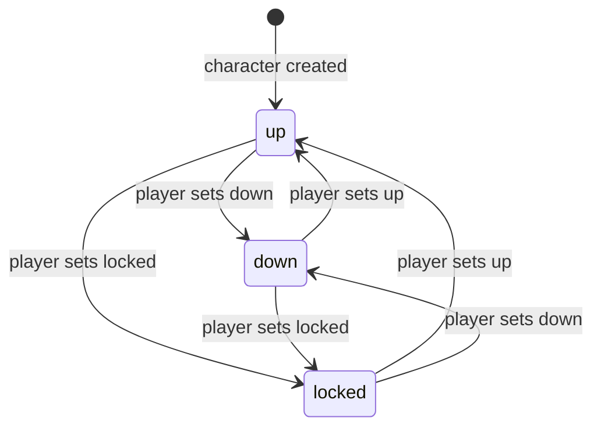

# Character Progression — Skills and Mastery

Version 1.0 — Expanded Technical Design Authority edition (2026-10-17)

Status: Design target; not implemented. Names per Shared Registry v1.0.

Entry: [Character Progression Architecture](../Legends_Shattered_Frontier_Character_Progression_Architecture_v1.0.md) · Registry: [Shared Registry v1.0](../Legends_Shattered_Frontier_Shared_Registry_v1.0.md)

Names marked † are registry additions now merged into the Shared Registry (see entry file, Registry additions); the Registry is authoritative.

---

## 1. Skill model

Each character has one SkillValue row per canonical skill (35 rows, created at character creation).

| Field | Meaning |
| --- | --- |
| `value` | Integer 0–1000 (`SKILL_MAX`). Displayed as `value / 10` with one decimal (e.g. 623 → "62.3"). |
| `band` | Derived from `value` per Registry `skill_band`: `novice` 0–99, `apprentice` 100–299, `journeyman` 300–499, `expert` 500–699, `master` 700–899, `legendary` 900–1000. |
| `lock` | `up` (default), `down`, `locked` (Registry `skill_lock`). |
| `discovered_at` | Null until the first practice record or training for that skill. |
| `peak_value` | Highest value ever held (achievements, catch-up). |
| Effective cap | 900 (`UNSPECIALIZED_SKILL_CAP`†) unless the skill holds a specialization, then 1000. |
| Effective value | `min(value, effective cap)`. Combat and Crafting read this. |

Caps (Registry constants): sum of all `value` ≤ `GLOBAL_SKILL_CAP` (7200); sum per track ≤ `TRACK_SKILL_CAP` (4000). With 3 specializations, the canonical full build is 3 × 1000 + 4 × 900 + 600 = 7200.

---

## 2. Canonical skill catalog

Governing attributes receive use-based attribute gains (Leveling part, Attributes) with the listed weights. D = action difficulty on the 0–1000 skill scale. Category sets the anti-macro repetition threshold (§5.4).

| Skill | Track | Governing (weight) | Practice trigger | Difficulty D | Category | Example actions |
| --- | --- | --- | --- | --- | --- | --- |
| `skill/swordsmanship` | combat | str .5, dex .5 | Sword attack resolved against a hostile, damageable target | Target defense skill | combat | Longsword strikes on a level-appropriate wolf |
| `skill/axes` | combat | str .6, con .4 | Axe attack resolved | Target defense skill | combat | Two-handed axe cleave on bandits |
| `skill/maces` | combat | str .7, con .3 | Mace/hammer attack resolved | Target defense skill | combat | Mace blows on armored skeletons |
| `skill/polearms` | combat | str .5, dex .5 | Polearm attack resolved | Target defense skill | combat | Spear thrusts from second rank |
| `skill/daggers` | combat | dex .7, str .3 | Dagger attack resolved | Target defense skill | combat | Backstab from stealth |
| `skill/archery` | combat | dex .7, wis .3 | Ranged weapon shot resolved (hit or miss) | Target defense skill, +50 beyond 30 m | combat | Longbow volleys at harpies |
| `skill/unarmed` | combat | dex .6, con .4 | Unarmed attack resolved | Target defense skill | combat | Brawling in an arena |
| `skill/shield_defense` | combat | con .6, str .4 | Incoming melee/ranged attack resolved while a shield is equipped | Attacker's offense skill | combat | Blocking an ogre's swings |
| `skill/tactics` | combat | int .5, wil .5 | Any weapon attack resolved (alongside the weapon skill) | Target defense skill | combat | Any armed fight |
| `skill/magic` | combat | int .7, wil .3 | Offensive or utility spell cast completed | Spell difficulty (Combat spell definition) | combat | Casting fireball, ward |
| `skill/healing` | combat | wis .7, int .3 | Heal applied to a target with hostile/environmental HP deficit in last 60 s | Heal difficulty (spell/bandage definition) | combat | Bandaging a tank mid-fight |
| `skill/resist_magic` | combat | wil .6, wis .4 | Hostile spell resolved against the character | Caster's magic skill | combat | Weathering a lich's curses |
| `skill/smithing` | crafting | str .6, int .4 | Recipe attempt at a Forge (success or failure) | Recipe difficulty (Crafting) | crafting | Forging iron longswords |
| `skill/carpentry` | crafting | str .5, dex .5 | Recipe attempt at a Sawmill | Recipe difficulty | crafting | Building bows, siege frames |
| `skill/tailoring` | crafting | dex .7, int .3 | Recipe attempt at a Tailor Shop | Recipe difficulty | crafting | Sewing leather armor |
| `skill/alchemy` | crafting | int .7, wis .3 | Recipe attempt at an Alchemy Lab | Recipe difficulty | crafting | Brewing healing potions |
| `skill/engineering` | crafting | int .6, dex .4 | Recipe attempt at an Engineering Workshop | Recipe difficulty | crafting | Building traps, siege equipment |
| `skill/cooking` | crafting | wis .5, dex .5 | Recipe attempt at an Alchemy Lab (cooking station) | Recipe difficulty | crafting | Cooking travel rations |
| `skill/jewelcrafting` | crafting | dex .6, int .4 | Recipe attempt at a Forge (jeweler's bench) | Recipe difficulty | crafting | Cutting gems, setting rings |
| `skill/inscription` | crafting | int .6, wis .4 | Recipe attempt at a Tailor Shop (scribe desk) | Recipe difficulty | crafting | Writing scrolls, maps for sale |
| `skill/mining` | gathering | str .7, con .3 | Ore node harvest tick | Node difficulty (Crafting, by resource tier) | gathering | Mining iron ore veins |
| `skill/logging` | gathering | str .6, con .4 | Tree node harvest tick | Node difficulty | gathering | Felling ironwood |
| `skill/farming` | gathering | con .5, wis .5 | Plot action (sow, tend, harvest) on an owned/permitted plot | Crop difficulty | gathering | Harvesting wheat fields |
| `skill/herbalism` | gathering | wis .6, dex .4 | Herb node harvest | Node difficulty | gathering | Gathering frostbloom |
| `skill/fishing` | gathering | dex .6, luck .4 | Catch attempt resolved at a fishing spot | Spot difficulty | gathering | Ice fishing in frozen_north |
| `skill/hunting` | gathering | dex .6, wis .4 | Skinning/tracking, or validated creature capture, training or meaningful combat handling (§2.1) | Creature level × 10 for skinning/tracking; authored handling difficulty for companion actions | gathering | Tracking dire wolves, training a captured wolf, coordinating combat companions |
| `skill/trading` | social | cha .7, int .3 | NPC vendor transaction or market sale to an unrelated buyer | `clamp(150 × log10(value_copper) − 200, 0, 1000)` | social | Selling crafted goods on the market |
| `skill/diplomacy` | social | cha .6, wis .4 | Persuasion/negotiation check in dialog, quest choice, or faction interaction | Authored check difficulty | social | Negotiating a caravan toll |
| `skill/performance` | social | cha .7, dex .3 | Performance piece completed with ≥ 1 qualifying audience member | Piece difficulty | social | Playing lute in a settlement tavern |
| `skill/leadership` | leadership | cha .6, wil .4 | Encounter defeat or objective completed as party/raid leader with ≥ 3 members from ≥ 3 accounts | Content level × 10 + difficulty offset | leadership | Leading a veteran dungeon |
| `skill/governance` | leadership | cha .5, int .5 | Settlement administration action (Building spec) by an authorized officer | Settlement tier × 200 | leadership | Setting upkeep, issuing decrees |
| `skill/cartography` | exploration | int .6, wis .4 | Survey point mapped or point of interest discovered | Zone level × 10 | exploration | Charting greenlands_south |
| `skill/survival` | exploration | con .6, wis .4 | Hazard exposure tick survived (cold, heat, corruption) or camp made in hostile terrain | Zone level × 10 + hazard severity | exploration | Crossing desert_wastes at noon |
| `skill/stealth` | exploration | dex .7, wil .3 | Hidden movement tick within detection radius of an alert hostile | Observer perception (§9.3) | exploration | Sneaking past a war camp |
| `skill/archaeology` | exploration | int .5, luck .5 | Excavation step at a dig site or relic identification | Dig site difficulty | exploration | Excavating corrupted_frontier ruins |

Difficulty offsets for leadership: `story` −100, `normal` 0, `veteran` +100, `heroic` +150, `mythic` +200 (+10 per mythic level).

### 2.1 Hunting: creature handling and combat companions

[Mounts and Companions](../Legends_Shattered_Frontier_Mounts_and_Companions_v0.1.md) extends existing `skill/hunting` with capture, training and combat handling. Tracking and skinning remain supported. The canonical skill count, gathering track, governing attributes and global/track caps are unchanged; archery is not required. This supports a hunter-style build within classless progression.

Validated capture/training steps and player-directed combat handling can emit Hunting practice records using release-authored action difficulty. Handling requires a meaningful resolved action against an eligible creature or hostile encounter: command spam, follow/stay toggles, idle deployment and autonomous pet attack ticks grant no practice. One coordinated action produces at most one Hunting record, irrespective of pet count; existing attempt weighting, fatigue and anti-macro rules apply. Creature XP and the player's Hunting practice are separate awards.

Initial mastery proposal: **Pack Handling**, node `pack_handling` within `mastery/hunting` (reference `mastery/hunting#pack_handling`), is one standard master-tier `utility` node permitting **two active combat companions instead of one** while active. It requires effective Hunting ≥ 700 (displayed **70.0**), at least two expert-tier nodes and the existing master-node cost of 25 LP. It uses an existing node position, not an additional tree slot, and does not require a new skill or specialization. Full Hunting-tree content publication remains integration work. Companion damage/control benefits must be included in combat power-budget validation even though Hunting belongs to gathering; a `utility` label cannot exempt this node from balance review. Gameplay Details §6 owns single/dual output and reference-health profiles, shared interrupt recovery and combination validation.

The active slot follows §8.4 activation/reset rules: dropping below the effective skill requirement or resetting the node removes permission for the extra combat companion. Stable space and owned creatures remain intact. Safe withdrawal, combat-change restrictions and deployment validation follow the companion specification. First reaching Hunting 300 and 700 each grants one permanent Stable slot, reconciled from historical peak evidence when enabling the feature. These are persistent capacity entitlements rather than active-node effects; ordinary retraining/reset does not revoke them. Gameplay Details §§1–9 own capture difficulty, lesson objectives, family progression, two-creature output, source-XP split and Injury/recovery; Integration defines their durable ownership and operation protocol.

---

## 3. Practice records

Simulation authorities (`zone-server`, `instance-server`, `crafting-service`) emit practice records; they never compute gains. A record:

| Field | Type | Meaning |
| --- | --- | --- |
| `character_id` | string | `chr_` |
| `skill_id` | string | `skill/<slug>` |
| `difficulty` | int 0–1100 | D on the skill scale |
| `outcome` | enum `success`, `failure` | Action result |
| `action_seconds` | float | Authored duration of the action (swing time, cast time, craft time) — never client-measured |
| `context_hash` | uint64 | Hash of (action id, target content id or node id, cell id); excludes runtime entity IDs for combat so repeated pulls of the same boss do not collide |
| `input_at` | timestamp | Server receive time of the player input that started the action |
| `initiated_by_input` | bool | False for auto-repeat (auto-attack ticks) |
| `track_tag` | enum | Track of the skill (redundant; validated) |
| `xp_eligible` | bool | Target/source eligible for practice XP |

Validity rules (enforced by the producer, re-checked by progression where possible):

1. Combat: target is hostile, can damage the character (or is a flagged PvP opponent), and is not a training dummy above `apprentice` difficulty (dummies have D ≤ 300).
2. Healing: target's HP deficit was caused by a hostile or environmental source in the last 60 s; self-inflicted damage does not qualify.
3. Resist magic: caster is hostile; spells from party members, same-account characters, or duel partners outside sanctioned duels do not qualify.
4. PvP: at most 30 practice records per opponent character pair per 24 h; none between characters of the same account.
5. Trading: market sales only to buyers on a different account and not flagged by `security.trade.flagged`; NPC vendor transactions capped at 40 records per 24 h.
6. Performance: audience member is a character from another account, within 20 m, with input in the last 120 s; or a settlement tavern NPC audience (max 1 record per 60 s).
7. Crafting: the attempt consumed materials (success or `crafting_failure`).
8. Gathering: the node yielded or depleted a harvest tick, or Hunting produced a validated tracking/skinning/creature-handling action (§2.1). Hunting handling does not require consuming a resource node.

Batching: producers flush every 2 s (`tune.progression.practice_flush_ms` = 2000) and at session end (`session_end = true`, `in_rest_area` flag), one batch per producer process containing many characters.

---

## 4. Skill gain formula

### 4.1 Refinement of the Combat formula

Combat: `SkillIncreaseChance = BaseRate / (CurrentSkill / 100)`. This spec keeps that term as `BASE × SF(S)` and guards it:

```text
SF(S) = 1 / max(1, S / 100)
```

At reference conditions (ω = 1, d at the optimum μ, band factor 1, outcome success, no modifiers) the gain chance equals Combat's formula with `BaseRate = BASE`.

### 4.2 Full formula

```text
P = min(P_MAX, BASE × ω × SF(S) × BF(S) × DF(d) × OC × M_bonus) × DR × AM
gain = +1 if rng() < P (server RNG, per gain check)

S        current skill value (stored)
BASE     0.15                                tune.progression.skill_gain_base_rate
ω        clamp(action_seconds / 6, 0.2, 3.0) tune.progression.attempt_weight_seconds (6)
SF(S)    1 / max(1, S/100)
BF(S)    band factor: novice 1.0, apprentice 1.0, journeyman 1.0, expert 0.9, master 0.8, legendary 0.5
                                             tune.progression.band_gain_factor
d        D − S
DF(d)    0                                    if d < −150 (trivial)
         exp(−((d − μ)/σ)² / 2)               if −150 ≤ d ≤ 250
         0                                    if d > 250 (impossible)
         μ = 25, σ = 100                      tune.progression.difficulty_mu, tune.progression.difficulty_sigma
OC       1.0 on success, 0.5 on failure       tune.progression.failure_gain_factor
M_bonus  min(M_BONUS_CAP, M_rest_gain × M_div × M_event × M_cu)   M_BONUS_CAP = 3.0
         M_rest_gain 1.75 while rested_minutes > 0 (Leveling part, Rested)
         M_div       1 + 0.05 × (n_tracks − 1)   (Leveling part, Diversity)
         M_event     LiveOps multiplier 1.0–1.5  tune.progression.event_skill_gain_multiplier
         M_cu        1.5 when skill catch-up applies (§10), else 1.0
P_MAX    0.9                                  tune.progression.skill_gain_p_max
DR       focus fatigue (§5.1)
AM       anti-macro factor (§5.4)
```

The roll is skipped (no gain check consumed) when the skill's lock is not `up` or its value is at its effective cap; the record still counts toward focus fatigue and repetition windows.

### 4.3 Difficulty factor reference

| d = D − S | −151 | −150 | −100 | −50 | 0 | +25 | +50 | +100 | +150 | +200 | +250 | +251 |
| --- | --- | --- | --- | --- | --- | --- | --- | --- | --- | --- | --- | --- |
| DF | 0 | 0.216 | 0.458 | 0.755 | 0.969 | 1.000 | 0.969 | 0.755 | 0.458 | 0.216 | 0.080 | 0 |

Players see a difficulty hint colour (grey `d < −150`, green `−150..−50`, yellow `−50..+100`, orange `+100..+250`, red `> +250`).

### 4.4 Worked examples

**A — combat, rested, diverse.** Swordsmanship S = 620 (expert), longsword swing 2.5 s, target defense D = 660, success, rested, 3 tracks today, no event, fatigue F = 45 min, no repetition flags.

```text
ω   = 2.5 / 6 = 0.4167      SF = 1 / 6.2 = 0.16129    BF = 0.9
d   = 40 → DF = exp(−(15/100)²/2) = 0.9888            OC = 1.0
M_bonus = 1.75 × 1.10 × 1.0 × 1.0 = 1.925
P   = 0.15 × 0.4167 × 0.16129 × 0.9 × 0.9888 × 1.0 × 1.925 × 1.0 × 1.0 = 0.01727
```

1.73% per swing; at 1,440 swings/hour ≈ 24.9 gains/hour. Tactics rolls independently on the same swings.

**B — crafting, fatigued, repetitive, failed.** Smithing S = 455, recipe D = 480, craft 12 s, failure, not rested, 1 track today, F = 150 min, same recipe 75 times in 60 min.

```text
ω = 2.0   SF = 1/4.55 = 0.21978   BF = 1.0   d = 25 → DF = 1.0   OC = 0.5   M_bonus = 1.0
DR = max(0.25, 1 − 0.75 × (150 − 90)/150) = 0.70
AM_rep = 60 / 75 = 0.80; AM = 0.80
P = min(0.9, 0.15 × 2.0 × 0.21978 × 1.0 × 1.0 × 0.5 × 1.0) × 0.70 × 0.80 = 0.032967 × 0.56 = 0.01846
```

### 4.5 Expected time per band (focused, baseline)

With 600 ω-weighted attempts/hour, average `DF × OC` ≈ 0.64, no bonuses, no fatigue: `gains/hour(S) = 600 × 0.15 × 0.64 × SF(S) × BF(S) = 57.6 × SF(S) × BF(S)`.

| Band reached | Cumulative focused hours (baseline) | With typical bonuses (≈ ×1.25) | Gains/hour at band start (baseline) |
| --- | --- | --- | --- |
| apprentice (100) | 1.7 | 1.4 | 57.6 |
| journeyman (300) | 8.7 | 7.0 | 19.2 |
| expert (500) | 22.5 | 18.0 | 10.4 |
| master (700) | 45.7 | 36.6 | 6.6 |
| legendary (900) | 80.4 | 64.3 | 3.2 |
| 1000 | 113.3 | 90.6 | 2.9 |

Because combat trains a weapon skill and tactics simultaneously (and shield_defense/resist_magic passively), a fighter's template fills ~2.5× faster than this single-skill table; target hours for a full 7200 template: 350–450 active hours.

---

## 5. Anti-grind controls

### 5.1 Focus fatigue (diminishing returns)

```text
F_k = active minutes for skill k in the rolling 240-minute window
      (a minute counts if ≥ 1 practice record for k arrived in it)
DR  = 1                                             if F_k ≤ 90
    = max(DR_FLOOR, 1 − 0.75 × (F_k − 90) / 150)    otherwise
DR_FLOOR = 0.25
tune.progression.fatigue_window_min (240), tune.progression.fatigue_free_min (90), tune.progression.fatigue_floor (0.25)
```

DR multiplies skill gain chance and the XP of kills and practice for that skill. A 4-hour single-skill session averages DR ≈ 0.78 over its last 2.5 hours; switching skills or resting restores it. Quest/dungeon/raid reward XP is never fatigued.

### 5.2 Hard rate limit

Per skill per rolling 60 minutes, committed gains may not exceed:

```text
G_HARD(S) = ceil(2 × 600 × BASE × SF(S) × BF(S) × M_BONUS_CAP)
```

Examples: S = 50 → 540; S = 620 → 79; S = 950 → 29. Gains beyond the limit are discarded, logged, and reported to `anticheat-service` (`detector/skill_gain_rate`†). Legitimate play cannot reach this (it requires P at the theoretical maximum for an hour at double the reference attempt rate).

### 5.3 Rested gains and diversity

See Leveling part (Rested, Diversity). Summary: rested multiplies gain chance by 1.75 while rested minutes last (max 600 minutes, earned offline); diversity adds 5% per additional track practiced (≥ 3 gains) in 24 h, max +25%.

### 5.4 Anti-macro hooks

```text
AM = AM_rep × AM_timing × AM_risk

AM_rep:    n_same = records for skill k with identical context_hash in rolling 60 min
           AM_rep = 1 if n_same ≤ N0(category) else max(0.2, N0 / n_same)
           N0: combat 400, crafting 60, gathering 80, social 20, leadership 10, exploration 40
           (tune.progression.repetition_threshold.<category>)
AM_timing: over the character's last 200 records with initiated_by_input = true,
           CV = stdev(intervals) / mean(intervals) of input_at deltas
           AM_timing = 0.25 if CV < 0.05, else 1.0      (tune.progression.timing_cv_min)
AM_risk:   1.0 if risk score < 850; 0.5 if 850–949; 0.0 if ≥ 950
           (risk score from security.score.changed; tune.progression.risk_dampen_threshold, risk_block_threshold)
```

Each time `AM_rep` or `AM_timing` first drops below 1 within an hour, progression reports a signal to anticheat-service (Service Interfaces part, Security considerations). AM never reveals itself to the client beyond the generic "you feel your concentration waver" message when `AM < 0.5`.

---

## 6. Committing a gain: locks and caps

```text
on successful roll for skill k (lock = up, value < effective_cap):
  need_track  = track_total(track(k)) + 1 > TRACK_SKILL_CAP
  need_global = global_total + 1 > GLOBAL_SKILL_CAP
  if need_track or need_global:
      candidates = skills j ≠ k with lock = down and value > 0
      if need_track: candidates = candidates ∩ track(k)       # same-track donor also fixes global
      donor = argmax(value) over candidates, tie → lowest skill_id lexicographically
      if donor is none: drop gain (counter m_skill_gain_blocked_by_cap)
      else: donor.value −= 1
  k.value += 1
  ledger entries (skill, donor), attribute side-gain rolls (Leveling part), band check, stage check
```

`down` skills never decrease on their own; they only donate points when a cap binds (Ultima Online semantics). Donation can lower a donor through band boundaries and below the level required by its mastery nodes, which deactivates those nodes (§8.4) without refunding them.

Skill lock state machine (player-controlled; `ChangeSkillLock`, rate-limited to one change per skill per 5 s):



Attribute locks follow the same diagram (Leveling part, Attributes).

---

## 7. Skill discovery, creation, and NPC trainers

### 7.1 Creation and discovery

At creation the player picks up to 3 starting skills distributing 150 points (max 100 per skill); they are discovered immediately. Every other skill is undiscovered (value 0). The first practice record or training for a skill discovers it: `discovered_at` is set, the character receives discovery XP `xp_reward(L, 0.5)` (`xp_source_kind = discovery`), and discovery-count achievements progress. Reaching level 5 or completing the tutorial quest moves the stage to `skill_discovery` (entry file, lifecycle).

### 7.2 NPC trainers (LP sink)

Trainer NPCs teach listed skills up to `teach_ceiling` (≤ 300, end of `apprentice`; per trainer template). Training is bought in 10-point steps:

```text
step cost at current value S (S < teach_ceiling, S multiple of 10 after first step):
  LP     = 1 + floor(S / 100)
  copper = 500 × (1 + floor(S / 100))         sink code training_cost
0 → 300 total: LP 10×1 + 10×2 + 10×3 = 60;  copper 30,000 (3 gold)
tune.progression.training_lp_step, tune.progression.training_copper_step, tune.progression.training_ceiling_max
```

Rules: skill lock must be `up`; cap/donor rules (§6) apply per point; training grants no XP, no attribute gains, and does not count as practice. Flow: client → `gateway` → `zone-server` validates proximity (≤ 5 m) and trainer template → `progression-service.TrainSkill` → `economy-service` debit (idempotent) → apply.

---

## 8. Specializations and mastery trees

### 8.1 Specializations

`specialization/<slug>` definitions each bind to one skill. Launch content: two per skill (70), e.g. smithing → `specialization/weaponsmith`, `specialization/armorsmith`; archery → `specialization/marksman`, `specialization/skirmish_archer` (illustrative).

| Rule | Value |
| --- | --- |
| Slots | 3 (`MAX_SPECIALIZATIONS`†): slot 1 at level 50, slot 2 at level 75, slot 3 at level 100 |
| Requirement | Skill value ≥ 700 (master) |
| One per skill | A skill holds at most one specialization |
| Cost | 100 LP (`lp_sink_kind = specialization`) |
| Effects | Effective cap 1000 for the skill; unlocks the legendary tier of its mastery tree; one defining passive (per definition, within the tree power budget) |
| Removal | Allowed after a 7-day slot cooldown (`tune.progression.specialization_cooldown_s` = 604800); refunds 50% of the fee and 100% of legendary-tier node LP |

On removal the skill keeps its stored value; effective value clamps to 900, gains above 900 are blocked, legendary-tier nodes are removed (`progression.mastery.tree_reset`† for that tier) and `progression.specialization.removed`† is emitted. Selecting another specialization into the slot is a separate selection.

### 8.2 Mastery tree structure

One tree per skill (`mastery/<skill_slug>`, 35 trees). Tiers align with skill bands:

| Tier (band) | Nodes | Selectable | LP per node | Prerequisite |
| --- | --- | --- | --- | --- |
| apprentice | 2 | 2 | 5 | skill band ≥ apprentice |
| journeyman | 3 | 3 | 10 | band ≥ journeyman, ≥ 2 nodes in previous tier |
| expert | 3 | 3 | 15 | band ≥ expert, ≥ 2 in previous tier |
| master | 2 standard + capstone pair | 3 (one capstone of two) | 25 | band ≥ master, ≥ 2 in previous tier |
| legendary | 1 standard + capstone pair | 2 (one capstone of two) | 40 | band legendary, skill specialized, ≥ 2 in previous tier |
| **Total** | 15 defined | 13 | 240 | |

Without specialization a tree tops out at 11 nodes / 160 LP.

### 8.3 Node effect types and power budget

| `effect_type` | Example | Consumer |
| --- | --- | --- |
| `rating` | +40 parry rating while wielding a sword | Combat rating conversion |
| `percent_modifier` | +3% weapon damage with swords | Combat |
| `ability_unlock` | Unlocks "Riposte" active ability | Combat / client |
| `quality_bonus` | +5 crafting quality points | Crafting |
| `yield_bonus` | +4% gathering yield | Crafting (gathering) |
| `utility` | −10% stealth movement noise; +1 map pin | owning system |

Budget per tree (validated at content publish): combined effect through the master tier ≤ +12% of the skill's primary output (damage, healing, quality, yield) and ≤ +18% including the legendary tier. Ratings convert via Combat's rating formulas when checking the budget.

Illustrative `mastery/swordsmanship`: apprentice — Balanced Grip (+20 crit rating), Footwork (+20 dodge rating); journeyman — Riposte (ability), Edge Discipline (+2% damage), Measured Stance (+30 parry); expert — Flowing Strikes (+3% attack speed), Disarm (ability), Weight Shift (+2% damage); master — Blade Ward, Second Wind, capstone *Duelist* (+single-target) or *Vanguard* (+cleave); legendary — Ashen Edge, capstone *Unbroken Line* or *Thousand Cuts*.

### 8.4 Node activation, reset

- A node is **active** only while the skill's effective band ≥ the node's tier band (and, for legendary, the skill is specialized). Inactive nodes stay owned; LP is not refunded. This makes lock-based build swapping cheap without letting LP stack power.
- `ResetMasteryTree`: refunds 100% of the tree's LP, costs `gold_reward(L, 1)` copper (`training_cost` sink), 24-hour cooldown per tree.

---

## 9. NPC parity: NPC progression templates

NPCs use the same attribute and skill framework (Combat spec: "Works identically for players and NPCs"). Profiles are generated deterministically from the `progression_template` block of an `npc/*` definition, its spawn level L, and tier. Ordinary wild/encounter NPCs do not gain skills at runtime. Captured, owned companions instead follow the persistent progression and family-skill rules in Mounts and Companions; they do not retain encounter-tier power scaling after capture.

### 9.1 Attributes

```text
attr_ref(L)   = round(120 + 460 × ((L − 1) / 99)^1.1)        (tracks player median natural totals)
base_i        = clamp(round(attr_ref(L) × aw_i), ATTRIBUTE_MIN, ATTRIBUTE_NATURAL_CAP)
final_i       = round(base_i × (1 + v_i))
v_i           = (hash64(ent_id, attribute) mod 1001) / 10000 − 0.05     spawn variance in [−0.05, +0.05]
tune.progression.npc_attr_curve, tune.progression.npc_variance
```

Archetype weights `aw` (sum 1.0; templates may override):

| Archetype | str | dex | con | int | wis | wil | cha | luck |
| --- | --- | --- | --- | --- | --- | --- | --- | --- |
| `brute` | .25 | .10 | .25 | .05 | .05 | .15 | .05 | .10 |
| `skirmisher` | .10 | .30 | .15 | .05 | .10 | .10 | .05 | .15 |
| `caster` | .05 | .10 | .10 | .30 | .15 | .15 | .05 | .10 |
| `healer` | .05 | .10 | .15 | .15 | .30 | .10 | .05 | .10 |
| `guardian` | .20 | .05 | .30 | .05 | .10 | .20 | .05 | .05 |
| `beast` | .25 | .25 | .25 | .02 | .08 | .05 | .02 | .08 |
| `commander` | .15 | .10 | .15 | .10 | .10 | .15 | .20 | .05 |
| `shaman` | .05 | .10 | .15 | .15 | .30 | .10 | .05 | .10 |
| `champion` | .25 | .10 | .25 | .05 | .05 | .15 | .05 | .10 |
| `guard` | .20 | .10 | .25 | .05 | .10 | .15 | .05 | .10 |
| `civilian` | .10 | .15 | .15 | .10 | .10 | .10 | .20 | .10 |

Archetype names are the registry enum `npc_archetype` (behavior: AI spec). `shaman` uses the `healer` weights and `champion` the `brute` weights.

The natural caps bound the *base*; spawn variance may exceed 150 by at most 5 % (NPCs only). Combat formulas then apply unchanged.

**Creature tier rule (stated once).** The Combat creature tiers (common 1.0, elite 2.5, mini_boss 5.0, world_boss 20.0) never multiply NPC attributes. They act only where the Dungeon spec's scaling applies them — health × `T_hp(t)`, archetype damage × `sqrt(T_hp(t))`, encounter-authored abilities × 1.0 (Dungeon spec, Content scaling and rewards part, Scaling model: Health and Damage) — plus, in this spec, the skill offset `off(tier)` (§9.2) and the kill-XP multiplier `T(tier)` (Leveling part, Kill XP).

### 9.2 Skills

```text
skill_ref(L) = round(900 × (L / 100)^0.85)
primary      = clamp(skill_ref(L) + off(tier) + template.skill_offset, 0, 1000)
secondary    = clamp(round(0.75 × skill_ref(L)) + off(tier) + template.skill_offset, 0, 1000)
tertiary     = clamp(round(0.50 × skill_ref(L)) + off(tier) + template.skill_offset, 0, 1000)
off(tier)    = 0 common, 50 elite, 100 mini_boss, 150 world_boss
template.skill_offset ∈ [−200, +200]
```

`skill_ref`: L10 → 127, L25 → 277, L50 → 499, L75 → 705, L100 → 900, aligning NPC skill with a same-level player's main skill (band entry points).

### 9.3 Derived difficulty values (inputs to player gains)

| Value | Definition |
| --- | --- |
| Defense skill (D for attacks against the NPC) | Highest of its combat-track skills incl. `shield_defense` |
| Offense skill (D for shield_defense/resist_magic) | Highest weapon skill, or `magic` for spells |
| Perception (D for stealth) | `max(survival skill, round(0.6 × skill_ref(L))) + off(tier)` |
| `xp_eligible` | Template flag; false for dummies, critters, summons |

### 9.4 Worked example

Level-30 elite skirmisher, primary `daggers`, `stealth`; secondary `tactics`; dex variance +0.02, con variance 0.

```text
attr_ref(30) = round(120 + 460 × (29/99)^1.1) = round(120 + 460 × 0.2591) = 239
dex: base = round(239 × 0.30) = 72;  final = round(72 × 1.02) = 73
con: base = round(239 × 0.15) = 36;  final = round(36 × 1.00) = 36
Combat Health = 100 + 36 × 15 + 30 × 25 = 1,390   (elite tier health scaling, if applied by the server: × 2.5 = 3,475)
skill_ref(30) = round(900 × 0.30^0.85) = round(323.4) = 323
daggers = 323 + 50 = 373;  tactics = round(0.75 × 323) + 50 = 292
```

A level-28 player with swordsmanship 355 attacking it: D = 373, d = 18 → DF = 0.998 (optimal practice).

---

## 10. Skill catch-up

When any character on the account has `peak_value ≥ 700` in skill k, the account holds `catch_up` unlock `skill/<k>`. Other characters on the account get `M_cu = 1.5` for k while their value < `account_peak(k) − 200`. Catch-up is included in `M_bonus` (capped at 3.0).

---

## 11. Skill balancing targets

| Metric | Target | Alert |
| --- | --- | --- |
| Median active hours to first skill at master (700) | 40–60 | < 25 |
| Median active hours to first legendary (900) | 75–110 | < 45 |
| Share of L100 characters with ≥ 1 skill ≥ 900 | 50–70% | < 30% |
| Median skill gains per active hour (all skills) | 18–35 | > 60 |
| Share of gain checks with DF = 0 (trivial/impossible) | < 25% | > 40% (content difficulty mismatch) |
| Share of committed gains with DR < 1 | 5–15% | > 30% |
| Share of committed gains with AM < 1 | < 3% | > 8% |
| Specialization pick share within a track | no single specialization > 25% of picks | > 35% |
| Skills at ≥ 700 per L100 character (median) | 5–7 | < 4 |
| Characters hitting the global cap (7200) by 300 active hours | 20–35% | > 60% |
