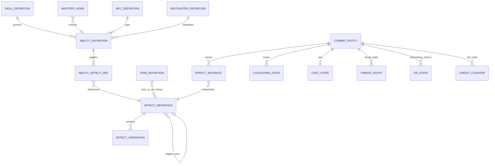
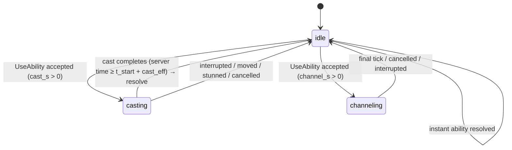
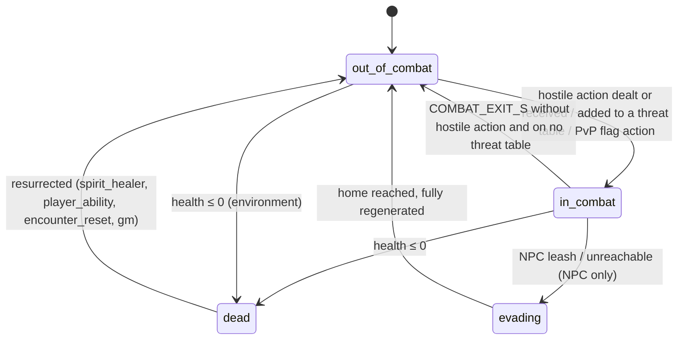
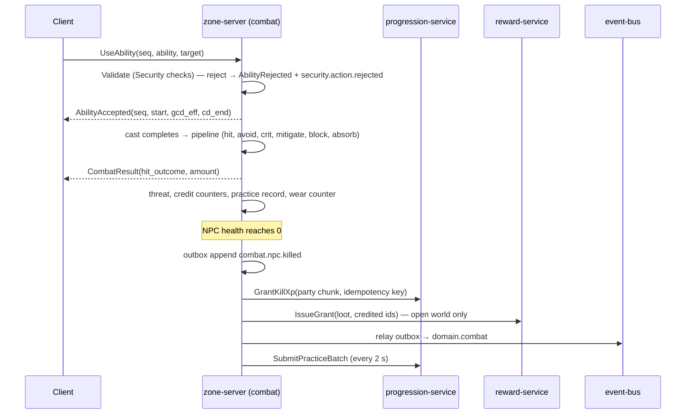
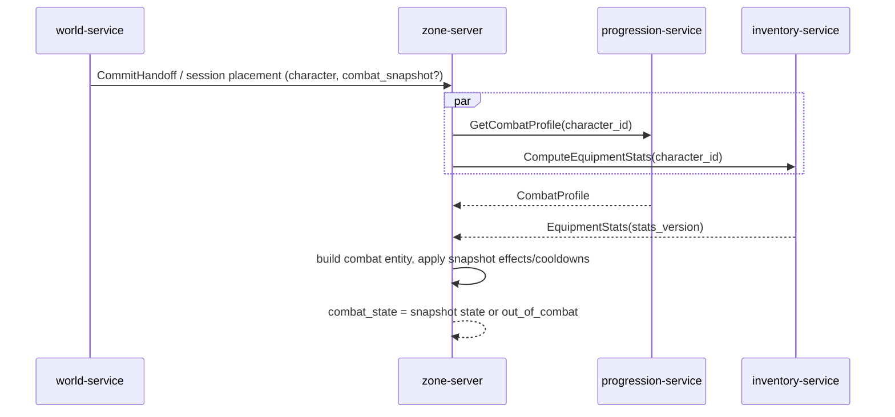

# Legends of the Shattered Frontier — Combat: Abilities, Effects, State Machine and Zone-Server Runtime
### Version 1.0 — Expanded Technical Design Authority edition (2026-10-17)

Status: Design target; not implemented. Names per [Shared Registry v1.0](../Legends_Shattered_Frontier_Shared_Registry_v1.0.md).
Entry file: [Combat spec](../Legends_Shattered_Frontier_Combat_System_v0.1.md). Part 3 of 4.

This part defines the combat content model (abilities and effects), stacking, crowd control and diminishing returns, casting, procs, the throughput budget that keeps kits on the reference scale, the combat state machine, and the runtime contracts of `zone-server` / `instance-server` combat: profile loading, intents, practice reporting, kill XP, events and the durable outbox. Formulas are in Parts 1 and 2.

---

## Content model

Combat content is published by `content-catalog-service` in versioned packs. The registered content kinds are `ability` (`ability/<slug>`) and `effect` (`effect/<slug>`) (Shared Registry, Content definition kinds). Encounter definitions may keep encounter-local ability keys (`abl_*`, Dungeon spec, Encounter definition schema); at publish they compile into the same ability model with `source: encounter` and the encounter ID as namespace.



Runtime aggregates (`COMBAT_ENTITY` and below) live in zone-server memory only, keyed by `ent_` (Registry, WorldEntity). They are rebuilt from the progression snapshot, equipment snapshot and handoff payload; nothing is durable except the events and outbox records in Durable outbox and event emission.

### Ability definition

```json
{
  "id": "ability/sundering_blow",
  "kind": "attack",
  "skill_id": "skill/axes",
  "school": "physical",
  "requirements": { "skill_min": 300, "weapon_skill_ids": ["skill/axes"], "requires_shield": false, "requires_stealth": false },
  "targeting": { "mode": "enemy", "range_m": 5.0, "facing_deg": 90, "requires_los": true },
  "timing": { "cast_s": 0, "channel_s": 0, "gcd_class": "standard", "cooldown_s": 8, "haste_scaled_cooldown": true, "charges": 1 },
  "cost": { "stamina_pct": 0.06, "mana_pct": 0 },
  "power": { "modifier": 1.2, "t_ref_s": null, "can_crit": true, "cannot_miss": false, "blockable": true, "max_targets": 1, "shape": "single" },
  "threat": { "on_apply": 0, "mult": 1.0, "taunt": false },
  "interrupt": { "interruptible": false, "lockout_s": 0 },
  "on_hit_effects": [ { "effect_id": "effect/sundered_armor", "chance": 1.0 } ],
  "practice": { "difficulty_rule": "target_defense" },
  "tags": ["melee", "two_hand_ok"],
  "display": { "name_key": "ability.sundering_blow.name", "icon": "icons/abilities/sundering_blow" }
}
```

### Field reference

| Field | Required | Values / rule |
| --- | --- | --- |
| `kind` | yes | `attack`, `spell`, `heal`, `utility`, `auto_attack`, `npc_archetype`, `encounter` |
| `skill_id` | yes for characters | governing skill (Part 1, Skill effects on combat); NPC abilities omit it (NPC offense skill used) |
| `school` | yes | `damage_school` (Shared Registry, Phase-2 enums): `physical`, `fire`, `frost`, `nature`, `shadow`, `arcane`, `holy`, `poison`, `disease` |
| `requirements.skill_min` | no | server check → `combat_unknown_ability` |
| `targeting.mode` | yes | `self`, `enemy`, `ally`, `any`, `ground`, `cone`, `around_self`, `line` |
| `targeting.range_m` | yes | used by Security range check (`R_ability`) |
| `targeting.facing_deg` | no | frontal abilities; Security facing check (`θ_ability`) |
| `timing.cast_s` / `channel_s` | yes | pre-haste; 0 = instant |
| `timing.gcd_class` | yes | `standard` (1.5 s), `short` (1.0 s), `none` (off-GCD; requires `t_ref_s`) |
| `timing.cooldown_s` | yes | 0 = none; `haste_scaled_cooldown` must be false when `cooldown_s > 30` |
| `timing.charges` | no | default 1; recharge = cooldown per charge |
| `cost.*_pct` | yes | fraction of the caster's **max** resource; deducted at ability start (Security `combat_resource`) |
| `power.modifier` | yes for damaging/healing | `AbilityModifier`; bounds by Throughput budget |
| `power.t_ref_s` | for off-GCD, DoT/HoT | Part 2, Damage formula |
| `power.shape`, `max_targets` | yes | `single`, `cleave` (≤ 3), `aoe` (≤ 8 default, ≤ 25 raid-authored) |
| `threat.*` | no | Part 2, Threat & Aggro System |
| `interrupt.interruptible` | spells yes | interrupt locks the school for `lockout_s` |
| `on_hit_effects[]` | no | effect IDs with `chance` (0–1); rolled on the `proc` sub-stream |
| `practice.difficulty_rule` | yes for characters | `target_defense`, `attacker_offense`, `spell_difficulty:<n>`, `heal_difficulty:<n>`, `none` (Character spec, Canonical skill catalog) |
| `dmg_coef`, `heal_coef` | NPC kinds only | Part 2, NPC-sourced damage |

### Effect definition

```json
{
  "id": "effect/sundered_armor",
  "category": "debuff",
  "dispel_type": "none",
  "duration_s": 12,
  "tick_s": 0,
  "stack": { "rule": "stack", "max_stacks": 3, "per_caster": false },
  "operations": [ { "op": "stat_mod", "stat": "armor", "mode": "mul_pct", "value": -0.04, "per_stack": true } ],
  "flags": { "persists_through_death": false, "persists_through_zone": true, "visible": true, "pvp_allowed": true },
  "cc_category": null,
  "scope": "target",
  "tags": ["armor_debuff"]
}
```

| Field | Values |
| --- | --- |
| `category` | `buff`, `debuff`, `aura`, `passive`, `proc_trigger` |
| `dispel_type` | `none`, `magic`, `curse`, `poison`, `disease`, `enrage` |
| `stack.rule` (`effect_stack_rule`, registered in Shared Registry, Phase-2 enums) | `refresh` (one instance, duration refreshed), `stack` (up to `max_stacks`, shared duration refreshed), `independent` (separate instances, each its own duration), `replace_if_stronger` (keep the higher magnitude), `unique_global` (one per target across all casters) |
| `stack.per_caster` | true: each caster keeps its own stack set |
| `scope` | `self`, `target`, `party`, `raid`, `area` (Party-scoped effects) |
| `cc_category` | Crowd control and diminishing returns |

### Effect operations

| `op` | Parameters | Consumer |
| --- | --- | --- |
| `stat_mod` | `stat` (Stat modifier keys), `mode` `add`/`mul_pct`, `value`, `per_stack` | Part 1 evaluation order |
| `damage_over_time` | `school`, `modifier` (character) or `dmg_coef` (NPC), `t_ref_s` | Part 2 |
| `heal_over_time` | `modifier`/`heal_coef`, `t_ref_s` | Part 2 |
| `absorb` | `amount_modifier` (scaled like a heal), `schools[]` | Part 2 absorbs |
| `cc` | `cc_category`, `break_on_damage_pct` | Crowd control and diminishing returns |
| `move_speed` | `value` (+ buff / − slow), `applies_mounted` | World spec `M_buff` (`u_i`, `d_j`) |
| `displace` | `cause` (`charge`, `knockback`, `pull`, `teleport_spell`), `distance_m`, `direction` | World teleport token (Displacement and movement) |
| `threat_mult`, `threat_reduce`, `threat_drop` | `value` | Part 2 threat |
| `damage_done_mod` | `category` (Part 2, Modifier categories), `value` | Part 2 |
| `damage_taken_mod` | `school` or `all`, `value` | Part 2 step 6 |
| `healing_taken_mod` | `value` | Part 2 |
| `resource_mod` | `resource`, `per_tick_pct` or `instant_pct` | Part 1 regeneration |
| `proc` | `trigger` (`on_hit`, `on_crit`, `on_hit_taken`, `on_heal`, `on_kill`, `on_block`), `effect_id` or `ability_id`, `chance` or `ppm`, `icd_s` | Procs |
| `stealth` | `level` | AI spec detection |
| `immunity` | `cc_categories[]` or `schools[]` — **NPC and encounter effects only**; character effects may not use it | Part 2 (No Hard Immunities) |
| `temporary_health` | `amount_modifier` | raises max and current health together |

---

## Stat modifier keys

`stat_mod` targets and Character mastery `percent_modifier` stats use one catalog. Item stat keys (Itemization stat-key catalog) are valid `stat` values; these keys are additional and exist only on effects and mastery nodes:

| Key | Mode | Meaning | Category / cap |
| --- | --- | --- | --- |
| `weapon_damage` | `mul_pct` | physical character damage | `school`, Σ ≤ +50 % |
| `spell_damage`, `<school>_damage` | `mul_pct` | magic damage (all / one school) | `school` |
| `single_target_damage` | `mul_pct` | abilities with `shape: single` | `target_shape`, Σ ≤ +25 % |
| `cleave_damage` | `mul_pct` | `cleave` and `aoe` abilities | `target_shape` |
| `damage_done` | `mul_pct` | all damage | `global`, Σ ≤ +30 % |
| `healing_done` | `mul_pct` | heals, HoTs, absorbs | `healing` |
| `damage_taken`, `<school>_damage_taken` | `mul_pct` | defender | product [0.10, 2.0] |
| `healing_taken` | `mul_pct` | target of heals | product [0.25, 2.0] |
| `attack_speed` | `add` (fraction) | auto-attack swing only, adds to `h_swing` | inside `HASTE_MAX` |
| `haste` | `add` (fraction) | `Σ h_effects` | `HASTE_MAX` |
| `crit_chance`, `crit_damage` | `add` | `Σ crit_effects`, `Σ crit_damage_effects` | caps |
| `dodge`, `parry`, `block` | `add` | avoidance effects | caps |
| `armor_pen`, `magic_pen` | `add` | `Σ pen_effects` | caps |
| `cooldown_<ability_slug>` | `add` seconds (negative) | one ability's cooldown | ≥ 50 % of base |
| `cost_pct` | `mul_pct` | ability resource costs | ≥ −50 % |
| `threat_mod` | `add` bp | as `threat_mod_bp` | ±2,000 bp total |

Character mastery `rating` effects add to ratings and convert through Part 1; the Character spec's tree budget (≤ +12 % / +18 % of primary output) is checked by `lsf-combatmath` converting every node with these formulas.

---

## Party-scoped effects

Effects with `scope: party` (leadership auras, group buffs, "party" heals) apply to the caster's **party** (`pty_`, `PARTY_MAX` 5) or, inside a raid group (`rgp_`), to the caster's **subgroup** of 5 (Raid spec, Subgroups). `scope: raid` applies to the whole raid group (or the party when not in a raid). Membership is evaluated when the effect is applied and at each tick for auras; out-of-range members (`range_m`, default 40 m) are excluded. Subgroup membership is frozen while an encounter is `engaged` (Raid spec), so scope changes only between pulls.

| Rule | Value |
| --- | --- |
| Effects tagged `leadership_aura` | magnitude × `cha_aura_mult` of the caster (Part 1, Charisma); one aura per caster active; same aura from several casters: strongest only (`replace_if_stronger`) |
| Raid-wide buffs (`scope: raid`, `damage_done`) | at most one per `stat` key per raid (`unique_global`) |
| Open-world groups without party | `party` = self only |

---

## Crowd control and diminishing returns

Categories (`cc_category`, registered in Shared Registry, Phase-2 enums): `stun`, `root`, `silence`, `fear`, `charm`, `incapacitate`, `disarm`, `taunt`, `knockback`, `slow`. `slow` is a World speed effect with its own cap (World `D_CAP` 0.70) and is not diminished; `knockback` is a displacement and is not diminished but limited to 1 per 2 s per target (`tune.combat.knockback_icd_s`).

```text
cc_duration = base_duration × DR_step(n) × (1 − min(CC_REDUCTION_CAP, wil_cc_red + cc_duration_reduction_bp / 10000))
DR_step(n)  = 1.0, 0.5, 0.25, 0 (immune) for the n-th application within DR_WINDOW_S of the previous one
DR_WINDOW_S = 18 s (tune.combat.dr_window_s);  CC_REDUCTION_CAP = 0.40 (tune.combat.cc_reduction_cap)
```

- DR state is per target per category; it resets 18 s after the last application of that category.
- `fear` and `charm` additionally apply Willpower's mental-defense factor (Part 1, Willpower).
- `taunt` on NPCs uses DR only for forced-target duration: 3 s, 1.5 s, 0.75 s, then immune for 18 s.
- Break on damage: `fear`, `incapacitate`, `charm` break when damage taken since application ≥ `break_on_damage_pct` × max health (default 0.10); `stun`, `root` never break on damage.
- CC applied to NPCs respects tier immunities (Part 2, Creature-tier rule). Encounter bosses use authored `interruptible` flags only.
- Maximum continuous control: a character cannot be under `stun`/`incapacitate`/`fear`/`charm` for more than 8 s in any 12 s window (`tune.combat.pvp_cc_chain_cap_s`); further applications are reduced to fit.

Worked example: base 4 s stun on a player with Willpower 110 (0.10) and 500 bp items (0.05): 1st 4 × 0.85 = 3.4 s; 2nd (within 18 s) 4 × 0.5 × 0.85 = 1.7 s; 3rd 0.85 s; 4th immune.

---

## Casting, channeling and the global cooldown

### Cast state

Proposed enum `cast_state`: `idle`, `casting`, `channeling`.



| Rule | Value | Key |
| --- | --- | --- |
| Effective cast time | `cast_s × (1 − h)`, completed by the server only | — |
| Movement | moving more than 0.25 m from cast start cancels casts unless `cast_while_moving` | `tune.combat.cast_move_tolerance_m` |
| Pushback | each damaging hit taken while casting adds 0.25 s, at most 2 pushbacks per cast; channels lose 0.25 s per hit instead | `tune.combat.pushback_s`, `tune.combat.pushback_max` |
| Interrupt | cancels cast and locks the ability's `school` for `lockout_s` (default 3 s, not haste-scaled) | per ability |
| Spell queue | an intent arriving ≤ 400 ms before GCD or cast end is queued (one slot) instead of rejected | `tune.combat.queue_window_ms` |
| GCD | starts at ability start for `standard`/`short`; `gcd_eff = max(GCD_MIN, GCD_BASE × (1 − h))` | Part 1, Haste |
| Cooldown start | at ability start (instants, casts) or at channel start | — |
| Resource deduction | at ability start; refunded fully if the cast is interrupted, 50 % if the caster cancels | `tune.combat.cancel_refund_pct` |

### Auto-attack

Auto-attacks swing every `speed_s × (1 − h_swing)` while a hostile target is selected and in range; casting pauses the swing timer; dual wield alternates main and off hand with a 0.5 swing offset. Ranged autos require `ranged` slot weapons and `requires_los`.

---

## Throughput budget

The modifier-per-second (MPS) of a rotation measures how much ability modifier per second it delivers relative to the formula in Part 2:

```text
MPS(rotation) = Σ_abilities (modifier × t_ref × uses) / rotation_time        (auto-attacks contribute 1.0 continuously)
```

| Role kit (reference spec) | Sustained single-target MPS | Composition |
| --- | --- | --- |
| Melee damage | 1.6 (`ROTATION_MPS_REF`) | autos 1.0 + GCD abilities averaging 0.6 |
| Ranged / caster damage | 1.6 | casts and instants fill the timeline; no autos (ranged weapon autos count) |
| Support | 1.0 + buffs priced at their throughput gain | |
| Tank | 0.5 (with stance threat ×2.0) | Dungeon `n_eq` 0.3 includes the damage-role mitigation loss |
| Healer (healing MPS) | 1.6 healing, damage MPS 0.5 | `HPS_ref` = 0.06 × `H_ref` |

Authoring bounds (publish-time validation, Part 4):

| Ability type | `modifier` range | Notes |
| --- | --- | --- |
| Filler (no cooldown, standard GCD) | 0.6 – 1.0 | |
| Cooldown ability (≤ 30 s) | ≤ `1.0 × (1 + cooldown_s / 6)` | e.g. 12 s cd ≤ 3.0 |
| Major cooldown (> 30 s) | contribution to 3-minute average ≤ +15 % MPS | |
| AoE | per-target modifier ≤ 0.6 × single-target equivalent | soft cap applies on top |
| DoT | total modifier over duration ≤ 1.2 × an instant of the same GCD cost | |
| Proc | expected MPS ≤ 0.08 per item, ≤ 0.20 total | Procs |

MPS is evaluated **without haste** (haste enters `U_ref` separately as `1 / (1 − h)`). Worked example (melee, two-hand axes): a 12 s rotation window holds 8 GCDs of 1.5 s. Sundering Blow (1.2, cd 8 s → 1.5 uses), Cleave (0.8 as single target, 2 uses), filler Chop (0.7, 3.5 uses), 1 GCD empty for movement:

```text
GCD part = (1.2 × 1.5 + 0.8 × 2 + 0.7 × 3.5) × 1.5 / 12 = (1.80 + 1.60 + 2.45) × 0.125 = 0.731   → total 1.73 (+8 %)
```

Validation fails (tolerance ±5 %). Chop 0.6 gives `(1.80 + 1.60 + 2.10) × 0.125 = 0.688` → 1.69 (+5.5 %), still failing; Chop 0.6 and Cleave 0.7 give `(1.80 + 1.40 + 2.10) × 0.125 = 0.663` → **1.66 (+3.8 %)**, accepted.

---

## Procs

```text
chance_per_event = chance                         (fixed-chance procs)
chance_per_event = ppm × t_ref / 60               (procs per minute: normalised by the triggering ability's t_ref)
```

- Internal cooldown `icd_s` (default 0; required ≥ 1 s for `on_hit_taken`).
- Procs never trigger procs (depth 1); a proc's own damage cannot crit unless `can_crit` is set.
- Draws come from the `proc` sub-stream (Part 2, Determinism and combat randomness).
- Item procs (`proc_<effect>`, Itemization) reference `effect/<slug>` and are budget-priced by Itemization; Combat validates their MPS (Throughput budget).

Example: 2 PPM proc on a 3.4 s two-hand auto → 2 × 3.4 / 60 = 11.3 % per swing; on a 1.5 s instant → 5 % per use.

---

## Combat state machine

Proposed enum `combat_state`: `out_of_combat`, `in_combat`, `dead`, `evading` (NPCs only).



| Rule | Value |
| --- | --- |
| `COMBAT_EXIT_S` | 5 s (`tune.combat.combat_exit_s`); NPC threat tables keep characters in combat while listed |
| Effects of `in_combat` | no out-of-combat regeneration; no mounting; no equipment changes except weapon swaps (`weapon_swap` ability, 1.5 s GCD); no `sprint` (World spec); logout timer 20 s |
| Out-of-combat token | the server issues `out_of_combat_token` (HMAC over `character_id`, `srvi_`, server time, TTL 10 s) on request while `out_of_combat`; `inventory-service` `EquipItem`/`UnequipItem` require it (Itemization, Equipment) |
| `dead` | only resurrection-accept and release-spirit intents accepted |
| `evading` | NPC immune, non-targetable, 1.5× speed home (Dungeon spec, Leashing and evade) |

Ability use lifecycle per intent (`ability_use_outcome`, registered in Shared Registry, Phase-2 enums): `resolved`, `rejected`, `interrupted`, `cancelled`.

---

## Zone-server combat runtime contracts

Combat runs inside `zone-server` and `instance-server` (UE5.8 dedicated server, same build). It owns no service and no database. The contracts below are what those servers must implement and what other services receive.

### Ticks and budgets

| Item | Rule |
| --- | --- |
| Simulation tick | combat resolves on the server simulation tick (World spec); all timers are integer milliseconds of server time |
| Decision tick | NPC target and ability decisions at 10 Hz (Dungeon spec, Determinism and seeding) |
| Budget | ≤ 5 µs CPU per resolved hit; ≤ 64 effect instances per entity (oldest `independent` instance evicted with an `ops` warning); ≤ 250 entities `in_combat` per zone process at full tick rate |
| Intent rate | ≤ 20 combat intents per second per character (`tune.combat.intent_rate_max`; excess → `rate_limited`) |

### Profile load on zone entry

On `character.world.entered` (or handoff arrival) the server loads, in parallel:

1. `progression-service.GetCombatProfile(character_id)` → natural attributes, level, effective skill values, unlocked abilities (from mastery `ability_unlock`), active mastery node effects, specialization IDs, `xp_eligible` defaults.
2. `inventory-service.ComputeEquipmentStats(character_id)` → stat totals, set counts, weapon definitions (`skill_id`, `speed_s`, `weapon_dps`, min/max hit), armor, `stats_version`.
3. Handoff `combat_snapshot` (Zone handoff) if arriving from another server.

Required `CombatProfile` fields (cross-spec request to the Character spec, which names the RPC but does not yet list the message): `character_id`, `level`, `attributes` (8 natural values), `skills` (`skill_id` → effective value), `ability_ids[]`, `mastery_effects[]` (`effect_type`, `stat`, `value`, `condition`), `specialization_ids[]`, `progression_version`. The server refreshes from deltas returned by `SubmitPracticeBatch` and from `progression.*` events; `stats_version` pushes refresh equipment.

Until both loads complete the character is `out_of_combat` and cannot use abilities (`combat_state` reject). Load timeout 2 s → retry ×3 → disconnect with `server_error`.

### Intent protocol (client ↔ server)

| Message | Fields | Notes |
| --- | --- | --- |
| `UseAbility` (client) | `intent_seq` (uint32), `ability_id`, `target_ent_id` or `aim` (position + direction), `client_time_ms` | `client_time_ms` is used only for lag compensation bounds (Security `rewind_max` 200 ms) |
| `CancelCast` (client) | `intent_seq` | |
| `AbilityAccepted` (server) | `intent_seq`, `server_start_ms`, `cast_eff_ms`, `gcd_eff_ms`, `cooldown_end_ms` | |
| `AbilityRejected` (server) | `intent_seq`, `reject_reason` | also `security.action.rejected` (sampled per Security) |
| `CombatResult` (server, batched per tick) | per hit: `source_ent`, `target_ent`, `ability_id`, `hit_outcome`, `amount`, `absorbed`, `overkill`, `school`, `crit` | relevance-filtered (Network spec) |
| `EffectUpdate` (server) | `effect_instance_id`, `effect_id`, `stacks`, `expires_ms`, `caster_ent` | visible effects only |

### Practice reporting

Each resolved character action produces at most one `PracticeRecord` per governing skill (plus `tactics` for weapon attacks, `shield_defense` for incoming attacks with a shield, `resist_magic` for hostile spells resolved against the character), following the Character spec's skill catalog (practice trigger, difficulty `D`). Records go into the per-process batch flushed every 2 s (`tune.progression.practice_flush_ms`) via `SubmitPracticeBatch`.

| Field | Combat source |
| --- | --- |
| `difficulty` | `target_defense`: NPC defense skill (Part 2, What NPC attributes do) or opponent's defense skill; `attacker_offense`: attacker's offense skill; `spell_difficulty:<n>` / `heal_difficulty:<n>`: authored `n` |
| `success` | `hit_outcome` ∈ {`hit`, `crit`, `block`, `crit_block`, `absorb`} for attacks; resolved for spells and heals; for defensive skills: the defender avoided or blocked |
| `action_seconds` | `t_ref` of the ability (auto-attack: `speed_s`) |
| `context_hash` | hash of (`ability_id`, target `npc_definition_id`, rounded position cell) |
| `initiated_by_input` | true for intents, false for autos and procs |
| `xp_eligible` | target NPC template flag |

No practice is recorded against targets with `xp_eligible = false`, gray targets (Part 1, Level Scaling), or targets under `evading`.

### Kill handling

On NPC death the server, in one tick:

1. Computes credit (Part 2, Kill credit), `killing_character_id`, party IDs.
2. Appends `combat.npc.killed` to the outbox (Durable outbox and event emission).
3. Calls `GrantKillXp` per party of credited `xp_eligible` characters (≤ 5 per call).
4. For loot-bearing open-world NPCs, requests `reward-service.IssueGrant` with the credited list (Itemization spec, open-world kills; `loot_drop` source); instance-servers follow the Dungeon/Raid reward flows instead.
5. Stops practice and threat for the dead NPC; despawn after the loot window (AI/World).

### Displacement and movement

Effects with `displace` request a teleport token from the World component (`TeleportToken`, `tpt_`, `displacement_cause` `charge`, `knockback`, `pull` or `teleport_spell`; TTL 2,000 ms in-zone) **before** moving the entity, so Security's movement validation accepts the jump. Slows, speed buffs, roots and stuns are passed to World as effect inputs (`u_i`, `d_j`, `v_eff = 0` while rooted, stunned, or casting a non-moving cast); Combat never writes `v_eff`.

### Zone handoff

During a handoff (World `RequestHandoff` / `CommitHandoff`, `hof_`), the source server serializes `combat_snapshot` into the handoff payload (cross-spec request to World: an opaque `combat_snapshot` bytes field, ≤ 8 KiB):

| Field | Content |
| --- | --- |
| `resources` | current health, mana, stamina (absolute and max) |
| `cooldowns` | `ability_id` → remaining ms (server-time independent) |
| `effects` | instances with `persists_through_zone`: effect ID, caster ent (or `character_id`), stacks, remaining ms, magnitude snapshot |
| `dr_state` | category → (step, remaining ms) |
| `combat_state` | `in_combat` / `out_of_combat` / `dead` |
| `credit` | none — kill credit, threat and engagement do not cross servers |

Handoff while `in_combat` is allowed; NPCs on the source server drop the character from threat tables (leash rule). A `dead` character hands off only through spirit release (`respawn`).

### Configuration and content changes

- `config.tuning.published` with `tune.combat.*` keys applies at the next tick for new hits; in-flight casts, effects and DoTs keep the values snapshotted at application.
- A new `content_version` is adopted per zone process at a safe point (no encounter `engaged` on instance-servers); abilities in flight finish under the old definition. Removed abilities are dropped from bars at the next profile refresh.
- Kill switch: `ff.content.disabled_definitions` (LiveOps) can disable an `ability/` or `effect/` ID; the server rejects uses with `combat_unknown_ability` and removes active instances of disabled effects.

### Sequence — ability use to kill



### Sequence — zone entry



---

## Durable outbox and event emission

Combat owns no PostgreSQL schema: all combat state is ephemeral simulation state. The only durable artifact is the outbox for `combat.npc.killed`, which must survive a zone-server crash because quests, achievements and LiveOps earn rules depend on it.

| Item | Rule |
| --- | --- |
| Store | append-only local journal per server process (fsync per tick batch) on the node's persistent volume; relay task publishes to `domain.combat` (key `zone_id`, or `run_id` when instanced) |
| Record | the full event envelope (Registry, Envelope) with `event_id` pre-assigned at append |
| Delivery | at-least-once; relay retries with exponential backoff (max 30 s); consumers dedupe on `event_id` |
| Recovery | on restart (same `srvi_` or a replacement with the journal volume) the relay resends unacknowledged records; records older than 24 h are moved to a dead-letter file and raise an `ops` alert |
| Ordering | per partition key in append order |
| Telemetry events | `combat.character.died`, `combat.character.resurrected`, `combat.damage.summarized`, `combat.pvp_kill.recorded`, `combat.profile.sampled` (registered in Shared Registry, combat events) go to `telemetry.server`, best-effort, not journaled |

Journal record layout (binary, little-endian; shown as a table):

| Field | Type | Notes |
| --- | --- | --- |
| `seq` | uint64 | monotonic per process |
| `event_id` | char(30) | `evt_` + ULID |
| `partition_key` | string ≤ 64 | `zone_id` or `run_id` |
| `appended_at_ms` | int64 | server time |
| `envelope_json` | bytes ≤ 16 KiB | UTF-8 JSON |
| `acked` | bool | set when the bus acknowledges |
| `crc32` | uint32 | over all prior fields |

### `combat.damage.summarized` aggregation

Per character the server accumulates `damage_done` (landed incl. absorbed, excl. overkill), `healing_done` (effective), `damage_taken` (landed incl. absorbed) and `abilities_used` (resolved intents). A window closes every `tune.combat.damage_summary_window_s` (60 s) while `in_combat`, on leaving combat, on death, and at attempt end (`encounter.attempt.*`), emitting one event per closed non-empty window.

### `combat.profile.sampled` (registered telemetry; Shared Registry, combat events)

Every 10 minutes of play per character (`tune.combat.profile_sample_interval_s` 600) and on each `stats_version` change at most once per minute, the server emits the computed combat profile used by the Analytics hooks (`m_crit_chance_p50`, `m_haste_p50`, `m_stat_cap_saturation`). Payload in the entry file, Combat events.
