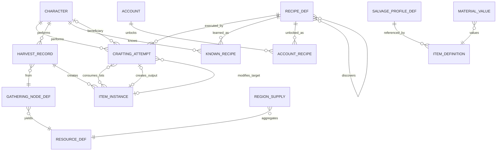

# Legends of the Shattered Frontier — Crafting: Data, API and Agent Implementation Guide
Version 1.0 — Expanded Technical Design Authority edition (2026-10-17)

Design target; not implemented. Names per Shared Registry v1.0.

Entry file: [Resource and Crafting Architecture](../Legends_Shattered_Frontier_Resource_and_Crafting_Architecture_v1.0.md) · Registry: [Shared Registry](../Legends_Shattered_Frontier_Shared_Registry_v1.0.md)

This part is the build contract for `crafting-service` and the gathering/crafting adapters on `zone-server`: entity relationships, the PostgreSQL schema `crafting`, the gRPC API `lsf.crafting_service.v1`, event production and consumption, privacy participation, performance budgets, and the agent implementation guide (layout, milestones, invariants, tests, acceptance, pitfalls, Do/Don't). Shared names follow the Registry; any future unmerged proposals are marked explicitly in the entry file's C10.

---

## 1. Entity relationships



`ITEM_INSTANCE`, `ITEM_DEFINITION`, `CHARACTER`, `ACCOUNT` are owned elsewhere (Itemization, Backend); crafting stores only their IDs. `RECIPE_DEF`, `RESOURCE_DEF`, `GATHERING_NODE_DEF`, `SALVAGE_PROFILE_DEF` are content definitions (content-catalog-service). `MATERIAL_VALUE` and `REGION_SUPPLY` are derived per `content_version` by crafting-service.

---

## 2. PostgreSQL schema `crafting`

```sql
CREATE SCHEMA crafting;

-- Proposed enums (entry file C10). Text + CHECK keeps additive evolution cheap.
-- crafting_attempt_state: requested, rolled, succeeded, failed, error
-- crafting_outcome (registry): success, failure
-- recipe_kind: refine, component, gear, tool, consumable, structure_material, reforge, reroll, legendary_forge
-- recipe_learn_source: default, trainer, scroll, reward, account_unlock, discovery, gm

CREATE TABLE crafting.attempts (
  crafting_attempt_id   text PRIMARY KEY CHECK (crafting_attempt_id LIKE 'crf\_%'),
  idempotency_key       text NOT NULL,
  request_hash          bytea NOT NULL,                    -- SHA-256 of the canonical request (IDEMPOTENCY_MISMATCH)
  batch_id              text NOT NULL,                     -- idempotency_key of the CraftItem call
  batch_index           smallint NOT NULL CHECK (batch_index >= 0 AND batch_index < 20),
  character_id          text NOT NULL,
  beneficiary_character_id text NULL,                      -- legendary forging
  recipe_id             text NOT NULL,
  recipe_kind           text NOT NULL CHECK (recipe_kind IN ('refine','component','gear','tool','consumable',
                                         'structure_material','reforge','reroll','legendary_forge')),
  skill_id              text NOT NULL,
  state                 text NOT NULL CHECK (state IN ('requested','rolled','succeeded','failed','error')),
  outcome               text NULL CHECK (outcome IN ('success','failure')),
  error_reason          text NULL,
  inputs                jsonb NOT NULL,                    -- [{item_id, definition_id, quantity, resource_tier, lot_quality, quality_input, protected}]
  target_item_id        text NULL,                         -- reforge / reroll
  affix_ref             text NULL,                         -- reroll
  quality_components    jsonb NULL,                        -- S, S_item, D, T, M, W, F, luck_factor, v, q_* terms, seed_version
  p_success             numeric(5,4) NULL,
  quality_score         smallint NULL CHECK (quality_score BETWEEN 0 AND 100),
  quality_bonus         smallint NULL CHECK (quality_bonus BETWEEN 0 AND 50),
  rarity                text NULL,
  output_item_id        text NULL,
  output_quantity       integer NULL,
  lost                  jsonb NULL,                        -- [{item_id, quantity}]
  input_ref_value       bigint NOT NULL,                   -- C_mat at reference values (copper)
  fee_copper            bigint NOT NULL DEFAULT 0,
  fee_txn_id            text NULL,                         -- txn_ from economy-service
  discovered_recipe_id  text NULL,
  workshop_kind         text NOT NULL,
  workshop_tier         smallint NOT NULL CHECK (workshop_tier BETWEEN 1 AND 5),
  workshop_ref          text NULL,
  public_workshop       boolean NOT NULL,
  zone_id               text NULL,
  content_version       bigint NOT NULL,
  config_version        text NOT NULL,
  created_at            timestamptz NOT NULL DEFAULT now(),
  rolled_at             timestamptz NULL,
  completed_at          timestamptz NULL,
  CONSTRAINT attempts_idem UNIQUE (idempotency_key, created_at),
  CONSTRAINT rolled_has_roll CHECK (state IN ('requested','error') OR (outcome IS NOT NULL AND p_success IS NOT NULL)),
  CONSTRAINT qb_mapping CHECK (quality_score IS NULL OR quality_bonus = quality_score / 2)
) PARTITION BY RANGE (created_at);
-- Monthly partitions; 13 retained online (rollback lineage), older detached to the archive store.
-- idempotency_key = '<batch_id>:<batch_index>'; global uniqueness is enforced by crafting.idempotency below
-- because a UNIQUE constraint on a partitioned table must include the partition key.

CREATE TABLE crafting.idempotency (
  idempotency_key   text PRIMARY KEY,
  crafting_attempt_id text NOT NULL,
  created_at        timestamptz NOT NULL DEFAULT now()       -- purged after IDEMPOTENCY_RETENTION (7 d) only if attempt terminal
);

CREATE INDEX attempts_character ON crafting.attempts (character_id, created_at DESC);
CREATE INDEX attempts_open      ON crafting.attempts (state, created_at) WHERE state IN ('requested','rolled');
CREATE INDEX attempts_output    ON crafting.attempts (output_item_id) WHERE output_item_id IS NOT NULL;
CREATE INDEX attempts_target    ON crafting.attempts (target_item_id, recipe_kind, state) WHERE target_item_id IS NOT NULL;
CREATE INDEX attempts_inputs    ON crafting.attempts USING gin (inputs jsonb_path_ops);

CREATE TABLE crafting.harvests (
  harvest_id          text PRIMARY KEY CHECK (harvest_id LIKE 'hrv\_%'),
  request_hash        bytea NOT NULL,
  character_id        text NOT NULL,
  node_entity_id      text NOT NULL,
  node_definition_id  text NOT NULL,
  spawn_point_id      text NOT NULL,
  world_region_id     text NOT NULL,
  zone_id             text NOT NULL,
  node_quality        smallint NOT NULL CHECK (node_quality BETWEEN 0 AND 100),
  skill_value         smallint NOT NULL,
  yield_multiplier    numeric(6,4) NOT NULL,
  outputs             jsonb NOT NULL,                      -- [{definition_id, quantity, lot_quality, bonus}]
  item_ids            text[] NOT NULL,
  state               text NOT NULL CHECK (state IN ('rolled','delivered')),
  content_version     bigint NOT NULL,
  config_version      text NOT NULL,
  created_at          timestamptz NOT NULL DEFAULT now()
);
-- harvest_id is globally unique (issued by zone-server); table is hash-partitioned by harvest_id (16) per realm DB,
-- with a monthly retention job deleting rows older than 13 months after archive export.
CREATE INDEX harvests_character ON crafting.harvests (character_id, created_at DESC);
CREATE INDEX harvests_items     ON crafting.harvests USING gin (item_ids);

CREATE TABLE crafting.known_recipes (                     -- proposed keyed entity KnownRecipe
  character_id        text NOT NULL,
  recipe_id           text NOT NULL,
  learn_source        text NOT NULL CHECK (learn_source IN ('trainer','scroll','reward','discovery','gm')),
  causation_id        text NOT NULL,                       -- txn_, itm_ (scroll), rwg_, crf_, aud_
  cost_copper         bigint NOT NULL DEFAULT 0,
  learned_at          timestamptz NOT NULL DEFAULT now(),
  revoked_at          timestamptz NULL,
  revoke_reason       text NULL,
  revoke_ref          text NULL,                           -- cas_ or rwg_
  PRIMARY KEY (character_id, recipe_id)
);

CREATE TABLE crafting.account_recipes (                   -- projection of progression account unlocks (kind recipe)
  account_id          text NOT NULL,
  recipe_id           text NOT NULL,
  source_event_id     text NOT NULL,                       -- evt_ of progression.account_unlock.granted
  granted_at          timestamptz NOT NULL,
  revoked_at          timestamptz NULL,
  PRIMARY KEY (account_id, recipe_id)
);
CREATE TABLE crafting.account_projection_state (          -- accounts fully loaded from ListAccountUnlocks
  account_id          text PRIMARY KEY,
  loaded_at           timestamptz NOT NULL
);

CREATE TABLE crafting.material_values (                   -- derived per content version
  content_version     bigint NOT NULL,
  definition_id       text NOT NULL,
  resource_tier       text NOT NULL,
  ref_value_copper    bigint NOT NULL CHECK (ref_value_copper > 0),
  derivation          text NOT NULL CHECK (derivation IN ('tier','authored','derived')),
  derived_from_recipe text NULL,
  PRIMARY KEY (content_version, definition_id)
);

CREATE TABLE crafting.region_supply (                     -- node_yield_per_hour per region/resource (Gathering part)
  content_version     bigint NOT NULL,
  world_region_id     text NOT NULL,
  resource_id         text NOT NULL,
  units_per_hour      numeric(12,2) NOT NULL,
  PRIMARY KEY (content_version, world_region_id, resource_id)
);

CREATE TABLE crafting.outbox (
  outbox_id           bigserial PRIMARY KEY,
  event_id            text NOT NULL UNIQUE,                -- evt_
  event_name          text NOT NULL,
  topic               text NOT NULL,                       -- domain.crafting
  partition_key       text NOT NULL,                       -- character_id
  envelope            jsonb NOT NULL,
  created_at          timestamptz NOT NULL DEFAULT now(),
  published_at        timestamptz NULL
);
CREATE INDEX outbox_unpublished ON crafting.outbox (outbox_id) WHERE published_at IS NULL;

CREATE TABLE crafting.inbox (                             -- consumer dedup
  event_id            text PRIMARY KEY,
  consumer            text NOT NULL,
  processed_at        timestamptz NOT NULL DEFAULT now()
);

CREATE TABLE crafting.erasure_tombstones (                -- privacy (Backend workflow)
  subject_token       text PRIMARY KEY,                    -- HMAC(chr_ or acc_), used in pseudonymized rows
  request_id          text NOT NULL,                       -- prq_
  erased_at           timestamptz NOT NULL DEFAULT now()
);
```

Row-size and volume planning (10,000 CCU realm): attempts ≈ 1,000 active crafters × 1 attempt / 15 s ≈ 67/s peak → ≈ 2.5 M/day average-load equivalent (≈ 2 KB/row) ≈ 5 GB/day before compression, 13 months online ≈ 1.5–2 TB per realm DB (archive older partitions); harvests ≈ 3,000 gatherers × 1 / 15 s ≈ 200/s peak, ≈ 0.6 KB/row. Both tables are write-mostly; reads are by idempotency key, character history, and lineage queries.

---

## 3. gRPC API — `lsf.crafting_service.v1`

All mutating RPCs carry `idempotency_key` (≤ 128 chars), `correlation_id`, `causation_id`, and the caller identity from mTLS; gateway calls carry `account_id`/`character_id` from the session token (Registry, Service registry).

```protobuf
syntax = "proto3";
package lsf.crafting_service.v1;

service CraftingService {
  rpc CraftItem(CraftItemRequest) returns (CraftItemResponse);              // zone-server
  rpc PreviewCraft(PreviewCraftRequest) returns (PreviewCraftResponse);     // gateway
  rpc ResolveHarvest(ResolveHarvestRequest) returns (ResolveHarvestResponse); // zone-server
  rpc ComputeSalvage(ComputeSalvageRequest) returns (ComputeSalvageResponse); // inventory-service (pure)
  // proposed (entry file C10)
  rpc LearnRecipe(LearnRecipeRequest) returns (LearnRecipeResponse);        // gateway, reward-service, admin-portal
  rpc RevokeRecipe(RevokeRecipeRequest) returns (RevokeRecipeResponse);     // reward-service, enforcement-service
  rpc ListKnownRecipes(ListKnownRecipesRequest) returns (ListKnownRecipesResponse); // gateway, loot-service, quest-service
  rpc RepairWithKit(RepairWithKitRequest) returns (RepairWithKitResponse);  // gateway
  rpc ReforgeItem(ModifyItemRequest) returns (ModifyItemResponse);          // zone-server (at workshop)
  rpc RerollItemAffix(ModifyItemRequest) returns (ModifyItemResponse);      // zone-server (at workshop)
  rpc GetCraftLineage(GetCraftLineageRequest) returns (GetCraftLineageResponse); // enforcement-service, admin-portal
}

message InputRef { string item_id = 1; int32 quantity = 2; }

message CraftItemRequest {
  string idempotency_key = 1;
  string character_id = 2;
  string recipe_id = 3;
  repeated InputRef inputs = 4;            // per unit; quantities × batch_count must be available
  string workshop_kind = 5;                // workshop_kind
  int32 workshop_tier = 6;                 // 1..5
  string workshop_ref = 7;                 // structure instance id, optional
  int32 batch_count = 8;                   // 1..tune.crafting.max_batch (kind limits apply)
  string input_at = 9;                     // RFC 3339 ms, server receive time of the intent
  bool public_workshop = 10;
  string beneficiary_character_id = 11;    // legendary_forge only
  string beneficiary_consent_token = 12;
  int64 content_version = 13;              // zone-server's active content version
  string zone_id = 14;
}
message AttemptResult {
  string crafting_attempt_id = 1;
  string outcome = 2;                      // crafting_outcome
  string item_id = 3;
  int32 quality_score = 4;
  int32 quality_bonus = 5;
  repeated InputRef lost = 6;
  string discovered_recipe_id = 7;
  string state = 8;                        // crafting_attempt_state
  string error_reason = 9;                 // per-unit error (batch continues only for roll failures)
}
message CraftItemResponse { repeated AttemptResult attempts = 1; int64 fee_copper_total = 2; }

message PreviewCraftRequest {
  string character_id = 1; string recipe_id = 2; repeated InputRef inputs = 3;
  int32 workshop_tier = 4; bool public_workshop = 5;
}
message PreviewCraftResponse {
  double p_success = 1; int32 quality_min = 2; int32 quality_max = 3;
  int32 ilvl_min = 4; int32 ilvl_max = 5; string rarity_min = 6; string rarity_max = 7;
  int64 fee_copper = 8; bool attemptable = 9; repeated string blocking_reasons = 10;
}

message ResolveHarvestRequest {
  string harvest_id = 1;                   // hrv_, idempotency key
  string character_id = 2;
  string node_entity_id = 3;
  string node_definition_id = 4;
  int32 node_quality = 5;
  string tool_item_id = 6;
  string world_region_id = 7;
  string spawn_point_id = 8;
  double event_mult = 9;                   // resolved by zone-server from config overlay and skill scope
  double buff_mult = 10;
  int32 npc_level = 11;                    // carcass nodes
  bool rich = 12;
  int32 plot_tends = 13;                   // farming
  int64 content_version = 14;
  string zone_id = 15;
}
message HarvestOutput { string definition_id = 1; int32 quantity = 2; int32 lot_quality = 3; bool bonus = 4; }
message ResolveHarvestResponse {
  repeated HarvestOutput outputs = 1; repeated string item_ids = 2;
  int32 skill_value = 3; int32 node_difficulty = 4; double yield_multiplier = 5;
}

message ComputeSalvageRequest {
  string idempotency_key = 1;              // inventory's SalvageItem key (seed)
  string character_id = 2;                 // salvager
  string item_id = 3; string definition_id = 4; int32 ilvl = 5; string rarity = 6;
  string item_status = 7;                  // active | broken
  string recipe_id = 8;                    // provenance, crafted items
  int32 quality_score = 9;                 // provenance, crafted items
  int64 item_content_version = 10;         // content version recorded at creation
}
message ComputeSalvageResponse { repeated HarvestOutput outputs = 1; double return_ratio = 2; int64 input_value = 3; }

message LearnRecipeRequest {
  string idempotency_key = 1; string character_id = 2; string recipe_id = 3;
  string learn_source = 4;                 // trainer | scroll | reward | gm
  string trainer_ref = 5; string scroll_item_id = 6; string reward_grant_id = 7; string audit_ref = 8;
  string zone_context_token = 9;           // trainer proximity, issued by zone-server
}
message LearnRecipeResponse { bool learned = 1; int64 cost_copper = 2; string txn_id = 3; }

message RevokeRecipeRequest {
  string idempotency_key = 1; string character_id = 2; string account_id = 3; string recipe_id = 4;
  string reason = 5; string case_id = 6; string reward_grant_id = 7;
}
message RevokeRecipeResponse { bool revoked = 1; }

message ListKnownRecipesRequest { string character_id = 1; repeated string recipe_ids = 2; string skill_id = 3; }
message KnownRecipe { string recipe_id = 1; bool known = 2; bool learnable = 3; string learn_source = 4; }
message ListKnownRecipesResponse { repeated KnownRecipe recipes = 1; }

message RepairWithKitRequest {
  string idempotency_key = 1; string character_id = 2; string kit_item_id = 3;
  repeated string target_item_ids = 4; string out_of_combat_token = 5;
}
message RepairWithKitResponse { repeated string repaired_item_ids = 1; int64 capacity_used = 2; int64 capacity_lost = 3; }

message ModifyItemRequest {
  string idempotency_key = 1; string character_id = 2; string recipe_id = 3;
  string target_item_id = 4; string affix_ref = 5;          // reroll only
  repeated InputRef reagents = 6; string workshop_kind = 7; int32 workshop_tier = 8;
  bool public_workshop = 9; string input_at = 10; int64 content_version = 11;
}
message ModifyItemResponse { AttemptResult attempt = 1; }

message GetCraftLineageRequest { string item_id = 1; int32 max_depth = 2; }
message LineageEdge { string from_item_id = 1; string to_item_id = 2; string via = 3; string ref_id = 4; } // via: craft | harvest
message GetCraftLineageResponse { repeated LineageEdge edges = 1; }
```

Plus the Registry's `PrivacyParticipant.ExportSubject` and `PrivacyParticipant.EraseSubject` (§6).

### 3.1 Caller authorization

| RPC | Allowed callers (mTLS identity) | Extra checks |
| --- | --- | --- |
| `CraftItem`, `ReforgeItem`, `RerollItemAffix`, `ResolveHarvest` | `zone-server` registered in world-service (`RegisterServer`) for `zone_id` | character is in that zone (world-service presence cache) |
| `PreviewCraft`, `ListKnownRecipes` | gateway (own character), loot-service, quest-service | gateway: character owned by session account |
| `ComputeSalvage` | inventory-service | — |
| `LearnRecipe` | gateway (`trainer`, `scroll`), reward-service (`reward`), admin-portal (`gm` with `audit_ref`) | source must match caller |
| `RevokeRecipe` | reward-service, enforcement-service | `reward_grant_id` or `case_id` required |
| `RepairWithKit` | gateway | `out_of_combat_token` from zone-server |
| `GetCraftLineage` | enforcement-service, admin-portal | staff role per Security (`enforcement_reviewer`+) |

### 3.2 Errors

All errors use `google.rpc.Status` with `ErrorInfo.reason` from the entry file C4.3 list. Mapping: validation → `FAILED_PRECONDITION` (`SKILL_TOO_LOW`, `WORKSHOP_TIER_TOO_LOW`, `RECIPE_NOT_KNOWN`, `INPUT_LOCKED`, `TOOL_REQUIRED`, `LEGENDARY_STAGE_NOT_READY`, `ALREADY_KNOWN`, `SALVAGE_NOT_ALLOWED`, `TARGET_ITEM_INVALID`, `INSUFFICIENT_FUNDS`), unknown content → `NOT_FOUND` (`RECIPE_NOT_FOUND`), caller → `PERMISSION_DENIED` (`CALLER_NOT_ALLOWED`, `BENEFICIARY_INVALID`), replay mismatch → `ALREADY_EXISTS` (`IDEMPOTENCY_MISMATCH`), out-of-band trusted input → `INVALID_ARGUMENT` (`NODE_QUALITY_OUT_OF_BAND`), flags → `UNAVAILABLE` (`FEATURE_DISABLED`, `RECIPE_DISABLED`), content version not loaded → `UNAVAILABLE` with retry-after 1 s (`CONTENT_VERSION_PENDING`).

---

## 4. Processing rules

### 4.1 `CraftItem` (per unit)

```text
1. tx: insert idempotency row (on conflict: load attempt; if request_hash differs → IDEMPOTENCY_MISMATCH; else resume from its state)
       insert attempt (requested) with inputs as requested
2. load content (recipe at content_version), progression snapshot (GetProgression), items (BatchGetItems: inputs, tool, equipment stats)
3. validate: recipe known; S ≥ D − MARGIN_LOW; W ≥ min_workshop_tier; workshop_kind serves skill; inputs owned by
   character (or beneficiary), active, not escrowed/quarantined, definitions and tiers match slots; tool category/tier;
   legendary: GetLegendaryProgress + consent token; flags
   → on failure: attempt error (reason), return per-unit error
4. if public_workshop and D ≥ PUBLIC_FEE_MIN_D: Debit(fee, sink npc_service, idem = crf_id:fee); record fee_txn_id
   → INSUFFICIENT_FUNDS: attempt error
5. roll (lsf-craftmath, seed = HMAC(server_secret[v], crf_id)): success, v / losses, rarity, discovery
   tx: attempt rolled (outcome, quality, components, rarity, lost, discovered_recipe_id)
6. side effects (idempotent keys derived from crf_id):
     success: CreateCraftedItem(idem = crf_id, …, crafter_skill_value = S_item) | RestoreMaxDurability | RerollAffix
     failure: ConsumeItem per lost lot (idem = crf_id:fail:n, sink crafting_failure)
     discovery: insert known_recipes (learn_source discovery, causation crf_id) + outbox crafting.recipe.learned
7. tx: attempt succeeded|failed, completed_at; outbox crafting.item.crafted | crafting.attempt.failed
8. buffer practice record (skill, D or D_target, outcome, craft_time_s, input_at, context_hash); flush every 2 s
```

Batch semantics: units run sequentially with keys `<idempotency_key>:<i>`; a unit's roll failure does not stop the batch; a validation error on unit *i* (e.g. inputs exhausted) stops the remaining units, which are returned with `error_reason` and no attempt rows. The fee is per unit.

Recovery sweeper (every 30 s): `rolled` attempts older than 10 s are resumed at step 6 with the stored roll; `requested` attempts older than 5 min with `fee_txn_id` set are resumed at step 3 (re-validate; if inputs are gone the attempt becomes `error` and the fee stays charged — fees are non-refundable once debited, as the UI states); `requested` without fee older than 5 min become `error`.

### 4.2 `ResolveHarvest`

```text
1. tx: insert harvest (rolled) keyed by harvest_id (conflict: same request_hash → return stored outputs; else IDEMPOTENCY_MISMATCH)
   — the roll happens before the insert, inside the same request: validate node definition, node_quality band
     (Gathering part §5.3, rich +10), skill requirement, tool; compute quantity, lot_quality, bonus outputs (seed HMAC(secret, hrv_))
2. CreateGatheredItems(idem = hrv_, outputs, node_ref = {node_definition_id, spawn_point_id, harvest_id})
3. tx: harvest delivered, item_ids
4. return outputs + item_ids (zone-server emits gathering.* and submits practice)
```

Latency budget: p99 120 ms (progression snapshot from cache ≤ 20 ms, inventory create ≤ 60 ms). Progression snapshots are cached per character for 5 s and invalidated by `progression.skill.gained` for gathering skills (accepting ≤ 5 s staleness for yield/quality is intended; it never affects authorization because the skill requirement is re-checked by zone-server from its own replicated skill values).

### 4.3 `ComputeSalvage`

Pure function of the request, content (`content_version` recorded on the item, falling back to current if archived), the salvager's skill (cached snapshot) and the seed. No writes, no events (inventory-service emits `item.instance.salvaged` and `item.instance.created`). Latency p99 40 ms.

### 4.4 Consumers

| Topic / event | Handler | Idempotency |
| --- | --- | --- |
| `domain.progression` `progression.account_unlock.granted` (`unlock_kind = recipe`) | upsert `account_recipes` | `crafting.inbox` by `event_id` |
| Account unlock revocation (Character `ApplyRollback`; `ListAccountUnlocks` reconciliation every 24 h for accounts with projection rows) | set `revoked_at` | inbox |
| `domain.config` `config.tuning.published` (`tune.crafting.*`, `tune.gathering.*`) | swap tuning snapshot atomically; record `config_version` | version monotonic |
| content pack activation (`content-catalog-service` notification) | load definitions, derive `material_values`, `region_supply`; validate; then activate | `content_version` monotonic |

### 4.5 Event production

| Event | Producer | Topic / key | Written |
| --- | --- | --- | --- |
| `crafting.item.crafted` | crafting-service | `domain.crafting` / `character_id` | outbox, same tx as `succeeded` |
| `crafting.attempt.failed` | crafting-service | `domain.crafting` / `character_id` | outbox, same tx as `failed` |
| `crafting.recipe.learned` | crafting-service | `domain.crafting` / `character_id` | outbox, same tx as the `known_recipes` insert; registered in Shared Registry, Phase-2 additions |
| `gathering.node.harvested` | zone-server | `domain.gathering` / `character_id` | after `ResolveHarvest` returns; zone-server's durable event spool (World/Network spec), `event_id` derived from `hrv_` for dedup |
| `gathering.node.depleted` | zone-server | `domain.gathering` / `node_entity_id` | on depletion |

The outbox relay publishes in `outbox_id` order per partition key and marks `published_at`; consumers deduplicate by `event_id` (Registry envelope rule). `envelope.causation_id` = request causation; `correlation_id` = the craft intent's correlation; `content_version` = the attempt's content version.

---

## 5. Configuration and content loading

- Tuning: crafting-service and zone-server read `tune.crafting.*` and `tune.gathering.event_yield_multiplier` from config-service; every attempt and harvest stores `config_version`. A tuning version failing the schema hook (weights ≠ 100, `QUALITY_VARIANCE` > 10, `P_SUCCESS_MAX` > 0.99, salvage bands outside Itemization's ranges, `YIELD_MULT_CAP` > 2.5) is rejected at publish.
- Content: `recipe`, `resource`, `gathering_node`, `salvage` definitions are client-visible; `bonus_outputs.chance`, carcass profiles and `material_values` are delivered in the server-only pack (`content_pack_visibility = server_only`, Backend spec). crafting-service accepts requests only for content versions it has activated; zone-server includes its `content_version` so a mismatch during rollout returns `CONTENT_VERSION_PENDING` instead of using the wrong recipe.
- Kill switches: `ff.content.disabled_definitions` (LiveOps) for recipes and nodes → `RECIPE_DISABLED` / node not spawned; `ff.crafting.*` flags per entry C9.

---

## 6. Privacy participation (Backend spec, Account deletion and privacy request workflow)

| Call | Behavior |
| --- | --- |
| `PrivacyParticipant.ExportSubject(request_id, account_id, character_ids)` | Returns known recipes (character and account), attempts and harvests of the last 13 months (recipe, outcome, quality, items, timestamps), as JSON lines in the export bundle |
| `PrivacyParticipant.EraseSubject(request_id, account_id, character_ids)` | Phase 2 Erase: hard-delete `known_recipes`, `account_recipes`, `account_projection_state` rows; pseudonymize `attempts` and `harvests` by replacing `character_id` / `beneficiary_character_id` with `subject_token = HMAC(erasure_key, id)` and clearing `workshop_ref`, `zone_id`; insert `erasure_tombstones`; retained for rollback lineage until the 13-month retention ends. Legal holds (`GetLegalHold`, Security) suspend pseudonymization of rows referenced by an open case |

Telemetry/warehouse erasure is Analytics' (Backend phase 3); crafting events carry only p0/p1 fields.

---

## 7. Performance and capacity

| Operation | Peak rate (10,000 CCU realm) | p99 budget | Notes |
| --- | --- | --- | --- |
| `ResolveHarvest` | 200 /s | 120 ms | 3,000 gatherers, one harvest per ≈ 15 s |
| `CraftItem` (per unit) | 70 /s (bursts 300 /s in batches) | 250 ms per unit | excludes channel time |
| `ComputeSalvage` | 50 /s | 40 ms | pure |
| `PreviewCraft` | 100 /s | 60 ms | rate-limited at gateway 2/s per character |
| `ListKnownRecipes` | 150 /s | 30 ms | known-recipe set cached per character (invalidate on learn/revoke) |

crafting-service is stateless; scale horizontally on CPU (RNG and math are cheap; the cost is downstream RPCs). Dependencies with timeouts: progression 50 ms, inventory 150 ms, economy 100 ms; circuit breakers open after 50 % errors over 10 s and return `UNAVAILABLE` (zone-server shows "the workshop is busy" and keeps inputs).

---

## 8. Agent implementation guide

### 8.1 Repository and module layout

Per the Repository Structure document (`/BackendServices`); language per Backend spec. Paths are normative for structure, not language.

```text
BackendServices/
  libs/
    lsf-craftmath/            # pure, deterministic: quality (C2), S_item, p_success, losses, rarity, potency,
                              # yield & lot quality, regeneration params, node_yield_per_hour, C_equiv, salvage,
                              # trainer price, kit capacity, reforge/reroll costs, RNG stream order
      src/ tests/ golden/     # golden vectors = every worked example of the Crafting spec
      depends on: lsf-itemmath (B(ilvl), vendor_value, slot weights, rarity mults, RNG xoshiro256**, HMAC seeds)
    lsf-content-model/
      crafting/               # recipe, resource, gathering_node, salvage types; validator rules (Recipes part §1.3,
                              # Salvage part §3); material_values and region_supply derivation
  crafting-service/
    api/proto/lsf/crafting_service/v1/
    src/
      handlers/               # one per RPC
      domain/attempt/         # CraftItem state machine, batch runner, recovery sweeper
      domain/harvest/
      domain/salvage/
      domain/learning/        # known recipes, trainer, scroll, reward, account projection, discovery
      domain/modify/          # repair kits, reforge, reroll
      domain/legendary/
      clients/                # progression, inventory, economy, world (presence), config
      repo/ outbox/ inbox/ privacy/
    migrations/               # crafting schema
    tests/ (unit, integration, property, load)
ZoneServer (UE5.8 project, Repository Structure / UE58 layout docs):
  Source/LSFServer/Gathering/ # node runtime, pools, regeneration hooks, harvest channel, gathering events, practice producer
  Source/LSFServer/Crafting/  # craft channel, workshop resolution, consent tokens, CraftItem adapter
Tools/
  crafting-sim/               # Monte Carlo: quality/success distributions, salvage EV, material flows, skill-up cost,
                              # gathering income; reads tuning + content packs; uses lsf-craftmath
```

Rule: no formula is implemented twice. crafting-service, zone-server adapters (via a generated C++ binding or a mirrored port tested against the same golden vectors), the content validator and the simulator use `lsf-craftmath`.

### 8.2 Build order and milestones

| Milestone | Scope | Exit criteria |
| --- | --- | --- |
| M1 — Math core | `lsf-craftmath` all formulas; RNG stream order; golden vectors | every worked example of entry file and parts reproduces exactly; property tests P1–P8 pass |
| M2 — Content | crafting types in `lsf-content-model`; validator; `material_values`, `region_supply` derivation | sample pack (catalogue rows of the Recipes part) validates; iron longsword draft fails, published passes; cycle detection test |
| M3 — Craft core | `CraftItem`, `PreviewCraft`, attempts schema, outbox; fakes for progression/inventory/economy | integration I1–I5; crash/retry I2 never duplicates |
| M4 — Gathering | `ResolveHarvest`, zone-server node runtime, pools, rich nodes, gathering events, practice producer | I6–I7; yield examples; load L1 |
| M5 — Salvage | `ComputeSalvage`, profiles | salvage examples 1–3; P3 Monte Carlo; inventory integration I11 |
| M6 — Learning | known/account recipes, trainer, scroll (flagged), reward routing, discovery, `crafting.recipe.learned` | I8–I9; trainer price examples |
| M7 — Modification | kits, reforge, reroll behind flags (await Itemization RPCs) | kit and reroll examples; target never lost |
| M8 — Legendary forging | consent tokens, beneficiary, `GetLegendaryProgress` checks | I10 |
| M9 — Ops | sweeper, lineage, privacy, circuit breakers, dashboards | I12; chaos test (inventory down mid-batch) |
| M10 — Balance | `crafting-sim` runs for a season; metrics wired | targets of Salvage part §9 met in simulation ± 10 % |

### 8.3 Invariants checklist

1. **INV-C1** An attempt's roll is persisted (`rolled`) before any item, currency or practice side effect; a `crf_` is rolled at most once.
2. **INV-C2** `quality_bonus = floor(quality_score / 2)`, `quality_score ∈ [0,100]` (DB check + library assertion).
3. **INV-C3** `crafter_skill_value` sent to inventory = `min(S, D + MARGIN_FULL)`; crafted ilvl therefore ≤ `floor((D+200)/1000 × 400) + 50` and ≤ `CRAFTED_ILVL_MAX`.
4. **INV-C4** Every item creation carries the right source (`crafting_output`, `gathering_output`, `salvage_output`, `legendary_upgrade`) and `causation_id` = `crf_`/`hrv_`/salvage key; crafting-service never creates items itself.
5. **INV-C5** Lost quantity per lot ≤ lot quantity; `protected_on_failure` lots never lost; reforge/reroll targets never consumed.
6. **INV-C6** Salvage return ratio is inside the Itemization band for its origin (× 0.5 broken); `E[output value] = V_out`.
7. **INV-C7** No roll, value or fee reads a market price.
8. **INV-C8** Yield multiplier ≤ `YIELD_MULT_CAP`; `node_quality` within the shifted band (+10 rich) or the harvest is rejected.
9. **INV-C9** One practice record per crafting attempt (crafting-service) and per harvest (zone-server); never both for the same action.
10. **INV-C10** Fees and trainer debits are idempotent on `crf_id:fee` / `learn:<character>:<recipe>`; a scroll is consumed only when the recipe becomes known.
11. **INV-C11** Events are written in the same transaction as the terminal state change; one event per attempt.
12. **INV-C12** `default` recipes are never materialized as rows.

### 8.4 Test matrix

**Unit (golden vectors).**

| ID | Case | Expected |
| --- | --- | --- |
| U1 | Entry C2.5 greatsword (`S` 950, `D` 850, T 90, M 80, W 5, F 5, luck 75, v 0) | `Q_base` 73.33, score 77, bonus 38, `p_success` 0.98, rarity `epic`, `S_item` 950 |
| U2 | Journeyman (`D` 450, T 50, M 30, W 1, F 0, luck 30, v +1) | score 21, bonus 10 |
| U3 | `S` 950, `D` 100 | `S_item` 300; max ilvl 170 (via `lsf-itemmath`) |
| U4 | `p_success` reference table (entry C4.1) | 0.50 / 0.625 / 0.75 / 0.875 / 0.98; luck 150 row |
| U5 | Failure loss, lot 7, `FAILURE_LOSS` 0.5, bernoulli draw 0.3 | lost 4 (3 + 1) |
| U6 | Starmetal yield example (Gathering part) | quantity 4, lot 84, no bonus |
| U7 | Newbie iron vein | quantity 3, lot 36 |
| U8 | Regeneration `s` 1.6, `respawn_s` 300 | 210 s; shift −6; band 14–44 |
| U9 | `node_yield_per_point` iron vein | 189 units/h |
| U10 | `C_equiv` table rows (Salvage part §2.2) | exact copper values |
| U11 | Validator: iron longsword draft / published; greatsword | fail (vendor) / pass; ratio 1.086 |
| U12 | Salvage example 1 / 2 / 3 | `V_out` 487,763 / 64,899 / 235; quantities' expectations |
| U13 | Trainer price `D` 120 / 450 / 850 | 4,687 / 31,199 / 79,753 |
| U14 | Kit example (tier 5, q 80) | capacity 135,000; repairs chest and legs; 4,267 lost |
| U15 | Reroll inks `n` 0 / 2 / ≥ 5 | 22 / 49 / 165 |
| U16 | Potency q 64 | 1.028 |
| U17 | Discovery q 77, luck 75 | 0.0162 |
| U18 | Rarity steps q 59 / 60 / 85 from `rare` with `rarity_max` epic | rare / epic / epic |

**Property-based.**

| ID | Property |
| --- | --- |
| P1 | ∀ inputs: `quality_score ∈ [0,100]`, `quality_bonus = floor(score/2)`; with `Q_base = 0`, score ≤ `QUALITY_VARIANCE` (luck creates nothing) |
| P2 | ∀ `S, D`: crafted ilvl ≤ `floor((D+200)/1000 × 400) + 50` and ≤ 450 |
| P3 | Salvage: over 100,000 seeds, mean output value within 0.5 % of `V_out`; `r` inside band |
| P4 | Determinism: same `crf_`/`hrv_`/salvage key + same secret version → identical results; different keys → uncorrelated (χ² on `v`) |
| P5 | Losses ≤ quantities; protected inputs never lost |
| P6 | Yield multiplier ≤ cap for any combination of event, buff and bonuses |
| P7 | Material value derivation: acyclic graph → finite values; adding a cycle → validator error |
| P8 | Recipes passing the validator never produce an output whose vendor value exceeds 40 % of `C_mat` |

**Integration (service + fakes / real dependencies in CI environment).**

| ID | Scenario | Expected |
| --- | --- | --- |
| I1 | Successful craft | one item (source `crafting_output`, causation `crf_`), inputs consumed `crafting_consumed`, one `crafting.item.crafted`, one practice record |
| I2 | Crash after `rolled`, before `CreateCraftedItem`; client retries | same outcome; exactly one item; one event |
| I3 | Same idempotency key, different inputs | `IDEMPOTENCY_MISMATCH` |
| I4 | Input escrowed by an open market listing | `INPUT_LOCKED`; nothing consumed |
| I5 | Public workshop, empty wallet | `INSUFFICIENT_FUNDS`; attempt `error`; no roll |
| I6 | `ResolveHarvest` timeout then retry with same `hrv_` | one set of items; zone-server decrements one charge |
| I7 | `node_quality` 99 for a 65–90 non-rich node | `NODE_QUALITY_OUT_OF_BAND`; ops alert |
| I8 | `progression.account_unlock.granted` for recipe on account with two characters | both can craft; no `crafting.recipe.learned` events |
| I9 | Reward grant with recipe unlock line then `RevokeGrant` | known then revoked; crafting rejected with `RECIPE_NOT_KNOWN` |
| I10 | Legendary forging by another smith with/without consent token | 465 legendary bound to owner / `BENEFICIARY_INVALID` |
| I11 | `SalvageItem` on legendary; on broken crafted item | `SALVAGE_NOT_ALLOWED`; ratio halved |
| I12 | Privacy erase | known recipes deleted; attempts pseudonymized; lineage query still links items |
| I13 | Batch of 20 refines with inputs for 12 | 12 attempts, 8 unit errors, fee charged 12× |
| I14 | Content version rollout: zone-server ahead of crafting-service | `CONTENT_VERSION_PENDING`, retry succeeds after activation |

**Load.** L1: 200 rps `ResolveHarvest` for 30 min, p99 < 120 ms, zero duplicate items. L2: 70 rps `CraftItem` + bursts of 300 units/s (batches), p99 < 250 ms per unit. L3: sweeper under 1 % injected inventory failures — all `rolled` attempts reach terminal state within 2 min. L4: outbox relay lag p99 < 2 s at peak.

### 8.5 Acceptance criteria

1. All golden vectors (U1–U18) pass in `lsf-craftmath` and in the zone-server port.
2. Integration I1–I14 pass against real inventory/progression/economy services in the shared CI environment.
3. Load targets L1–L4 met on the reference realm profile.
4. A full content pack of ≥ 900 recipes, ≥ 120 resources, ≥ 150 node definitions and 8 salvage profiles validates; derived `material_values` exported to Analytics.
5. `crafting-sim` season run: salvage share 40–55 %, crafted margin ratio assumptions documented, gathering income ratio 0.8–1.3 per tier, material stock growth within −2 %…+3 % per week.
6. Dashboards show every metric of the Salvage part §9 with alert rules registered in Analytics.
7. Security review signs off C7 rules (seed handling, caller allowlist, bounded trusted inputs).

### 8.6 Pitfalls

- **Re-rolling on retry.** Always load the stored roll; never call the RNG before checking the idempotency row.
- **Wrong skill to inventory.** Sending `S` instead of `S_item` lets master crafters make endgame ilvl from trivial recipes.
- **Rounding drift.** Use `round_half_up` on the final score only; keep intermediate terms as exact decimals (scale 6) — floating-point `0.1 × 3` errors flip scores at .5 boundaries. Golden vectors include boundary cases.
- **Quality from the request.** Lot quality, tool quality and equipment stats are read from inventory, never from zone-server or client payloads.
- **Market prices in rolls.** Do not import Economy price indexes into salvage or validation.
- **Double practice.** Gathering practice is zone-server's; crafting-service must not also submit it from `ResolveHarvest`.
- **Default recipes as rows.** Inserting rows for `default` recipes inflates storage by millions of rows and breaks content-driven changes.
- **Batch fee charged once.** The fee is per unit; a single debit for the batch breaks idempotency on partial batches.
- **Seed version.** Store the secret version with the attempt; rotating the secret must not change audit recomputation.
- **Content version skew.** Validate the request's `content_version`; never fall back silently to the newest recipe.
- **Treating `E[value]` as exact.** Salvage outputs are stochastic per item; tests check expectations over many seeds and exact outputs for a fixed seed.

### 8.7 Do / Don't for coding agents

| Do | Don't |
| --- | --- |
| Put every formula in `lsf-craftmath` with tuning keys as parameters and golden tests from this spec | Hard-code constants in handlers or the zone-server adapter |
| Persist the roll before side effects; derive every downstream idempotency key from `crf_`/`hrv_` | Call `CreateCraftedItem` and then write the attempt |
| Use `CreateCraftedItem` / `CreateGatheredItems` / `ConsumeItem` with registry source/sink codes | Use `GrantItems` (reward-service only) or invent codes |
| Read lot quality and tool stats from inventory provenance | Trust quality, skill or tier values sent by clients |
| Emit events via the outbox in the terminal-state transaction | Publish directly to the bus from handlers |
| Use `recipe_kind`, `crafting.recipe.learned`, `consumable_used`, and registered RPCs as defined in the Shared Registry; apply subsystem feature flags only where specified | Invent names or bypass a subsystem's explicit feature flag |
| Return ranges only from `PreviewCraft` | Leak the seed, `v`, or bonus-output chances to clients |
| Check `ff.content.disabled_definitions` on every craft and spawn | Cache disabled-definition state longer than the config push interval |
| Pseudonymize lineage rows on erasure | Delete attempts or harvests that enforcement may still need |
| Raise a cross-spec request when an RPC you need is not defined (entry file C10) | Write to inventory, progression or economy tables directly |
