# Legends of the Shattered Frontier — Crafting: Gathering, Resources and Nodes
Version 1.0 — Expanded Technical Design Authority edition (2026-10-17)

Design target; not implemented. Names per Shared Registry v1.0.

Entry file: [Resource and Crafting Architecture](../Legends_Shattered_Frontier_Resource_and_Crafting_Architecture_v1.0.md) · Registry: [Shared Registry](../Legends_Shattered_Frontier_Shared_Registry_v1.0.md)

This part defines where materials come from: the resource and material model, the catalogue by tier and biome, gathering node definitions and their runtime lifecycle, the harvest flow, yield and lot quality, tools, regeneration parameters that World's regeneration clock applies, the specifics of fishing, hunting and farming, and gathering balancing targets. The normative formulas of the entry file (C5. Gathering contract) are restated here only where they are extended.

---

## 1. Resource and material model

### 1.1 Layers

| Layer | Content kind / item category | Examples | Created by | Reference value |
| --- | --- | --- | --- | --- |
| Raw resource | `resource/<slug>` with linked `item/<slug>` of category `material` | `resource/iron_ore`, `resource/oak_log`, `resource/frostbloom` | `gathering_output` (zone-server → crafting-service → inventory-service) | `tune.crafting.ref_value.<tier>` |
| Refined material | `item/<slug>`, category `material`, `recipe_kind = refine` | `item/iron_ingot`, `item/oak_plank`, `item/linen_cloth` | `crafting_output` | derived: inputs × `REFINE_VALUE_MULT` |
| Component | `item/<slug>`, category `material`, `recipe_kind = component` | `item/tempered_hilt`, `item/reinforced_strap` | `crafting_output` | derived |
| Reagent (special) | `item/<slug>`, category `material` | `item/ember_essence`, `item/abyssal_shard`, `item/flawless_ruby` | `salvage_output`, `loot_drop`, gathering bonus output, world events | authored `ref_value_copper` |
| Vendor reagent | `item/<slug>`, category `material` | `item/flux`, `item/thread_spool`, `item/vial` | `vendor_stock` (Itemization; while `ff.item.vendor_stock_enabled`) | authored, equals vendor price |

Rules:

1. Every raw resource has exactly one `resource` definition and one material item definition; the item definition's `tags` include `resource:<slug>` and its `resource_tier`. Stack limit is the Itemization `material` limit (≤ 1,000).
2. Only `resource` definitions are gathered; only item definitions are crafted. A recipe input names an item definition, never a `resource/` ID.
3. A material item carries lot quality in `provenance.quality_score`. Stacks merge only when `definition_id`, `binding`, and `quality_score` are equal (Itemization stack rules; quality is part of the stack key so a lot never averages silently).
4. Materials have no `salvage_profile` (Salvage part): materials are never salvaged back into their inputs.
5. Construction materials carry the tag `construction_material` (Recipes part, Construction materials and the Builder's Cache).

### 1.2 `resource` definition (content)

```json
{
  "id": "resource/starmetal_ore",
  "item_definition_id": "item/starmetal_ore",
  "resource_tier": "epic",
  "skill_id": "skill/mining",
  "family": "ore",
  "biomes": ["frozen_north", "corrupted_frontier"],
  "level_band": { "min": 70, "max": 100 },
  "ref_value_copper": "derived",
  "market_basket_group": "raw",
  "display": { "name_key": "resource.starmetal_ore.name", "icon": "icons/resources/starmetal_ore" }
}
```

| Field | Rule |
| --- | --- |
| `resource_tier` | registry `resource_tier` |
| `skill_id` | one of the six gathering skills |
| `family` | `ore`, `stone`, `wood`, `fiber`, `herb`, `crop`, `fish`, `hide`, `meat`, `bone`, `gem`, `essence` (content enum, validator-checked; not a registry enum) |
| `biomes` | registry `biome` values; at least one |
| `level_band` | recommended character levels; used by Quest generation (`resource_context`) and dungeon material tables |
| `ref_value_copper` | `"derived"` → `tune.crafting.ref_value.<resource_tier>`; an explicit integer only for gems and essences (validator: within 0.5–3.0 × the tier default) |
| `market_basket_group` | `raw` for the Economy inflation basket (Economy spec, Inflation index); optional |

### 1.3 Tier ladder

| `resource_tier` | `tier_index` | `D_node` | Unlock skill (`D_node − MARGIN_LOW`) | Default `quality_band` | Character levels | Biomes (primary) | Ref value (copper) |
| --- | --- | --- | --- | --- | --- | --- | --- |
| `common` | 0 | 0 | 0 | 20–50 | 1–20 | `greenlands` | 120 |
| `uncommon` | 1 | 200 | 100 | 35–65 | 20–45 | `greenlands`, `desert_wastes` | 600 |
| `rare` | 2 | 400 | 300 | 50–80 | 40–70 | `desert_wastes`, `frozen_north` | 2,000 |
| `epic` | 3 | 600 | 500 | 65–90 | 65–100 | `frozen_north`, `corrupted_frontier` | 6,000 |
| `legendary` | 4 | 800 | 700 | 80–100 | 100 | `corrupted_frontier`, world events | 18,000 |

Gathering skills are therefore "ahead" of character level: a gatherer at skill 500 can work epic nodes at character level 60 if they survive the zone. This is intended (classless, skill-based design); zone danger is the natural gate.

### 1.4 Catalogue (illustrative slugs; canonical lists are registry-only)

| Skill | `common` | `uncommon` | `rare` | `epic` | `legendary` |
| --- | --- | --- | --- | --- | --- |
| `mining` | `iron_ore`, `copper_ore`, `rough_stone` | `silver_ore`, `granite` | `blackcoal`, `mithril_ore`, `marble` | `starmetal_ore`, `frostglass` | `voidsteel_ore` |
| `logging` | `oak_log`, `pine_log` | `ash_log` | `ironwood_log` | `frostbark_log` | `heartwood_of_ages` |
| `herbalism` | `meadowleaf`, `linseed_flax` | `sunpetal` | `frostbloom` | `ember_lotus` | `shard_orchid` |
| `farming` | `wheat`, `cotton` | `barley`, `silkcap` | `goldroot` | `starfruit` | — (no legendary crops at launch) |
| `fishing` | `river_trout` | `sand_eel` | `ice_pike` | `abyssal_angler` | `leviathan_scale` (world event) |
| `hunting` | `rough_hide`, `raw_meat` | `thick_hide` | `dune_stalker_pelt` | `frost_wyrm_scale` | `dragon_hide` (world boss) |
| bonus (gem, essence) | — | `rough_quartz` | `sapphire` | `flawless_ruby` | `prismatic_core` |

---

## 2. Gathering node definitions

### 2.1 `gathering_node` definition (content)

```json
{
  "id": "gathering_node/starmetal_vein",
  "resource_id": "resource/starmetal_ore",
  "skill_id": "skill/mining",
  "resource_tier": "epic",
  "node_kind": "spawned",
  "difficulty": "derived",
  "quality_band": { "min": 65, "max": 90 },
  "charges": { "min": 2, "max": 4 },
  "base_yield": 2,
  "harvest_s": "derived",
  "respawn_s": "derived",
  "respawn_jitter": 0.2,
  "tool_category": "pickaxe",
  "tool_tier_min": 3,
  "bonus_outputs": [ { "definition_id": "item/flawless_ruby", "chance": 0.02, "quantity": 1, "luck_scaled": true } ],
  "spawn_mode": "static",
  "rich_eligible": true,
  "despawn_idle_s": null,
  "display": { "name_key": "node.starmetal_vein.name", "mesh": "SM_Node_Starmetal" }
}
```

| Field | Rule |
| --- | --- |
| `node_kind` | `spawned` (mining, logging, herbalism), `fishing_spot`, `carcass` (hunting), `plot` (farming) — content enum |
| `difficulty` | `"derived"` → `tune.crafting.node_difficulty.<tier>`; explicit 0–1000 allowed for fishing spots and plots; carcasses use `10 × npc_level` |
| `quality_band` | `0 ≤ min ≤ max ≤ 100`; defaults by tier (§1.3) |
| `charges` | `1 ≤ min ≤ max ≤ 12` |
| `base_yield` | integer ≥ 1 |
| `harvest_s` | `"derived"` → `tune.crafting.harvest_s.<tier>` (3 / 3.5 / 4 / 5 / 8 s) |
| `respawn_s` | `"derived"` → `tune.crafting.respawn_s.<tier>` (300 / 450 / 600 / 900 / 3,600 s) |
| `respawn_jitter` | 0–0.5; respawn time is drawn uniformly in `respawn_s_eff × [1 − j, 1 + j]` |
| `tool_category` | `pickaxe`, `axe`, `sickle`, `fishing_rod`, `skinning_knife`, `hoe`, or null (herbs at `common`/`uncommon` may be hand-picked) |
| `tool_tier_min` | 1–5; default `max(1, tier_index)` (§4) |
| `bonus_outputs` | at most 3; `chance ≤ 0.10` each; `luck_scaled` multiplies by `(1 + luck_factor)` |
| `spawn_mode` | `static` (authored spawn-point pools), `rare_spawn` (a pool slot rolls this node with `rare_spawn_chance` per respawn), `world_event` (spawned only by `ai-director-service` world events) |
| `rich_eligible` | the node may spawn as a rich variant (§5.4) |
| `despawn_idle_s` | optional: node relocates (→ `retired` → new spawn elsewhere) if not harvested for this long; anti-camping for rare spawns |

Validator rules (content publish): `resource_tier` equals the resource's tier; `legendary` nodes must use `rare_spawn` or `world_event`; expected yield per spawn `E[charges] × base_yield` ≤ 30; `tool_tier_min ≤ 5`; every node references a published resource.

### 2.2 Spawn points and pools (World-authored placement, Crafting-authored parameters)

Spawn points are authored in zone content by world designers (World spec owns placement and cell IDs). Each point belongs to a **pool** keyed by `(zone_id, pool_id)` that lists the node definitions it may spawn with weights. Crafting defines the pool parameters:

| Pool parameter | Meaning | Default |
| --- | --- | --- |
| `max_active_ratio` | Share of points in the pool that may hold an `available` node at once | 0.6 |
| `weights[]` | `{node_definition_id, weight}` | authored |
| `rare_spawn_chance` | Per respawn, chance to roll a `rare_spawn` node instead of a weighted one | 0.02 |
| `pool_resource_ids` | Derived list for scarcity aggregation | derived |

`max_active_ratio < 1` keeps nodes moving across the map so routes vary and fixed-route bots are less effective.

---

## 3. Node lifecycle

### 3.1 State machine

States use the canonical `gathering_node_state` enum (Shared Registry, Phase-2 enums; entry file, C10).

```mermaid
stateDiagram-v2
    [*] --> pending_spawn : pool slot scheduled (respawn_at)
    pending_spawn --> available : regeneration clock fires; node_quality rolled; ent_ spawned
    available --> available : harvest (charges_remaining > 0)
    available --> depleted : last charge harvested (gathering.node.depleted)
    depleted --> pending_spawn : World schedules respawn_at = now + respawn time
    available --> retired : idle despawn, content disabled, zone shutdown, world event end
    pending_spawn --> retired : content disabled or zone shutdown
    retired --> [*]
```



| Transition | Owner | Notes |
| --- | --- | --- |
| `pending_spawn → available` | World regeneration clock fires, zone-server spawns | `node_quality` rolled from the shifted band (§5.3); rich roll (§5.4); `spawn_point` chosen uniformly among free points of the pool |
| `available → depleted` | zone-server | emits `gathering.node.depleted` with `respawn_at`; carcass and plot nodes go to `retired` instead (they do not respawn) |
| `depleted → pending_spawn` | World | respawn time from §5.2; World may defer the spawn while the zone is above its load budget |
| `* → retired` | zone-server | no event except `gathering.node.depleted` when the cause is depletion |

Runtime node state lives only in zone-server memory (`WorldEntity`, memory only per Registry). Respawn schedules survive zone restarts through World's regeneration persistence (World spec, Resource regeneration); if World restores none, zone-server spawns pools at `max_active_ratio` on boot with fresh rolls.

### 3.2 Contention

A node is harvested by one character at a time: zone-server holds a harvest lock for `harvest_s_eff + 0.5 s`. A second character's intent during the lock is rejected with `interact_state`. Charges belong to whoever completes the channel; there is no tagging for spawned nodes. Carcass nodes give the credited characters (`credited_character_ids` of `combat.npc.killed`) exclusive access for 30 s (`tune.crafting.carcass_exclusive_s`), then anyone.

---

## 4. Tools

| `tool_category` | Skill | Crafted by | Tool tier ↔ material |
| --- | --- | --- | --- |
| `pickaxe` | mining | smithing | 1 iron, 2 silver-steel, 3 mithril, 4 starmetal, 5 voidsteel |
| `axe` | logging | smithing | as pickaxe |
| `sickle` | herbalism, farming harvest | smithing | as pickaxe |
| `hoe` | farming (sow, tend) | smithing | as pickaxe |
| `fishing_rod` | fishing | carpentry + tailoring components | 1 oak … 5 heartwood |
| `skinning_knife` | hunting | smithing | as pickaxe |
| crafting tools (`smithing_hammer`, `needle_set`, `alembic_kit`, `carving_set`, `jeweler_loupe`, `scribe_quill`, `cook_knife`, `engineer_toolkit`) | the crafting skills | smithing / engineering | tier 1–5 |

Rules:

1. A tool is an item of `item_category = tool`, slot `tool` (Itemization), with `tool_tier` (1–5), `tool_category`, profession stats only (`skill_bonus_<skill>`, `harvest_speed_bp`, `yield_bonus_bp`, `craft_quality_bonus`; Itemization spec, Profession stats) and durability.
2. Requirement: when a node has `tool_category`, the equipped tool must match and have `tool_tier ≥ tool_tier_min`; otherwise zone-server rejects with `interact_state` and crafting-service would return `TOOL_REQUIRED`.
3. Tool quality `T` (entry file C2.2) is used by crafting tools; gathering tools affect gathering only through their stats.
4. Wear: each harvest or craft adds 1 wear point to the equipped tool, submitted by zone-server in its `ApplyWear` batch (Itemization). A broken tool equips but gives no stats (Itemization rule); a broken required tool still satisfies the category requirement only at tier 1.

Harvest time:

```text
harvest_s_eff = harvest_s × (1 − min(HARVEST_SPEED_CAP, harvest_speed_bp / 10000))
```

`HARVEST_SPEED_CAP` 0.5 (`tune.crafting.harvest_speed_cap`). Example: epic vein `harvest_s` 5, tool `harvest_speed_bp` 1,500 → `5 × 0.85 = 4.25 s`. zone-server measures the channel server-side; `harvest_seconds` in `gathering.node.harvested` is the measured value.

---

## 5. Harvest, yield and regeneration

### 5.1 Harvest flow

```mermaid
sequenceDiagram
    participant C as client
    participant ZS as zone-server
    participant CS as crafting-service
    participant P as progression-service
    participant I as inventory-service
    participant W as World regeneration clock
    C->>ZS: harvest(node_ent_id)
    ZS->>ZS: checks: node available, range 3.0 m + 0.5, tool, S_gather ≥ D_node − 100, not in combat, lock free
    ZS->>ZS: channel harvest_s_eff (moving or damage taken cancels)
    ZS->>ZS: issue hrv_ (harvest_id)
    ZS->>CS: ResolveHarvest(hrv_, character, node ent/def, node_quality, tool, region, yield_context)
    CS->>CS: insert harvest row (idempotent on hrv_); validate node_quality band
    CS->>P: GetProgression — S_gather, yield_bonus nodes, luck
    CS->>I: BatchGetItems(tool) — yield_bonus_bp
    CS->>CS: seeded u, bonus rolls; quantity, lot_quality
    CS->>I: CreateGatheredItems(idem = hrv_, outputs, node_ref) — source gathering_output
    I-->>CS: item_ids
    CS-->>ZS: outputs, item_ids
    ZS->>ZS: charges_remaining −= 1; emit gathering.node.harvested
    ZS->>P: SubmitPracticeBatch (difficulty D_node, success)
    alt charges_remaining = 0
        ZS->>ZS: emit gathering.node.depleted (respawn_at)
        ZS->>W: schedule respawn (pool, respawn time)
    end
```

Failure handling: if `ResolveHarvest` fails or times out (500 ms budget, 2 retries with the same `hrv_`), zone-server keeps the charge (does not decrement), releases the lock and shows "the vein resists" — the player retries. Because `hrv_` is idempotent end-to-end, a late success after the timeout is returned on retry instead of creating items twice. Bags full: `CreateGatheredItems` overflows to the mailbox per Itemization rules; gathering never destroys outputs.

### 5.2 Yield and lot quality (extends C5.2)

```text
mult        = min(YIELD_MULT_CAP, (1 + yield_bonus) × event_mult × buff_mult)
yield_bonus = Σ mastery yield_bonus(skill) + tool yield_bonus_bp / 10000
quantity    = floor(base_yield × mult + u)                         u ~ U[0,1) seeded by hash(hrv_, server_secret)
lot_quality = clamp(node_quality + GATHER_SKILL_QUALITY × clamp((S_gather − D_node) / 200, 0, 1), 0, 100)
bonus_i     = 1 if u_i < chance_i × (1 + luck_factor if luck_scaled else 1) else 0     (draws after u, in definition order)
```

| Variable | Definition | Default / key |
| --- | --- | --- |
| `base_yield` | node definition | — |
| `yield_bonus` | mastery `yield_bonus` effect (Character spec, Node effect types: +4 % per node, tree budget ≤ +18 %) + tool | — |
| `event_mult` | `tune.gathering.event_yield_multiplier` if the skill is in the active LiveOps event scope, else 1.0 (LiveOps hard cap 1.5) | LiveOps |
| `buff_mult` | Raid `regional_buff` gathering yield effect for the node's `world_region_id` (e.g. 1.05), else 1.0 | Raid spec, world effects |
| `YIELD_MULT_CAP` | 2.0 | `tune.crafting.yield_multiplier_cap` |
| `GATHER_SKILL_QUALITY` | 10 | `tune.crafting.gather_skill_quality` |
| `luck_factor` | Combat spec, Luck (effective luck) | — |

Bonus outputs are created in the same `CreateGatheredItems` call (same source `gathering_output`), with lot quality equal to `lot_quality`.

**Yield worked example.** Mining epic `gathering_node/starmetal_vein` (`base_yield` 2), `node_quality` 78, `S_gather` 720 (`D_node` 600), mastery `yield_bonus` +8 % (two nodes), tool `yield_bonus_bp` 500, LiveOps harvest festival 1.5 for mining, Raid regional buff 1.05, luck 90.

```text
lot_quality = 78 + 10 × clamp(120/200, 0, 1) = 78 + 6 = 84
mult        = min(2.0, 1.13 × 1.5 × 1.05) = 1.77975
quantity    = floor(2 × 1.77975 + u) ; u = 0.62 → floor(4.1795) = 4      (expected 3.56)
luck_factor = 90/150 × 0.10 = 0.06 → ruby chance 0.02 × 1.06 = 0.0212 ; u_1 = 0.40 → no bonus
```

**Second example (newbie).** Common `gathering_node/iron_vein` (`base_yield` 3, charges 4–6), `node_quality` 34, `S_gather` 40, no bonuses: `lot_quality = 34 + 10 × 0.2 = 36`; `quantity = floor(3 + u) = 3` always (no multipliers, so `u` never reaches the next integer).

### 5.3 Regeneration parameters (applied by World's regeneration clock)

World owns the clock, respawn timing, persistence and the regional scarcity index (World spec, Resource regeneration; World spec, Regional scarcity index). Respawn time is World's: over-harvested regions regenerate **slower**, by World's factor `S(σ) = 1 + 0.5 × max(0, σ − 1)` (at most × 1.5). Crafting owns only the per-node parameters (`respawn_s`, `respawn_jitter`, quality band) and the quality pressure that zone-server applies when it rolls a new node (resolved at registry merge, 2026-10-17; an earlier draft here sped regeneration up under pressure and is withdrawn):

```text
s                = scarcity_index(world_region_id, resource_id) ∈ [0, 2]      (World; 1.0 when unpublished)
respawn_time     = World: respawn_s × S(s) × U[1 − respawn_jitter, 1 + respawn_jitter]   (World spec, Resource regeneration)
quality_shift    = − round(QUALITY_PRESSURE_K × max(0, s − 1)) + round(QUALITY_PRESSURE_K × max(0, 0.5 − s))
band_eff         = [clamp(min + quality_shift, 0, 100), clamp(max + quality_shift, 0, 100)]
node_quality     = uniform integer in band_eff (+10 for rich nodes, cap 100)
```

| Constant | Default | Tuning key | Effect |
| --- | --- | --- | --- |
| `QUALITY_PRESSURE_K` | 10 | `tune.crafting.quality_pressure_k` | … but yield lower-quality lots (−10 at s = 2); quiet regions (s < 0.5) gain up to +5 |

Design intent: over-harvested regions respawn slower and yield lower-quality lots, so gatherers spread to quiet regions, creating regional price differences (Economy spec, regional markets). `scarcity_index` is World's exponentially weighted harvest/capacity ratio (World spec, Regional scarcity index). The earlier proposed 24-hour definition is superseded and kept only as a sanity check for analytics:

```text
supply_24h    = Σ over pool points in region of node_yield_per_point(resource) × 24
harvested_24h = Σ quantity of gathering.node.harvested (resource, region) over the trailing 24 h
scarcity_index = clamp(harvested_24h / max(1, supply_24h), 0, 2)
```

Worked example: region `greenlands_south`, `resource/iron_ore`, `s` = 1.6 (Quest generation example) → World: `respawn = 300 × (1 + 0.5 × 0.6) = 390 s` (before jitter); `quality_shift = −round(6) = −6` → band 14–44.

### 5.4 Rich nodes

At spawn, a `rich_eligible` node becomes rich with probability `RICH_NODE_CHANCE` 0.05 (`tune.crafting.rich_node_chance`): charges × 2 and `node_quality + 10` (cap 100). Rich nodes are visually distinct and reported with `rich = true` in `gathering.node.harvested`. They make exploring off-route worthwhile and are the main source of lot quality ≥ 95 at epic and legendary tiers.

### 5.5 Node yield per hour (input to Quest generation feasibility)

Quest generation checks `Σ node_yield_per_hour × ttl_h ≥ 1.5 × count × expected_takers` (Quest spec, Generation and campaigns). Crafting defines the per-point upper bound:

```text
node_yield_per_point = E[charges] × E[quantity] × 3600 / respawn_s_eff         units per hour
E[charges]  = (charges.min + charges.max)/2 × (1 + RICH_NODE_CHANCE)
E[quantity] = base_yield × mult_expected            (mult_expected = 1.0 for feasibility; events excluded)
node_yield_per_hour(region, resource) = Σ_points node_yield_per_point × max_active_ratio × share(resource in pool weights)
```

Rich nodes add charges, not per-harvest yield, hence the `(1 + RICH_NODE_CHANCE)` factor on charges only. The service exposes the per-region value through content-derived data (`crafting.material_values` sibling table `crafting.region_supply`, Data part) so quest-service does not re-derive it.

Example: iron vein, charges 4–6 → `E[charges] = 5 × 1.05 = 5.25`; `base_yield` 3; `respawn_s_eff` 300 → `5.25 × 3 × 12 = 189` units/h per point. A pool of 40 points weighted 50 % iron with `max_active_ratio` 0.6 → `40 × 0.6 × 0.5 × 189 = 2,268` iron ore/h of regional supply.

### 5.6 Legendary and world-event nodes

- `legendary` nodes use `spawn_mode = rare_spawn` (`corrupted_frontier` pools, `rare_spawn_chance` 0.02, `despawn_idle_s` 1,800) or `world_event` (`ai-director-service` spawns them at a world event's resolution as part of its reward; World/AI spec, world events).
- World-event nodes are `retired` when the event's `world_event_state` becomes `resolved` or `failed` plus a grace of 300 s; they never respawn.
- Legendary node charges are 1–2 with `base_yield` 1; the main legendary material flow is world events and raid salvage (Salvage part), not open-world mining.

---

## 6. Skill-specific rules

### 6.1 Mining, logging, herbalism

Standard spawned nodes (§2–§5). Herbalism `common` and `uncommon` nodes have `tool_category = null` (hand-picked, `harvest_s` +1 s); `rare`+ require a sickle. Logging nodes are trees whose depletion leaves a stump; World may render regrowth over `respawn_time`.

### 6.2 Fishing

Fishing spots are `node_kind = fishing_spot` nodes (shoals) with charges (fish available), explicit `difficulty` per spot (e.g. river spots 0–200, `frozen_north` ice holes 500), and a catch table instead of a single resource:

```json
{
  "id": "gathering_node/ice_hole_shoal",
  "node_kind": "fishing_spot",
  "skill_id": "skill/fishing",
  "resource_tier": "rare",
  "difficulty": 450,
  "charges": { "min": 4, "max": 8 },
  "cast_s": 12,
  "catch_table": [
    { "resource_id": "resource/ice_pike", "weight": 70, "base_yield": 1 },
    { "resource_id": "resource/river_trout", "weight": 25, "base_yield": 2 },
    { "resource_id": "resource/abyssal_angler", "weight": 5, "base_yield": 1, "min_skill": 550, "luck_scaled": true }
  ],
  "tool_category": "fishing_rod",
  "tool_tier_min": 2
}
```

Rules: one cast consumes one charge and is one `ResolveHarvest` call; the catch-table pick is the first seeded draw (`u_0`, luck-scaled entries have their weight × `(1 + luck_factor)`; entries with `min_skill` above `S_gather` are removed before the draw), quantity uses the next draw (`u`). `resource_tier` of the harvest event is the caught resource's tier. Fishing practice difficulty is the spot `difficulty` (Character spec: "Spot difficulty"). Casting into a spot already locked by another angler is allowed (shoals are shared) but each catch consumes a charge.

### 6.3 Hunting

When an NPC whose definition has a `hunting` profile dies, zone-server spawns a carcass node at the corpse:

| Field | Rule |
| --- | --- |
| `difficulty` | `min(1000, 10 × npc_level)` (Character spec, hunting row) |
| resource tier | by NPC level: 1–20 `common`, 21–45 `uncommon`, 46–70 `rare`, 71–100 `epic`; +1 tier for `npc_tier` `elite`/`mini_boss`, +2 for `world_boss` (cap `legendary`) |
| `base_yield` | by `npc_tier`: `common` 1, `elite` 2, `mini_boss` 4, `world_boss` 10 |
| `charges` | 1 (`common`), 2 (`elite`), one per credited character up to 20 (`mini_boss`, `world_boss`) |
| `node_quality` | from the tier band, no pressure shift (carcasses are not regional supply) |
| lifetime | corpse lifetime (120 s default), then `retired`; exclusive to credited characters for 30 s |
| outputs | the profile's `{hide, meat, bone}` resources; one primary resource per harvest by weighted draw |

`ResolveHarvest` carries `npc_level` for carcasses; crafting-service recomputes `D_node` from it and the NPC definition (server-only content), never from the request's difficulty.

### 6.4 Farming

Farming uses `node_kind = plot` nodes placed as functional objects on a Building claim (owner or permitted characters; Building spec, permissions). A plot has its own cycle (state kept by zone-server and persisted as a structure property by Building):

```mermaid
stateDiagram-v2
    [*] --> fallow
    fallow --> growing : sow (consumes seed lot; sink crafting_consumed)
    growing --> growing : tend (≤ 3 per cycle, each a practice record)
    growing --> ripe : growth_s elapsed (server time; offline growth allowed)
    ripe --> fallow : harvest (ResolveHarvest; plot is the node)
    ripe --> fallow : rot after ripe_window_s (no output)
```



```text
quantity    = floor(base_yield × (1 + TEND_BONUS × tends) × mult + u)       TEND_BONUS 0.10, tends ≤ 3
node_quality = seed lot quality                                             (planting good seed matters)
lot_quality  = C5.2 formula with D_node = crop difficulty
```

| Crop tier | `growth_s` | `ripe_window_s` | Crop difficulty | Seeds |
| --- | --- | --- | --- | --- |
| `common` | 3,600 | 86,400 | 0–100 | vendor reagent or 5 % bonus output of harvest |
| `uncommon` | 10,800 | 86,400 | 200–300 | harvest bonus output (5 %) |
| `rare` | 21,600 | 43,200 | 400–500 | harvest bonus, herbalism bonus outputs |
| `epic` | 43,200 | 43,200 | 600–700 | harvest bonus (3 %), dungeon material tables |

Sowing is a plot interaction validated by zone-server (permission, plot state); the seed is consumed through `ConsumeItem` with sink `crafting_consumed` (seed → crop is a transformation), idempotency key = the harvest ID reserved for the cycle. Biome and weather restrictions on crops are World's (World spec, environment); plots outside a crop's biome list reject sowing.

---

## 7. Gathering balancing targets

### 7.1 Throughput and income

Focused gathering on tier-appropriate nodes, average route, no event multipliers:

| Tier | Units/hour (target) | Ref value/unit | Ref value/hour | Combat gold faucet at the tier's typical level (`7.5 × gold_reward(L,1)`, Itemization faucet model) | Ratio target 0.8–1.3 |
| --- | --- | --- | --- | --- | --- |
| `common` (L10) | 300 | 120 | 36,000 (3.6 g) | 2.74 g | 1.31 |
| `uncommon` (L30) | 220 | 600 | 132,000 (13.2 g) | 12.9 g | 1.02 |
| `rare` (L55) | 160 | 2,000 | 320,000 (32.0 g) | 31.4 g | 1.02 |
| `epic` (L100) | 110 | 6,000 | 660,000 (66.0 g) | 76.1 g | 0.87 |
| `legendary` (L100) | 40 | 18,000 | 720,000 (72.0 g) | 76.1 g | 0.95 |

Gathering income is realised through the market (a transfer, not a gold faucet), so it does not inflate the money supply; its gold-equivalent is kept close to the combat faucet so gathering is a viable main activity. Levers in order of preference: pool density and `max_active_ratio` (World/content), `charges`, `base_yield`, `respawn_s.<tier>`, then `ref_value.<tier>` (last, because it moves every downstream recipe value).

### 7.2 Other targets

| Metric | Target | Alert |
| --- | --- | --- |
| `m_gathering_yield_per_hour` median per tier (focused sessions ≥ 30 min) | table above ± 20 % | ± 35 % for 3 days |
| `m_node_depletion_rate` (share of spawned nodes depleted before `despawn_idle_s` or 2 × respawn) per region | 40–80 % | < 20 % (dead region: reduce pool) or > 95 % for 3 days (starved region: add points) |
| Share of harvests from rich nodes | 8–12 % | > 18 % (rich chance or spawn bug) |
| Median wait for a free node in a pool at peak (ops sample) | < 45 s | > 120 s |
| Gathering practice share of all practice records | 15–30 % | > 45 % (bot farming suspicion; joins `detector/bot_gather_yield`) |
| Gathered quantity per character per day p99 | ≤ 3 × median focused day | > 5 × (Security review) |

### 7.3 Skill pacing consistency

Gathering skills use Character's gain formula and targets (Character spec, Skill balancing targets: first skill at 700 in 40–60 active hours, at 900 in 75–110). With `D_node` steps of 200 per tier and the gain optimum at `D − S` ≈ +25, a gatherer always has an on-band tier: skill 0–175 common, 175–375 uncommon, 375–575 rare, 575–775 epic, 775+ legendary (rare). Above 825 only legendary nodes and high-level carcasses (`10 × npc_level` up to 1000) give efficient gains, which makes 900+ gathering a world-event and hunting activity — intended to keep legendary gatherers rare.

---

## 8. Security and analytics for gathering

1. All checks in Security spec, Interaction-level authority (harvest row) run on zone-server before the channel and again at completion (node still available, still in range, lock owned).
2. The client never learns `node_quality` before harvest beyond a coarse tier tint for rich nodes; exact quality appears on the produced lot.
3. Harvest cadence: zone-server rejects a harvest completion earlier than `harvest_s_eff − 50 ms` (`interact_timing`).
4. Bots: `detector/bot_gather_yield` (harvests/hour vs band p99, distinct node types, zero social interaction) and `detector/bot_path_loop` (cell sequences) consume `gathering.node.harvested` (`spawn_point_id` and `world_region_id` are included for path features). `AM_rep` gathering N0 = 80 (Character) reduces skill gain for repeated identical contexts.
5. Multi-boxing: harvest locks are per node, not per account; concurrent characters of one account harvesting the same pool is allowed but visible to analytics (`distinct_harvesters` per node, account joins in the warehouse).
6. Analytics: `modeled.fact_gathering` grain = one harvest (all C6.3 fields); `m_gathering_yield_per_hour`, `m_node_depletion_rate`; the Analytics dashboard field `ops.zone.load_sampled.gathering_nodes_available_ratio` is computed by zone-server as `available / (pool points × max_active_ratio)`.


## Gathering presentation quality

The [gathering presentation and material-claiming contract](../Legends_Shattered_Frontier_Gathering_Presentation_and_Material_Claiming_v0.1.md) expands material-specific destruction, tree stumps, acquisition feedback and visual acceptance without changing this document's harvest/reward mechanics.
