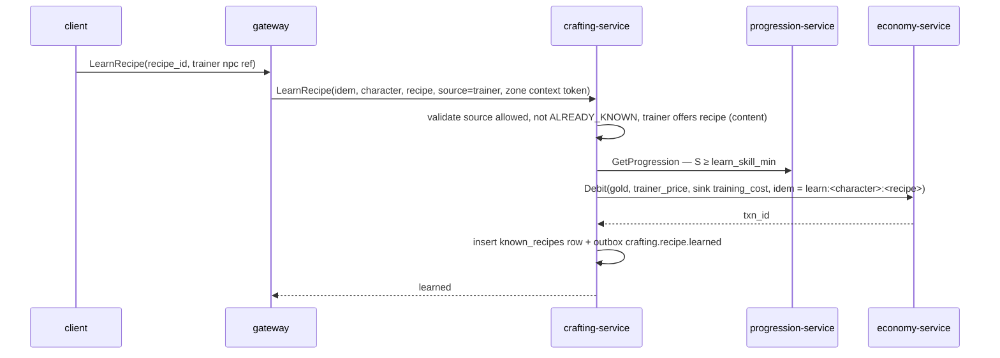

# Legends of the Shattered Frontier — Crafting: Recipes, Workshops and Learning
Version 1.0 — Expanded Technical Design Authority edition (2026-10-17)

Design target; not implemented. Names per Shared Registry v1.0.

Entry file: [Resource and Crafting Architecture](../Legends_Shattered_Frontier_Resource_and_Crafting_Architecture_v1.0.md) · Registry: [Shared Registry](../Legends_Shattered_Frontier_Shared_Registry_v1.0.md)

This part defines what can be crafted and where: the recipe content model and kinds, difficulty bands, refinement chains, output rules, workshops and stations with their tiers, how recipes are learned and discovered, repair kits, reforge and reroll, legendary forging, and construction materials including the Builder's Cache. Quality, success and the ilvl mapping are normative in the entry file (C2–C4); this part references them.

---

## 1. Recipe content model

### 1.1 `recipe` definition

```json
{
  "id": "recipe/emberforged_greatsword",
  "recipe_kind": "gear",
  "skill_id": "skill/smithing",
  "workshop_kind": "forge",
  "min_workshop_tier": 4,
  "difficulty": 850,
  "craft_time_s": "derived",
  "tool_category": "smithing_hammer",
  "inputs": [
    { "slot": 1, "definition_id": "item/steel_ingot", "quantity": 6, "required_tier": "rare",
      "accepts_higher_tier": true, "quality_input": true, "protected_on_failure": false },
    { "slot": 2, "definition_id": "item/ember_essence", "quantity": 15, "required_tier": "epic",
      "quality_input": false },
    { "slot": 3, "definition_id": "item/abyssal_shard", "quantity": 12, "required_tier": "epic",
      "quality_input": false },
    { "slot": 4, "definition_id": "item/flawless_ruby", "quantity": 2, "required_tier": "epic",
      "quality_input": false }
  ],
  "catalyst_slot": { "accepts_tag": "affix_catalyst", "max": 1 },
  "output": { "definition_id": "item/emberforged_greatsword", "quantity": 1,
              "base_rarity": "rare", "rarity_max": "epic" },
  "learn": { "sources": ["trainer", "scroll"], "learn_skill_min": 750, "trainer_cost": "derived",
             "account_wide": false },
  "discovers": [ { "recipe_id": "recipe/emberforged_greatsword_of_cinders", "weight": 1 } ],
  "tags": ["two_hand", "sword", "endgame"],
  "display": { "name_key": "recipe.emberforged_greatsword.name" }
}
```

| Field | Rule |
| --- | --- |
| `recipe_kind` | registered enum `recipe_kind` (Shared Registry, Phase-2 enums; §1.2) |
| `skill_id` | one of the eight crafting skills; must be served by `workshop_kind` (Registry workshop ↔ skill mapping) |
| `min_workshop_tier` | ≥ the band minimum for `difficulty` (§2) |
| `difficulty` | 0–1100 |
| `craft_time_s` | `"derived"` (§2.2) or an explicit value within ± 50 % of derived |
| `tool_category` | crafting tool category, or null (no tool → `T = 0` unless one is equipped) |
| `inputs[]` | 1–8 slots; `definition_id` is an item definition; `quality_input` slots must exist for `gear`, `tool`, `consumable`, `refine`, `component`; `protected_on_failure` only for `legendary_forge` or definitions tagged `world_event_material` |
| `input_scaling` | only for `reforge`/`reroll`: `{ "basis": "target_value", "fraction_key": "tune.crafting.reforge_cost_fraction" }` — quantities are computed per target (§7) |
| `catalyst_slot` | optional; a catalyst (tag `affix_catalyst`, inscription-made) locks one secondary affix (`locked_affixes`, Itemization 8.1) |
| `output` | `definition_id` category consistent with the kind; `base_rarity ≤ rarity_max ≤ epic` (legendary only for `legendary_forge`) |
| `learn` | at least one source (§4); `learn_skill_min` default `max(0, D − MARGIN_LOW)` |
| `discovers[]` | optional variant recipes (§5) |

### 1.2 Recipe kinds

| `recipe_kind` | Output | ilvl | Batch max | Failure | Value rule |
| --- | --- | --- | --- | --- | --- |
| `refine` | material (lot quality = `quality_score`) | — | 20 | lose 50 % of inputs | output ref value = inputs × `REFINE_VALUE_MULT` / quantity |
| `component` | material | — | 20 | lose 50 % | as refine |
| `gear` | weapon, armor, accessory | `S_item` formula (C3) | 5 | lose 50 % | `C_mat` ∈ cost band × `C_equiv` (Salvage part) |
| `tool` | tool | `S_item` formula | 5 | lose 50 % | cost band at tool slot weight 0.50 |
| `consumable` | consumable (potency C2.7), repair kits, recipe scrolls | — | 20 | lose 50 % | authored ref value; kits per §6 |
| `structure_material` | construction materials, siege parts, workshop components | — | 20 | lose 50 % | as refine |
| `reforge` | modifies target (`RestoreMaxDurability`) | unchanged | 1 | lose 50 % of reagents; target safe | reagents = `REFORGE_COST_FRACTION × C_equiv(target)` |
| `reroll` | modifies target (`RerollAffix`) | unchanged | 1 | lose 50 % of reagents; target safe | reagents = `REROLL_COST_FRACTION × C_equiv(target) × escalation` |
| `legendary_forge` | legendary item (Itemization forging) | 465 fixed | 1 | never fails | path-defined |

### 1.3 Validator (content publish, `lsf-craftmath` validator inside `content-catalog-service`)

A pack is rejected when any recipe:

1. Names an unknown skill/workshop pairing or a `min_workshop_tier` below its difficulty band, unless the recipe carries a reviewed `workshop_tier_exception` (used by the workshop-fitting and siege recipes of §9.4–§9.5 so a workshop can make its own next upgrade).
2. Has a `gear`/`tool` output whose `ilvl_rule.kind` (Itemization) is not `crafted`, or a `legendary_forge` output not referenced by a published `legendary_path`.
3. Fails the cost band `C_mat / C_equiv(output at ilvl_ref and base_rarity) ∈ [0.75, 1.25]` (`gear`, `tool`; `ilvl_ref` is the on-band reference item level, Salvage part, Recipe cost validator) or the vendor check `vendor_value(output) ≤ C_mat / 2.5` (Salvage part, Recipe cost validator).
4. Creates a cycle in the material graph (a material whose derived reference value depends on itself).
5. Marks inputs `protected_on_failure` outside the allowed cases, or has no learn source.
6. References a disabled definition (`ff.content.disabled_definitions` is runtime; the validator only warns).

Warnings (publish allowed, flagged for review): `D` outside the kind's typical band (§2.1), `craft_time_s` override, discovery variants with higher value than the parent by more than 10 %.

---

## 2. Difficulty bands, workshop tiers and time

### 2.1 Bands

| `D` range | Skill band of an on-band crafter | `min_workshop_tier` | Typical input tier | Max crafted ilvl (`S_item` cap, C3) | Typical crafter level |
| --- | --- | --- | --- | --- | --- |
| 0–299 | `novice`–`apprentice` | 1 | `common` | 170–250 | 1–30 |
| 300–549 | `journeyman` | 2 | `uncommon` | 250–350 | 25–55 |
| 550–799 | `expert`–`master` | 3 | `rare` | 350–449 | 50–90 |
| 800–949 | `master`–`legendary` | 4 | `rare` + `epic` reagents | 450 | 80–100 |
| 950–1100 | `legendary` (specialized) | 5 | `epic` + `legendary` reagents | 450 | 100 |

Band thresholds are `tune.crafting.min_workshop_tier_bands` = `[300, 550, 800, 950]`. Public workshops (tier ≤ 3) therefore serve every recipe below `D` 800; master-level recipes need a player or guild workshop (§3). This is the main social hook between crafting and Building.

### 2.2 Craft time

| `recipe_kind` | `craft_time_s` (derived) |
| --- | --- |
| `refine`, `structure_material` | 3 (per unit) |
| `component` | 5 |
| `gear` | `10 + D / 100` (D 850 → 18.5 s) |
| `tool` | `8 + D / 100` |
| `consumable` | 4 |
| `reforge`, `reroll` | 8 |
| `legendary_forge` | 60 (ceremonial channel; both characters must stay in range) |

Batch channel time = `batch_count × craft_time_s × batch_time_factor` (`tune.crafting.batch_time_factor.<kind>`: `refine` 0.8, others 1.0). Character's practice weight uses `action_seconds = craft_time_s` per unit (ω = `clamp(t / 6, 0.2, 3.0)`), so long gear crafts are worth more practice per attempt than refinement, and batches do not inflate practice beyond per-unit time.

---

## 3. Workshops and stations

### 3.1 Stations

A workshop of a given `workshop_kind` provides every station of that kind; recipes select the station by `skill_id`.

| `workshop_kind` | Stations (skill) | Typical recipes |
| --- | --- | --- |
| `forge` | anvil (`smithing`), jeweler's bench (`jewelcrafting`) | ingots, weapons, plate/mail, tools, rings, necklaces, gem cutting |
| `sawmill` | saw bench (`carpentry`) | planks, timber, bows, staves, shields, siege frames, Builder's Cache |
| `alchemy_lab` | alembic (`alchemy`), cooking hearth (`cooking`) | potions, reagents, essence refining, food |
| `tailor_shop` | loom (`tailoring`), scribe desk (`inscription`) | cloth, leather armor, bags, scrolls, inks, catalysts, recipe scrolls |
| `engineering_workshop` | assembly bench (`engineering`) | traps, siege equipment, stone blocks, mechanisms, workshop components |

### 3.2 Tier sources

| Workshop source | Tier | Rule |
| --- | --- | --- |
| Public (NPC town) | authored per placement, 1–3 (`PUBLIC_WORKSHOP_TIER_MAX`); default `tune.crafting.public_workshop_tier` (2) | Capital and faction-hub towns 3; outposts 1 |
| Player housing | structure `workshop_tier`, capped at `settlement_tier_cap.housing` = 3 | owner and permitted characters |
| Guild settlement | structure `workshop_tier`, capped by settlement stage: camp 2, village 3, town 4, city 5, capital 5 (`tune.crafting.settlement_tier_cap.<stage>`) | Building permissions |
| Damaged structure | −1 tier while structure health < 50 % (min 1) | Building structure state |

Player workshops are Building `structure/<kind>_t<n>` functional objects (cross-spec request, entry file C10), e.g. `structure/forge_t4`, carrying `workshop_kind` and `workshop_tier`. Upgrading `t<n>` → `t<n+1>` replaces the object through a Construction build transaction; Crafting supplies the components (§9.3).

### 3.3 Resolution (zone-server)

```text
if workshop is public:  W = placement.tier ; public_workshop = true
else:                   W = max(1, min(structure.workshop_tier, cap(claim_or_settlement_stage)) − damaged)
                        require use permission (Building: owner / friends / guild / public), else interact_state
require distance(character, workshop) ≤ interact_range (Security spec) and not in combat
send CraftItem(workshop_kind, workshop_tier = W, workshop_ref = structure instance id or null, public_workshop)
```

crafting-service trusts `W` from a registered zone-server but rejects `W > 5`, or `W > PUBLIC_WORKSHOP_TIER_MAX` with `public_workshop = true` (entry file C7 #7).

### 3.4 Workshop tier value

Workshop tier contributes `Q_workshop = 10 × (W − 1)/4` quality points (C2.1) and gates recipes by `min_workshop_tier`. A tier-5 workshop is worth +10 quality, i.e. +5 `quality_bonus` (≈ +5 ilvl) on every crafted endgame item — enough that guilds build them, not so much that solo crafters at public tier-3 workshops are uncompetitive (−5 quality vs tier 5).

---

## 4. Recipe learning

### 4.1 Sources

| `recipe_learn_source` | How | Cost / sink | Notes |
| --- | --- | --- | --- |
| `default` | Known by every character from creation (starter recipes) or on first reaching `learn_skill_min` | — | Granted lazily: crafting-service treats `default` recipes as known when `S ≥ learn_skill_min`; no row, no event |
| `trainer` | NPC crafting trainer (gateway → `LearnRecipe`, trainer validated by zone-server context) | gold, sink `training_cost` (`economy-service.Debit`) | requires `S ≥ learn_skill_min` |
| `scroll` | Consume a recipe scroll item (`item/recipe_scroll_<slug>`, category `consumable`, tag `recipe_scroll`) | item, sink `consumable_used` (Shared Registry, Currency sources and sinks) | scrolls drop from loot tables, are sold by vendors, or crafted by inscription; tradeable unless bound; behind `ff.crafting.recipe_scrolls_enabled` |
| `reward` | Reward bundle `unlock` line with `unlock_id = recipe/<slug>`, `account_wide = false` → reward-service → `crafting-service.LearnRecipe` | — | Resolved (2026-10-17): Itemization spec, Reward bundles, Delivery |
| `account_unlock` | Reward line with `account_wide = true` → progression `GrantAccountUnlock` (`unlock_kind = recipe`) → crafting-service projection | — | Resolved (2026-10-17): Character spec, Account-wide unlocks; consumer is crafting-service |
| `discovery` | Experimentation on successful crafts (§5) | — | `ff.crafting.discovery_enabled` |
| `gm` | admin-portal, audited | — | `learn_source = gm`; requires audit record |

### 4.2 Knowledge model

```text
known(character, recipe) ⇔
     (recipe.learn.sources ∋ default ∧ S(character, recipe.skill) ≥ recipe.learn.learn_skill_min)
  ∨  ∃ row in crafting.known_recipes(character_id, recipe_id, revoked_at IS NULL)
  ∨  ∃ row in crafting.account_recipes(account_id(character), recipe_id, revoked_at IS NULL)
```

- `crafting.known_recipes` is the authoritative per-character store (`KnownRecipe`, registered in Shared Registry, Phase-2 additions).
- `crafting.account_recipes` is a projection of progression-service account unlocks with `unlock_kind = recipe`, built from `progression.account_unlock.granted`. On a projection miss for an account never seen, crafting-service calls `ListAccountUnlocks(account_id, kind = recipe)` once and caches. Resolved (2026-10-17): crafting-service reconciles account unlock grants and revocations with `ListAccountUnlocks` every 24 h for accounts with projection rows; Character's `ApplyRollback` revokes the account unlock, while Crafting owns its recipe projection and `KnownRecipe` state.
- Knowing a recipe does not bypass `S ≥ D − MARGIN_LOW` at craft time: a recipe can be learned at `learn_skill_min` (default `D − 100`) and crafted from the same point, at low quality and 50 % success.
- Knowledge is realm-scoped through the character (characters are realm-scoped); account recipes are realm-independent (Character spec: unlocks are account scope).

### 4.3 Trainer price

```text
L_eq(D)       = clamp(ceil(D / 10), 1, 100)
trainer_price = round(TRAINER_COST_W × gold_reward(L_eq(D), 1) × npc_price_mult)       copper
```

`TRAINER_COST_W` 1.0 (`tune.crafting.trainer_cost_weight`); `gold_reward` from Registry, Shared reward scaling functions; `npc_price_mult` from economy-service (Charisma/faction price modifier, Economy spec). Examples (`npc_price_mult` 1.0): `D` 120 → L 12 → `100 × 13^1.5 = 4,687` copper; `D` 450 → L 45 → `100 × 46^1.5 = 31,199` copper (3 g 11 s 99 c); `D` 850 → L 85 → `100 × 86^1.5 = 79,753` copper. A crafter who learns every trainer recipe of one skill (≈ 120 recipes, average L_eq 45) spends ≈ 375 g over the skill's lifetime — a meaningful but secondary gold sink (Salvage part, Crafting gold sinks).

### 4.4 Learn flow (trainer)



Scroll flow is identical with `ConsumeItem(scroll, sink consumable_used, idem = learn:<character>:<recipe>)` instead of `Debit`; the scroll is consumed only if the recipe is not yet known (`ALREADY_KNOWN` is checked before consumption). The idempotency key ties the payment to the knowledge row, so a retry never charges twice.

### 4.5 Loot eligibility

Itemization's need/greed rule allows `need` on "a recipe/token usable by the character". loot-service calls `ListKnownRecipes(character_id, recipe_ids[])`, which returns per recipe `known` and `learnable` (`S ≥ learn_skill_min − MARGIN_LOW` and not known). `need` on a scroll is allowed when `learnable = true`.

### 4.6 Revocation

`RevokeRecipe(character_id | account_id, recipe_id, reason, case_id | reward_grant_id)` sets `revoked_at`; it is called by reward-service (`RevokeGrant` of a recipe line) and enforcement-service (rollback). Resolved (2026-10-17): reward-service routes recipe-line revocations to this RPC (Itemization spec, Reward bundles, Delivery). Items already crafted with the recipe are not affected by revocation (their lineage is handled by enforcement's taint trace). Revocation of a scroll-learned recipe does not refund the scroll.

---

## 5. Discovery (experimentation)

A recipe may list `discovers[]` variant recipes (same skill, same or higher `D`, different look or affix emphasis). On every **successful** attempt of the parent:

```text
candidates = { v ∈ discovers : v not known ∧ S ≥ v.learn_skill_min }
p_disc     = DISCOVERY_BASE × quality_score / 100 × (1 + luck_factor)          if candidates ≠ ∅
on u_disc < p_disc: learn one candidate by weighted draw (learn_source = discovery)
```

`DISCOVERY_BASE` 0.02 (`tune.crafting.discovery_base`). Draws come after `v` in the attempt's stream (entry C4.1). Example: `quality_score` 77, luck 75 → `0.02 × 0.77 × 1.05 = 0.0162` per success, ≈ 62 successes on average. Discovery is limited to one recipe per attempt and never to recipes with `learn.sources` excluding `discovery` (validator ensures variants list `discovery`). Rationale: rewards experimenting with high-quality crafts without making discovery the main acquisition path.

---

## 6. Repair kits

Itemization: "Player repair (Crafting-owned recipe "repair kit", skill-gated) consumes materials instead of gold and restores up to the current `max_durability`".

### 6.1 Kit definition

Kits are `consumable` outputs (`item/repair_kit_<family>_t<n>`, family `metal`, `leather`, `cloth`, `wood`) crafted by smithing (metal), tailoring (leather, cloth) or carpentry (wood).

```text
kit_capacity_copper = KIT_CAPACITY(tier) × (0.5 + quality_score / 200)        (0.5–1.0 of nominal)
use requirement     = S(kit.use_skill) ≥ (tier − 1) × 200 ; target family matches ; target ilvl ≤ ILVL_MAX(tier)
```

| Kit tier | `KIT_CAPACITY` (`tune.crafting.kit_capacity.<tier>`) | Target ilvl max | Use skill min | Recipe `D` | Target `C_mat` (0.45 × capacity) |
| --- | --- | --- | --- | --- | --- |
| 1 | 2,000 | 100 | 0 | 50 | 900 |
| 2 | 8,000 | 200 | 200 | 250 | 3,600 |
| 3 | 25,000 | 300 | 400 | 450 | 11,250 |
| 4 | 60,000 | 400 | 600 | 650 | 27,000 |
| 5 | 150,000 | any | 800 | 850 | 67,500 |

### 6.2 Applying a kit

```mermaid
sequenceDiagram
    participant C as client
    participant G as gateway
    participant CS as crafting-service
    participant I as inventory-service
    C->>G: RepairWithKit(kit_item_id, target_item_ids[])
    G->>CS: RepairWithKit(idem, character, kit, targets) (out of combat token from zone-server)
    CS->>I: BatchGetItems(kit + targets)
    CS->>CS: validate family, tier, use skill; capacity from kit provenance.quality_score
    CS->>I: RepairItems(payment_kind=kit, kit_item_id, capacity_copper, targets, idem)
    I->>I: quote each target (Itemization repair formula, npc_price_mult = 1, economy_repair_mult = 1); repair in order until capacity used; consume kit (sink consumable_used)
    I-->>CS: repaired[], capacity_used
    CS-->>G: result
```

Rules: repair cost in kit terms is Itemization's `missing_cost` with `npc_price_mult = 1` and `economy_repair_mult = 1` (kits are independent of NPC pricing and Economy's repair scaling); broken targets use `BROKEN_REPAIR_SURCHARGE` and still suffer `BROKEN_MAX_DUR_LOSS` (Itemization). The last target is repaired partially (`floor(remaining / cost_per_point)` points). Unused capacity is lost (single-use kit). Kits never raise `max_durability` (that is reforge). Practice: none (kit use is not a recipe attempt). Resolved (2026-10-17): inventory-service `RepairItems` accepts kit mode with crafting-service as caller (Itemization spec, Item Model and Lifecycle, Inventory RPCs).

Worked example: tier-5 metal kit at `quality_score` 80 → `150,000 × 0.9 = 135,000` copper-equivalent. Target 1: epic plate chest ilvl 460 at 56/140 → missing cost 42,400 (Itemization worked example) → repaired fully; remaining 92,600. Target 2: epic plate legs ilvl 460 at 0/140 broken → `full_repair_cost = 70,666` (legs weight 1.0 = chest) × 1.25 = 88,333 → repaired fully, remaining 4,267, lost. Kit reference value ≈ 67,500 copper versus 130,733 copper of NPC repairs replaced: kits are ≈ 50 % cheaper in material value, but require a crafter, travel-free use, and turn a gold sink into an item sink — Economy watches the shift (`m_repair_kit_share`, Salvage part).

---

## 7. Reforge and reroll

### 7.1 Reforge (restore `max_durability`)

`recipe_kind = reforge`, one generic recipe per material family (`recipe/reforge_metal`, `recipe/reforge_leather`, `recipe/reforge_cloth`, `recipe/reforge_wood`), skill smithing / tailoring / carpentry.

```text
D_target        = min(1000, 2 × ilvl_rel(target))                 ilvl_rel = ilvl − ilvl_tier_offset(current tier)
reagent_value   = REFORGE_COST_FRACTION × C_equiv(target)          REFORGE_COST_FRACTION 0.10
reagent_qty_i   = ceil(reagent_value × share_i / ref_value(reagent_i))
```

The recipe's effective difficulty is `D_target` (used for success, quality and practice). On success crafting-service calls `inventory-service.RestoreMaxDurability(target, idem = crf_id)` (cross-spec request); on failure 50 % of reagents are lost and the target is untouched. Quality has no effect on the result (the outcome is binary); `quality_score` is still recorded for analytics. Target must be unequipped, `active` or `broken`, not escrowed/quarantined, not legendary-locked (legendary items can be reforged; Itemization forbids only salvage/destroy).

Example: epic plate chest ilvl 460 whose `max_durability` fell to 120/140. `C_equiv` (Salvage part) = `25,376 × 1.0 × 1.15 × E(460)`, `E(460) = 1 + 30 + 1.0 × 55 = 86` → `2,509,686` copper; reagents `0.10 × 2,509,686 = 250,969` copper of `item/tempered_flux` (ref 9,000) → `ceil(27.89) = 28` flux; `D_target = min(1000, 920) = 920`.

### 7.2 Reroll (replace one affix)

`recipe_kind = reroll`, `recipe/arcane_reinscription` (inscription, scribe desk). Itemization executes the reroll (Stat budget part, Rerolls and modification: replaces exactly one non-implicit affix from the same kind pool, new RNG stream keyed by the crafting request ID, budget/ilvl/rarity unchanged).

```text
n               = count of succeeded reroll attempts on this target (crafting.attempts.target_item_id)
reagent_value   = REROLL_COST_FRACTION × C_equiv(target) × REROLL_ESCALATION ^ min(n, 5)
D_target        = min(1000, 2 × ilvl_rel(target))
```

`REROLL_COST_FRACTION` 0.15, `REROLL_ESCALATION` 1.5 (`tune.crafting.reroll_cost_fraction`, `tune.crafting.reroll_escalation`). Target rarity ≥ `uncommon` (needs a secondary affix). The player names the affix to replace (`affix_ref`). On success crafting-service calls `inventory-service.RerollAffix(target, affix_ref, idem = crf_id)` (cross-spec request); inventory emits `item.instance.modified` (`change_kind = reroll`).

Example: rare ring ilvl 405, `C_equiv` 432,660 (Salvage part example 2). First reroll: `0.15 × 432,660 = 64,899` copper of `item/arcane_ink` (ref 3,000) → `ceil(21.63) = 22` inks. Third reroll (`n` = 2): `× 2.25 = 146,023` → 49 inks. Sixth and later (`1.5^5 = 7.59`): `492,827` → 165 inks — escalation stops endless fishing for perfect affixes.

---

## 8. Legendary forging

### 8.1 Rules

1. Recipe `recipe_kind = legendary_forge`, referenced by exactly one `legendary_path` final stage (`crafted_by` requirement with `recipe_id`, `crafter_skill_min`, `skill_id`; Itemization spec, Legendary items).
2. Requirements at attempt time: workshop tier 5 of the right kind; crafter `S ≥ crafter_skill_min` (900 in the Itemization example, i.e. specialized) and recipe known by the **crafter** (learned via the path's quest reward or trainer for specialized crafters); the beneficiary's legendary progress (via `inventory-service.GetLegendaryProgress`) is on the forging stage with every requirement other than `crafted_by` satisfied, else `LEGENDARY_STAGE_NOT_READY`.
3. Inputs are owned by the **beneficiary** (path materials are usually bound to them) and all are `protected_on_failure`; `p_success = 1` (no success draw). Quality is rolled normally and recorded (it sets the legendary's `roll_floor` through `quality_bonus` as for any crafted item; Itemization decides whether legendary affixes use it).
4. Output: `CreateCraftedItem` with `rarity = legendary`, `legendary_path_id`, `beneficiary_character_id`; Itemization creates the item at ilvl 465, source `legendary_upgrade`, binding `on_pickup` to the beneficiary (Itemization forging rule). `crafting.item.crafted` with the beneficiary drives the `crafted_by` requirement and the stage advance.
5. Self-forging (crafter = owner) needs no consent token. Forging for another character requires `beneficiary_consent_token` (entry C7 #11) and `ff.crafting.beneficiary_forging_enabled`.
6. A forging attempt is never batched and holds a per-beneficiary lock for its 60 s channel; a second concurrent attempt for the same path returns `IDEMPOTENCY_MISMATCH` or `LEGENDARY_STAGE_NOT_READY`.

### 8.2 Flow

```mermaid
sequenceDiagram
    participant O as owner client
    participant K as crafter client
    participant ZS as zone-server
    participant CS as crafting-service
    participant I as inventory-service
    K->>ZS: craft intent (legendary recipe, beneficiary = owner)
    ZS->>O: consent prompt (both within interact_range of a tier-5 forge)
    O->>ZS: accept
    ZS->>ZS: issue beneficiary_consent_token (60 s, single use); 60 s channel
    ZS->>CS: CraftItem(recipe, inputs owned by owner, beneficiary, token)
    CS->>I: GetLegendaryProgress(owner, path) — forging stage, other requirements met
    CS->>CS: roll quality (no success draw); persist rolled
    CS->>I: CreateCraftedItem(rarity legendary, legendary_path_id, beneficiary, material_lots)
    I-->>CS: item_id (ilvl 465, source legendary_upgrade, bound to owner)
    CS->>CS: succeeded + outbox crafting.item.crafted (beneficiary)
    Note over I: inventory consumer marks crafted_by satisfied, AdvanceLegendaryStage → forged
```

---

## 9. Construction materials and the Builder's Cache

Construction consumes materials directly through its all-or-nothing build transaction (Construction concept); Crafting produces those materials and the Builder's Cache.

### 9.1 Structural material tiers

| Construction tier | Material item (tag `construction_material`) | Recipe (skill, `D`, workshop, min tier) | Inputs → output | Ref value per unit (derived) |
| --- | --- | --- | --- | --- |
| 1 Rough timber | `item/rough_timber` | carpentry, 0, sawmill, 1 | 1 `oak_log` → 4 | `120 × 1.15 / 4 = 35` |
| 2 Worked timber | `item/worked_timber` | carpentry, 250, sawmill, 1 | 2 `ash_log` + 1 `iron_nails` → 6 | `(1,200 + 46) × 1.15 / 6 = 239` |
| 3 Stone masonry | `item/dressed_stone` | engineering, 350, engineering workshop, 2 | 2 `granite` → 4 | `1,200 × 1.15 / 4 = 345` |
| 4 Reinforced masonry | `item/reinforced_block` | engineering, 550, engineering workshop, 3 | 3 `dressed_stone` + 1 `iron_bracket` → 3 | `(1,035 + 317) × 1.15 / 3 = 518` |
| 5 Metal-framed masonry | `item/framed_block` | engineering, 750, engineering workshop, 3 | 2 `reinforced_block` + 1 `steel_beam` → 2 | `(1,036 + 3,121) × 1.15 / 2 = 2,390` |

Supporting refines: `item/iron_nails` (smithing D 30: 1 `iron_ore` → 3, value 46), `item/iron_ingot` (smithing D 10: 1 `iron_ore` → 1, value 138), `item/iron_bracket` (smithing D 150: 2 iron ingots → 1, `276 × 1.15 = 317`), `item/steel_ingot` (smithing D 420: 3 `iron_ore` + 1 `blackcoal` → 1, `2,360 × 1.15 = 2,714`), `item/steel_beam` (smithing D 500: 1 `steel_ingot` → 1, `2,714 × 1.15 = 3,121`). Construction materials are batchable (`structure_material`, batch 20) and quality only affects appearance variants (structure stats come from Building/Construction material data). Rationale for low per-unit values: a 256-voxel batch must stay affordable (tier 1 ≈ 9,000 copper, tier 5 ≈ 610,000 copper).

### 9.2 Builder's Cache

The entry file's Construction supply object and this recipe define the same launch cache. Content definitions below are the concrete authored catalogue, not implemented assets.

```json
{
  "id": "recipe/builders_cache",
  "recipe_kind": "component",
  "skill_id": "skill/carpentry",
  "workshop_kind": "sawmill",
  "min_workshop_tier": 1,
  "difficulty": 40,
  "craft_time_s": 10,
  "inputs": [
    { "slot": 1, "definition_id": "item/worked_timber", "quantity": 20, "required_tier": "uncommon", "quality_input": true },
    { "slot": 2, "definition_id": "item/rough_timber", "quantity": 10, "required_tier": "common", "quality_input": true }
  ],
  "output": { "definition_id": "item/builders_cache", "quantity": 1, "base_rarity": "common", "rarity_max": "common" },
  "learn": { "sources": ["default"], "learn_skill_min": 0 }
}
```

- Output `item/builders_cache` is a placeable item whose container behavior (capacity, storage filter `construction_material`, persistence) is Itemization's; placement and permissions are Building's.
- Quality maps only to `appearance_variant` (`quality_score` ≥ 85 → "masterwork" finish); it never changes capacity, supply radius, health or access rights.
- `learn_source = default` with `learn_skill_min` 0: every character can build one, matching "early-game recipe".
- Batch max 1 for this recipe (`batch_max` override) so cache spam is bounded by craft time; Building may cap caches per claim.

### 9.3 Workshop components

Workshop upgrades consume Crafting-made components through Construction transactions:

| Target tier | Component (kind `structure_material`) | Skill, `D` | Key inputs |
| --- | --- | --- | --- |
| 1 | — (built from tier 1–2 construction materials only) | — | — |
| 2 | `item/workshop_fittings_t2` | engineering 300 | iron brackets, worked timber |
| 3 | `item/workshop_fittings_t3` | engineering 550 | steel beams, dressed stone |
| 4 | `item/workshop_core_t4` (per kind: bellows, loom frame, alembic array, saw assembly, gear train) | engineering 800 + kind skill 700 component | epic reagents |
| 5 | `item/workshop_core_t5` | engineering 950 | epic reagents + 1 `prismatic_core` (legendary) |

### 9.4 Launch siege and defense catalogue

The following complete launch recipes supersede the former generic D400–950 siege/gear-value rule. Each named output is `item/<recipe slug>` and each recipe is `recipe/<slug>`; output quantity is one unless shown. Equipment uses `item_category = siege_equipment`, ammunition uses `material`, and the anchor is a placeable `tool` with no storage. All recipes are `component`, default known, batch maximum one for equipment/anchor and 20 for ammunition, with ordinary success and failure rules. Station requirements are explicit content exceptions to the general difficulty-band defaults. Quality is cosmetic and provenance only: no equipment stat budget, ilvl, affix, damage, health, ammunition potency or rarity benefit. Material cost and ordinary component value checks replace gear slot valuation.

| Slug | Skill / difficulty | Workshop / tier | Seconds | Inputs → output |
| --- | --- | --- | ---: | --- |
| `battering_ram` | carpentry /300 | Sawmill /2 |30 |40 worked timber +10 iron ingots →1 ram |
| `ballista` | engineering /400 | Engineering Workshop /2 |40 |30 worked timber +20 iron ingots →1 ballista |
| `mortar` | engineering /550 | Engineering Workshop /3 |45 |20 worked timber +30 iron ingots →1 mortar |
| `siege_bolt` | engineering /150 | Engineering Workshop /1 |4 |2 worked timber +1 iron ingot →1 bolt |
| `stone_charge` | engineering /250 | Engineering Workshop /1 |6 |10 granite +1 iron ingot →1 charge |
| `powered_bolt_turret` | engineering /550 | Engineering Workshop /3 |40 |30 worked timber +20 iron ingots →1 turret |
| `ownership_anchor` | carpentry /0 | Sawmill /1 |10 |20 rough timber +10 granite →1 anchor |

All ingredient names resolve to the existing `item/` definitions of §9.1 and Gathering. Granite is the mortar's stone input. Output item IDs above, `item/builders_cache`, `structure/builders_cache` and `recipe/builders_cache` are concrete content catalogue declarations using existing content kinds; these do not add services, enum values or implemented assets. Siege damage, deployment caps, turret targeting, power, recovery and one-bolt-per-shot consumption follow [Territory §6.3](../Legends_Shattered_Frontier_Building_and_Territory_System_v1.0.md). Equipment crafts empty; creating ammunition never loads it for free. Spent ammunition/charges do not become reclaimable structural input.

### 9.5 Construction bootstrap and workshop linkage

[Construction §16](../Legends_Shattered_Frontier_Construction_System_Architecture_v0.1.md) owns hand assembly of the hammer/digging tool, tier-1 workshop placement, direct functional-object plans and tier acquisition unlocks. These are deterministic construction transactions, not crafting attempts: no quality roll, skill practice, equipment budget or workshop circular dependency. Public tier-1 Sawmills provide the first refinement path. All material refinement above remains a normal crafting attempt.

Tier-2 fittings are made at Engineering Workshop tier 1, difficulty 300, in 20 seconds, from 4 iron brackets and 8 worked timber; tier-3 fittings at Engineering Workshop tier 2, difficulty 550, in 30 seconds, from 2 steel beams and 8 dressed stone. Each recipe outputs one matching §9.3 fitting. These explicit station exceptions allow upgrading the current workshop. Tiers 4–5 retain §9.3's advanced component chain and require the preceding workshop tier; a target-tier station is never required to make its own first upgrade. Construction supplies 20 units of the target structural material plus one fitting/core per upgrade, and Territory caps the effective workshop tier. See the entry's supply tuning controls and the shared Tuning document for reviewed recipe publication; no console can edit quality or damage equations.

---

## 10. Representative recipe catalogue (illustrative)

| Recipe | Kind | Skill | `D` | Tier | Inputs (summary) | Output |
| --- | --- | --- | --- | --- | --- | --- |
| `recipe/iron_ingot` | refine | smithing | 10 | 1 | 1 iron ore | 1 iron ingot |
| `recipe/steel_ingot` | refine | smithing | 420 | 2 | 3 iron ore + 1 blackcoal | 1 steel ingot (rare) |
| `recipe/iron_longsword` | gear | smithing | 120 | 1 | 20 iron ingot, 2 leather strip (`C_mat` 3,036; `rarity_max = common`, Salvage part §3.2) | sword, ilvl ≤ 178 |
| `recipe/linen_cloth` | refine | tailoring | 20 | 1 | 2 linseed flax → 1 | cloth |
| `recipe/minor_healing_potion` | consumable | alchemy | 30 | 1 | 2 meadowleaf + 1 vial → 3 | potion (potency 0.90–1.10) |
| `recipe/frostbloom_elixir` | consumable | alchemy | 480 | 2 | 3 frostbloom + 1 sapphire dust → 2 | elixir |
| `recipe/hearty_stew` | consumable | cooking | 150 | 1 | raw meat, wheat, salt → 4 | food buff |
| `recipe/silver_ring` | gear | jewelcrafting | 300 | 2 | 2 silver ingot, 1 rough quartz | ring, ilvl ≤ 250 |
| `recipe/ironwood_longbow` | gear | carpentry | 600 | 3 | ironwood planks, sinew, steel fittings | bow (two-hand) |
| `recipe/arcane_ink` | component | inscription | 350 | 2 | sunpetal, prismatic dust, vial → 4 | ink (reroll reagent) |
| `recipe/minor_affix_catalyst` | component | inscription | 600 | 3 | inks + essence | catalyst (tag `affix_catalyst`) |
| `recipe/starmetal_pickaxe` | tool | smithing | 700 | 3 | starmetal ingot, ironwood haft | pickaxe tier 4 |
| `recipe/repair_kit_metal_t5` | consumable | smithing | 850 | 4 | starsteel scraps, tempered flux | repair kit |
| `recipe/emberforged_greatsword` | gear | smithing | 850 | 4 | §1.1 | two-hand sword, ilvl ≤ 450 |
| `recipe/ashbringer_reforged` | legendary_forge | smithing | 1000 | 5 | path materials (protected) | legendary (Itemization path) |
| `recipe/builders_cache` | component | carpentry | 40 | 1 | §9.2 | Builder's Cache |

Recipe count targets at launch: ≈ 120 per crafting skill (≈ 25 per band from novice to master, ≈ 20 above 800), of which ≈ 30 % `default`, 50 % `trainer`, 15 % `scroll`/`reward`, 5 % `discovery`.

## Material identity across harvesting and crafting

User direction,2026-10-19: the gathering progression applies to every material family, from accessible starting resources to tougher, rare and magical types (Gathering§1.5). Wood spans workable soft/light timber, mature hardwoods, dense rare wood and magical timber; stone/ore, plant fibers/herbs, crops, fish and animal materials have equivalent authored ladders. Refining preserves published material identity/grade and lot-quality provenance. Recipe inputs distinguish those materials and support appropriate different outputs/components/properties through existing formulas and workshop/learning gates. Do not collapse all harvested wood into a universal timber item or all stone/ore into one resource, and do not silently allow higher-grade substitution into every recipe. Existing low-grade materials retain everyday crafting/construction uses. New item slugs/recipes require catalogue publication; this note does not publish unimplemented items.
