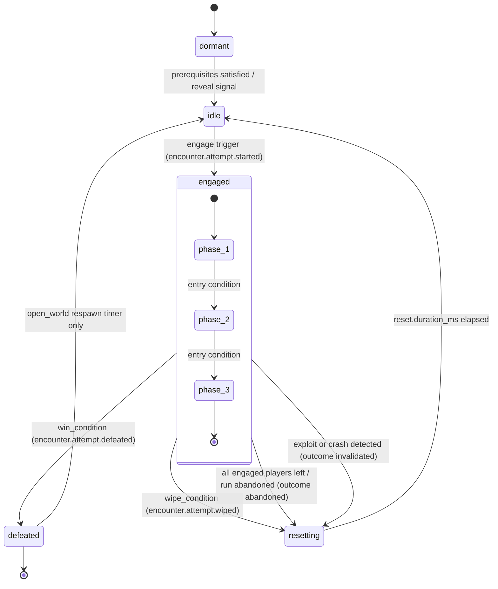

# Legends of the Shattered Frontier — Dungeon Spec, Part 2: Encounter Framework and NPC Behavior
### Version 1.0 — Expanded Technical Design Authority edition (2026-10-17)

**Status:** Design target; not implemented. Names per Shared Registry v1.0.
**Entry file:** [Dungeon Architecture](../Legends_Shattered_Frontier_Dungeon_Architecture_v1.0.md) · **Registry:** [Shared Registry v1.0](../Legends_Shattered_Frontier_Shared_Registry_v1.0.md)

This part defines the **encounter framework** shared by dungeons and raids (encounter definition schema, boss state machine, phases, timers, mechanics, enrage, attempts and outcomes, scripting with behavior trees and utility AI, determinism and seeding), the **NPC behavior models** for trash packs, elites and mini bosses inside instanced content, and the payloads of all `encounter.*` events. Damage, mitigation and threat math are owned by the Combat spec (Combat, Threat & Aggro System; Armor System); NPC behavior in the open world is owned by the AI spec. This part extends both for instanced content and does not redefine them. Raid-specific encounter design (raid roles, council loot, world effects) is in the Raid spec; extension points are marked **[Raid extension point]**.

---

## 1. Runtime placement

The encounter runtime is a UE5.8 server module (`LSFEncounter`) compiled into the zone-server build. It runs in:

- `instance-server` for instanced dungeons and raids (the normal case), and
- `zone-server` for open-world dungeons (Part 3, Open-world dungeons), with `run_id` absent.

The runtime is simulation-authoritative (Registry authority rule 1). It reports to `instance-service` via the server-facing RPCs of Part 1 (`ReportAttemptStarted`, `ReportPhaseChanged`, `ReportMechanicFailed`, `ReportAttemptEnded`); `instance-service` validates, persists and relays the `encounter.*` events. Encounter logic ticks at a fixed **10 Hz decision rate** (`tune.dungeon.encounter_tick_hz`) on top of the UE server frame (30 Hz); movement and ability execution use the normal combat pipeline.

---

## 2. Encounter definition schema

Encounter definitions are content (`encounter/<slug>`) published in content packs by `content-catalog-service`. The same schema serves dungeons and raids.

```json
{
  "id": "encounter/sunken_vault_drowned_king",
  "schema_version": 1,
  "kind": "boss",
  "display_name_key": "enc.sunken_vault.drowned_king.name",
  "host_content": ["dungeon/sunken_vault"],
  "creature_tier": "mini_boss",
  "boss_hp_factor": 6.0,
  "level_offset": 2,
  "roster": [
    { "npc_id": "npc/drowned_king", "role": "primary", "count": 1, "spawn_point": "sp_throne" },
    { "npc_id": "npc/tide_thrall", "role": "add", "count": 0, "spawn_point": "sp_pool_a", "scale_count": true }
  ],
  "prerequisites": { "encounters_defeated": ["encounter/sunken_vault_tidecaller"], "objectives_done": [] },
  "arena": {
    "bounds_volume": "vol_throne_room",
    "doors": ["door_throne_north"],
    "seal_on_engage": true,
    "out_of_bounds_grace_ms": 3000
  },
  "engage": { "triggers": ["aggro_radius", "damage_taken", "interact:altar_throne"], "aggro_radius_m": 18 },
  "win_condition": { "type": "npc_dead", "npc_role": "primary" },
  "wipe_condition": { "type": "no_live_engaged_players_in_arena", "grace_ms": 5000 },
  "size_variants": {
    "solo_party": { "disabled_mechanics": [], "min_group_size_overrides": {} },
    "extended_party": { "extra_mechanics": ["mech_twin_whirlpools"] }
  },
  "phases": [
    {
      "phase": 1,
      "name_key": "enc.drowned_king.p1",
      "entry": { "type": "start" },
      "abilities": ["abl_crushing_tide", "abl_brine_bolt", "abl_summon_thralls"],
      "behavior_tree": "behavior_tree/drowned_king_p1"
    },
    {
      "phase": 2,
      "name_key": "enc.drowned_king.p2",
      "entry": { "type": "health_pct_lte", "value": 60 },
      "transition": { "invulnerable_ms": 4000, "cast": "abl_flood_chamber" },
      "abilities": ["abl_crushing_tide", "abl_whirlpool", "abl_brine_bolt"],
      "behavior_tree": "behavior_tree/drowned_king_p2"
    },
    {
      "phase": 3,
      "name_key": "enc.drowned_king.p3",
      "entry": { "type": "health_pct_lte", "value": 25 },
      "abilities": ["abl_crushing_tide", "abl_whirlpool", "abl_drowning_grasp"],
      "behavior_tree": "behavior_tree/drowned_king_p3"
    }
  ],
  "abilities": {
    "abl_crushing_tide": { "kind": "tank_hit", "dmg_coef": 0.30, "school": "frost", "initial_ms": 8000, "cooldown_ms": 16000, "jitter_ms": 1500, "cast_ms": 2000, "target": "threat_top" },
    "abl_brine_bolt": { "kind": "damage", "dmg_coef": 0.10, "school": "nature", "initial_ms": 4000, "cooldown_ms": 7000, "jitter_ms": 1000, "cast_ms": 1500, "target": "utility:ranged_preference" },
    "abl_summon_thralls": { "kind": "add_wave", "add_role": "add", "base_count": 3, "initial_ms": 20000, "cooldown_ms": 40000, "jitter_ms": 0 },
    "abl_whirlpool": { "kind": "mechanic", "mechanic_id": "mech_whirlpool", "initial_ms": 6000, "cooldown_ms": 22000, "jitter_ms": 2000 },
    "abl_drowning_grasp": { "kind": "mechanic", "mechanic_id": "mech_grasp_interrupt", "initial_ms": 5000, "cooldown_ms": 18000, "jitter_ms": 1000 },
    "abl_flood_chamber": { "kind": "damage", "dmg_coef": 0.15, "school": "frost", "target": "all_in_arena" }
  },
  "mechanics": {
    "mech_whirlpool": {
      "type": "dodge",
      "telegraph_ms": 2500,
      "placement": "random_player_positions",
      "count": { "base": 2, "per_extra_player": 0.4 },
      "radius_m": 4,
      "fail": { "condition": "inside_radius_at_resolve", "effect": "damage", "dmg_coef": 0.45, "debuff": null }
    },
    "mech_grasp_interrupt": {
      "type": "interrupt",
      "cast_ms": 3000,
      "fail": { "condition": "cast_completes", "effect": "debuff", "debuff_id": "eff_drowning", "dmg_coef": 0.08, "duration_ms": 8000 },
      "min_group_size": 2
    },
    "mech_twin_whirlpools": { "type": "spread", "radius_m": 6, "fail": { "condition": "overlap", "effect": "damage", "dmg_coef": 0.25 } }
  },
  "enrage": {
    "soft_start_ms": 300000,
    "soft_ramp_pct_per_10s": 5,
    "hard_ms": 480000,
    "hard_ability": "abl_tsunami_wipe"
  },
  "reset": { "duration_ms": 10000, "respawn_trash": false },
  "rewards": {
    "story": "reward/sunken_vault_drowned_king_story",
    "normal": "reward/sunken_vault_drowned_king_normal",
    "veteran": "reward/sunken_vault_drowned_king_veteran"
  },
  "validation": { "min_ttk_ms_at_ref": 90000, "max_boss_distance_from_anchor_m": 45 }
}
```

### 2.1 Field reference

| Field | Required | Meaning |
| --- | --- | --- |
| `kind` | yes | `boss`, `mini_boss`, `event` (gauntlet, survival, escort), `objective` (interact/channel). |
| `creature_tier` | yes | Combat creature tier of the primary NPC: `common`, `elite`, `mini_boss`, `world_boss` (Combat, NPC Attribute Generation). Dungeon bosses are `mini_boss` tier with `boss_hp_factor`. |
| `boss_hp_factor` | bosses | Authored archetype multiplier `A_hp` (Part 3 scaling). Range 2.0–12.0 for dungeons. |
| `level_offset` | yes | Added to run level for the NPC level (Part 3). |
| `roster[]` | yes | NPCs in the encounter; `scale_count` applies group count scaling to `add` roles. |
| `prerequisites` | no | Gates `dormant` → `idle`. |
| `arena` | yes | Bounds volume, doors, out-of-bounds rule. |
| `engage.triggers` | yes | Any of `aggro_radius`, `damage_taken`, `interact:<actor>`, `event:<signal>`. |
| `win_condition` | yes | `npc_dead` (role), `all_dead`, `survive_ms`, `objective_done`, `custom:<bt_signal>`. |
| `wipe_condition` | yes | Default: no live engaged player inside arena for `grace_ms`. |
| `size_variants` | yes | Per `group_size_class`: mechanics disabled/added. |
| `phases[]` | yes | Ordered; each has `entry`, optional `transition`, ability set, behavior tree. |
| `abilities{}` | yes | Timer-driven ability definitions (§4). |
| `mechanics{}` | no | Failable mechanics (§5). |
| `enrage` | bosses | Soft and hard enrage (§6). |
| `reset` | yes | Reset duration and trash behavior. |
| `rewards{}` | yes | Reward bundle per difficulty; `mythic` runs normally omit (end chest) — Part 3. |
| `validation` | yes | Anti-exploit thresholds checked on defeat (§8). |

**Phase entry types:** `start`, `health_pct_lte` (of primary), `time_gte_ms` (since engage), `adds_dead`, `adds_alive_gte`, `mechanic_count_gte`, `signal:<name>` (from behavior tree or arena script). Phases are monotonic: the runtime never returns to an earlier phase index within an attempt **unless** the phase declares `"loop_to": <phase>` (used for alternating stage designs). Each transition emits `encounter.phase.changed`.

---

## 3. Encounter state machine (registry `encounter_state`)

| State | Meaning |
| --- | --- |
| `dormant` | Not yet available: prerequisites unmet, or a scripted event has not yet revealed it. NPCs may be absent or non-interactive. |
| `idle` | Available; NPCs at spawn, full health, doors open, waiting for an engage trigger. |
| `engaged` | An attempt is in progress; arena sealed (if configured); phases, timers and mechanics run. |
| `defeated` | Win condition met. Terminal for this run (open world: until respawn timer, then `idle`). |
| `resetting` | Wipe, evade, abandonment or invalidation: NPCs leash home, heal, despawn adds, clear debuffs, reopen doors. |



Invariants:

1. Exactly one open `EncounterAttempt` per encounter while `engaged`; it is created on entering `engaged` and closed with exactly one `encounter_attempt_outcome` on leaving it.
2. `attempt_index` increases by 1 per attempt within the run (0-based) and feeds `encounter_seed` (Part 1, Seeds), so every attempt has fresh but reproducible randomness.
3. `resetting` cannot be cut short by players (no re-pull while resetting); NPCs are immune and non-targetable during reset.
4. A defeated encounter is persisted in the checkpoint immediately; crash recovery never revives a defeated boss.

### 3.1 Attempt outcomes (registry `encounter_attempt_outcome`)

| Outcome | Condition | Rewards | Lockout | Counts as wipe for analytics |
| --- | --- | --- | --- | --- |
| `defeated` | `win_condition` met and validation passes (§8). | Yes, eligible participants. | Created/updated. | No |
| `wiped` | `wipe_condition` met. | No | No | Yes |
| `abandoned` | All engaged players left the run or disconnected beyond linkdead; run abandoned mid-attempt. | No | No | No |
| `invalidated` | Validation failed on defeat, server crash mid-attempt, GM action, arena exploit detected. | No (and any defeat is voided) | No | No |

A defeat that fails validation is recorded as `invalidated` and the encounter goes to `resetting`, not `defeated` — the players must kill it legitimately. Because the registry catalog has no `encounter.attempt.abandoned`/`encounter.attempt.invalidated` events, these outcomes are currently visible only through `instance.run.*` aggregates and the `encounter_attempts` table; the entry file proposes adding the two events.

---

## 4. Timers and ability scheduling

Each ability in the active phase has a **timer**: `next_ms = engage_or_phase_start + initial_ms + J`, then after each use `next_ms = used_at + cooldown_ms + J`, where `J` is jitter drawn uniformly from `[-jitter_ms, +jitter_ms]` using the encounter RNG `timer` stream (§7). Rules:

- **Phase reset of timers.** On phase entry, timers of abilities new to the phase start from `initial_ms`; abilities that continue from the previous phase keep their remaining time, clamped to at least `tune.dungeon.phase_carry_min_ms` (default 3000 ms) so that a phase transition never chains two big hits.
- **Spell queue.** If two abilities become ready within 1500 ms (`tune.dungeon.ability_spacing_ms`), the lower-priority one is delayed until the first resolves + spacing. Priority: `mechanic` > `add_wave` > `tank_hit` > `damage`.
- **Cast-time readability.** Every ability with `dmg_coef ≥ 0.25` (heavy hit) must have `cast_ms ≥ 1500` or a telegraph — validated at content publish.
- **Group-size scaling of timers.** Timers do not scale with group size; counts and damage do (Part 3). This keeps encounter rhythm learnable across sizes.

Worked example (`abl_brine_bolt`, `initial_ms` 4000, `cooldown_ms` 7000, `jitter_ms` 1000): with RNG draws −420, +880, +115, the first cast starts at 4,000 − 420 = 3,580 ms; the starts at 3,580 + 7,000 + 880 = 11,460; the third at 11,460 + 7,000 + 115 = 18,575 (cooldown counted from cast start). Because the stream is seeded, a replay of the same attempt reproduces these times exactly.

---

## 5. Mechanics

A **mechanic** is a failable player test. Mechanic types (the framework implements each once; content parameterizes):

| Type | Player test | Default failure condition | Scaling with group size |
| --- | --- | --- | --- |
| `dodge` | Leave telegraphed area. | Inside radius at resolve. | `count = base + per_extra_player × (n − 1)`, rounded down. |
| `soak` | Required number of players stand in area. | Fewer than `required` players → damage split fails → full damage to all in arena. | `required = max(1, round(n × soak_fraction))`. |
| `spread` | Keep distance from allies. | Overlap within radius. | None. |
| `stack` | Group together to split damage. | Damage split among players in radius; fail if any receives > `max_share`. | Damage scales by `G_dmg`. |
| `interrupt` | Interrupt or stun a cast. | Cast completes. | Disabled if `n < min_group_size`. |
| `tank_swap` | Second tank taunts at stacks. | Stacks exceed `max_stacks`. | Disabled for `n < 6` unless content opts in. |
| `add_priority` | Kill specific add within time. | Add alive at timer end → buff boss / damage. | Add count via count scaling. |
| `positional` | Face/position boss (e.g. frontal cone away). | Non-tank hit by cone. | None. |
| `dispel` | Remove a debuff. | Debuff expires undispelled. | Disabled if no `healer`/`support` in group and `n ≤ 3`. |
| `carry` | Carry object to a location. | Object dropped/expired. | None. |

Every failure is evaluated server-side and results in (a) the authored effect and (b) an `encounter.mechanic.failed` report. To protect the event bus, the server **aggregates** failures per `(attempt, mechanic, character)` over 5-second windows and reports one entry with `count` (§9.5). Mechanics that are mandatory for a role the group lacks (e.g. `tank_swap` with one tank) are auto-disabled by `size_variants` and by the rule above; content cannot require a combat role that the matchmaker does not guarantee for that size class (Part 4, role slots).

---

## 6. Enrage

Two enrage tiers keep TTK targets meaningful and prevent infinite-sustain cheese.

**Soft enrage** (default on for bosses): after `soft_start_ms`, all boss damage is multiplied by

```
E_soft(t) = 1 + soft_ramp_pct_per_10s / 100 × floor((t − soft_start_ms) / 10000)     for t ≥ soft_start_ms
```

where `t` is ms since engage. Example: `soft_start_ms` 300,000, ramp 5 %: at t = 360,000 → `1 + 0.05 × 6 = 1.30`.

**Hard enrage**: at `hard_ms` the boss casts `hard_ability` (an unavoidable arena-wide hit with `dmg_coef ≥ 5.0`), repeating every 5 s. Hard enrage cannot be disabled by affixes, consumables or group size.

**Authoring rule.** For a boss with target TTK `T_target` (Part 3, Run time targets):

```
soft_start_ms = round(1.5 × T_target)   (tune.dungeon.soft_enrage_ttk_mult = 1.5)
hard_ms       = round(2.5 × T_target)   (tune.dungeon.hard_enrage_ttk_mult = 2.5)
```

For `story` difficulty, soft enrage is disabled and hard enrage is 4 × `T_target` (allows very under-geared or solo players to finish). For `mythic`, enrage timers use the same values but the dungeon timer (Part 3) is the primary pressure.

---

## 7. Determinism and seeding

Goals: identical inputs reproduce the same boss decisions (debugging, replay, exploit investigation) and randomness cannot be predicted or manipulated by players.

1. **Seed source.** `encounter_seed` (Part 1, Seeds) per attempt. Open-world encounters use `SHA-256("owenc|" + zone_id + "|" + encounter_id + "|" + spawn_epoch + "|" + attempt_index)`.
2. **Generator.** PCG32 (64-bit state, 32-bit output). Each purpose uses its own stream ID so that adding a draw in one system does not shift another:

| Stream ID | Purpose |
| --- | --- |
| 1 `timer` | Ability jitter. |
| 2 `target` | Random target selection, tie breaks in utility scoring. |
| 3 `placement` | Mechanic placement, add spawn point choice. |
| 4 `crit` | NPC crit/dodge rolls (Combat formulas use this stream for NPC-side rolls in encounters). |
| 5 `loot_presentation` | Cosmetic only (chest choice); never actual loot (loot is rolled by `loot-service`). |

3. **Fixed decision tick.** All behavior-tree and utility evaluations run on the 10 Hz decision tick, with inputs sampled at the tick boundary (positions, threat table, health). Decisions never read wall-clock time; they read `engage_elapsed_ms` from the tick counter.
4. **Order.** Iteration over players uses ascending `character_id` order; over NPCs ascending spawn order. No iteration over hash maps in decision code.
5. **Replay log.** The server records a compact per-attempt input log (tick, player positions quantized to 0.25 m, health, threat table top-5, casts started) to local disk, uploaded to object storage on `wiped`/`invalidated`/`defeated` for 7 days (`tune.dungeon.replay_retention_days`). A headless replay harness (Part 4) re-runs the encounter logic and must reproduce the same decision sequence.
6. **No client-visible seed.** Clients receive telegraphs only when a mechanic is announced; they never receive future timer values or the seed.

Determinism scope is the **decision layer** (which ability, which target, which placement, when). Physics, navigation micro-movement and floating-point combat math are not bit-exact across builds; the replay harness compares decisions, not damage numbers.

---

## 8. Encounter scripting: behavior trees + utility AI

Boss and NPC logic is layered (AI spec, NPC AI layers; this section specializes them for encounters):

```
Encounter Director (per encounter, owns state machine, phases, timers, enrage)
  └─ Phase Behavior Tree (behavior_tree/<boss>_p<n>)
       ├─ Selector: interrupt-reactions (stunned, feared, phase transition lock)
       ├─ Sequence: ready ability from timer queue → Utility target selection → cast
       ├─ Sequence: mechanic orchestration (spawn telegraphs, resolve, report failures)
       └─ Fallback: melee threat_top / reposition to anchor
  └─ Utility Scorer (target selection and optional ability choice)
```

**Behavior trees** decide *what* the boss does next (sequence and priority). The timer queue (§4) feeds ready abilities into the tree; the tree may hold an ability for up to 1 s for positioning but cannot fire it early.

**Utility AI** decides *whom* or *where* for abilities with `target: "utility:<profile>"`. Score for candidate target `p`:

```
U(p) = Σ_k w_k × f_k(p) + ε
```

| Feature `f_k` | Definition (normalized 0–1) |
| --- | --- |
| `threat_rank` | `1 − rank/(n−1)` on the threat table (rank 0 = top). |
| `distance_far` | `min(1, dist(boss,p) / 40 m)`. |
| `distance_near` | `1 − distance_far`. |
| `observed_healer` | Share of the group's healing done by `p` in the last 15 s. |
| `observed_damage` | Share of damage done by `p` in the last 15 s. |
| `low_health` | `1 − health_pct(p)`. |
| `recently_targeted` | 1 if `p` was this ability's target within its last 2 uses. |
| `in_los` | 1 if line of sight else 0 (hard filter if ability needs LoS). |

Profiles (weights `w_k`) are content data, e.g. `ranged_preference = {distance_far: 1.0, recently_targeted: -0.8, threat_rank: -0.3}`, `disrupt_healer = {observed_healer: 1.2, recently_targeted: -0.6}`, `execute = {low_health: 1.0, threat_rank: -0.5}`. `ε` is a tie-break from the `target` stream in `[0, 0.01)`.

**Role-aware targeting uses observed behavior, not declared `combat_role`.** Declared roles are only for matchmaking (Registry glossary, Combat Role); a player who declares `damage` but heals is targeted as a healer. This prevents gaming the AI by declaring a role.

**Fairness caps** (framework-enforced, not content-overridable): the same player cannot be the target of more than 3 consecutive utility-targeted abilities; `execute`-style profiles cannot select a target that has received a targeted ability in the last 3 s.

### 8.1 Defeat validation

On `win_condition`, the server collects `ValidationFacts` and `instance-service` re-checks them before accepting `defeated`:

| Rule | Check | Failure |
| --- | --- | --- |
| Arena containment | Primary NPC never beyond `max_boss_distance_from_anchor_m`; no engaged player outside arena bounds more than `out_of_bounds_grace_ms` cumulatively while dealing damage. | `invalidated`, reason `arena_violation`. |
| Minimum TTK | `duration_ms ≥ min_ttk_ms_at_ref × (HP_actual / HP_ref_5) × (n_eq_ref / n_eq_actual) / avg_ilvl_factor`, where `HP_ref_5` is the primary NPC's health for a reference 5-player group at the same difficulty, `n_eq` is damage-equivalents, and `avg_ilvl_factor = ilvl_dps_factor(avg_ilvl) / ilvl_dps_factor(ilvl_ref)` (Part 3, Reference damage output and TTK). `min_ttk_ms_at_ref` is authored at about 35 % of the target TTK. | `invalidated`, reason `ttk_floor`, detection report. |
| Navigation validity | Every damaging player position was on navmesh or a valid jump arc (sampled at 2 Hz). | `invalidated`, reason `geometry`. |
| Layout | `layout_hash` matches the run's stored hash. | `invalidated`, reason `layout_mismatch`. |
| Leash evades | Boss did not evade during the attempt (evade ends the attempt as `resetting`). | — |
| Participants | Every rewarded participant has `joined_before_engage`. | Participant excluded. |

---

## 9. NPC behavior models (trash, elites, mini bosses)

These models apply inside instances and open-world dungeons. World AI (patrol networks, faction behavior, world events) stays with the AI spec.

### 9.1 Perception and aggro

| Parameter | `common` | `elite` | `mini_boss` | Tuning key |
| --- | --- | --- | --- | --- |
| Aggro radius (m) at equal level | 12 | 15 | 18 | `tune.dungeon.aggro_radius_<tier>` |
| Radius change per level difference | −1 m per level the player is above NPC (min 4 m); +1 m per level below (max +6 m) | same | none | `tune.dungeon.aggro_level_slope` |
| Line of sight required | yes | yes | no (arena trigger) | — |
| Stealth detection | `detect = aggro_radius × (1 − stealth_skill/1500)` (skill `stealth`, AI spec owns stealth) | ×1.2 | ×1.5 | — |
| Sound/assist call radius | 8 m | 10 m | — | `tune.dungeon.assist_radius_<tier>` |

Aggro radius only triggers engagement; target selection after engagement is threat-based per Combat (1 damage = 1 threat, 1 healing = 0.5 threat split across engaged NPCs, taunt = top × 1.10 plus forced target, Combat spec, Threat & Aggro).

**Threat switching.** An NPC changes its melee target only when another player's threat exceeds the current target's by **110 %** if the challenger is in melee range (≤ 5 m) or **130 %** if not (`tune.dungeon.threat_switch_melee` = 1.10, `tune.dungeon.threat_switch_ranged` = 1.30). Taunt sets the taunter's threat to `max(own, top × TAUNT_THREAT_MULT)` (`TAUNT_THREAT_MULT` 1.10) and forces target for `TAUNT_FORCE_S` (3 s). Resolved (2026-10-17): per Combat spec, Threat & Aggro (was `top × 1.0`).

**Initial threat.** On engagement by proximity, the first player detected gets 1 threat; healing done before any NPC engages generates no threat.

### 9.2 Pack links

Trash is authored in **packs** (`pack_id`). All members of a pack engage together (shared engage). Rules:

- `link_radius` 0 by default: packs do not chain-pull each other. Content can opt in per pack (`"link_to": ["ps_04"]`) for authored "linked groups"; chains are limited to depth 1.
- **Assist calls:** an engaged NPC that survives ≥ 2 s and has a non-engaged NPC of the same faction within `assist_radius` pulls that NPC's pack. This is the only implicit link; it makes body-pulling/LOS-pulling meaningful without random chain pulls.
- **Patrol packs** link with a stationary pack only if the patrol is within the stationary pack's aggro radius of a player at engage time.

### 9.3 Leashing and evade

| NPC kind | Leash anchor | Leash radius | Additional rule |
| --- | --- | --- | --- |
| Trash / elites | Pack spawn centroid | 40 m (`tune.dungeon.leash_radius_trash`) | Also evade if no damage dealt or taken by the pack for 10 s while target unreachable (pathing failure). |
| Mini bosses (trash-area) | Spawn point | 30 m | Same unreachable rule (6 s). |
| Encounter bosses | Arena bounds volume | Arena volume | Leaving arena = evade = attempt ends with `resetting` and outcome `wiped` (if players alive outside) or `invalidated` (if dragged by exploit, §8.1). |

Evade behavior: drop threat table, become immune and non-targetable, run back at 1.5× speed, regenerate to full on arrival, restore authored position and facing. Evade count per pack is tracked; ≥ 3 evades of the same pack within 2 minutes reports a `leash_abuse` signal to `anticheat-service` (Part 4, Security).

### 9.4 Patrols

Patrols follow authored splines (`patrol_path_id`) with `speed` (default 2.5 m/s), `pause_ms` at nodes and `ping_pong` or `loop`. In generated layouts (Part 3), patrol paths are chosen by the `placement` stream from the slot's candidate list. A patrol that engages and then resets resumes from its nearest path node, not from the start.

### 9.5 Archetype behavior defaults

| Archetype | Tier | Default behavior tree | Utility profile for specials | Notes |
| --- | --- | --- | --- | --- |
| Brute | common | melee threat_top; occasional frontal cleave (positional) | — | Cleave `dmg_coef` 0.08. |
| Caster | common | stays at 20–30 m; interruptible cast every 6–8 s | `ranged_preference` | Interrupt-flagged casts are `interrupt` mechanics with no event reporting below elite tier. |
| Skirmisher | common | jumps to far targets every 12 s | `ranged_preference` | Respects fairness caps. |
| Guardian | elite | shields allies; must be interrupted or killed first | — | Implements `add_priority` lite. |
| Shaman | elite | heals pack 15 % every 10 s; dispellable buffs | `disrupt_healer` for hex | — |
| Champion | mini_boss | two-ability rotation + one mechanic (dodge or interrupt) | `execute` for finisher | Uses encounter framework with `kind: mini_boss` and its own small arena volume. |

Archetype names are registry `npc_archetype` values (`brute`, `caster`, `skirmisher`, `guardian`, `shaman`, `champion`); default trees are `behavior_tree/` content. Resolved (2026-10-17).

Mini bosses that sit in trash areas use the encounter framework (`kind: mini_boss`) with `seal_on_engage: false`; they produce attempts and can carry their own reward bundle (veteran/mythic: enemy forces only).

### 9.6 Role-aware targeting for trash

Trash uses threat; only specials use utility profiles. Elites and mini bosses may use `disrupt_healer` at most once per 20 s per NPC (`tune.dungeon.disrupt_healer_cd_ms`) so packs pressure healers without making tanking meaningless.

---

## 10. `encounter.*` event payloads

Producer in envelope: `instance-service` (relaying); `payload.origin_server_instance_id` records the simulation source. Envelope `character_id` is omitted (multi-participant); participants are in the payload. Topic `domain.encounter`, key `run_id` (or `zone_id` for open world).

### 10.1 `encounter.attempt.started`

| Field | Type | Required | Description | privacy_class |
| --- | --- | --- | --- | --- |
| `attempt_id` | string | yes | `att_`. | p1_pseudonymous |
| `run_id` | string | no | Absent for open world. | p1_pseudonymous |
| `encounter_id` | string | yes | `encounter/<slug>`. | p0_public |
| `content_id` | string | yes | Host `dungeon/*` or `raid/*`. | p0_public |
| `difficulty` | string | yes | Difficulty. | p0_public |
| `mythic_level` | int | no | Mythic level. | p0_public |
| `attempt_index` | int | yes | 0-based within run (open world: within spawn). | p0_public |
| `participant_character_ids` | string[] | yes | Engaged players at start. | p1_pseudonymous |
| `group_size` | int | yes | `n` used for scaling. | p0_public |
| `origin_server_instance_id` | string | yes | `srvi_`. | p0_public |

### 10.2 `encounter.phase.changed`

| Field | Type | Required | Description | privacy_class |
| --- | --- | --- | --- | --- |
| `attempt_id` | string | yes | Attempt. | p1_pseudonymous |
| `encounter_id` | string | yes | Encounter. | p0_public |
| `from_phase` | int | yes | Previous phase. | p0_public |
| `to_phase` | int | yes | New phase. | p0_public |
| `elapsed_ms` | int | yes | Since engage. | p0_public |
| `trigger` | string | yes | Entry type that fired (`health_pct_lte`, `time_gte_ms`, …). | p0_public |
| `boss_health_pct` | number | yes | Primary NPC health at transition. | p0_public |

### 10.3 `encounter.attempt.defeated`

| Field | Type | Required | Description | privacy_class |
| --- | --- | --- | --- | --- |
| `attempt_id` | string | yes | Attempt. | p1_pseudonymous |
| `run_id` | string | no | Run. | p1_pseudonymous |
| `encounter_id`, `content_id`, `difficulty` | string | yes | — | p0_public |
| `mythic_level` | int | no | — | p0_public |
| `duration_ms` | int | yes | Engage → defeat. | p0_public |
| `group_size` | int | yes | `n`. | p0_public |
| `deaths` | int | yes | Player deaths during attempt. | p0_public |
| `mechanic_failures` | int | yes | Total failure count. | p0_public |
| `participants` | object[] | yes | `{character_id, combat_role, equipped_ilvl, damage_done, healing_done, damage_taken, deaths, reward_eligible}`. | p1_pseudonymous |
| `affix_ids` | string[] | yes | Active affixes. | p0_public |
| `first_defeat_for_run` | bool | yes | Always true for instanced; open world: first defeat in spawn cycle. | p0_public |

### 10.4 `encounter.attempt.wiped`

| Field | Type | Required | Description | privacy_class |
| --- | --- | --- | --- | --- |
| `attempt_id` | string | yes | Attempt. | p1_pseudonymous |
| `run_id` | string | no | Run. | p1_pseudonymous |
| `encounter_id`, `difficulty` | string | yes | — | p0_public |
| `duration_ms` | int | yes | Engage → wipe. | p0_public |
| `final_phase` | int | yes | Phase reached. | p0_public |
| `boss_health_pct` | number | yes | Health at wipe. | p0_public |
| `enrage_reached` | string | yes | `none`, `soft`, `hard`. | p0_public |
| `top_failed_mechanics` | object[] | yes | Up to 3 `{mechanic_id, count}`. | p0_public |
| `group_size` | int | yes | `n`. | p0_public |
| `participant_character_ids` | string[] | yes | — | p1_pseudonymous |

### 10.5 `encounter.mechanic.failed`

Aggregated per `(attempt, mechanic, character)` per 5 s window.

| Field | Type | Required | Description | privacy_class |
| --- | --- | --- | --- | --- |
| `attempt_id` | string | yes | Attempt. | p1_pseudonymous |
| `encounter_id` | string | yes | Encounter. | p0_public |
| `mechanic_id` | string | yes | Mechanic key from definition. | p0_public |
| `mechanic_type` | string | yes | `dodge`, `soak`, … | p0_public |
| `character_id` | string | yes | Failing player (for personal failure); absent for group failures (e.g. soak under-count). | p1_pseudonymous |
| `count` | int | yes | Failures in window. | p0_public |
| `window_start_ms` | int | yes | Elapsed since engage. | p0_public |
| `consequence` | string | yes | `damage`, `debuff`, `boss_buff`, `add_spawn`, `death`. | p0_public |

### 10.6 combat.* payloads (moved to the Combat spec)

The canonical `combat.*` payloads (`combat.npc.killed` durable on `domain.combat` with `credited_character_ids`; `combat.character.died`, `combat.character.resurrected`, `combat.damage.summarized`, `combat.pvp_kill.recorded` as telemetry) moved on 2026-10-17, unchanged, to the [Combat spec, Combat events](../Legends_Shattered_Frontier_Combat_System_v0.1.md#combat-events). `instance-server` produces them for instanced runs exactly as defined there.

---

## 11. Content validation (publish-time)

`content-catalog-service` runs the encounter validator (Part 4 test matrix) before a pack can publish. A definition fails if:

1. A phase is unreachable (entry conditions impossible given prior phases).
2. Any heavy hit (`dmg_coef ≥ 0.25`) lacks a cast or telegraph ≥ 1500 ms.
3. A mechanic requires a role not guaranteed for any enabled size class without a `size_variants` disable.
4. `hard_ms` ≤ `soft_start_ms`, or enrage timings deviate from the authoring rule by > 20 % without a LiveOps waiver.
5. Headless simulation with reference bots (Part 3 reference stats) at each enabled `(difficulty, size_class)` misses the TTK target band by more than ±25 %.
6. Reward bundles missing for any enabled non-mythic difficulty.
