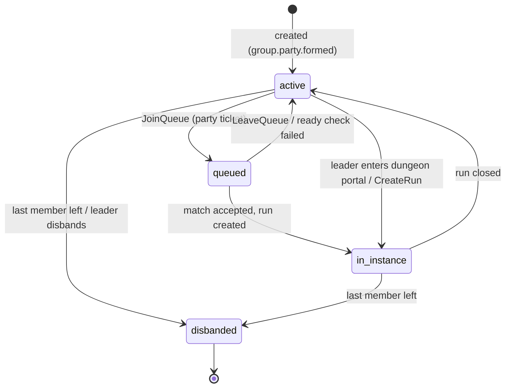
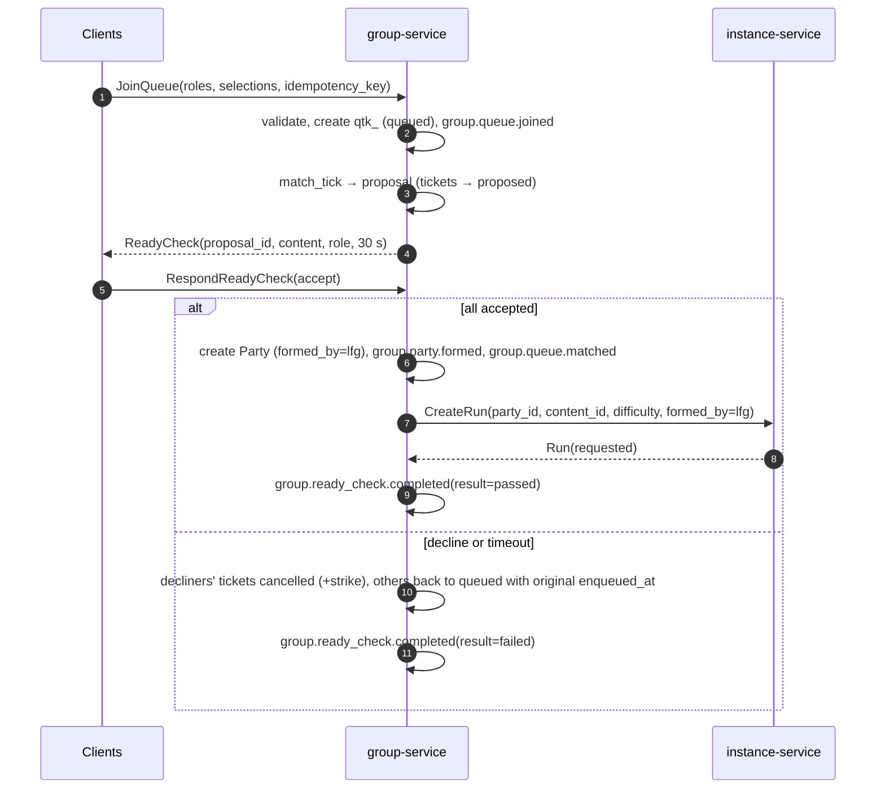
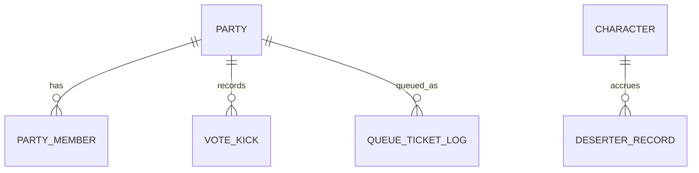

# Legends of the Shattered Frontier — Dungeon Spec, Part 4: Groups and Matchmaking, Analytics, Security, Agent Implementation Guide
### Version 1.0 — Expanded Technical Design Authority edition (2026-10-17)

**Status:** Design target; not implemented. Names per Shared Registry v1.0.
**Entry file:** [Dungeon Architecture](../Legends_Shattered_Frontier_Dungeon_Architecture_v1.0.md) · **Registry:** [Shared Registry v1.0](../Legends_Shattered_Frontier_Shared_Registry_v1.0.md)

This part defines `group-service` (parties, extended parties, LFG matchmaking by `combat_role`, the queue algorithm, ready checks, vote-kick, deserter rules, mythic listings), its schema, gRPC API and `group.*` event payloads; then the domain's analytics hooks, security considerations, and the agent implementation guide for the whole Dungeon spec. Raid groups (`rgp_`) are owned by the Raid spec and reuse the queue, ready-check and vote primitives defined here **[Raid extension point]**.

---

## 1. Parties and extended parties

| Concept | Entity | Size | Rules |
| --- | --- | --- | --- |
| Party | `Party` (`pty_`), `size_class = solo_party` | 1–5 (`PARTY_MAX`) | One leader; optional assistant. |
| Extended party | `Party` (`pty_`), `size_class = extended_party` | 6–10 (`EXTENDED_PARTY_MAX`) | Two subgroups of up to 5 (`subgroup` 1 or 2) for UI and buffs; one leader. |

An extended party is the same entity as a party with a different `size_class`; conversion (`ConvertPartySize`) is allowed only when the party is not queued and not in an instance, and only to `solo_party` if it has ≤ 5 members.

**Realm rules.** Premade parties are formed within one realm (invites by name). LFG-formed parties may span realms within one `dc_region`; instances are hosted per `dc_region`. Cross-realm members can trade dungeon loot only with same-realm members (§7.3).

**Party states** (registry enum `party_state`):



Leadership: on leader leave, leadership passes to the assistant, else to the longest-tenured member. Invitations live in Redis for 60 s (`tune.group.invite_ttl_s`). A character belongs to at most one party.

---

## 2. LFG matchmaking

### 2.1 Scope

Automatic matchmaking covers `story` (group mode), `normal` and `veteran`. `mythic` uses **listings** (§2.7) because Mythic Level, access and route knowledge make blind matching a poor experience. Queues are scoped to `dc_region` and cross realms.

### 2.2 Queue tickets

`QueueTicket` (`qtk_`, Redis). Fields: `ticket_id`, `party_id` (or null for solo), `members[] {character_id, realm_id, roles[] (declared combat_role, one or more), level, equipped_ilvl}`, `selections[] {content_id, difficulty}`, `size_class`, `dc_region`, `enqueued_at`, `priority_boost_s`, `backfill_run_id` (optional), `state`.

Ticket states (registry enum `queue_ticket_state`): `queued` → `proposed` (in a ready check) → `matched` (run created) | `cancelled` (player left) | `expired` (max queue time `tune.group.queue_max_s` = 3,600 s) — and `proposed` → `queued` if someone else failed the ready check.

Eligibility at enqueue (all members):

1. Not in a non-closed run; not already queued; no active deserter penalty (§4).
2. Level within the selected dungeon's `level_range` (cap content: Level 100).
3. Equipped ilvl ≥ minimum: cap `normal` 390, `veteran` 400 (`tune.group.min_ilvl_<difficulty>`).
4. For `veteran`: dungeons where the member already holds a `loot_only` lockout on every encounter are removed from that ticket's selections (warned in UI); an empty selection list is rejected.
5. Party tickets: party size + required roles must be fillable within the size class.

### 2.3 Role slots

| Size class | Tank | Healer | Flex (`damage` or `support`) | Constraints |
| --- | --- | --- | --- | --- |
| `solo_party` (5) | 1 | 1 | 3 | ≤ 1 `support` |
| `extended_party` (10) | 2 | 2 | 6 | ≤ 2 `support`; a 3rd healer may take a flex slot |

These are the only role guarantees encounter content may rely on (Part 2, Mechanics). Roles are self-declared (Registry glossary, Combat Role); no stat checks beyond ilvl minimums.

### 2.4 Queue algorithm

Buckets are keyed by `(dc_region, size_class, difficulty_family)` where `difficulty_family` is `story`, `normal_levelling`, `normal_cap`, or `veteran`. Each bucket is processed by exactly one matcher shard (consistent hash on bucket key; Redis lock with 5 s lease). Tick every 1,000 ms (`tune.group.match_tick_ms`).

```
procedure match_tick(bucket):
  tickets = bucket.queued sorted by effective_wait desc     -- effective_wait = now − enqueued_at + priority_boost_s
  used = {}
  for anchor in tickets[0 .. 49] not in used:                  -- up to 50 anchors per tick
     group = [anchor]; S = anchor.selections
     slots = role_slots(size_class) minus roles assignable to anchor members (assign_roles)
     for role in [tank, healer, flex]:                         -- scarce roles first
        while slots[role] > 0:
           cand = oldest ticket t not in used ∪ group such that
                    S ∩ t.selections ≠ ∅
                    and fits(t, slots)                         -- whole party ticket fits remaining slots (assign_roles)
                    and level_ok(group ∪ t, wait(anchor))
           if none: break
           group += cand; S = S ∩ cand.selections; slots = recompute(slots, group)
     if all slots filled:
        content = choose_content(S, group)                     -- least recently completed by members; tie → seeded rng
        propose(group, content); used ∪= group
```

**Role assignment (`assign_roles`)**: a member declaring several roles is assigned by exhaustive search over the remaining slots (at most 10 members × 4 roles), preferring the assignment that leaves the scarcest role (lowest supply in bucket over last 5 min) unfilled the least.

**Level spread (`level_ok`)** for `normal_levelling`/`story`: all members within one selected dungeon's `level_range` and `max(level) − min(level) ≤ 5 + floor(wait_s / 60)` (relaxes by 1 level per minute of the anchor's wait, capped at the range width). Cap content has no level check.

**Content choice**: from `S`, prefer the dungeon with the fewest completions by group members in the last 24 h, then seeded tie-break (`SHA-256("match|" + proposal_id)`).

**Complexity**: O(A × T) per tick with A ≤ 50 anchors and T tickets in the bucket; buckets above 5,000 tickets are partitioned by selection hash. Target matcher p99 tick time < 50 ms.

### 2.5 Wait estimation and scarce-role incentive

`est_wait(role, bucket)` = exponentially weighted moving average (half-life 10 min) of realized waits for that role. When `est_wait(damage) > 3 × est_wait(role)` for `tank` or `healer`, that role is flagged scarce for the bucket; members who queue in a scarce role and complete the run receive `reward/lfg_role_bonus` (Part 3, Rewards). The flag is recomputed every 60 s and stamped onto the ticket at match time (a player cannot gain it retroactively).

### 2.6 Backfill

When an LFG run loses a member before the final encounter, the leader (or any member if no leader action within 30 s) may request backfill. `group-service` creates a ticket with `backfill_run_id`, one required role, `priority_boost_s = 600`, and the run's `content_id` as the only selection. Matching candidates are solo tickets whose selections include that content. The backfill player joins via `AddBackfillMember` (Part 1) and receives full reward eligibility for encounters not yet engaged.

### 2.7 Mythic listings

`CreateListing {content_id, mythic_level, min_rating, roles_needed[], note_key}` by a party leader whose access ≥ level. Applicants `ApplyToListing` with role(s); the leader `AcceptApplicant`/`DeclineApplicant`. Listings expire after 30 min or when full. Free-text notes are not allowed (preset note keys only) to avoid moderation load. Listings live in Redis (`grp:listing:*`) and are searchable by `dc_region`, dungeon and level range.

### 2.8 Queue → ready check → run sequence



---

## 3. Ready checks

| Rule | Value | Tuning key |
| --- | --- | --- |
| Duration | 30 s | `tune.group.ready_check_s` |
| Decline strike | Declining or timing out an LFG proposal adds 1 strike (rolling 30 min). | `tune.group.decline_strike_window_s` |
| Strike lockout | 3 strikes → 5 min queue lockout (not a deserter penalty). | `tune.group.decline_lockout_s` |
| Requeue priority | Non-declining tickets keep their original `enqueued_at`. | — |
| Premade ready check | Leader-initiated, informational, no strikes. | — |

---

## 4. Vote-kick and deserter rules

### 4.1 Vote-kick (LFG-formed groups)

Premade leaders kick directly (`KickMember`). In LFG-formed groups:

| Rule | Value |
| --- | --- |
| Initiator eligibility | In the run ≥ 60 s; not on cooldown (one initiation per 15 min). |
| Target restrictions | Not while any encounter is `engaged`; not within 60 s after the target joined. |
| Votes required | `yes ≥ ceil(0.6 × (members − 1))` excluding the target (5 → 3, 4 → 2, 3 → 2, 10 → 6). |
| Window | 30 s; abstain = no. |
| Max kicks per run | 3. |
| Reason codes | `inactive`, `disruptive`, `wrong_role`, `other` (preset; no free text). |
| Inactive auto-flag | No input and no combat actions for 120 s while the group is in combat → target flagged `inactive`; required votes drop to simple majority. |

Kicked players receive no deserter penalty unless kicked with an `inactive` auto-flag active. A character kicked ≥ 3 times in 24 h generates a review signal (analytics only, no automatic penalty). Kicks are recorded in `group.vote_kicks` and surface as `group.member.left` with `reason = kicked`.

### 4.2 Deserter penalty

Applies only to `formed_by = lfg` runs. A member who leaves (`exit`, `party_left`) before run completion receives a queue ban:

```
k        = desertions by the character in the rolling 24 h window, including this one
penalty  = min(base × 2^(k − 1), cap)          base = 1,800 s, cap = 7,200 s
```

(`tune.group.deserter_base_s`, `tune.group.deserter_cap_s`). Example: third desertion in a day → min(1,800 × 4, 7,200) = 7,200 s.

Exemptions (no penalty, no strike): run completed; kicked (non-inactive); run abandoned by vote; ≥ 3 `wiped` attempts on the same encounter in this run (wipe mercy); run age ≥ 60 min without completion; member was a backfill that joined < 2 min ago. `disconnected_expired` applies half the penalty and does not increment `k`.

---

## 5. Data model (`group` schema)



```sql
CREATE SCHEMA IF NOT EXISTS "group";

CREATE TABLE "group".parties (
  party_id      text PRIMARY KEY CHECK (party_id ~ '^pty_'),
  size_class    text NOT NULL CHECK (size_class IN ('solo_party','extended_party')),
  state         text NOT NULL CHECK (state IN ('active','queued','in_instance','disbanded')),
  formed_by     text NOT NULL CHECK (formed_by IN ('premade','lfg')),
  dc_region     text NOT NULL,
  leader_character_id text NOT NULL,
  loot_mode     text NOT NULL DEFAULT 'personal' CHECK (loot_mode IN ('personal','group_need_greed','master_loot')),
  created_at    timestamptz NOT NULL DEFAULT now(),
  disbanded_at  timestamptz,
  version       integer NOT NULL DEFAULT 0
);

CREATE TABLE "group".party_members (
  party_id      text NOT NULL REFERENCES "group".parties(party_id),
  character_id  text NOT NULL,
  account_id    text NOT NULL,
  realm_id      text NOT NULL,
  subgroup      smallint NOT NULL DEFAULT 1 CHECK (subgroup IN (1,2)),
  role_assigned text CHECK (role_assigned IN ('tank','healer','damage','support')),
  is_assistant  boolean NOT NULL DEFAULT false,
  joined_at     timestamptz NOT NULL DEFAULT now(),
  left_at       timestamptz,
  left_reason   text CHECK (left_reason IN ('left','kicked','disbanded','disconnected')),
  PRIMARY KEY (party_id, character_id, joined_at)
);
CREATE UNIQUE INDEX party_members_one_party ON "group".party_members (character_id) WHERE left_at IS NULL;

CREATE TABLE "group".deserter_records (
  character_id  text NOT NULL,
  run_id        text NOT NULL,
  occurred_at   timestamptz NOT NULL DEFAULT now(),
  penalty_s     integer NOT NULL,
  counts_toward_escalation boolean NOT NULL,
  expires_at    timestamptz NOT NULL,
  PRIMARY KEY (character_id, run_id)
);
CREATE INDEX deserter_active_idx ON "group".deserter_records (character_id, expires_at);

CREATE TABLE "group".vote_kicks (
  vote_id       text PRIMARY KEY,               -- ULID without prefix (internal)
  party_id      text NOT NULL REFERENCES "group".parties(party_id),
  run_id        text,
  initiator_character_id text NOT NULL,
  target_character_id    text NOT NULL,
  reason        text NOT NULL CHECK (reason IN ('inactive','disruptive','wrong_role','other')),
  inactive_flag boolean NOT NULL,
  yes_votes     smallint NOT NULL,
  no_votes      smallint NOT NULL,
  passed        boolean NOT NULL,
  created_at    timestamptz NOT NULL DEFAULT now()
);

CREATE TABLE "group".queue_ticket_log (     -- durable summary when a ticket leaves Redis
  ticket_id     text PRIMARY KEY CHECK (ticket_id ~ '^qtk_'),
  party_id      text,
  dc_region     text NOT NULL,
  bucket        text NOT NULL,
  final_state   text NOT NULL CHECK (final_state IN ('matched','cancelled','expired')),
  roles         text[] NOT NULL,
  enqueued_at   timestamptz NOT NULL,
  ended_at      timestamptz NOT NULL,
  wait_ms       integer NOT NULL
);

CREATE TABLE "group".outbox (
  event_id text PRIMARY KEY, aggregate_id text NOT NULL, topic text NOT NULL,
  envelope jsonb NOT NULL, created_at timestamptz NOT NULL DEFAULT now(), published_at timestamptz
);
CREATE TABLE "group".idempotency_keys (
  idempotency_key text PRIMARY KEY, rpc text NOT NULL, response bytea NOT NULL,
  created_at timestamptz NOT NULL DEFAULT now()
);
```

The schema name `group` is a reserved word in SQL and must always be quoted. Live state is Redis-first:

| Key | Type | Purpose |
| --- | --- | --- |
| `grp:party:{party_id}` | hash | Live party (members, leader, state, version). |
| `grp:chr:{character_id}:party` | string | Membership lookup. |
| `grp:q:{bucket}` | sorted set (score = enqueued_at − boost) | Bucket order. |
| `grp:ticket:{ticket_id}` | hash | Ticket body; TTL `queue_max_s`. |
| `grp:rc:{proposal_id}` | hash | Ready-check responses; TTL 45 s. |
| `grp:listing:{listing_id}` | hash | Mythic listings; TTL 30 min. |
| `grp:wait:{bucket}:{role}` | string | EWMA wait. |

Redis is the source of truth for live parties and tickets; PostgreSQL is written synchronously for party create/disband/membership changes (so parties survive a Redis failover by rebuild) and asynchronously for logs.

---

## 6. gRPC API — `lsf.group_service.v1`

```protobuf
syntax = "proto3";
package lsf.group_service.v1;

service GroupService {
  // Parties
  rpc CreateParty(CreatePartyRequest) returns (Party);
  rpc InviteToParty(InviteRequest) returns (Invite);
  rpc RespondToInvite(InviteResponse) returns (Party);
  rpc LeaveParty(LeavePartyRequest) returns (Ack);
  rpc KickMember(KickRequest) returns (Party);                 // premade leader only
  rpc PromoteLeader(PromoteRequest) returns (Party);
  rpc ConvertPartySize(ConvertRequest) returns (Party);
  rpc SetLootMode(SetLootModeRequest) returns (Party);         // before run creation
  rpc GetParty(PartyRef) returns (Party);
  rpc GetPartyForCharacter(CharacterRef) returns (Party);

  // Queue
  rpc JoinQueue(JoinQueueRequest) returns (QueueTicket);
  rpc LeaveQueue(TicketRef) returns (Ack);
  rpc GetQueueStatus(TicketRef) returns (QueueStatus);         // est_wait per role
  rpc RespondReadyCheck(ReadyCheckResponse) returns (ReadyCheckState);
  rpc RequestBackfill(BackfillRequest) returns (QueueTicket);

  // Votes
  rpc StartVoteKick(VoteKickRequest) returns (VoteState);
  rpc CastVoteKick(CastVoteRequest) returns (VoteState);

  // Mythic listings
  rpc CreateListing(CreateListingRequest) returns (Listing);
  rpc SearchListings(SearchListingsRequest) returns (ListingPage);
  rpc ApplyToListing(ApplyRequest) returns (Application);
  rpc RespondToApplication(ApplicationDecision) returns (Listing);

  // Penalties
  rpc GetDeserterStatus(CharacterRef) returns (DeserterStatus);
  rpc AdminClearDeserter(AdminDeserterAction) returns (Ack);   // audited

  // From instance-service (run membership changes)
  rpc NotifyRunMemberLeft(RunMemberLeft) returns (Ack);
  rpc NotifyRunClosed(RunClosed) returns (Ack);
}

message JoinQueueRequest {
  string idempotency_key = 1;
  string character_id = 2;         // caller; party leader for party tickets
  string party_id = 3;             // optional
  repeated MemberRoles roles = 4;  // per member declared roles
  repeated Selection selections = 5;
  string size_class = 6;
}
```

Errors: `FAILED_PRECONDITION` (deserter penalty active — body includes `expires_at`; already queued; in run), `PERMISSION_DENIED` (not leader), `RESOURCE_EXHAUSTED` (strike lockout), `INVALID_ARGUMENT` (role slots unfillable).

---

## 7. `group.*` event payloads

Producer `group-service`; topic `domain.group`, key `party_id` (queue events: `ticket_id`). Envelope per Registry §10.1.

### 7.1 `group.party.formed`

| Field | Type | Required | Description | privacy_class |
| --- | --- | --- | --- | --- |
| `party_id` | string | yes | `pty_`. | p1_pseudonymous |
| `size_class` | string | yes | `solo_party` / `extended_party`. | p0_public |
| `formed_by` | string | yes | `premade` / `lfg`. | p0_public |
| `leader_character_id` | string | yes | Leader. | p1_pseudonymous |
| `member_character_ids` | string[] | yes | Initial members. | p1_pseudonymous |
| `cross_realm` | bool | yes | Members span realms. | p0_public |

### 7.2 `group.party.disbanded`

| Field | Type | Required | Description | privacy_class |
| --- | --- | --- | --- | --- |
| `party_id` | string | yes | Party. | p1_pseudonymous |
| `reason` | string | yes | `last_member_left`, `leader_disbanded`, `run_closed_lfg`, `gm`. | p0_public |
| `lifetime_ms` | int | yes | Formed → disbanded. | p0_public |
| `runs_completed` | int | yes | Runs completed while formed. | p0_public |

### 7.3 `group.member.joined`

| Field | Type | Required | Description | privacy_class |
| --- | --- | --- | --- | --- |
| `party_id` | string | yes | Party. | p1_pseudonymous |
| `character_id` | string | yes | Joining member (also in envelope). | p1_pseudonymous |
| `via` | string | yes | `invite`, `lfg_match`, `backfill`, `listing`. | p0_public |
| `role_assigned` | string | no | LFG role. | p0_public |
| `party_size_after` | int | yes | Size after join. | p0_public |

### 7.4 `group.member.left`

| Field | Type | Required | Description | privacy_class |
| --- | --- | --- | --- | --- |
| `party_id` | string | yes | Party. | p1_pseudonymous |
| `character_id` | string | yes | Leaving member. | p1_pseudonymous |
| `reason` | string | yes | `left`, `kicked`, `vote_kicked`, `disbanded`, `disconnected`. | p0_public |
| `run_id` | string | no | Run in progress at the time. | p1_pseudonymous |
| `kick_reason` | string | no | Preset reason code. | p0_public |
| `deserter_penalty_s` | int | yes | 0 when exempt. | p1_pseudonymous |
| `exemption` | string | no | `completed`, `wipe_mercy`, `abandon_vote`, `run_age`, `kicked`, `backfill_grace`. | p0_public |

### 7.5 `group.queue.joined`

| Field | Type | Required | Description | privacy_class |
| --- | --- | --- | --- | --- |
| `ticket_id` | string | yes | `qtk_`. | p1_pseudonymous |
| `party_id` | string | no | For party tickets. | p1_pseudonymous |
| `member_count` | int | yes | Members on ticket. | p0_public |
| `roles` | object[] | yes | `{character_id, roles[]}`. | p1_pseudonymous |
| `selections` | object[] | yes | `{content_id, difficulty}`. | p0_public |
| `bucket` | string | yes | Bucket key. | p0_public |
| `est_wait_ms` | int | yes | Estimate shown to player. | p0_public |
| `is_backfill` | bool | yes | Backfill ticket. | p0_public |

### 7.6 `group.queue.matched`

| Field | Type | Required | Description | privacy_class |
| --- | --- | --- | --- | --- |
| `proposal_id` | string | yes | Proposal (ULID). | p0_public |
| `ticket_ids` | string[] | yes | Matched tickets. | p1_pseudonymous |
| `party_id` | string | yes | Resulting party. | p1_pseudonymous |
| `content_id`, `difficulty` | string | yes | Chosen content. | p0_public |
| `wait_ms_by_ticket` | object | yes | `{ticket_id: wait_ms}`. | p1_pseudonymous |
| `role_assignment` | object | yes | `{character_id: role}`. | p1_pseudonymous |
| `scarce_roles` | string[] | yes | Roles flagged scarce at match time. | p0_public |
| `level_spread` | int | yes | max − min level. | p0_public |

### 7.7 `group.queue.left`

| Field | Type | Required | Description | privacy_class |
| --- | --- | --- | --- | --- |
| `ticket_id` | string | yes | Ticket. | p1_pseudonymous |
| `reason` | string | yes | `cancelled`, `expired`, `ready_check_declined`, `ready_check_timeout`, `ineligible`, `entered_other_activity`. | p0_public |
| `wait_ms` | int | yes | Time queued. | p0_public |

### 7.8 `group.ready_check.completed`

| Field | Type | Required | Description | privacy_class |
| --- | --- | --- | --- | --- |
| `proposal_id` | string | yes | Proposal (or premade check ID). | p0_public |
| `kind` | string | yes | `lfg_proposal` or `premade`. | p0_public |
| `result` | string | yes | `passed`, `failed`. | p0_public |
| `responses` | object[] | yes | `{character_id, response: accept/decline/timeout, response_ms}`. | p1_pseudonymous |
| `requeued_ticket_ids` | string[] | yes | Tickets returned to queue. | p1_pseudonymous |

---

## 8. Analytics hooks

Metric definitions are registered with the Analytics spec; this list fixes names and sources.

| Metric | Definition | Source events | Alert |
| --- | --- | --- | --- |
| `m_dungeon_completion_rate` | completed / (completed + abandoned + failed) per content, difficulty | `instance.run.*` | < 75 % for a dungeon over 24 h |
| `m_dungeon_run_duration_p50` | median `duration_ms` per content/difficulty | `instance.run.completed` | outside target band ±20 % |
| `m_instance_provision_p95` | p95 `provisioning_ms` per region | `instance.run.started` | > 30 s |
| `m_instance_failure_rate` | `failed` / created, by reason | `instance.run.failed` | > 0.5 % hourly |
| `m_encounter_wipe_rate` | wipes / attempts per encounter, difficulty, M | `encounter.attempt.*` | change > 2× week over week |
| `m_encounter_ttk_p50` | median defeat `duration_ms` vs TTK target | `encounter.attempt.defeated` | outside band ±25 % |
| `m_mechanic_fail_rate` | failures per attempt per mechanic | `encounter.mechanic.failed` | top-5 report weekly |
| `m_mythic_timed_rate_by_level` | timed / completed per M | `instance.run.completed` | outside Part 3 timed-rate targets |
| `m_mythic_access_distribution` | share of level-100 actives by access level | `instance.mythic_progress` snapshot | — |
| `m_lfg_wait_time_p50_by_role` | median wait per role per bucket | `group.queue.matched`, `group.queue.left` | damage > 15 min, tank/healer > 3 min |
| `m_ready_check_fail_rate` | failed / total LFG ready checks | `group.ready_check.completed` | > 20 % |
| `m_deserter_rate` | penalized leaves / LFG runs | `group.member.left` | > 8 % |
| `m_vote_kick_rate` | passed vote-kicks / LFG runs | `group.member.left` | > 5 % |
| `m_marks_from_dungeons_per_char_week` | dungeon-sourced marks per active character per week | `economy.currency.credited` (`source = dungeon_reward`) | median > 1,100 |
| `m_dungeon_ilvl_pace` | days from Level 100 to avg ilvl 415 / 430 / 440 | `inventory.item.equipped` + progression | outside Part 3 gear pace ±25 % |
| `m_affix_week_completion_delta` | timed rate this week vs season mean | `instance.affix.rotated` + runs | delta < −15 pts |

Client telemetry needed: `client.ui.interacted` for queue UI (role selection, listing search) and `client.load.completed` for instance load times.

---

## 9. Security considerations

### 9.1 Threats and controls

| Threat | Description | Server-side control | Report to `anticheat-service` (illustrative detector IDs) |
| --- | --- | --- | --- |
| Wall-clipping / geometry exploits | Standing inside geometry to avoid mechanics or attack bosses safely. | Server-authoritative movement (Network spec); 2 Hz navmesh validity sampling for players dealing damage in an engaged encounter; defeat validation `geometry` (Part 2). | `detector/nav_invalid_damage` — severity `medium`, `high` if on a defeat. |
| Pulling bosses out of arenas | Leading a boss to terrain where it cannot path. | Arena bounds = leash; evade; unreachable-target evade; defeat validation `arena_violation`. | `detector/arena_violation`; repeated evades → `detector/leash_abuse` (`low`). |
| Boss-reset abuse | Resetting to clear boss state while keeping player advantages, or resetting to re-roll RNG. | Reset restores full boss health, timers and phase; player cooldowns are **not** reset by encounter reset; new `attempt_index` gives new RNG but no rewards without a valid defeat. | `detector/encounter_reset_loop` when ≥ 10 resets of one encounter in 30 min with < 5 % boss damage each (`info`, farming signal). |
| Instance reset farming | Creating runs repeatedly to farm trash drops/rare spawns. | `tune.dungeon.run_creation_per_hour` (10); trash loot in a dungeon drops to 0 after 5 runs of the same dungeon per character per hour; lockouts on boss loot. | `detector/run_creation_rate` (`low`). |
| Impossible kills | Damage hacks or packet manipulation leading to kills below physical TTK. | TTK floor on defeat (Part 2); damage computed server-side only. | `detector/encounter_ttk_floor` (`high`). |
| Logout-to-dodge | Disconnecting to avoid deaths or mechanics. | Linkdead avatar stays 30 s and can die (Part 1). | — |
| Join-ticket forgery or replay | Entering another group's instance. | Ed25519-signed, 60 s, single-use nonce, bound to character and `srvi_`. | `security.action.rejected` with `reason = join_ticket_invalid`. |
| Spoofed server reports | A compromised or stale process reporting defeats. | mTLS identity + `alloc_token`; `srvi_` must equal the run's current server; illegal transitions rejected. | `security.integrity.failed` (`critical`). |
| Duplicate rewards on crash/retry | Re-reporting a defeat after recovery. | Idempotency keys `enc:{att_id}:{chr_id}`, `run:{run_id}:{chr_id}`, `mythic:{run_id}:{chr_id}`. | — |
| Late joiners leeching | Joining right before a boss dies to get loot. | `joined_before_engage` and `present_at_defeat` required. | — |
| Seed prediction | Pre-computing mechanics or layout. | Seeds never sent to clients; layout seeds committed by hash only. | — |
| Carry selling / RMT via groups | Selling mythic carries or loot for gold/real money. | Loot trading restrictions (§9.2); carries are allowed but patterns are reported. | `security.trade.flagged` via `detector/carry_trade_pattern`: same carrier group with ≥ 8 distinct paying characters/week and post-run gold trades. |
| Vote-kick griefing | Kicking a player right before loot. | Personal loot assigned at defeat; no kicks during engaged encounters; per-run limit. | — |
| GM misuse | Admin closing runs or resetting lockouts for friends. | All admin RPCs audited (`audit-service`), two-person rule for bulk lockout resets. | — |

### 9.2 Loot trading in groups

- Personal-loot items with `binding = on_pickup` may be traded within **2 h** of the drop (`LOOT_TRADE_WINDOW`, `tune.loot.trade_window_minutes` = 120, Itemization spec) **only** to characters who were `reward_eligible` for the same encounter attempt and are on the same realm. `instance-service` sends the eligible character list with the grant (`trade_eligible_character_ids`); Itemization enforces binding (Itemization spec, Group loot trade window).
- An item cannot be traded if the recipient already received an item of the same `item_definition` from the same attempt (blocks funneling).
- `master_loot` assignments must go to an eligible member present at the defeat; assignments are audited.
- Group trades of dungeon items followed by a gold trade in the opposite direction within 10 min are reported to `anticheat-service` as a trade signal (Economy owns trade flows).

### 9.3 Validation rules checklist (server)

1. Every client request touching a run carries a session and a matching character; the gateway rejects others.
2. `instance-server` never accepts client-reported damage, position teleports, or encounter state.
3. `instance-service` re-validates every defeat (Part 2 defeat validation) before any reward.
4. Rewards are issued only by `instance-service` via `reward-service`; servers never call `inventory-service` or `economy-service`.
5. Scaling inputs are pinned at run creation (`scaling_table_version`).

---

## 10. Agent implementation guide

### 10.1 Repository and module layout (design target)

```
proto/lsf/instance_service/v1/instance_service.proto
proto/lsf/group_service/v1/group_service.proto
services/instance-service/
  cmd/ internal/{runs,lockouts,encounters,mythic,affixes,rewards,outbox,admin}/ migrations/ test/
services/group-service/
  cmd/ internal/{parties,queue,matcher,readycheck,votes,deserter,listings,outbox}/ migrations/ test/
ue/Source/LSFEncounter/          # UE5.8 server module: director, timers, mechanics, utility scorer, NPC models
ue/Source/LSFInstanceRuntime/    # instance-mode bootstrap, checkpoints, join tickets, reporting client
content/dungeons/<slug>/         # dungeon, encounter, pack, objective JSON
content/dungeon_affixes/
tools/layout-validator/          # deterministic generation + V1–V8 checks (CLI, used by content publish)
tools/encounter-replay/          # headless replay of decision logs
tools/scaling-calculator/        # computes Part 3 formulas; golden tables for tests
```

Per the repository's working rules, any created module, route, command or test target must be added to `docs/dependency-map.md` in the same change.

### 10.2 Build order and milestones

| Milestone | Scope | Exit criteria |
| --- | --- | --- |
| M1 Scaling library | `tools/scaling-calculator` + shared library used by services and server | Golden tests reproduce every worked example in Part 3. |
| M2 Instance run core | DDL, `CreateRun`, state machine, outbox, `instance.run.*` events, fake allocator | All legal/illegal transition tests pass; exactly-once outcome events. |
| M3 Allocation and join | `world-service` contract stub, bootstrap, join tickets, reconnect, timeouts | Sequence in Part 1 runs end-to-end with a stub server. |
| M4 Encounter runtime | `LSFEncounter`: state machine, phases, timers, mechanics, enrage, RNG streams, validation facts | Replay harness reproduces decisions for 100 recorded attempts. |
| M5 Lockouts and rewards | Lockout policies, eligibility, reward orchestration, idempotency | Crash-replay tests produce no duplicate grants. |
| M6 Group service | Parties, queue, matcher, ready checks, vote-kick, deserter | Load test targets met (§10.4); `group.*` events validated. |
| M7 Mythic and affixes | Access, timer, upgrades, score, rotation generator, mythic layout seed | Rotation passes constraints for 100 simulated seasons. |
| M8 Generation and open world | Layout generator + validator, open-world hosting on `zone-server`, seasonal gating | Determinism property tests across two server builds. |

### 10.3 Invariants checklist

- [ ] At most one non-closed run per character (DB unique index + service check).
- [ ] Exactly one outcome state per run; exactly one outcome event.
- [ ] Exactly one open attempt per engaged encounter; every attempt has exactly one outcome.
- [ ] A defeated encounter never returns to `idle` in an instanced run (including after crash recovery).
- [ ] Rewards only after validated `defeated`; every grant has a deterministic idempotency key.
- [ ] Lockouts are created only for reward-eligible participants and only on defeat.
- [ ] Same `(layout_seed, content_version)` → same `layout_hash`.
- [ ] Same `encounter_seed` + same input log → same decision sequence.
- [ ] Encounter content never requires a role outside the size class's guaranteed slots.
- [ ] Mythic timer never counts server downtime.
- [ ] No service writes another service's schema; all cross-service effects go through RPC or events.
- [ ] All names (states, events, IDs, enums) match the Shared Registry.

### 10.4 Test matrix

| Layer | Test | Concrete cases |
| --- | --- | --- |
| Unit | Scaling formulas | `H_ref(102) = 4939`; `G_hp(1) = 0.2349 ± 1e-4`; `Y(12) = 2.184 ± 1e-3`; worked examples 1–4 exact HP values; `count(4, n=10) = 6`. |
| Unit | Mythic timer | Example in Part 3 (elapsed 1,485,000 / par 1,920,000 → upgrade 2); boundary exactly 0.6 → +3; overtime → 0, untimed reward ilvl. |
| Unit | Lockout expiry | `na` daily at 14:59 → 15:00 same day; weekly across DST-free UTC boundaries; cooldown 20 h. |
| Unit | Deserter | k = 1, 2, 3, 4 → 1,800, 3,600, 7,200, 7,200 s; each exemption yields 0. |
| Unit | Vote thresholds | members 3, 4, 5, 10 → 2, 2, 3, 6 yes votes. |
| Property | Run state machine | Random sequences of server/client calls never produce illegal states or two outcome events. |
| Property | Layout generation | For 10,000 random seeds per dungeon: either valid layout or fallback; identical hash across two builds. |
| Property | Matcher | Never violates role slots, support caps, selection intersection, or party atomicity; no ticket in two proposals. |
| Property | Affix rotation | 1,000 seasons: all constraints hold or fallback used. |
| Integration | Happy path | Queue 5 solo tickets → ready check → run → 3 defeats → completion → rewards → close; event sequence matches Part 1/2/4 tables. |
| Integration | Crash recovery | Kill server after boss 1 and mid-boss 2: boss 1 stays defeated, boss 2 attempt `invalidated`, no duplicate grants, mythic timer paused. |
| Integration | Reconnect | Disconnect 20 s (linkdead, can die), reconnect at 300 s (slot kept), reconnect at 700 s (rejected, `disconnected_expired`). |
| Integration | Lockout | Veteran clear; second run same day: entry allowed, no rewards from locked bosses; next day rewards resume. |
| Integration | Exploits | Boss pulled past arena → evade, no defeat; forged ticket rejected; stale `srvi_` report rejected; TTK below floor → `invalidated` + detection. |
| Load | Matcher | 50,000 queued tickets in one region, 1 s ticks, p99 tick < 50 ms; 5,000 matches/min. |
| Load | instance-service | 2,000 concurrent runs, 400 attempt reports/s, outbox lag p99 < 2 s. |
| Load | Weekly reset | 1 M lockouts expire; job completes < 10 min without blocking reads. |

### 10.5 Acceptance criteria

1. All worked examples in Parts 1–4 reproduce exactly from code (golden tests).
2. Every event in Registry §10.2 owned by this domain is emitted with the payload fields in this spec and validates against the schema registry.
3. Provisioning p95 ≤ 10 s warm, ≤ 45 s cold in staging; matcher and service load targets met.
4. Replay harness reproduces decisions for recorded attempts on the release build.
5. No reward duplicates in a chaos test of 1,000 runs with random server kills.

### 10.6 Pitfalls

- Treating declared `combat_role` as truth in AI targeting — use observed behavior (Part 2).
- Re-scaling an engaged boss when someone leaves (lets groups shrink health mid-pull) — only out of combat.
- Emitting outcome events outside the state-change transaction (duplicates or losses) — use the outbox.
- Iterating hash maps in encounter decision code (non-deterministic order).
- Computing lockout expiry with the server host's region instead of the character's realm region.
- Letting mid-run tuning publishes affect live pulls — pin `scaling_table_version`.
- Using `loot_drop` instead of `dungeon_reward` for dungeon bundles.
- Forgetting that `heroic` is raid-only even though the shared enum allows it.

### 10.7 Do / Don't for coding agents

| Do | Don't |
| --- | --- |
| Use registry names verbatim (states, events, prefixes, enums). | Invent new event names or states without a Registry addition. |
| Put every tunable behind its `tune.dungeon.*` / `tune.group.*` key. | Hard-code constants in server or service code. |
| Pass idempotency keys on every mutating RPC and persist them 7 days. | Retry reward calls with new keys. |
| Keep encounter RNG in per-purpose PCG32 streams seeded per attempt. | Use engine global random or wall-clock time in decisions. |
| Validate every defeat in `instance-service` before rewards. | Let `instance-server` call `reward-service` directly for dungeons. |
| Write outbox rows in the same transaction as state changes. | Publish directly to the event bus from request handlers. |
| Add new modules, tests and commands to `docs/dependency-map.md`. | Edit the Shared Registry from a domain change. |
| Run targeted tests for the module changed. | Run the full suite unless asked. |
