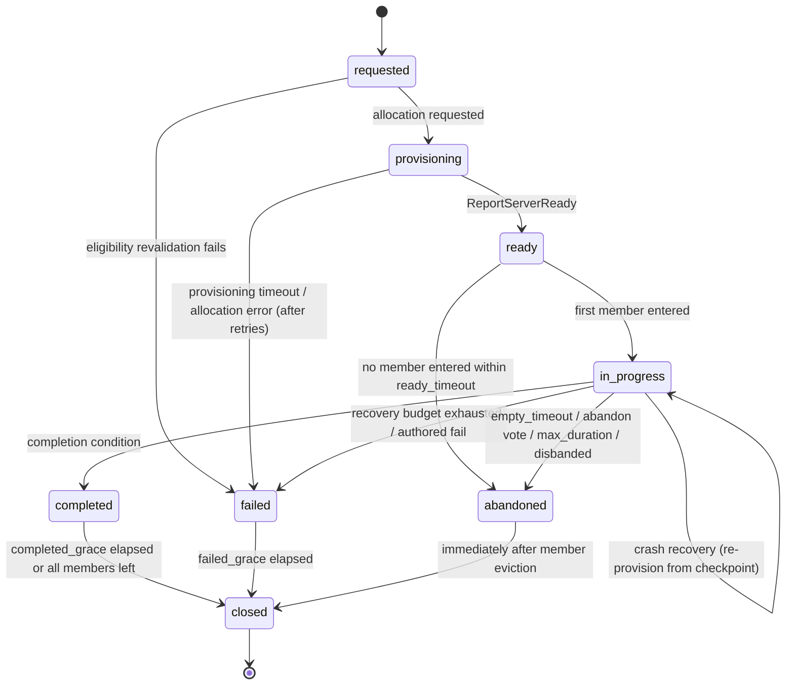
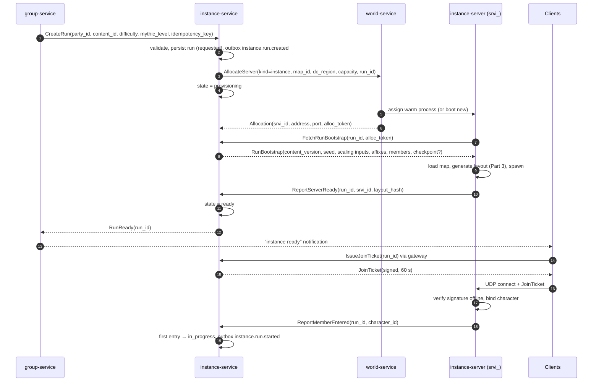
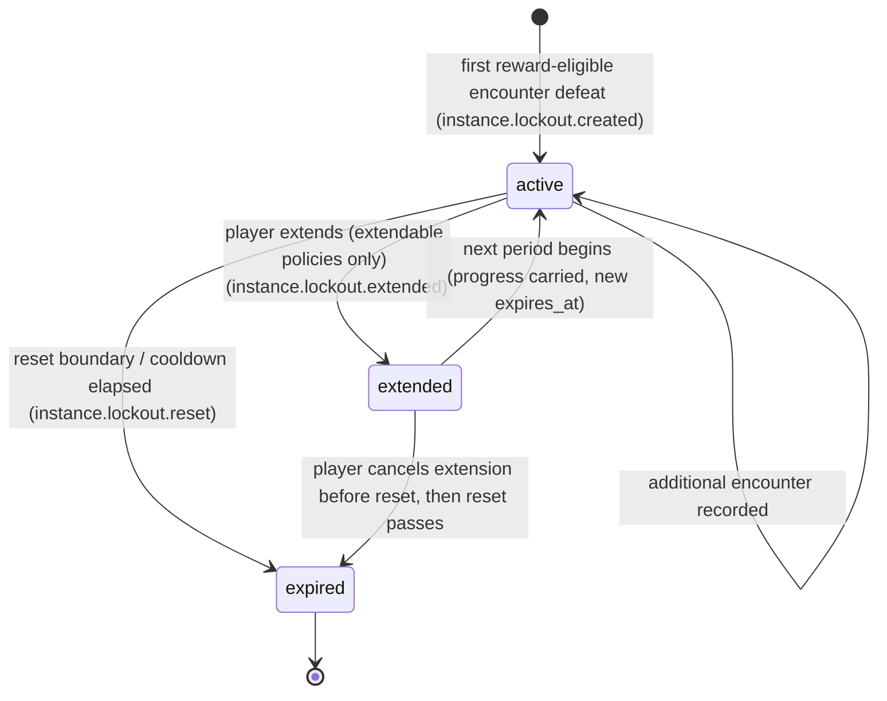
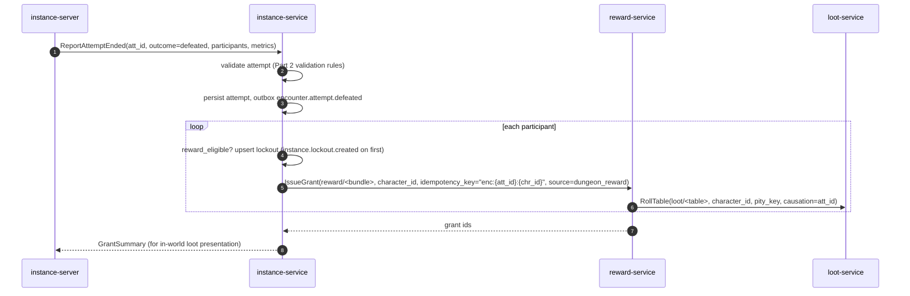
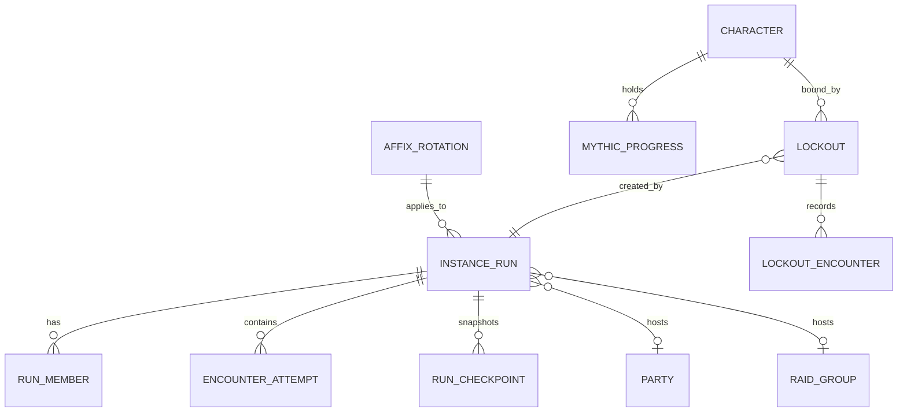

# Legends of the Shattered Frontier — Dungeon Spec, Part 1: Instance Runtime and Lockouts
### Version 1.0 — Expanded Technical Design Authority edition (2026-10-17)

**Status:** Design target; not implemented. Names per Shared Registry v1.0.
**Entry file:** [Dungeon Architecture](../Legends_Shattered_Frontier_Dungeon_Architecture_v1.0.md) · **Registry:** [Shared Registry v1.0](../Legends_Shattered_Frontier_Shared_Registry_v1.0.md)

This part defines the generic **instance run framework** (lifecycle, server allocation, joining, reconnects, timeouts, crash recovery, closing) and the generic **lockout framework**, together with the `instance` PostgreSQL schema, the `lsf.instance_service.v1` gRPC API, and the payloads of every `instance.*` event. The Raid spec extends both frameworks (raid lockout policy, `RaidProgress`, `raid.*` events) through the extension points marked **[Raid extension point]**.

---

## 1. Responsibilities and boundaries

| Concern | Owner | Notes |
| --- | --- | --- |
| Run record, run state machine, membership, checkpoints | `instance-service` | Sole writer of schema `instance`. |
| Process allocation, server registry, warm pools | `world-service` | `instance-service` requests; never starts processes itself. |
| Live simulation, encounters, NPCs, objectives | `instance-server` | Simulation authority (Registry authority rule 1). |
| Lockout records, eligibility checks | `instance-service` | Policy content authored per dungeon/raid. |
| Reward issuance | `reward-service` | `instance-service` orchestrates dungeon rewards after validation. |
| Party membership, queue, ready checks | `group-service` | See Part 4. |
| Event relay of `encounter.*` | `instance-service` | Originates in `instance-server` (Registry §10.2). |

Design principles:

1. **One run, one process.** Each `InstanceRun` is hosted by exactly one `instance-server` process (`ServerInstance`, `srvi_`) at a time. Packing several runs into one UE process is a non-goal (shared world state across runs creates cross-run exploits and crash blast radius).
2. **Durable truth lives in `instance-service`.** The `instance-server` holds live state in memory and pushes checkpoints; on crash the run is rebuilt from the last checkpoint, never from client claims.
3. **Generic over content.** The framework knows `content_id` (`dungeon/<slug>` or `raid/<slug>`), `difficulty`, `group_size_class`, and a `lockout_policy`; everything dungeon-specific lives in content definitions (Part 3).

---

## 2. Instance run lifecycle

### 2.1 States (registry `instance_run_state`)

| State | Meaning | Entered when |
| --- | --- | --- |
| `requested` | Run accepted; eligibility validated; run ID allocated. | `CreateRun` succeeds. |
| `provisioning` | Waiting for `world-service` to assign and load an `instance-server`. | Allocation request sent. |
| `ready` | Server loaded map, applied seed and scaling, and accepts joins. | Server calls `ReportServerReady`. |
| `in_progress` | At least one member has entered the instance. | First `ReportMemberEntered`. |
| `completed` | Completion condition met (final encounter defeated, or all required objectives for open-objective dungeons). | Server calls `ReportRunOutcome(completed)`. |
| `failed` | Unrecoverable technical failure or authored failure condition (e.g. escort objective lost in `story`). | Allocation timeout, recovery budget exhausted, authored fail. |
| `abandoned` | Players left or the run exceeded limits without completing. | Empty timeout, abandon vote, max-duration cap, party disbanded. |
| `closed` | Terminal; server released; no more joins. | Grace timer after any of the three outcome states. |



Rules:

- Transitions are performed only by `instance-service` with an optimistic version check (`instance_runs.version`). Server reports that would cause an illegal transition are rejected with `FAILED_PRECONDITION` and logged as `security.action.rejected` candidates when they come from an authenticated server whose `srvi_` is not the run's current server (stale or spoofed process).
- `completed`, `failed`, `abandoned` are **outcome** states; exactly one is reached per run and the outcome event (`instance.run.completed` / `failed` / `abandoned`) is published exactly once (outbox pattern, §6.4).
- Re-provisioning after a crash does **not** leave `in_progress`; `recovery_count` increments and `instance.run.started` is not re-emitted.
- `story` runs with NPC companions follow the same lifecycle.

### 2.2 Timeouts and limits

All values are defaults; tuning keys are authoritative.

| Timer | Default | Tuning key | Effect |
| --- | --- | --- | --- |
| Provisioning timeout | 90 s | `tune.dungeon.provisioning_timeout_s` | Retry allocation once with a different host; then `failed`. |
| Allocation retries | 1 | `tune.dungeon.allocation_retries` | — |
| Ready timeout | 300 s | `tune.dungeon.ready_timeout_s` | `ready` → `abandoned` if nobody entered. |
| Server heartbeat interval | 5 s | `tune.dungeon.server_heartbeat_s` | Server → `instance-service`. |
| Server lost threshold | 15 s (3 missed) | `tune.dungeon.server_lost_s` | Start crash recovery. |
| Recovery budget | 2 recoveries per run | `tune.dungeon.recovery_budget` | Third crash → `failed`. |
| Member reconnect grace | 600 s | `tune.dungeon.reconnect_grace_s` | Slot reserved; deserter rules not applied. |
| Linkdead in-world time | 30 s | `tune.dungeon.linkdead_s` | Disconnected avatar stays (can die); prevents logout-to-dodge. |
| Empty timeout | 900 s | `tune.dungeon.empty_timeout_s` | No connected members → `abandoned`. |
| Max run duration | 4 h (`mythic`: 2 × par + 30 min) | `tune.dungeon.max_run_duration_s` | → `abandoned` (or `completed` if already met). |
| Completed grace | 600 s | `tune.dungeon.completed_grace_s` | Loot trading window inside instance, then eviction. |
| Failed grace | 120 s | `tune.dungeon.failed_grace_s` | Time to read failure UI. |
| Run creation rate | 10 new runs / rolling hour / character | `tune.dungeon.run_creation_per_hour` | Anti-farm guard (Part 4, Security). |

### 2.3 Creating a run

`CreateRun` is called by `group-service` (after a matched queue or a party leader's "enter" action) or by `zone-server` when a party walks into a dungeon entrance portal. Validation in order:

1. Content exists in the active `content_version`, is enabled (`ff.dungeon.<slug>_enabled` kill switch not off), and the `difficulty` and `group_size_class` are supported.
2. Group size `n` (connected party members) is within the content's size class (`solo_party` 1–5, `extended_party` 6–10).
3. Every member meets entry requirements (min Character Level, attunement quest, `mythic` access level — Part 3, Mythic access).
4. No member is already in another run in a non-outcome state (one active run per character).
5. Lockout check per member (§4.5). Members who are locked out may still enter if the policy is `loot_only`; they are marked `reward_eligible = false` per encounter.
6. Rate limit per member (`tune.dungeon.run_creation_per_hour`).
7. For `mythic`: the party leader's access level ≥ requested Mythic Level (Part 3).

On success, `instance-service` writes the run (`requested`), its members, the derived `run_seed` (§2.6), and emits `instance.run.created` through the outbox, then transitions to `provisioning`.

### 2.4 Server allocation (via `world-service`)



Allocation contract required from `world-service` (World spec owns the API; listed as an open issue in the entry file's Registry additions):

| Field | Direction | Meaning |
| --- | --- | --- |
| `kind` | request | `instance` |
| `map_id` | request | Level asset of the dungeon (from content definition). |
| `dc_region` | request | Region of the party leader's realm. |
| `capacity` | request | Max members (5 or 10; raids up to 25). |
| `run_id` | request | Correlation and idempotency (`alloc:{run_id}:{attempt}`). |
| `srvi_id`, `address`, `port` | response | Assigned `ServerInstance`. |
| `alloc_token` | response | Short-lived token the server presents to `instance-service` to prove assignment. |

Warm pools: `world-service` keeps `tune.dungeon.warm_pool_size` (default 2 per map per region, plus 10 % of the trailing-hour peak concurrent runs for that map) pre-booted processes. Target: `provisioning` → `ready` p95 ≤ 10 s with a warm hit, ≤ 45 s cold.

### 2.5 Joining, leaving and reconnects

**Join tickets.** A join ticket is a compact signed token (Ed25519, `instance-service` key, public key distributed to `instance-server` builds through `config-service`) with claims `{run_id, character_id, account_id, srvi_id, exp, nonce}`. Lifetime 60 s, single use (the server keeps a nonce set for the ticket lifetime). The server verifies offline; it never trusts a character ID from the client handshake otherwise.

**Leaving.** A member leaves by exit portal, `LeaveRun`, party leave, or vote-kick. `instance-service` records `left_at` and `leave_reason` (`exit`, `kicked`, `party_left`, `disconnected_expired`, `evicted_closed`). `group-service` decides deserter consequences (Part 4).

**Disconnects.** The `instance-server` reports `ReportMemberDisconnected`. The avatar stays in the world as *linkdead* for `linkdead_s` (it keeps threat and can die; this prevents "alt-F4 to avoid a mechanic"). After that it is removed from the simulation but the slot is reserved for `reconnect_grace_s`. A returning client asks the gateway for its active run (`GetActiveRunForCharacter`) and receives a new join ticket; position is restored to the last safe checkpoint position (the most recent graveyard/respawn point, never mid-arena during an engaged encounter). Expiry of the grace sets `leave_reason = disconnected_expired`.

**Backfill.** If an LFG-formed run loses a member, the party may request a backfill (Part 4). The new member joins with a fresh ticket; lockout and eligibility checks run for them individually.

### 2.6 Seeds

| Seed | Definition | Used for |
| --- | --- | --- |
| `run_seed` (uint64) | first 8 bytes (big-endian) of `SHA-256("run|" + run_id + "|" + content_version)` | Layout generation for non-mythic difficulties, cosmetic variation. |
| `mythic_layout_seed` | first 8 bytes of `SHA-256("mythic|" + content_id + "|" + season_id + "|" + week_index)` | Layout for all `mythic` runs of a dungeon in a week (fair leaderboard; learnable route). |
| `encounter_seed` | first 8 bytes of `SHA-256("enc|" + run_seed + "|" + encounter_id + "|" + attempt_index)` | Encounter RNG (Part 2, Determinism). |

`week_index` = number of whole weekly resets elapsed in the run's `dc_region` since the season start (0-based). Seeds are stored on the run; they are never sent to clients before the corresponding content is revealed (seed leakage lets players pre-compute RNG).

### 2.7 Checkpoints and crash recovery

The server pushes a **checkpoint** (`Checkpoint` RPC) on: run start, every encounter outcome, every objective completion, every 60 s while not in an engaged encounter, and on graceful shutdown. Checkpoint contents:

```json
{
  "run_id": "run_01JA0000000000000000000000",
  "checkpoint_seq": 7,
  "layout_hash": "sha256:4f1c…",
  "encounters": { "encounter/sunken_vault_tidecaller": "defeated", "encounter/sunken_vault_drowned_king": "dormant" },
  "objectives": { "obj_free_prisoners": { "progress": 3, "target": 3, "done": true } },
  "pack_slots_cleared": ["ps_02", "ps_03", "ps_05"],
  "enemy_forces": { "current": 214, "required": 260 },
  "mythic_timer": { "elapsed_ms": 1022400, "deaths": 4, "paused": false },
  "member_positions": { "chr_01J…": { "respawn_point": "rp_vault_gate" } }
}
```

Recovery sequence: heartbeat loss → `instance-service` marks the server lost, pauses the mythic timer at the last checkpoint's `elapsed_ms` (players are not penalized for infrastructure faults), requests a new allocation, the new server boots with `RunBootstrap.checkpoint`, rebuilds state (defeated encounters stay defeated; engaged encounters revert to `idle` and their open attempt is closed `invalidated`), and members are prompted to rejoin with new tickets. Rewards already granted are protected by idempotency keys (§4.6), so re-reporting a defeat after recovery is harmless.

### 2.8 Closing

On reaching `closed`: remaining members are moved to the dungeon entrance location in the world (via `world-service` handoff), the server is released (`ReleaseServer`), Redis presence keys are deleted, and `instance.run.closed` is emitted with final counters. Runs are retained in PostgreSQL for 90 days hot (`tune.dungeon.run_retention_days`), then archived to the warehouse.

---

## 3. Abandonment vote

Any member may start an abandon vote (`StartAbandonVote`) when not in an engaged encounter. Passing requires a strict majority of connected members (≥ 3 of 5, ≥ 6 of 10). Vote window 30 s. A passed vote moves the run to `abandoned`; no deserter penalty applies to anyone. For `mythic`, abandoning is final and does not change access level (Part 3).

---

## 4. Lockout framework

### 4.1 Concepts

A **Lockout** (`lck_`) limits *rewards* (and, for some policies, *re-entry*) from a content + difficulty for one character until a reset boundary. Lockout behavior is driven by a content-authored `lockout_policy`:

```json
{
  "lockout_policy": {
    "period": "daily",
    "granularity": "loot_only",
    "extendable": false,
    "soft_cooldown_s": null,
    "scope": "character"
  }
}
```

| Field | Values | Meaning |
| --- | --- | --- |
| `period` | `none`, `daily`, `weekly`, `cooldown` | Reset boundary: daily/weekly region reset (Registry §7.3) or a rolling cooldown. |
| `granularity` | `loot_only`, `instance_saved` | `loot_only`: character may re-enter new runs but receives no rewards from encounters already looted this period. `instance_saved`: character is bound to the specific run (`bound_run_id`) and may only re-enter that run's progress until reset **[Raid extension point]**. |
| `extendable` | bool | Player may set the lockout to `extended` to keep progress past the next reset (raids). |
| `soft_cooldown_s` | int or null | For `period = cooldown` (open-world soft lockout): seconds before a defeated encounter can reward the same character again. |
| `scope` | `character` | Reserved; account scope is a non-goal. |

Dungeon defaults (content may override within LiveOps review):

| Dungeon type / difficulty | Policy |
| --- | --- |
| `story`, `normal` (any type) | `period: none` — no lockout. |
| `veteran` (instanced) | `daily`, `loot_only`. |
| `mythic` | `none` for encounters; end-of-run chest limited by weekly marks cap and the mythic weekly cache rule (Part 3, Rewards). |
| `open_world` | `cooldown`, `soft_cooldown_s: 72000` (20 h), per encounter. |
| `seasonal` | `daily`, `loot_only` for bosses; seasonal currency follows season caps (LiveOps). |
| Raids | Defined by Raid spec (expected: `weekly`, `instance_saved`, `extendable: true`). |

### 4.2 States (registry `lockout_state`)



- A lockout is created lazily on the **first reward-eligible encounter defeat**, not on entry. Entering and wiping never locks a character.
- `expired` rows are kept for 30 days for support and analytics, then deleted.
- Expiry is computed (`expires_at`) and materialized by a reset job at each regional reset; reads treat `now() ≥ expires_at` as expired even before the job runs.
- `period = cooldown` lockouts exist per encounter (`encounter_id` set, `scope_key = encounter_id`) and expire individually.
- **Lockout scope.** Every lockout carries `scope_key` (default `'instance'`). At most one live (`active`/`extended`) lockout exists per `(character_id, content_id, difficulty, scope_key)`. Dungeons use `'instance'` or, for cooldown lockouts, the `encounter_id`; the Raid spec uses `encounter_id` for per-encounter loot lockouts and `'progress'` for progress lockouts.
- **Additive-extension rule [Raid extension point].** Extending specs may add one optional, namespaced object to `instance.lockout.*` and `instance.run.*` payloads (Raid: `raid`) and 1:1 detail tables keyed by `lockout_id`/`run_id`; they never change or remove base fields. Base consumers must tolerate and ignore unknown optional objects; schema version stays 1 for additive fields.

### 4.3 Expiry computation

```
expires_at(period, t, region) =
  daily    → next daily reset in region strictly after t
  weekly   → next weekly reset in region strictly after t
  cooldown → t + soft_cooldown_s
  none     → (no lockout)
```

`region` is the `dc_region` of the character's realm, not of the server host. Worked example: an `na` character defeats a `veteran` boss at 2026-10-20T14:59:00Z (Tuesday). Next `na` daily reset is 15:00 the same day, so `expires_at = 2026-10-20T15:00:00.000Z` — one minute later. This is intended (reset boundaries are hard); UI warns when a run starts within 30 min of reset.

### 4.4 Extension **[Raid extension point]**

For `extendable` policies, `ExtendLockout(lockout_id)` sets state `extended`. At the next boundary the reset job, instead of expiring, transitions it back to `active` with a new `expires_at` and keeps `bound_run_id` and recorded encounters, emitting `instance.lockout.extended` (with `carried = true`). Dungeons do not use extension at launch.

### 4.5 Eligibility check

```
reward_eligible(character, encounter, run) =
     not exists lockout L where
        L.character_id = character
        and L.content_id = run.content_id
        and L.difficulty = run.difficulty
        and L.state in (active, extended)
        and now() < L.expires_at
        and encounter in L.defeated_encounters        -- loot_only / cooldown
  and (policy.granularity != instance_saved or L.bound_run_id in (null, run.run_id))
  and member.present_at_defeat                         -- in arena or within 100 m and alive or died during attempt
  and member.joined_before_engage                      -- joined the run before the attempt started
```

The check runs twice: at `CreateRun` (to inform UI and to reject `instance_saved` mismatches) and authoritatively at defeat time in `instance-service` before reward issuance.

### 4.6 Defeat → lockout → reward sequence



Idempotency keys: encounter rewards `enc:{att_id}:{character_id}`; run completion rewards `run:{run_id}:{character_id}`; mythic chest `mythic:{run_id}:{character_id}`. These are stable across server crashes and retries.

---

## 5. Data model (`instance` schema)

### 5.1 Entity relationships



### 5.2 DDL

```sql
CREATE SCHEMA IF NOT EXISTS instance;

CREATE TYPE instance.instance_run_state AS ENUM
  ('requested','provisioning','ready','in_progress','completed','failed','abandoned','closed');
CREATE TYPE instance.encounter_attempt_outcome AS ENUM ('defeated','wiped','abandoned','invalidated');
CREATE TYPE instance.lockout_state AS ENUM ('active','extended','expired');
CREATE TYPE instance.difficulty AS ENUM ('story','normal','veteran','heroic','mythic');
CREATE TYPE instance.group_size_class AS ENUM ('solo_party','extended_party','raid_small','raid_large');

CREATE TABLE instance.instance_runs (
  run_id              text PRIMARY KEY CHECK (run_id ~ '^run_[0-9A-HJKMNP-TV-Z]{26}$'),
  content_id          text NOT NULL,                 -- dungeon/<slug> or raid/<slug>
  dungeon_type        text,                          -- registry dungeon_type; null for raids
  difficulty          instance.difficulty NOT NULL,
  group_size_class    instance.group_size_class NOT NULL,
  mythic_level        smallint CHECK (mythic_level BETWEEN 1 AND 20),
  party_id            text,                          -- pty_
  raid_group_id       text,                          -- rgp_  [Raid extension point]
  formed_by           text NOT NULL CHECK (formed_by IN ('premade','lfg','portal','gm')),
  realm_id            text NOT NULL,                 -- leader realm
  dc_region           text NOT NULL CHECK (dc_region IN ('na','eu','apac','sa')),
  content_version     bigint NOT NULL,
  run_seed            bigint NOT NULL,
  layout_seed         bigint NOT NULL,               -- run_seed or mythic_layout_seed
  layout_hash         text,
  affix_ids           text[] NOT NULL DEFAULT '{}',
  season_id           text,                          -- ssn_ when seasonal/mythic
  week_index          integer,
  state               instance.instance_run_state NOT NULL DEFAULT 'requested',
  server_instance_id  text,                          -- srvi_
  recovery_count      smallint NOT NULL DEFAULT 0,
  run_level           smallint NOT NULL CHECK (run_level BETWEEN 1 AND 100),
  mythic_par_ms       integer,
  mythic_elapsed_ms   integer,
  mythic_deaths       integer NOT NULL DEFAULT 0,
  mythic_upgrade      smallint,                      -- 0..3, null if not mythic or not completed
  outcome_reason      text,
  created_at          timestamptz NOT NULL DEFAULT now(),
  ready_at            timestamptz,
  started_at          timestamptz,
  outcome_at          timestamptz,
  closed_at           timestamptz,
  version             integer NOT NULL DEFAULT 0,
  CHECK ((party_id IS NULL) <> (raid_group_id IS NULL) OR formed_by = 'gm')
);
CREATE INDEX instance_runs_active_idx ON instance.instance_runs (state) WHERE state NOT IN ('closed');
CREATE INDEX instance_runs_content_idx ON instance.instance_runs (content_id, difficulty, created_at);

CREATE TABLE instance.run_members (
  run_id            text NOT NULL REFERENCES instance.instance_runs(run_id),
  character_id      text NOT NULL,
  account_id        text NOT NULL,
  realm_id          text NOT NULL,
  combat_role       text CHECK (combat_role IN ('tank','healer','damage','support')),
  character_level   smallint NOT NULL,
  equipped_ilvl     smallint NOT NULL,
  joined_at         timestamptz NOT NULL DEFAULT now(),
  entered_at        timestamptz,
  left_at           timestamptz,
  leave_reason      text CHECK (leave_reason IN ('exit','kicked','party_left','disconnected_expired','evicted_closed','abandon_vote')),
  is_backfill       boolean NOT NULL DEFAULT false,
  PRIMARY KEY (run_id, character_id)
);
-- one non-terminal run per character
CREATE UNIQUE INDEX run_members_one_active ON instance.run_members (character_id) WHERE left_at IS NULL;

CREATE TABLE instance.encounter_attempts (
  attempt_id        text PRIMARY KEY CHECK (attempt_id ~ '^att_'),
  run_id            text REFERENCES instance.instance_runs(run_id),   -- null for open_world (zone-hosted)
  zone_id           text,                                             -- set for open_world
  encounter_id      text NOT NULL,                                    -- encounter/<slug>
  attempt_index     integer NOT NULL,
  encounter_seed    bigint NOT NULL,
  started_at        timestamptz NOT NULL,
  ended_at          timestamptz,
  outcome           instance.encounter_attempt_outcome,
  final_phase       smallint,
  boss_health_pct   numeric(5,2),             -- at end
  participants      text[] NOT NULL,          -- chr_ ids engaged
  deaths            integer NOT NULL DEFAULT 0,
  mechanic_failures integer NOT NULL DEFAULT 0,
  invalid_reason    text,
  metrics           jsonb NOT NULL DEFAULT '{}',   -- dps/hps summaries, ttk
  CHECK (run_id IS NOT NULL OR zone_id IS NOT NULL),
  UNIQUE (run_id, encounter_id, attempt_index)
);

CREATE TABLE instance.run_checkpoints (
  run_id           text NOT NULL REFERENCES instance.instance_runs(run_id),
  checkpoint_seq   integer NOT NULL,
  server_instance_id text NOT NULL,
  body             jsonb NOT NULL,
  created_at       timestamptz NOT NULL DEFAULT now(),
  PRIMARY KEY (run_id, checkpoint_seq)
);

CREATE TABLE instance.lockouts (
  lockout_id      text PRIMARY KEY CHECK (lockout_id ~ '^lck_'),
  character_id    text NOT NULL,
  content_id      text NOT NULL,
  difficulty      instance.difficulty NOT NULL,
  period          text NOT NULL CHECK (period IN ('daily','weekly','cooldown')),
  granularity     text NOT NULL CHECK (granularity IN ('loot_only','instance_saved')),
  encounter_id    text,                        -- only for period = cooldown
  scope_key       text NOT NULL DEFAULT 'instance', -- 'instance' (whole content); encounter_id for cooldown
                                               -- lockouts; Raid: encounter_id (loot) or 'progress'
  bound_run_id    text REFERENCES instance.instance_runs(run_id),
  created_by_run  text NOT NULL,               -- run_ or zone attempt's att_ for open_world
  state           instance.lockout_state NOT NULL DEFAULT 'active',
  dc_region       text NOT NULL,
  created_at      timestamptz NOT NULL DEFAULT now(),
  expires_at      timestamptz NOT NULL,
  version         integer NOT NULL DEFAULT 0
);
CREATE UNIQUE INDEX lockouts_live_uniq ON instance.lockouts
  (character_id, content_id, difficulty, scope_key)
  WHERE state IN ('active','extended');
CREATE INDEX lockouts_expiry_idx ON instance.lockouts (dc_region, expires_at) WHERE state IN ('active','extended');

CREATE TABLE instance.lockout_encounters (
  lockout_id    text NOT NULL REFERENCES instance.lockouts(lockout_id),
  encounter_id  text NOT NULL,
  attempt_id    text NOT NULL REFERENCES instance.encounter_attempts(attempt_id),
  recorded_at   timestamptz NOT NULL DEFAULT now(),
  PRIMARY KEY (lockout_id, encounter_id)
);

CREATE TABLE instance.affix_rotations (
  season_id     text NOT NULL,
  week_index    integer NOT NULL,
  affix_ids     text[] NOT NULL,             -- ordered by mythic threshold slot
  generated_by  text NOT NULL,               -- 'generator:v1' or 'liveops:<acc_>'
  published_at  timestamptz NOT NULL DEFAULT now(),
  PRIMARY KEY (season_id, week_index)
);

CREATE TABLE instance.mythic_progress (
  character_id       text NOT NULL,
  season_id          text NOT NULL,
  content_id         text NOT NULL,           -- dungeon/<slug>
  best_timed_level   smallint NOT NULL DEFAULT 0,
  best_time_ms       integer,
  best_run_id        text,
  score              integer NOT NULL DEFAULT 0,
  updated_at         timestamptz NOT NULL DEFAULT now(),
  PRIMARY KEY (character_id, season_id, content_id)
);

CREATE TABLE instance.outbox (
  event_id      text PRIMARY KEY,           -- evt_
  aggregate_id  text NOT NULL,
  topic         text NOT NULL,              -- domain.instance | domain.encounter
  envelope      jsonb NOT NULL,
  created_at    timestamptz NOT NULL DEFAULT now(),
  published_at  timestamptz
);

CREATE TABLE instance.idempotency_keys (
  idempotency_key text PRIMARY KEY,
  rpc            text NOT NULL,
  response       bytea NOT NULL,
  created_at     timestamptz NOT NULL DEFAULT now()       -- purge after 7 days (IDEMPOTENCY_RETENTION)
);
```

Notes: `instance.difficulty` includes `heroic` because raids share the type; a CHECK in the service layer rejects `heroic` for `dungeon/*`. `encounter_attempts.run_id` is nullable for open-world encounters hosted on `zone-server` (Part 3, Open-world dungeons).

### 5.3 Redis keys

| Key | Type | TTL | Purpose |
| --- | --- | --- | --- |
| `inst:run:{run_id}:presence` | hash chr→`connected`/`linkdead`/`grace` | run life | Fast presence for empty-timeout. |
| `inst:chr:{character_id}:active_run` | string | run life | `GetActiveRunForCharacter`. |
| `inst:srv:{srvi_id}:hb` | string | 15 s | Heartbeat liveness. |
| `inst:ticket:nonce:{nonce}` | string | 60 s | Join ticket replay guard (also enforced on server). |
| `inst:rate:create:{character_id}` | sorted set | 1 h | Run creation rate limit. |

---

## 6. gRPC API — `lsf.instance_service.v1`

Every mutating RPC carries `idempotency_key`. Callers: **G** = group-service, **Z** = zone-server, **S** = instance-server, **C** = client via gateway, **A** = admin-portal, **X** = other services.

```protobuf
syntax = "proto3";
package lsf.instance_service.v1;

service InstanceService {
  // Run lifecycle
  rpc CreateRun(CreateRunRequest) returns (Run);                         // G, Z
  rpc GetRun(GetRunRequest) returns (Run);                               // any
  rpc GetActiveRunForCharacter(CharacterRef) returns (Run);              // C, G
  rpc IssueJoinTicket(IssueJoinTicketRequest) returns (JoinTicket);      // C
  rpc LeaveRun(LeaveRunRequest) returns (Run);                           // C, G
  rpc StartAbandonVote(VoteRequest) returns (VoteState);                 // C
  rpc CastAbandonVote(CastVoteRequest) returns (VoteState);              // C
  rpc AddBackfillMember(AddMemberRequest) returns (Run);                 // G

  // Server-facing (mTLS, server identity = srvi_ + alloc_token)
  rpc FetchRunBootstrap(BootstrapRequest) returns (RunBootstrap);        // S
  rpc ReportServerReady(ServerReady) returns (Ack);                      // S
  rpc Heartbeat(ServerHeartbeat) returns (HeartbeatAck);                 // S
  rpc Checkpoint(RunCheckpoint) returns (Ack);                           // S
  rpc ReportMemberEntered(MemberEvent) returns (Ack);                    // S
  rpc ReportMemberDisconnected(MemberEvent) returns (Ack);               // S
  rpc ReportAttemptStarted(AttemptStarted) returns (Ack);                // S, Z
  rpc ReportPhaseChanged(PhaseChanged) returns (Ack);                    // S, Z
  rpc ReportMechanicFailed(MechanicFailed) returns (Ack);                // S, Z (sampled, batched)
  rpc ReportAttemptEnded(AttemptEnded) returns (GrantSummary);           // S, Z
  rpc ReportRunOutcome(RunOutcome) returns (Ack);                        // S

  // Lockouts
  rpc ListLockouts(CharacterRef) returns (LockoutList);                  // C, X
  rpc CheckEligibility(EligibilityRequest) returns (EligibilityResult);  // G, Z, S
  rpc ExtendLockout(ExtendLockoutRequest) returns (Lockout);             // C (extendable policies only)

  // Mythic and affixes
  rpc GetAffixRotation(AffixRotationRequest) returns (AffixRotation);    // any
  rpc GetMythicProgress(MythicProgressRequest) returns (MythicProgress); // C, G

  // Admin (audited via audit-service)
  rpc AdminCloseRun(AdminRunAction) returns (Run);                       // A
  rpc AdminResetLockout(AdminLockoutAction) returns (Lockout);           // A
  rpc AdminInvalidateAttempt(AdminAttemptAction) returns (Ack);          // A
  rpc AdminOverrideAffixWeek(AdminAffixOverride) returns (AffixRotation);// A
}

message CreateRunRequest {
  string idempotency_key = 1;
  string content_id = 2;          // dungeon/<slug>
  string difficulty = 3;          // story|normal|veteran|mythic
  string group_size_class = 4;    // solo_party|extended_party
  uint32 mythic_level = 5;        // 0 when not mythic
  string party_id = 6;            // pty_
  string formed_by = 7;           // premade|lfg|portal|gm
  repeated string character_ids = 8;
}

message RunBootstrap {
  string run_id = 1;
  int64 content_version = 2;
  uint64 layout_seed = 3;
  uint64 run_seed = 4;
  uint32 run_level = 5;
  uint32 group_size = 6;
  string difficulty = 7;
  uint32 mythic_level = 8;
  repeated string affix_ids = 9;
  repeated Member members = 10;           // ids, level, ilvl, role, reward eligibility per encounter
  bytes checkpoint = 11;                  // empty on first boot
  string scaling_table_version = 12;      // cfg_ of tune.dungeon.* snapshot used for the run
}

message AttemptEnded {
  string idempotency_key = 1;             // "att_end:{att_id}"
  string attempt_id = 2;
  string run_id = 3;
  string encounter_id = 4;
  string outcome = 5;                     // defeated|wiped|abandoned|invalidated
  repeated Participant participants = 6;  // character_id, present_at_defeat, joined_before_engage, damage, healing, deaths
  uint32 duration_ms = 7;
  uint32 final_phase = 8;
  float boss_health_pct = 9;
  string invalid_reason = 10;
  ValidationFacts facts = 11;             // arena_violations, leash_evades, min_ttk_ok, layout_hash
}
```

Error model: `INVALID_ARGUMENT` (bad content/difficulty), `FAILED_PRECONDITION` (illegal transition, lockout `instance_saved` mismatch, member busy), `RESOURCE_EXHAUSTED` (rate limit, capacity), `PERMISSION_DENIED` (server identity mismatch, ticket for other character), `UNAVAILABLE` (allocation unavailable; caller retries with backoff).

Scaling-table pinning: `RunBootstrap.scaling_table_version` pins the `tune.dungeon.*` values for the whole run so mid-run tuning publishes cannot change a live pull; new runs pick up new values. Kill switches still apply immediately.

### 6.4 Outbox and publishing

All `instance.*` and relayed `encounter.*` events are written to `instance.outbox` in the same transaction as the state change; a relay publishes to `domain.instance` (key `run_id`) and `domain.encounter` (key `run_id`, or `zone_id` for open world) and marks `published_at`. Consumers deduplicate on `event_id`.

---

## 7. `instance.*` event payloads

Envelope per Registry §10.1 (not redefined). `character_id` in the envelope is set only for per-character events (lockouts); run events omit it and list members in the payload. Producer: `instance-service`.

### 7.1 `instance.run.created`

| Field | Type | Required | Description | privacy_class |
| --- | --- | --- | --- | --- |
| `run_id` | string | yes | `run_` ID. | p1_pseudonymous |
| `content_id` | string | yes | `dungeon/<slug>`. | p0_public |
| `dungeon_type` | string | yes | Registry `dungeon_type`. | p0_public |
| `difficulty` | string | yes | Registry `difficulty`. | p0_public |
| `group_size_class` | string | yes | `solo_party` / `extended_party`. | p0_public |
| `mythic_level` | int | no | 1–20 when mythic. | p0_public |
| `party_id` | string | yes | `pty_`. | p1_pseudonymous |
| `formed_by` | string | yes | `premade`, `lfg`, `portal`, `gm`. | p0_public |
| `member_character_ids` | string[] | yes | Members at creation. | p1_pseudonymous |
| `run_level` | int | yes | Scaling level (Part 3). | p0_public |
| `affix_ids` | string[] | yes | Active `dungeon_affix/*` (empty allowed). | p0_public |
| `season_id` | string | no | `ssn_` when seasonal or mythic. | p0_public |

### 7.2 `instance.run.started`

| Field | Type | Required | Description | privacy_class |
| --- | --- | --- | --- | --- |
| `run_id` | string | yes | Run. | p1_pseudonymous |
| `content_id` | string | yes | Dungeon. | p0_public |
| `server_instance_id` | string | yes | `srvi_` hosting the run. | p0_public |
| `provisioning_ms` | int | yes | `requested` → `ready` latency. | p0_public |
| `warm_hit` | bool | yes | Allocation used a warm process. | p0_public |
| `layout_hash` | string | yes | Hash of generated layout (validation/replay). | p0_public |

### 7.3 `instance.run.completed`

| Field | Type | Required | Description | privacy_class |
| --- | --- | --- | --- | --- |
| `run_id` | string | yes | Run. | p1_pseudonymous |
| `content_id`, `difficulty` | string | yes | Content and difficulty. | p0_public |
| `mythic_level` | int | no | Mythic level. | p0_public |
| `duration_ms` | int | yes | `started_at` → completion (mythic: timer elapsed incl. death penalties). | p0_public |
| `mythic_timed` | bool | no | Completed within par. | p0_public |
| `mythic_upgrade` | int | no | 0–3 (Part 3). | p0_public |
| `deaths` | int | yes | Total member deaths. | p0_public |
| `wipes` | int | yes | Total `wiped` attempts. | p0_public |
| `members` | object[] | yes | `{character_id, combat_role, character_level, equipped_ilvl, present_at_end}`. | p1_pseudonymous |
| `recovery_count` | int | yes | Crash recoveries. | p0_public |

### 7.4 `instance.run.failed`

| Field | Type | Required | Description | privacy_class |
| --- | --- | --- | --- | --- |
| `run_id` | string | yes | Run. | p1_pseudonymous |
| `content_id` | string | yes | Dungeon. | p0_public |
| `from_state` | string | yes | State before failure. | p0_public |
| `reason` | string | yes | `allocation_timeout`, `allocation_error`, `recovery_exhausted`, `authored_fail`, `eligibility_changed`. | p0_public |
| `server_instance_id` | string | no | Last server. | p0_public |
| `compensation_eligible` | bool | yes | True for technical failures (LiveOps compensation flows). | p0_public |

### 7.5 `instance.run.abandoned`

| Field | Type | Required | Description | privacy_class |
| --- | --- | --- | --- | --- |
| `run_id` | string | yes | Run. | p1_pseudonymous |
| `content_id`, `difficulty` | string | yes | — | p0_public |
| `reason` | string | yes | `empty_timeout`, `ready_timeout`, `abandon_vote`, `max_duration`, `party_disbanded`, `gm`. | p0_public |
| `encounters_defeated` | int | yes | Count defeated before abandonment. | p0_public |
| `elapsed_ms` | int | yes | Time since start (0 if never started). | p0_public |

### 7.6 `instance.run.closed`

| Field | Type | Required | Description | privacy_class |
| --- | --- | --- | --- | --- |
| `run_id` | string | yes | Run. | p1_pseudonymous |
| `outcome` | string | yes | `completed`, `failed`, `abandoned`. | p0_public |
| `total_ms` | int | yes | `created_at` → `closed_at`. | p0_public |
| `server_seconds` | int | yes | Billable process seconds (capacity analytics). | p0_public |

### 7.7 `instance.lockout.created`

Envelope `character_id` set.

| Field | Type | Required | Description | privacy_class |
| --- | --- | --- | --- | --- |
| `lockout_id` | string | yes | `lck_`. | p1_pseudonymous |
| `content_id`, `difficulty` | string | yes | — | p0_public |
| `period`, `granularity` | string | yes | Policy snapshot. | p0_public |
| `encounter_id` | string | no | For cooldown lockouts. | p0_public |
| `scope_key` | string | no | Lockout scope; absent means `instance` (§4.2 Lockout scope). | p0_public |
| `run_id` | string | no | Creating run (null for open world). | p1_pseudonymous |
| `raid` | object | no | Additive raid extension (Raid spec, Data, API, events); ignored by dungeon consumers. | per field |
| `expires_at` | string (RFC 3339) | yes | Expiry. | p0_public |

### 7.8 `instance.lockout.extended`

| Field | Type | Required | Description | privacy_class |
| --- | --- | --- | --- | --- |
| `lockout_id` | string | yes | Lockout. | p1_pseudonymous |
| `carried` | bool | yes | False when the player requests extension; true when the reset job carries it into a new period. | p0_public |
| `scope_key` | string | no | As in `instance.lockout.created`. | p0_public |
| `new_expires_at` | string | yes | New expiry. | p0_public |

### 7.9 `instance.lockout.reset`

| Field | Type | Required | Description | privacy_class |
| --- | --- | --- | --- | --- |
| `lockout_id` | string | yes | Lockout. | p1_pseudonymous |
| `reason` | string | yes | `period_reset`, `cooldown_elapsed`, `gm_reset`. | p0_public |
| `encounters_recorded` | int | yes | Number of encounters in the lockout. | p0_public |
| `scope_key` | string | no | As in `instance.lockout.created`. | p0_public |

High-volume note: the reset job may emit hundreds of thousands of `instance.lockout.reset` events at a weekly boundary; it publishes in batches of 5,000 with jitter over 10 minutes. Reads never depend on the event (expiry is computed).

### 7.10 `instance.affix.rotated`

Published once per `dc_region` at each weekly reset (envelope `dc_region` set, no `character_id`).

| Field | Type | Required | Description | privacy_class |
| --- | --- | --- | --- | --- |
| `season_id` | string | yes | `ssn_`. | p0_public |
| `week_index` | int | yes | Week within season. | p0_public |
| `affix_ids` | string[] | yes | Ordered by threshold slot (M2, M4, M7, M10). | p0_public |
| `mythic_layout_seed_hashes` | object | yes | `{content_id: sha256(seed)}` — commitment published for later audit; seeds themselves stay secret. | p0_public |
| `source` | string | yes | `generator` or `liveops_override`. | p0_public |
