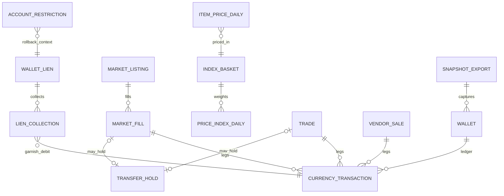
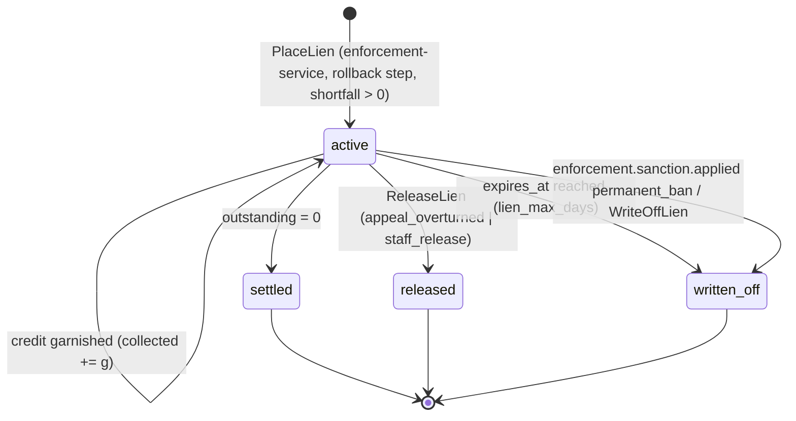
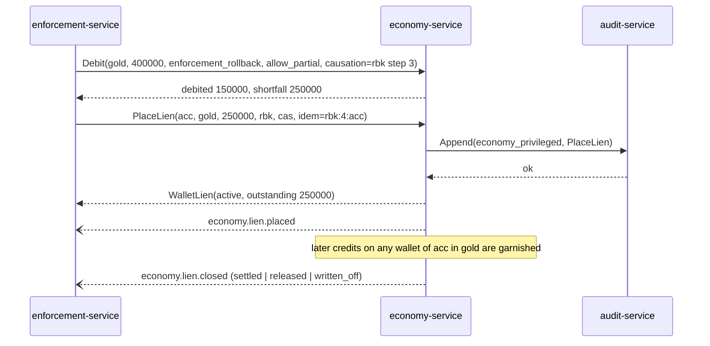

# Legends of the Shattered Frontier — Economy Part 1: Ledger, Wallets, Liens and Data
### Version 1.0 — Expanded Technical Design Authority edition (2026-10-17)

Status: Design target; not implemented. Names per Shared Registry v1.0.

Entry file: [Economy Architecture](../Legends_Shattered_Frontier_Economy_Architecture_v1.0.md) · Registry: [Shared Registry](../Legends_Shattered_Frontier_Shared_Registry_v1.0.md)

This part defines everything that touches a balance: the `economy` schema, the gRPC API, the faucet/sink taxonomy and per-currency allow-lists, the frontier marks cap, season tokens, wallet liens, the wallet snapshot export, privacy participation and ledger reconciliation. Markets, trades, holds and NPC vendors are in Part 2; balancing targets, the inflation index and event payloads are in Part 3.

---

## Data model (PostgreSQL schema `economy`)

One PostgreSQL database per `dc_region`; schema `economy`. All monetary columns are `bigint` minor units (copper for gold; whole units for marks, season tokens and crowns). Timestamps are `timestamptz` UTC.

```sql
CREATE SCHEMA economy;

CREATE TABLE economy.wallets (
  owner_kind     text   NOT NULL CHECK (owner_kind IN ('character','account','guild')),
  owner_id       text   NOT NULL,                 -- chr_ / acc_ / gld_
  currency_id    text   NOT NULL,                 -- currency/gold ...
  realm_id       text,                            -- NULL only for account-owned (crowns)
  account_id     text,                            -- owning account; NULL for guild wallets
  balance        bigint NOT NULL DEFAULT 0 CHECK (balance >= 0),          -- INV-7
  reserved       bigint NOT NULL DEFAULT 0 CHECK (reserved >= 0 AND reserved <= balance),
  wallet_seq     bigint NOT NULL DEFAULT 0,       -- +1 per txn on this wallet
  updated_at     timestamptz NOT NULL DEFAULT now(),
  PRIMARY KEY (owner_kind, owner_id, currency_id),
  CHECK ((owner_kind = 'account') = (realm_id IS NULL))
);
CREATE INDEX wallets_account_currency ON economy.wallets (account_id, currency_id);

CREATE TABLE economy.currency_transactions (        -- append-only
  txn_id           text   NOT NULL,               -- txn_ULID
  occurred_at      timestamptz NOT NULL DEFAULT now(),
  owner_kind       text   NOT NULL,
  owner_id         text   NOT NULL,
  currency_id      text   NOT NULL,
  realm_id         text,
  account_id       text,
  direction        text   NOT NULL CHECK (direction IN ('credit','debit')),
  amount           bigint NOT NULL CHECK (amount > 0),
  balance_after    bigint NOT NULL CHECK (balance_after >= 0),
  wallet_seq       bigint NOT NULL,
  source_code      text,
  sink_code        text,
  flow_class       text   NOT NULL CHECK (flow_class IN ('faucet','sink','transfer','correction')),
  causation_id     text   NOT NULL,               -- rwg_, pur_, rbk_ step, wln_, trd_, lst_, txn_, cmpg_ ...
  correlation_id   text,
  idempotency_key  text   NOT NULL,
  counterparty_owner_kind text,                   -- transfers only
  counterparty_owner_id   text,
  transfer_ref     text,                          -- trd_ / lst_ / mail ref
  reward_grant_id  text,
  liveops_event_id text,
  lien_id          text,                          -- garnish debits
  reason_code      text,                          -- free enum per caller (e.g. buyback, season_token_conversion)
  config_version   bigint NOT NULL,
  PRIMARY KEY (txn_id, occurred_at),
  UNIQUE (owner_kind, owner_id, currency_id, wallet_seq, occurred_at),
  CHECK ((direction = 'credit' AND source_code IS NOT NULL AND sink_code IS NULL)
      OR (direction = 'debit'  AND sink_code  IS NOT NULL AND source_code IS NULL))
) PARTITION BY RANGE (occurred_at);                -- monthly partitions
-- append-only: the service role has INSERT/SELECT only; a trigger rejects UPDATE/DELETE.
CREATE INDEX txn_causation ON economy.currency_transactions (causation_id);
CREATE INDEX txn_owner_time ON economy.currency_transactions (owner_kind, owner_id, currency_id, occurred_at);

CREATE TABLE economy.code_allow_list (            -- INV-9 and per-currency validity
  currency_id  text NOT NULL,
  code         text NOT NULL,
  direction    text NOT NULL CHECK (direction IN ('credit','debit')),
  flow_class   text NOT NULL,
  PRIMARY KEY (currency_id, code, direction)
);

CREATE TABLE economy.caller_allow_list (          -- PERMISSION_DENIED source of truth
  service      text NOT NULL,                     -- mTLS service identity, e.g. reward-service
  code         text NOT NULL,
  direction    text NOT NULL CHECK (direction IN ('credit','debit')),
  PRIMARY KEY (service, code, direction)
);

CREATE TABLE economy.idempotency_keys (
  idempotency_key text NOT NULL,
  rpc             text NOT NULL,
  request_hash    bytea NOT NULL,                 -- replay with a different body → ALREADY_EXISTS
  response        bytea NOT NULL,
  created_at      timestamptz NOT NULL DEFAULT now(),
  PRIMARY KEY (rpc, idempotency_key)
);                                                -- purged after 7 days

CREATE TABLE economy.marks_weekly_counters (
  character_id   text   NOT NULL,
  week_start     timestamptz NOT NULL,            -- weekly reset of the character's dc_region
  credited       bigint NOT NULL DEFAULT 0 CHECK (credited >= 0),
  capped_total   bigint NOT NULL DEFAULT 0,
  PRIMARY KEY (character_id, week_start)
);

CREATE TABLE economy.wallet_liens (
  lien_id          text PRIMARY KEY,              -- wln_ULID
  account_id       text   NOT NULL,
  currency_id      text   NOT NULL CHECK (currency_id <> 'currency/crowns'),
  original_amount  bigint NOT NULL CHECK (original_amount > 0),
  collected        bigint NOT NULL DEFAULT 0 CHECK (collected >= 0 AND collected <= original_amount),
  outstanding      bigint GENERATED ALWAYS AS (original_amount - collected) STORED,
  state            text   NOT NULL CHECK (state IN ('active','settled','released','written_off')),
  rollback_id      text   NOT NULL,              -- rbk_
  case_id          text   NOT NULL,              -- cas_
  created_at       timestamptz NOT NULL DEFAULT now(),
  expires_at       timestamptz NOT NULL,          -- created_at + tune.economy.lien_max_days
  closed_at        timestamptz,
  close_reason     text,                          -- settled | appeal_overturned | staff_release | expired | permanent_ban | account_deleted
  version          int NOT NULL DEFAULT 0,
  UNIQUE (rollback_id, account_id, currency_id)   -- mirrors enforcement.rollback_deficits PK
);
CREATE INDEX wallet_liens_active ON economy.wallet_liens (account_id, currency_id, created_at)
  WHERE state = 'active';

CREATE TABLE economy.lien_collections (           -- per-lien allocation of each garnish debit
  lien_id      text NOT NULL REFERENCES economy.wallet_liens,
  txn_id       text NOT NULL,                     -- garnish debit txn_
  amount       bigint NOT NULL CHECK (amount > 0),
  collected_at timestamptz NOT NULL DEFAULT now(),
  PRIMARY KEY (lien_id, txn_id)
);

CREATE TABLE economy.account_restrictions (        -- rollback freeze step (ApplyRestriction)
  account_id     text NOT NULL,
  kind           text NOT NULL CHECK (kind IN ('trade','market')),
  rollback_id    text NOT NULL,
  applied_at     timestamptz NOT NULL DEFAULT now(),
  lifted_at      timestamptz,
  PRIMARY KEY (account_id, kind, rollback_id)
);

CREATE TABLE economy.snapshot_exports (
  dc_region text NOT NULL, snapshot_day date NOT NULL, as_of timestamptz NOT NULL,
  iceberg_snapshot_id bigint, row_count bigint, totals jsonb,   -- {realm_id: {currency_id: Σ balance}}
  state text NOT NULL CHECK (state IN ('running','committed','failed')),
  PRIMARY KEY (dc_region, snapshot_day)
);

CREATE TABLE economy.reconciliation_runs (         -- hourly INV-8 check
  dc_region text NOT NULL, realm_id text NOT NULL, currency_id text NOT NULL,
  window_start timestamptz NOT NULL, window_end timestamptz NOT NULL,
  credits bigint NOT NULL, debits bigint NOT NULL, delta_balances bigint NOT NULL,
  residual bigint GENERATED ALWAYS AS (credits - debits - delta_balances) STORED,
  PRIMARY KEY (realm_id, currency_id, window_start)
);

CREATE TABLE economy.outbox (                      -- transactional outbox → event-bus
  outbox_id   bigserial PRIMARY KEY,
  topic       text NOT NULL,                      -- domain.economy | domain.market
  event_key   text NOT NULL,                      -- partition key (see entry file, Service)
  envelope    jsonb NOT NULL,
  created_at  timestamptz NOT NULL DEFAULT now(),
  relayed_at  timestamptz
);
```

Market, trade, hold, vendor and index tables are defined with their behaviour (Part 2, Market data model; Part 3, Inflation index). The full table list is `wallets`, `currency_transactions`, `code_allow_list`, `caller_allow_list`, `idempotency_keys`, `marks_weekly_counters`, `wallet_liens`, `lien_collections`, `account_restrictions`, `market_listings`, `market_fills`, `trades`, `transfer_holds`, `vendor_stock_counters`, `vendor_sales`, `price_index_daily`, `index_baskets`, `item_prices_daily`, `snapshot_exports`, `reconciliation_runs`, `outbox`.

### Entity relationships



### Ledger write procedure

Every balance change runs this procedure in one `SERIALIZABLE` transaction (retry on serialization failure up to 5 times with jitter):

1. Look up `(rpc, idempotency_key)`; on hit return the stored response if `request_hash` matches, else `ALREADY_EXISTS`.
2. Check `code_allow_list` (currency × code × direction) and `caller_allow_list` (service × code × direction).
3. `SELECT … FOR UPDATE` the wallet rows involved, in ascending `(owner_kind, owner_id, currency_id)` order (deadlock-free); create missing wallets with balance 0.
4. Apply the cap (marks), the debit check (`amount ≤ balance − reserved`, or partial), and the lien garnish (credits).
5. Insert one `txn_` row per wallet change with `wallet_seq = wallet_seq + 1`; update the wallet.
6. Insert the outbox events and the idempotency row; commit.

Audit-before-act (Security, Audit): for audited codes the `audit-service.Append` call happens between steps 2 and 3, outside the DB transaction, with the idempotency key as audit dedupe key; failure → `UNAVAILABLE` and nothing is written.

---

## gRPC API

Package `lsf.economy_service.v1`; services `EconomyService` (gameplay callers) and `EconomyAdmin` (enforcement, staff, schedulers). Cross-service RPCs listed in the Shared Registry (including vendor pricing and buy/sell/buyback) are canonical; other service-local RPCs are defined by the Economy parts, and unmerged additions remain proposals.

```protobuf
service EconomyService {
  rpc GetWallet(GetWalletRequest) returns (GetWalletResponse);              // owner, optional currency
  rpc Credit(CreditRequest) returns (CreditResult);                         // reward-service, liveops, store, enforcement
  rpc Debit(DebitRequest) returns (DebitResult);                            // NPC sinks, store, liveops, enforcement
  rpc TransferCurrency(TransferCurrencyRequest) returns (TransferResult);   // mail gold attachments (inventory-service mailbox)
  rpc ProposeTrade(ProposeTradeRequest) returns (Trade);
  rpc SetTradeOffer(SetTradeOfferRequest) returns (Trade);
  rpc ConfirmTrade(ConfirmTradeRequest) returns (Trade);                    // both confirmed → execute or hold
  rpc CancelTrade(CancelTradeRequest) returns (Trade);
  rpc CreateListing(CreateListingRequest) returns (MarketListing);
  rpc CancelListing(CancelListingRequest) returns (MarketListing);
  rpc BuyListing(BuyListingRequest) returns (MarketFill);
  rpc SearchListings(SearchListingsRequest) returns (SearchListingsResponse);
  rpc GetIndexPrices(GetIndexPricesRequest) returns (GetIndexPricesResponse); // item fair values + index
  rpc QuoteNpcPrices(QuoteNpcPricesRequest) returns (NpcPriceQuote);        // registered: Part 2, NPC vendor pricing
  rpc BuyFromVendor(BuyFromVendorRequest) returns (VendorResult);           // zone-server
  rpc SellToVendor(SellToVendorRequest) returns (VendorResult);             // zone-server
  rpc BuybackFromVendor(BuybackRequest) returns (VendorResult);             // zone-server
}
service EconomyAdmin {
  rpc PlaceLien(PlaceLienRequest) returns (WalletLien);                     // enforcement-service
  rpc ReleaseLien(ReleaseLienRequest) returns (WalletLien);                 // enforcement-service
  rpc WriteOffLien(WriteOffLienRequest) returns (WalletLien);               // enforcement-service
  rpc GetLien(GetLienRequest) returns (WalletLien);
  rpc ListLiens(ListLiensRequest) returns (ListLiensResponse);
  rpc ApplyRestriction(ApplyRestrictionRequest) returns (ApplyRestrictionResponse); // rollback freeze
  rpc LiftRestriction(LiftRestrictionRequest) returns (LiftRestrictionResponse);
  rpc ResolveHold(ResolveHoldRequest) returns (TransferHold);               // staff: release | cancel
  rpc GetHold(GetHoldRequest) returns (TransferHold);
  rpc ExportWalletSnapshot(ExportWalletSnapshotRequest) returns (SnapshotExport);
  rpc RecomputeIndex(RecomputeIndexRequest) returns (PriceIndex);           // backfill, economy_analyst
  rpc GetLedger(GetLedgerRequest) returns (GetLedgerResponse);              // admin-portal, enforcement: paged txn_ history
}

message Owner { string owner_kind = 1; string owner_id = 2; }
message CreditRequest {
  string idempotency_key = 1; Owner owner = 2; string currency_id = 3; int64 amount = 4;
  string source_code = 5; string causation_id = 6; string correlation_id = 7;
  string reward_grant_id = 8; string liveops_event_id = 9; string reason_code = 10;
}
message CreditResult {
  string txn_id = 1; int64 requested_amount = 2; int64 applied_amount = 3;
  int64 capped_amount = 4;          // frontier marks weekly cap truncation
  int64 garnished_amount = 5;       // collected by liens from this credit
  string garnish_txn_id = 6; int64 balance_after = 7;
}
message DebitRequest {
  string idempotency_key = 1; Owner owner = 2; string currency_id = 3; int64 amount = 4;
  string sink_code = 5; string causation_id = 6; string correlation_id = 7;
  bool allow_partial = 8;           // enforcement-service and reward-service RevokeGrant only
  string reason_code = 9;
}
message DebitResult { string txn_id = 1; int64 debited_amount = 2; int64 shortfall = 3; int64 balance_after = 4; }
message TransferCurrencyRequest {
  string idempotency_key = 1; Owner from = 2; Owner to = 3; string currency_id = 4; int64 amount = 5;
  string transfer_kind = 6;         // mail (trade/market legs are written by economy-service itself)
  string causation_id = 7; string correlation_id = 8;
}
message TransferResult {
  string transfer_ref = 1;          // pre-allocated txn_ of the payer leg (mail reference)
  string payer_txn_id = 2; string payee_txn_id = 3;   // empty while held
  string hold_id = 4;               // thd_ when held
  int64 garnished_amount = 5;       // payee-side lien collection
}
message PlaceLienRequest {
  string idempotency_key = 1;       // rbk_id:step_no:account_id (Security RB-1)
  string account_id = 2; string currency_id = 3; int64 amount = 4;
  string rollback_id = 5; string case_id = 6;
}
message ReleaseLienRequest { string idempotency_key = 1; string lien_id = 2; string reason = 3; } // appeal_overturned | staff_release
message WriteOffLienRequest { string idempotency_key = 1; string lien_id = 2; string reason = 3; } // permanent_ban | account_deleted | staff
message WalletLien {
  string lien_id = 1; string account_id = 2; string currency_id = 3; int64 original_amount = 4;
  int64 collected = 5; int64 outstanding = 6; string state = 7; string rollback_id = 8; string case_id = 9;
  string created_at = 10; string expires_at = 11; string closed_at = 12; string close_reason = 13;
}
message ApplyRestrictionRequest { string idempotency_key = 1; string rollback_id = 2; repeated string account_ids = 3; repeated string kinds = 4; }
message ExportWalletSnapshotRequest { string idempotency_key = 1; string dc_region = 2; string snapshot_day = 3; bool backfill = 4; }
message SnapshotExport { string dc_region = 1; string snapshot_day = 2; string as_of = 3; int64 iceberg_snapshot_id = 4; int64 row_count = 5; string state = 6; }
message GetIndexPricesRequest { string dc_region = 1; repeated string item_definition_ids = 2; string as_of_day = 3; }
message ItemFairValue { string item_definition_id = 1; int64 fair_value_copper = 2; bool fallback = 3; int64 units_7d = 4; }
message GetIndexPricesResponse {
  repeated ItemFairValue items = 1; double index_value = 2; double index_chain_value = 3;
  int32 basket_version = 4; int32 method_version = 5; double dynamic_fee_factor = 6; double repair_scaling = 7;
}
```

### RPC signatures and caller allow-list

| RPC | Signature (inputs → result) | Caller allow-list |
| --- | --- | --- |
| `GetWallet` | `(owner, currency_id?) → wallets[]` | gateway (own characters), all game services, admin-portal |
| `Credit` | `(owner, currency_id, amount, source_code, causation_id) → txn_id, applied, capped, garnished` | reward-service, liveops-service, store-service, enforcement-service, zone-server (`npc_bounty`; `vendor_sale` only through `SellToVendor`) |
| `Debit` | `(owner, currency_id, amount, sink_code, causation_id, allow_partial) → txn_id, debited, shortfall` | zone-server (NPC sinks), world-service (`fast_travel` cross-zone), crafting-service, guild-service, store-service, liveops-service, progression-service (`training_cost`), inventory-service (`repair_cost`, `legendary_upgrade_cost`), quest-service (`quest_turn_in`, `campaign_contribution`), instance-service (`raid_bonus_roll`), enforcement-service, reward-service |
| `TransferCurrency` | `(from, to, currency_id, amount, transfer_kind = mail, transfer_ref) → txn_ids or hold_id` | inventory-service (mailbox) |
| `ProposeTrade` / `SetTradeOffer` / `ConfirmTrade` / `CancelTrade` | trade lifecycle on `trd_` | gateway (player, session-bound) |
| `CreateListing` / `CancelListing` / `BuyListing` / `SearchListings` | market lifecycle on `lst_` | gateway (player, at a market hub) |
| `GetIndexPrices` | `(dc_region, item_definition_ids[]) → fair value per item, index` | enforcement-service, anticheat-service, reward-service, analytics-pipeline, inventory-service, building/guild services |
| `QuoteNpcPrices` / `BuyFromVendor` / `SellToVendor` / `BuybackFromVendor` | NPC vendor flows (Part 2) | zone-server; `QuoteNpcPrices` also inventory-service (`QuoteRepair`) |
| `PlaceLien` | `(account_id, currency_id, amount, rollback_id, case_id) → WalletLien(active)` | enforcement-service |
| `ReleaseLien` | `(lien_id, reason) → WalletLien(released), collected` | enforcement-service |
| `WriteOffLien` | `(lien_id, reason) → WalletLien(written_off)` | enforcement-service, internal expiry job |
| `ApplyRestriction` / `LiftRestriction` | `(rollback_id, account_ids, kinds) → ok` | enforcement-service |
| `ResolveHold` | `(hold_id, release \| cancel, reason) → TransferHold` | admin-portal (`economy_analyst`, `enforcement_reviewer`) |
| `ExportWalletSnapshot` | `(dc_region, snapshot_day) → SnapshotExport` | internal scheduler, admin-portal (`economy_analyst`) |
| `RecomputeIndex`, `GetLedger` | backfill / paged history | admin-portal (`economy_analyst`; `GetLedger` also `enforcement_reviewer`, `support_agent` read-only for own tickets) |

Code-level caller matrix (`economy.caller_allow_list` seed): reward-service may credit every faucet source an authored bundle can carry (`quest_reward`, `dungeon_reward`, `raid_reward`, `world_event_reward`, `achievement_reward`, `season_reward`, `loot_drop`, `liveops_compensation`, `gm_grant`); liveops-service `season_conversion`, `season_expiry`, `liveops_compensation`; store-service `crown_topup`, `store_refund`, `store_spend`, `store_chargeback`; enforcement-service `enforcement_rollback`, `enforcement_restore`; economy-service itself (internal) `market_*`, `trade_*`, `vendor_sale`, `vendor_purchase` (vendor flows), `account_erasure`. Any other combination → `PERMISSION_DENIED` and a `security.action.rejected` signal with `reason = economy_invariant`.

### Error model

`INVALID_ARGUMENT` (code not allow-listed for the currency, amount ≤ 0), `FAILED_PRECONDITION` (insufficient spendable, `economy_freeze` on, listing not active, trade not in expected state, lien currency is crowns), `PERMISSION_DENIED` (caller not allow-listed for the code), `ALREADY_EXISTS` (idempotency key reused with a different request hash), `UNAVAILABLE` (audit-service down for an audited action — fail closed). Players never receive internal reason codes for sanction or hold decisions (Security, Client-visible behavior); the client sees "trade pending review" or "trading unavailable".

`allow_partial = true` resolves the Itemization note "Debit(sink = enforcement_rollback, allow_negative per Economy policy)": Economy never allows negative balances; a partial debit takes `min(amount, spendable + reserved_released)` where any reservation on that wallet is cancelled first, and returns `shortfall`. The caller turns shortfall into a lien via `PlaceLien` (enforcement-service directly, or via the `deficits[]` that `RevokeGrant` returns).

Latency budgets (p99, single dc_region): `GetWallet` 10 ms (read replica allowed for UI, primary for any decision), `Credit`/`Debit` 40 ms, `BuyListing` 80 ms including inventory escrow transfer, `SearchListings` 60 ms, `GetIndexPrices` 15 ms (cached per index day).

---

## Faucet/sink taxonomy

### Flow classes

Every currency transaction gets exactly one `flow_class` (Registry enum `currency_flow_class`), stored on the row and published in the payload so that Analytics does not have to re-derive it. Values and rules match Analytics' Economy health classification.

| Code | Kind | Currency use | flow_class |
| --- | --- | --- | --- |
| `quest_reward`, `dungeon_reward`, `raid_reward`, `world_event_reward`, `npc_bounty`, `achievement_reward`, `season_reward` | source | gold, marks, season tokens (per allow-list) | faucet |
| `loot_drop` | source | gold (coin drops rolled by loot-service) | faucet |
| `vendor_sale` | source | gold (selling items to NPCs) | faucet |
| `season_conversion` | source | gold | faucet |
| `liveops_compensation`, `gm_grant` | source | any allow-listed | faucet |
| `crown_topup` | source | crowns | faucet |
| `market_sale`, `trade_receive` | source | gold | **transfer** |
| `enforcement_restore` | source | any | correction |
| `store_refund` | source | crowns | correction |
| `repair_cost`, `housing_tax`, `territory_upkeep`, `fast_travel`, `guild_upkeep`, `siege_declaration`, `npc_service`, `vendor_purchase`, `training_cost`, `legendary_upgrade_cost`, `quest_turn_in`, `campaign_contribution`, `raid_bonus_roll` | sink | gold (marks/tokens where the allow-list allows) | sink |
| `market_listing_fee`, `market_transaction_fee`, `market_expiry_fee` | sink | gold | sink |
| `season_expiry` | sink | season tokens | sink |
| `store_spend` | sink | crowns | sink |
| `market_purchase`, `trade_send` | sink | gold | **transfer** |
| `enforcement_rollback` | sink | any | correction (includes lien garnish debits) |
| `store_chargeback` | sink | crowns | correction |
| `account_erasure` | sink | any | correction (excluded from faucet/sink metrics) |
| `crafting_output`, `gathering_output`, `salvage_output`, `store_purchase`, `legendary_upgrade`, `vendor_stock`, `tier_conversion_output` | source | **items only** — rejected on `Credit` | — |
| `crafting_consumed`, `crafting_failure`, `salvage_input`, `item_destroyed`, `tier_conversion_input` | sink | **items only** — rejected on `Debit` | — |

**Buyer-side market debit (confirmed).** The buyer leg of a market fill uses sink `market_purchase` (Registry, Currencies, sources and sinks), `flow_class = transfer`. It pairs with the seller's `market_sale` credit in the same DB transaction and the same `transfer_ref` (`lst_…`), so `Σ market_purchase = Σ market_sale` per day exactly. This resolves the earlier placeholder in Analytics' Economy health contract.

Mail gold attachments reuse `trade_send` / `trade_receive` with `transfer_ref` = the mail reference and payload `transfer_kind = mail`; no new code is needed because the value is neither created nor destroyed.

Correction rule (Analytics compatible): any credit whose `causation_id` is a rollback step or lien, and every `enforcement_rollback` debit, is `correction`. Corrections are excluded from `m_gold_created` / `m_gold_destroyed` but included in the ledger residual.

Buyback rule: buying back an item sold to an NPC within the buyback window is a `vendor_purchase` debit with `reason_code = buyback` and `causation_id` = the original `vendor_sale` txn. Both rows are counted (faucet then sink), so the net effect on `m_gold_faucet_sink_ratio` numerators cancels; Analytics may exclude both with the `reason_code` when reporting vendor faucets.

### Per-currency allow-list

Enforces Security INV-9.

| Currency | Allowed credit codes | Allowed debit codes |
| --- | --- | --- |
| gold | all gold faucet, transfer and correction sources in the flow-class table | all gold sink, transfer and correction sinks in the flow-class table, including `account_erasure` |
| frontier marks | `quest_reward`, `dungeon_reward`, `raid_reward`, `world_event_reward`, `achievement_reward`, `liveops_compensation`, `gm_grant`, `enforcement_restore` | `vendor_purchase`, `raid_bonus_roll`, `npc_service`, `enforcement_rollback`, `account_erasure` |
| season tokens | `season_reward`, `liveops_compensation`, `gm_grant`, `enforcement_restore` | `vendor_purchase`, `season_expiry`, `enforcement_rollback`, `account_erasure` |
| crowns | `crown_topup`, `store_refund`, `liveops_compensation`, `gm_grant`, `enforcement_restore` | `store_spend`, `store_chargeback`, `enforcement_rollback`, `account_erasure` |

The allow-list is data (`economy.code_allow_list`) seeded from this table and covered by a CI static check. Crowns never appear as an input to an operation producing gold (no gold credit is ever caused by a `store_spend` txn; reconciliation joins on `causation_id`).

INV-9 reconciliation query (hourly, must return 0 rows):

```sql
SELECT g.txn_id FROM economy.currency_transactions g
JOIN economy.currency_transactions c ON c.txn_id = g.causation_id
WHERE g.currency_id = 'currency/gold' AND g.direction = 'credit'
  AND c.currency_id = 'currency/crowns';
```

### `FRONTIER_MARKS_WEEKLY_CAP` enforcement

Cap `C` = 1,500 (`tune.economy.frontier_marks_weekly_cap`), per character, per week starting at the weekly reset of the character's realm `dc_region` (Registry, Resets).

```text
on Credit(currency/frontier_marks, amount a, source s):
  if flow_class(s) = correction: apply a, do not count           -- enforcement_restore
  else:
    used    = marks_weekly_counters.credited for (character, current week)   -- row locked
    applied = min(a, max(0, C − used))
    capped  = a − applied
    counters.credited += applied; counters.capped_total += capped
    if applied > 0: insert txn (amount = applied)
    return applied_amount = applied, capped_amount = capped
```

All faucet sources (including `liveops_compensation` and `gm_grant`) count toward the cap, which keeps Security INV-12 literally true. A fully capped credit writes no `txn_` row but still returns a result (and publishes `economy.currency.credited` with `amount = 0` only if `ff.economy.publish_capped_zero_credits` is on; default off). Reward-service reports `capped_amount` to the authoring domain (Quest `marks_capped = true`; Dungeon "logged as capped"). The cap value change takes effect at the next weekly reset, never mid-week.

**Example.** A character has 1,420 marks this week; a dungeon grants 150. Applied 80, capped 70; the next grant this week is fully capped.

**Compensation of marks (decision).** INV-12 is not amended: compensation marks count toward the cap. When LiveOps must compensate more marks than the recipient's remaining weekly headroom, liveops-service issues the grant in weekly tranches (`cmpg_` with one reward grant per week, idempotency key `cmpg_id:week_index`) until the amount is delivered; Economy does nothing special. `tune.economy.event_marks_multiplier` scales `marks_reward(w)` upstream (Part 3, Inflation controls) and never raises `C`.

Weekly rollover: counters are keyed by `week_start`; no reset job runs. Rows older than 8 weeks are deleted by a daily job.

---

## Season tokens

Economy confirms LiveOps' model: `currency/season_tokens` wallets are owned by the **character** (`owner_kind = character`), are realm-scoped, are not tradeable or mailable (any `trade_send`, `market_*` or mail attempt → `INVALID_ARGUMENT`), and crowns can never produce them (allow-list). At the season end job (LiveOps spec, Season tokens lifecycle) liveops-service calls, per character, `Debit(season_tokens, convert, season_expiry)` + `Credit(gold, convert × token_value(L), season_conversion)` and then `Debit(season_tokens, remainder, season_expiry)`, all with idempotency keys derived from `ssn_id:dc_region:character_id`. Economy reads balances authoritatively from `economy.wallets` (never a cache). Lien garnish applies to the gold `season_conversion` credit (it is a faucet, not exempt).

Conversion parameters are LiveOps-owned and read by Economy for bound checks: `convert = min(balance, CONV_CAP)`, `CONV_CAP` = 1,000 (`tune.liveops.season_token_conversion_cap`), `token_value(L) = gold_reward(L, W_TOKEN)`, `W_TOKEN` = 0.02. Economy rejects a `season_conversion` credit whose amount exceeds `CONV_CAP × gold_reward(100, W_TOKEN)` = 2,030,000 copper (`FAILED_PRECONDITION`, reported as `economy_invariant`), and rejects any `season_conversion` credit whose `causation_id` is not the matching `season_expiry` debit of the same character and season (idempotency keys `ssn:dc:chr:convert_debit` → `ssn:dc:chr:convert_credit`).

Worked example (LiveOps numbers): level 100, 1,640 tokens. Debit 1,000 (`season_expiry`, `reason_code = converted`); credit 2,030,000 copper (`season_conversion`); debit 640 (`season_expiry`, `reason_code = expired`). With an active 250,000-copper lien, garnish = floor(0.5 × 2,030,000) = 1,015,000 → lien settled after collecting 250,000; the player keeps 1,780,000.

Season vendors sell items for season tokens via `BuyFromVendor` (sink `vendor_purchase`, Part 2). No Charisma or faction multiplier applies to season-token or marks prices.

---

## Wallet liens

### Purpose

Security's rollback saga debits currency with sink `enforcement_rollback`; anything beyond the available balance becomes a `rollback_deficit` (Security, Rollbacks, RB-7). A **wallet lien** (`WalletLien`, prefix `wln_`) is Economy's record of that debt: it intercepts a share of the account's future credits in the lien currency and destroys it with sink `enforcement_rollback` until the deficit is recovered, the lien is released, or it is written off. This recovers currency that the incident net-created (Security worked example: 250,000 copper refunded to innocents via `enforcement_restore` beyond what the offender held).

### Lifecycle (`wallet_lien_state`)

| State | Meaning | Terminal |
| --- | --- | --- |
| `active` | Outstanding > 0; garnishing credits | no |
| `settled` | Collected = original amount | yes |
| `released` | Cancelled with collections returnable (appeal overturned, staff release) | yes |
| `written_off` | Remaining debt forgiven (expiry, permanent ban, account deletion) | yes |



### Creation

1. Rollback saga step "debit" (Security, Saga) calls `Debit(..., sink = enforcement_rollback, allow_partial = true, causation_id = rbk step ID)`.
2. If `shortfall > 0`, the next step calls `PlaceLien(account_id, currency_id, amount = shortfall, rollback_id, case_id, idempotency_key = rbk_id:step_no:account_id)`. Deficits returned by `reward-service.RevokeGrant` (`deficits[]` with `kind = currency`) follow the same path via enforcement-service. Item deficits valued in copper become gold-currency liens when the approved rollback plan assigns the deficit to the offender. Resolved (2026-10-17): Security owns case-by-case attribution; enforcement-service places the lien for the assigned copper value under this Economy contract.
3. Economy appends an `economy_privileged` audit record (audit-before-act; fail closed if audit is unavailable), inserts the lien (`expires_at = now + lien_max_days`), and publishes `economy.lien.placed`.
4. `UNIQUE (rollback_id, account_id, currency_id)` mirrors `enforcement.rollback_deficits`; a replayed `PlaceLien` returns the existing lien. `enforcement.rollback_deficits.settled` and `written_off` are maintained by enforcement-service from `economy.lien.closed` (Economy is authoritative for `collected`; `GetLien` gives live progress).

Crowns liens are rejected (`FAILED_PRECONDITION`): crowns fraud is handled by store-service chargebacks (`store_chargeback`) per LiveOps.



### Garnishing future credits

Scope: all wallets of `currency_id` owned by the lien's account (every character on every realm in the dc_region; guild wallets are never garnished).

```text
on Credit(owner wallet W of account A, currency c, applied amount a, source s), same DB transaction:
  L = active liens of (A, c), ordered by created_at
  if L empty or s ∈ EXEMPT: g = 0
  else:
    r = R_TRANSFER if s ∈ {market_sale, trade_receive} else R_GARNISH
    (for a market fill, a = seller_net: the transaction fee is debited before the garnish)
    g = min(Σ_{l∈L} outstanding_l, floor(r × a))
  credit txn: amount a, source s                              (counts as faucet/transfer as usual)
  if g > 0:
    debit txn: amount g, sink enforcement_rollback, flow_class correction,
               causation_id = oldest lien_id, lien_id set
    allocate g to liens oldest first; collected += share; if outstanding = 0 → settled (economy.lien.closed)
  return garnished_amount = g
```

| Variable | Default | Tuning key |
| --- | --- | --- |
| `R_GARNISH` | 0.5 (50 % of each eligible credit) | `tune.economy.lien_garnish_rate` |
| `R_TRANSFER` | 1.0 (100 % of transfer-in credits) | `tune.economy.lien_garnish_rate_transfer` |
| `EXEMPT` sources | `enforcement_restore`, `liveops_compensation`, `store_refund` | `tune.economy.lien_exempt_sources` |
| `lien_max_days` | 180 | `tune.economy.lien_max_days` |

Rationale: 50 % leaves normal play rewarding (a liened player still keeps half of quest and dungeon gold); 100 % on transfer-ins means funnelling gold from alts or selling items simply pays the debt. Compensation and restores are exempt because they correct the operator's own mistakes. Garnish debits are audited per Security's `economy_privileged` rule ("any `enforcement_rollback`"); volume is bounded by the number of liened accounts. Garnish audit records are batched: one audit record per garnish debit, written via the async audit path with the outbox as durable buffer, because a garnish is a consequence of an audited `PlaceLien` (resolved by Security, Audit, Wallet lien audit batching).

If one credit spans multiple liens, the single garnish debit names the oldest lien in `causation_id`; the payload of `economy.currency.debited` lists the per-lien allocation in `lien_allocations`, and `economy.lien_collections` stores one row per lien.

Mail gold received by a liened account is garnished at `R_TRANSFER` (it is a `trade_receive`). Marks liens are possible (rollback of a marks dupe); marks garnish does not interact with the weekly cap counter: the cap counts the applied credit, the garnish then destroys part of it.

### Interaction with trade and market restrictions

Security RB-7 keeps `trade_restriction` and `market_restriction` on deficit accounts "until Economy supports wallet liens". With liens in place:

1. While any lien on `(A, c)` is `active`, economy-service itself blocks **outgoing** player transfers in currency `c` from account A: `trade_send` of `c`, `market_purchase` (buying from players), and mail gold. A trade in which A's outgoing value (gold + items at index fair value, Part 2, Transfer holds) exceeds A's incoming value by more than `tune.economy.lien_trade_value_tolerance` (default 0.10 = 10 %) is rejected. A may still sell (proceeds garnished at 100 %), trade at fair value, and spend at NPC sinks (which destroy currency).
2. Enforcement-service may therefore lift deficit-driven interim restrictions once `PlaceLien` succeeds; case-driven sanctions (`market_abuse`, `rmt_buyer` ladders) remain independent and are still read through `CheckRestrictions`.
3. Liens do not block login, play, NPC repairs, or crowns cosmetics.
4. Deposits by a liened account into a guild wallet are outgoing transfers and are blocked.

### Release, write-off, expiry

| Trigger | Action |
| --- | --- |
| Appeal overturned (Security, Restore saga) | enforcement-service calls `ReleaseLien(reason = appeal_overturned)`; Economy returns `collected`; the restore saga credits it back with `enforcement_restore` (`causation_id` = restore step). |
| Staff release | `ReleaseLien(reason = staff_release)`, `enforcement_lead` permission, audited; no automatic refund. |
| Permanent ban | Economy consumes `enforcement.sanction.applied` with `sanction_type = permanent_ban`, `scope = account` and writes off all active liens of the account (`reason = permanent_ban`), matching RB-7 "deficit written off". |
| Expiry | Daily job at each dc_region reset writes off liens with `expires_at ≤ now` (`reason = expired`). |
| Account deletion | `WriteOffLien(reason = account_deleted)`; then `PrivacyParticipant.EraseSubject` (Backend spec, Account deletion and privacy request workflow) debits remaining balances with sink `account_erasure` (flow class `correction`, excluded from faucet/sink balance metrics). |

Written-off amounts are permanent net currency creation and are reported as `m_lien_written_off_copper` alongside Security's `m_rollback_net_created_copper`. A write-off is a state change on the lien, not a ledger row: no currency moves, so it never uses a sink code (Backend's "write off with sink `account_erasure`" is implemented as lien `written_off` plus `account_erasure` debits of the remaining *balances*). If a legal hold covers scope `economy_ledger` (Backend, `GetLegalHold`), the lien row and `rollback_deficit` linkage are retained (state `written_off`, `close_reason = account_deleted`) and only pseudonymized when the hold is released.

### Worked example (continues Security's dupe example)

Offender account deficit 250,000 copper gold → `PlaceLien(amount = 250,000)`. Day 1: quest reward 3,600 copper → g = floor(0.5 × 3,600) = 1,800; keeps 1,800. Day 2: sells an item on the market for 40,000 → credit `market_sale` 40,000, fee debit 2,000, seller_net 38,000, g = floor(1.0 × 38,000) = 38,000. Collected 39,800, outstanding 210,200. Because garnish is a share of an amount credited in the same transaction, it can never produce a negative balance. If the offender is permanently banned on day 30 with 150,000 outstanding, the lien becomes `written_off` and `m_lien_written_off_copper` += 150,000.

Expected recovery time: a level-100 offender earning the cap faucet of ≈ 76 gold per active hour (Part 3, Economic balancing targets) repays a 25-gold lien in about 0.7 active hours at `R_GARNISH`; a 2,500-gold lien takes ≈ 66 active hours. Liens larger than 180 days of expected garnish are flagged in the enforcement console so reviewers can choose a permanent sanction instead of an unrecoverable lien.

---

## Wallet snapshot export

### Interface

Job `wallet-snapshot-export` inside economy-service, triggered at each `dc_region` daily reset from `tune.liveops.reset_schedule` (defaults: `na` 15:00, `eu` 04:00, `apac` 22:00, `sa` 18:00 UTC). The same code is exposed as `EconomyAdmin.ExportWalletSnapshot(dc_region, snapshot_day)` for backfill and re-runs. Idempotency key `wallet_snapshot:<dc_region>:<snapshot_day>`; a re-run of a committed day is a no-op unless `backfill = true`, which overwrites that day's partition.

### Consistency

1. At `as_of` = reset instant, the job opens a `REPEATABLE READ READ ONLY` transaction on a replica whose replay position is ≥ the primary's LSN at `as_of` (start delay ≤ 60 s), and reads `economy.wallets`.
2. Each row carries `wallet_seq`; ledger transactions with `wallet_seq ≤` the exported value are exactly those included in the balance (per-wallet sequence, Ledger write procedure).
3. Rows with `balance = 0` and `reserved = 0` are omitted; consumers treat a missing `(owner, currency)` as balance 0 (Gini population is defined by activity, not by the snapshot).
4. `currency/crowns` (account-owned, not realm-scoped) is excluded from the realm table; it is exported to a separate table (below).
5. Writes go to Iceberg table `landing.economy_wallet_snapshots` in one Iceberg commit; then `economy.snapshot.exported` is published with per-realm, per-currency totals for reconciliation. Target: committed by reset + 30 min (Analytics daily jobs start by reset + 2 h).

Failure handling: on replica lag > 60 s the job retries every 5 min for 90 min and then pages (`sev3`); the snapshot is never taken from a later instant, because the reconciliation identity needs `as_of` exactly at reset. A failed day is backfilled from the ledger: `balance(as_of) = balance(now) − Σ signed amounts of txns after as_of` per wallet (exact because the ledger is append-only).

### Snapshot schema

| Column | Type | Nullable | Description | privacy_class |
| --- | --- | --- | --- | --- |
| `snapshot_day` | date | no | dc_region day that starts at `as_of` | p0_public |
| `dc_region` | string | no | `na`, `eu`, `apac`, `sa` | p0_public |
| `as_of` | timestamp | no | reset instant (UTC) | p0_public |
| `realm_id` | string | no | e.g. `na-1` | p0_public |
| `owner_kind` | string | no | `character`, `guild` | p0_public |
| `owner_id` | string | no | `chr_` / `gld_` | p1_pseudonymous |
| `account_id` | string | yes | owning account (null for guild) | p1_pseudonymous |
| `currency_id` | string | no | `currency/gold`, `currency/frontier_marks`, `currency/season_tokens` | p0_public |
| `balance` | int64 | no | minor units | p1_pseudonymous |
| `reserved` | int64 | no | part of balance reserved (holds, open trades) | p1_pseudonymous |
| `wallet_seq` | int64 | no | last ledger sequence included | p1_pseudonymous |
| `lien_outstanding` | int64 | no | Σ outstanding active liens of the account in this currency (repeated on each of the account's rows; 0 if none) | p1_pseudonymous |

Table `privacy_class` = `p1_pseudonymous`. Partitioned by `(snapshot_day, currency_id)`. Retention follows Analytics' modeled tier. Erasure: deleting an account deletes its rows via Iceberg merge-on-read deletes, same as other p1 tables.

**Account-owned wallets (crowns).** Economy also writes `landing.economy_account_wallet_snapshots` in the same job: columns `snapshot_day`, `dc_region`, `as_of`, `account_id`, `currency_id`, `balance`, `wallet_seq` (no `realm_id`). This closes the earlier crowns gap without a sentinel realm in Analytics' realm table; Analytics may adopt it for crowns float metrics (`m_crowns_stranded_p50` already exists in LiveOps).

### Consumers

| Consumer | Use |
| --- | --- |
| Analytics `modeled.snap_wallet_balances_daily` | `m_gold_money_supply`, `m_gold_money_supply_growth_wow`, `m_wealth_gini`, `m_market_velocity` denominator |
| Analytics ledger reconciliation | `m_gold_ledger_residual` computed exactly per wallet: `balance_d − balance_{d−1} = Σ signed amount of txns with wallet_seq in (seq_{d−1}, seq_d]`; residual must be 0 (Security INV-8) |
| anticheat-service | `detector/currency_conservation` daily cross-check against `economy.snapshot.exported` totals |
| economy-service seasonal audit (Part 3, Inflation controls) | wealth concentration review |

---

## Ledger reconciliation

Security INV-8 is stated per currency, per realm, per hour. Economy runs the hourly job `ledger-reconcile` on the primary's replica:

```text
for each (realm r, currency c), window [t, t+1h):
  credits = Σ amount of txns direction = credit in window
  debits  = Σ amount of txns direction = debit  in window
  delta   = Σ balance(t+1h) − Σ balance(t)      (balances reconstructed from wallet_seq checkpoints)
  residual = credits − debits − delta           must be 0
  source check: Σ credits with reward_grant_id per grant = reward-service delivered currency lines;
                Σ market_sale = Σ market_purchase per window; Σ trade_send = Σ trade_receive per window
```

Rows land in `economy.reconciliation_runs`. Residual ≠ 0 or a source-check mismatch raises an `economy_invariant` signal to `anticheat-service.ReportSignals` and an `ops.alert.fired` (`sev2`); `detector/currency_conservation` traces it. Hourly checkpoints of `Σ balance` per (realm, currency) are taken from a rolling materialized view keyed by `wallet_seq` so the job never locks wallets.

---

## Privacy participation

economy-service implements `PrivacyParticipant.ExportSubject` and `PrivacyParticipant.EraseSubject` (Backend spec, Account deletion and privacy request workflow).

| Operation | Economy behaviour |
| --- | --- |
| `ExportSubject(account_id, character_ids)` | JSON part with: wallets (balance per currency), last 25 months of `txn_` rows owned by the subject (amount, code, time, counterparty shown only as `owner_kind`, never the other player's ID), active and closed listings, trades (own side only), liens (amounts and state; `case_id` omitted, Security summarizes enforcement). |
| `EraseSubject` phase 1 (Unwind) | Cancel open listings (`market.listing.cancelled`, `cancelled_by = system`, escrow returned to the subject), cancel open/locked/held trades and held mail (`cancelled`, reservations released), write off active liens (`account_deleted`), then debit every remaining non-zero wallet of the account with sink `account_erasure` (`causation_id = prq_`). Guild wallets are untouched. |
| `EraseSubject` phase 2 (Erase) | `txn_` rows, fills and trades are retained with `acc_`/`chr_` IDs (unlinked by Backend's tombstones) for reconciliation; free-text fields (`reason_code` on staff actions) are nulled. Idempotency rows of the subject are deleted. |
| Legal hold `economy_ledger` | Liens and deficit links retained until the hold is released (Release, write-off, expiry). |

Idempotency key format: `prq_…:economy-service:erase`. Erasure of an account with a held transfer to an innocent counterparty cancels the transfer (the innocent party keeps their own items and gold).

---

## Operational jobs summary

| Job | Schedule | Effect |
| --- | --- | --- |
| `wallet-snapshot-export` | each dc_region daily reset | Iceberg snapshot, `economy.snapshot.exported` |
| `index-compute` | reset + 15 min (revision 0), reset + 24 h (revision 1) | `economy.index.computed` (Part 3) |
| `lien-expiry` | each dc_region daily reset | write-off expired liens |
| `hold-recheck` | every minute | Transfer holds re-check (Part 2) |
| `listing-expiry` | every minute | expire listings, charge expiry fee (Part 2) |
| `ledger-reconcile` | hourly | INV-8 residual |
| `allow-list-check` | hourly + CI | INV-9 query, allow-list drift vs seed |
| `idempotency-purge` | daily | delete keys older than 7 days |
| `partition-maintenance` | monthly | create next two months' ledger partitions; never drop |
