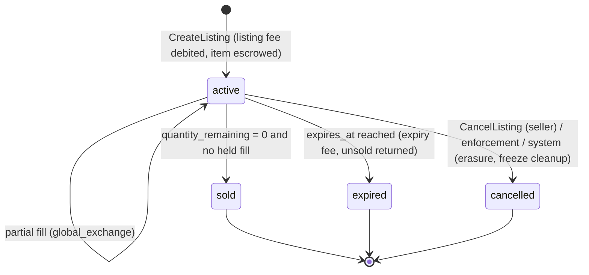
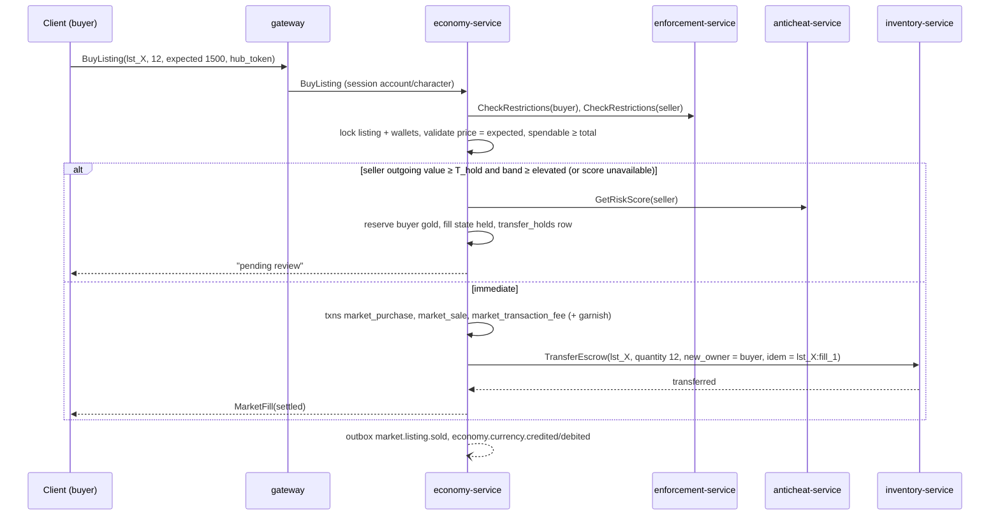
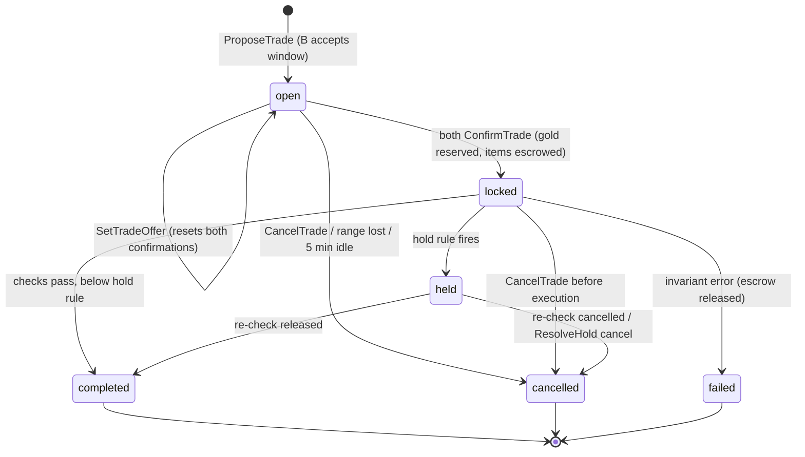
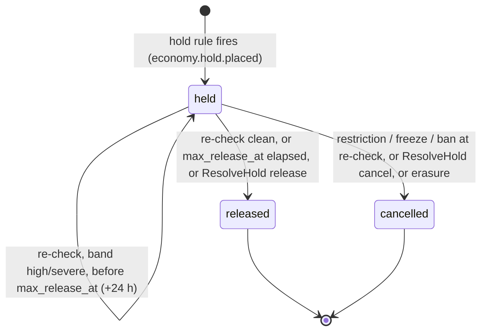

# Legends of the Shattered Frontier — Economy Part 2: Markets, Trade, Holds and NPC Vendors
### Version 1.0 — Expanded Technical Design Authority edition (2026-10-17)

Status: Design target; not implemented. Names per Shared Registry v1.0.

Entry file: [Economy Architecture](../Legends_Shattered_Frontier_Economy_Architecture_v1.0.md) · Registry: [Shared Registry](../Legends_Shattered_Frontier_Shared_Registry_v1.0.md)

This part covers every flow that moves value between owners or between a player and an NPC: the market (auction house), direct player trade, mail gold, guild wallets, transfer holds, NPC vendor pricing and vendor flows, and storage rules. Ledger mechanics (allow-lists, liens, idempotency) are in Part 1.

Common rules for every flow here:

1. Clients send intents only; prices, fees, values and balances are computed server-side.
2. Items never move directly between owners: inventory-service escrow (Itemization spec, Escrow) holds them with `escrow_ref` = `trd_`, `lst_` or the mail reference, and economy-service is the saga owner.
3. Every value-moving step checks, in order: `ff.security.economy_freeze` on the realm; `enforcement-service.CheckRestrictions`; `economy.account_restrictions`; active liens (Part 1, Wallet liens); then Transfer holds.

---

## Market (auction house)

### Market scopes

Markets, preserved from the original design:

- **Global exchange** (`market_scope = global_exchange`): commodities, raw materials, crafting ingredients. One order book per realm per item definition, reachable from any market hub on the realm; partial fills allowed.
- **Regional markets** (`market_scope = regional`): equipment, structures, mounts, specialty goods. Listings are visible only at hubs in the listing's `world_region_id`; purchased whole (stack quantity fixed). This keeps supply and demand regional.

Scope assignment is by item definition, not player choice: `item_category ∈ {material, consumable}` and `resource/*` → `global_exchange`; everything else tradeable (`binding = none`) → `regional`. Items with `binding ≠ none`, `quest_item`, `token` and `currency/*` are never listable (`INVALID_ARGUMENT`). A market hub is an NPC entity flagged `market_hub` in its NPC definition; zone-server attests hub proximity by issuing a short-lived `hub_token` (30 s, HMAC over `character_id`, `world_region_id`, expiry) that gateway forwards with every market RPC.

### Market data model

```sql
CREATE TABLE economy.market_listings (
  listing_id         text PRIMARY KEY,            -- lst_ULID
  realm_id           text   NOT NULL,
  market_scope       text   NOT NULL CHECK (market_scope IN ('global_exchange','regional')),
  world_region_id    text,                        -- required for regional
  seller_account_id  text   NOT NULL,
  seller_character_id text  NOT NULL,
  item_definition_id text   NOT NULL,
  item_instance_id   text   NOT NULL,             -- escrowed itm_ (stack for commodities)
  quantity_listed    int    NOT NULL CHECK (quantity_listed > 0),
  quantity_remaining int    NOT NULL CHECK (quantity_remaining >= 0),
  unit_price_copper  bigint NOT NULL CHECK (unit_price_copper > 0),
  listing_fee_copper bigint NOT NULL,
  duration_hours     int    NOT NULL CHECK (duration_hours IN (12,24,48)),
  state              text   NOT NULL CHECK (state IN ('active','sold','expired','cancelled')),
  created_at         timestamptz NOT NULL DEFAULT now(),
  expires_at         timestamptz NOT NULL,
  closed_at          timestamptz,
  CHECK ((market_scope = 'regional') = (world_region_id IS NOT NULL))
);
CREATE INDEX listings_book ON economy.market_listings
  (realm_id, market_scope, item_definition_id, unit_price_copper) WHERE state = 'active';
CREATE INDEX listings_seller ON economy.market_listings (seller_character_id) WHERE state = 'active';
CREATE INDEX listings_expiry ON economy.market_listings (expires_at) WHERE state = 'active';

CREATE TABLE economy.market_fills (               -- one row per market.listing.sold
  listing_id         text NOT NULL REFERENCES economy.market_listings,
  fill_no            int  NOT NULL,
  buyer_account_id   text NOT NULL,
  buyer_character_id text NOT NULL,
  quantity           int  NOT NULL CHECK (quantity > 0),
  unit_price_copper  bigint NOT NULL,
  total_copper       bigint NOT NULL,
  fee_copper         bigint NOT NULL,
  hold_id            text,                        -- thd_ when held
  state              text NOT NULL CHECK (state IN ('settled','held','cancelled')),
  filled_at          timestamptz NOT NULL DEFAULT now(),
  PRIMARY KEY (listing_id, fill_no)
);
```

A listing is `sold` when `quantity_remaining = 0` and no fill is `held`; a held fill keeps its quantity reserved (`quantity_remaining` already decremented) and restores it if the hold is cancelled.

### Listing lifecycle (`market_listing_state`)



`ff.security.economy_freeze` pauses the expiry clock: deadlines are extended by the freeze duration. Cancellation by enforcement (`cancelled_by = enforcement`) returns escrow to the seller unless the item is quarantined (Itemization spec, Quarantine), in which case it stays quarantined.

### Listing rules and price guardrails

| Rule | Value | Tuning key |
| --- | --- | --- |
| Max active listings per character | 100 | `tune.economy.market_max_listings_per_character` |
| Durations | 12 / 24 / 48 h (default 48) | `tune.economy.market_listing_durations_hours` |
| Min character level to list | 10 | `tune.economy.market_min_level` |
| Hard price ceiling | `P_max = max(P_CAP_MULT × fair_value, P_CAP_ABS)` | `tune.economy.market_price_cap_mult` (20), `tune.economy.market_price_cap_abs_copper` (100,000) |
| Soft warning band | outside `[0.5, 2.0] × fair_value` → client confirm dialog | `tune.economy.market_price_warn_low`, `tune.economy.market_price_warn_high` |
| Price floor | 1 copper; no NPC floor (selling below vendor value is allowed and warned) | — |

`fair_value` is defined in Transfer holds (Value of a transfer). The hard ceiling exists to stop gold-for-nothing transfers through absurdly priced listings (a classic RMT delivery channel); legitimate thin-market goods are covered by the fallback `vendor_value × 4` and the 20× multiplier (≥ 80× vendor value). Listings at or above `P_max` → `INVALID_ARGUMENT`.

**Worked example.** A regional epic sword with no 28-day sales has `vendor_value` 2,097 copper → fallback `fair_value` = 8,388; `P_max = max(20 × 8,388, 100,000) = 167,760` copper. Listing at 150,000 is allowed with a warning (17.9× fair value); 200,000 is rejected.

### Market fees

Fees (all sinks, seller pays):

```text
listing_fee     = max(F_min, round(r_list × unit_price × quantity_listed))           charged at CreateListing, non-refundable
transaction_fee = round(r_txn_eff × total_copper)                                     per fill, debited from the seller's market_sale credit
expiry_fee      = min(spendable_seller, max(F_min, round(r_exp × unit_price × quantity_remaining)))   at expiry
r_txn_eff       = r_txn × D                                                           D = dynamic fee factor (Part 3, Inflation controls), 1.0 when disabled
seller_net      = total_copper − transaction_fee
```

| Variable | Default | Tuning key |
| --- | --- | --- |
| `r_list` | 0.01 (1 %) global exchange; 0.02 regional | `tune.economy.market_listing_fee_rate`, `tune.economy.market_listing_fee_rate_regional` |
| `r_txn` | 0.05 (5 %) | `tune.economy.market_transaction_fee_rate` |
| `r_exp` | 0.01 (1 %) | `tune.economy.market_expiry_fee_rate` |
| `F_min` | 100 copper (1 silver) | `tune.economy.market_fee_min_copper` |
| durations | 12 / 24 / 48 h (default 48) | `tune.economy.market_listing_durations_hours` |
| max active listings per character | 100 | `tune.economy.market_max_listings_per_character` |

Expiry fee is capped by the seller's spendable balance so wallets never go negative; any uncollected part is reported as `expiry_fee_waived_copper` (abuse of this path is visible and bounded by the listing fee already paid). Cancellation charges no extra fee (the listing fee is the spoofing deterrent).

A fill writes, in one transaction: buyer debit `market_purchase` (total), seller credit `market_sale` (total), seller debit `market_transaction_fee` (fee), plus inventory-service escrow move of `quantity` to the buyer. Settlement-owned marketplaces may add a local tax (Settlement taxes, below).

**Worked example.** A character lists 20 iron ingots at 1,500 copper on the global exchange for 48 h. Listing fee = max(100, round(0.01 × 30,000)) = 300 copper. A buyer takes 12: total 18,000, transaction fee 900, seller net 17,100. The remaining 8 expire: expiry fee = max(100, round(0.01 × 1,500 × 8)) = 120. Sinks from this listing: 300 + 900 + 120 = 1,320 copper; transfer volume 18,000 copper.

Effective fee take on a fully sold global-exchange listing: `r_list + r_txn` = 6 % (7 % regional); on an expired one `r_list + r_exp` = 2 %. Part 3 (Economic balancing targets) uses 6.3 % as the blended market fee rate.

### Fill procedure

`BuyListing(listing_id, quantity, expected_unit_price, hub_token, idempotency_key)`:



Atomicity across services: the economy DB transaction commits the ledger rows and a `pending_escrow` marker on the fill; the escrow transfer is then driven by an outbox-backed worker with idempotency key `lst_id:fill_no` until inventory-service confirms. Inventory's sweeper asks economy-service before releasing any `lst_` escrow (Itemization spec, Escrow), so an item cannot return to the seller after the buyer paid. If `TransferEscrow` fails permanently (item quarantined between listing and fill), the worker reverses the fill with a correction pair (`enforcement_restore` credit to the buyer for `total_copper`, `enforcement_rollback` debit on the seller for `seller_net`, `allow_partial` with any shortfall becoming a lien; `causation_id` = `lst_id:fill_no`), audits it, and reports `economy_invariant`. Ledger rows are never edited. This path is expected only under enforcement races.

Which side is held: the **seller** (giving party of items, receiving gold) is evaluated because an elevated-risk seller is the RMT delivery pattern; the buyer's outgoing gold is evaluated too, and either side at or above `T_hold` with elevated risk holds the fill.

### Search and visibility

`SearchListings(realm_id, market_scope, world_region_id?, item_definition_id? | filters{item_category, equip_slot, rarity, ilvl_min, ilvl_max}, sort = unit_price_asc | ilvl_desc | expires_asc, page_token)`. Global exchange results aggregate by price level (quantity per unit price) for the top 20 levels. Regional results are filtered by the hub's `world_region_id` from `hub_token`. Search reads a replica (staleness ≤ 2 s); `BuyListing` always revalidates on the primary and returns `FAILED_PRECONDITION` (`listing_changed`) if price or quantity moved.

---

## Player trading

Direct trade (implemented here), trade contracts, guild trading and settlement vendors (future, built on the same escrow and hold primitives). Trade lifecycle (`trade_state`): `open` → `locked` (both offers frozen, gold reserved, items moved to escrow by inventory-service) → `completed`, or `held` (Transfer holds) → `completed` / `cancelled`; `open`/`locked` → `cancelled` by either side; `failed` on an invariant error (all escrow and reservations returned). Execution writes `trade_send`/`trade_receive` pairs per gold direction and calls inventory-service to move escrowed items, atomically per side (Security INV-10). Trades require both characters on the same realm and within interaction range (zone-server validated) unless made at a trade post.

```sql
CREATE TABLE economy.trades (
  trade_id            text PRIMARY KEY,           -- trd_ULID
  realm_id            text NOT NULL,
  side_a_account_id   text NOT NULL, side_a_character_id text NOT NULL,
  side_b_account_id   text NOT NULL, side_b_character_id text NOT NULL,
  offer_a             jsonb NOT NULL,             -- {gold_copper, items:[{item_instance_id, item_definition_id, quantity}]}
  offer_b             jsonb NOT NULL,
  state               text NOT NULL CHECK (state IN ('open','locked','held','completed','cancelled','failed')),
  hold_id             text,
  created_at          timestamptz NOT NULL DEFAULT now(),
  completed_at        timestamptz,
  version             int NOT NULL DEFAULT 0
);
```



Rules:

1. `SetTradeOffer` replaces a side's offer and clears both confirmations (prevents bait-and-switch). Max 8 item stacks per side.
2. `ConfirmTrade` by both sides within 60 s of the last offer change moves to `locked`: economy-service reserves gold (`reserved += gold_copper`) and calls `EscrowItems(escrow_ref = trd_X, idem = trd_X:A:hold)` for each side. Inventory validates binding and the loot trade window (Itemization spec, `LOOT_TRADE_WINDOW`).
3. Execution in one economy transaction: for each side with gold, `trade_send` on the giver, `trade_receive` on the receiver (+ garnish), `reserved` released; then `TransferEscrow(trd_X, new_owner)` per side via the outbox worker (idempotent `trd_X:commit:A`, `trd_X:commit:B`). Escrow max age for trades is 15 min (Itemization); held trades extend the escrow by the hold (`ReleaseEscrow` is never called while a hold is `held`).
4. A trade is completed when both `TransferEscrow` calls confirm; `economy.trade.completed` is published once with `sides[]`.
5. Gift trades (one side empty) are allowed; they are the main input to Security's funnel detector and are always evaluated against the hold rule.

**Itemization alignment.** The Itemization escrow sequence names the accept step `AcceptTrade`; the canonical Economy RPC is `ConfirmTrade` (both sides call it). They denote the same step.

### Mail gold

Mail attachments are owned by inventory-service (mailbox container) and mail bodies by chat-service (Backend spec, Inventory Service and erasure saga). Gold attachments are economy transfers:

1. On send, inventory-service calls `TransferCurrency(from = sender character, to = recipient character, currency/gold, amount, transfer_kind = mail, idempotency_key = mail send key)`.
2. economy-service pre-allocates the payer `txn_` ID and returns it as `transfer_ref`; inventory uses it as the mail's `escrow_ref` for any item attachments. Security's `security.trade.flagged` uses the same `txn_` as `transfer_ref` for mail (Security spec, `security.trade.flagged`).
3. The transfer runs the hold rule with the sender as giving party; if held, gold stays `reserved` on the sender and the mail shows "pending review". On release, `trade_send`/`trade_receive` rows are written with the pre-allocated `txn_id`.
4. Gold is delivered to the recipient's wallet at send time (not at mail open) to keep the ledger simple; the mail shows the amount as already credited. Returned or expired mail never moves gold back (there is nothing to return).
5. Limits: `tune.economy.mail_gold_max_copper` = 50,000,000 (5,000 gold) per mail; senders below character level 10 or on accounts younger than 3 days may attach at most `tune.economy.mail_gold_newbie_max_copper` = 10,000 per day (mule throttle). Only `currency/gold` can be mailed.

### Guild wallets

Guild wallets (`owner_kind = guild`) pay `guild_upkeep`, `territory_upkeep`, `housing_tax` and `siege_declaration` via guild-service `Debit`. Deposits and withdrawals are player-to-guild transfers using `trade_send` / `trade_receive` and registered `transfer_kind = guild` (Shared Registry, Phase-2 enums). Guild deposits and withdrawals run behind `ff.economy.guild_wallet_transfers_enabled` (default off) and guilds fund upkeep only from guild-earned income defined by the Building spec. Withdrawal permission is checked by guild-service (rank permission) before it calls economy-service; the hold rule applies to withdrawals (the guild is not a risk-scored party; the withdrawing character's account is the receiving party and the depositor is the giving party).

---

## Transfer holds

### Rule source

Security, Bands and automatic controls: at band `elevated` (400–599) and above, "outgoing trades/mail/market sales with value ≥ 100,000 copper held 24 h for automatic re-check" (`tune.security.trade_hold_value_copper`); at `severe`, interim `trade_restriction` and `market_restriction` sanctions apply. `CheckRestrictions` is fail-closed for trades above the hold threshold. Economy implements both.

### Evaluation (every trade execution, market fill, mail gold transfer)

```text
for each giving party P (trade: each side with outgoing value; market: seller of the fill; mail: sender):
  R = enforcement.CheckRestrictions(P.account, P.character)           -- 30 s cache, invalidated by sanction events
  if R.trade_restricted (trade, mail) or R.market_restricted (market):  reject FAILED_PRECONDITION
  if economy.account_restrictions active for P (rollback freeze):       reject
  if ff.security.economy_freeze on the realm:                           reject
  v = outgoing value of P (gold + items at fair value)
  if v ≥ T_hold:
     s = anticheat.GetRiskScore(P.account)                              -- timeout 50 ms
     if s unavailable or s.band ∈ {elevated, high, severe}: HOLD
execute immediately if no HOLD
```

`CheckRestrictions` errors: below `T_hold` fail-open (proceed), at or above `T_hold` fail-closed (reject with retry hint). `GetRiskScore` errors at or above `T_hold` produce a hold, not a rejection (fail-closed but player-friendly).

| Variable | Default | Tuning key |
| --- | --- | --- |
| `T_hold` | 100,000 copper | `tune.security.trade_hold_value_copper` (Security-owned; read only) |
| hold duration | 24 h | `tune.economy.transfer_hold_hours` |
| max hold | 72 h | `tune.economy.transfer_hold_max_hours` |
| band threshold | `elevated` | fixed by Security band table |

### Value of a transfer

`v = gold_copper + Σ_items quantity × fair_value(item_definition_id, dc_region)`; `fair_value` = latest 7-day volume-weighted median unit price from `economy.item_prices_daily`; items with no sales in 28 days use `vendor_value × 4` (`tune.economy.unpriced_item_multiplier`). The same `fair_value` is returned by `GetIndexPrices` and used by Security's taint trace and Itemization's deficit valuation, so every domain values items identically.

The 7-day median is computed over all non-flagged fills of the dc_region (both scopes), with the same outlier and flag exclusions as the index (Part 3, Inflation index). Regional-market items with fewer than 5 fills in 7 days use the 28-day median if it has ≥ 5 fills, else the fallback.

### Hold data model and lifecycle (`transfer_hold_state`)

```sql
CREATE TABLE economy.transfer_holds (
  hold_id            text PRIMARY KEY,            -- thd_ULID
  transfer_kind      text NOT NULL CHECK (transfer_kind IN ('trade','market','mail')),
  transfer_ref       text NOT NULL,               -- trd_ / lst_:fill_no / mail ref
  held_account_id    text NOT NULL,               -- elevated party
  value_copper       bigint NOT NULL,
  risk_score_at_hold int,                         -- NULL when GetRiskScore unavailable (fail-closed hold)
  state              text NOT NULL CHECK (state IN ('held','released','cancelled')),
  release_at         timestamptz NOT NULL,
  max_release_at     timestamptz NOT NULL,
  rechecks           int NOT NULL DEFAULT 0,
  outcome_reason     text,
  created_at         timestamptz NOT NULL DEFAULT now()
);
CREATE INDEX holds_due ON economy.transfer_holds (release_at) WHERE state = 'held';
```



### Hold mechanics

On HOLD, nothing moves yet: the paying side's gold is `reserved` and items stay `escrowed` in inventory-service; a `transfer_holds` row is created (`thd_`), the trade goes to `held` (or the fill to `held`), and `economy.hold.placed` is published (anticheat-service consumes it and emits `security.trade.flagged` with `hold_applied = true` when a detector fires). Both players see "pending review, up to 24 h". Money supply is unaffected because balances do not change during a hold.

Re-check at `release_at` (job every minute):

| Condition at re-check | Outcome |
| --- | --- |
| `trade_restricted`/`market_restricted` now active, rollback freeze, or account banned | `cancelled`: reservations and escrow returned; trade `cancelled`, fill `cancelled` (listing quantity restored) |
| band `high` or `severe` (case open) and `now < max_release_at` | extend 24 h (`rechecks += 1`) |
| band `high`/`severe` at `max_release_at` without restriction | `released` (Security had 72 h to act; release is logged with `outcome_reason = max_hold_elapsed`) |
| otherwise | `released`: execute the transfer exactly as it would have run, publish the normal events with `hold_id` |

`ff.security.economy_freeze` pauses all re-checks and listing expiry clocks on the realm (expiry deadlines are extended by the freeze duration). Staff can `ResolveHold` early (audited).

A held market fill whose listing expires keeps the held quantity; only the unheld remainder expires. A held fill whose buyer's reserved gold would be needed by a later debit is protected: `reserved` is excluded from spendable, so the buyer simply cannot spend it.

**Worked example.** An `elevated` seller (score 470) sells a mount listing for 450,000 copper. `v` for the seller = item fair value 430,000 ≥ 100,000 → HOLD; buyer's 450,000 is reserved, the mount stays escrowed, `release_at` = +24 h. At re-check the score is 520 (still `elevated`, no restriction) → released: fee 22,500, seller net 427,500, mount delivered; `market.listing.sold` carries `hold_id`; `held_seconds` = 86,400.

---

## NPC vendor pricing

### Scope

Economy owns NPC price modifiers and the vendor flows; Itemization owns `vendor_value(item)` (Itemization spec, Vendor value) and the repair base cost; Combat lists Charisma → NPC Prices (Combat spec, Charisma) and AI owns faction standing tiers (AI spec, Faction service). The modifier `npc_price_mult` consumed by Itemization's repair formula is defined here.

### Price modifiers

```text
d_cha         = CHA_DISCOUNT_MAX × clamp((cha_nat − ATTRIBUTE_MIN) / (CHA_REF − ATTRIBUTE_MIN), 0, 1)
f_tier        = FACTION_PRICE[tier(standing with the vendor's faction)]      -- 0 if the vendor has no faction
npc_price_mult = clamp((1 − d_cha) × (1 + f_tier), M_MIN, M_MAX)              -- repairs, npc_service, vendor buys
m_buy         = npc_price_mult × v_econ                                       -- gold vendor purchases only
m_sell        = 1 + CHA_SELL_BONUS_MAX × d_cha / CHA_DISCOUNT_MAX            -- gold vendor sales

buy_price(entry)  = ceil(base_price_copper(entry) × m_buy)                    -- gold entries
buy_price(entry)  = base_price(entry)                                         -- marks / season-token entries (no modifiers)
sell_price(item)  = floor(vendor_value(item) × m_sell)
```

| Variable | Definition / default | Tuning key |
| --- | --- | --- |
| `cha_nat` | character's **natural** Charisma (before items/effects), from progression-service attribute snapshot; natural, like the Combat/AI reputation rule, so gear swaps cannot farm prices | — |
| `ATTRIBUTE_MIN` | 10 (Registry) | `tune.progression.attribute_min` |
| `CHA_REF` | 150 (= `ATTRIBUTE_NATURAL_CAP`) | `tune.economy.npc_cha_reference` |
| `CHA_DISCOUNT_MAX` | 0.10 | `tune.economy.npc_cha_discount_max` |
| `CHA_SELL_BONUS_MAX` | 0.05 | `tune.economy.npc_cha_sell_bonus_max` |
| `FACTION_PRICE` | `hated`/`hostile`: service refused; `unfriendly` +0.10; `neutral` 0; `friendly` −0.02; `honored` −0.05; `revered` −0.08; `exalted` −0.10 | `tune.economy.npc_faction_price.<tier>` |
| `M_MIN`, `M_MAX` | 0.75, 1.25 | `tune.economy.npc_price_mult_min`, `tune.economy.npc_price_mult_max` |
| `v_econ` | vendor inflation multiplier, 1.0 (Part 3, Inflation controls) | `tune.economy.vendor_price_scaling` |

**Arbitrage guard (normative).** Every gold vendor entry must satisfy `base_price_copper ≥ VENDOR_MARKUP_MIN × vendor_value(item)` with `VENDOR_MARKUP_MIN` = 4 (`tune.economy.vendor_markup_min`). The cheapest possible buy is `0.75 × 0.8 × 4 = 2.4 × vendor_value` (with `v_econ` at its floor 0.8) and the best possible sale is `1.05 × vendor_value`, so buy-from-vendor/sell-to-vendor loops always lose ≥ 56 %. The content validator rejects catalogs that break the guard.

**Worked example.** Natural Charisma 80, `honored` with the vendor's faction. `d_cha = 0.10 × (70 / 140) = 0.05`; `f_tier = −0.05`; `npc_price_mult = 0.95 × 0.95 = 0.9025`; `m_buy = 0.9025` (v_econ 1.0); `m_sell = 1 + 0.05 × 0.5 = 1.025`. A potion with base 2,000 copper costs `ceil(1,805.0) = 1,805`. A rare ring with `vendor_value` 2,097 sells for `floor(2,149.4) = 2,149`. Itemization's epic chest repair (42,400 copper at mult 1.0) costs ≈ 38,266 copper for this character (Itemization applies the multiplier inside its `ceil`).

### Vendor catalog content (`vendor/<slug>`, registered content kind; Shared Registry, Content definition kinds)

```json
{
  "id": "vendor/greenhold_provisioner",
  "npc_id": "npc/greenhold_provisioner",
  "faction_id": "faction/greenhold_wardens",
  "kind": "general",
  "entries": [
    { "item_definition_id": "item/minor_healing_potion", "currency_id": "currency/gold",
      "base_price_copper": 1800, "stock_per_reset": null, "requires": null },
    { "item_definition_id": "item/greenhold_tabard", "currency_id": "currency/frontier_marks",
      "base_price": 400, "stock_per_reset": { "period": "weekly", "limit": 1 },
      "requires": { "faction_id": "faction/greenhold_wardens", "min_tier": "honored" } }
  ],
  "buys_items": true,
  "season_id": null
}
```

`kind ∈ {general, reagent, faction, season, quartermaster}`. Season vendors set `season_id` and may only price in `currency/season_tokens`. Vendor-created items use source `vendor_stock` and the Itemization rarity ceiling for vendor stock (`uncommon`; faction/quartermaster entries may name a fixed-ilvl item from their bundle rules). Slugs above are illustrative.

### Vendor flows

All three RPCs are called by zone-server, which validates that the character is within interaction range of a live vendor NPC entity (`ent_`) bound to the catalog, then forwards the player's intent with `vendor_id`, `npc_entity_id` and the session's `account_id`/`character_id`.

| RPC | Steps (one idempotency key per player intent) |
| --- | --- |
| `BuyFromVendor(vendor_id, entry_index, quantity, expected_unit_price)` | quote (`QuoteNpcPrices`, cached 60 s per character × faction); check `requires`, stock counter and `expected_unit_price`; **reserve** `price × quantity`; call registered inventory-service `CreateVendorItems` (Itemization; source `vendor_stock`, idem = intent key); on success **debit** `vendor_purchase` consuming the reservation and increment the stock counter; on permanent failure release the reservation. No refund code is ever needed. |
| `SellToVendor(vendor_id, item_id, quantity)` | `vendor.buys_items` must be true; inventory-service `MoveToBuyback` (Itemization; validates the item is the character's, not escrowed/quarantined/bound-unsellable, records `sale_ref`); then `Credit(vendor_sale, floor(vendor_value × m_sell) × quantity, causation_id = sale_ref)` via outbox retry until applied. |
| `BuybackFromVendor(sale_ref)` | within the buyback window (until the next daily reset, Itemization `buyback` container): `Debit(vendor_purchase, original amount, reason_code = buyback, causation_id = vendor_sale txn)`, then inventory-service `RestoreFromBuyback(sale_ref)`. Price equals the original sale price (no modifier re-applied). |

`ff.item.vendor_stock_enabled` (Itemization) gates `BuyFromVendor` for item creation; while it is off, `BuyFromVendor` returns `FAILED_PRECONDITION`. Buyback containers are cleared at the daily reset by inventory-service with item sink `item_destroyed` (no currency effect).

```sql
CREATE TABLE economy.vendor_stock_counters (
  character_id text NOT NULL, vendor_id text NOT NULL, entry_index int NOT NULL,
  period_start timestamptz NOT NULL,              -- daily or weekly reset of the dc_region
  purchased    int NOT NULL DEFAULT 0 CHECK (purchased >= 0),
  PRIMARY KEY (character_id, vendor_id, entry_index, period_start)
);
CREATE TABLE economy.vendor_sales (               -- links vendor_sale credits to buyback
  sale_ref      text PRIMARY KEY,                 -- issued by inventory MoveToBuyback
  character_id  text NOT NULL, vendor_id text NOT NULL,
  item_definition_id text NOT NULL, quantity int NOT NULL,
  amount_copper bigint NOT NULL, credit_txn_id text,
  bought_back_txn_id text,
  created_at    timestamptz NOT NULL DEFAULT now()
);
```

Trading-skill practice (Character spec, `skill/trading`) consumes `economy.currency.debited`/`credited` with `vendor_id` set; Character caps vendor practice records at 40 per 24 h.

### `QuoteNpcPrices`

`QuoteNpcPrices(character_id, vendor_id? | faction_id?) → {quote_id, npc_price_mult, m_buy, m_sell, valid_until}`. economy-service reads natural Charisma from progression-service (attribute snapshot, cached 5 min, invalidated by `progression.attribute.changed`) and standing from `faction-service.GetStanding` (cached 60 s, invalidated by `faction.reputation.changed`). Callers: zone-server (vendors, NPC services, fast travel quotes) and inventory-service (`QuoteRepair`). The quote is advisory; the charging call (`Debit` by inventory-service for `repair_cost`, or the vendor RPC) carries `quote_id`, and economy-service rejects a debit whose amount differs from the quote-derived amount by more than 1 copper per line when `quote_id` is present.

### NPC services price table

Gold sinks that Economy prices directly (other domains own the rest; see entry file, Gold sources and sinks):

| Service (sink) | Price | Tuning key |
| --- | --- | --- |
| Bank row expansion (`npc_service`), Itemization `bank` +10 slots per row, max 6 rows | `row_k × gold_reward(L_row, 1) × npc_price_mult`, `L_row` = 20, 40, 60, 80, 100, 100; `row_k` = 2, 4, 6, 8, 10, 15 | `tune.economy.bank_row_price_k` |
| Mail postage (`npc_service`) | 30 copper per mail + 1 % of attached gold, min 30, max 10,000 copper | `tune.economy.mail_postage_*` |
| Respec of attribute locks, name services in-game (`npc_service`) | `gold_reward(L, 2) × npc_price_mult` | `tune.economy.npc_service_weight_<service>` |
| Fast travel (`fast_travel`, World-owned route table) | World sets base route cost; Economy multiplies by `npc_price_mult` for flight-master NPCs | World / Economy |

Worked example: third bank row at L_row 60: `6 × gold_reward(60, 1) = 6 × 47,643 = 285,858` copper (≈ 28.6 gold) × 0.9025 → 257,987 copper for the character above.

---

## Storage rules

Itemization owns containers and capacities (Itemization spec, Container kinds). Economy's rules for anything that sells storage:

1. Gold-purchasable storage (`bank` rows) is priced by the NPC services table and is per character.
2. Store-purchasable storage (LiveOps `convenience` offers) is limited to **one** extra `account_bank` tab of 20 slots per account (`tune.economy.store_account_bank_tab_max` = 1, `tune.economy.store_account_bank_tab_slots` = 20). The tab holds only items `account_bank` already accepts; it never increases character bank capacity, mailbox, or guild bank.
3. No storage product may hold currency, increase market listing limits, or reduce market fees (crowns never buy economic advantage; Security INV-9 spirit).

---

## Settlement taxes

Settlement-owned marketplaces (Building spec, Guild settlements) may levy a local tax on fills at their hubs. Economy's mechanism remains disabled until Building expands (`ff.economy.settlement_tax_enabled`, default off); the source and sink codes are registered in the Shared Registry, Currencies, sources and sinks:

```text
settlement_tax = round(r_settle × total_copper),   r_settle ∈ [0, 0.05] set by the owning guild, max change once per week
seller debit  settlement_tax_paid   (registered sink,   flow_class transfer)
guild credit  settlement_tax_income (registered source, flow_class transfer) → owning guild wallet
```

The transaction fee (`market_transaction_fee`) still applies and is destroyed; the settlement tax is a transfer, so it never counts toward `m_gold_destroyed`.
