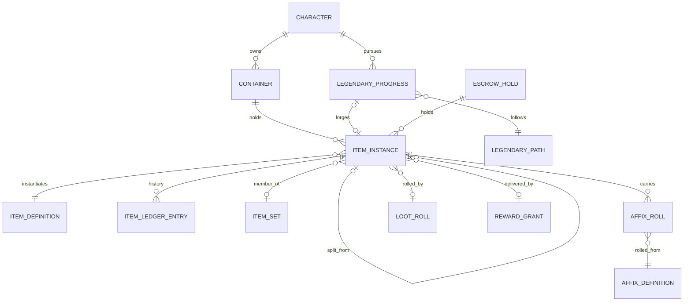
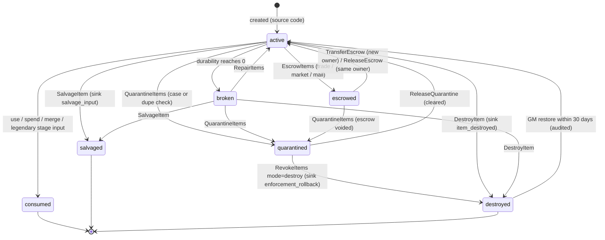
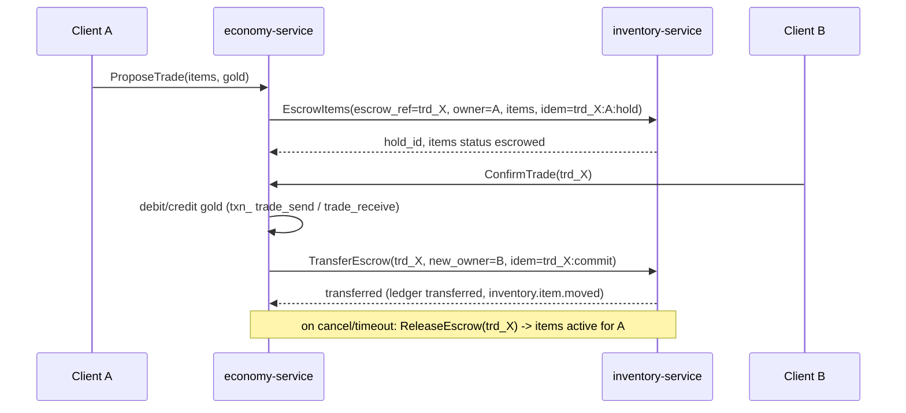

# Legends of the Shattered Frontier — Itemization: Item Model, Lifecycle, Durability and Legendary Paths
### Version 1.0 — Expanded Technical Design Authority edition (2026-10-17)

Status: Design target; not implemented. Names per Shared Registry v1.0.

Entry file: [Itemization Architecture](../Legends_Shattered_Frontier_Itemization_Architecture_v1.0.md) · Registry: [Shared Registry](../Legends_Shattered_Frontier_Shared_Registry_v1.0.md)

---

## 1. Purpose

This part specifies everything `inventory-service` owns: item definitions as consumed from content, item instances with provenance, the item ledger, containers and equipment, binding, the `item_status` lifecycle, escrow and duplication prevention, durability (wear, repair, broken, salvage, destroy), legendary acquisition paths, the `inventory` PostgreSQL schema, the `lsf.inventory_service.v1` API, and payloads for every `item.*` and `inventory.*` event.

## 2. Item definitions

Content kind `item`, ID `item/<slug>`, published in content packs by `content-catalog-service`. Definitions are immutable per `content_version`; instances record the `content_version` they were rolled under and are re-evaluated only by explicit migration.

```json
{
  "id": "item/iron_longsword",
  "category": "weapon",
  "slot": "main_hand",
  "weapon_type": "sword",
  "speed_s": 2.6,
  "material": null,
  "skill_id": "skill/swordsmanship",
  "rarity_range": { "min": "common", "max": "rare" },
  "ilvl_rule": { "kind": "from_source" },
  "binding": "on_equip",
  "stackable": false,
  "max_stack": 1,
  "unique_equipped": false,
  "unique_owned": false,
  "durability_class": "weapon",
  "requirements": { "character_level_min": 1, "skills": [ { "skill_id": "skill/swordsmanship", "min": 0 } ] },
  "stat_affinity": ["melee", "str"],
  "implicit_affixes": [],
  "excluded_affixes": [],
  "affix_pool_override": null,
  "item_set_id": null,
  "vendor_value_copper": "derived",
  "salvage_profile": "salvage/metal_weapon",
  "tags": ["sword", "one_hand"],
  "display": { "name_key": "item.iron_longsword.name", "icon": "icons/weapons/iron_longsword", "model": "SM_Iron_Longsword" }
}
```

Field rules:

| Field | Rule |
| --- | --- |
| `category` | registry `item_category` |
| `slot` | registry `equip_slot`, or `ring` / `trinket` slot families, or `null` for non-equippables |
| `material` | armor only: `cloth`, `leather`, `mail`, `plate` |
| `rarity_range` | rarity a roll may produce; clamped further by the source ladder ceiling |
| `ilvl_rule.kind` | `from_source` (ladder via loot context), `fixed` (with `ilvl`), `crafted` (registry crafted formula) |
| `binding` | registry `binding`; legendary items are always `on_pickup`; `currency`-like tokens are `account` |
| `unique_equipped` / `unique_owned` | enforced by inventory-service on equip / create |
| `vendor_value_copper` | `"derived"` → `vendor_value(item)` (§9.4), or an explicit integer for non-budget items |
| `salvage_profile` | Crafting-owned salvage profile ID consumed by crafting-service |

### 2.1 Categories and slots

| `item_category` | Equippable slots | Budget | Durability | Stackable | Notes |
| --- | --- | --- | --- | --- | --- |
| `weapon` | `main_hand`, `off_hand`, `two_hand`, `ranged` | yes | yes | no | weapon damage implicit |
| `armor` | `head`, `shoulders`, `chest`, `hands`, `waist`, `legs`, `feet`, `back`, `off_hand` (shields) | yes | yes | no | armor implicit |
| `accessory` | `neck`, `ring_1`, `ring_2`, `trinket_1`, `trinket_2` | yes | no | no | |
| `tool` | `tool` | profession budget | yes (per use) | no | gathering/crafting tools |
| `siege_equipment` | none (deployed) | Building spec | yes | no | deploy consumes via Building flow |
| `consumable` | none | no | no | yes (≤ 200) | potions, food, scrolls |
| `material` | none | no | no | yes (≤ 1,000) | resources are `material` items with `resource/<slug>` link |
| `token` | none | no | no | yes (≤ 100) | upgrade tokens, legendary fragments |
| `quest_item` | none | no | no | per def | `on_pickup`, removed on quest end by quest-service request |
| `cosmetic` | appearance slots (client) | no | no | no | `account` binding; may come from store |
| `container` | bag slots | no | no | no | defines `capacity` |

Equip rules (server-validated by `inventory-service.EquipItem`): `two_hand` occupies `main_hand` and `off_hand`; character meets `requirements`; item status `active` or `broken` (broken items equip but give no stats); `unique_equipped` and `LEGENDARY_EQUIPPED_MAX` respected; equipment changes in combat are rejected unless the simulating server marks the character `out_of_combat` in the request.

### 2.2 Rarity rules

- Rarity is fixed at instance creation and never changes (legendary upgrades raise ilvl, not rarity).
- Effective rarity = `min(definition.rarity_range.max, source ladder ceiling, rolled rarity)` and ≥ `rarity_range.min`.
- `mythic` is reserved: creation requests with `mythic` are rejected with `RARITY_NOT_OBTAINABLE`.
- Rarity colors and names are client concerns; rarity rank order is `common` < `uncommon` < `rare` < `epic` < `legendary` < `mythic`.

## 3. Item instances

### 3.1 Instance model

| Field | Description |
| --- | --- |
| `item_id` | `itm_<ULID>`; stable for the item's whole life, across owners |
| `definition_id`, `content_version` | template and pack version at roll |
| `realm_id` | items never cross realms |
| `owner_kind`, `owner_id` | `character` (`chr_`), `account` (`acc_`, account bank), `guild` (`gld_`), or `system` (escrow, overflow) |
| `container_id`, `slot_index`, `equip_slot` | location; exactly one location while not terminal |
| `quantity` | ≥ 1 while non-terminal; stacks only |
| `status` | registry `item_status` |
| `binding`, `bound_character_id`, `bound_account_id`, `bound_at` | binding state (§5) |
| `ilvl`, `rarity`, `item_budget`, `roll_algorithm_version`, `roll_floor_permille` | power snapshot (Stat budget part) |
| `affixes` | ordered list `{affix_id, kind, tier, stats:{stat:value}, r_permille}` |
| `durability`, `max_durability`, `base_max_durability` | null for non-durable categories |
| `provenance` | `{source, source_ref, causation_id, loot_roll_id?, reward_grant_id?, crafted_by_character_id?, quality_score?, quality_bonus?, parent_item_id?, legendary_progress_id?}` |
| `trade_window_until`, `trade_eligible_character_ids` | group-loot trade window for `on_pickup` items (§5.2) |
| `escrow_ref` | `trd_`, `lst_`, or mail reference while `escrowed` |
| `quarantine_case_id` | `cas_` while `quarantined` |
| `version` | optimistic concurrency counter, +1 on every write |
| `last_ledger_id`, `ledger_seq` | head of the item's ledger chain |

Provenance is write-once: `source`, `source_ref`, `causation_id`, roll references, and crafter fields never change after creation.

### 3.2 Entity relationships



`AFFIX_ROLL` is the `affixes` JSONB array, not a table.

### 3.3 Containers

`ctn_<ULID>`; one row per container. Kinds use the registered `container_kind` enum. Resolved (2026-10-17): Shared Registry, Shared enumerations and canonical lifecycle states.

Containers are created lazily on first use by inventory-service; character creation does not pre-create every optional container. Resolved (2026-10-17): Economy spec, Storage rules, defines one store-purchasable 20-slot account-bank tab per account.

| `container_kind` | Owner | Default capacity | Notes |
| --- | --- | --- | --- |
| `equipment` | character | 18 (one per `equip_slot`) | `slot_index` unused; `equip_slot` set |
| `backpack` | character | 20 | created on first inventory use |
| `bag` | character | from bag item `capacity` (8–32) | the bag is itself an item in a bag slot; cannot be removed while non-empty |
| `bank` | character | 60 (+ purchasable rows via Economy `npc_service`) | |
| `account_bank` | account | 40 base slots plus Economy's one 20-slot store tab cap | only `account`-bound or unbound items; per Economy spec, Storage rules |
| `guild_bank` | guild | per guild-service tier | permissions checked via guild-service |
| `mailbox` | character | unlimited, 30-day expiry for player mail | rewards overflow lands here, no expiry |
| `escrow` | system | unlimited | one logical hold per `escrow_ref` |
| `buyback` | character | 12, FIFO, cleared at daily reset | vendor sales reversible |

## 4. Item status lifecycle

Canonical states from registry `item_status`. Transitions are only performed by `inventory-service`; every transition writes one ledger entry and one outbox event in the same transaction.



Rules:

- `broken` items cannot be escrowed (repair first) but can be equipped, salvaged, or destroyed.
- `quarantined` items are visible to the owner as "Under review", cannot move, equip, or be consumed, and contribute no stats.
- A stack merge moves the source stack's quantity into the target and sets the source to `consumed` with ledger `entry_type = merged` and **no sink code**: value is conserved; analytics exclude merges from sinks.
- GM restore of `destroyed` items requires `admin-portal` with a ticket reference, writes `entry_type = restored`, and emits `item.instance.modified` with `change_kind = restored`. Items `consumed` or `salvaged` are never restored; GMs grant replacements via reward-service (`gm_grant`).

## 5. Binding

### 5.1 Rules

| `binding` | Becomes bound when | Bound to | Transfer allowed after binding |
| --- | --- | --- | --- |
| `none` | never | — | always |
| `on_equip` | first successful equip | character | no |
| `on_pickup` | creation into a character container | character | only within group trade window (§5.2) |
| `account` | creation | account | between characters of the same account on the same realm via `account_bank` |

Binding writes `bound_character_id` or `bound_account_id`, `bound_at`, a ledger entry `bound`, and emits `item.instance.bound`. Bound items may be listed only to NPC vendors (`vendor_sale`), salvaged, or destroyed.

### 5.2 Group loot trade window

Items with `on_pickup` binding awarded from a group loot roll get `trade_window_until = assigned_at + LOOT_TRADE_WINDOW` (2 h, `tune.loot.trade_window_minutes` = 120) and `trade_eligible_character_ids` = characters eligible for that drop. Inside the window the item may be traded only to those characters through economy-service trade escrow. Equipping, salvaging, or modifying the item ends the window.

## 6. Item ledger and duplication prevention

### 6.1 Ledger entry

Every ownership or state change appends one `ilg_` entry. Durability *wear* deltas are not ledgered individually (high volume); `broken` and `repaired` transitions are.

| `entry_type` | Required codes |
| --- | --- |
| `created` | `source` code (registry §7.2), `causation_id` |
| `moved`, `equipped`, `unequipped` | — |
| `split` | `parent_item_id`, `quantity` moved; new item gets its own `created`-less chain starting with `split_from` |
| `merged` | target `item_id`, quantity |
| `bound` | binding target |
| `escrowed`, `escrow_released`, `transferred` | `escrow_ref`; `transferred` records new owner and `trade_send`/`trade_receive` or `market_sale` context |
| `broken`, `repaired` | repair cost `txn_` reference |
| `modified` | `change_kind` (`reroll`, `legendary_upgrade`, `migration`, `restored`) |
| `consumed`, `salvaged`, `destroyed` | `sink` code (`crafting_consumed`, `salvage_input`, `item_destroyed`, `legendary_upgrade_cost`, `enforcement_rollback`) |
| `quarantined`, `quarantine_released` | `cas_` reference |
| `revoked` | `rwg_` and `cas_` references |

Each entry stores `prev_entry_hash` and `entry_hash = SHA-256(canonical_json(entry without entry_hash) || prev_entry_hash)`. The first entry of a chain uses 32 zero bytes.

Vendor sale: the item moves to `buyback` (ledger `moved`) and economy-service credits gold with source `vendor_sale`. Buyback reverses both. When buyback clears at daily reset the item becomes `destroyed` with sink `item_destroyed` and `context = vendor_sale` (`vendor_sale` is a currency *source* code, never an item sink).

### 6.2 Invariants (checked continuously)

| ID | Invariant | Enforcement |
| --- | --- | --- |
| INV-1 | Only inventory-service writes `inventory.*` tables | DB role grants; other services have no credentials |
| INV-2 | An item has exactly one location while non-terminal | partial unique index `(container_id, slot_index)`; `CHECK` that terminal rows have null location |
| INV-3 | Every `item_id` has exactly one `created` or `split_from` entry at `ledger_seq = 1` | unique `(item_id, ledger_seq)`; trigger on insert |
| INV-4 | Ledger is append-only and hash-chained | `REVOKE UPDATE, DELETE`; trigger raises; nightly chain verifier |
| INV-5 | Stack conservation: for split/merge, Σ quantity before = Σ quantity after | single transaction; property-based tests |
| INV-6 | Creation only with a registry source code and causation ID | `NOT NULL` + `CHECK (source IN (...))` |
| INV-7 | Replaying an item's ledger yields its current row | nightly reconciliation; mismatch → `item.instance.quarantined` |
| INV-8 | Idempotency: same `idempotency_key` returns the original result | `idempotency_keys` table, retention `IDEMPOTENCY_RETENTION` |
| INV-9 | Escrowed items are referenced by exactly one open escrow hold | FK + unique `(item_id)` on open holds |
| INV-10 | `item_budget` ≥ Σ affix cost; ilvl ≤ ladder max for its source | checked at create/modify; reconciliation |

### 6.3 Single writer and concurrency

- All writes for one owner are serialized: each mutating RPC takes `SELECT … FOR UPDATE` on the owner's container rows in ascending `container_id` order (deadlock-free), and updates items with `WHERE version = :expected`.
- Cross-owner moves (trades, market, mail, guild bank) are never direct: they go through **escrow** (§6.4).
- Zone and instance servers hold a read-only equipment snapshot (pushed after every equip change with a `stats_version`) and never mutate items; they submit wear and consumption as RPCs.
- Every mutating RPC requires `idempotency_key`; replay returns the stored response.
- Outbox: events are written to `inventory.outbox` in the same transaction and relayed to `event-bus` topic `domain.item` / `domain.inventory` keyed by owner ID.

### 6.4 Escrow (trades, market, mail)

Economy owns trades (`trd_`) and listings (`lst_`); inventory-service owns the items. Protocol (two-phase, idempotent, owner of the saga = economy-service):



Rules: escrow validates binding and trade windows at `EscrowItems`; `TransferEscrow` is all-or-nothing for the hold; holds older than `ESCROW_MAX_AGE` (trades 15 min, mail 30 days, listings listing duration + 1 h; `tune.item.escrow_max_age.<kind>`) are auto-released by a sweeper that calls economy-service first to confirm the trade is not committed.

## 7. Durability

### 7.1 Max durability

```text
base_max_durability = DUR_BASE[durability_class]
max_durability      = base_max_durability at creation; decays only via broken NPC repairs (§7.4),
                      never below DUR_FLOOR_FRACTION × base_max_durability
```

| `durability_class` | `DUR_BASE` | Tuning key |
| --- | --- | --- |
| `weapon` (all weapon slots) | 150 | `tune.item.dur_base.weapon` |
| `armor_major` (head, chest, legs, shields) | 140 | `tune.item.dur_base.armor_major` |
| `armor_minor` (shoulders, hands, waist, feet) | 110 | `tune.item.dur_base.armor_minor` |
| `back` | 90 | `tune.item.dur_base.back` |
| `tool` | 250 (uses) | `tune.item.dur_base.tool` |
| `siege` | Building spec | — |

Rarity does not change durability, so repair cost per hour is a function of ilvl and rarity only through the cost formula.

### 7.2 Wear

Wear is computed by the simulating server and submitted in batches (`ApplyWear`) at most every `WEAR_BATCH_SECONDS` (30 s) and on zone exit; inventory-service applies it idempotently per `batch_id`.

```text
weapon_wear  = floor((hits_dealt + carry_dealt) / WEAR_WEAPON_HITS)          carry = remainder kept by the server per item
armor_wear_i = floor((hits_taken_on_piece_i + carry_i) / WEAR_ARMOR_HITS)    piece i chosen per hit with probability ∝ slot_weight
tool_wear    = uses (1 per harvest or craft action)
death_wear   = ceil(max_durability × DEATH_WEAR_FRACTION) on every equipped durable item
final_wear   = ceil(wear × (1 − min(durability_loss_reduction_bp, 3000) / 10000))
durability   = max(0, durability − final_wear)
```

| Constant | Default | Tuning key |
| --- | --- | --- |
| `WEAR_WEAPON_HITS` | 75 | `tune.item.wear_weapon_hits` |
| `WEAR_ARMOR_HITS` | 12 | `tune.item.wear_armor_hits` |
| `DEATH_WEAR_FRACTION` | 0.10 (0.05 for Character Level < 20; 0 in `story` difficulty) | `tune.item.death_wear_fraction` |
| `WEAR_BATCH_SECONDS` | 30 | `tune.item.wear_batch_seconds` |

Worked example: a damage dealer lands 2,400 hits per active combat hour → weapon wear 32/h; a 150-durability weapon lasts ≈ 4.7 h without deaths. A tank taking 2,400 hits/h spread over seven pieces (~343 per piece) loses ≈ 28 durability per piece per hour.

### 7.3 Broken state

When durability reaches 0 the item transitions `active → broken` (`item.instance.broken`). Broken items stay equipped, contribute **no** stats, affixes, set counts, or armor; broken weapons deal unarmed damage (Combat spec). The client warns at 20 % and 5 %.

### 7.4 Repair cost (gold sink)

NPC repair (sink `repair_cost`, debited by economy-service):

```text
full_repair_cost(item) = REPAIR_K × B(ilvl) × slot_weight[slot] × repair_rarity_mult[rarity]
repair_cost(item)      = ceil(full_repair_cost × (max_durability − durability) / max_durability
                              × broken_mult × economy_repair_mult × npc_price_mult × newbie_mult)
broken_mult            = BROKEN_REPAIR_SURCHARGE if status = broken else 1.0
newbie_mult            = REPAIR_NEWBIE_MULT (0.5, tune.item.repair_newbie_mult) if Character Level < 20 else 1.0
```

| Variable | Default | Tuning key / owner |
| --- | --- | --- |
| `REPAIR_K` | 1,300 copper per budget point | `tune.item.repair_k` |
| `repair_rarity_mult` | common 0.6, uncommon 0.8, rare 1.0, epic 1.3, legendary 1.6 | `tune.item.repair_rarity_mult.<rarity>` |
| `BROKEN_REPAIR_SURCHARGE` | 1.25 | `tune.item.broken_repair_surcharge` |
| `economy_repair_mult` | 1.0, clamped 0.8–1.5; set by Economy "repair scaling" inflation control | `tune.economy.repair_scaling` (Economy-owned) |
| `npc_price_mult` | 1.0; Charisma/faction price modifier supplied by `economy-service.QuoteNpcPrices` | Resolved (2026-10-17): Economy spec, NPC vendor pricing |
| `B`, `slot_weight` | Stat budget part | |

Broken NPC repair also reduces `max_durability` by `BROKEN_MAX_DUR_LOSS` (2 % of base, floor `DUR_FLOOR_FRACTION` 0.6 × base; `tune.item.broken_max_dur_loss`, `tune.item.dur_floor_fraction`). Player repair (Crafting-owned recipe "repair kit", skill-gated) consumes materials instead of gold and restores up to the current `max_durability`; a "reforge" recipe restores `max_durability` to base.

Worked example: epic plate chest ilvl 460 at 56/140 durability. `full_repair_cost = 1,300 × 41.814 × 1.0 × 1.3 = 70,666` copper. Missing 84 → `ceil(70,666 × 84/140) = 42,400` copper (4 g 24 s). If broken: `ceil(70,666 × 1.25) = 88,333` copper.

Economy targets: full repair of a durable kit (Σ durable slot weights 8.5) at cap, epic 460: ≈ 60 gold; at ≈ 4.5 combat hours per full wear cycle that is ≈ 13 g/h, the "repair sink" share in the Loot and Rewards part, Economic balancing targets.

### 7.5 Salvage

Salvage outputs are owned by Crafting (`crafting-service`: salvage outputs). Flow:

```mermaid
sequenceDiagram
    participant C as Client
    participant I as inventory-service
    participant K as crafting-service
    C->>I: SalvageItem(item_id, idem)
    I->>I: validate active|broken, owner, not equipped, not escrowed
    I->>K: ComputeSalvage(definition, ilvl, rarity, status, quality_score, salvager skill)
    K-->>I: outputs [ {definition_id, quantity} ] (salvage_output)
    I->>I: one tx: item -> salvaged (sink salvage_input) + create outputs (source salvage_output)
    I-->>C: result; events item.instance.salvaged, item.instance.created xN
```

Itemization targets for Crafting's salvage profiles: expected material value returned = 25–40 % of the recipe input value for crafted items, 15–25 % for dropped items, ×0.5 when `broken`. Legendary items cannot be salvaged.

### 7.6 Destroy

`DestroyItem` requires the item to be unequipped, not escrowed, not quarantined; sink `item_destroyed`. Items with rarity ≥ `epic` require a `confirm_token` obtained from `PrepareDestroy` (valid 60 s) so a single forged packet cannot destroy valuables. Legendary items cannot be destroyed by players. Destroyed rows are retained (status `destroyed`) for `DESTROY_RESTORE_DAYS` = 30 for GM restore, then location fields stay null forever; rows are never deleted.

### 7.7 Raid tier-set conversion

Requested by the Raid spec (Tier tokens and conversion); Raid owns eligibility (from tier week `tune.raid.conversion_start_week` = 8, once per character per week). `ConvertTierItem(character_id, item_id, target_slot)` consumes one raid item of the current tier at difficulty `d` (sink `tier_conversion_input`) and creates the `item_set` piece for `target_slot` at the same difficulty ilvl (source `tier_conversion_output`) in one transaction; the source item must be `active`, unequipped, and not escrowed or quarantined, and `target_slot` must be a set slot the character does not own at that difficulty. The weekly limit is enforced by inventory-service with the idempotency key `tierconv:<character_id>:<iso_week>`.

## 8. Legendary items

### 8.1 Legendary path definition

Content kind `legendary_path`, ID `legendary_path/<slug>`.

```json
{
  "id": "legendary_path/ashbringer_reforged",
  "result_item": "item/ashbringer_reforged",
  "legendary_power": "affix/legendary_ashen_wrath",
  "eligibility": { "character_level_min": 100, "skills": [ { "skill_id": "skill/swordsmanship", "min": 700 } ] },
  "stages": [
    { "index": 1, "name_key": "lp.ashbringer.s1", "requirements": [ { "kind": "quest_completed", "quest_id": "quest/whispers_of_ash" } ] },
    { "index": 2, "requirements": [
        { "kind": "items_consumed", "definition_id": "item/ashen_fragment", "quantity": 30 },
        { "kind": "world_event_participation", "world_event_id": "world_event/dragon_incursion", "count": 3 } ] },
    { "index": 3, "requirements": [
        { "kind": "encounter_defeated", "encounter_id": "encounter/ashen_citadel_warden", "min_difficulty": "veteran", "count": 1 },
        { "kind": "mythic_dungeon_completed", "min_level": 10, "count": 5 } ] },
    { "index": 4, "requirements": [
        { "kind": "crafted_by", "recipe_id": "recipe/ashbringer_reforged", "crafter_skill_min": 900, "skill_id": "skill/smithing" },
        { "kind": "currency_spent", "currency_id": "currency/gold", "amount_copper": 5000000 } ],
      "forges_item": true }
  ],
  "upgrades": [
    { "rank": 1, "ilvl": 470, "cost": { "gold_copper": 5000000, "frontier_marks": 1000,
      "items": [ { "definition_id": "item/legendary_essence", "quantity": 20 } ] } },
    { "rank": 2, "ilvl": 475, "cost": { "gold_copper": 10000000, "frontier_marks": 1500,
      "items": [ { "definition_id": "item/legendary_essence", "quantity": 40 } ] } }
  ],
  "weekly_stage_gate": true
}
```

Requirement kinds and the events that drive them (inventory-service consumes these domain events; progress is keyed by `character_id`):

| `kind` | Driving event | Notes |
| --- | --- | --- |
| `quest_completed` | `quest.instance.completed` | |
| `items_consumed` | `SubmitLegendaryItems` RPC | consumes items with sink `legendary_upgrade_cost` |
| `currency_spent` | economy-service `Debit` with sink `legendary_upgrade_cost` | idempotent per stage |
| `encounter_defeated` | `encounter.attempt.defeated` (participants list) | difficulty ≥ minimum |
| `mythic_dungeon_completed` | `instance.run.completed` (mythic level in payload) | |
| `world_event_participation` | `world.event.ended` (participants with contribution ≥ threshold) | |
| `skill_min` | `progression.skill.gained` / query | checked at stage advance |
| `crafted_by` | `crafting.item.crafted` for the path recipe | crafter may be another player; output goes to the path owner |

### 8.2 Legendary progress state machine

```mermaid
stateDiagram-v2
    [*] --> in_progress : StartLegendaryPath (eligibility ok)
    in_progress --> stage_ready : all stage requirements met
    stage_ready --> in_progress : AdvanceLegendaryStage (next stage; weekly gate passed)
    stage_ready --> forged : AdvanceLegendaryStage on forging stage (item created ilvl 465)
    forged --> forged : UpgradeLegendary rank 1 (ilvl 470)
    forged --> maxed : UpgradeLegendary rank 2 (ilvl 475)
    in_progress --> suspended : enforcement hold
    stage_ready --> suspended : enforcement hold
    forged --> suspended : enforcement hold
    suspended --> in_progress : hold lifted
    suspended --> forged : hold lifted (item exists)
    maxed --> [*]
```

`lgp_<ULID>`, unique per `(character_id, path_id)`. The registry has no enum for this; this spec proposes `legendary_progress_state` (entry file Registry additions).



Rules:

- **Weekly gate:** with `weekly_stage_gate`, at most one stage advance per character per weekly reset (registry Resets). Target path length: 6–8 weeks, 40–60 played hours for an engaged raider.
- **Forging:** the final stage calls the forging recipe through crafting-service; inventory-service creates the item via `CreateCraftedItem` with `rarity = legendary`, `ilvl = 465` (fixed by the ladder, not the crafted formula), source `legendary_upgrade`, binding `on_pickup` to the path owner, plus the path's `legendary_power`. Emits `item.instance.created` and `item.legendary.stage_advanced`.
- **Upgrade 465 → 470 → 475:** `UpgradeLegendary` debits gold and marks via economy-service (sink `legendary_upgrade_cost`, idempotency `lgp_id:rank`), consumes essence items, then sets `ilvl`, recomputes `item_budget`, and **scales existing affix values by `item_budget_new / item_budget_old` with floor** (affix choice is preserved; no new randomness). Emits `item.instance.modified` (`change_kind = legendary_upgrade`) and `item.legendary.stage_advanced` (`stage = upgrade_rank`).
- Progress survives character transfer only per Backend spec rules; it is never shared across characters.
- Stage requirements are evaluated at `AdvanceLegendaryStage` from durable counters, never from client claims.

## 9. Item sources

| Source | Source code | ilvl rule (registry power ladder) | Rarity ceiling | Path |
| --- | --- | --- | --- | --- |
| Levelling quests | `quest_reward` | `4 × L` | `rare` | quest-service → reward-service |
| Open-world kills | `loot_drop` | `4 × npc_level` (clamped to zone range) | `rare` | zone-server → reward-service → loot-service |
| Levelling dungeon final boss | `dungeon_reward` | `4 × L` | `epic` | instance-service → reward-service |
| Dungeon `normal` / `veteran` at cap | `dungeon_reward` | 405 / 415 | `rare` / `epic` | |
| Mythic dungeon level M | `dungeon_reward` | `420 + 2 × min(M, 15)` | `epic` | end-of-run bundle |
| Raid `normal` / `veteran` / `heroic` / `mythic` | `raid_reward` | 420 / 430 / 445 / 460 | `epic` | instance-service → reward-service (loot modes) |
| World events | `world_event_reward` | `4 × L` while levelling; at cap see entry file Registry additions | `rare` (`epic` world bosses, proposed) | ai-director-service → reward-service |
| Crafting | `crafting_output` | crafted formula 0–450 | `epic` | crafting-service → inventory-service |
| Salvage | `salvage_output` | materials only | — | inventory-service ↔ crafting-service |
| Gathering | `gathering_output` | materials only | — | zone-server → crafting-service → inventory-service |
| NPC vendor stock | `vendor_stock` (currency side sink `vendor_purchase`) | fixed per vendor | `uncommon` | economy-service-only `CreateVendorItems` |
| Achievements / seasons | `achievement_reward`, `season_reward` | fixed per bundle | per bundle (cosmetic/convenience if season store) | reward-service |
| LiveOps compensation | `liveops_compensation` | fixed per bundle | ≤ the item being compensated | liveops-service → reward-service |
| Premium store | `store_purchase` | none — cosmetic/convenience only | — | store-service → reward-service |
| GM grant | `gm_grant` | any; audited, two-person rule above epic | — | admin-portal → reward-service |
| Legendary forge | `legendary_upgrade` | 465 (→ 475) | `legendary` | inventory-service |
| Trade / market receipt | ownership change only (`trade_receive`, `market_sale` context on ledger `transferred`) | unchanged | — | escrow |

Resolved (2026-10-17): Shared Registry, Currencies, sources and sinks registers `vendor_stock`; Economy spec, NPC vendor pricing restricts `CreateVendorItems` to economy-service. No other source code may be substituted.

### 9.4 Vendor value

```text
vendor_value(item) = floor(VENDOR_K × B(ilvl) × slot_weight × rarity_mult × (durability / max_durability or 1))   VENDOR_K = 120 copper
```

Key `tune.item.vendor_k`. Worked example: rare ring ilvl 405 → `floor(120 × 31.783 × 0.55 × 1.0) = 2,097` copper. Vendor value is ≈ 9 % of the item's full repair cost, so vendoring never beats repairing (Economy sink balance).

## 10. `inventory` schema (PostgreSQL)

```sql
CREATE SCHEMA inventory;

CREATE TYPE inventory.item_status AS ENUM ('active','escrowed','broken','quarantined','consumed','salvaged','destroyed');
CREATE TYPE inventory.binding     AS ENUM ('none','on_equip','on_pickup','account');
CREATE TYPE inventory.rarity      AS ENUM ('common','uncommon','rare','epic','legendary','mythic');

CREATE TABLE inventory.containers (
  container_id   text PRIMARY KEY CHECK (container_id LIKE 'ctn\_%'),
  realm_id       text NOT NULL,
  owner_kind     text NOT NULL CHECK (owner_kind IN ('character','account','guild','system')),
  owner_id       text NOT NULL,
  kind           text NOT NULL,              -- registered container_kind enum (Shared Registry)
  capacity       int  NOT NULL CHECK (capacity >= 0),
  bag_item_id    text,                       -- for kind = 'bag'
  version        bigint NOT NULL DEFAULT 0,
  created_at     timestamptz NOT NULL DEFAULT now()
);
CREATE INDEX ON inventory.containers (owner_kind, owner_id);

CREATE TABLE inventory.item_instances (
  item_id                 text PRIMARY KEY CHECK (item_id LIKE 'itm\_%'),
  definition_id           text NOT NULL,
  content_version         int  NOT NULL,
  realm_id                text NOT NULL,
  owner_kind              text NOT NULL,
  owner_id                text NOT NULL,
  container_id            text REFERENCES inventory.containers,
  slot_index              int,
  equip_slot              text,
  quantity                int  NOT NULL CHECK (quantity >= 0),
  status                  inventory.item_status NOT NULL DEFAULT 'active',
  binding                 inventory.binding NOT NULL,
  bound_character_id      text,
  bound_account_id        text,
  bound_at                timestamptz,
  ilvl                    smallint CHECK (ilvl BETWEEN 0 AND 1000),
  rarity                  inventory.rarity NOT NULL,
  item_budget             numeric(10,3),
  roll_algorithm_version  smallint NOT NULL DEFAULT 1,
  roll_floor_permille     smallint,
  affixes                 jsonb NOT NULL DEFAULT '[]',
  durability              int,
  max_durability          int,
  base_max_durability     int,
  source                  text NOT NULL,
  source_ref              text,
  causation_id            text NOT NULL,
  provenance              jsonb NOT NULL,
  parent_item_id          text,
  trade_window_until      timestamptz,
  trade_eligible_character_ids text[],
  escrow_ref              text,
  quarantine_case_id      text,
  legendary_progress_id   text,
  last_ledger_id          text NOT NULL,
  ledger_seq              int  NOT NULL,
  version                 bigint NOT NULL DEFAULT 0,
  created_at              timestamptz NOT NULL,
  updated_at              timestamptz NOT NULL,
  CHECK (status IN ('consumed','salvaged','destroyed') OR quantity >= 1),
  CHECK (status NOT IN ('consumed','salvaged','destroyed') OR container_id IS NULL),
  CHECK (status <> 'escrowed' OR escrow_ref IS NOT NULL),
  CHECK (status <> 'quarantined' OR quarantine_case_id IS NOT NULL),
  CHECK (rarity <> 'mythic'),
  CHECK (source IN ('quest_reward','dungeon_reward','raid_reward','world_event_reward','npc_bounty','loot_drop',
                    'crafting_output','gathering_output','salvage_output','achievement_reward','season_reward',
                    'liveops_compensation','store_purchase','gm_grant','legendary_upgrade','split'))
);
CREATE UNIQUE INDEX item_location_uq ON inventory.item_instances (container_id, slot_index)
  WHERE container_id IS NOT NULL AND equip_slot IS NULL;
CREATE UNIQUE INDEX item_equip_uq ON inventory.item_instances (container_id, equip_slot)
  WHERE equip_slot IS NOT NULL;
CREATE INDEX ON inventory.item_instances (owner_kind, owner_id) WHERE container_id IS NOT NULL;
CREATE INDEX ON inventory.item_instances (parent_item_id) WHERE parent_item_id IS NOT NULL;
CREATE INDEX ON inventory.item_instances ((provenance->>'reward_grant_id'));

CREATE TABLE inventory.item_ledger (
  ledger_id        text PRIMARY KEY CHECK (ledger_id LIKE 'ilg\_%'),
  item_id          text NOT NULL,
  ledger_seq       int  NOT NULL,
  entry_type       text NOT NULL,
  status_from      inventory.item_status,
  status_to        inventory.item_status,
  owner_from       text,
  owner_to         text,
  container_from   text,
  container_to     text,
  quantity_delta   int NOT NULL DEFAULT 0,
  source_code      text,
  sink_code        text,
  related_item_id  text,
  references_json  jsonb NOT NULL DEFAULT '{}',   -- txn_, trd_, lst_, rwg_, cas_, lrl_, lgp_
  causation_id     text NOT NULL,
  correlation_id   text,
  idempotency_key  text,
  actor            text NOT NULL,                  -- service name or 'gm:<acc_>'
  prev_entry_hash  bytea NOT NULL,
  entry_hash       bytea NOT NULL,
  occurred_at      timestamptz NOT NULL,
  UNIQUE (item_id, ledger_seq)
);
REVOKE UPDATE, DELETE ON inventory.item_ledger FROM PUBLIC;

CREATE TABLE inventory.escrow_holds (
  escrow_ref    text NOT NULL,                     -- trd_, lst_, mail ref
  item_id       text NOT NULL,
  owner_id      text NOT NULL,
  state         text NOT NULL CHECK (state IN ('held','transferred','released')),
  expires_at    timestamptz NOT NULL,
  PRIMARY KEY (escrow_ref, item_id)
);
CREATE UNIQUE INDEX escrow_open_item_uq ON inventory.escrow_holds (item_id) WHERE state = 'held';

CREATE TABLE inventory.legendary_progress (
  progress_id     text PRIMARY KEY CHECK (progress_id LIKE 'lgp\_%'),
  character_id    text NOT NULL,
  path_id         text NOT NULL,
  content_version int  NOT NULL,
  state           text NOT NULL CHECK (state IN ('in_progress','stage_ready','forged','maxed','suspended')),
  state_before_suspend text,
  stage_index     smallint NOT NULL,
  stage_progress  jsonb NOT NULL DEFAULT '{}',
  last_advance_reset_at timestamptz,
  item_id         text,
  upgrade_rank    smallint NOT NULL DEFAULT 0 CHECK (upgrade_rank BETWEEN 0 AND 2),
  version         bigint NOT NULL DEFAULT 0,
  created_at      timestamptz NOT NULL,
  updated_at      timestamptz NOT NULL,
  UNIQUE (character_id, path_id)
);

CREATE TABLE inventory.wear_batches (
  batch_id      text PRIMARY KEY,                  -- server-generated, idempotent
  character_id  text NOT NULL,
  server_id     text NOT NULL,                     -- srvi_
  applied_at    timestamptz NOT NULL
);

CREATE TABLE inventory.idempotency_keys (
  idempotency_key text PRIMARY KEY,
  rpc            text NOT NULL,
  request_hash   bytea NOT NULL,
  response       bytea NOT NULL,
  created_at     timestamptz NOT NULL
);

CREATE TABLE inventory.outbox (
  event_id    text PRIMARY KEY,
  topic       text NOT NULL,
  partition_key text NOT NULL,
  envelope    jsonb NOT NULL,
  created_at  timestamptz NOT NULL,
  published_at timestamptz
);
```

`'split'` in the source check is internal (split-created rows inherit the parent's economic provenance in `provenance` and are excluded from creation metrics); it is never emitted as a registry source code.

Partitioning: `item_ledger` is range-partitioned monthly by `occurred_at`; `item_instances` is hash-partitioned by `owner_id` (16 partitions) per realm database.

## 11. API — `lsf.inventory_service.v1`

All mutating RPCs carry `idempotency_key`, `correlation_id`, `causation_id`, and `actor` (from mTLS service identity; client calls arrive via gateway with `account_id`/`character_id` from the session token).

| RPC | Caller(s) | Request (key fields) | Response | Notes |
| --- | --- | --- | --- | --- |
| `GetInventory` | gateway, zone-server | `character_id`, `container_kinds[]` | containers + items | read replica allowed for UI |
| `GetItem` / `BatchGetItems` | any | `item_ids[]` | items | |
| `GrantItems` | reward-service only | `grant_id`, `line_no`, `character_id`, `items[{definition_id, quantity, ilvl, rarity, rng_seed_ref, binding_override?, trade_eligible_character_ids?}]`, `source`, `allow_overflow=true` | `item_ids[]`, `overflowed` | rolls affixes with `lsf-itemmath`; full bags → `mailbox` |
| `CreateVendorItems` | economy-service only | vendor purchase context and generated item specifications | `item_ids[]` | source `vendor_stock`; Resolved (2026-10-17): Economy spec, NPC vendor pricing |
| `CreateCraftedItem` | crafting-service | see Stat budget part, Crafted-item quality integration | `item_id` | consumes `material_lots` in same tx |
| `CreateGatheredItems` | crafting-service | `character_id`, `outputs[]`, `node_ref` | `item_ids[]` | source `gathering_output` |
| `MoveItem` | gateway | `item_id`, `to_container_id`, `to_slot_index`, `quantity?` | moved / split result | same-owner only |
| `MoveToBuyback` / `RestoreFromBuyback` | economy-service only | `item_id`, `sale_ref`; `sale_ref` | buyback record / restored item | Resolved (2026-10-17): Economy spec, NPC vendor pricing |
| `SplitStack` / `MergeStacks` | gateway | `item_id`, `quantity` / `source_item_id`, `target_item_id` | new `item_id` / target | INV-5 |
| `EquipItem` / `UnequipItem` | gateway (validated by zone-server combat flag) | `character_id`, `item_id`, `equip_slot`, `out_of_combat_token` | new `stats_version` | binds `on_equip` |
| `ComputeEquipmentStats` | zone-server, instance-server, progression-service | `character_id` | stat totals, set counts, `stats_version` | pure read |
| `ApplyWear` | zone-server, instance-server | `batch_id`, `character_id`, per-item wear, `deaths` | updated durabilities, newly broken | |
| `QuoteRepair` / `RepairItems` | gateway (at NPC); crafting-service for kit mode | `item_ids[]`, `npc_ref`, `quote_id`; kit mode: `payment_kind = kit`, `kit_item_id`, `capacity_copper` | cost / repaired | Gold mode debits `repair_cost`; kit mode consumes the kit with sink `consumable_used`; idempotent per quote or craft request (Crafting spec, Repair kits) |
| `RestoreMaxDurability` | crafting-service | `item_id`, `idempotency_key = crf_id` | modified item | Resolved (2026-10-17): Crafting spec, Reforge |
| `RerollAffix` | crafting-service | `item_id`, `affix_ref`, `idempotency_key = crf_id` | modified item | Resolved (2026-10-17): Crafting spec, Affix reroll |
| `ConsumeItem` | zone-server, quest-service, crafting-service | `item_id`, `quantity`, `sink`, `context` | remaining quantity | |
| `SalvageItem` | gateway | `item_id` | outputs | calls crafting-service |
| `PrepareDestroy` / `DestroyItem` | gateway | `item_id` / `item_id`, `confirm_token` | ok | |
| `EscrowItems` / `TransferEscrow` / `ReleaseEscrow` | economy-service, mail flow | `escrow_ref`, items / new owner | hold state | §6.4 |
| `QuarantineItems` / `ReleaseQuarantine` | enforcement-service, reconciler | `item_ids[]` or `lineage_root`, `case_id` | affected items | |
| `RevokeItems` | reward-service (revocation), enforcement-service, auth-service (account erasure) | `grant_id` or `item_ids[]`, `case_id`, `mode` (`destroy` / `quarantine`) | `revoked[]`, `deficits[]` | follows `parent_item_id` lineage; `mode = destroy` on `quarantined` items is the enforcement destroy step (`quarantined → destroyed`, sink `enforcement_rollback`); account erasure uses this RPC for subject-owned items, paired with Economy's `account_erasure` wallet debit (Backend spec, Account deletion and privacy request workflow, Orchestration); consumed/salvaged/destroyed items are returned in `deficits[]` |
| `ConvertTierItem` | gateway (at raid quartermaster) | `character_id`, `item_id`, `target_slot` | new `item_id` | §7.7; weekly limit; sinks/sources `tier_conversion_input` / `tier_conversion_output` |
| `GetItemLedger` | admin-portal, enforcement-service | `item_id`, paging | entries + chain verification | |
| `StartLegendaryPath` / `GetLegendaryProgress` / `SubmitLegendaryItems` / `AdvanceLegendaryStage` / `UpgradeLegendary` | gateway, internal consumers | `character_id`, `path_id`, … | progress | §8 |
| `AdminRestoreItem` | admin-portal | `item_id`, `ticket_ref` | item | audited to audit-service |

Error codes (gRPC status details, `reason` string): `ITEM_NOT_FOUND`, `NOT_OWNER`, `ITEM_LOCKED` (escrowed/quarantined), `ITEM_BROKEN`, `BOUND`, `TRADE_WINDOW_CLOSED`, `REQUIREMENTS_NOT_MET`, `UNIQUE_CONFLICT`, `CONTAINER_FULL`, `VERSION_CONFLICT`, `IDEMPOTENCY_MISMATCH` (same key, different request hash), `RARITY_NOT_OBTAINABLE`, `BUDGET_VIOLATION`, `IN_COMBAT`, `LEGENDARY_GATE`.

Resolved (2026-10-17): inventory-service implements Backend's `TransferParticipant` for character-scoped item state (Backend spec, Realm and character transfer, Participant contract); staged inventories remain invisible until commit. Its privacy participant exports and erases subject-owned item data under the hold rules in Backend spec, Account deletion and privacy request workflow, Hard deletion vs pseudonymization by data class.

## 12. Event payloads — `item.*` and `inventory.*`

All events use the registry envelope (Registry, Event taxonomy) with `producer.service = "inventory-service"`, `character_id` set to the current owner when the owner is a character, and envelope `privacy_class = p1_pseudonymous` unless noted. Common item fields are reused by reference:

**ItemRef** (embedded object): `item_id` string req (p1), `definition_id` string req (p0), `rarity` string req (p0), `ilvl` int opt (p0), `quantity` int req (p0), `category` string req (p0).

### `item.instance.created`

| Field | Type | Req | Description | Privacy |
| --- | --- | --- | --- | --- |
| `item` | ItemRef | yes | created item | p1 |
| `source` | string | yes | registry source code | p0 |
| `source_ref` | string | no | `qst_`, `run_`, `att_`, `rwg_`, crafting request | p1 |
| `reward_grant_id` | string | no | `rwg_` | p1 |
| `loot_roll_id` | string | no | `lrl_` | p1 |
| `binding` | string | yes | `binding` at creation | p0 |
| `item_budget` | number | no | budget | p0 |
| `affix_ids` | string[] | no | rolled affixes | p0 |
| `crafted_by_character_id` | string | no | crafter | p1 |
| `quality_score` | int | no | crafted quality | p0 |
| `overflowed_to_mailbox` | bool | yes | full-bags overflow | p0 |
| `ledger_id` | string | yes | `ilg_` | p1 |

### `item.instance.destroyed`

| Field | Type | Req | Description | Privacy |
| --- | --- | --- | --- | --- |
| `item` | ItemRef | yes | | p1 |
| `sink` | string | yes | `item_destroyed`, `enforcement_rollback` | p0 |
| `reason` | string | yes | `player`, `vendor_sale`, `enforcement`, `expiry` | p0 |
| `case_id` | string | no | `cas_` | p1 |
| `vendor_value_copper` | int | no | when sold to vendor | p0 |
| `ledger_id` | string | yes | | p1 |

### `item.instance.bound`

| Field | Type | Req | Description | Privacy |
| --- | --- | --- | --- | --- |
| `item` | ItemRef | yes | | p1 |
| `binding` | string | yes | `on_equip`, `on_pickup`, `account` | p0 |
| `bound_character_id` | string | no | | p1 |
| `bound_account_id` | string | no | | p1 |
| `trigger` | string | yes | `equip`, `pickup`, `trade_window_closed`, `creation` | p0 |

### `item.instance.broken`

| Field | Type | Req | Description | Privacy |
| --- | --- | --- | --- | --- |
| `item` | ItemRef | yes | | p1 |
| `equip_slot` | string | no | if equipped | p0 |
| `cause` | string | yes | `combat_wear`, `death`, `tool_use` | p0 |
| `zone_id` | string | no | | p0 |
| `wear_batch_id` | string | yes | | p1 |

### `item.instance.repaired`

| Field | Type | Req | Description | Privacy |
| --- | --- | --- | --- | --- |
| `item` | ItemRef | yes | | p1 |
| `durability_before` / `durability_after` | int | yes | | p0 |
| `max_durability_after` | int | yes | after broken decay | p0 |
| `was_broken` | bool | yes | | p0 |
| `method` | string | yes | `npc`, `player_kit`, `reforge` | p0 |
| `cost_copper` | int | no | NPC repairs | p0 |
| `currency_transaction_id` | string | no | `txn_` | p1 |

### `item.instance.salvaged`

| Field | Type | Req | Description | Privacy |
| --- | --- | --- | --- | --- |
| `item` | ItemRef | yes | input | p1 |
| `was_broken` | bool | yes | | p0 |
| `outputs` | ItemRef[] | yes | created outputs | p1 |
| `salvage_profile` | string | yes | | p0 |

### `item.instance.modified`

| Field | Type | Req | Description | Privacy |
| --- | --- | --- | --- | --- |
| `item` | ItemRef | yes | after change | p1 |
| `change_kind` | string | yes | `reroll`, `legendary_upgrade`, `migration`, `restored`, `quarantine_released` | p0 |
| `ilvl_before` / `ilvl_after` | int | no | | p0 |
| `affixes_removed` / `affixes_added` | string[] | no | | p0 |
| `actor` | string | yes | service or `gm` | p1 |
| `ticket_ref` | string | no | GM ticket | p2 |

### `item.instance.quarantined`

| Field | Type | Req | Description | Privacy |
| --- | --- | --- | --- | --- |
| `item` | ItemRef | yes | | p1 |
| `case_id` | string | no | `cas_` | p1 |
| `reason` | string | yes | `enforcement_hold`, `ledger_mismatch`, `dupe_suspected`, `revocation_lineage` | p0 |
| `previous_status` | string | yes | | p0 |
| `owner_account_id` | string | yes | | p1 |

### `item.legendary.stage_advanced`

| Field | Type | Req | Description | Privacy |
| --- | --- | --- | --- | --- |
| `legendary_progress_id` | string | yes | `lgp_` | p1 |
| `path_id` | string | yes | | p0 |
| `stage_index` | int | yes | new stage (or final) | p0 |
| `state` | string | yes | new progress state | p0 |
| `upgrade_rank` | int | yes | 0–2 | p0 |
| `item_id` | string | no | once forged | p1 |
| `ilvl` | int | no | | p0 |
| `days_since_start` | int | yes | | p0 |

### `inventory.item.moved`

| Field | Type | Req | Description | Privacy |
| --- | --- | --- | --- | --- |
| `item` | ItemRef | yes | | p1 |
| `move_kind` | string | yes | `move`, `split`, `merge`, `transfer`, `escrow`, `escrow_release`, `mail_claim`, `overflow` | p0 |
| `from_container_kind` / `to_container_kind` | string | yes | | p0 |
| `from_owner_id` / `to_owner_id` | string | yes | differ only for `transfer` | p1 |
| `related_item_id` | string | no | split/merge counterpart | p1 |
| `escrow_ref` | string | no | `trd_`, `lst_` | p1 |

### `inventory.item.equipped` / `inventory.item.unequipped`

| Field | Type | Req | Description | Privacy |
| --- | --- | --- | --- | --- |
| `item` | ItemRef | yes | | p1 |
| `equip_slot` | string | yes | | p0 |
| `replaced_item_id` | string | no | equipped only | p1 |
| `stats_version` | int | yes | new equipment stats version | p0 |
| `equipped_ilvl_avg` | number | yes | average ilvl of equipped combat slots after change | p0 |
| `set_counts` | object | no | `{item_set_id: count}` | p0 |
