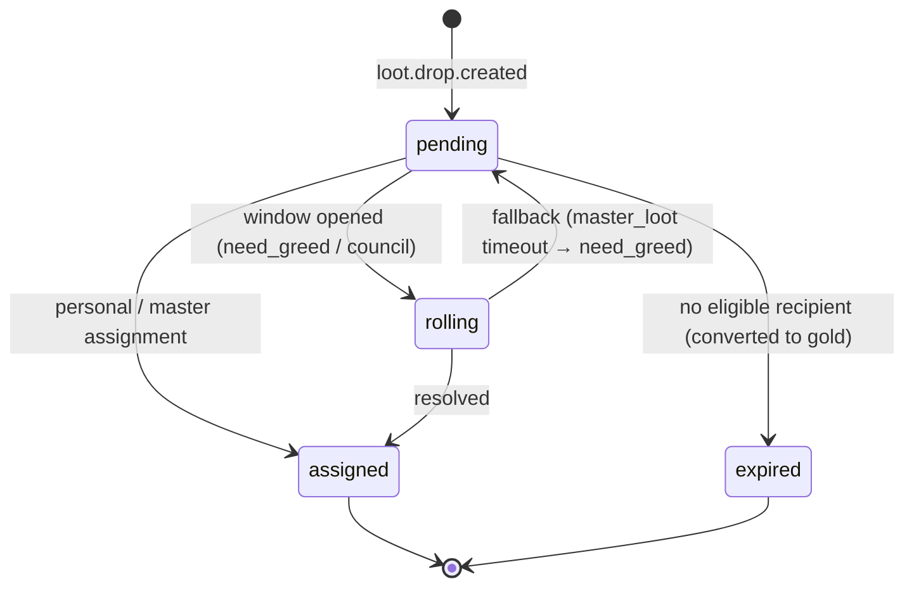
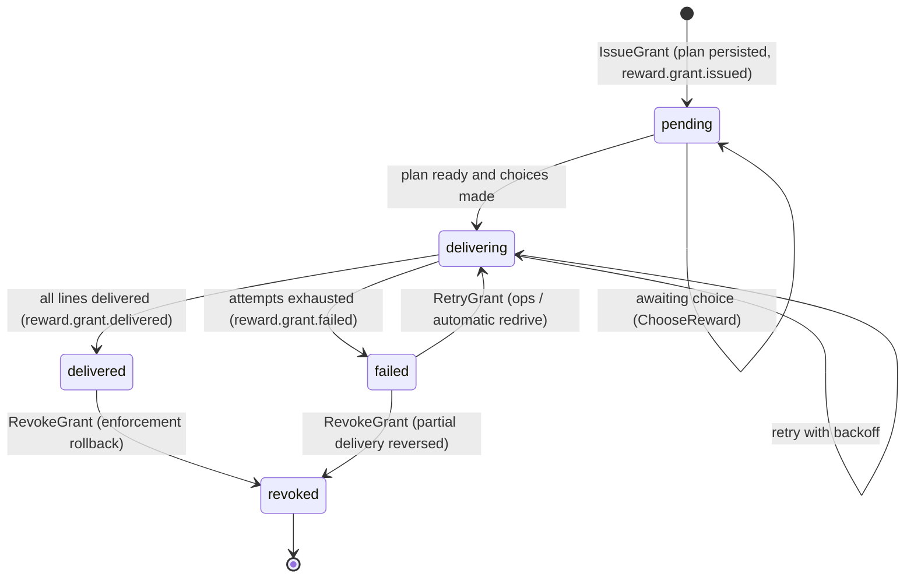
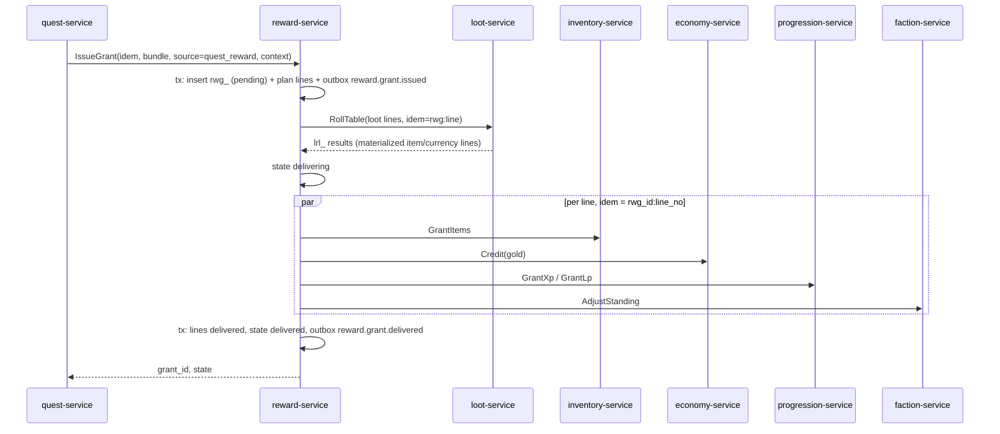

# Legends of the Shattered Frontier — Itemization: Loot Tables, Pity, Reward Bundles and Grants, Economic Balancing
### Version 1.0 — Expanded Technical Design Authority edition (2026-10-17)

Status: Design target; not implemented. Names per Shared Registry v1.0.

Entry file: [Itemization Architecture](../Legends_Shattered_Frontier_Itemization_Architecture_v1.0.md) · Registry: [Shared Registry](../Legends_Shattered_Frontier_Shared_Registry_v1.0.md)

---

## 1. Purpose

This part specifies `loot-service` (loot tables, deterministic rolls, group loot distribution, pity) and `reward-service` (reward bundles, idempotent reward grants, delivery saga, revocation), plus the economic balancing targets that tie drops, gear pace, item sinks, and gold faucets/sinks together. Item creation itself always happens in `inventory-service` (Item model part); currency creation in `economy-service`.

Flow summary (registry authority rule 4: all rewards flow through reward-service):

```text
caller (quest-service, instance-service, zone-server, ai-director-service, progression-service, liveops-service, store-service, admin-portal)
  → reward-service.IssueGrant(bundle, context)
      → loot-service.RollTable(...)        for loot lines (personal results inline; group drops resolved later)
      → inventory-service.GrantItems(...)  items
      → economy-service.Credit(...)        gold, marks, season tokens
      → progression-service.Grant*(...)    XP, LP, account unlocks
      → faction-service.AdjustStanding(...) reputation
  loot-service (group drop assigned) → reward-service.IssueGrant(child grant for winner)
```

## 2. Loot tables

### 2.1 Definition

Content kind `loot`, ID `loot/<slug>`. Itemization owns the table format; Dungeon and Raid assign tables to encounters.

```json
{
  "id": "loot/sunken_vault_final_boss",
  "rolls": { "min": 2, "max": 2 },
  "mode": "weighted_one",
  "entries": [
    { "kind": "table", "table_id": "loot/sunken_vault_weapons", "weight": 30 },
    { "kind": "table", "table_id": "loot/sunken_vault_armor", "weight": 50 },
    { "kind": "nothing", "weight": 20 }
  ],
  "guaranteed": [
    { "kind": "currency", "currency_id": "currency/gold", "amount": { "fn": "gold_reward", "w": 0.5 } },
    { "kind": "item", "definition_id": "item/sunken_relic_shard", "quantity": { "min": 1, "max": 3 },
      "scope": "personal", "conditions": [ { "kind": "quest_active", "quest_id": "quest/the_drowned_crown" } ] }
  ],
  "personal_extras": [
    { "kind": "item", "definition_id": "item/tidecaller_mount_whistle", "chance": 0.01,
      "pity_key": "mount:sunken_vault", "scope": "personal", "binding_override": "account" }
  ],
  "ilvl_rule": { "kind": "from_context" },
  "rarity_weights": { "rare": 70, "epic": 30 },
  "max_depth": 4
}
```

| Element | Meaning |
| --- | --- |
| `rolls` | number of draws from `entries`; uniform integer in `[min, max]` (one RNG draw if `min < max`) |
| `mode` | `weighted_one`: each roll picks exactly one entry by weight; `independent`: each entry rolls its own `chance` once per roll |
| `entries[].kind` | `item`, `table` (nested reference), `currency`, `nothing` |
| `guaranteed` | always produced once per evaluation (subject to conditions) |
| `personal_extras` | per-character entries rolled once per eligible character even in group modes; the only place pity applies |
| `quantity` | int or `{min, max}` uniform |
| `amount` | literal or a registry reward scaling function (`gold_reward`, `marks_reward`) with weight `w` |
| `conditions[]` | all must hold, else the entry is removed *before* weight normalisation (§2.3) |
| `ilvl_rule` | `from_context` (caller supplies `content_ilvl`), `fixed`, or `character_level` (`4 × L` clamped to context range) |
| `rarity_weights` | rarity distribution for item entries whose definition allows a rarity range; clamped by the context ceiling |
| `scope` | `group` (default; one result for the group) or `personal` |

Validator rules at publish: nesting depth ≤ `LOOT_MAX_DEPTH` 4 (`tune.loot.max_depth`); no cycles (DFS over `table` references); weights are positive integers; `chance` in (0, 1]; every referenced definition exists in the same pack; a table reachable from a `store_purchase` bundle is rejected.

### 2.2 Conditions

| `kind` | Parameters | Evaluated against |
| --- | --- | --- |
| `character_level` | `min`, `max` | context `character_level` |
| `quest_active` | `quest_id` | quest-service snapshot in context (`active_quest_ids`) |
| `skill_min` | `skill_id`, `min` | progression snapshot |
| `difficulty` | `in[]` | context |
| `mythic_level_min` | `min` | context |
| `faction_standing_min` | `faction_id`, `min` | faction snapshot |
| `liveops_event_active` | `liveops_event_id` | config-service active events at roll time |
| `first_kill_in_lockout` | — | instance-service lockout snapshot |
| `biome` / `zone` | `in[]` | context |
| `not_owned` | `definition_id` | inventory-service `unique_owned` check (personal scope only) |
| `group_size_min` | `min` | context |

The caller (reward-service) assembles a **context snapshot** once per grant; loot-service never calls other services mid-roll, which keeps rolls deterministic and replayable.

### 2.3 Evaluation algorithm

```text
evaluate(table, ctx, rng, depth):
  if depth > LOOT_MAX_DEPTH: error LOOT_DEPTH
  out ← []
  for g in table.guaranteed where conditions(g, ctx): out += materialize(g, ctx, rng, depth)
  n ← table.rolls.min == table.rolls.max ? table.rolls.min : rng.int(table.rolls.min, table.rolls.max)
  E ← [e in table.entries where conditions(e, ctx)]                 # filtered, order = authored order
  for i in 1..n:
    if table.mode == weighted_one:
      w_e ← e.weight × luck_mult(e, ctx)                              # §2.5
      e ← rng.weighted_pick(E, w)                                     # 1 draw
      out += materialize(e, ctx, rng, depth)
    else:  # independent
      for e in E: if rng.uniform() < min(1, e.chance × luck_mult(e, ctx)): out += materialize(e, ctx, rng, depth)
  return out

materialize(e, ctx, rng, depth):
  table    → evaluate(load(e.table_id), ctx, rng, depth + 1)
  nothing  → []
  currency → [{currency_id, amount = eval(e.amount, ctx.L), quantity rolled}]
  item     → [{definition_id, quantity, ilvl = ilvl_rule(ctx), rarity = pick_rarity(rarity_weights ∩ definition range, ceiling, rng)}]
```

Draw order is normative (authored entry order, depth-first), so the same seed always gives the same result for the same `content_version`.

### 2.4 Drop-rate math

For a `weighted_one` table, the probability that one roll yields entry `e` is `p(e) = w_e / Σ w`. For nested tables the path probabilities multiply: `p(item) = Π p(edge)` along the path. With `n` rolls (with replacement), `P(at least one) = 1 − (1 − p)^n`; expected count `= n × p`. For `independent` entries, `P = 1 − (1 − chance)^n`.

Worked example (`loot/sunken_vault_final_boss` above; weapons sub-table has 3 equally weighted swords; armor sub-table has 8 pieces):

| Quantity | Calculation | Value |
| --- | --- | --- |
| P(weapons branch per roll) | 30 / 100 | 0.300 |
| P(a specific sword per roll) | 0.30 × 1/3 | 0.100 |
| P(that sword at least once per kill, 2 rolls) | 1 − 0.9² | 0.190 |
| Expected items per kill | 2 × 0.80 | 1.60 |
| Expected kills to see a specific armor piece | 1 / (1 − (1 − 0.5/8)²) | 8.3 |
| P(mount whistle per character per kill, before pity) | 0.01 | 0.010 |

The validator computes and publishes these per-table expectations (flattened probability per definition) into the pack manifest so Analytics can compare observed vs expected (`m_loot_drop_rate_deviation`).

### 2.5 Luck influence

The Combat spec caps luck influence at `LUCK_MAX_INFLUENCE` (10 %). Itemization applies it only to entries of rarity ≥ `rare` (and `personal_extras`):

```text
luck_bonus   = LUCK_MAX_INFLUENCE × min(1, luck / LUCK_REFERENCE)          LUCK_REFERENCE = 150 (tune.loot.luck_reference)
luck_mult(e) = 1 + luck_bonus  if rarity(e) ≥ rare or e is a personal extra, else 1
```

`luck` is the character's total luck (natural + items) from the context snapshot. For group-scope rolls, `luck` is the mean luck of eligible characters. Example: luck 75 → `luck_bonus = 0.05`; the mount chance becomes 0.0105; in `weighted_one`, rare+ weights are ×1.05 before normalisation, so `nothing` and common entries lose share proportionally.

### 2.6 Rarity selection and ceilings

`pick_rarity` draws from `rarity_weights` restricted to `definition.rarity_range` and `ctx.rarity_ceiling` (registry power ladder; e.g., `rare` for levelling content, `epic` for levelling dungeon final bosses and raids). If the restricted set is empty, the lowest allowed rarity is used. Rarity is decided by loot-service; affixes are rolled later by inventory-service from the per-drop affix seed (§3.2).

## 3. Deterministic seeded server rolls

### 3.1 Seeds

```text
roll_seed  = HMAC-SHA256(key = LOOT_SEED_KEY[seed_epoch],
                         msg = "lsf-loot/v1|" + realm_id + "|" + context_id + "|" + subject_id + "|" + table_id + "|" + roll_index)
affix_seed = HMAC-SHA256(LOOT_SEED_KEY[seed_epoch], "lsf-affix/v1|" + loot_roll_id + "|" + drop_index)
group_seed = HMAC-SHA256(LOOT_SEED_KEY[seed_epoch], "lsf-group/v1|" + loot_roll_id + "|" + drop_index + "|" + character_id + "|" + attempt)
```

- `context_id` = the authoritative cause: `att_` (encounter kill), `run_` (end-of-run), `qst_` (quest turn-in), `wev_` (world event), the kill `evt_` (open world), or `rwg_` for anything else. `subject_id` = `character_id` for personal scope, `pty_`/`rgp_` for group scope.
- `LOOT_SEED_KEY` lives in the secrets manager, rotates every `SEED_EPOCH_DAYS` (7); old epochs are retained (read-only) for 400 days for audit replay. The key never leaves loot-service and inventory-service.
- RNG: `xoshiro256**` seeded from the 32-byte HMAC output (all-zero state is replaced with the SHA-256 of the seed). `uniform()` = `(next() >> 11) × 2⁻⁵³`; integer ranges use rejection sampling (no modulo bias).
- `lrl_` rows store `seed_epoch`, `seed_commitment = SHA-256(roll_seed)`, `draw_count`, and the result. An auditor with key access recomputes the seed, checks the commitment, and replays the exact draws.

### 3.2 Idempotency

`loot_roll_idempotency_key = context_id + ":" + subject_id + ":" + table_id + ":" + roll_index`. A repeated `RollTable` returns the stored `lrl_` result. Because the seed is a pure function of the same tuple, a re-roll after a lost response is impossible by construction: the same inputs always produce the same output.

### 3.3 Volume handling (open world)

Open-world kills can reach thousands per second per realm. `RollTableBatch` accepts up to 500 subjects. Rolls with a non-empty result, or any roll touching a `pity_key`, persist an `lrl_` row; empty rolls are counted in per-minute aggregates `(realm, zone, table_id, empty_count)` and published as one `loot.table.rolled` with `aggregated = true`. Determinism is unaffected (the seed is derivable).

## 4. Group loot modes

Registry `loot_mode`: `personal`, `group_need_greed`, `master_loot`, `council` (raid only). Raid spec owns which modes raids allow by difficulty; Dungeon spec owns dungeon defaults. Defaults if unspecified: open world and LFG groups `personal`; premade parties may pick `group_need_greed`; raids per Raid spec.

### 4.1 Eligibility

A character is eligible for an encounter drop iff: it is in the encounter attempt participants list (instance-server), present in the instance at kill time, not already locked out for that encounter at that difficulty (instance-service lockout snapshot), and not under an active sanction whose type restricts trade or market *only if* the item would be tradeable (bound items are still awarded). Open world: eligible = characters credited by the zone-server tagging rules (World spec).

### 4.2 `personal`

Each eligible character rolls the table with `subject_id = character_id`. To keep per-group expected drops equal to the authored value:

```text
personal_chance = min(1, items_per_kill(group_size) / group_size / table_expected_items)
```

`items_per_kill` comes from the encounter's reward bundle (Dungeon/Raid content). A character first rolls `uniform() < personal_chance`; on success the table is evaluated for that character only. Example: 5-player final boss with `items_per_kill = 2.5`, table expected items 1.6 → `personal_chance = min(1, 2.5 / 5 / 1.6) = 0.3125`, expected items per player = 0.3125 × 1.6 = 0.5.

### 4.3 `group_need_greed`

One group-scope evaluation creates **drops** (`loot.drop.created`), each identified by `(loot_roll_id, drop_index)`.

```mermaid
sequenceDiagram
    participant IS as instance-server
    participant INS as instance-service
    participant R as reward-service
    participant L as loot-service
    participant C as Clients (eligible)
    participant INV as inventory-service
    IS->>INS: encounter.attempt.defeated (participants)
    INS->>R: IssueGrant(bundle, context, loot_mode=group_need_greed)
    R->>L: RollTable(scope=group, eligible[])
    L-->>R: drops pending (personal parts inline)
    L->>C: roll window open (ROLL_WINDOW_SECONDS)
    C->>L: SubmitRollChoice(need|greed|pass)
    L->>L: resolve: need > greed; d100 from group_seed; ties re-roll
    L->>R: IssueGrant(child: fixed item line, idem=lrl:drop_index)
    R->>INV: GrantItems(trade window, eligible list)
    L-->>C: loot.roll.resolved, loot.drop.assigned
```

Rules: `need` is allowed only if the character can equip the item (slot/material/requirements) or it is a recipe/token usable by the character; otherwise the client may only `greed`/`pass` (server-enforced). Window `ROLL_WINDOW_SECONDS` = 60 (`tune.loot.roll_window_seconds`); non-responders count as `pass`. If everyone passes the drop goes to a greed roll among all eligible; if still none, the drop is converted to its vendor value split as gold (economy-service credit, source `loot_drop`). Roll value = `1 + floor(uniform() × 100)` from `group_seed`; ties re-roll with `attempt + 1`.

### 4.4 `master_loot`

The group's loot master (group-service role) assigns each drop to an eligible character within `MASTER_LOOT_WINDOW` = 15 min (`tune.loot.master_loot_window_minutes`). Unassigned drops fall back to `group_need_greed` resolution with all eligible characters treated as `greed`. Raids override window and fallback per the Raid spec (Loot modes: assign within 300 s, fallback `group_need_greed` among characters who declared interest). Every assignment is audited (actor, target, drop) and visible to the group.

### 4.5 `council` (raid only)

Drops enter a council pool held by a **LootCouncilSession** (`lcs_`, owned by loot-service, table `loot.council_sessions`; one session per raid kill). Members submit `interest` (`need`, `minor`, `offspec`, `pass`) in the interest window; council members (loot master plus 2–4 council members, Raid spec) vote; the loot master finalises (`SubmitCouncilInterest` / `SubmitCouncilVote` / `FinalizeCouncilDrop`). Windows, quorum, override (`override_reason`) and fallback rules are owned by the Raid spec (Lockouts, Progression, Loot and World part, Council): interest window 90 s, council window `tune.raid.council_window_seconds` = 300, fallback `group_need_greed` among characters who declared interest, else a uniformly random eligible character. All votes are stored on the drop row, emitted in `loot.roll.resolved`, and the outcome in `loot.drop.assigned` (`assignment_method`, `council_session_id`, `council_override`).

### 4.6 Drop states

Internal to loot-service (registered enum `loot_drop_state`, Shared Registry, Phase-2 enums):



## 5. Pity (bad-luck protection)

Pity applies only to entries with a `pity_key`, which must be `personal` scope. Counter: `PityCounter (character_id, pity_key)` in loot-service storing `failures` (consecutive misses) and `last_success_at`.

```text
p0      = base chance of the entry after luck (§2.5)
g       = ceil(PITY_GRACE_MULT / p0)                       PITY_GRACE_MULT = 1.0  (tune.loot.pity_grace_mult)
h       = ceil(PITY_HARD_MULT / p0)                        PITY_HARD_MULT  = 2.5  (tune.loot.pity_hard_mult)
f       = failures so far
p_eff(f)= 1                                               if f + 1 ≥ h
        = min(1, p0 + max(0, f − g) × p0 × PITY_STEP)       otherwise;   PITY_STEP = 0.5 (tune.loot.pity_step)
on success: failures ← 0, emit loot.pity.triggered if p_eff > p0
on miss:    failures ← failures + 1
```

Feature flag: `ff.loot.pity_enabled` (registry example). Counters are per character and per key; they persist across lockouts and seasons unless the key includes the season slug.

Worked example (`p0 = 0.02`): `g = 50`, `h = 125`. After 60 misses, `p_eff = 0.02 + 10 × 0.01 = 0.12`; after 70, 0.22. Simulated distribution (`lsf-itemmath` reference test):

| Base chance | Grace g | Hard h | Mean attempts without pity | Mean attempts with pity | P(success by g) | P(success by g + 20) |
| --- | --- | --- | --- | --- | --- | --- |
| 0.05 | 20 | 50 | 20 | 15.3 | 0.64 | 1.00 |
| 0.02 | 50 | 125 | 50 | 35.9 | 0.64 | 0.97 |
| 0.005 | 200 | 500 | 200 | 135.3 | 0.63 | 0.80 |

Pity never applies to group-scope drops of non-raid tables, to `epic` dungeon gear tables (those use lockouts and loot modes), or to `store_purchase` content (there are no random paid rewards).

**Raid pity keys.** Raid gear uses per-character keys `raid:<raid_slug>:<difficulty>` with the raid profile requested by the Raid spec (Bad-luck protection): the counter increments by 1 on each reward-eligible kill on which the character received no item and resets on receiving any item from that raid and difficulty. Personal mode: `p_eff = min(p_cap, p_base + failures × p_step × m_d)` with `tune.raid.personal_loot_chance`, `tune.raid.pity_step`, `tune.raid.pity_cap`, `tune.raid.pity_difficulty_mult`. Group modes (`group_need_greed`, `master_loot`, `council`): when `failures ≥ T_pity` (`tune.raid.pity_group_threshold` = 8) the character receives one extra personal drop outside `drops(N)`, the counter resets and `loot.pity.triggered` is emitted (`hard_guarantee = true`). Keys with prefix `raid:` select this profile; all other keys use the curve above.

## 6. Reward bundles

Resolved (2026-10-17): reward-service applies Economy's `tune.economy.event_gold_reward_multiplier` and `tune.economy.event_marks_multiplier` while evaluating eligible reward bundles, as specified in Economy spec, Event multipliers. Both multipliers are bounded there; event modifiers do not raise the weekly marks cap.

### 6.1 Definition

Content kind `reward`, ID `reward/<slug>`. Itemization owns the schema; authoring domains (Quest, Dungeon, Raid, LiveOps, AI, Character) own the content.

```json
{
  "id": "reward/frontier_founder_completion",
  "weight_w": 1.0,
  "level_range": { "min": 1, "max": 10 },
  "lines": [
    { "kind": "xp", "amount": { "fn": "xp_reward", "w": 1.0 } },
    { "kind": "currency", "currency_id": "currency/gold", "amount": { "fn": "gold_reward", "w": 1.0 } },
    { "kind": "lp", "amount": { "fn": "lp_reward", "w": 1.0 } },
    { "kind": "reputation", "faction_id": "faction/greenhold_wardens", "amount": 250 },
    { "kind": "choice", "pick": 1, "options": [
        { "kind": "item", "definition_id": "item/founders_blade", "ilvl_rule": { "kind": "character_level" }, "rarity": "uncommon" },
        { "kind": "item", "definition_id": "item/founders_buckler", "ilvl_rule": { "kind": "character_level" }, "rarity": "uncommon" } ] },
    { "kind": "loot", "table_id": "loot/greenlands_quest_bonus" },
    { "kind": "unlock", "unlock_id": "title/the_unbroken", "account_wide": false }
  ],
  "loot_mode": "personal",
  "items_per_kill": null
}
```

| Line `kind` | Target service | Delivery RPC | Source code |
| --- | --- | --- | --- |
| `item` | inventory-service | `GrantItems` | from grant `source` |
| `loot` | loot-service then inventory-service / economy-service | `RollTable` → `GrantItems` / `Credit` | from grant `source` |
| `currency` | economy-service | `Credit` | from grant `source` |
| `xp`, `lp` | progression-service | Character spec grant RPCs | from grant `source` |
| `unlock` | progression-service for account-wide unlocks; crafting-service for character recipe unlocks | Character spec `GrantAccountUnlock`; Crafting spec `LearnRecipe` | — |
| `reputation` | faction-service | `AdjustStanding` (proposed contract for the AI spec) | — |
| `choice` | resolved to one of the above after `ChooseReward` | — | — |

Amount expressions use only registry reward scaling functions with `L` = character level clamped to `level_range`. Bundles with `weight_w ≥ 5.0` require an `economy_review` field (registry rule) or the validator rejects the pack.

Resolved (2026-10-17): an `unlock` line with `unlock_id = recipe/<slug>` and `account_wide = false` is delivered by reward-service to `crafting-service.LearnRecipe`; `account_wide = true` routes to progression-service as `account_unlock_kind = recipe`, which crafting-service consumes in its account recipe projection (Crafting spec, Recipe learning, Knowledge model). `RevokeGrant` calls `crafting-service.RevokeRecipe` for character-scoped recipe lines.

### 6.2 Caller authorisation

reward-service maps the caller's mTLS identity to allowed source codes; anything else is rejected with `SOURCE_NOT_ALLOWED`.

| Caller | Allowed `source` |
| --- | --- |
| quest-service | `quest_reward` |
| instance-service | `dungeon_reward`, `raid_reward` |
| zone-server / instance-server | `loot_drop`, `npc_bounty` |
| ai-director-service | `world_event_reward` |
| progression-service | `achievement_reward` |
| liveops-service | `season_reward`, `liveops_compensation` |
| store-service | `store_purchase` (bundle must contain only `cosmetic`, `container`, or convenience items with no stat budget; no XP, LP, gold, or loot lines — registry `currency/crowns` rule) |
| admin-portal | `gm_grant` (two-person approval above `rare` or above 1,000 gold; audited) |
| loot-service | child grants for assigned drops, inheriting the parent's source |

## 7. Reward grants

### 7.1 Grant lifecycle

`rwg_<ULID>`; idempotency key `"{source}:{source_ref}:{character_id}:{bundle_id}"` (e.g., `quest_reward:qst_…:chr_…:reward/frontier_founder_completion`). States are the registry `reward_grant_state`.



Choice grants wait in `pending` for `CHOICE_TIMEOUT_DAYS` = 30 (`tune.reward.choice_timeout_days`); on timeout the first option is chosen automatically.

### 7.2 Delivery saga (forward-recovery)



Rules:

1. **Plan before side effects.** The full delivery plan (every line with materialized amounts, evaluated at issue time with the context snapshot) is persisted in the same transaction as the grant row. Re-delivery never re-evaluates amounts or re-rolls loot.
2. **Per-line idempotency.** Each line's downstream call uses `idempotency_key = rwg_id:line_no`; downstream services return the original result on replay (registry: keys retained ≥ 7 days; reward-service never retries a line older than 6 days without ops review).
3. **Forward recovery, no compensation on failure.** Delivered lines stay delivered; failed lines retry with exponential backoff (`1 s × 2^attempt`, max 15 min, `REWARD_MAX_ATTEMPTS` = 8, `tune.reward.max_attempts`). After the last attempt the grant is `failed` and alerts ops (`m_reward_failed_grants`). Compensation exists only as explicit revocation (§7.4).
4. **Bags full is not a failure.** `GrantItems` uses `allow_overflow = true`; items go to `mailbox`.
5. **Ordering.** No line depends on another, so lines run in parallel; `xp` lines are submitted before `unlock` lines only when the bundle sets `ordered = true`.
6. **Synchronous fast path.** Callers may wait up to 500 ms for `delivered`; otherwise they get `pending/delivering` and the client is notified by events.

### 7.3 Lockout and duplicate-source guards

- Dungeon/raid grants must include `lockout_id`; reward-service validates via instance-service that the character's lockout permits loot for that encounter (Dungeon spec lockout framework). Invalid → `LOCKOUT_EXHAUSTED`.
- The grant idempotency key makes double turn-ins and double kill credits collapse to one grant.

### 7.4 Revocation (enforcement rollbacks)

Called by enforcement-service as part of `item_rollback` / `currency_rollback` / `progression_rollback` sanctions (Security spec owns the decision and `enforcement.rollback.executed`).

```text
RevokeGrant(grant_id, case_id, mode = destroy | quarantine):
  for each delivered line (idem = rwg_id:line_no:revoke):
    item       → inventory-service.RevokeItems(grant_id, case_id, mode)
                   follows parent_item_id lineage (splits), wherever the items now are (other owners included)
                   items already consumed/salvaged/destroyed → reported as deficits
    currency   → economy-service.Debit(sink = enforcement_rollback, allow_negative per Economy policy)
    xp / lp    → progression-service.ApplyRollback(scope = reward_grant_id) (Character spec, Service interfaces)
    reputation → faction-service.AdjustStanding (negative delta)
    unlock     → same ApplyRollback call (titles, account unlocks, achievements granted by this rwg_ get revoked_at)
  persist per-line revocation results and deficits; state → revoked; emit reward.grant.revoked
```

**Consumed rewards.** Lines whose items are already `consumed`, `salvaged` or `destroyed` (or whose currency is already spent) are not clawed back in kind: `RevokeGrant` revokes what remains, never substitutes other items, and returns one `deficits[]` entry per shortfall `{line_no, kind (item | currency | xp | lp), definition_id?, quantity, value_copper}` (items valued at the Economy price index). Salvage outputs are followed through the item ledger and revoked like their input. The grant still moves to `revoked`; enforcement-service converts deficits into `currency_rollback` debits or a `rollback_deficit` record (Security spec, Rollback). LP already spent on mastery nodes is handled inside progression-service (newest nodes revoked until LP ≥ 0).

Items that moved to innocent third parties are quarantined (not destroyed) when `mode = quarantine`; enforcement decides compensation (`liveops_compensation`) for those parties. Deficits are returned to enforcement-service for follow-up `currency_rollback`.

## 8. Economic balancing targets

All targets are measured continuously (Agent implementation guide part, Analytics hooks) and tuned through `tune.*` keys, not code changes.

### 8.1 Drop rates by rarity (per kill, level-appropriate)

| Source | Gear drop chance | common | uncommon | rare | epic |
| --- | --- | --- | --- | --- | --- |
| Open world, Combat tier 1 (common creature) | 6 % | 72 % | 23 % | 5 % | 0 % |
| Open world, tier 2 elite | 15 % | 45 % | 40 % | 15 % | 0 % |
| Open world, tier 3 mini boss | 100 % (1 item) | 0 % | 75 % | 25 % | 0 % |
| World boss (tier 4), per participant | 100 % | 0 % | 0 % | 85 % | 15 % (proposed ladder row) |
| Levelling dungeon boss (per group) | 1.5 items | 0 % | 60 % | 40 % | 0 % |
| Levelling dungeon final boss (per group) | 2.5 items | 0 % | 30 % | 60 % | 10 % |
| Dungeon `normal` at cap | 1.5 / 2.5 items | 0 % | 0 % | 100 % | 0 % |
| Dungeon `veteran` / mythic end-of-run | 2.5 items / 1 per player | 0 % | 0 % | 30 % | 70 % |
| Raid (any difficulty) | `items_per_kill = group_size / 5` (Raid may override) | — | — | — | 100 % |

Derived: rare gear per open-world normal kill = 0.06 × 0.05 = 0.3 %. Alert when observed rates deviate > 15 % over 10,000 rolls (`m_loot_drop_rate_deviation`).

### 8.2 Gear acquisition pace

Engaged player (≈ 15 played hours/week at cap) targets:

| Tier | ilvl | Target to fill 11 of 16 combat slots | Primary gate |
| --- | --- | --- | --- |
| Levelling | `4 × L` | equipped average ilvl within 8 of `4 × L` at all times; ≈ 1 upgrade per 1.2 h | quests and open world |
| Dungeon `normal` | 405 | 15–20 h after reaching level 100 | time |
| Dungeon `veteran` / crafted | 415 / up to 450 | +20–25 h; crafted market-dependent | time, gold |
| Raid `normal` | 420 | 4–6 weekly lockouts | lockout |
| Mythic dungeon M10–M15 | 440–450 | 6–8 weeks | weekly vault/run count |
| Raid `veteran` / `heroic` | 430 / 445 | 6–8 / 10–12 weeks | lockout |
| Raid `mythic` | 460 | 50–70 % of slots in a 12-week season | lockout, group skill |
| Legendary | 465 → 475 | 6–8 weeks path, +2–4 weeks upgrades | weekly stage gate, gold, marks |

### 8.3 Item sink rates

| Population | Target |
| --- | --- |
| `common`/`uncommon` gear created | ≥ 90 % exits (vendor, salvage, destroy) within 14 days |
| `rare` gear | ≥ 70 % exits within 30 days |
| `epic` gear | ≥ 40 % salvaged or vendored within 60 days of being replaced |
| Active items per character | median < 250, p99 < 1,500 (inventory performance budget) |
| Salvage share of exits | 35–55 % (feeds Crafting material supply) |

### 8.4 Gold faucet vs repair sink

Faucet model: `6 × gold_reward(L, 1)` per hour from quests, bounties and content rewards, plus 25 % from vendoring loot. Repair model: full durable-kit repair every 4.5 combat hours (Item model part, Repair cost), with typical gear rarity for that level.

| Level | Typical gear | Faucet (g/h) | Repair sink (g/h) | Repair share | Target band |
| --- | --- | --- | --- | --- | --- |
| 10 | ilvl 40 uncommon (newbie mult 0.5) | 2.74 | 0.39 | 14 % | 10–20 % |
| 20 | ilvl 80 uncommon | 7.22 | 1.38 | 19 % | 10–20 % |
| 40 | ilvl 160 rare | 19.69 | 3.19 | 16 % | 10–20 % |
| 60 | ilvl 240 rare | 35.73 | 4.67 | 13 % | 10–20 % |
| 80 | ilvl 320 rare | 54.67 | 6.14 | 11 % | 10–20 % |
| 100 | ilvl 405 rare | 76.13 | 7.80 | 10 % | 10–20 % |
| 100 | ilvl 460 epic (raider) | 76.13 | 13.35 | 18 % | 10–20 % |

Itemization-owned sinks at cap (repair, legendary upgrade cost, item_destroyed of vendor value) should together remove 18–25 % of gold created; Economy owns the remaining sinks and the overall inflation index. If `m_gold_repair_sink_share` leaves the band for 7 days, Economy adjusts `tune.economy.repair_scaling` (0.8–1.5) before Itemization touches `REPAIR_K`.

## 9. Schemas

### 9.1 `loot` schema

```sql
CREATE SCHEMA loot;

CREATE TABLE loot.rolls (
  roll_id          text PRIMARY KEY CHECK (roll_id LIKE 'lrl\_%'),
  idempotency_key  text NOT NULL UNIQUE,
  realm_id         text NOT NULL,
  table_id         text NOT NULL,
  content_version  int  NOT NULL,
  context_kind     text NOT NULL,             -- encounter_kill, run_end, quest, world_event, open_world, grant
  context_id       text NOT NULL,
  subject_id       text NOT NULL,             -- chr_, pty_, rgp_
  reward_grant_id  text,
  loot_mode        text NOT NULL CHECK (loot_mode IN ('personal','group_need_greed','master_loot','council')),
  context_snapshot jsonb NOT NULL,            -- level, luck, ilvl, ceiling, conditions inputs
  seed_epoch       int  NOT NULL,
  seed_commitment  bytea NOT NULL,
  draw_count       int  NOT NULL,
  result           jsonb NOT NULL,            -- materialized lines
  created_at       timestamptz NOT NULL
) PARTITION BY RANGE (created_at);

CREATE TABLE loot.drops (
  roll_id            text NOT NULL,
  drop_index         smallint NOT NULL,
  definition_id      text NOT NULL,
  quantity           int NOT NULL,
  ilvl               smallint,
  rarity             text NOT NULL,
  state              text NOT NULL CHECK (state IN ('pending','rolling','assigned','expired')),
  eligible_character_ids text[] NOT NULL,
  window_until       timestamptz,
  choices            jsonb NOT NULL DEFAULT '{}',   -- character_id -> {choice, roll_value, attempt}
  council_votes      jsonb NOT NULL DEFAULT '{}',
  assigned_character_id text,
  assignment_method  text,                          -- 'personal','roll','master','council','fallback','expired_to_gold'
  assigned_by_character_id text,                    -- loot master chr_ for 'master' / 'council'
  council_session_id text,                          -- lcs_
  child_grant_id     text,
  version            bigint NOT NULL DEFAULT 0,
  PRIMARY KEY (roll_id, drop_index)
);
CREATE INDEX ON loot.drops (state, window_until) WHERE state IN ('pending','rolling');

CREATE TABLE loot.council_sessions (
  council_session_id text PRIMARY KEY CHECK (council_session_id LIKE 'lcs\_%'),
  roll_id            text NOT NULL,
  raid_group_id      text NOT NULL,                 -- rgp_
  loot_master_character_id text NOT NULL,
  council_character_ids    text[] NOT NULL,          -- 2–4, frozen at engage
  state              text NOT NULL CHECK (state IN ('interest','voting','finalized','fallback')),
  interest_until     timestamptz NOT NULL,
  vote_until         timestamptz NOT NULL,
  created_at         timestamptz NOT NULL
);

CREATE TABLE loot.pity_counters (
  character_id     text NOT NULL,
  pity_key         text NOT NULL,
  failures         int  NOT NULL DEFAULT 0,
  last_roll_id     text,
  last_success_at  timestamptz,
  version          bigint NOT NULL DEFAULT 0,
  PRIMARY KEY (character_id, pity_key)
);

CREATE TABLE loot.empty_roll_aggregates (
  realm_id text, zone_id text, table_id text, minute timestamptz, empty_count int NOT NULL,
  PRIMARY KEY (realm_id, zone_id, table_id, minute)
);
-- plus loot.idempotency_keys and loot.outbox, same shape as inventory
```

Pity counter updates happen in the same transaction as the `lrl_` insert.

### 9.2 `reward` schema

```sql
CREATE SCHEMA reward;
CREATE TYPE reward.grant_state AS ENUM ('pending','delivering','delivered','failed','revoked');

CREATE TABLE reward.grants (
  grant_id          text PRIMARY KEY CHECK (grant_id LIKE 'rwg\_%'),
  idempotency_key   text NOT NULL UNIQUE,
  realm_id          text NOT NULL,
  account_id        text NOT NULL,
  character_id      text NOT NULL,
  bundle_id         text NOT NULL,
  content_version   int  NOT NULL,
  source            text NOT NULL,
  source_ref        text NOT NULL,
  caller_service    text NOT NULL,
  parent_grant_id   text,
  lockout_id        text,
  context_snapshot  jsonb NOT NULL,
  state             reward.grant_state NOT NULL,
  awaiting_choice   boolean NOT NULL DEFAULT false,
  attempts          int NOT NULL DEFAULT 0,
  next_attempt_at   timestamptz,
  last_error        text,
  revocation_case_id text,
  issued_at         timestamptz NOT NULL,
  delivered_at      timestamptz,
  revoked_at        timestamptz,
  version           bigint NOT NULL DEFAULT 0
);
CREATE INDEX ON reward.grants (character_id, issued_at DESC);
CREATE INDEX ON reward.grants (state, next_attempt_at) WHERE state IN ('pending','delivering');

CREATE TABLE reward.grant_lines (
  grant_id        text NOT NULL REFERENCES reward.grants,
  line_no         smallint NOT NULL,
  kind            text NOT NULL CHECK (kind IN ('item','currency','xp','lp','reputation','unlock','loot','choice')),
  target_service  text NOT NULL,
  request         jsonb NOT NULL,           -- fully materialized
  state           text NOT NULL CHECK (state IN ('pending','delivered','failed','revoked','skipped')),
  result_refs     jsonb,                    -- itm_, txn_, pgl_, lrl_
  revocation      jsonb,                    -- results and deficits
  attempts        int NOT NULL DEFAULT 0,
  PRIMARY KEY (grant_id, line_no)
);
-- plus reward.idempotency_keys and reward.outbox
```

## 10. APIs

### 10.1 `lsf.loot_service.v1`

| RPC | Caller | Request | Response |
| --- | --- | --- | --- |
| `RollTable` | reward-service | `idempotency_key`, `table_id`, `content_version`, `context_kind`, `context_id`, `subject_id`, `loot_mode`, `eligible[] {character_id, luck, level, snapshot}`, `context_snapshot`, `reward_grant_id` | `roll_id`, `personal_results[]`, `drops[]` |
| `RollTableBatch` | reward-service (open world) | up to 500 `RollTable` requests | results |
| `SubmitRollChoice` | gateway | `roll_id`, `drop_index`, `character_id`, `choice` (`need`/`greed`/`pass`) | accepted / `NEED_NOT_ALLOWED` / `WINDOW_CLOSED` |
| `AssignDrop` | gateway (loot master) | `roll_id`, `drop_index`, `target_character_id` | assigned |
| `SubmitCouncilInterest` / `SubmitCouncilVote` / `FinalizeCouncilDrop` | gateway | drop, interest/vote | state |
| `GetPendingDrops` | gateway, instance-server | `character_id` or `group_id` | drops |
| `GetPity` | admin-portal, gateway (UI hint optional) | `character_id`, `pity_key` | failures, current `p_eff` |
| `ReplayRoll` | admin-portal, enforcement-service (privileged) | `roll_id` | recomputed result + commitment check |
| `PreviewTable` | tooling (non-prod only) | `table_id`, context, N | Monte Carlo distribution |

### 10.2 `lsf.reward_service.v1`

| RPC | Caller | Request | Response |
| --- | --- | --- | --- |
| `IssueGrant` | see §6.2 | `idempotency_key`, `bundle_id` (or inline `lines` for `gm_grant`/`liveops_compensation`), `character_id`, `source`, `source_ref`, `context` (level, difficulty, mythic level, lockout_id, group, loot_mode, items_per_kill, `trade_eligible_character_ids` — group/raid `on_pickup` items, passed through to `GrantItems`; window `LOOT_TRADE_WINDOW`, `tune.loot.trade_window_minutes` = 120), `wait_ms` | `grant_id`, `state`, `delivered_refs` |
| `IssueGrantBatch` | zone-server | up to 500 grants | per-grant results |
| `ChooseReward` | gateway | `grant_id`, `line_no`, `option_index` | state |
| `GetGrant` / `ListGrants` | gateway, admin-portal | id / character + paging | grants with lines |
| `RetryGrant` | ops, admin-portal | `grant_id` | state |
| `RevokeGrant` | enforcement-service | `grant_id`, `case_id`, `mode` | per-line results, deficits |

Errors: `SOURCE_NOT_ALLOWED`, `BUNDLE_NOT_FOUND`, `CONTENT_VERSION_UNKNOWN`, `LOCKOUT_EXHAUSTED`, `IDEMPOTENCY_MISMATCH`, `CHOICE_INVALID`, `GRANT_NOT_REVOCABLE`, `STORE_BUNDLE_INVALID`.

## 11. Event payloads — `loot.*` and `reward.*`

Registry envelope; `producer.service` = `loot-service` or `reward-service`; envelope `privacy_class = p1_pseudonymous`.

### `loot.table.rolled`

| Field | Type | Req | Description | Privacy |
| --- | --- | --- | --- | --- |
| `roll_id` | string | no | `lrl_` (absent when aggregated) | p1 |
| `table_id` | string | yes | | p0 |
| `context_kind` | string | yes | | p0 |
| `context_id` | string | no | | p1 |
| `subject_id` | string | no | | p1 |
| `loot_mode` | string | yes | | p0 |
| `result_count` | int | yes | materialized lines | p0 |
| `result_definition_ids` | string[] | no | | p0 |
| `luck_bonus` | number | no | | p0 |
| `aggregated` | bool | yes | true for open-world empty aggregates | p0 |
| `empty_count` | int | no | aggregates only | p0 |
| `seed_epoch` | int | no | | p0 |

### `loot.drop.created`

| Field | Type | Req | Description | Privacy |
| --- | --- | --- | --- | --- |
| `roll_id` | string | yes | | p1 |
| `drop_index` | int | yes | | p0 |
| `definition_id` | string | yes | | p0 |
| `rarity` | string | yes | | p0 |
| `ilvl` | int | no | | p0 |
| `loot_mode` | string | yes | | p0 |
| `eligible_count` | int | yes | | p0 |
| `group_id` | string | no | `pty_` / `rgp_` | p1 |
| `window_until` | timestamp | no | | p0 |

### `loot.roll.resolved`

| Field | Type | Req | Description | Privacy |
| --- | --- | --- | --- | --- |
| `roll_id`, `drop_index` | string, int | yes | | p1 |
| `method` | string | yes | `need`, `greed`, `all_pass_greed`, `master`, `council`, `fallback` | p0 |
| `winner_character_id` | string | no | | p1 |
| `choices` | object[] | yes | `{character_id, choice, roll_value}` | p1 |
| `tie_rerolls` | int | yes | | p0 |
| `decided_by` | string | no | loot master `chr_` | p1 |

### `loot.drop.assigned`

| Field | Type | Req | Description | Privacy |
| --- | --- | --- | --- | --- |
| `roll_id`, `drop_index` | string, int | yes | | p1 |
| `definition_id` | string | yes | | p0 |
| `assigned_character_id` | string | no | absent when converted to gold | p1 |
| `assignment_method` | string | yes | `personal`, `roll`, `master`, `council`, `fallback`, `expired_to_gold` | p0 |
| `council_session_id` | string | no | `lcs_` when `assignment_method = council` (or `fallback` from a council session) | p1 |
| `council_override` | bool | no | council only: finalized by loot-master override with `override_reason` (audited) | p0 |
| `child_grant_id` | string | no | `rwg_` | p1 |
| `seconds_to_assign` | int | yes | | p0 |

### `loot.pity.triggered`

| Field | Type | Req | Description | Privacy |
| --- | --- | --- | --- | --- |
| `pity_key` | string | yes | | p0 |
| `roll_id` | string | yes | | p1 |
| `failures_before` | int | yes | | p0 |
| `base_chance` | number | yes | | p0 |
| `effective_chance` | number | yes | | p0 |
| `hard_guarantee` | bool | yes | | p0 |
| `definition_id` | string | yes | | p0 |

### `reward.grant.issued`

| Field | Type | Req | Description | Privacy |
| --- | --- | --- | --- | --- |
| `grant_id` | string | yes | `rwg_` | p1 |
| `bundle_id` | string | yes | | p0 |
| `source` | string | yes | registry source code | p0 |
| `source_ref` | string | yes | | p1 |
| `caller_service` | string | yes | | p0 |
| `parent_grant_id` | string | no | | p1 |
| `line_kinds` | string[] | yes | | p0 |
| `awaiting_choice` | bool | yes | | p0 |
| `planned_gold_copper` | int | no | | p0 |
| `planned_xp` | int | no | | p0 |

### `reward.grant.delivered`

| Field | Type | Req | Description | Privacy |
| --- | --- | --- | --- | --- |
| `grant_id` | string | yes | | p1 |
| `bundle_id`, `source` | string | yes | | p0 |
| `item_ids` | string[] | no | | p1 |
| `currency_transaction_ids` | string[] | no | `txn_` | p1 |
| `gold_copper`, `frontier_marks`, `xp`, `lp` | int | no | delivered totals | p0 |
| `overflowed_items` | int | yes | | p0 |
| `attempts` | int | yes | | p0 |
| `latency_ms` | int | yes | issue → delivered | p0 |

### `reward.grant.failed`

| Field | Type | Req | Description | Privacy |
| --- | --- | --- | --- | --- |
| `grant_id` | string | yes | | p1 |
| `bundle_id`, `source` | string | yes | | p0 |
| `failed_lines` | object[] | yes | `{line_no, kind, target_service, error_code}` | p0 |
| `delivered_lines` | int | yes | | p0 |
| `attempts` | int | yes | | p0 |

### `reward.grant.revoked`

| Field | Type | Req | Description | Privacy |
| --- | --- | --- | --- | --- |
| `grant_id` | string | yes | | p1 |
| `case_id` | string | yes | `cas_` | p1 |
| `mode` | string | yes | `destroy`, `quarantine` | p0 |
| `revoked_item_ids` | string[] | no | | p1 |
| `third_party_item_ids` | string[] | no | lineage items found on other owners | p1 |
| `gold_debited_copper` | int | no | | p0 |
| `deficits` | object[] | no | `{kind, ref, amount}` | p1 |
