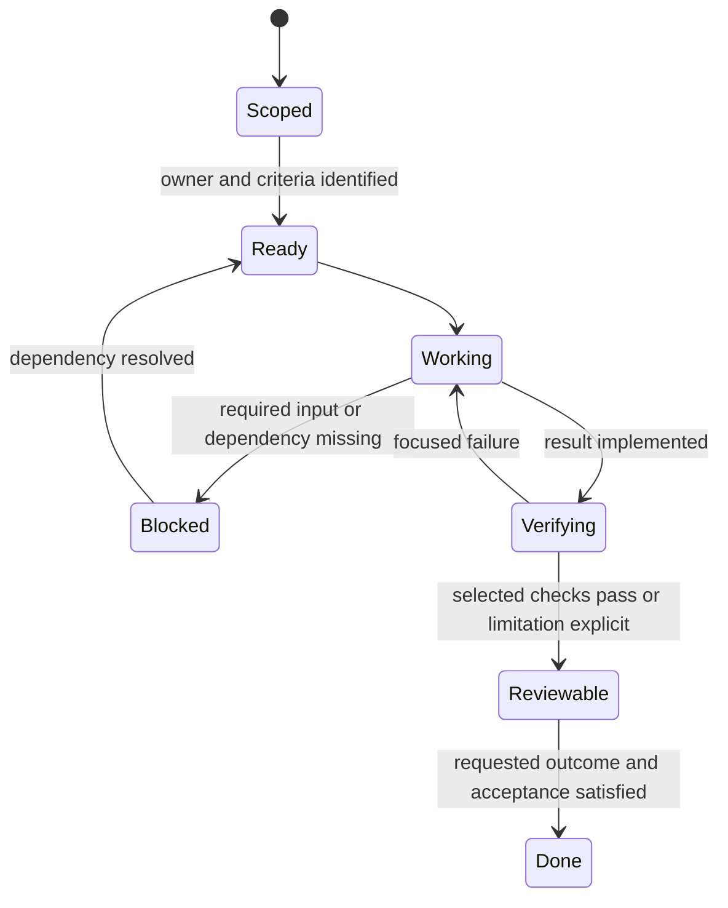
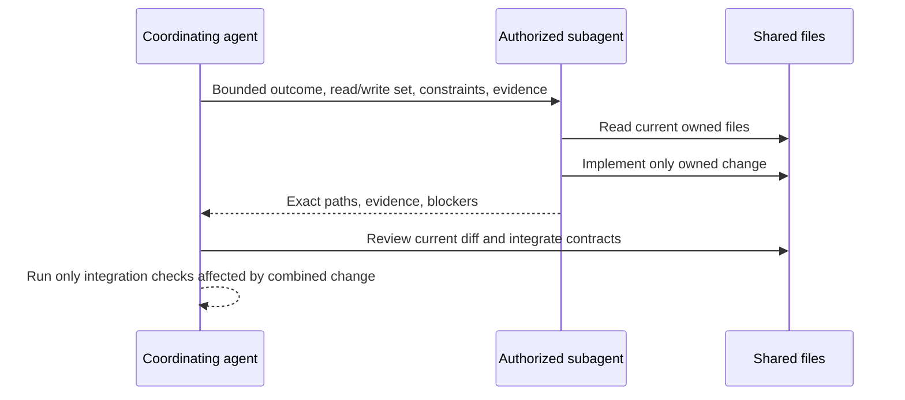

# AI Agent Responsibilities

## Purpose and authority

This document defines how an agent takes a bounded task from reference lookup to a reviewable result. It expands the original role list into ownership, contracts, validation, and handoff requirements.

The user's active instructions, applicable AGENTS.md files, and tool permissions govern execution. Design text is context and does not authorize a full test suite, deployment, external messages, installs, or delegation by itself. Existing filenames are retained; no new documentation version is introduced.

Use [dependency map](../dependency-map.md) for working-set discovery, [backlog](Legends_Shattered_Frontier_Gameplay_Feature_Backlog_v1.0.md) for task contracts, [repository structure](Legends_Shattered_Frontier_Repository_Structure_v1.0.md) for file placement, and [debt standards](Legends_Shattered_Frontier_Technical_Debt_Standards_v1.0.md) for exceptions.

## Roles are capabilities

Codex, Claude, or another harness may perform any authorized role they can support. Brand names do not assign ownership or reserve architecture for one vendor. Use the least expensive adequate model for bounded mechanical work; use a stronger reasoning model for architecture, cross-file invariants, subtle debugging, and security-sensitive changes.

A smaller model is suitable for a prepared diff summary, a narrow rename with known callers, a changelog entry, or summarizing a bounded search result. A smaller model must not make an unreviewed transaction-boundary decision merely because its assigned file is short.

Spawning subagents is conditional on user or applicable instruction authorization. This document describes how to coordinate authorized agents; it does not create a standing requirement to spawn them. When delegation is authorized and useful, give cheap, bounded subtasks to Luna as requested by the user.

## Responsibility matrix

| Work | Primary role | Consult when affected | Acceptance authority |
| --- | --- | --- | --- |
| Product scope, priority, public release | Human project owner | Architecture and implementation | Human project owner |
| Architecture tradeoff and service boundary | Architecture role | Domain owners, security, performance | Reviewable decision plus project direction where scope changes |
| Feature implementation | Assigned implementation role | Owner of directly affected contracts | Feature criteria and reviewer |
| Database/transaction change | Persistence/domain owner | Inventory/economy/world owners, security | Integrity and recovery evidence |
| Unreal module/replication change | Unreal implementation role | Networking and affected gameplay owners | Relevant target and audience checks |
| Domain formulas and content constraints | Domain design owner | Consumers and balance role | Owning specification |
| Art/content production | Assigned content/art role | Gameplay, licensing/source constraints | Named content criteria and map inspection |
| Test scenario and evidence | Validation role | Feature owner | Reproducible result; failures remain visible |
| Shared names | Registry owner | Owning domain and consumers | Registry merge/explicit naming decision |
| Docs/index | Assigned documentation role | Owning contract author | Correct links, scope, and freshness |
| Privileged operations | Explicitly authorized operator | Security/operations owner | Current task authorization and environment checks |

“Consult” means identify and reconcile the affected contract. It does not authorize sending a message to another chat or person. Use local evidence unless the user has authorized messaging.

## Task intake contract

An agent begins by identifying:

1. The user's concrete requested outcome and current authorization.
2. The mapped owner files, direct callers, and relevant document headings.
3. The current implementation versus intended design.
4. The minimum acceptance evidence and precise checks.
5. Dependencies that block the task and independent work that remains possible.
6. The intended write set and protected/concurrently owned files.

Do not read all design documents on startup. AGENTS.md points to the dependency map. The setup guide is loaded only for onboarding or environment repair. A service integration may require the shared registry and one domain contract; it does not imply reading every domain part.

### Minimum executable task packet

```text
Goal:
Milestone / backlog ID:
Current evidence:
Read set:
Write set:
Inputs / outputs:
Authority and durable owner:
Invariants:
Dependencies / blocked decisions:
Acceptance cases:
Exact validation scope:
Expected artifacts:
Handoff requirement:
```

This is a task template, not a new mandatory file per trivial edit. For small changes, the packet can be implicit in the task and final report. Persist it when concurrent or long work needs a durable handoff.

## Agent work state machine



These are local task descriptions, not canonical gameplay enums. A blocked agent states the exact missing input, evidence already gathered, and what it can still complete. Waiting on a user answer is not permission to proceed with the dependent operation.

A result can be reviewable while a release decision is pending; it cannot be called tested if only a plan was written. Avoid fabricating a success from an unavailable engine, missing dependency, or unrun test.

## Implementation responsibilities

The implementation owner:

- Keeps authority and persistence in the mapped server/domain boundary.
- Preserves existing unrelated changes and local data.
- Resolves callers when changing a contract; does not update only the declaration.
- Handles negative inputs, retries, revision conflicts, disconnects, and recovery where the changed feature requires them.
- Updates relevant documentation and dependency edges in the same change.
- Runs only precise checks affected by the change.
- Reports actual behavior, evidence, limitations, and remaining blockers.

A feature touching a durable item quantity is not “just UI.” A widget should request an existing mutation; if no authoritative mutation exists, identify the missing contract rather than inventing a client-side write.

### Architecture responsibilities

The architecture owner prepares a decision with:

| Field | Content |
| --- | --- |
| Problem | Concrete trigger and the invariant at risk |
| Context | Current implementation and affected domains |
| Alternatives | Smallest viable choices and material consequences |
| Decision | Proposed/accepted status and owner |
| Ownership | State writer, durable store, replication audience |
| Failure behavior | Timeout, partial commit, restart, retry |
| Compatibility | Existing client/schema/content effects |
| Budget | What will be measured and on which reference environment |
| Validation | Cases that distinguish the options |
| Revisit trigger | Evidence that would invalidate the decision |

Do not write a large abstract framework when one action contract and a measured prototype resolve the uncertainty.

## Unreal-specific responsibilities

The engine owner follows the project layout's lifecycle and replication boundaries. It verifies the installed engine/build environment, uses the relevant Unreal skill when actually interacting with the editor, and confirms project paths before changing configuration.

An editor action is not automatically persisted to source control. Save intended assets, report exact changed files, and inspect the affected map or actor state. A Live Coding success alone is not final packaged-target evidence.

For an intent/RPC change, check owning-client input, server validation, relevant remote-client projection, late join if state is durable, and denial feedback. Never use a local screenshot as proof that a private field was not replicated.

For content/art work, identify asset dependencies and import source, avoid bulk unrelated changes, preserve stable content IDs, and report licensing/provenance information available from the source rather than inventing it.

## Persistence and service responsibilities

The domain owner states the atomic boundary before code. If a command spans inventory and world state, define coordinated commit or reservation/settlement and recovery; do not rely on “the second request usually succeeds.”

The owner verifies:

| Concern | Required evidence |
| --- | --- |
| Identity | Derived from authenticated server context |
| Idempotency | Same key/payload returns same result; changed payload rejected |
| Concurrency | Conflicting revision/ownership cannot both win |
| Durability | Success follows durable commit |
| Recovery | Crash before/after commit yields reconcilable outcome |
| Publication | Failed event/projection delivery can be repaired |
| Privacy | Client response excludes internal or unrelated private records |
| Migration | Compatible code/data rollback or forward-repair procedure |

Use the shared registry's names and owning domain schemas. If a needed contract is missing, propose it in the assigned document's registry-additions section and flag the blocker. Do not silently modify the registry or another session's domain.

## Validation responsibilities

Select checks from changed behavior and failure risk. The user's policy is precise tests only; full-suite runs require an explicit request. Documentation-only changes require link/reference/structure checks, not runtime tests.

| Change | Validation role's focus |
| --- | --- |
| Small presentation change | Changed viewport/widget/content and affected bindings |
| Rule change | Matching valid/invalid boundary cases |
| Economic/persistent mutation | Relevant retry/contention/crash/conservation cases |
| Session/permission change | Allowed and denied identities; privacy; reconnect |
| Module/build change | Affected target and changed dependency exclusions |
| Documentation | Existing links, consistent names, no implementation claims |
| Performance optimization | Same scenario before/after, instrumentation overhead and correctness |
| Load scenario | Reproducible setup; only tiers/scenarios relevant to the requested change |

Boilerplate tests that restate implementation add little evidence. Prefer a test that can catch the plausible failure. A failed unrelated pre-existing check is recorded with evidence and kept separate from the changed-feature result.

### Evidence packet

```text
Task / build:
Changed behavior:
Selected check and why:
Environment / fixture:
Expected:
Observed:
Result:
Artifact / log reference:
Known limits:
```

Exact test/command names must be real and verified. Do not copy a speculative Unreal command into the handoff as if it ran.

## Authorized multi-agent workflow

Use one write owner per file during a task. Different agents may read the same contracts. Shared files, migrations, registry changes, and dependency indexes need explicit serialization or a narrow reread-and-patch procedure.



Delegating does not remove the coordinating agent's responsibility to inspect results. Do not accept a summary that claims a commit or test without artifacts when correctness depends on it.

### Conflict handling

If a file changed while work was in progress, reread the latest file and merge only the intended change. Do not reset it to an older snapshot. If the write sets overlap materially, stop the conflicting edit and complete independent work while ownership is resolved.

The protected Character, Itemization, Quest, Dungeon, Raid, Security, LiveOps, and Analytics specifications are outside this expansion's write set. Their references may be consumed where needed; their source files and parts stay with the other session.

## Cheap-work routing and token discipline

| Work | Suggested model/approach |
| --- | --- |
| Commit message, concise changelog, bounded diff summary | Luna when delegation is authorized and worthwhile |
| Rename with exact callers and no semantic decision | Luna with a narrow write set and focused verification |
| Search-result summary | Luna with already scoped output |
| Architecture, transaction boundary, replication ownership | Stronger reasoning model |
| Subtle failure, cross-domain refactor, security-sensitive change | Stronger reasoning model and relevant owner review |
| Trivial local edit | Execute directly when delegation would cost more than the task |

Start with targeted paths and headings. Cap tool output at about 1,000 tokens unless the failure needs detail. Batch independent reads when useful; keep dependent edits and checks sequential. Do not rescan the project when the map answers the task.

Keep stable instruction prefixes stable. Prompt caching is platform controlled; no agent should claim to enable it without an actual supported setting. Use short durable handoffs and new scoped sessions as needed; do not claim that an agent can force platform context compaction.

## Handoff protocol

A useful handoff states goal, exact changed paths, current evidence, unresolved decision, and next concrete step. It excludes raw tool logs, repeated design prose, credentials, and stale plans.

Before ending long work, update the task's concise note if one exists. Before reading a long prior session, use a bounded summary/status when available. A new agent should not need a full transcript to identify the next safe action.

A final report distinguishes:
- Implemented and verified.
- Implemented with an explicit verification limitation.
- Designed/proposed only.
- Blocked and why.

Do not close a task merely because time/tokens are nearly exhausted. Preserve the remaining work honestly.

## Completion and review criteria

A task is complete when the requested outcome is present, affected contracts/callers are consistent, precise checks have evidence, protected files are preserved, and relevant indexes are current. No critical invariant is waived by a generic “AI generated” note.

Review should focus on actual diff and failure modes, not model identity. If acceptance requires a stronger review, name the concern and evidence needed. Avoid automatic extra review cycles after all relevant checks pass unless new evidence justifies them.

## Registry additions

None. Role names, task states, and handoff fields are workflow metadata only. They do not introduce runtime entities or public event names.
