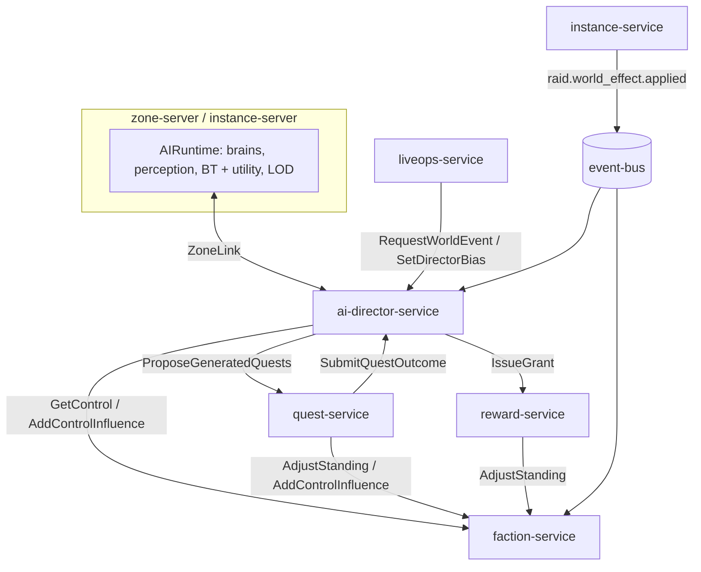
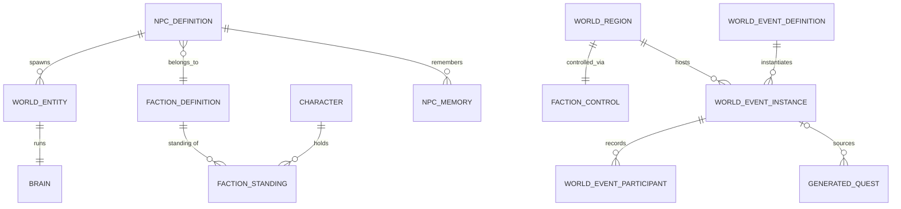

# Legends of the Shattered Frontier — AI Architecture

Version 1.0 — Expanded Technical Design Authority edition (2026-10-17)

Status: Design target; not implemented. Names per Shared Registry v1.0.

Links: [Shared Registry](Legends_Shattered_Frontier_Shared_Registry_v1.0.md) · Glossary: Registry, Glossary

---

## Mission

A living world: NPCs that perceive, fight and react believably; factions that pursue goals and contest regions; a director that paces world events; and generated quests that respond to all of it — with every outcome server-authoritative, bounded and reproducible.

## Scope and non-goals

| In scope (AI owns) | Not in scope (owner) |
| --- | --- |
| NPC behavior: perception, awareness, behavior trees, utility scoring, combat roles, leash/evade, social, schedules, morale/flee | NPC stats, damage, mitigation, threat generation (Combat) |
| NPC memory (working, zone, long-term) | Spawn tables, population caps, placement, terrain (World) |
| Faction AI strategy and `faction-service` (standing, tiers, regional control) | Encounter framework for bosses, instance leash rules (Dungeon, Raid) |
| World director: pacing, budgets, event selection, spawn pressure | Quest model, generation templates, validation, LLM text (Quest) |
| Dynamic world events lifecycle, contribution and reward weights | Reward bundles, grants, loot (Itemization) |
| Agentic quest-generation contract (director side) | Event calendar, overlays (LiveOps) |
| AI scaling and tick budgets; `faction.*` and `world.event.*` payloads | Detectors and sanctions (Security) |

GM requests that spawn or adjust NPCs or start events follow the [Game Master Architecture](Legends_Shattered_Frontier_Game_Master_Architecture_v0.1.md); AI validates them through its normal rules (NPC Behavior part, GM adjustments; World Director part, admin RPCs). The director's autonomous decisions are distinct from GM tool actions.

## Architecture and service ownership

| Runtime | Kind | Owns | Publishes |
| --- | --- | --- | --- |
| `AIRuntime` in `zone-server` / `instance-server` | UE5.8 subsystem | NPC brains (`ent_`, memory only), perception, decisions, LOD, stage execution of world events | — (signals to anticheat; `ZoneLink` to director) |
| `ai-director-service` | stateful, leader per realm, schema `director` | `WorldEventInstance` (`wev_`), pacing state, LiveOps requests and bias windows, quest-bias aggregates, narrative flags, region history, long-term NPC memory | `world.event.started`, `world.event.stage_changed`, `world.event.ended` |
| `faction-service` | stateless + DB, schema `faction` | `FactionStanding`, `FactionControl`, `FactionStandingLedgerEntry` (`fsl_`), influence | `faction.reputation.changed`, `faction.control.changed` |

Local AI runs on zone-servers; strategic AI runs in centralized services. Durable writes follow Registry authority rules: AI services write only their own schemas and change others' state through RPCs.

## Core model

## Table of contents

| Part | Contents |
| --- | --- |
| [NPC Behavior and Memory](AI/Legends_Shattered_Frontier_AI_NPC_Behavior_and_Memory_v1.0.md) | Runtime, NPC content block, BT node set, perception (aggro, sight, hearing, stealth), awareness states, Utility AI (action and target scoring), archetypes and combat roles, social behavior, schedules, essential NPCs, morale and flee, leashing and evade, NPC memory, LOD and tick budgets |
| [Factions and Faction Service](AI/Legends_Shattered_Frontier_AI_Factions_and_Faction_Service_v1.0.md) | Faction AI (strategic tick, actions, diplomacy, NPC-attributed influence, war-state machine) and the ratified Faction service contract F1–F12 (tiers, Charisma effect, control rule, DDL, gRPC, payloads, security) |
| [World Director and Dynamic Events](AI/Legends_Shattered_Frontier_AI_World_Director_and_Dynamic_Events_v1.0.md) | Pacing, budgets, spawn pressure, event selection, LiveOps requests and bias, quest and raid inputs, event definitions, lifecycle, scaling, contribution, rewards, world bosses, agentic quest generation, director DDL, gRPC, `world.event.*` payloads |
| [Agent Implementation Guide](AI/Legends_Shattered_Frontier_AI_Agent_Implementation_Guide_v1.0.md) | Module layout, milestones, invariants, test matrix, acceptance, pitfalls, Do/Don't |

## AI Layers

### NPC AI

Every NPC runs a brain on its zone-server: perception feeds an awareness state machine, a behavior tree chooses the relevant behavior, utility selectors pick the specific action, target and position, and abilities go through Combat's validation. Details: NPC Behavior part.

### NPC AI layers

Perception → awareness → behavior tree → utility selectors → combat decision layer → navigation. Encounter bosses add the Dungeon spec's Encounter Director on top; instance rules override open-world rules inside instances.

### Utility AI

Action scoring `U(a) = w_a × (Π c_k)^(1/K) × (1 + μ·running) + ε` with response curves and veto; target scoring `U(p) = Σ w_k f_k(p) + ε` with the canonical feature catalog (threat rank, distance, observed healer/damage/tank, low health, recently targeted, LoS, debuffed, attacker, hated) and fairness caps. Details: NPC Behavior part, Utility AI.

### Faction AI

Durable faction state lives in `faction-service` (Factions part, Faction service). Strategic behavior — territory and resource goals, authored diplomacy stances, `fortify`/`expand`/`reinforce` actions, NPC-attributed influence capped at 60 per faction per region per week — runs in `ai-director-service` and changes the world only through world events and `faction-service` RPCs. Raid influence (Raid spec, Weekly influence formula) is applied by faction-service's raid consumer with `AddControlInfluence` semantics (F5 rule 4).

### World Director

Per realm, per region, every 30 s: intensity from combat share, deaths and active events; phases `calm`/`build_up`/`peak`/`relax`; an event-point budget from population; spawn-pressure multipliers; candidate scoring by weight, bias, phase fit, freshness, reasons, strategy and LiveOps urgency; seeded sampling. The director may decline LiveOps requests that conflict with faction wars or invasion cooldowns (`director_decline_reason`). Details: World Director and Dynamic Events part.

## Dynamic Events

Caravan attacks, invasions (dragon incursions), faction wars, resource shortages, world bosses, discoveries and seasonal events are `world_event/<slug>` definitions with stages. Lifecycle uses `world_event_state` (`pending → active → resolved | failed`); contribution `c = 0.4 × presence + 0.6 × actions` decides eligibility and reward tier; rewards use the Registry reward functions with `w_event` 0.5–2.0 and the power-ladder ceilings (405 `rare`, world bosses 415 `epic`).

## Agentic quest generation

Inputs (region, faction state, resources, player level) become a typed `GenerationRequest` (Quest spec) with `FactionContext {controlling_faction_id, contested, war_state}` from faction-service region control. The director decides when and why (`world_event`, `resource_shortage`, `faction_pressure`, `population_gap`, `ambient`), self-limits, backs off on `RESOURCE_EXHAUSTED`, and never sends text. Outputs (objectives, rewards, narrative) are quest-service's, including LLM text with fail-closed fallback. No model runs in the director at launch; a future planner is flag-gated and proposes only validated typed actions. Details: World Director part, Agentic quest generation.

## AI Memory

Event history, world changes and faction outcomes are stored by the director (`world_event_instances`, `narrative_flags`, `region_history`); NPCs keep working and zone memory in the zone-server and, for `memory: true` NPCs, a decaying per-character disposition used only for flavor (NPC Behavior part, NPC memory).

## Scaling

Local AI on zone-servers: 10 Hz decisions for engaged NPCs, LOD L0–L4 by player proximity, AI ≤ 6 ms p95 of the 33.3 ms frame, a budget governor that never degrades engaged NPCs. Strategic AI on centralized services: one director leader per realm, ≤ 50 ms per region tick; faction-service scales horizontally per realm database.

## Analytics hooks

| Hook | Use |
| --- | --- |
| `faction.reputation.changed`, `faction.control.changed` | Tier distribution, control map, flips, war durations |
| `world.event.started`, `world.event.stage_changed`, `world.event.ended` | Frequency, success, participation, contribution, rewards (`fact_world_events`) |
| `world.director.decided` (proposed telemetry) | Selection tuning, pacing phases, LiveOps declines |
| `ops.server.tick_sampled` extension (requested) | AI frame time, NPCs by LOD, governor steps |

Metrics (Analytics to register): `m_faction_tier_distribution`, `m_region_control_flips_weekly`, `m_influence_cap_hit_share`, `m_npc_influence_share`, `m_world_events_per_region_hour`, `m_world_event_success_rate`, `m_world_event_eligible_share`, `m_world_boss_spawns_daily`, `m_marks_from_world_events_per_char_week`, `m_world_event_gold_share`, `m_director_peak_share`, `m_generated_quest_request_yield`, `m_npc_evade_rate`, `m_npc_flee_rate`, `m_npc_assist_adds_per_pull`, `m_npc_ai_frame_ms_p95`. `m_world_event_request_fulfillment_rate` stays LiveOps'.

## Security considerations

| Threat | Mitigation |
| --- | --- |
| Reputation/influence farming or compromised caller | Caller × source matrix, per-call, character-weekly and region-weekly caps (F3, F7); velocity features to Security |
| Event farming and AFK participation | Contribution needs action points; AFK flag; 12 full-reward events per character per day, then ×0.25 |
| Forged zone reports | `ZoneLink` mTLS `srvi_` identity checked against world-service allocation; credited kills must match `combat.npc.killed`; progress spikes rejected and reported |
| Leash and training exploits | Open-world leash, `safe_zone` evade, `leash_abuse` signal to anticheat-service |
| LiveOps or GM overreach | Server-side caps (≤ 12 per region per day, bias ≤ 3.0), approved definitions only, audited admin RPCs |
| Prompt injection / unsafe text | No player text or ids reach any model; director outputs are typed; text safety is quest-service's |
| Personal data | Participants and NPC memories are `p1_pseudonymous`; both services implement `PrivacyParticipant` |

AI services raise no detections; they send signals and features to `anticheat-service` (Security spec).

## Open contracts closed (phase 2)

| Citing spec | Issue | Resolved in |
| --- | --- | --- |
| Quest (Model and Objectives) | `SubmitQuestOutcome` for `world_event_bias` | World Director part, SubmitQuestOutcome |
| Quest (Model and Objectives) | `essential` NPC flag | NPC Behavior part, Essential NPCs |
| Quest (Model and Objectives) | Giver `flee` policy executed by AI | NPC Behavior part, Civilians: cower and flee |
| Quest (Generation) | Director request construction, faction-service as caller | World Director part, Agentic quest generation; Factions part, F1 clarification |
| Dungeon (Encounters) | Stealth detection owned by AI | NPC Behavior part, Stealth detection |
| Raid (Groups, Encounters) | Utility target selection features | NPC Behavior part, Target scoring |
| Raid (World integration) | Narrative flags, `world_event_trigger` consumption | World Director part, Raid world effects |
| LiveOps (Events and Seasons) | `RequestWorldEvent`, `SetDirectorBias`, `CancelWorldEventRequests`, decline reasons | World Director part, LiveOps requests and bias; gRPC contract |
| Itemization (Item model) | `world.event.ended` participants with contribution threshold; world event ilvl | World Director part, `world.event.ended`, Rewards |
| Analytics (Pipeline) | World-event and faction-control payloads | Factions part F6; World Director part, Event payloads |
| Dungeon (Rewards) | Marks share from world events | World Director part, Balancing targets |
| AI F12 #2, #5 | Spillover; realm transfer | Factions part, F12 |

## Registry additions

> **Merge status (2026-10-17):** merged into the Shared Registry (change log, phase-2 row) with these maintainer decisions: `npc_archetype` is the 11-value union; AI kinds `bt`/`up` are `behavior_tree`/`utility_profile`; Backend `guild.guild.*` events are `guild.profile.*`; world events split between AI (lifecycle, payloads) and World (placement, fixed windows, `trigger_kind = world_schedule`); World owns respawn timing under scarcity. Cross-spec requests below were applied to the owning specs or remain listed as open issues there.

All phase-2 additions below are merged into the Shared Registry (change log, phase-2 row), as were the F11 additions. The Registry is authoritative; rows remain as rationale and ownership notes.

| Kind | Name | Value / definition | Justification |
| --- | --- | --- | --- |
| Entity / prefix | `WorldEventRequest` `wer_` | ai-director-service, AI, PostgreSQL `director` | LiveOps stores `request_id` "returned by ai-director-service" |
| Entity / prefix | `DirectorBiasWindow` `dbw_` | ai-director-service, AI, `director` | `SetDirectorBias` return id |
| Entity / prefix | `GeneratedQuestRequest` `gqr_` | ai-director-service, AI, `director` | Quest's "director-side ULID" `request_id` needs a prefix |
| Keyed entity | `NpcMemory` (`realm_id`+`npc_id`+`character_id`) | ai-director-service, AI, `director` | Durable personal data; privacy participant |
| RPC table | `ai-director-service` | `RequestWorldEvent`, `CancelWorldEventRequests`, `SetDirectorBias`, `SubmitQuestOutcome`, `GetActiveWorldEvents`, `GetNarrativeFlags`, `ZoneLink`, `GetNpcMemories`, `AdminStartWorldEvent`, `AdminAdvanceWorldEvent`, `AdminEndWorldEvent`, `AdminGetRegionState` (World Director part, gRPC contract) | Already called by LiveOps and Quest |
| Enum | `world_event_category` | `invasion`, `world_boss`, `caravan_attack`, `faction_war`, `resource_shortage`, `discovery`, `seasonal`, `ambient` | Payloads; LiveOps bias scope |
| Enum | `world_event_intensity` | `minor`, `major`, `epic` | Payloads; budgets |
| Enum | `world_event_end_reason` | `objectives_completed`, `objectives_failed`, `timeout`, `cancelled`, `resolved_by_effect`, `server_lost`, `no_participants` | `world.event.ended` |
| Enum | `world_event_trigger_kind` | `director`, `liveops_request`, `faction_ai`, `quest_outcome`, `raid_effect`, `world_schedule`, `gm` | `world.event.started` |
| Enum | `world_event_reward_tier` | `gold`, `silver`, `bronze` | Participant payload |
| Enum | `director_decline_reason` | `definition_not_found`, `definition_not_requestable`, `no_eligible_region`, `conflicts_faction_war`, `invasion_cooldown`, `exceeds_daily_cap`, `kill_switch`, `invalid_window` | LiveOps `decline_reason` |
| Enum | `npc_archetype` | `brute`, `caster`, `skirmisher`, `guardian`, `shaman`, `champion`, `beast`, `guard`, `civilian`, `commander` | Shared with Dungeon archetypes |
| Enum | `npc_aggression` | `aggressive`, `defensive`, `passive` | NPC content |
| Enum | `faction_stance` | `allied`, `neutral`, `hostile` | Faction content; NPC hostility |
| Enum value | `faction_change_source` += `realm_transfer` | Ledger source for transferred standings | F12 #5 |
| Content kinds | `behavior_tree`, `utility_profile`, `schedule`, `spawnset` | `behavior_tree/<slug>`, `utility_profile/<slug>`, `schedule/<slug>`, `spawnset/<slug>` | Referenced by NPC and event definitions and validators |
| Content fields | `npc.ai.*` (incl. `essential`, `memory`); `faction.ai_controlled`, `relations`, `home_regions`, `goals`, `strategic_actions`, `npc_influence_on_outcome`; `world_event.*` (§7.1 of the director part) | — | Cross-domain validators (Quest, Dungeon) |
| Event (telemetry) | `world.director.decided` | `telemetry.server`, p0 | Director tuning |
| Tuning domains | `tune.ai.*`, `tune.director.*` | keys in parts | New domains |
| Feature flags | `ff.director.world_events_enabled`, `ff.director.quest_requests_enabled`, `ff.director.model_planner_enabled` (default false), `ff.director.event_<slug>_enabled` | — | Kill switches |

Cross-spec requests:

| Owner | Request |
| --- | --- |
| World | zone-server hosts the `ZoneLink` client; spawn executor honors `RegionDirective` multipliers (respawn rate only) and quest spawn allowance; publish `scarcity_index` per (region, resource); handoff payload carries AI `ai_flags` (offender entries) |
| Analytics | Register payloads and metrics above; add `ai_frame_ms_p95`, `npc_count_by_lod`, `ai_governor_step` to `ops.server.tick_sampled` |
| Backend | Realm-transfer workflow calls faction-service per F12 #5; list `ai-director-service` as a privacy participant |
| Security | Consume `leash_abuse` and participation-anomaly signals; confirm `staff_role` gates for director admin RPCs |
| Quest | Confirm `SubmitQuestOutcome` key `<qst_id>:bias:<world_event_id>` and `points ∈ (0, 1]` |

## Open issues

1. **Dynamic diplomacy.** Stances are authored; simulation-driven stance changes are deferred.
2. **Multi-zone events.** One primary zone per event at launch; multi-zone needs progress merge and chunked participant lists.
3. **Territory influence source.** Waiting on Building spec (F12 #4).
4. **Region weekly inflow cap scale.** Validate at PTR (F12 #6).
5. **Model planner.** Disabled; enabling requires Security review of inputs and an A/B against rule-based selection.
