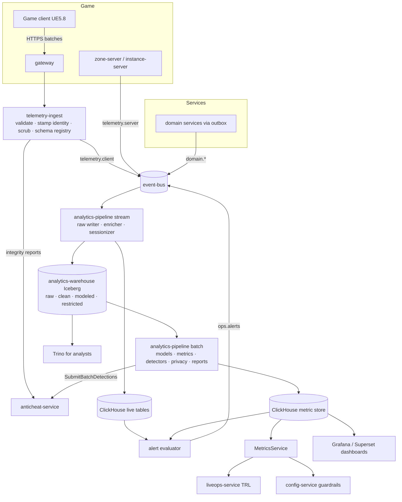
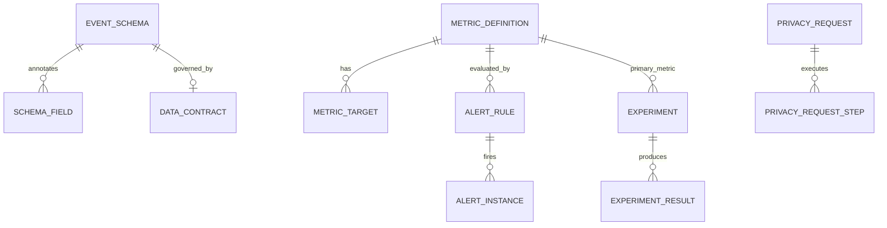

# Legends of the Shattered Frontier — Analytics Architecture
## Version 1.0 — Expanded Technical Design Authority edition (2026-10-17)

Status: Design target; not implemented. Names per Shared Registry v1.0.

- Registry: [Shared Registry v1.0](Legends_Shattered_Frontier_Shared_Registry_v1.0.md)
- Short name: **Analytics**. Part folder: [`Analytics/`](Analytics/)
- Adjacent specs: Database, Backend, Economy, Network, World; consumers of every domain spec's events

---

## 1. Goals

Analytics turns every domain fact and telemetry sample into trustworthy numbers that drive balancing, operations, and safety. Goals, in priority order:

1. **Data-driven balancing.** Every tuning target written in a domain spec (time to level 100, quest gold share, dungeon completion rates, raid kill rates, repair sink share, inflation band) has exactly one metric with an exact formula, a dashboard, and where needed an alert.
2. **Safe live operations.** LiveOps trigger rules and config-service rollout guardrails read Analytics metrics within 2 minutes; when data is stale, automation holds instead of guessing.
3. **Economic integrity.** Gold faucets, sinks, money supply, prices, inflation, wealth concentration, and duplication signals are measured continuously and reconciled against the ledgers.
4. **Fast detection of breakage and abuse.** Crashes, server tick degradation, exploit and dupe indicators raise alerts in minutes and route to the right team and to `anticheat-service`.
5. **Privacy by construction.** Personal data is classified per field, scrubbed before storage, retained per class, and erasable within 30 days.
6. **One metric catalog.** Metric names proposed across specs are consolidated into one canonical catalog; every name resolves to one definition.
7. **Agent-implementable.** Schemas, formulas, worked examples, and tests are precise enough for coding agents.

## 2. Scope and non-goals

### 2.1 In scope

| Area | Summary | Part |
| --- | --- | --- |
| Event envelope implementation | `lsf-events` SDK, outbox delivery, validation rules E1–E9 | [Pipeline and telemetry](Analytics/Legends_Shattered_Frontier_Analytics_Pipeline_and_Telemetry_v1.0.md) |
| Schema registry | JSON Schema per event version, privacy annotations, compatibility rules, lifecycle | Pipeline and telemetry |
| Ingest | `telemetry-ingest` client intake, identity stamping, quotas, clock correction, PII scrubbing | Pipeline and telemetry |
| Pipeline | Flink stream jobs (raw writer, enricher, sessionizer, alert evaluator), Spark batch jobs, sessionization rules | Pipeline and telemetry |
| Lakehouse and serving | Iceberg `raw`/`clean`/`modeled`/`restricted`, ClickHouse live tables and metric store | Pipeline and telemetry; [Warehouse and metrics](Analytics/Legends_Shattered_Frontier_Analytics_Warehouse_and_Metrics_v1.0.md) |
| Telemetry payloads | All `client.*` (except `client.integrity.reported`, Security) and all `ops.*` events | Pipeline and telemetry |
| Data quality | Contracts, freshness SLAs, late data, dedup by `event_id` | Pipeline and telemetry |
| Cost and scale | Events/s per CCU phase, storage, cost per CCU-day | Pipeline and telemetry |
| Warehouse model | Facts, dimensions, snapshots with DDL and ER diagram | Warehouse and metrics |
| Metric catalog | Canonical formulas: engagement, retention, churn, progression, quests, dungeons, raids, items, economy (FSR, money supply, inflation index, Gini, velocity), performance, security, LiveOps | Warehouse and metrics |
| Dashboards, alerting, reporting | Boards with panel lists, alert rules with thresholds/windows/severity/routing, daily/weekly/seasonal reports | [Dashboards, alerting and privacy](Analytics/Legends_Shattered_Frontier_Analytics_Dashboards_Alerting_Privacy_v1.0.md) |
| Experimentation | A/B framework on config-service flags, statistics, guardrails | Dashboards, alerting and privacy |
| Privacy | Class handling, retention, erasure/export flows, consent, access control | Dashboards, alerting and privacy |
| Hooks and security | MetricsService for LiveOps/config-service, batch detector host for Security, threats | Dashboards, alerting and privacy |
| Implementation guide | Layout, milestones, invariants, test matrix, Do/Don't | [Agent implementation guide](Analytics/Legends_Shattered_Frontier_Analytics_Agent_Implementation_Guide_v1.0.md) |

### 2.2 Non-goals

- Defining payloads of events owned by other services (owning specs do; Analytics registers and consumes them).
- Infrastructure observability (traces, logs, host metrics) beyond the allowlisted counters bridged into the metric store; that belongs to DevOps.
- Detector logic, risk scoring, and sanctions (Security). Analytics only hosts batch detector execution and delivers results.
- Economy policy (tax rates, sink design). Analytics measures; Economy decides. The inflation index method is Economy-owned; Analytics provides a reference computation until Economy publishes one.
- Player-facing statistics (leaderboards, armory pages); these are product features served by owning services.
- Real-time per-player personalization or marketing; not permitted on analytics data.

## 3. Glossary pointer

All shared terms are in the Registry Glossary. Analytics-local terms:

| Term | Meaning |
| --- | --- |
| Activity day | Reset-aligned day of the event's `dc_region` (Registry, Resets), used for all daily metrics |
| Active (account, day) | ≥ 1 world entry or in-world heartbeat on that activity day (Warehouse and metrics part, Engagement and retention) |
| Active hours / played hours | Heartbeat-based time with input / in world (Pipeline and telemetry part, Sessionization) |
| Merged session | Auth sessions of one account separated by < 5 min, the unit for session metrics |
| Freshness class | `realtime`, `near_realtime`, `hourly`, `daily` latency guarantee of a metric |
| Flow class | `faucet`, `sink`, `transfer`, `correction` classification of a currency transaction |
| Restricted zone | Iceberg namespace `restricted` holding `p2_personal` data in the home dc_region, 30-day retention |
| Provisional / blocked metric | Metric whose inputs come from an interim contract / from not-yet-merged proposed events |

## 4. Architecture and service ownership

### 4.1 Services

| Service | Role | Owns | PostgreSQL schema | APIs |
| --- | --- | --- | --- | --- |
| `telemetry-ingest` | edge collector | client intake, validation, PII scrubbing, schema registry | `telemetry_ingest` | HTTP `POST /v1/telemetry/batch` via gateway; `lsf.telemetry_ingest.v1` (SchemaRegistry) |
| `analytics-pipeline` | stream/batch jobs | enrichment, sessionization, models, metric materialization, alert evaluation (`ops` domain), batch detector host, experiments, privacy workers, reports | `analytics_pipeline` | `lsf.analytics_pipeline.v1` (MetricsService, PrivacyService); publishes `ops.alerts` |
| `analytics-warehouse` | data platform | Iceberg lakehouse on object storage, Iceberg REST catalog, ClickHouse serving | `analytics_warehouse` (catalog metadata) | Trino (analysts), ClickHouse (dashboards, MetricsService) |
| `event-bus` | infrastructure (shared with Backend) | Kafka-compatible log | — | topics per Registry |

### 4.2 Architecture diagram



### 4.3 Interfaces with other domains

| Domain / service | Direction | What | Where specified |
| --- | --- | --- | --- |
| All publishing services | in | domain events per owning spec payload tables | owning specs; consumed per Pipeline and telemetry part, Data sources by domain |
| Economy (`economy-service`) | in | currency, market, trade events; nightly wallet export; `economy.index.computed` | interim requirements in Warehouse and metrics part, Inputs from specs that are not yet expanded |
| LiveOps (`liveops-service`, `config-service`) | out | `metric()` values for trigger rules; guardrail samples; experiment readouts | Dashboards, alerting and privacy part, Analytics hooks back to other services |
| Security (`anticheat-service`) | out | batch detector results; alerts routed `anticheat_service` | Dashboards, alerting and privacy part, Alerting |
| Security (`anticheat-service`) | in | `client.integrity.reported` forwarded by ingest (payload by Security) | Security spec, Audit, operations and interfaces part |
| Backend (`auth-service`) | in | erasure/export requests from the privacy workflow | Dashboards, alerting and privacy part, Privacy |
| `audit-service` | out | audit records for schema changes, exports, restricted access, erasures | same |
| Database spec | — | Analytics is the "Analytics Warehouse" domain of the Database spec; object storage hosts the lakehouse | Database spec, Core domains |
| Network / World | in | latency, loss, zone load, handoffs via `client.perf.sampled`, `ops.zone.load_sampled` | Pipeline and telemetry part |

## 5. Core model

### 5.1 Data flow and layers

```text
producer ──(Registry envelope, at-least-once)──▶ event-bus topic
  ──▶ raw      : exact accepted event (scrubbed), 25 months
  ──▶ clean    : typed, deduplicated by event_id, enriched (activity_day, level, cohort, config arms)
  ──▶ modeled  : facts / dimensions / snapshots (p0/p1 only)
  ──▶ metric store : catalog metrics (numerator, denominator, n) at 1m … season grains
  ──▶ consumers: dashboards, alerts (ops.alerts), MetricsService, reports, batch detectors
restricted (p2, home dc_region, 30 days) sits beside clean; only aggregates leave it
```

### 5.2 Data sources

Client (heartbeat, performance, crashes, loads, UI, surveys, integrity), servers (tick, zone load, service health), and every domain in the Registry event catalog: auth, character, progression, item/inventory, loot, reward, crafting/gathering, economy/market, quest, group, instance/encounter/raid, combat, world/faction, security, enforcement, audit, liveops/config/store. The full mapping of events to payload sources and warehouse tables is in the Pipeline and telemetry part (Data sources by domain) and the Warehouse and metrics part (Facts and snapshots).

### 5.3 Metrics (summary)

| Family | Representative canonical metrics |
| --- | --- |
| Retention and engagement | `m_d1_retention`, `m_d7_retention`, `m_d30_retention`, `m_dau`, `m_wau`, `m_mau`, `m_dau_mau_ratio`, `m_churn_rate_30d`, `m_session_length_minutes_p50` |
| Progression | `m_time_to_level_hours`, `m_progression_funnel`, `m_skill_band_distribution`, `m_xp_source_share` |
| Content | `m_quest_completion_rate`, `m_quest_abandon_rate`, `m_dungeon_completion_rate`, `m_encounter_wipe_rate`, `m_raid_wipe_funnel` |
| Economy health | `m_gold_faucet_sink_ratio`, `m_gold_money_supply`, `m_inflation_index`, `m_gold_inflation_index_wow`, `m_wealth_gini`, `m_market_velocity` |
| Performance | `m_zone_tick_p99_ms`, `m_client_crash_rate`, `m_server_crash_rate`, `m_latency_rtt_p95_ms`, `m_load_time_p95_s` |

Full catalog with formulas and worked examples: Warehouse and metrics part, Canonical metric catalog.

### 5.4 Dashboards, alerting, reporting (summary)

- **Dashboards:** Live Operations, Economy, World Health, Server Performance, Security (four boards), Progression and content, LiveOps/store/releases.
- **Alerting:** inflation spikes, faucet/sink imbalance, gold and item creation spikes (exploit indicators), ledger residuals and ledger anomalies (dupe signals), crash spikes, tick degradation, login failures, engagement drops, pipeline health. Severities `sev1`–`sev4`; published on `ops.alerts`; subject-level findings to `anticheat-service`.
- **Reporting:** daily (reset + 3 h), weekly (weekly reset + 6 h), seasonal (season end + 7 days, after restatement).

### 5.5 Control-plane entities



DDL: `telemetry_ingest.event_schemas`, `schema_fields`, `ingest_quotas` (Pipeline and telemetry part); `analytics_pipeline.metric_definitions`, `metric_targets`, `data_contracts` (Warehouse and metrics part); `alert_rules`, `alert_instances`, `experiments`, `experiment_results` (Dashboards, alerting and privacy part); privacy requests below.

```sql
CREATE TABLE analytics_pipeline.privacy_requests (
  request_id     text PRIMARY KEY,                  -- issued by the Backend privacy workflow
  kind           text NOT NULL CHECK (kind IN ('erasure','export')),
  account_id     text NOT NULL CHECK (account_id ~ '^acc_'),
  character_ids  text[] NOT NULL DEFAULT '{}',
  home_dc_region text NOT NULL,
  state          text NOT NULL CHECK (state IN ('received','held','running','verifying','completed','failed')),
  legal_hold     boolean NOT NULL DEFAULT false,
  received_at    timestamptz NOT NULL,
  due_at         timestamptz NOT NULL,              -- received_at + 30 days
  completed_at   timestamptz,
  idempotency_key text NOT NULL UNIQUE
);

CREATE TABLE analytics_pipeline.privacy_request_steps (
  request_id   text NOT NULL REFERENCES analytics_pipeline.privacy_requests,
  table_name   text NOT NULL,                     -- e.g. 'modeled.fact_sessions'
  rows_affected bigint NOT NULL,
  finished_at  timestamptz NOT NULL,
  PRIMARY KEY (request_id, table_name)
);
```

### 5.6 Design principles

1. **Server truth for decisions.** Anything that drives automation is computed from server-authoritative events.
2. **Sum, then divide.** Ratios are stored with numerators and denominators.
3. **One name, one formula, versioned.**
4. **Scrub before storing.** Nothing personal reaches durable analytics storage unclassified.
5. **Late is normal.** Watermarks, dirty partitions, and versioned restatements, never silent edits.
6. **Measure, don't act.** Analytics never sanctions, never changes tuning; it informs the owning service.

## 6. Table of contents

| Part | File | Contents |
| --- | --- | --- |
| Entry | this file | goals, scope, architecture, core model, Registry additions |
| 1 | [Pipeline, telemetry and data quality](Analytics/Legends_Shattered_Frontier_Analytics_Pipeline_and_Telemetry_v1.0.md) | envelope SDK, topics, validation; schema registry and compatibility; ingest; PII scrubbing; pipeline jobs, enrichment, sessionization; Iceberg layers; ClickHouse; `client.*` and `ops.*` payloads; data sources; data quality; cost and scale |
| 2 | [Warehouse data model and metric catalog](Analytics/Legends_Shattered_Frontier_Analytics_Warehouse_and_Metrics_v1.0.md) | modeling conventions; ER diagram; dimension and fact DDL; interim inputs; canonical metric catalog with formulas and worked examples; duplicate resolution; control-plane schema |
| 3 | [Dashboards, alerting, reporting, experimentation, privacy and security](Analytics/Legends_Shattered_Frontier_Analytics_Dashboards_Alerting_Privacy_v1.0.md) | dashboards and panels; alert severities, baselines, rules, lifecycle; anticheat routing; reports; A/B framework; privacy classes, retention, erasure/export, consent, access control; MetricsService hooks; security considerations |
| 4 | [Agent implementation guide](Analytics/Legends_Shattered_Frontier_Analytics_Agent_Implementation_Guide_v1.0.md) | repository layout, milestones, invariants, test matrix, acceptance criteria, pitfalls, Do/Don't |

## 7. Analytics hooks (summary)

Analytics is the consumer of every other spec's "Analytics hooks" section. Its own health metrics: `m_pipeline_freshness_seconds`, `m_event_loss_rate`, `m_duplicate_event_rate`, `m_schema_violation_rate`. Hooks back to services: `MetricsService.GetMetric`/`GetGuardrailSample` for liveops-service and config-service, `SubmitBatchDetections` to anticheat-service, `ops.alerts` for on-call, admin-portal and LiveOps triggers (Dashboards, alerting and privacy part, Analytics hooks back to other services).

## 8. Security considerations (summary)

Main threats: poisoned client telemetry steering automation, ingest floods, insider exfiltration, re-identification, PII leaks via free text or dumps, market manipulation aimed at trigger rules, alert tampering, and stale data driving decisions. Mitigations and the signals Analytics reports to `anticheat-service` are in the Dashboards, alerting and privacy part, Security considerations.

---

## 9. Registry additions and open issues

> **Merge status (2026-10-17):** R1–R8 and R11 are merged into the Shared Registry; R9, R10, R12, R13 are Analytics-owned names recorded here. O5 resolved: Character now classifies `rest`, `div`, `event`, `cu` as p1 and keeps `dr`, `am` at p2. O9 partly resolved: `progression.stage.changed`, `progression.mastery.tree_reset`, and `raid.first_kill.revoked` are canonical; a mythic-progress snapshot event remains open.

R1–R8 and R11 are merged into the Shared Registry. R9, R10, R12, and R13 are Analytics-owned catalog names; they are defined in this specification. The Registry is authoritative for shared names.

### 9.1 Additions

| # | Kind | Proposal | Justification |
| --- | --- | --- | --- |
| R1 | ID prefix | `alr_` — AlertInstance, owner `analytics-pipeline`, PostgreSQL `analytics_pipeline` | Alerts need a stable ID across `firing`/`escalated`/`resolved` and for acknowledgement |
| R2 | ID prefix | `exp_` — Experiment, owner `analytics-pipeline`, PostgreSQL `analytics_pipeline` | Experiments are referenced by config rules, reports, and salts |
| R3 | Envelope value | `producer.service = "game-client"` for client telemetry | Registry requires a service name in `producer`; the client is not a service |
| R4 | Enum | `alert_severity`: `sev1`, `sev2`, `sev3`, `sev4` | Used in `ops.alert.fired`; Security already uses SEV1–SEV3 labels |
| R5 | Enum | `service_health_state`: `healthy`, `degraded`, `unhealthy`, `unknown` | Used in `ops.service.health_changed` and LiveOps status rules |
| R6 | Sink code | `market_purchase` — buyer-side debit for a market buy | No canonical code exists; needed to classify market purchases as transfers in faucet/sink metrics (Economy to confirm) |
| R7 | Constant | `TELEMETRY_P2_RETENTION` = 30 days, key `tune.analytics.p2_retention_days` | `EVENT_SCHEMA_RETENTION_RAW` defers p2 handling to Analytics; aligns with Security's 30-day IP/chat rule |
| R8 | Feature flag | `ff.analytics.client_telemetry_enabled` (per `client_build` cohort) | Kill switch for client telemetry floods or a bad client build |
| R9 | Tuning keys (cross-domain read by client and servers) | `tune.analytics.heartbeat_interval_s` (60), `tune.analytics.perf_sample_rate` (1.0), `tune.analytics.ui_sample_rate` (0.2), `tune.analytics.ui_allowlist`, `tune.analytics.client_batch_max_events` (500), `tune.analytics.client_batch_max_kb` (256) | Client and server SDKs read them from config-service |
| R10 | Tuning keys (Analytics-internal) | `tune.analytics.session_close_timeout_s` (900), `play_session_gap_s` (600), `session_merge_gap_s` (300), `input_idle_s` (300), `stream_watermark_s` (7200), `quest_completion_horizon_days` (14), `basket_weight_cap` (0.15), `alert.<rule_id>.<param>` | Listed for completeness; published via config-service |
| R11 | Detector content IDs (Security-owned kind) | `detector/telemetry_tamper`, `detector/headless_presence` | New subject-level signals only Analytics can compute (client vs server presence); Security to define severity and confidence |
| R12 | Batch header field | `telemetry_consent` (`full`, `essential`) on client telemetry uploads | Consent enforcement at ingest |
| R13 | Metric names | New canonical metrics: `m_wau`, `m_progression_funnel`, `m_quest_fail_rate`, `m_raid_completion_rate`, `m_days_to_ilvl_tier`, `m_gold_created`, `m_gold_destroyed`, `m_gold_faucet_sink_ratio`, `m_gold_money_supply`, `m_gold_money_supply_growth_wow`, `m_gold_ledger_residual`, `m_gold_created_npc`, `m_inflation_index`, `m_wealth_gini`, `m_market_velocity`, `m_tick_overrun_rate`, `m_crashes_per_1k_hours`, `m_server_crash_rate`, `m_latency_rtt_p95_ms`, `m_packet_loss_p95_pct`, `m_client_fps_p50`, `m_load_time_p95_s`, `m_zone_population_ratio`, `m_handoff_failure_rate`, `m_pipeline_freshness_seconds`, `m_event_loss_rate`, `m_duplicate_event_rate`, `m_schema_violation_rate`, `m_raid_pity_triggers_per_kill` (rename) | Metric names are Analytics-owned (Registry, Concept ownership); listed so other specs can reference them after merge |

### 9.2 Renames and duplicate resolution

Recorded in the Warehouse and metrics part, Duplicate resolution and renames: `m_time_to_level_100_hours` and `m_time_to_level_cap_hours` → `m_time_to_level_hours{level=100}`; `m_skill_gain_blocked_by_cap` → `m_cap_blocked_gains`; `m_raid_kill_duration_p50` → `m_encounter_ttk_p50{content_kind=raid}`; `m_dungeon_ilvl_pace` → `m_days_to_ilvl_tier`; `m_raid_pity_trigger_rate` → `m_raid_pity_triggers_per_kill`. Aliases resolve for one season.

### 9.3 Open issues

| # | Issue | Owner to resolve |
| --- | --- | --- |
| O1 | Economy, Crafting, Combat, Backend (auth, character) have no expanded payload tables; Analytics lists required fields as interim requirements and marks dependent metrics `provisional`. Resolved (2026-10-17): payload tables now exist for every listed event — Economy spec, Event payloads (all `economy.*` / `market.*`, every interim field plus a published `flow_class`); Crafting spec, Event payloads (`crafting.*`, `gathering.*`); Combat spec, Combat events (`combat.*`); Backend spec, Event payloads (all `auth.*` and `character.*`). Dependent metrics may drop `provisional` | Economy, Crafting, Combat, Backend |
| O2 | Registry assigns the inflation index to Economy; Analytics computes a reference Laspeyres index and reconciles against `economy.index.computed` until Economy defines its method. Resolved (2026-10-17): Economy spec, Inflation index adopts the reference Laspeyres method (14-day base, weight cap 0.15, chained across seasons) and publishes the basket; Analytics recomputes from that basket, expected gap ≤ 0.5 points, alert stays at 1 point | Economy |
| O3 | Nightly wallet balance export (needed for money supply and Gini) has no defined interface; proposal: economy-service export RPC writing an Iceberg snapshot at each dc_region daily reset. Resolved (2026-10-17): Economy spec, Wallet snapshot export defines `ExportWalletSnapshot` and a job writing `landing.economy_wallet_snapshots` (p1) at each dc_region reset (crowns excluded in v1; namespace to confirm — Economy open issues) | Economy / Backend |
| O4 | Quest's `m_quest_gold_faucet_share` divides by gold credits from all sources (including transfers); Analytics uses faucet-class credits | Quest |
| O5 | Character classifies `progression.xp.granted.multipliers` as `p2_personal`, but its own metrics need them; Analytics computes them inside `restricted`. Suggest reclassifying `rest`, `div`, `event`, `cu` as `p1_pseudonymous` (keeping `am`, `dr` at p2) | Character |
| O6 | `m_raid_mechanic_failure_rate` needs a count of spawned mechanic instances per attempt, not present in `encounter.attempt.*` | Raid |
| O7 | Experiments need a per-rule salt override in config-service (bucket salt defaults to the key name) | LiveOps |
| O8 | `ops.alert.fired` also carries `escalated` and `resolved` via a `status` field; a separate `ops.alert.resolved` event could be added instead | Registry maintainer |
| O9 | Proposed source events not in the Registry (`progression.stage.changed`, `progression.mastery.tree_reset`, `raid.first_kill.revoked`, `instance.mythic_progress` snapshot) block `m_stage_funnel`, `m_mastery_reset_rate`, `m_raid_first_kill_invalidations`, `m_mythic_access_distribution` | Character, Raid, Dungeon |
| O10 | `auth.login.failed` needs a `reason` field to compute `m_login_success_rate` as LiveOps intends (excluding bad credentials). Resolved (2026-10-17): Backend spec, `login_failure_reason` and `m_login_success_rate` adds `reason` (`login_failure_reason`, classified by Security) to `auth.login.failed`, with an explicit user-error vs system-failure split for the metric | Backend / Security |
| O11 | Account deletion workflow owner: Analytics assumes the Backend `auth-service` privacy workflow calls `PrivacyService`; Backend spec does not yet describe it. Resolved (2026-10-17): Backend spec, Account deletion and privacy request workflow defines the auth-service workflow (`privacy_request_state`, intake, legal holds, phased orchestration), which calls `PrivacyService.SubmitErasure` / `SubmitExport` with a `deadline_at` | Backend |
