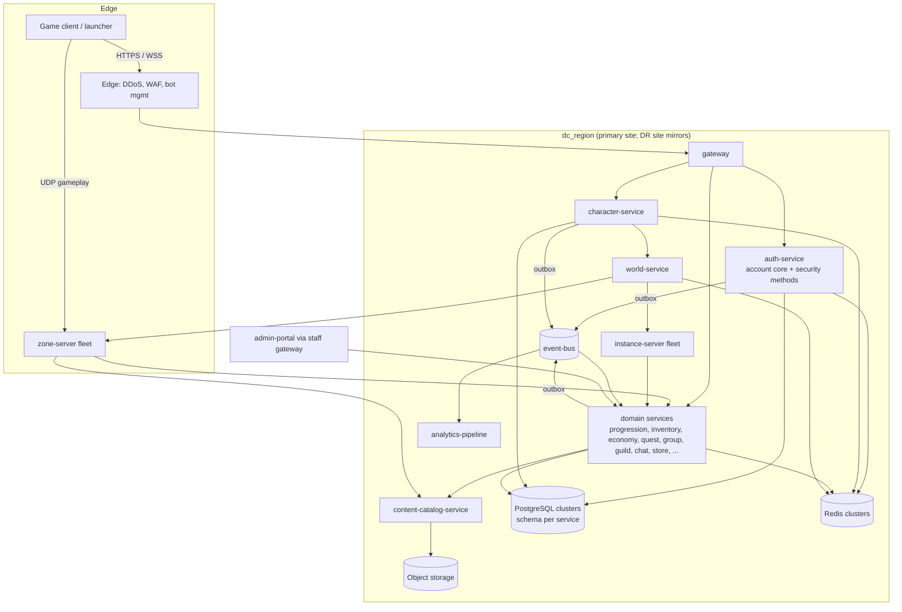
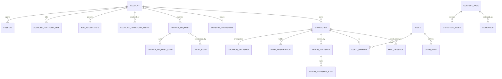

# Legends of the Shattered Frontier — Backend Architecture
## Unreal Engine 5.8 MMO Infrastructure Specification
### Version 1.0 — Expanded Technical Design Authority edition (2026-10-17)

Design target; not implemented. Names per Shared Registry v1.0.

Registry: [Shared Registry](Legends_Shattered_Frontier_Shared_Registry_v1.0.md) · Parts: [Backend/](Backend/) (see Table of contents)

This edition replaces the original overview and the 2026-10-17 contract patch. All normative contract content of the patch is kept: the service ownership contracts are below; the privacy workflow, `login_failure_reason` and event payloads moved to the parts under their original titles. Where the original overview's service catalogue conflicted with Shared Registry §4 on ownership (for example, a "Character Service" storing inventory, skills and quests), the Registry wins and the catalogue below follows it.

---

## 1. Overview

### 1.1 Purpose

This specification defines the cross-cutting backend platform of a large-scale persistent sandbox MMORPG built on Unreal Engine 5.8: the service catalogue and ownership boundaries, the Backend-owned services (`gateway`, `auth-service` account core, `character-service`, `content-catalog-service`, `chat-service`, the core of `guild-service`, `event-bus`), the conventions every service implements (gRPC, idempotency, outbox, sagas, persistence), the account deletion and privacy workflow, realm/character transfer, and the operational platform (scaling, disaster recovery, multi-region deployment, deployment, observability).

### 1.2 Principles

1. Service-oriented architecture with **one owner per datum** (Registry §4, authority rules).
2. Stateless services whenever possible; state lives in the owning service's PostgreSQL schema, with Redis only for declared hot or ephemeral state.
3. Horizontal scalability; capacity is added by replicas, realms and zone servers, not by bigger single nodes.
4. Persistent world state; nothing a player earns depends on a single process surviving.
5. No single point of failure inside a region; a region survives the loss of an availability zone without data loss.
6. Region-independent deployment; every `dc_region` runs a complete stack, and player personal data stays in its home region.
7. Cloud-native infrastructure (containers, GitOps, managed or operator-run data stores).
8. UE5.8 dedicated servers for real-time simulation (`zone-server`, `instance-server`); services never trust the client.

### 1.3 Launch targets

| Phase | Peak CCU | Topology |
| --- | --- | --- |
| 1 | 100–500 | single world (one realm) in `na` |
| 2 | 2,000–5,000 | multiple realms; `na` and `eu` |
| 3 | 10,000+ | multi-region operation (`na`, `eu`, `apac`, `sa`) |

Sizing per phase: Part 3, Scaling.

### 1.4 Technology stack

| Layer | Choice |
| --- | --- |
| Game engine | Unreal Engine 5.8 (client, dedicated servers) |
| Backend services | C# (.NET), Rust or Go — one language per service, fixed by a recorded decision before the first service (Repository Structure spec) |
| Internal APIs | gRPC with protobuf (`lsf.<service_snake>.v1`) |
| Databases | PostgreSQL (durable state), Redis (hot/ephemeral state) |
| Event bus | Kafka-compatible durable log (`event-bus`) |
| Storage | S3-compatible object storage (Cloudflare R2, AWS S3 or Azure Blob) |
| Infrastructure | Docker, Kubernetes, Terraform, GitOps; Cloudflare edge (DDoS, WAF) per Network spec |
| Observability | OpenTelemetry metrics, traces and logs |

---

## 2. Scope and non-goals

| In scope (this spec) | Owned elsewhere (consumed here) |
| --- | --- |
| Service catalogue, tiers, ownership boundaries for every registry service | Each service's domain behavior: owning spec in Registry §4 |
| `auth-service` account core: accounts, `account_state`, directory, ToS, session record semantics, Backend MFA/step-up hooks, `login_failure_reason` value list | Credentials, MFA factors, devices, session binding, login risk, connect tickets, staff elevation: Security spec |
| `gateway`: routes, pipeline, rate-limit enforcement, login gate, minimum client build, push channel | Rate-limit values, abuse detection: Security spec |
| `character-service`: character lifecycle, names, slots, world entry, realm queue, location checkpoints, realm transfer | Progression data (level, skills, attributes): Character spec; zone allocation, handoffs: World spec |
| Platform conventions: gRPC, idempotency, outbox/event bus, inbox, sagas, persistence (PostgreSQL, Redis, object storage), encryption | Event envelope implementation, schema registry, warehouse: Analytics spec |
| `content-catalog-service`: packs, server-only packs, activation, delivery to services | Content kind schemas and validators: owning specs; release orchestration: LiveOps spec; client patching: Client Delivery spec |
| Account deletion and privacy request workflow | Evidence retention, audit record format: Security spec; telemetry erasure: Analytics spec |
| Realm and character transfer saga | Per-domain carry rules beyond Part 3: owning specs (via `TransferParticipant`) |
| `chat-service` (chat, mail messages), `guild-service` core (membership, ranks, succession) | Mail attachments: Itemization/Economy; settlements, territory, wars: Building spec |
| Scaling, disaster recovery, multi-region, deployment platform, observability, SLOs | Pipelines and branching: DevOps spec; releases, maintenance windows, kill switches: LiveOps spec; transport and edge: Network spec; backup goals: Database spec |
| `auth.*`, `character.*`, `content.*`, `guild.*` event payloads | All other domains' payloads |

Non-goals: gameplay formulas of any kind; the Node.js proof of concept (`server/`, `public/`), which does not implement this design (Registry §0); vendor selection beyond the stack table; calendar estimates.

The Database, Network and DevOps specs are earlier short documents. This spec refines them (Database: backup classes and RPO/RTO; Network: gateway and edge layers; DevOps: deployment flow) and does not duplicate their content.

---

## 3. Glossary

All terms follow the [Shared Registry](Legends_Shattered_Frontier_Shared_Registry_v1.0.md), Glossary. Terms introduced by this spec:

| Term | Definition |
| --- | --- |
| Account core | The Backend-owned half of `auth-service`: account record, `account_state`, directory, ToS, platform links, slot entitlement, privacy requests. |
| Account directory | Region-replicated map from an identifier HMAC (email or platform subject) to `account_id` and home `dc_region`; contains no plaintext identifiers. |
| Critical path | The tier-0 service set whose health defines a realm outage (Part 3, Observability). |
| Data key | Per-account AES key wrapping all p2/p3 fields of that account; deleting it crypto-shreds them. |
| DR site | The second site of a `dc_region` in the same legal jurisdiction, holding asynchronous replicas. |
| Home region | The `dc_region` where an account's personal data lives (`home_dc_region`). |
| Inbox / Outbox | Per-schema tables that make event consumption and publication transactional (Part 2). |
| Legal hold | A Security-issued restriction preventing erasure of named data scopes for a subject (`hld_`, proposed). |
| Participant | A service implementing a cross-service contract (`PrivacyParticipant`, `TransferParticipant`, `ContentReferenceParticipant`) for its own data. |
| Pivot | The saga step after which only forward recovery is allowed. |
| Realm queue | Admission queue for world entry when a realm is at its soft CCU cap. |
| Realm transfer | Move of one character and its durable state to another realm (`rtx_`, proposed). |
| Saga | A multi-service state change with one orchestrator, idempotent steps, compensations before the pivot. |
| Service tier | Availability class 0–2 of a service; determines SLO, RPO/RTO and paging. |
| Server-only pack | A content pack with `content_pack_visibility = server_only`, never delivered to clients. |

---

## 4. Architecture

Key paths:

| Path | Flow | Spec |
| --- | --- | --- |
| Login | client → edge → gateway (deadline, rate limit, client build, home-region routing) → auth-service (Security credential/MFA steps, Backend state gate) → session | Part 1, Login path and Backend hooks |
| World entry | gateway → character-service (`EnterWorld`: state, restrictions, realm queue) → world-service `ResolveZone` → connect ticket → client UDP to zone-server | Part 1, World entry, presence and the realm queue |
| Durable mutation | zone-server or gateway → owning service RPC (idempotency key) → one transaction: state + idempotency row + outbox row | Part 2, Idempotency; Events |
| Cross-service change | orchestrator saga → idempotent participant steps → pivot → forward completion | Part 2, Sagas |
| Content | CI → content-catalog-service publish → liveops activation → services and servers load signed packs | Part 2, `content-catalog-service` |
| Telemetry | client/server → telemetry-ingest → event-bus `telemetry.*` → analytics | Analytics spec |

---

## 5. Service catalogue

Every service of Registry §4, with Backend's platform view. "Tier" is the availability class (Part 3, Service tiers, critical path and SLOs). "Realm scoping" is the persistence mode (Part 2, Realm scoping).

| Service | Kind | Owning spec | Tier | Durable store | Realm scoping | Backend obligations beyond the conventions |
| --- | --- | --- | --- | --- | --- | --- |
| `gateway` | edge API | Backend / Network | 0 | none (Redis buckets, gates table) | — | Part 1 |
| `auth-service` | stateless + DB | Backend (account core) / Security | 0 | PostgreSQL `auth`, Redis session hot copy | region_global | privacy workflow orchestrator |
| `character-service` | stateless + DB | Backend | 0 | PostgreSQL `character`, Redis presence/queue | realm_column | creation, transfer, purge orchestrator |
| `progression-service` | stateless + DB | Character | 0 | `progression` | realm_column | participant (privacy, transfer, content refs); Stable/owned-creature writer per [Companion Integration](Companions/Legends_Shattered_Frontier_Companion_Integration_and_Delivery_v0.1.md), including operation/entitlement/deployment records. |
| `inventory-service` | stateless + DB | Itemization | 0 | `inventory` | realm_sharded | participant; mail attachments |
| `loot-service` | stateless + DB | Itemization | 1 | `loot` | realm_column | participant |
| `reward-service` | stateless + DB | Itemization | 1 | `reward` | realm_column | participant; transfer blocker for pending grants |
| `crafting-service` | stateless + DB | Crafting | 1 | `crafting` | realm_column | participant |
| `economy-service` | stateless + DB | Economy | 0 | `economy` | realm_column | participant; phase-1 unwind |
| `quest-service` | stateless + DB | Quest | 1 | `quest` | realm_column | participant; transfer carry decision |
| `group-service` | stateful (Redis) + DB | Dungeon / Raid | 1 | `group`, Redis | realm_column | participant |
| `instance-service` | stateless + DB | Dungeon / Raid | 1 | `instance` | realm_column | participant (lockouts carry) |
| `guild-service` | stateless + DB | Backend / Building | 1 | `guild` | realm_column | Part 2 core; participant |
| `building-service` | stateless + DB | Building / Construction | 0 | `building` | realm_column | Durable claim/structure owner and construction coordinator; [Construction Integration](Legends_Shattered_Frontier_Construction_Integration_Contracts_v0.1.md). Privacy and transfer participant; guild-service retains membership authority. |
| `chat-service` | stateful | Backend | 1 | `chat` | realm_column | Part 2; mail saga orchestrator |
| `world-service` | stateful | World | 0 | Redis `redis-world` | per realm deployment | `ResolveZone`, `GetRealms` used by character-service |
| `zone-server` | UE5.8 dedicated server | World / Network | 0 | memory; checkpoints via character-service | per realm | presence and checkpoint writer |
| `instance-server` | UE5.8 dedicated server | Dungeon / Raid | 0 | memory | per realm | same as zone-server |
| `content-catalog-service` | stateless + object storage | Backend | 0 (read path) | `content_catalog`, buckets | region_global | Part 2 |
| `ai-director-service` | stateful | AI | 1 | `director` | realm_column | content consumer (server-only packs) |
| `faction-service` | stateless + DB | AI | 1 | `faction` | realm_column (standings keyed by character) | participant; transfer carries `faction.standings` |
| `anticheat-service` | stream + DB | Security | 1 | `anticheat` | region_global | participant; server-only pack consumer |
| `enforcement-service` | stateless + DB | Security | 1 | `enforcement` | region_global | `GetLegalHold` (proposed) |
| `audit-service` | append-only | Security | 1 (blocks privileged actions when down) | `audit` + WORM bucket | region_global | erasure tombstone mirror |
| `liveops-service` | stateless + DB | LiveOps | 1 | `liveops` | region_global | caller of gateway gates, content activation |
| `config-service` | stateless + DB + push | LiveOps | 0 (read path) | `config` | region_global | — |
| `store-service` | stateless + DB | LiveOps | 1 | `store` | region_global | participant (pseudonymized retention) |
| `telemetry-ingest` | edge collector | Analytics | 1 | event-bus | — | — |
| `analytics-pipeline` | stream/batch | Analytics | 2 | `analytics_pipeline`, lakehouse | — | `PrivacyService` participant |
| `analytics-warehouse` | data platform | Analytics | 2 | lakehouse + ClickHouse | — | — |
| `event-bus` | infrastructure | Backend / Analytics | 0 | Kafka-compatible log | regional | Part 2, topics |
| `admin-portal` | web UI | LiveOps / Security | 2 | none | — | uses staff gateway |

---

## 6. Service ownership contracts

### 6.1 `auth-service` ownership split

`auth-service` is one deployable with one PostgreSQL schema (`auth`) and one gRPC package (`lsf.auth_service.v1`), but two owning specs. Each spec is the only author of its tables, RPCs and payload fields; the other spec consumes them through the same service process.

| Area | Owner | Tables (schema `auth`) | RPCs (`lsf.auth_service.v1`) |
| --- | --- | --- | --- |
| Account core: account record, `account_state`, home `dc_region`, locale, age-gate band, ToS acceptance, linked platform identities, account directory, character slot entitlement, privacy requests | **Backend** (this spec) | `accounts`, `account_directory`, `account_platform_links`, `tos_versions`, `tos_acceptances`, `privacy_requests`, `privacy_request_steps`, `erasure_tombstones` | `CreateAccount`, `GetAccount`, `UpdateAccountProfile`, `AcceptTos`, `LinkPlatform`, `UnlinkPlatform`, `ResolveHomeRegion`, `ListSessionsOverlapping`, `GetCharacterSlotEntitlement`, `SubmitPrivacyRequest`, `ConfirmPrivacyRequest`, `CancelPrivacyRequest`, `GetPrivacyRequest`, `AuthAdmin.OpenPrivacyRequest`, `HoldReleased` (callback); internal `SetAccountState`, `GetDataKey` |
| Session lifecycle record: session row, start/end, `ses_` issuance, end reasons | **Backend** (record) / **Security** (binding and validation) | `sessions` (DDL in Security spec) | `EndSession`; `ValidateSession` is Security's |
| Credentials, MFA, devices and device keys, session binding (proof of possession), login risk, cooling-off, connect tickets, step-up | **Security** | `credentials`, `mfa_factors`, `devices`, `refresh_families`, `login_attempts`, `cooloffs` | `BeginLogin`, `CompleteLogin`, `StepUp`, `RegisterDevice`, `ValidateSession`, `IssueConnectTicket`, `RevokeSessions`, `GetLoginRisk`, `AuthAdmin.ForcePasswordReset`, `AuthAdmin.RemoveMfaFactor` (Security spec, Audit Operations and Interfaces, `lsf.auth_service.v1` security methods) |
| Staff elevation grants (`elv_`) | **Security** | staff access tables | Security spec |
| Login failure classification (`login_failure_reason`) | **Security** decides which reason a failed attempt gets, following the check order in Part 1; **Backend** owns the field, the value list (jointly) and the event envelope | — | — |

Rules:

1. Backend code never reads credential, MFA, device or login-risk tables directly; it calls Security's RPCs in-process through the same interface used by other callers. Security code never writes `accounts` except `account_state` transitions it requests through `SetAccountState` (internal, audited).
2. Events: `auth.*` events are published by `auth-service` on `domain.auth` keyed by `account_id`. The payload tables in Part 1, Event payloads, are the single combined contract; fields marked **Sec** are defined by Security (Security spec, Audit Operations and Interfaces, `auth.*` event payloads) and reproduced there for completeness. On conflict, Security's definition of a **Sec** field wins and the Backend table is corrected.
3. Deployment and on-call: the service is operated by Backend (`oncall_platform`); Security owns the security runbooks for its RPCs.

### 6.2 `content-catalog-service` server-only content packs

Resolves Security open issue 8.6 #5 (Security spec, Registry additions, Open issues and cross-domain dependencies).

A content pack carries a **visibility** flag (Registry enum `content_pack_visibility`: `client_visible`, `server_only`). The flag is set at authoring time by the pack's manifest and is immutable for a published `content_version`.

| Rule | Server-only behavior |
| --- | --- |
| Allowed content kinds | `detector` (mandatory server-only), NPC behavior internals, loot table weights, any kind whose owning spec marks it server-only (Registry §3.2). A `detector/` definition in a `client_visible` pack fails publication. |
| Pack composition | A pack is either wholly client-visible or wholly server-only; there is no per-definition flag inside one pack. Server-only definitions may reference client-visible IDs, never the reverse (publication lint rejects client→server-only references). |
| Signing | Same signed manifest format as client-visible packs (Client Delivery spec, manifests), signed by the release signing service with a **separate** key pair (`content-server-only` key); servers accept server-only packs only under that key, and clients have no trust anchor for it. Every signing and promotion appends a `release` audit record (Security spec, Audit Operations and Interfaces, What is audited). |
| Storage | Separate object-storage bucket per `dc_region` (`content-server`, Part 2, Object storage), no public endpoint, no CDN origin. Read access only for workload identities of `zone-server`, `instance-server`, `anticheat-service`, `ai-director-service` and services listed by the owning spec. Objects encrypted at rest with a dedicated KMS key. |
| Delivery | Fetched by servers through `content-catalog-service.GetPack(content_version, visibility = server_only)` with workload mTLS. `gateway` exposes no route that can return a server-only pack or definition; the client patch manifest generator excludes `server_only` packs by construction (query filter plus a build-time assertion that fails the release if any server-only object hash appears in a client manifest). |
| Versioning | Server-only packs share the monotonic `content_version` sequence so that the envelope `content_version` identifies the full content state. Clients see gaps in versions that contain only server-only changes; this is expected. |
| Observability | Definition IDs from server-only packs must not appear in client-bound payloads, chat, or player-facing error messages. `reject_reason` and detection codes shown to players use generic text (Security spec, Threat Model and Server Authority). `content.pack.published` for a server-only pack carries counts and kinds only. |
| Leak response | Any server-only object hash seen in a client manifest, CDN log or public bucket listing raises `sev1` to Security and blocks promotion. |

### 6.3 `character-service` and `progression-service`

`character-service` owns identity and envelope (`chr_`, account and realm binding, `character_state`, name, slot, appearance, bio, location snapshot, presence, realm queue, transfers). `progression-service` owns everything in Character spec's progression model. Creation calls `progression-service.InitializeCharacter` (Character spec, Service Interfaces); character select shows a level cached from `progression.level.reached`. `character.profile.deleted` soft-deletes and `character.profile.restored` (proposed) restores the progression row; purge erases it through `PrivacyParticipant.EraseSubject`.

### 6.4 Chat, mail and attachments

`chat-service` owns channels, messages, contacts and mail messages (`mal_`, proposed). Mail item attachments live in `inventory-service` `mailbox` containers; gold attachments move through `economy-service.TransferCurrency` with `transfer_kind = mail` called by inventory-service (Economy spec, gRPC API). chat-service orchestrates the mail saga (Part 2, `chat-service` and mail).

### 6.5 `guild-service` split

Backend owns guild record, membership, ranks, permissions, succession and dissolution (Part 2, `guild-service`); Building owns settlements, territories, wars and sieges. Guild wallets are economy wallets (`owner_kind = guild`), guild banks are inventory `guild_bank` containers.

### 6.6 Obligations of every data-owning service

| Obligation | Contract |
| --- | --- |
| gRPC conventions, authz allowlist, deadlines, errors | Part 2, gRPC conventions |
| Idempotent mutations, 7-day key retention | Part 2, Idempotency |
| Outbox for every domain event; inbox for every state-changing consumer | Part 2, Events |
| Own schema only; migrations expand/contract | Part 2, Persistence conventions |
| `PrivacyParticipant.ExportSubject` / `EraseSubject` | Part 3, Account deletion and privacy request workflow |
| `TransferParticipant.PrepareTransfer` / `StageTransfer` / `CommitTransfer` / `AbortTransfer` for character-scoped state | Part 3, Realm and character transfer |
| `ContentReferenceParticipant.CountReferences` if it persists content IDs | Part 2, Activation and delivery to services |
| Health supervisor emitting `ops.service.health_changed`; RED metrics; SLO per tier | Part 3, Observability |

---

## 7. Core model

| Lifecycle | States (registry or proposed) | Part |
| --- | --- | --- |
| Account | `account_state`: `active`, `pending_deletion`, `erasing`, `erased` | Part 1, Account lifecycle |
| Character | `character_state` (proposed): `creating`, `active`, `transferring`, `deleted`, `purged` | Part 1, Character lifecycle |
| Privacy request | `privacy_request_state`: `received`, `verifying`, `rejected`, `cooling_off`, `cancelled`, `processing`, `completed_with_holds`, `completed` | Part 3 |
| Privacy step | `privacy_step_state` (proposed): `pending`, `in_progress`, `done`, `held`, `skipped` | Part 3 |
| Realm transfer | `realm_transfer_state` (proposed): `requested`, `validating`, `rejected`, `locked`, `staging`, `committing`, `completed`, `aborting`, `aborted` | Part 3 |
| Saga (platform-internal) | `running`, `compensating`, `completed`, `compensated`, `stuck` | Part 2 |

---

## 8. Table of contents

| Part | File | Contents |
| --- | --- | --- |
| 1 | [Identity, Gateway and Characters](Backend/Legends_Shattered_Frontier_Backend_Identity_Gateway_and_Characters_v1.0.md) | account core (lifecycle, creation, DDL, RPCs, sessions, login path and Backend hooks), `login_failure_reason` and `m_login_success_rate`, gateway (routes, pipeline, rate limiting, runtime gates, push), character-service (lifecycle, names, slots, creation saga, deletion/restore/purge, world entry and realm queue, checkpoints, DDL, RPCs), Event payloads (`auth.*`, `character.*`) |
| 2 | [Service Communication, Persistence and Content](Backend/Legends_Shattered_Frontier_Backend_Service_Communication_Persistence_and_Content_v1.0.md) | gRPC conventions, idempotency, outbox/event bus/inbox, sagas, PostgreSQL topology and conventions, Redis, object storage, encryption and data keys, content-catalog-service (packs, publication, activation and delivery, RPCs, DDL, `content.*` events), chat-service and mail, guild-service core (`guild.*` events) |
| 3 | [Privacy, Transfers and Operations](Backend/Legends_Shattered_Frontier_Backend_Privacy_Transfers_and_Operations_v1.0.md) | Account deletion and privacy request workflow (intake, states, SLA, legal holds, orchestration, data classes, export bundle, DDL, workflow events), realm and character transfer, scaling, disaster recovery, multi-region deployment, deployment, observability (tiers, critical path, SLOs, platform metrics) |
| 4 | [Agent Implementation Guide](Backend/Legends_Shattered_Frontier_Backend_Agent_Implementation_Guide_v1.0.md) | repository layout, milestones, invariants, test matrix, acceptance criteria, pitfalls, Do/Don't |

Cited section titles and where they live: "Account deletion and privacy request workflow" (Part 3), "`login_failure_reason` and `m_login_success_rate`" (Part 1), "Event payloads" (Part 1; privacy workflow events in Part 3, Workflow events), "Service ownership contracts" (this file).

---

## 9. Security considerations

- Privacy requests are an account-takeover target (an attacker deleting a victim's account or exfiltrating an export): fresh `StepUp`, cooling-off block, 14-day grace with email notification at request, 3 days before processing, and at completion; export bundles are encrypted, single-account, 7-day links, and downloading one requires a logged-in `StepUp`.
- Deletion as evasion: deleting an account does not end an enforcement case; `GetLegalHold` preserves scoped evidence, and ban-evasion signals (device HMACs in evidence) follow Security evidence retention ("account deletion + 1 year" for permanent bans).
- Support cannot verify identity or complete a request on a player's behalf; staff-attested requests need two-person approval and are audited.
- Login responses must not disclose account existence; `bad_credentials` covers unknown identifiers, `account_locked` is returned only after successful credential verification, and cross-region forwarding keeps the same latency profile for unknown identifiers.
- Server-only packs: separate signing key, bucket and KMS key; release fails closed on any leak signal (Service ownership contracts, server-only content packs).
- Realm transfers: enforcement and economy blockers, 30-day cooldown, audited pivot with digests, no value creation; `character.transfer.*` events feed anticheat-service.
- Gateway: the only external surface; identity metadata (`x-lsf-account-id` etc.) is trusted by services only from the `gateway` workload identity; mutating routes require idempotency keys; rate limits fail closed for login and account mutation when Redis is degraded.
- Internal: mTLS with SPIFFE identities and default-deny per-RPC allowlists; no cross-schema database grants; staff database access only through an audited break-glass bastion.
- Data protection: p2/p3 encrypted with per-account data keys; HMAC lookup columns; no p2/p3 in logs, traces or URLs; erasure replay on every restore.
- Report to `anticheat-service` (via events it consumes): bursts of `auth.login.failed`, `character.transfer.*`, repeated create/delete cycles of characters (name squatting), and mail volume anomalies (counts from chat-service telemetry).
- Erasure completion counts are verifiable by participants re-querying for subject IDs; Analytics' verification rule (counts must be 0) applies to its stores, and Backend runs the same check for `auth` and `character`.
- Audit-before-act on every workflow transition, gateway gate change, content signing and transfer pivot; audit records hold no personal data.

---

## 10. Analytics hooks

| Hook | Source | Use |
| --- | --- | --- |
| `m_login_success_rate` | `auth.login.*` with `reason` (Part 1) | LiveOps status and `login_success_low` alert |
| Login failure mix | `auth.login.failed.reason`, `stage`, `error_code`, `decided_by` | dashboard panel; per-reason spike alert |
| Privacy SLA | `auth.account.*` workflow events, `days_since_verified` | `m_privacy_request_sla_met` (share of requests completed ≤ 30 days; target 100 %) and backlog panel; aggregates only |
| Deletion funnel | `deletion_requested` → `deletion_cancelled` / `deleted` | churn insight (cancellation rate), cohort tables mark `dim_accounts` as erased |
| Play sessions | `character.world.entered/left` (`left_reason`), `character.zone.changed` | sessionizer (Analytics spec, Pipeline and Telemetry, Sessionization) |
| Character lifecycle | `character.profile.created/deleted/restored`, `m_character_creation_success_rate` | creation health; restore rate |
| Realm queue | `character.world.entered.queue_wait_s` → `m_realm_queue_wait_p95_s` | realm capacity planning |
| Transfers | `character.transfer.*` → `m_realm_transfer_success_rate` | transfer health; realm population flows |
| Platform health | `m_service_availability`, `m_outbox_lag_p99_s`, `m_consumer_lag_p99_s`, `m_saga_stuck_count`, `m_db_replication_lag_s`, `m_backup_restore_test_pass_rate` | SLO dashboards, DR readiness |
| Content | `content.pack.published`, `content.version.activated` | release annotations on every dashboard |
| Guilds | `guild.*` | social retention cohorts |
| Erasure | `PrivacyService.SubmitErasure` / `ErasureCompleted`; `SubmitExport` | called by the workflow (Part 3) |

Analytics must treat `auth.account.deleted` as the signal that a subject is erased; late-arriving events for an erased `account_id` are dropped at ingest using `erasure_tombstones` exported as an ID-only list.

---

## 11. Registry additions

> **Merge status (2026-10-17):** merged into the Shared Registry (change log, phase-2 row) with these maintainer decisions: `npc_archetype` is the 11-value union; AI kinds `bt`/`up` are `behavior_tree`/`utility_profile`; Backend `guild.guild.*` events are `guild.profile.*`; world events split between AI (lifecycle, payloads) and World (placement, fixed windows, `trigger_kind = world_schedule`); World owns respawn timing under scarcity. Cross-spec requests below were applied to the owning specs or remain listed as open issues there.

Merged earlier (2026-10-17, see Registry change log; kept as justification): `prq_`; enums `privacy_request_kind`, `privacy_request_state`, `account_state`, `login_failure_reason`, `content_pack_visibility`; `auth.account.*` deletion/export events; `auth.session.ended.reason` value `account_deletion`; `PRIVACY_REQUEST_SLA`; `tune.backend.privacy_delete_grace_days` (14), `tune.backend.privacy_verify_expiry_days` (7); sink `account_erasure`; privacy RPCs; `m_privacy_request_sla_met`; cooling-off list adds account deletion.

**Merge status (2026-10-17):** additions below are merged into the Shared Registry (change log, phase-2 row). The Registry is authoritative; the rows remain as rationale and ownership notes.

| Kind | Name | Value / definition | Justification |
| --- | --- | --- | --- |
| Entity | RealmTransfer `rtx_` | character-service, Backend, PostgreSQL `character` | realm transfer saga (AI open issue) |
| Entity | MailMessage `mal_` | chat-service, Backend, PostgreSQL `chat` | Economy's "mail ref" needs an owner and ID |
| Entity | LegalHold `hld_` | enforcement-service, Security, PostgreSQL `enforcement` | `GetLegalHold` returns `hold_id`s (cross-spec: Security confirms) |
| Enum | `character_state` | `creating`, `active`, `transferring`, `deleted`, `purged` | character lifecycle |
| Enum | `realm_transfer_state` | `requested`, `validating`, `rejected`, `locked`, `staging`, `committing`, `completed`, `aborting`, `aborted` | transfer saga |
| Enum | `privacy_step_state` | `pending`, `in_progress`, `done`, `held`, `skipped` | participant step states used in payload-free contracts and `EraseSubjectResult.state` |
| Enum | `legal_hold_scope` | `enforcement_evidence`, `chat`, `economy_ledger`, `item_ledger`, `audit`, `telemetry`, `purchase_records` | shared vocabulary for Security, Analytics and every participant |
| Enum | `legal_hold_basis` | `open_case`, `fraud_prevention`, `legal_obligation`, `payment_dispute` | hold justification |
| Enum | `service_tier` | `tier_0`, `tier_1`, `tier_2` | SLO/alert routing; defines the critical path used by Analytics and LiveOps |
| Events | `character.*` | `character.profile.restored`, `character.profile.renamed`, `character.transfer.requested`, `character.transfer.completed`, `character.transfer.aborted` | restore window, forced renames, transfers |
| Events | `content.*` | `content.pack.published`, `content.version.activated` | registry lists domain `content` with no events; services need activation signals |
| Events | `guild.*` | `guild.profile.created`, `guild.profile.disbanded`, `guild.member.joined`, `guild.member.left`, `guild.leader.changed` | registry lists domain `guild` with no events; succession and erasure need them |
| Event value | `character.world.left.left_reason` | adds `realm_transfer` | transfer kicks |
| Event field | `auth.login.failed.decided_by` | `gateway`, `auth_service` | single producer while the gateway decides checks 1–4 |
| Constant | `CHARACTER_SLOTS_PER_REALM` | 8 (`tune.backend.character_slots_per_realm`) | slots |
| Constant | `CHARACTER_RESTORE_DAYS` | 30 (`tune.backend.character_restore_days`) | restore window |
| Constant | `NAME_REUSE_QUARANTINE_DAYS` | 90 (`tune.backend.name_reuse_quarantine_days`) | name reuse after purge/erasure |
| Constant | `REALM_TRANSFER_COOLDOWN_DAYS` | 30 (`tune.backend.realm_transfer_cooldown_days`) | transfer abuse limit |
| Constant | `BACKUP_RETENTION_DAYS` | 35 (no tuning key; infrastructure) | bounds personal data in backups; closes open issue on backup retention |
| Tuning keys | `tune.backend.*` | `consent_age_by_country` (16), `max_launcher_sessions` (5), `game_session_idle_s` (1,800), `login_deadline_ms` (10,000), `step_up_max_age_s` (600), `character_slots_account_base` (16), `character_restore_min_level` (10), `starting_zone_by_realm` (`zone/greenlands_01`), `realm_ccu_soft_cap` (3,000), `reconnect_grace_s` (300), `checkpoint_interval_s` (60), `rpc_default_deadline_ms` (2,000), `chat_filter_*`, `mail_expiry_days` (30), `guild_member_max` (500), `guild_leader_inactivity_days` (90), `guild_asset_retention_days` (30), `transfer_arrival_zone_id`, `pitr_window_days` (7) | Backend behavior thresholds |
| Feature flags | `ff.backend.*` | `character_creation_enabled`, `realm_transfer_enabled`, `cross_region_transfer_enabled` (false), `cross_region_play_enabled` (false) | operational switches |
| Source code | `starter_kit` | items/currency granted by the new-character starter bundle | no existing source fits character creation |
| Sink code | `guild_dissolution` | flow class `correction`; assets of a disbanded guild after the retention window | guild dissolution |
| RPCs | `gateway` (`lsf.gateway.v1`) | `SetLoginGate`, `ClearLoginGate`, `SetMinClientBuild`, `PushClientNotice` | confirms LiveOps requirements |
| RPCs | `auth-service` | `CreateAccount`, `GetAccount`, `ResolveHomeRegion`, `ListSessionsOverlapping`, `EndSession`, `HoldReleased` (callback); internal `SetAccountState`, `GetDataKey` | account core; LiveOps targeting |
| RPCs | `character-service` | `CreateCharacter`, `ListCharacters`, `GetCharacter`, `RenameCharacter`, `DeleteCharacter`, `RestoreCharacter`, `EnterWorld`, `ReportPresence`, `CheckpointCharacter`, `GetLocation`, `ListActiveCharacters`, `RequestRealmTransfer`, `GetRealmTransfer`, `CancelRealmTransfer`, `CharacterAdmin.ForceRename`, `CharacterAdmin.GetCharacterHistory` | character core; confirms LiveOps `ListActiveCharacters` |
| RPCs | `content-catalog-service` | `PublishPack`, `ValidatePack`, `ActivateContentVersion`, `GetActiveVersion`, `GetPack`, `GetDefinitions`, `CheckRollbackSafety`, `ContentAdmin.ListPacks`, `ContentAdmin.DiffVersions` | confirms names LiveOps already uses |
| RPCs | every data-owning service | `TransferParticipant.PrepareTransfer`, `StageTransfer`, `CommitTransfer`, `AbortTransfer`; `ContentReferenceParticipant.CountReferences` | transfer and content rollback safety |
| RPCs | `enforcement-service` | `GetLegalHold` message shapes (Part 3) | confirms the *proposed* registry row; Security must confirm |
| Metrics | `m_*` | `m_service_availability`, `m_outbox_lag_p99_s`, `m_consumer_lag_p99_s`, `m_saga_stuck_count`, `m_idempotent_replay_rate`, `m_db_replication_lag_s`, `m_realm_queue_wait_p95_s`, `m_character_creation_success_rate`, `m_realm_transfer_success_rate`, `m_backup_restore_test_pass_rate` | Analytics to adopt definitions |

**Cross-spec requests** (names owned by other specs):

| Owner | Request |
| --- | --- |
| Security | Confirm `GetLegalHold` / `HoldReleased`, `hld_`, `legal_hold_scope`, `legal_hold_basis`; confirm the login check order (Part 1) and `decided_by`; confirm the extra `auth.mfa.removed` fields; name the credential-enrolment routine `CreateAccount` calls; decide detectors on `character.transfer.*`. |
| AI | Add `realm_transfer` to `faction_change_source` (opening ledger entries on cross-region transfer); implement `TransferParticipant` on faction-service. |
| Itemization | Confirm containers are created on first use (no creation step); implement `TransferParticipant` for the realm-sharded inventory; confirm gold attachment handling inside `TransferEscrow` for `escrow_ref = mal_…`; `RevokeItems` with sink `account_erasure` (phase 1). |
| Economy | Implement `TransferParticipant` (wallet `realm_id` update in-region; opening-entry codes cross-region); confirm mail gold flow and holds. |
| Quest | Decide carry/abandon/block for realm-bound generated quests and campaign contributions at `PrepareTransfer`. |
| World | `GetRealms` exposes a "transfers open" realm role; `state_version` is monotonic per character across owners; `DrainRealms`/`GetRealms`/`SetRealmRole` (LiveOps requirements) are World's to confirm. |
| Character | progression-service consumes `character.profile.restored`; accepts `EraseSubject` as creation compensation. |
| LiveOps | Purchase record retention; transfer and slot `store_offer`s; adopt `service_tier` critical path for `major_outage`. |
| Analytics | Adopt the metrics above; use `GetLegalHold` for `restricted_hold`; drop late events using tombstones. |
| Building | Settlements/territories on guild dissolution; `STRUCTURES_OWNED` transfer blocker. |

---

## 12. Open issues

| # | Issue | Status / owner |
| --- | --- | --- |
| 1 | `enforcement-service.GetLegalHold` / `HoldReleased` and the hold vocabulary need Security confirmation. | Contract now specified (Part 3, Legal holds); Security to confirm |
| 2 | Backup retention period and restore-time erasure replay. | Resolved: `BACKUP_RETENTION_DAYS` = 35 and restore rules (Part 3, Disaster recovery); the Database spec should cite them when expanded |
| 3 | Purchase and tax record retention period and lawful basis for pseudonymized `pur_` retention. | LiveOps / legal |
| 4 | Economy `account_erasure` sink and lien write-off on erasure. | Resolved (Economy spec, Wallet liens) |
| 5 | Security to confirm the added `auth.mfa.removed` fields. | Partly resolved (`reason` field); fields pending Security |
| 6 | Analytics `m_login_success_rate` inclusion set and erasure SLA measured from `deadline_at`. | Resolved (Analytics O10); deadline rule restated in Part 3 |
| 7 | Guild succession and dissolution on leader erasure. | Resolved for membership (Part 2, Succession and dissolution); settlement handling pending Building |
| 8 | Regional variants (shorter deletion SLAs, guardian-initiated requests, under-consent accounts). | LiveOps / legal; grace may be shortened per region via the tuning key |
| 9 | Cross-region play and cross-region transfers. | Disabled at launch by flags; needs data-residency review before enabling |
| 10 | Realm-bound quest handling on transfer. | Quest (cross-spec request) |
