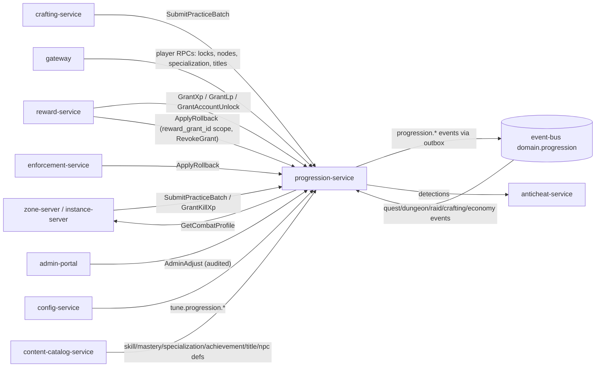
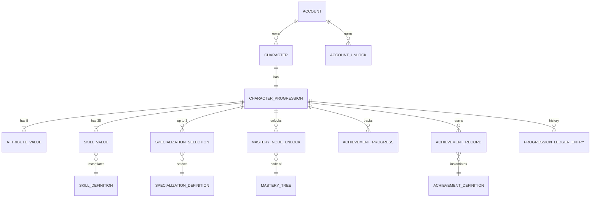
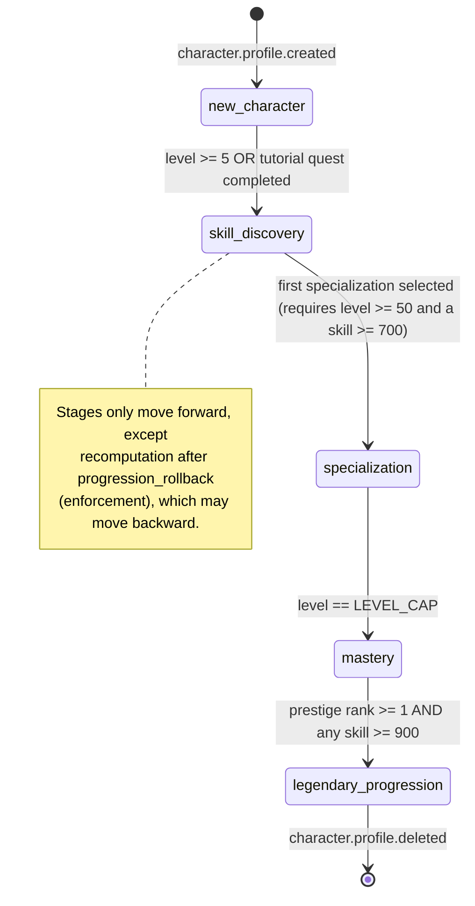

# Legends of the Shattered Frontier — Character Progression Architecture

Version 1.0 — Expanded Technical Design Authority edition (2026-10-17)

Status: Design target; not implemented. Names per Shared Registry v1.0.

Registry: [Shared Registry v1.0](Legends_Shattered_Frontier_Shared_Registry_v1.0.md) · Formula base: [Combat System v0.1](Legends_Shattered_Frontier_Combat_System_v0.1.md)

---

## 1. Vision

Classless progression inspired by Ultima Online, with MMO specialization depth. A character improves in two coupled ways:

1. **Experience (XP)** from quests, kills, dungeons, raids, discovery, and practice raises **Character Level** (1–100, `LEVEL_CAP`). Levels grant **Learning Points (LP)** and attribute points, and feed the Combat spec's level terms (health, mana, armor scaling).
2. **Use** advances **skills** (0–1000, `SKILL_MAX`). Doing a thing near the edge of your ability is how you get better at it. Skills raise attributes as a side effect.

LP converts experience into *choices*: training a new skill to apprentice level, buying mastery nodes, selecting specializations. Caps (`GLOBAL_SKILL_CAP` 7200, `TRACK_SKILL_CAP` 4000, `ATTRIBUTE_TOTAL_NATURAL_CAP` 600) force every character to be a distinct build, and skill locks (`up`, `down`, `locked`) let players reshape that build without starting over.

Design pillars:

| Pillar | Consequence in this spec |
| --- | --- |
| Identity through choice, not class | No classes. Builds are defined by which 7–8 skills a character keeps high, up to 3 specializations, and mastery-node picks. |
| Effort near your edge is rewarded | Skill gain peaks when action difficulty is slightly above current skill; trivial actions yield nothing. |
| Sessions, not marathons | Focus fatigue (diminishing returns), rested gains, and diversity rewards make 2-hour varied sessions as efficient per hour as 10-hour grinds are per hour — the grind is never better. |
| Same math for everyone | NPC profiles are generated from the same attribute/skill framework (NPC parity), as required by the Combat spec. |
| Server authority and auditability | Every XP, LP, skill, and attribute change is an append-only ledger entry with a cause; rollbacks are compensating entries. |
| Power is finite | Prestige and seasonal content grant breadth (cosmetics, titles, LP for more nodes from a finite tree), never unbounded stats. |

---

## 2. Scope and non-goals

**In scope (owned here):** XP and the `xp_to_next(L)` curve; Character Level; LP sources and sinks; attribute growth and natural caps; the 35 canonical skills (catalog, gain triggers); use-based skill gain; skill locks; global and track caps; specializations; mastery trees; NPC trainers (LP sink); rested gains; diversity rewards; diminishing returns; anti-macro hooks; prestige ranks; achievements (including seasonal); titles; account-wide unlocks; the character progression lifecycle; NPC progression templates; `progression-service` data, API, and `progression.*` events; progression balancing targets.

**Non-goals (owned elsewhere):**

| Topic | Owner |
| --- | --- |
| Attribute → secondary stat formulas, damage, mitigation, hit/crit, how skill value changes combat outcomes | Combat spec |
| Crafting quality, recipe difficulty values, node yields | Crafting spec |
| Item stat budgets, reward bundle schema, reward grant delivery | Itemization spec |
| Quest/dungeon/raid reward authoring (weights `w`) | Quest, Dungeon, Raid specs |
| Detector implementation, risk score, sanctions | Security spec |
| Season scheduling, LiveOps bonus events, tuning publication | LiveOps spec |
| Character creation UI, appearance, name, location | Backend (`character-service`) |
| Warehouse tables, dashboards | Analytics spec |

---

## 3. Glossary

All terms follow the [Shared Registry](Legends_Shattered_Frontier_Shared_Registry_v1.0.md), Glossary. Terms introduced by this spec:

| Term | Definition |
| --- | --- |
| Practice record | A server-produced fact that a character performed a skill-relevant action (skill, difficulty, outcome, attempt weight, context hash). Input to skill gain. |
| Gain check | One roll of the skill gain formula for one practice record. |
| Effective skill cap | 900 (`UNSPECIALIZED_SKILL_CAP`†) for an unspecialized skill, `SKILL_MAX` (1000) for a specialized one. |
| Effective skill value | `min(value, effective cap)`; the value Combat and Crafting formulas read (before item/effect bonuses they own). |
| Focus fatigue | Per-skill diminishing return after 90 active minutes in a rolling 4-hour window. |
| Rested minutes | Pool accrued offline; while positive, skill gain chance and kill XP are boosted. |
| Diversity multiplier | Bonus for practicing several progression tracks in a rolling 24 hours. |
| Standard Activity Equivalent (SAE) | The XP of one standard quest, `xp_reward(L, 1)` = 1/12 of a level. Unit for pacing. |
| Progression stage† | Lifecycle state of a character's progression (§6). |
| NPC progression template | The block on an `npc/*` definition from which NPC attributes and skills are generated (Skills part, NPC parity). |

† = registry addition now merged into the Shared Registry (see Registry additions); the Registry is authoritative for these names.

---

## 4. Architecture and service ownership

`progression-service` (stateless + PostgreSQL schema `progression`, Redis for hot practice windows) is the **only writer** of XP, level, LP, attributes, skill values, locks, mastery unlocks, specializations, prestige, achievements, titles, and account unlocks (Registry, Service registry).

Responsibilities split:

| Concern | Decider | Notes |
| --- | --- | --- |
| Did the action happen, at what difficulty, success or failure | `zone-server` / `instance-server` / `crafting-service` | Simulation authority. Emits practice records; never computes gains. |
| Gain chance, roll, caps, locks, attribute side-gains | `progression-service` | Single implementation of the formula; server RNG. |
| XP amount for quests/dungeons/raids | Authoring spec via `xp_reward(L, w)`; delivered by `reward-service` | Progression applies rested/diversity only to kill and practice XP, never to rewards. |
| XP for kills | `progression-service` (`GrantKillXp`) from NPC level, tier, party size | Inputs are reported by the simulation server. |
| Combat use of level/attributes/effective skills | Combat spec in `zone-server` | Reads `GetCombatProfile` at zone entry plus deltas returned by practice batches. |
| Achievement criteria evaluation | `progression-service` consuming domain events | Rewards issued through `reward-service` (Registry authority rule 4). |
| Character level shown at character select | `character-service` caches it from `progression.level.reached` | Cache only; progression is authoritative. |

---

## 5. Core model

### 5.1 Entities

Registry entities: SkillValue, ProgressionLedgerEntry (`pgl_`), MasteryNodeUnlock, AchievementRecord, AccountUnlock, AttributeValue, SpecializationSelection, AchievementProgress, CharacterProgression (the per-character aggregate row). Full DDL is in the Service interfaces part.

### 5.2 Quantities at a glance

| Quantity | Range / default | Defined in |
| --- | --- | --- |
| Character Level | 1–100 (`LEVEL_CAP`) | Leveling part |
| Lifetime XP to reach 100 | 15,859,950 | Leveling part, XP curve |
| Prestige rank | 0–999, `xp_to_next(100)` = 400,600 XP per rank | Leveling part |
| LP | ~945 from levels + ~1,200 from content by cap | Leveling part, LP economy |
| Attributes | 8 × [10, 150]; total ≤ 600; start total 120 | Leveling part, Attributes |
| Skills | 35 × [0, 1000]; total ≤ 7200; per track ≤ 4000 | Skills part |
| Effective skill cap | 900 unspecialized, 1000 specialized | Skills part |
| Specialization slots | 3 (levels 50, 75, 100) | Skills part |
| Mastery tree | 13 selectable nodes / 240 LP per skill | Skills part |

### 5.3 Character progression lifecycle

The skeleton's lifecycle (New Character → Skill Discovery → Specialization → Mastery → Legendary Progression) is a monotonic state machine stored on CharacterProgression as `progression_stage`† with values `new_character`, `skill_discovery`, `specialization`, `mastery`, `legendary_progression`. Stage gates UI onboarding, LiveOps targeting, and analytics funnels; it never gates power by itself (all gates are the underlying level/skill conditions).

Transition rules:

1. Evaluated after every committed change that touches level, specializations, prestige, or skill values.
2. A character that satisfies several gates at once (e.g. after a GM adjustment) advances one stage per evaluation loop until stable; each step emits `progression.stage.changed`†.
3. A level-100 character with no specialization stays in `skill_discovery` (specialization is the deliberate commitment). This is intended: `mastery` means "capped and committed".
4. Rollback recomputes the stage from scratch (`stage = highest stage whose gates all hold`), possibly backward; the event carries `cause = "rollback"`.

---

## 6. Table of contents

| Part | Contents |
| --- | --- |
| [Leveling, Attributes, and Endgame](Character-Progression/Legends_Shattered_Frontier_Character_Leveling_Attributes_Endgame_v1.0.md) | XP curve and level table, XP sources (kill XP, practice XP), rested XP, catch-up, LP sources/sinks/budget, attribute growth and locks, prestige ranks, achievements (incl. seasonal), titles, account-wide unlocks, leveling balance targets |
| [Skills and Mastery](Character-Progression/Legends_Shattered_Frontier_Character_Skills_Mastery_v1.0.md) | 35-skill catalog, use-based gain formula (refining Combat's SkillIncreaseChance), diminishing returns, rested gains, diversity, anti-macro hooks, skill locks, global/track caps, NPC trainers, specializations, mastery trees, NPC parity templates, skill balance targets |
| [Service Interfaces](Character-Progression/Legends_Shattered_Frontier_Character_Service_Interfaces_v1.0.md) | PostgreSQL DDL (`progression`), content definition JSON, gRPC API `lsf.progression_service.v1`, sequence diagrams, all `progression.*` event payloads, analytics hooks, security considerations |
| [Agent Implementation Guide](Character-Progression/Legends_Shattered_Frontier_Character_Agent_Implementation_Guide_v1.0.md) | Module layout, build order and milestones, invariants checklist, test matrix, acceptance criteria, pitfalls, Do/Don't |

---

## 7. Relationship to the Combat spec

The Combat spec is authoritative for attribute and combat formulas. This spec **extends** it:

| Combat statement | This spec's extension |
| --- | --- |
| Eight attributes; formulas such as `Health = 100 + Con×15 + Level×25` | Defines how attribute values and Level are *earned*, capped (150 / 600), and locked. Values feed Combat unchanged. |
| `SkillIncreaseChance = BaseRate / (CurrentSkill / 100)` | Kept as the skill factor term: `BaseRate × SF(S)`, with `SF(S) = 1 / max(1, S/100)` (guards the division by zero at S = 0 and the >100% chance below 100). Multiplied by difficulty, band, outcome, and anti-grind factors (Skills part, Gain formula). At reference conditions it equals Combat's formula exactly. |
| Mastery bands (Novice … Legendary) | Identical to Registry `skill_band`. |
| NPC tiers 1.0× / 2.5× / 5.0× / 20.0× | Not applied to NPC attributes; scale NPC health (× tier) and archetype damage (× sqrt(tier)) per Dungeon spec scaling; in this spec they set the NPC skill offset and the kill-XP multiplier (Skills part, NPC parity, Creature tier rule). |
| Player levels 1–100, expansion support 101+ | `xp_to_next(L)` is defined for all L ≥ 1; raising `tune.progression.level_cap` needs no formula change. |
| Luck max influence 10% | Luck grows like other attributes; its *effect* stays capped by `LUCK_MAX_INFLUENCE`. |

---

## 8. Registry additions

> **Merge status (2026-10-17):** the additions below were merged into the Shared Registry (see its change log), with these rulings: LiveOps `gm_role` → Security `staff_role`; trade window uses `tune.loot.trade_window_minutes` only. The registry is now authoritative for these names; rows here remain as justification.

The additions below have been merged into the Shared Registry (change log, phase 2). The Registry is authoritative; the rows remain as rationale and ownership notes.

| # | Kind | Proposal | Justification |
| --- | --- | --- | --- |
| 1 | Enum | `progression_stage`: `new_character`, `skill_discovery`, `specialization`, `mastery`, `legendary_progression` | Canonical lifecycle names for the skeleton's lifecycle; LiveOps targeting and Analytics funnels consume it. |
| 2 | Event | `progression.stage.changed` | Stage transitions are a cross-domain fact (LiveOps onboarding, Analytics funnels). |
| 3 | Event | `progression.mastery.tree_reset` | Respec refunds LP and removes node effects; zone-servers must drop the effects and Analytics must not double-count `node_unlocked`. |
| 4 | Event | `progression.specialization.removed` | Removing a specialization lowers the effective cap; Combat/Crafting consumers need the fact independent of a new selection. |
| 5 | Entities | `AttributeValue` (keyed `character_id`+`attribute`), `SpecializationSelection` (keyed `character_id`+`slot`), `AchievementProgress` (keyed `character_id`+`achievement_id`), `CharacterProgression` (keyed `character_id`); all progression-service, schema `progression`, no ID prefix | Registry lists attributes as progression-owned but names no entity. |
| 6 | Constants | `UNSPECIALIZED_SKILL_CAP` = 900 (`tune.progression.unspecialized_skill_cap`); `MAX_SPECIALIZATIONS` = 3 (`tune.progression.max_specializations`); `ATTRIBUTE_MIN` = 10 (`tune.progression.attribute_min`); `PRESTIGE_RANK_MAX` = 999 (`tune.progression.prestige_rank_max`) | Read by Combat (effective skill), Crafting (crafted ilvl from skill), LiveOps (prestige rewards). |
| 7 | Enum | `xp_source_kind`: `quest`, `kill`, `dungeon`, `raid`, `world_event`, `discovery`, `practice`, `achievement`, `liveops`, `compensation`, `gm` | `reward-service` and simulation servers must label XP grants consistently. |
| 8 | Enum | `account_unlock_kind`: `title`, `cosmetic`, `mount`, `recipe`, `catch_up` | Inventory (mounts, cosmetics) and Crafting (recipes) consume account unlocks. |
| 9 | Enum reuse | Attribute locks use the `skill_lock` values `up`, `down`, `locked` | Avoids a duplicate enum; Registry glossary should note "applies to attributes too". |
| 10 | Detectors (Security owns) | `detector/skill_gain_rate`, `detector/practice_timing_regularity`, `detector/practice_context_saturation`, `detector/practice_record_integrity` | Progression produces the signals; Security owns detector definitions and severity policy. |
| 11 | Tuning keys (cross-domain) | `tune.progression.kills_per_level` (150), `tune.progression.event_skill_gain_multiplier` (1.0, max 1.5), `tune.progression.event_xp_multiplier` (1.0, max 2.0; event × catch-up capped by LiveOps `tune.liveops.max_combined_xp_multiplier` = 2.5) | LiveOps sets event multipliers; AI/World read kill-XP pacing when authoring spawn density. |

Open issues (no registry change requested; flagged for the maintainer):

1. **Combat formula guard.** Combat's `SkillIncreaseChance` divides by zero at skill 0 and exceeds 100% below skill 100 for BaseRate > 1. This spec adds `max(1, S/100)`; Combat should cite it. Resolved (2026-10-17): Combat spec, Skill Progression now states the guarded form `BaseRate / max(1, CurrentSkill / 100)`.
2. **Crafted ilvl vs unspecialized cap.** Registry power ladder: crafted ilvl = `floor(skill/1000×400) + quality`. With `UNSPECIALIZED_SKILL_CAP` 900, an unspecialized crafter tops out at ilvl 360 + quality. Intended (endgame crafting requires specialization); Crafting and Itemization should confirm. Resolved (2026-10-17): Crafting spec, Unspecialized ceiling confirms the ilvl 410 (360 + 50) cap for unspecialized crafters; crafted ilvl 411–450 requires a specialization.
3. **Tier multiplier target.** Combat lists tier multipliers under "NPC Attribute Generation" without saying what they multiply. This spec applies them to generated attributes; if Combat later applies them to health/damage instead, the NPC parity section must drop its multiplication to avoid double scaling. Resolved (2026-10-17): tiers no longer multiply NPC attributes; they scale health and archetype damage only as in Dungeon spec scaling (Skills part, NPC parity, Creature tier rule). Combat ratified the health/damage split on 2026-10-17 (Combat spec, NPC Attribute Generation, Creature-tier rule); the reference build used for NPC scaling is agreed in Combat spec, Reference build (Constitution share 0.2917 of the median natural total, `C_ref(100)` = 150).
