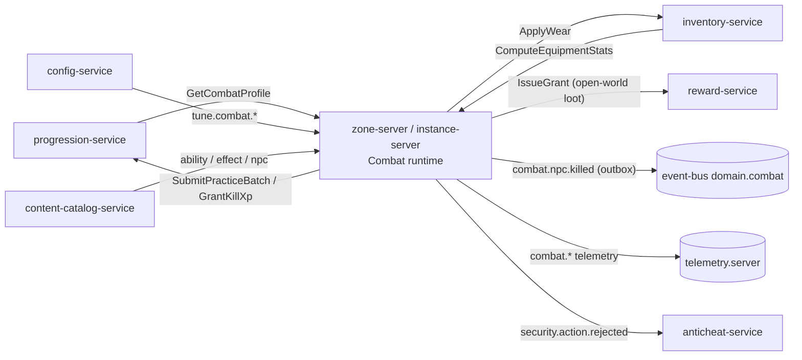

# Legends of the Shattered Frontier — Combat System (Character, NPC, Attribute and Combat Formulas)
### Version 1.0 — Expanded Technical Design Authority edition (2026-10-17)

Status: Design target; not implemented. Names per [Shared Registry v1.0](Legends_Shattered_Frontier_Shared_Registry_v1.0.md). The filename keeps its `v0.1` suffix for stable links; the content is Version 1.0.

Short name in cross-references: **Combat spec**. Part folder: [`Combat/`](Combat/).

---

## Table of contents

| Part | File | Contents |
| --- | --- | --- |
| Entry (this file) | — | Philosophy, scope, ownership, architecture, core model, contract index, Combat events, analytics hooks, security considerations, open contracts, registry additions |
| Part 1 | [Attributes, derived stats, ratings and reference build](Combat/Legends_Shattered_Frontier_Combat_Attributes_and_Ratings_v1.0.md) | Primary Attributes (incl. Charisma, Luck), Health/Mana/Stamina, regeneration, Skill System and Skill Progression, skill effects on combat, Combat Rating System, Haste (Haste maximum), crit, dodge/parry/block, penetration, Movement speed (Dexterity → movement speed), Reference build, Reference throughput (`σ(L)`, `DPS_ref`), Level Scaling, Soft Caps, Endgame Balance Targets |
| Part 2 | [Damage pipeline, mitigation, NPCs and threat](Combat/Legends_Shattered_Frontier_Combat_Damage_Mitigation_and_NPCs_v1.0.md) | Damage formula, Resolution pipeline, Armor System, Magic Resistance System, NPC mitigation, NPC Attribute Generation (Creature-tier rule), NPC combat profile, Threat & Aggro System (Threat & Aggro), kill credit and death, PvP rules, determinism, balance simulations |
| Part 3 | [Abilities, effects, state machine and runtime](Combat/Legends_Shattered_Frontier_Combat_Abilities_Effects_and_Runtime_v1.0.md) | Ability and effect content model (ERD, JSON), stat modifier keys, Party-scoped effects, crowd control and diminishing returns, casting and GCD, throughput budget, procs, combat state machine, zone-server runtime contracts, outbox |
| Part 4 | [Agent implementation guide](Combat/Legends_Shattered_Frontier_Combat_Agent_Implementation_Guide_v1.0.md) | Module layout, milestones, invariants, validators, test matrix, acceptance criteria, pitfalls, Do/Don't |

Glossary: Registry, Glossary. Terms specific to this spec are defined where they are introduced (`σ(L)`, `DPS_ref`, MPS, `t_ref`).

---

## Design Philosophy

This system combines:

- World of Warcraft combat mathematics (ratings with diminishing returns, GCD, threat)
- Ultima Online skill progression (use-based skills that change outcomes)
- MMORPG-style itemization (Itemization spec stat budget)
- Sandbox character freedom (classless; roles are self-declared `combat_role`)
- Predictable balancing and mathematical transparency for developers

Goals:

1. Easy to balance: every throughput, health and mitigation number derives from one reference character.
2. Hard for players to exploit: every input is server state, every cap applies after all sources.
3. Supports PvE and PvP with the same formulas and two PvP levers.
4. Scales from level 1 to endgame without rescaling content (level-scaled constants).
5. Works identically for players and NPCs (shared pipeline; NPC numbers sized from the reference).
6. Supports future expansions without redesigning formulas (re-fit constants above `LEVEL_CAP`).

Recommended principle:

```text
Rating-Based Conversion + Diminishing Returns + No Hard Immunities + Shared Formula Set + One Reference Character
```

---

## Scope and non-goals

In scope (Combat owns behavior; Registry, Concept ownership):

- Attribute → secondary stat formulas, derived resources and regeneration.
- How skill values change combat outcomes (accuracy, damage/healing multiplier, defensive skills).
- Rating constants (level-scaled), haste (casts, channels, swings, GCD, cooldowns), crit, avoidance, block, penetration, caps.
- Luck curve (`luck_factor`) used by loot, crafting and discovery.
- Movement modifier `combat_move_mult` (attribute and item term only).
- Reference build `C_ref` / `H_ref`, reference throughput `σ(L)` / `DPS_ref`.
- Damage and healing pipeline, mitigation, NPC mitigation, creature-tier rule, NPC combat profiles.
- Threat and aggro after engagement, kill credit, death and resurrection rules, PvP combat rules.
- Ability and effect content model, crowd control and diminishing returns, combat state machine.
- `combat.*` events and payloads; zone-server / instance-server combat runtime contracts.

Non-goals (owner in brackets):

- Natural attribute and skill growth, XP, kill XP amounts, mastery budgets [Character].
- Item stats, weapon damage, armor values, stat costs [Itemization].
- NPC health/damage context scaling by group size, difficulty and mythic level [Dungeon]; raid boss health [Raid].
- NPC behavior trees, utility AI, perception, stealth detection, world events [AI; encounter scripting: Dungeon/Raid].
- Base movement speeds, mounts, `v_eff`, teleport tokens, handoffs [World].
- Validation thresholds, detectors, sanctions [Security].
- Transport, relevance filtering, client prediction protocol framing [Network].

---

## Architecture and service ownership

Combat is a **library and runtime component**, not a service. It runs inside the UE5.8 dedicated server build in both modes:

| Runtime | Role | Combat responsibilities |
| --- | --- | --- |
| `zone-server` | live simulation of a zone (open world, open-world dungeons) | full pipeline; publishes `combat.*` (`combat.npc.killed` durable on `domain.combat`) |
| `instance-server` | live simulation of one instance run | full pipeline; encounter seeds; NPC-side rolls on encounter stream 4 |
| game client | presentation and prediction | calls the same formula library for tooltips/predictions only (never decides) |
| `lsf-combatmath` (tool) | offline calculator and publish validators | σ table, kit budgets, balance simulations |

Dependencies (all through the owners' RPCs; Combat never writes another service's data):

| Service | RPC / event | Direction | Purpose |
| --- | --- | --- | --- |
| `progression-service` | `GetCombatProfile`, `SubmitPracticeBatch`, `GrantKillXp`; `progression.*` events | read / report | natural attributes, effective skills, abilities; practice; kill XP |
| `inventory-service` | `ComputeEquipmentStats`, `ApplyWear`, `ConsumeItem`; `stats_version` push | read / report | item stats, weapons, armor; wear; consumables |
| `reward-service` | `IssueGrant` | request | open-world kill loot (Itemization flow) |
| `world-service` / World component | `RequestHandoff`, `CommitHandoff`, teleport tokens | request | handoff `combat_snapshot`; displacement |
| `config-service` | `tune.combat.*`, `ff.*`; `config.tuning.published` | read | tuning, kill switches |
| `content-catalog-service` | content packs (`ability`, `effect`, `npc`, `encounter`) | read | definitions |
| `anticheat-service` | `security.action.rejected` (via Security validators), detector signals | report | rejects, anomalies |
| `event-bus` | `domain.combat`, `telemetry.server` | publish | Combat events |



Ownership split: this spec owns what stats *do*. Character owns natural attribute and skill growth; Itemization owns what stats an item *has* (Stat budget part); Dungeon and Raid own NPC health/damage context scaling built on the rules here. GM requests to adjust player or NPC stats must use the capability and action boundaries in [Game Master Architecture](Legends_Shattered_Frontier_Game_Master_Architecture_v0.1.md); temporary modifiers or durable changes must not bypass these formulas.

---

## Core Architecture

Every entity is built from the same parts and evaluated by the same formulas:

```text
Entity (ent_)
 ├── Attributes        str dex con int wis wil cha luck          (Part 1)
 ├── Skills            effective values 0–1000                   (Character; effects Part 1)
 ├── Equipment         item stats, weapon, armor                 (Itemization)
 ├── Effects/Buffs     effect instances                          (Part 3)
 ├── Mastery           rating / percent_modifier / ability_unlock (Character; conversion Parts 1–3)
 └── Combat state      resources, cooldowns, cast, DR, threat    (Part 3)
```

Players, NPCs, bosses, pets, summons, guards and monsters all use it. NPC differences are data: NPC health and damage are sized from the reference character (Part 2, NPC combat profile), and creature tiers change only health and archetype damage.

### Core model at a glance

```text
A_total            = natural + items + effects                              Part 1, Primary Attributes
Health             = 100 + 15·con + 25·L                                    Part 1, Health Formula
Rating %           = R / (R + K_cap · B(4L)/B(400))                         Part 1, Combat Rating System
h                  = min(0.75, haste% + effects);  gcd_eff = max(0.75, 1.5·(1−h))   Part 1, Haste
crit               = min(0.60, 0.05 + dex/5000 + crit%)                      Part 1, Critical Strike Formula
Raw                = (weapon_dps·t_ref·spread + Power·t_ref/2.4) · modifier   Part 2, Damage formula
Out                = Raw · σ(L) · skill_mult · Π(1+Σcat) · crit_mult          Part 2, Damage formula
Mitigated          = Out · (1 − DR_armor or DR_resist) · block · taken mods   Part 2, pipeline + mitigation
NPC HP             = H_ref(L_npc) · T · A_hp · context                        Part 2, NPC combat profile
NPC damage         = H_ref(L_npc) · dmg_coef · √T · context                   Part 2, NPC-sourced damage
H_ref(L)           = 400 + 44.5·L;   DPS_ref(L, 4L) = 0.04 · H_ref(L)         Part 1, Reference build/throughput
Threat             = damage + 0.5·healing/k, × modifiers; taunt = top × 1.10  Part 2, Threat & Aggro
```

---

## Contract index

Other specifications cite these sections by title. Each title exists verbatim as a heading in the listed file.

| Cited title | Location | Key content |
| --- | --- | --- |
| Primary Attributes, Charisma, Luck | Part 1 | attribute outputs; AI Charisma multiplier ratified; `luck_factor`, effective luck for every consumer |
| Skill Progression | Part 1 | guarded `SkillIncreaseChance` |
| Combat Rating System | Part 1 | `K_stat(L)`, constants crit 1,400 / haste 1,750 / dodge, parry 1,400 / block 700 / pen 385 / crit damage 146 |
| Haste, Haste maximum | Part 1 | timers, `gcd_eff`, `haste_scaled_cooldown`, `HASTE_MAX` 0.75 |
| Movement speed, Dexterity → movement speed | Part 1 | `combat_move_mult`, on foot only |
| Reference build | Part 1 | `C_ref`, `H_ref`, reference offense profile |
| Reference throughput | Part 1 | `σ(L)`, canonical `DPS_ref(L, i)` |
| Soft Caps, Endgame Balance Targets | Part 1 | caps and bands |
| Damage formula, Resolution pipeline | Part 2 | formulas, nine-step pipeline, five draws |
| Armor System, Magic Resistance System | Part 2 | mitigation |
| NPC mitigation | Part 2 | `armor_coef` / `resist_coef` classes |
| NPC Attribute Generation, Creature-tier rule | Part 2 | tiers, raid-boss classification |
| Threat & Aggro System, Threat & Aggro | Part 2 | threat sources, switching, taunt |
| Party-scoped effects | Part 3 | party = party or raid subgroup |
| Combat events | this file | canonical `combat.*` payloads |

---

## Combat events

Producer in envelope: `zone-server` (open world, open-world dungeons) or `instance-server` (instanced runs). `combat.npc.killed` is a **durable domain event** on topic `domain.combat` (key `zone_id`, or `run_id` when instanced; outbox-backed, at-least-once, consumers dedupe on `event_id`; Part 3, Durable outbox). The other `combat.*` events are telemetry (`telemetry.server`, best-effort). Envelope `character_id` is omitted on multi-character events. This section is canonical (moved from the Dungeon spec, Encounters and NPC Behavior part, on 2026-10-17); every other spec references it. All payloads are `schema_version` 1; fields marked *(v1.0 additive)* are optional additions of this edition.

### `combat.npc.killed` (durable)

| Field | Type | Required | Description | privacy_class |
| --- | --- | --- | --- | --- |
| `npc_entity_id` | string | yes | `ent_` runtime entity. | p0_public |
| `npc_definition_id` | string | yes | `npc/<slug>` (Quest `kill` target `npc_id` matches this). | p0_public |
| `npc_tags` | string[] | yes | Definition tags (may be empty). | p0_public |
| `npc_tier` | string | yes | `common`, `elite`, `mini_boss`, `world_boss`. | p0_public |
| `npc_level` | int | yes | Spawn level `L_npc`. | p0_public |
| `xp_eligible` | bool | yes | Template flag (Character spec, NPC parity). | p0_public |
| `zone_id` | string | yes | `zone/<slug>` (instanced: the instance map's zone). | p0_public |
| `world_region_id` | string | no | `world_region/<slug>`; absent in instances. | p0_public |
| `run_id`, `attempt_id`, `encounter_id` | string | no | Set when the kill belongs to an instance run / encounter attempt. | p1_pseudonymous |
| `killing_character_id` | string | no | Character that dealt the killing blow (pet/summon owner); absent for NPC/environment kills. | p1_pseudonymous |
| `credited_character_ids` | string[] | yes | Characters credited with the kill (Part 2, Kill credit: ≥ 10 % damage or healing, or same party/raid group within 60 m and alive — Character spec, Kill XP eligibility); sorted ascending; empty when no player is credited. | p1_pseudonymous |
| `party_ids` | string[] | no | `pty_` / `rgp_` of credited characters. | p1_pseudonymous |
| `origin_server_instance_id` | string | yes | `srvi_`. | p0_public |
| `engagement_ms` | int | no *(v1.0 additive)* | Time from first engagement to death. | p0_public |
| `cell_id` | string | no *(v1.0 additive)* | World cell of the NPC at death (World spec cell ID format). | p0_public |

Example:

```json
{
  "event_name": "combat.npc.killed",
  "schema_version": 1,
  "producer": { "service": "zone-server", "instance_id": "srvi_01JA0Z7K4N2M8P6Q3R5S9T1V0W", "build": "0.9.0+c1" },
  "zone_id": "zone/greenlands_01",
  "privacy_class": "p1_pseudonymous",
  "payload": {
    "npc_entity_id": "ent_01JA0Z9B3C5D7E9F1G3H5J7K9M",
    "npc_definition_id": "npc/ash_wolf",
    "npc_tags": ["beast", "wolf"],
    "npc_tier": "elite",
    "npc_level": 31,
    "xp_eligible": true,
    "zone_id": "zone/greenlands_01",
    "world_region_id": "world_region/greenlands_south",
    "killing_character_id": "chr_01J9ZK3Q8M4V6T2N5X7B1C0D9E",
    "credited_character_ids": ["chr_01J9ZK3Q8M4V6T2N5X7B1C0D9E", "chr_01J9ZM1A2B3C4D5E6F7G8H9J0K"],
    "party_ids": ["pty_01JA0Y1Q2W3E4R5T6Y7U8I9O0P"],
    "origin_server_instance_id": "srvi_01JA0Z7K4N2M8P6Q3R5S9T1V0W",
    "engagement_ms": 22400
  }
}
```

### `combat.character.died` (telemetry)

| Field | Type | Required | Description | privacy_class |
| --- | --- | --- | --- | --- |
| `character_id` | string | yes | Dead character. | p1_pseudonymous |
| `zone_id` | string | yes | `zone/<slug>`. | p0_public |
| `run_id`, `attempt_id` | string | no | Instance context. | p1_pseudonymous |
| `killer_kind` | string | yes | `npc`, `player`, `environment` (proposed enum `killer_kind`). | p0_public |
| `killer_ref` | string | no | `npc/<slug>` or `chr_`. | p1_pseudonymous |
| `character_level` | int | yes | Synced level at death. | p0_public |
| `pvp` | bool | yes | Death caused by a character. | p0_public |
| `killing_ability_id` | string | no *(v1.0 additive)* | `ability/<slug>` or encounter ability key. | p0_public |
| `damage_school` | string | no *(v1.0 additive)* | School of the killing hit. | p0_public |
| `cell_id` | string | no *(v1.0 additive)* | World cell at death (Analytics death heatmaps). | p0_public |

### `combat.character.resurrected` (telemetry)

| Field | Type | Required | Description | privacy_class |
| --- | --- | --- | --- | --- |
| `character_id` | string | yes | Resurrected character. | p1_pseudonymous |
| `method` | string | yes | `spirit_healer`, `player_ability`, `encounter_reset`, `gm` (proposed enum `resurrect_method`). | p0_public |
| `resurrector_character_id` | string | no | For `player_ability`. | p1_pseudonymous |
| `dead_seconds` | int | yes | Seconds dead. | p0_public |
| `zone_id` | string | yes | Zone of resurrection. | p0_public |

### `combat.damage.summarized` (telemetry)

One per character per closed window (Part 3, aggregation rules; `tune.combat.damage_summary_window_s` = 60).

| Field | Type | Required | Description | privacy_class |
| --- | --- | --- | --- | --- |
| `character_id` | string | yes | Character. | p1_pseudonymous |
| `window_start`, `window_end` | string (RFC 3339) | yes | Window bounds. | p0_public |
| `damage_done`, `healing_done`, `damage_taken` | int | yes | Landed incl. absorbed, excl. overkill / effective healing. | p0_public |
| `abilities_used` | int | yes | Resolved intents. | p0_public |
| `run_id`, `attempt_id` | string | no | Instance context. | p1_pseudonymous |
| `crit_hits`, `total_hits` | int | no *(v1.0 additive)* | For observed crit rate. | p0_public |
| `window_close_reason` | string | no *(v1.0 additive)* | `interval`, `combat_end`, `death`, `attempt_end`. | p0_public |

### `combat.pvp_kill.recorded` (telemetry)

| Field | Type | Required | Description | privacy_class |
| --- | --- | --- | --- | --- |
| `killer_character_id`, `victim_character_id` | string | yes | Killing blow (pet owner) and victim. | p1_pseudonymous |
| `assist_character_ids` | string[] | no | Damage/hostile effect on victim within 30 s. | p1_pseudonymous |
| `zone_id` | string | yes | Zone. | p0_public |
| `world_region_id` | string | no | Region. | p0_public |
| `level_delta` | int | yes | Victim level − killer level. | p0_public |

### `combat.profile.sampled` (telemetry, proposed)

| Field | Type | Required | Description | privacy_class |
| --- | --- | --- | --- | --- |
| `character_id` | string | yes | Sampled character. | p1_pseudonymous |
| `character_level`, `synced_level` | int | yes | Real and synced level. | p0_public |
| `avg_ilvl` | int | yes | Equipped average ilvl. | p0_public |
| `combat_role` | string | no | Declared role. | p0_public |
| `crit_chance`, `haste`, `dodge`, `parry`, `block`, `armor_dr`, `armor_pen` | number | yes | Computed fractions after caps. | p0_public |
| `capped_stats` | string[] | yes | Stats at a cap (Part 1, Soft Caps). | p0_public |
| `stats_version` | int | yes | Equipment snapshot version. | p0_public |

Consumer notes: quest-service (kill objectives, giver deaths) — Quest spec, Objective type catalog; progression-service (achievement criteria such as `npc_tier = elite`; kill XP arrives through `GrantKillXp`, not this event) — Character spec; liveops-service participation earn rules — LiveOps spec; anticheat-service (TTK floor and kill-rate detectors) — Security spec; Analytics `fact_combat_deaths` (requires `killer_kind`, `zone_id`, `run_id`; heatmaps use `cell_id`).

---

## Tuning keys (`tune.combat.*`)

All defaults are in the parts; keys listed for `config-service` registration.

| Group | Keys |
| --- | --- |
| Ratings | `rating_k_crit`, `rating_k_haste`, `rating_k_dodge`, `rating_k_parry`, `rating_k_block`, `rating_k_armor_pen`, `rating_k_magic_pen`, `rating_k_crit_damage` |
| Haste / GCD | `haste_max`, `gcd_base_s`, `gcd_min_s` |
| Crit / avoidance | `crit_base`, `crit_cap`, `crit_damage_max`, `avoidance_cap`, `block_cap`, `block_reduction`, `block_reduction_max`, `front_arc_deg` |
| Mitigation | `armor_k_level`, `armor_dr_cap`, `resist_k`, `resist_cap`, `armor_pen_cap`, `magic_pen_cap`, `armor_debuff_cap`, `npc_armor_coef.<class>`, `npc_resist_coef.<class>` |
| Throughput | `throughput_scale` (per-level table), `power_speed_ref_s`, `rotation_mps_ref`, `hps_ref_fraction`, `unarmed_dps_factor`, `aoe_soft_targets`, `dot_refresh_cap` |
| Skill | `skill_damage_floor`, `skill_ratio_max`, `tactics_hit_weight`, `miss_divisor`, `miss_max` |
| Luck / movement | `luck_max_influence`, `move_dex_cap`, `move_dex_divisor` |
| Resources | `regen_delay_s`, `health_regen_ooc_pct`, `mana_regen_combat_base`, `mana_regen_wis_coef`, `mana_regen_ooc_pct`, `stamina_regen_combat`, `stamina_regen_ooc` |
| NPC | `tier_health_mult.<npc_tier>`, `npc_dps_coef.<archetype>` |
| Threat | `taunt_threat_mult`, `taunt_force_s`, `threat_mult_min`, `threat_mult_max`, `threat_table_max` (switch thresholds stay `tune.dungeon.threat_switch_melee` / `_ranged`) |
| CC / casting | `dr_window_s`, `cc_reduction_cap`, `knockback_icd_s`, `pvp_cc_chain_cap_s`, `cast_move_tolerance_m`, `pushback_s`, `pushback_max`, `queue_window_ms`, `cancel_refund_pct`, `combat_exit_s`, `intent_rate_max` |
| Credit / death / PvP | `kill_credit_share`, `kill_credit_radius_m`, `kill_steal_guard`, `spirit_res_fraction`, `res_accept_s`, `pvp_damage_mult`, `pvp_healing_mult`, `pvp_assist_window_s`, `pvp_repeat_kill_window_s`, `pvp_combat_s`, `pvp_taunt_s` |
| Environment / telemetry | `fall_speed_threshold_mps`, `damage_summary_window_s`, `profile_sample_interval_s` |

Keys owned elsewhere and read by Combat: `tune.dungeon.ref_con_base`, `tune.dungeon.ref_con_per_level`, `tune.dungeon.ref_dps_fraction` (`k_dps`), `tune.dungeon.tier_damage_exponent`, `tune.dungeon.threat_switch_melee`, `tune.dungeon.threat_switch_ranged`, `tune.loot.luck_reference`, `tune.item.cap.*`, `tune.faction.cha_rep_*`.

---

## Analytics hooks

| Metric | Definition | Source | Target / use |
| --- | --- | --- | --- |
| `m_crit_chance_p50` | median `crit_chance` by level band, role and content tier | `combat.profile.sampled` | 25–35 % at cap in raid gear |
| `m_haste_p50` | median `haste` by level band and role | `combat.profile.sampled` | 15–25 % at cap |
| `m_stat_cap_saturation` | share of sampled characters with non-empty `capped_stats` | `combat.profile.sampled` | < 5 % at tier start, < 25 % at end |
| `m_ttk_vs_ref_ratio` | observed engagement time / Dungeon `TTK_ref` per pack or boss | `combat.npc.killed.engagement_ms`, `encounter.attempt.defeated` | 0.8–1.25 |
| `m_deaths_per_hour` | deaths per character combat hour | `combat.character.died`, `combat.damage.summarized` | content difficulty |
| `m_death_cause_share` | deaths by `killer_kind` and `damage_school` | `combat.character.died` | spot overtuned abilities |
| `m_observed_crit_rate_gap` | `crit_hits/total_hits` − sampled `crit_chance` | damage summaries vs profile samples | ≈ 0; drift signals a pipeline bug |
| `m_dps_vs_ref_ratio` | `damage_done` per combat second / `DPS_ref(L, ilvl)` for damage-role characters | `combat.damage.summarized`, `combat.profile.sampled` | p50 0.9–1.1 |
| `m_pvp_ttk_p50` | median seconds from first PvP damage to death | `combat.pvp_kill.recorded`, damage summaries | 15–30 s |
| `m_kill_credit_share_party` | share of credited characters credited only via party radius | `combat.npc.killed` | monitoring; spikes suggest leeching |

Rating constants, `σ(L)` and the NPC archetype coefficients are re-validated by simulation whenever Itemization's budget curve, stat costs or the reference build change (Part 2, Balance checks by simulation).

---

## Security considerations

| Threat | Server rule | Reported to `anticheat-service` |
| --- | --- | --- |
| Forged combat values | Every formula input is server state; clients send intents only (ability, target, aim). Unknown fields are ignored | malformed intents → `malformed_input` rejects |
| Cooldown / GCD / cast speed hacks | Security validators use Combat's `h`, `gcd_eff` and `haste_scaled_cooldown` | `combat_cooldown`, `combat_cast_time` via `security.action.rejected` |
| Stacking exploits | Caps after summing all sources; modifier categories additive within category; damage-taken floor 0.10 | publish validators block content; runtime clamps log `ops` warnings |
| Hard-immunity content | Character effects cannot use the `immunity` op | validator V4 |
| Kill stealing / tagging | contribution thresholds, overkill excluded, single-hit guard | `m_kill_credit_share_party` anomalies as detector features |
| Leeching via party radius | alive + 60 m + party membership required | AFK presence (Quest spec presence ratio) |
| Leash abuse | evade clears credit and threat | ≥ 3 evades in 2 min → `leash_abuse` signal (Dungeon) |
| Compromised or buggy server | damage envelope: per character per 60 s window `damage_done ≤ 3 × DPS_max(L, ilvl) × 60` where `DPS_max` uses all caps | summaries above the envelope → proposed `detector/damage_envelope` (Security to define) |
| Replay of intents | `intent_seq` monotonic per session; duplicates dropped | `replay_detected` |
| Outbox tampering | journal CRC, records signed implicitly by mTLS on relay | relay CRC failures → `ops` alert |
| Predictable RNG | server seeds from CSPRNG, never sent to clients | — |

Publish-time validation rejects content with `haste_scaled_cooldown = true` on `cd > 30 s`, tier multipliers outside the registry set, ability modifiers outside the throughput budget, and procs above the MPS cap (Part 4, Publish-time validators).

---

## Open contracts closed

Items raised by other specifications and phase-1 follow-ups, with the section that resolves them.

| Citing spec | Issue | Resolved in |
| --- | --- | --- |
| Itemization (entry, Open issues 1) | Rating constants for crit, haste, armor/magic pen consistent with 0.25 budget/point | Part 1, Combat Rating System |
| Itemization (entry, Open issues 3); Crafting (Open issues 3) | `LUCK_REFERENCE` 150 and effective vs natural luck | Part 1, Luck |
| Security (entry, Open issues 4); Security Threat model, Combat validation | How haste applies to cooldowns and GCD | Part 1, Haste; Haste maximum |
| Dungeon (entry, Open issues 3); Character (entry, Open issues 3) | Creature tiers: what they multiply | Part 2, Creature-tier rule |
| Dungeon (entry, Open issues 4) | `C_ref` placeholder | Part 1, Reference build |
| Dungeon Content scaling (NPC armor/resistances) | NPC mitigation | Part 2, NPC mitigation |
| Quest (entry, Open issues 2); Analytics (O1, Warehouse, Inputs from specs) | `combat.npc.killed` durable with `credited_character_ids`; payload tables; `killer_kind`, `zone_id`, `run_id` | Combat events (this file) |
| Character (entry, Open issues 1) | Guarded skill gain term | Part 1, Skill Progression |
| AI (Faction service, Open issues 1 and 3) | Charisma multiplier; natural vs effective Charisma | Part 1, Charisma (natural Charisma) |
| World (Open issues 2) | Item `movement_speed_bp` and mounts | Part 1, Movement speed |
| Raid Groups/scaling (Subgroups) | "party" effects in raids | Part 3, Party-scoped effects |
| Raid Groups/scaling (Raid boss health) | "Tier 4 baseline for armor, resistances, attack ratings" | Part 2, Creature-tier rule (classification + `heavy`, no multiplication) |
| Raid Groups/scaling (Reference DPS curve) | `D0`/`g` must be recalibrated against Combat's damage formula | Part 1, Reference throughput (`D0` 246, `g` 1.0053) |
| Dungeon Content scaling (Reference TTK) | `ilvl_dps_factor` | Part 1, Reference throughput (use `B(i)·rarity/B(4L)`, step 1.0053) |
| Character Skills/Mastery (`percent_modifier` stats, "attack speed") | Combat consumer of mastery effect types | Part 3, Stat modifier keys |
| Character Service interfaces (`GetCombatProfile`) | Message contents undefined | Part 3, Profile load on zone entry (required fields) |
| Itemization Item model (broken weapons deal unarmed damage) | Unarmed damage value | Part 2, Damage formula (`unarmed_dps`) |
| Itemization Item model (`out_of_combat_token`) | Who issues it | Part 3, Combat state machine |

### Conflicts and cross-spec requests

| # | Owner | Request |
| --- | --- | --- |
| X1 | Security | Threat model, Combat validation: apply `(1 − haste)` to cooldowns only when `haste_scaled_cooldown`; GCD check must use `gcd_eff = max(GCD_MIN, GCD_BASE × (1 − h))` (current text: `gcd × (1 − haste)`). |
| X2 | Dungeon | Perception and aggro: taunt sets `top × 1.10` (Combat), not `top × 1.0`. |
| X3 | Dungeon | Content scaling: re-fit `ilvl_dps_factor` to Combat's `DPS_ref` (`tune.dungeon.ilvl_dps_step` 1.0053 or the `B` ratio). Levelling `k_dps` 0.04 unchanged. |
| X4 | Raid | Re-fit `tune.raid.dps_ref_base` 1,500 → 246 and `tune.raid.dps_ref_growth` 1.006 → 1.0053; boss `H_ref` scales down ≈ 6.1×. |
| X5 | Raid | "Tier 4 baseline" wording: classification `world_boss`, `heavy` mitigation; no multiplied armor or ratings. |
| X6 | Character | Publish the `CombatProfile` message with the fields listed in Part 3. |
| X7 | World | Add an opaque `combat_snapshot` (≤ 8 KiB) to the handoff payload. |
| X8 | Economy | Optional consumer of `cha_price_mult` (vendor buy prices only, −5 % max). |
| X9 | Security | Define `detector/damage_envelope` using the envelope above. |
| X10 | Character | Registry enum for NPC `archetype` values (`brute`, `skirmisher`, `caster`, `healer`, `guardian`, `beast`, `commander`) — Character owns the values; Combat reads them. |

---

## Level Scaling and Future Systems

Player levels 1–100 (`LEVEL_CAP`); expansions re-fit `s(L)`, `C_ref(L)` and `σ(L)` above the cap without changing formulas. Future systems that will extend this model: mount statistics, naval combat, siege equipment (`siege_equipment` item category), territory control bonuses, kingdom technology trees, creature breeding, NPC kingdoms, player governments, AI-driven world economies.

---

## Construction and siege integration

[Building and Territory §6](Legends_Shattered_Frontier_Building_and_Territory_System_v1.0.md#6-declared-territorial-sieges) defines the complete launch equipment, ammunition, targeting caps, protected volumes and repair pressure. [Construction](Legends_Shattered_Frontier_Construction_System_Architecture_v0.1.md) owns material/shape combat health, fire resistance and the support solver. These are launch design contracts; siege equipment is no longer an unspecified future extension.

The authoritative zone runtime validates target identity, occupied shape mask, range, line of sight, declared side, battle phase and protected access before damage. Structural cells and functional objects use their authored construction health; character armor/avoidance/crit/level scaling never applies to them. Ordinary handheld attacks use a normal validated damage roll against zero character armor/avoidance, followed by the Territory 10% structural scale and eligible material fire resistance; other damage schools use no invented character resistance. Dedicated ram/ballista/mortar attacks instead use Territory's fixed profile damage and reloads, with no offense stat, haste or critical multiplier. Bolt turrets use their fixed physical hit against participants through normal character mitigation, and fixed damage against eligible siege equipment. Neither turrets nor equipment can acquire protected bystanders or fire through protected housing.

Every projectile and spreading fire retains actor, side, siege, frozen profile and causation across launch, impact and secondary propagation. Revalidate legal target/phase at impact; a projectile landing after the damage window closes causes no structure damage. Environmental ignition cannot become attributed PvP fire; combat fire cannot shed its original attribution to bypass ownership. Dead/disconnected actors do not erase an already authorized projectile's origin. No geometric explosion duplicates an item drop, applies damage once per mesh face, or bypasses protected supports. Cell destruction, collapse salvage, container recovery and geometry changes use Building's durable [Construction Integration](Legends_Shattered_Frontier_Construction_Integration_Contracts_v0.1.md) decision before any usable loot appears. Damage against a pending conflicting decision waits/revalidates; no cosmetic client hit proves an authoritative result.

Combat repair in an active battle follows Territory's single-target, 5%-health-per-two-real-seconds limit, ten-second hostile-hit exclusion, one repairer, unstable-piece prohibition and thirty-second destroyed-cell replacement exclusion. A normal condition-repair tool cannot bypass those rules. Equipment operation grants no construction, container withdrawal or terrain right. Siege participation creates no XP/loot by itself; normal valid combat rewards remain governed by their existing domains, and shell salvage is a separately ledgered Territory entitlement.

## Registry additions

> **Merge status (2026-10-17):** merged into the Shared Registry (change log, phase-2 row) with these maintainer decisions: `npc_archetype` is the 11-value union; AI kinds `bt`/`up` are `behavior_tree`/`utility_profile`; Backend `guild.guild.*` events are `guild.profile.*`; world events split between AI (lifecycle, payloads) and World (placement, fixed windows, `trigger_kind = world_schedule`); World owns respawn timing under scarcity. Cross-spec requests below were applied to the owning specs or remain listed as open issues there.

> Merge status (2026-10-17): names from the original addition list below have been merged into the Shared Registry; the Registry is authoritative. The 2026-10-17 contract-patch additions (`HASTE_MAX`, `CRIT_CAP`, `GCD_BASE`, `GCD_MIN`, rating constants, `LUCK_REFERENCE`, `combat.*` payload home) are also merged. The rows below remain as rationale and ownership notes.

| Kind | Name | Value / definition | Justification |
| --- | --- | --- | --- |
| Content kind | `ability` | `ability/<slug>`; owning spec Combat (encounter-local keys compile into it) | Already used by Character (mastery `ability_unlock`) and Raid (timelines) without a registered kind |
| Content kind | `effect` | `effect/<slug>`; owning spec Combat | Item procs, set bonuses, mastery and abilities reference effects |
| Enum | `damage_school` [Combat] | `physical`, `fire`, `frost`, `nature`, `shadow`, `arcane`, `holy`, `poison`, `disease` | Shared by abilities, Itemization `resist_<school>`, Dungeon/Raid encounter `school` fields, `combat.character.died` |
| Enum | `hit_outcome` [Combat] | `hit`, `crit`, `miss`, `resist`, `dodge`, `parry`, `block`, `crit_block`, `absorb`, `immune` | Client protocol, practice `success`, replay comparison |
| Enum | `combat_state` [Combat] | `out_of_combat`, `in_combat`, `dead`, `evading` | Security `combat_state` checks; Itemization out-of-combat token |
| Enum | `cast_state` [Combat] | `idle`, `casting`, `channeling` | Security cast validation, client UI |
| Enum | `ability_use_outcome` [Combat] | `resolved`, `rejected`, `interrupted`, `cancelled` | Telemetry and replay |
| Enum | `cc_category` [Combat] | `stun`, `root`, `silence`, `fear`, `charm`, `incapacitate`, `disarm`, `taunt`, `knockback`, `slow` | DR, tier immunities, encounter `interrupt` mechanics |
| Enum | `effect_stack_rule` [Combat] | `refresh`, `stack`, `independent`, `replace_if_stronger`, `unique_global` | Content validation |
| Enum | `npc_armor_class` [Combat] | `light`, `medium`, `heavy` | NPC definitions; Dungeon/Raid authoring |
| Enum | `killer_kind` [Combat] | `npc`, `player`, `environment` | `combat.character.died` field already canonical in payload |
| Enum | `resurrect_method` [Combat] | `spirit_healer`, `player_ability`, `encounter_reset`, `gm` | `combat.character.resurrected.method` |
| Event | `combat.profile.sampled` | telemetry, `zone-server` / `instance-server`; payload in Combat events | Source for `m_crit_chance_p50`, `m_haste_p50`, `m_stat_cap_saturation` (previously "server-side stat snapshots" with no event) |
| Payload (additive) | `combat.npc.killed`: `engagement_ms`, `cell_id`; `combat.character.died`: `killing_ability_id`, `damage_school`, `cell_id`; `combat.damage.summarized`: `crit_hits`, `total_hits`, `window_close_reason` | optional fields, `schema_version` 1 | Analytics heatmaps, TTK ratio, crit drift |
| Constant | `AVOIDANCE_CAP` / `BLOCK_CAP` / `BLOCK_REDUCTION` | 0.50 / 0.75 / 0.30 (`tune.combat.avoidance_cap`, `block_cap`, `block_reduction`) | Read by Security replay tooling and Itemization caps |
| Constant | `ARMOR_DR_CAP` / `RESIST_CAP` / `PEN_CAP` / `CRIT_DAMAGE_MAX` | 0.85 / 0.75 / 0.60 / 3.0 | Itemization caps, Dungeon tank-band checks |
| Constant | `THROUGHPUT_SCALE` `σ(L)` | per-level table, `σ(100)` = 0.3098 (`tune.combat.throughput_scale`) | Couples player damage to `H_ref`-sized NPC health (Dungeon, Raid) |
| Constant | `DPS_ref(L, i)` (function) | Part 1, Reference throughput; `DPS_ref(L, 4L) = k_dps × H_ref(L)` | Canonical TTK input for Dungeon, Raid, Security TTK floors |
| Constant | `POWER_SPEED_REF` / `ROTATION_MPS_REF` / `HPS_REF_FRACTION` | 2.4 s / 1.6 / 0.06 | Content authoring budgets (Dungeon/Raid kits, Itemization procs) |
| Constant | `KILL_CREDIT_SHARE` / `KILL_CREDIT_RADIUS_M` | 0.10 / 60 m (`tune.combat.kill_credit_share`, `kill_credit_radius_m`) | Quest and Character kill-credit consumers |
| Constant | `DR_WINDOW_S` / `CC_REDUCTION_CAP` | 18 s / 0.40 | PvP balance, Itemization `cc_duration_reduction_bp` cap |
| Constant | `COMBAT_EXIT_S` | 5 s | Itemization out-of-combat token, World sprint rule |
| Constant | `TAUNT_THREAT_MULT` / `TAUNT_FORCE_S` | 1.10 / 3 s | Dungeon and Raid encounter design |
| Tuning domain | `tune.combat.*` | keys listed in Tuning keys | config-service registration |
| Detector (cross-spec) | `detector/damage_envelope` | Security to define | Server-compromise and stacking-exploit detection |

---

## Change log

| Date | Change |
| --- | --- |
| 2026-10-17 | v0.1 contract patch: rating constants, haste, luck, movement, reference build, creature-tier rule, damage pipeline, `combat.*` payloads moved from Dungeon. |
| 2026-10-17 | Version 1.0 expanded edition: entry + four parts; skill effects on combat; reference throughput `σ(L)` and canonical `DPS_ref`; NPC combat profiles; full threat model; kill credit; ability/effect model; CC and DR; combat state machine; runtime contracts and outbox; agent guide; additive payload fields; registry proposals. |
