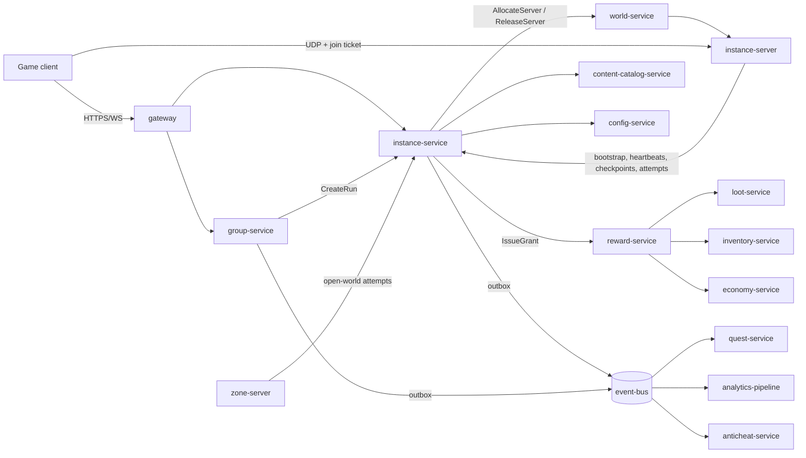
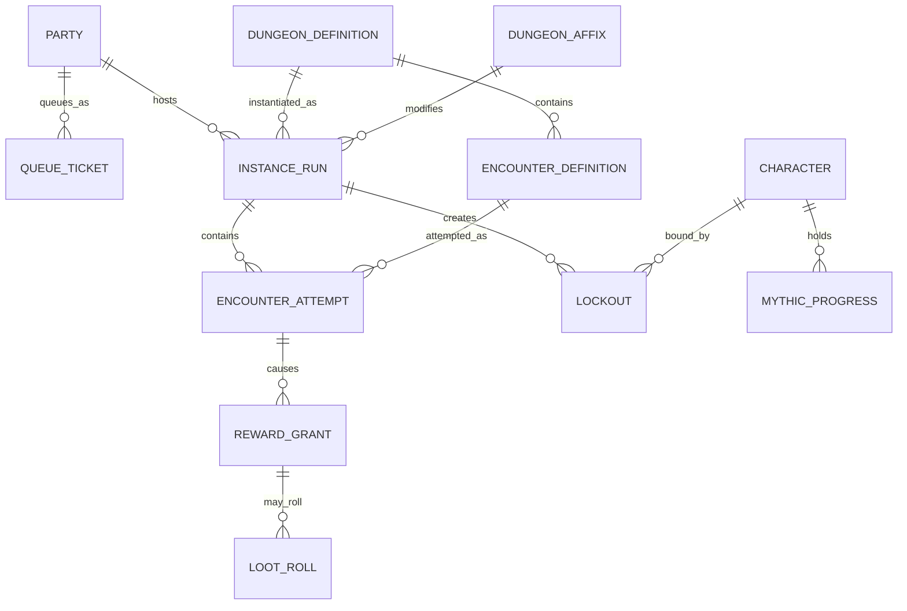

# Legends of the Shattered Frontier — Dungeon Architecture
### Version 1.0 — Expanded Technical Design Authority edition (2026-10-17)

**Status:** Design target; not implemented. Names per Shared Registry v1.0.
**Registry:** [Shared Registry v1.0](Legends_Shattered_Frontier_Shared_Registry_v1.0.md) · **Short name:** Dungeon · **Part folder:** [`Dungeons/`](Dungeons/)

---

## 1. Overview and philosophy

Dungeons are **replayable cooperative content for 1–10 players with procedural modifiers**. They are the main repeatable PvE loop between levelling and raiding: a short, readable run (15–35 minutes) with authored bosses, seeded variation in packs, objectives and events, and an endgame ladder (Mythic Levels 1–20) driven by a timer and weekly affixes.

Design pillars:

1. **Readable and fair.** Every heavy hit is telegraphed; every random choice comes from a seeded, server-only stream that can be replayed. Mythic layouts are the same for every group in a week.
2. **Scales cleanly.** One formula set scales health, damage and counts by group size (1–10), Character Level, difficulty and Mythic Level, built on the Combat spec's formulas and creature tiers.
3. **Server authority throughout.** `instance-server` simulates; `instance-service` validates every defeat before rewards; `reward-service` issues them.
4. **Generic frameworks.** The instance run lifecycle, lockout framework, encounter framework and group primitives are content-agnostic so the Raid spec extends them rather than duplicating them.
5. **Respect player time.** Short queues through role-aware matchmaking, deserter rules that protect groups without punishing bad luck, and pacing targets in player hours.

## 2. Scope and non-goals

**In scope:** `instance-service` and `group-service` (owned), the encounter runtime in `instance-server`, dungeon types and composition, scaling, mythic, affixes, procedural generation, open-world and seasonal dungeons, reward assignment, economic targets, schemas, APIs, events, analytics hooks, security, implementation guide.

**Non-goals:**

- Raid tiers, raid sizes, raid lockout policy, raid encounter design, `council` loot, `raid.*` events, `RaidProgress` — Raid spec (it extends the frameworks here).
- Loot tables, pity, stat budgets, reward bundle schema, binding — Itemization spec (this spec assigns tables and bundles).
- Damage, mitigation, threat formulas — Combat spec (this spec applies them).
- Open-world NPC AI, world events, faction behavior — AI spec.
- Server process management and the server registry — World spec (`world-service`).
- Currency caps and balance — Economy spec (this spec sets dungeon contribution targets).
- Packing several runs into one server process; account-scoped lockouts; consumable mythic keys; PvP dungeons.

## 3. Glossary

All terms follow the [Shared Registry glossary](Legends_Shattered_Frontier_Shared_Registry_v1.0.md). Domain-local terms used in this spec:

| Term | Meaning |
| --- | --- |
| Run level (`L_run`) | Level used to scale a run's NPCs (Part 3). |
| Reference player (`H_ref`, `dps_ref`) | Modelled player used to derive NPC health/damage and TTK (Part 3). |
| Pack slot / objective slot / event slot | Generation points in a dungeon's segment graph (Part 3). |
| Layout hash | SHA-256 of a run's generated choices; validated on every defeat. |
| Access level | Highest Mythic Level a character may start as leader (Part 3). |
| Linkdead | Disconnected avatar that remains in the world for 30 s (Part 1). |
| Damage-equivalents (`n_eq`) | Group damage output in units of one damage-role player (Part 3). |

## 4. Architecture and service ownership

| Component | Role in this domain | Data |
| --- | --- | --- |
| `group-service` (owned) | Parties, extended parties, LFG queue and matcher, ready checks, vote-kick, deserter penalties, mythic listings. Publishes `group.*`. | Redis (live) + PostgreSQL `group`. |
| `instance-service` (owned) | Run lifecycle, server allocation requests, join tickets, checkpoints, lockouts, mythic progress, affix rotation, defeat validation, reward orchestration; publishes `instance.*`, relays `encounter.*`. | PostgreSQL `instance` + Redis presence. |
| `instance-server` | Simulation of one run: encounters, NPC behavior, generation, timers. | Memory; checkpoints to `instance-service`. |
| `zone-server` | Hosts open-world dungeons with the same encounter module. | Memory. |
| `world-service` | Allocates and releases `instance-server` processes (`srvi_`), warm pools. | Redis server registry. |
| `reward-service` / `loot-service` | Issue grants and roll loot tables for dungeon rewards. | Their schemas. |
| `content-catalog-service` | Publishes dungeon, encounter, affix, NPC content; runs publish-time validators. | Content packs. |
| `config-service` | `tune.dungeon.*`, `tune.group.*`, kill switches `ff.dungeon.*`. | — |

## 5. Core model

The life of a dungeon run in one paragraph: a party (premade, or formed by the matcher from `QueueTicket`s and a ready check) asks `instance-service` to `CreateRun`; the run moves `requested` → `provisioning` while `world-service` assigns an `instance-server`; the server fetches the bootstrap (content version, seeds, scaling inputs, affixes), generates the layout, and reports `ready`; members join with signed tickets and the run becomes `in_progress`. Encounters move `dormant` → `idle` → `engaged` → `defeated` (or `resetting` → `idle` after a wipe); each engagement is an `EncounterAttempt` with exactly one outcome (`defeated`, `wiped`, `abandoned`, `invalidated`). On a validated defeat, `instance-service` records lockouts for eligible members and issues reward grants with deterministic idempotency keys. The run ends `completed`, `failed` or `abandoned`, then `closed`.

Key numbers (defaults; tuning keys in parts):

| Item | Value |
| --- | --- |
| Group sizes | `solo_party` 1–5, `extended_party` 6–10 (`PARTY_MAX` 5, `EXTENDED_PARTY_MAX` 10) |
| Difficulties | `story`, `normal`, `veteran`, `mythic` |
| Mythic Levels | 1–20 (`MYTHIC_LEVEL_MAX`); affix slots at 2, 4, 7, 10; timer par per dungeon, 5 s per death |
| Health scaling | `H_ref(L_npc) × T_hp × A_hp × (n/5)^0.9 × D_hp × Y(M) × affixes` |
| Mythic multiplier | `1.07^(min(M,10)−1) × 1.09^max(M−10,0)` (M10 1.84, M20 4.35) |
| Reward ilvl | `normal` cap 405, `veteran` 415, mythic `420 + 2 × min(M,15)` (Registry power ladder) |
| Marks | ~1,000 of the 1,500 weekly cap from dungeons in 5–7 h |
| Run time | `normal` 20–30 min, `veteran` 25–35 min, mythic par 28–36 min |

## 6. Shared frameworks for the Raid spec

| Framework | Defined in | Generic over | Raid extension points |
| --- | --- | --- | --- |
| Instance run lifecycle | Part 1 | `content_id` (`dungeon/*`, `raid/*`), `group_size_class`, difficulty | `raid_group_id`, raid capacity (up to 25), raid outcome rules. |
| Lockout framework | Part 1 | `lockout_policy {period, granularity, extendable, soft_cooldown_s}` | `instance_saved` granularity, extension, `RaidProgress`. |
| Encounter framework | Part 2 | Encounter definition schema, state machine, phases, timers, mechanics, enrage, determinism | Raid mechanic types, raid size variants, `raid.*` events. |
| Scaling reference | Part 3 | `H_ref`, `dps_ref`, `n_eq`, TTK validation | Raid `G_hp` curve for 10–25 (flex), raid difficulty multipliers. |
| Group primitives | Part 4 | Queue/bucket matcher, ready check, votes | Raid groups (`rgp_`) with subgroups of 5; raid finder buckets. |

## 7. Skeleton topics (v1.0 baseline) and where they are expanded

| Baseline topic | Expanded in |
| --- | --- |
| Philosophy — replayable cooperative content with procedural modifiers | §1 above; Part 3 (generation, affixes). |
| Types — Story, Open World, Instanced, Mythic, Seasonal | Part 3, Dungeon types; Open-world dungeons; Seasonal dungeons. |
| Composition — Entrance, Encounters, Events, Bosses, Rewards | Part 3, Composition and the dungeon definition; Part 2 (encounters and bosses). |
| Scaling — 1–5, 5–10 and scalable difficulty variants | Part 3, Scaling model; Mythic dungeons. (The registry's `extended_party` is 6–10; a 5-player group is `solo_party`.) |
| Rewards — loot tables, crafting materials, progression tokens | Part 3, Rewards; Economic and pacing targets. |
| Dynamic systems — randomized objectives, enemy packs and affixes | Part 3, Dungeon affixes; Randomized packs, objectives and events. |

## 8. Table of contents

| Part | File | Contents |
| --- | --- | --- |
| Entry | this file | Overview, scope, architecture, core model, frameworks, Registry additions. |
| Part 1 | [Instance Runtime and Lockouts](Dungeons/Legends_Shattered_Frontier_Dungeon_Instance_Runtime_v1.0.md) | Run lifecycle (`instance_run_state`), timeouts, server allocation via `world-service`, join tickets, reconnects, seeds, checkpoints and crash recovery, closing, abandon vote; lockout framework (`lockout_state`), eligibility, defeat → reward sequence; `instance` DDL; `lsf.instance_service.v1`; `instance.*` payloads. |
| Part 2 | [Encounter Framework and NPC Behavior](Dungeons/Legends_Shattered_Frontier_Dungeon_Encounters_and_NPC_Behavior_v1.0.md) | Encounter definition schema; `encounter_state` machine; attempt outcomes; timers; mechanics; enrage; determinism and seeding; behavior trees + utility AI; defeat validation; trash/elite/mini-boss models (aggro, threat switching, pack links, leashing, patrols, role-aware targeting); `encounter.*` payloads; publish validation. |
| Part 3 | [Dungeon Content, Scaling, Mythic, Affixes and Rewards](Dungeons/Legends_Shattered_Frontier_Dungeon_Content_Scaling_and_Rewards_v1.0.md) | Dungeon types; composition and definition schema; complete scaling formulas with worked examples; TTK and run-time targets; mythic access, timer, upgrades, score; affix pools and weekly rotation; seeded generation and validation; open-world and seasonal dungeons; reward assignment; marks and gear pacing. |
| Part 4 | [Groups and Matchmaking, Analytics, Security, Agent Implementation Guide](Dungeons/Legends_Shattered_Frontier_Dungeon_Groups_Security_and_Implementation_v1.0.md) | Parties and extended parties; LFG by `combat_role`; queue algorithm; ready checks; vote-kick; deserter rules; mythic listings; `group` DDL; `lsf.group_service.v1`; `group.*` payloads; analytics hooks; security considerations; module layout, milestones, invariants, test matrix, acceptance criteria, pitfalls, Do/Don't. |

Related specs: Combat (creature tiers, threat, damage pipeline), AI (NPC AI layers), World (zones, `world-service`), Backend (service architecture), Network (UDP transport, interest management), Itemization (loot tables, bundles, binding), Economy (marks cap), Quest (dungeon quest progress), Raid (framework extensions), Security (detections), LiveOps (seasons, overrides), Analytics (metrics).

---

## 9. Registry additions (proposed)

> **Merge status (2026-10-17):** the additions below were merged into the Shared Registry (see its change log), with these rulings: LiveOps `gm_role` → Security `staff_role`; trade window uses `tune.loot.trade_window_minutes` only. The registry is now authoritative for these names; rows here remain as justification.

These were proposed by this spec and are now merged (see note above); consume them from the Registry.

### 9.1 Events

| Addition | Owner | Justification |
| --- | --- | --- |
| `encounter.attempt.abandoned` | instance-service (relayed) | The registry has outcome `abandoned` but no event; analytics and Raid progress need to distinguish abandoned pulls from wipes. Payload mirrors `encounter.attempt.wiped` minus enrage fields. |
| `encounter.attempt.invalidated` | instance-service | Invalidated defeats (exploit, crash, GM) must be visible to Security and Analytics; payload adds `invalid_reason`. |

### 9.2 Enumerations

| Enum | Values | Justification |
| --- | --- | --- |
| `lockout_period` | `none`, `daily`, `weekly`, `cooldown` | Lockout framework shared with Raid. |
| `lockout_granularity` | `loot_only`, `instance_saved` | Same; Raid needs `instance_saved`. |
| `party_state` | `active`, `queued`, `in_instance`, `disbanded` | Party lifecycle shared with raid groups and UI. |
| `queue_ticket_state` | `queued`, `proposed`, `matched`, `cancelled`, `expired` | Queue analytics and Raid finder reuse. |
| `run_formed_by` | `premade`, `lfg`, `portal`, `gm` | Loot mode and deserter rules depend on it; consumed by Analytics. |
| `encounter_kind` | `boss`, `mini_boss`, `event`, `objective` | Encounter schema shared with Raid. |

### 9.3 Entities (keyed rows, no new ID prefix)

| Entity | Key | Owner / store | Justification |
| --- | --- | --- | --- |
| MythicProgress | `character_id` + `season_id` + `content_id` | instance-service, PostgreSQL `instance` | Mythic access and rating. |
| AffixRotation | `season_id` + `week_index` | instance-service, PostgreSQL `instance` | Registry lists affix rotations as owned data but no entity. |
| RunCheckpoint | `run_id` + `checkpoint_seq` | instance-service, PostgreSQL `instance` | Crash recovery. |
| DeserterRecord | `character_id` + `run_id` | group-service, PostgreSQL `group` | Deserter penalties. |

### 9.4 Content kinds

| Kind | Example | Justification |
| --- | --- | --- |
| `pack` | `pack/sv_tide_casters` | Reusable trash pack templates for seeded generation. |
| `objective` | `objective/sv_free_prisoners` | Randomized dungeon objectives. |
| `dungeon_event` | `dungeon_event/sv_ambush` | Event slots; distinct from `world_event` and `liveops_event`. |

### 9.5 Cross-domain tuning keys

| Key | Default | Justification |
| --- | --- | --- |
| `tune.dungeon.ref_con_base`, `tune.dungeon.ref_con_per_level` | 20, 1.3 | Reference player health used by Dungeon and Raid NPC scaling; must track Character's reference build. |
| `tune.dungeon.ref_dps_fraction`, `tune.dungeon.ilvl_dps_step` | 0.04, 1.0053 | Reference DPS for TTK targets and the TTK-floor exploit check (Raid, Security). Resolved (2026-10-17): step re-fitted from 1.015 to Combat `DPS_ref(L, i)` (Combat spec, Reference throughput); cap content uses the Combat table, 1.0053 is the same-rarity fallback (Part 3, §3.7). |
| `tune.dungeon.tier_damage_exponent` | 0.5 | Tier damage multiplier = tier health multiplier ^ 0.5 (ratified: Combat spec, Creature-tier rule). |

### 9.6 Open issues and conflicts

1. **World spec API.** `world-service` must expose `AllocateServer`/`ReleaseServer` (proposed contract for the World spec; Raid uses the same names) with the contract in Part 1 (kind, map, region, capacity, `run_id`, `alloc_token`) and warm pools. Resolved (2026-10-17): World spec, world-service API and server allocation adopts this contract unchanged (fields added additively) and defines idempotency, errors, warm pools, placement, the ServerInstance lifecycle and the Redis record.
2. **Registry ER vs. open world.** The registry ER shows `INSTANCE_RUN ||--o{ ENCOUNTER_ATTEMPT` and `LOCKOUT }o--|| INSTANCE_RUN`; open-world dungeons have no run, so `encounter_attempts.run_id` is nullable and open-world cooldown lockouts reference the attempt (`created_by_run` holds an `att_` ID). The ER should mark these relations optional.
3. **Combat tier damage.** Combat defines tiers as 1.0/2.5/5.0/20.0 without separating health and damage. This spec applies the full multiplier to health and its square root to archetype damage. Resolved (2026-10-17): Combat ratified the rule (Combat spec, NPC Attribute Generation, Creature-tier rule).
4. **Reference Constitution.** `C_ref(L) = 20 + 1.3 × L` is a placeholder until the Character spec publishes reference attribute growth. Resolved (2026-10-17): Combat and Character agree a reference build (Combat spec, Reference build): Constitution takes 29.17 % of Character's median natural attribute total, reaching 150 at level 100; the linear form with defaults 20 / 1.3 is ratified as its fit (≤ 5 % health error), so scaling values and examples are unchanged. Canonical `combat.*` payloads moved to Combat spec, Combat events.
5. **Itemization trade list.** Group loot trading needs Itemization to accept a `trade_eligible_character_ids` list on grants and enforce the 2 h window for `on_pickup` items. Resolved (2026-10-17): Itemization's `IssueGrant` context and `GrantItems` carry `trade_eligible_character_ids`; the window is `LOOT_TRADE_WINDOW` (`tune.loot.trade_window_minutes` = 120); Dungeon no longer defines its own key.
6. **Skeleton scaling text.** The baseline said "1–5, 5–10"; the registry's `group_size_class` makes 6–10 the `extended_party` class. This spec follows the registry.
7. **`difficulty` enum in DDL.** The shared enum includes `heroic` (raid-only); `instance.difficulty` keeps it for Raid and the service rejects it for dungeons.
8. **Phase-2 Combat alignment.** Resolved (2026-10-17): taunt uses `TAUNT_THREAT_MULT` 1.10 / `TAUNT_FORCE_S` 3 s (Part 2, Perception and aggro; Combat spec, Threat & Aggro); the gear factor uses Combat `DPS_ref(L, i)` (Part 3, §3.7; Combat spec, Reference throughput), which moves worked example 1 from 266 s to 244 s and example 3 from 438 s / 337 s to 560 s / 431 s; `k_dps` 0.04 and levelling examples are unchanged; archetypes are registry `npc_archetype`.
