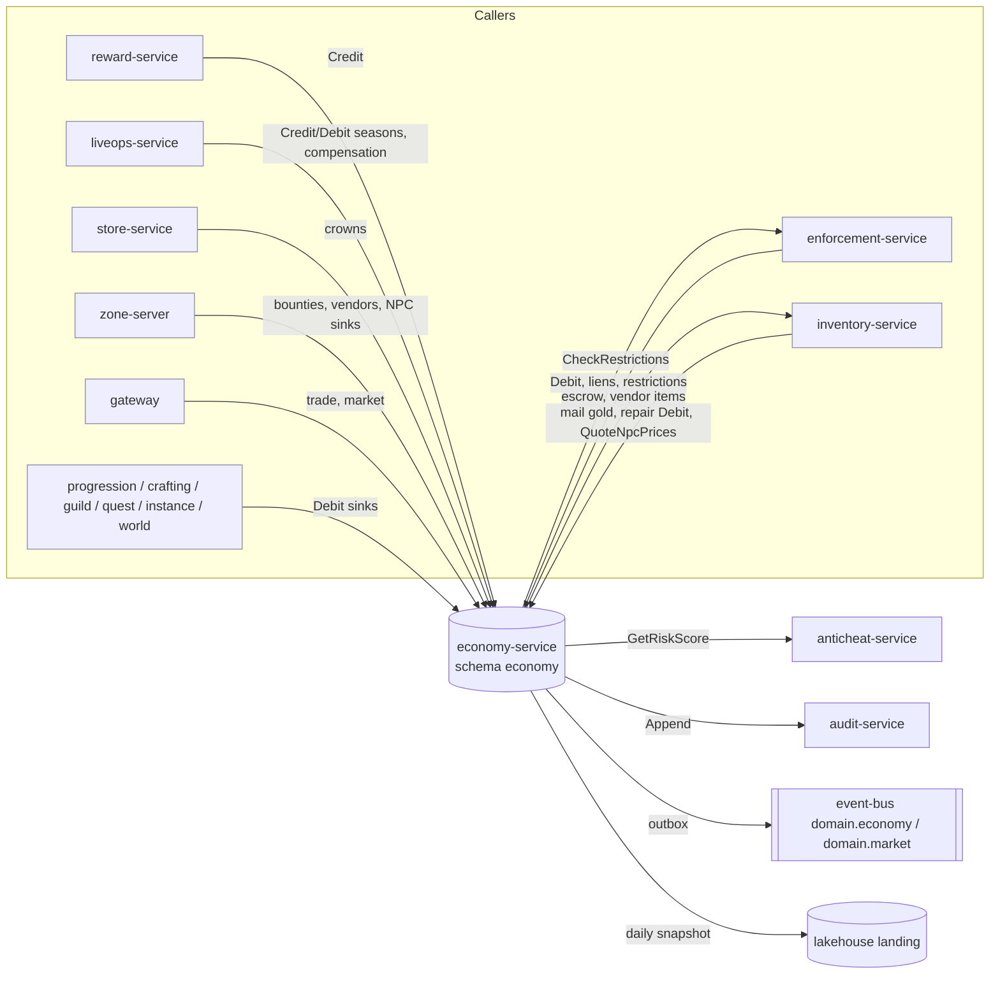
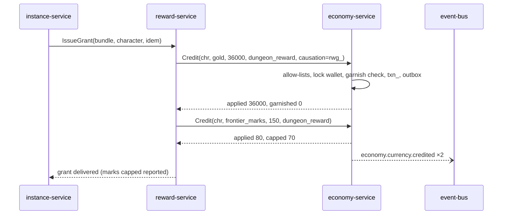

# Legends of the Shattered Frontier — Economy Architecture
### Version 1.0 — Expanded Technical Design Authority edition (2026-10-17)

Status: Design target; not implemented. Names per Shared Registry v1.0.

Registry: [Shared Registry](Legends_Shattered_Frontier_Shared_Registry_v1.0.md) · Parts: [Ledger, wallets, liens and data](Economy/Legends_Shattered_Frontier_Economy_Ledger_Wallets_and_Data_v1.0.md) · [Markets, trade, holds and vendors](Economy/Legends_Shattered_Frontier_Economy_Markets_Trade_and_Vendors_v1.0.md) · [Balancing, inflation and events](Economy/Legends_Shattered_Frontier_Economy_Balancing_Inflation_and_Events_v1.0.md) · [Analytics, security and agent guide](Economy/Legends_Shattered_Frontier_Economy_Agent_Implementation_Guide_v1.0.md)

---

## Vision, principles and scope

### Vision

Player-driven economy inspired by Ultima Online with modern MMO controls preventing inflation and market abuse.

### Economic principles

- Most items crafted by players
- Resources gathered from world
- Limited NPC item generation
- Regional supply and demand
- Multiple currency sinks
- Economic telemetry driven balancing

Two engineering rules make these principles enforceable:

1. **One ledger.** Every currency movement is one append-only `CurrencyTransaction` (`txn_`) row carrying a Registry source or sink code and a `causation_id`. Balances are a fold of the ledger.
2. **No negative wallets, ever.** Debts created by enforcement are tracked as wallet liens (Part 1, Wallet liens) and paid down from future credits, never by letting a balance go below zero (Security INV-7, RB-7).

Three design rules follow from the principles:

3. **Gold is created only by NPC-facing activity** (rewards, bounties, vendor sales, season conversion, compensation) and destroyed only by NPC-facing sinks; player-to-player flows are transfers and never change money supply.
4. **Markets are discovered, not set.** Economy never fixes player market prices; it steers through fees, sinks, vendor anchors and reward scales, measured by the official inflation index.
5. **Every lever is a bounded tuning key.** Automatic controls move in small, clamped, audited steps; anything larger goes through the seasonal economic audit.

### Scope

In scope: `economy-service` ownership, wallets, the currency ledger, the faucet/sink taxonomy and per-currency allow-lists, markets (global exchange and regional markets), direct trades, mail gold, guild wallet transfers, fees and caps, wallet liens for rollback deficits, transfer (trade) holds, NPC vendor pricing and vendor flows, the nightly wallet snapshot export, the official inflation index and inflation controls, economic balancing targets (gold per hour by level band, sink/faucet ratio targets, sink composition, price bands), `economy.*`/`market.*` event payloads, analytics hooks, and security considerations.

Out of scope (owned elsewhere): item instances and escrow containers (Itemization spec, Item model and lifecycle), reward bundles and grants (Itemization spec, Loot and rewards), vendor value and repair base cost (Itemization spec), crowns pricing and store offers (LiveOps spec, Store, compensation and community), season schedule and token conversion parameters (LiveOps spec, Season tokens lifecycle), risk score and sanctions (Security spec, Detection, risk and enforcement), warehouse modelling and alerting (Analytics spec), settlement taxes amounts and territory upkeep amounts (Building spec), fast-travel route costs (World spec), recipe costs and gathering yields (Crafting spec), faction standings (AI spec, Faction service).

Non-goals for v1: cross-realm global exchange (needs cross-realm item transfer), player banking and loans, currency exchange between gold and other currencies, buy orders on the market, cash-on-delivery mail, player corporations (see Future systems).

### Glossary

Terms (escrow, frontier marks, wallet, reset, realm, dc_region, …) are defined in the Registry glossary. Economy-local terms:

| Term | Definition |
| --- | --- |
| Spendable | `balance − reserved` of a wallet; every debit and reservation checks it. |
| Flow class | `currency_flow_class` of a transaction: `faucet`, `sink`, `transfer`, `correction`. |
| Fair value | 7-day volume-weighted median unit price of an item definition in a dc_region, with fallback `vendor_value × 4` (Part 2, Transfer holds). |
| Garnish | Automatic `enforcement_rollback` debit that collects a share of a credit for an active lien. |
| Hold | Delay of a transfer pending risk re-check (`TransferHold`, `thd_`). |
| Hub token | Short-lived zone-server attestation that a character stands at a market hub. |
| `F_ref(L)` | Reference gold faucet per focused active hour at level L (Part 3, Economic balancing targets). |

---

## Architecture and service ownership

### Service

| Property | Value |
| --- | --- |
| Service | `economy-service` (stateless + DB) |
| gRPC package | `lsf.economy_service.v1` (services `EconomyService`, `EconomyAdmin`) |
| Database | PostgreSQL schema `economy`, one database per `dc_region` |
| Publishes | `domain.economy`, `domain.market` (keyed by wallet owner ID for `economy.currency.*`, by `listing_id` for `market.*`, by `trade_id` for `economy.trade.completed`, by `dc_region` for `economy.index.computed`) |
| Owns | wallets, currency ledger, market listings and fills, trades, transfer holds, wallet liens, fee schedule application, price indexes, NPC price modifiers, vendor stock counters |
| Depends on | `inventory-service` (item escrow moves, vendor item creation), `anticheat-service.GetRiskScore`, `enforcement-service.CheckRestrictions`, `audit-service.Append`, `config-service` (tuning, flags, reset schedule), `content-catalog-service` (currency, item and vendor definitions), `progression-service` (natural Charisma snapshot), `faction-service.GetStanding` |

Authority rule (Registry, Service registry): currency is created or destroyed only by `economy-service`; every creation carries a source code and `causation_id`. Item moves for trades and markets are requested from `inventory-service` (escrow container, `item_status = escrowed`); economy-service never writes `inventory` tables.

Remaining keys: `economy.lien.*`, `economy.hold.*` keyed by `account_id`; `economy.snapshot.exported` by `dc_region`.

### Context

### Key flow: reward credit

### Ownership of economic values

| Value | Owner | Economy's role |
| --- | --- | --- |
| `gold_reward`, `marks_reward` scale constants | Economy (`tune.economy.gold_reward_scale`, `tune.economy.marks_reward_scale`) | changes only via seasonal audit, ±10 % per season |
| Content weights `w` | authoring spec (Quest, Dungeon, Raid, AI, LiveOps) | weights ≥ 5.0 need LiveOps economy review (Registry) |
| `FRONTIER_MARKS_WEEKLY_CAP` | Economy | enforced in `Credit` |
| Repair base cost, vendor value | Itemization | `repair_scaling`, `npc_price_mult` multipliers |
| Market fees, NPC price modifiers, vendor catalogs prices | Economy | — |
| Housing tax, territory and guild upkeep, siege | Building | debited via `Debit`; territory index link optional |
| Fast-travel routes | World | `npc_price_mult` at flight masters |
| Training costs | Character | debited as `training_cost` |
| Season token conversion parameters | LiveOps | bound check on `season_conversion` |
| Event multipliers | Economy keys, scheduled by LiveOps | validated against active `lop_` |

---

## Core model

### Currency model

| Currency (Registry, Currencies) | Wallet owner kind | Realm-scoped | Tradeable | Notes |
| --- | --- | --- | --- | --- |
| `currency/gold` | `character`, `guild` | yes | yes (trade, market, mail) | stored in copper; 1 gold = 10,000 copper |
| `currency/frontier_marks` | `character` | yes | no | weekly cap per character (Part 1, `FRONTIER_MARKS_WEEKLY_CAP` enforcement) |
| `currency/season_tokens` | `character` | yes | no | **confirmed: wallet owner = character** (Part 1, Season tokens) |
| `currency/crowns` | `account` | no (account-wide) | no | premium; allow-listed sources/sinks only (Part 1, Per-currency allow-list) |

`wallet_owner_kind` values (Registry): `character`, `account`, `guild`. These match the `owner_kind` column Analytics already models. A wallet is keyed by `(owner_kind, owner_id, currency_id)`. Wallets are created lazily on first credit with balance 0.

### Wallet balance components

| Field | Meaning |
| --- | --- |
| `balance` | Ledger fold; the only number included in money supply. Never negative. |
| `reserved` | Part of `balance` locked by an open trade offer, a buy in progress, a vendor purchase reservation, or a held transfer (Part 2, Transfer holds). `0 ≤ reserved ≤ balance`. |
| spendable | `balance − reserved`. Every debit and every new reservation checks spendable. |

Liens are **not** a wallet column: a lien is an account-level debt (Part 1, Wallet liens) that intercepts future credits. A liened wallet still shows its real balance.

### Ledger rules

1. Every mutating RPC takes an `idempotency_key` (≤ 128 chars) and returns the stored result on replay for 7 days (`IDEMPOTENCY_RETENTION`, Security INV-11).
2. Each `txn_` row is either a credit (`source_code` set) or a debit (`sink_code` set), never both, `amount > 0`.
3. A wallet row update and its `txn_` insert happen in one serializable transaction under a row lock; `wallet_seq` increments by exactly 1 per transaction on that wallet, giving each wallet a gap-free sequence used for exact reconciliation (Part 1, Wallet snapshot export).
4. Transfers (trade, market, mail gold) write both legs in one transaction: a debit on the payer (`trade_send` or `market_purchase`) and a credit on the payee (`trade_receive` or `market_sale`), plus any fee debit. Security INV-8 and INV-10 hold per transaction.
5. `txn_` rows are never updated or deleted. Corrections are new rows (`enforcement_rollback`, `enforcement_restore`, `store_refund`, `store_chargeback`, `account_erasure`).

### Gold sources and sinks

Design intent, preserved:

Gold sources: quests, NPC bounties, dungeon rewards, world events (plus raids, achievements, vendor sales and season token conversion; full mapping in Part 1, Faucet/sink taxonomy).

Gold sinks: repairs, housing taxes, territory upkeep, fast travel, marketplace fees, guild upkeep, siege declarations, NPC services (plus training, legendary upgrades, vendor purchases, quest turn-ins, campaign contributions; full mapping in Part 1, Faucet/sink taxonomy).

Resource sinks (item-side, owned by Crafting/Building, ledgered by `inventory-service` with the same sink codes): building decay, repair costs, construction projects, siege rebuilding, crafting failures.

| Gold flow | Code | Debited / credited by | Amount defined in |
| --- | --- | --- | --- |
| Quest rewards | `quest_reward` | reward-service | Quest (weights) × Registry `gold_reward` |
| NPC bounties | `npc_bounty` | zone-server | Combat/AI NPC definitions × `gold_reward` |
| Coin drops | `loot_drop` | reward-service | Itemization loot tables |
| Dungeon / raid / world event rewards | `dungeon_reward`, `raid_reward`, `world_event_reward` | reward-service | Dungeon, Raid, AI weights |
| Vendor sales | `vendor_sale` | economy-service (`SellToVendor`) | Itemization vendor value × Economy `m_sell` |
| Season conversion | `season_conversion` | liveops-service | LiveOps |
| Repairs | `repair_cost` | inventory-service | Itemization × Economy multipliers |
| Housing tax, territory/guild upkeep, siege | `housing_tax`, `territory_upkeep`, `guild_upkeep`, `siege_declaration` | guild-service | Building (guild upkeep: Backend/Building) |
| Fast travel | `fast_travel` | zone-server / world-service | World × `npc_price_mult` |
| Market fees | `market_listing_fee`, `market_transaction_fee`, `market_expiry_fee` | economy-service | Economy (Part 2, Market fees) |
| NPC services | `npc_service` | zone-server, economy-service | Economy (Part 2, NPC services price table) |
| Vendor purchases | `vendor_purchase` | economy-service (`BuyFromVendor`) | Economy vendor catalogs |
| Training | `training_cost` | progression-service | Character |
| Legendary upgrades | `legendary_upgrade_cost` | inventory-service | Itemization |
| Quest turn-ins, campaigns | `quest_turn_in`, `campaign_contribution` | quest-service | Quest |

Balancing targets for all of these: Part 3, Economic balancing targets. Economy's controls over sinks whose amounts other specs own are the dynamic fee factor, repair scaling, the optional territory index link, and the seasonal economic audit (Part 3, Inflation controls).

---

## Table of contents

| Part | File | Contents |
| --- | --- | --- |
| Entry | this file | vision, scope, architecture, ownership, currency model, gold sources and sinks, contracts closed, registry additions, open issues |
| Part 1 | [Ledger, Wallets, Liens and Data](Economy/Legends_Shattered_Frontier_Economy_Ledger_Wallets_and_Data_v1.0.md) | data model (DDL, erDiagram), ledger write procedure, gRPC API, error model, faucet/sink taxonomy, per-currency allow-list, marks cap, season tokens, wallet liens (incl. release, write-off, expiry), wallet snapshot export, ledger reconciliation, privacy participation, jobs |
| Part 2 | [Markets, Trade, Holds and NPC Vendors](Economy/Legends_Shattered_Frontier_Economy_Markets_Trade_and_Vendors_v1.0.md) | market scopes, listings and fills, price guardrails, market fees, fill procedure, search; player trading; mail gold; guild wallets; transfer holds; NPC vendor pricing and flows; NPC services prices; storage rules; settlement taxes |
| Part 3 | [Balancing Targets, Inflation and Events](Economy/Legends_Shattered_Frontier_Economy_Balancing_Inflation_and_Events_v1.0.md) | economic balancing targets (gold/h by band, sink/faucet ratios, sink composition, price bands, marks pacing), inflation index, inflation controls, seasonal audit, event payloads |
| Part 4 | [Analytics, Security and Agent Implementation Guide](Economy/Legends_Shattered_Frontier_Economy_Agent_Implementation_Guide_v1.0.md) | analytics hooks and proposed metrics, security threats and validation rules, anticheat signals, module layout, build order, invariants, test matrix, acceptance criteria, pitfalls, Do/Don't |

---

## Cross-spec contracts closed

| Citing spec | Issue | Resolved in |
| --- | --- | --- |
| Analytics (entry, registry additions R6; Warehouse part, Economy health) | Buyer-side market debit classification | Part 1, Faucet/sink taxonomy: `market_purchase`, flow class `transfer` (Registry-canonical) |
| Analytics (O1; Warehouse part, Inputs from specs that are not yet expanded; agent guide `provisional`) | economy payload tables | Part 3, Event payloads (incl. Coverage of Analytics interim requirements) |
| Analytics (O2) | inflation index method | Part 3, Inflation index |
| Analytics (O3) | nightly wallet export interface | Part 1, Wallet snapshot export |
| Analytics (Dashboards part, Seasonal) | seasonal economic audit | Part 3, Inflation controls (Seasonal economic audit) |
| Security (entry open issue 1; Detection part RB-7) | wallet liens and trade-hold mechanism | Part 1, Wallet liens; Part 2, Transfer holds |
| Security (Threat model, INV-7..INV-12) | enforcement of economy invariants | Part 1, Data model and Ledger reconciliation; Part 4, Security considerations |
| Backend (open issue 4; erasure saga phase 1) | `account_erasure`, lien write-off on erasure, legal hold | Part 1, Release, write-off, expiry; Privacy participation |
| LiveOps (open issue 3) | season token wallet owner | Part 1, Season tokens |
| LiveOps (cross-domain keys) | `tune.economy.event_gold_reward_multiplier`, `tune.economy.event_marks_multiplier`, `tune.liveops.season_token_conversion_cap` consumer | Part 3, Inflation controls (Event multipliers); Part 1, Season tokens |
| LiveOps (Store part) | "account-wide bank tab capped by Economy spec storage rules" | Part 2, Storage rules |
| LiveOps (Store part) | `m_gold_inflation_index_wow` target (Economy spec, Inflation controls) | Part 3, Distribution and velocity targets; Inflation controls |
| Itemization (Item model, Repair cost) | `tune.economy.repair_scaling` control rule; `npc_price_mult` "supplied by economy-service" | Part 3, Inflation controls (Repair scaling); Part 2, NPC vendor pricing |
| Itemization (Item sources, `vendor_stock`) | NPC vendor item flow | Part 2, Vendor flows (needs Itemization RPCs, see Registry additions) |
| Itemization (Container kinds) | bank rows bought via `npc_service` | Part 2, NPC services price table |
| Itemization (Loot and rewards, Gold faucet vs repair sink) | Economy owns remaining sinks and index | Part 3, Sink composition at cap |
| Quest (Rewards part, Gold faucet share; entry "Economy spec (Gold sources and sinks)") | Economy owns total gold flow and scale constants | Gold sources and sinks (this file); Part 3, Faucet composition |
| Dungeon (entry, scope) | currency caps and balance | Part 1, `FRONTIER_MARKS_WEEKLY_CAP` enforcement; Part 3, Marks and token pacing |
| Raid (Bonus rolls; Data part `CommitBonusRoll`) | `raid_bonus_roll` debit at kill | Part 1, RPC signatures (instance-service caller) and Per-currency allow-list |
| Character (Skills part, training and mastery reset costs; trading practice) | `training_cost` debits; vendor transactions for trading practice | Part 1, RPC signatures; Part 2, Vendor flows |
| Combat (Charisma → NPC Prices) | formula for Charisma effect on prices | Part 2, NPC vendor pricing |
| World (Teleport tokens, `fast_travel`) | world-service as `fast_travel` debit caller | Part 1, RPC signatures |
| Economy skeleton open issues 1–9 | RB-7 wording, INV-12 compensation, crowns snapshot, landing namespace, Analytics alignment, mail ownership, settlement taxes, item deficits, cross-realm exchange | see Open issues (each marked resolved, proposed or owned elsewhere) |

---

## Registry additions

> **Merge status (2026-10-17):** merged into the Shared Registry (change log, phase-2 row) with these maintainer decisions: `npc_archetype` is the 11-value union; AI kinds `bt`/`up` are `behavior_tree`/`utility_profile`; Backend `guild.guild.*` events are `guild.profile.*`; world events split between AI (lifecycle, payloads) and World (placement, fixed windows, `trigger_kind = world_schedule`); World owns respawn timing under scarcity. Cross-spec requests below were applied to the owning specs or remain listed as open issues there.

> **Merge status (2026-10-17):** both tables were merged into the Shared Registry (change log, phase-2 row); the Registry is authoritative and the rows remain as rationale.

### Merged

| Kind | Name | Justification |
| --- | --- | --- |
| Entity + ID prefix | `WalletLien`, `wln_` (economy-service, Economy, PostgreSQL `economy`) | Security RB-7 needs a lien record to settle `rollback_deficit` |
| Entity + ID prefix | `TransferHold`, `thd_` (economy-service, Economy, PostgreSQL `economy`) | Security band `elevated` 24 h holds need an identifiable record for re-checks, audit and `security.trade.flagged` linkage |
| Enum | `wallet_lien_state`: `active`, `settled`, `released`, `written_off` | lien lifecycle |
| Enum | `transfer_hold_state`: `held`, `released`, `cancelled` | hold lifecycle |
| Enum | `wallet_owner_kind`: `character`, `account`, `guild` | already used by Analytics `owner_kind`; makes it canonical |
| Enum | `currency_flow_class`: `faucet`, `sink`, `transfer`, `correction` | Analytics classification, now published by Economy |
| Enum | `market_scope`: `global_exchange`, `regional` | already used by Analytics `fact_market_sales` |
| Enum | `market_listing_state`: `active`, `sold`, `expired`, `cancelled` | listing lifecycle |
| Enum | `trade_state`: `open`, `locked`, `held`, `completed`, `cancelled`, `failed` | trade lifecycle |
| Enum | `transfer_kind`: `trade`, `market`, `mail` | already used in Security `security.trade.flagged` |
| Events | `economy.lien.placed`, `economy.lien.closed`, `economy.hold.placed`, `economy.hold.released`, `economy.snapshot.exported` | enforcement mirror of deficits, anticheat hold linkage, Analytics export reconciliation |
| RPCs (cross-service) | `economy-service`: `Credit`, `Debit`, `GetWallet`, `TransferCurrency`, `GetIndexPrices`, `PlaceLien`, `ReleaseLien`, `WriteOffLien`, `ApplyRestriction`, `LiftRestriction`, `ExportWalletSnapshot` | already called by Itemization, LiveOps, Security; fixes names for consumers |
| Tuning keys | `tune.economy.market_listing_fee_rate`, `tune.economy.market_listing_fee_rate_regional`, `tune.economy.market_transaction_fee_rate`, `tune.economy.market_expiry_fee_rate`, `tune.economy.market_fee_min_copper`, `tune.economy.market_listing_durations_hours`, `tune.economy.market_max_listings_per_character`, `tune.economy.lien_garnish_rate`, `tune.economy.lien_garnish_rate_transfer`, `tune.economy.lien_exempt_sources`, `tune.economy.lien_max_days`, `tune.economy.lien_trade_value_tolerance`, `tune.economy.transfer_hold_hours`, `tune.economy.transfer_hold_max_hours`, `tune.economy.unpriced_item_multiplier`, `tune.economy.index_base_period_days`, `tune.economy.index_min_days_sold`, `tune.economy.index_min_weekly_units`, `tune.economy.index_basket_size`, `tune.economy.index_basket_groups`, `tune.economy.index_weight_cap`, `tune.economy.index_outlier_low`, `tune.economy.index_outlier_high`, `tune.economy.index_carry_forward_days`, `tune.economy.index_reconcile_tolerance`, `tune.economy.dynamic_fee_k`, `tune.economy.dynamic_fee_min`, `tune.economy.dynamic_fee_max`, `tune.economy.gm_grant_max_copper` | defaults in Parts 1–3 |
| Flags | `ff.economy.dynamic_fees_enabled`, `ff.economy.publish_capped_zero_credits` | Part 3, Inflation controls; Part 1, marks cap |

No new source or sink codes were needed for the merged set: garnish uses `enforcement_rollback`; mail gold uses `trade_send`/`trade_receive`; `crown_topup`, `store_spend`, `season_conversion`, `market_purchase` already exist in the Registry.

### Merged additions from this edition

| Kind | Name | Value / definition | Justification |
| --- | --- | --- | --- |
| RPCs (cross-service) | `economy-service`: `QuoteNpcPrices`, `BuyFromVendor`, `SellToVendor`, `BuybackFromVendor` | callers zone-server; `QuoteNpcPrices` also inventory-service | Itemization's `npc_price_mult` is "supplied by economy-service"; vendor flows need fixed names (Part 2) |
| Content kind | `vendor` | `vendor/<slug>`, owner Economy; schema Part 2, Vendor catalog content | vendor catalogs have no content kind |
| Enum value | `transfer_kind` += `guild` | player ↔ guild wallet deposits/withdrawals | guild wallets need funding without misusing `trade` |
| Source code | `settlement_tax_income` | flow class `transfer`; credit to settlement-owning guild | Building settlement market taxes (Part 2, Settlement taxes) |
| Sink code | `settlement_tax_paid` | flow class `transfer`; debit on the seller | as above; keeps the tax out of sink metrics |
| Tuning keys | `tune.economy.repair_scaling` (1.0, 0.8–1.5) | already cited by Itemization as Economy-owned | Part 3, Repair scaling |
| Tuning keys | `tune.economy.event_gold_reward_multiplier`, `tune.economy.event_marks_multiplier` (1.0), `tune.economy.event_multiplier_max` (2.0) | proposed by LiveOps under Economy's domain | Part 3, Event multipliers |
| Tuning keys | `tune.economy.gold_reward_scale` (100), `tune.economy.marks_reward_scale` (50), `tune.economy.frontier_marks_weekly_cap` (1,500) | already Registry-listed defaults; confirm Economy ownership | Ownership of economic values |
| Tuning keys | `tune.economy.npc_cha_reference` (150), `tune.economy.npc_cha_discount_max` (0.10), `tune.economy.npc_cha_sell_bonus_max` (0.05), `tune.economy.npc_faction_price.<tier>`, `tune.economy.npc_price_mult_min` (0.75), `tune.economy.npc_price_mult_max` (1.25), `tune.economy.vendor_price_scaling` (1.0), `tune.economy.vendor_markup_min` (4) | Part 2, NPC vendor pricing | cross-domain: Itemization repair formula reads `npc_price_mult` |
| Tuning keys | `tune.economy.market_min_level` (10), `tune.economy.market_price_cap_mult` (20), `tune.economy.market_price_cap_abs_copper` (100,000), `tune.economy.market_price_warn_low` (0.5), `tune.economy.market_price_warn_high` (2.0) | Part 2, Listing rules and price guardrails | RMT delivery control |
| Tuning keys | `tune.economy.mail_gold_max_copper` (50,000,000), `tune.economy.mail_gold_newbie_max_copper` (10,000/day), `tune.economy.mail_postage_*` | Part 2, Mail gold | mule throttle |
| Tuning keys | `tune.economy.bank_row_price_k`, `tune.economy.npc_service_weight_<service>`, `tune.economy.store_account_bank_tab_max` (1), `tune.economy.store_account_bank_tab_slots` (20) | Part 2, NPC services, Storage rules | Itemization bank rows; LiveOps store convenience |
| Tuning keys | `tune.economy.dynamic_fee_max_step` (0.05), `tune.economy.gatherer_wage_band` (0.6–1.0) | Part 3 | control step bound; price-band targets |
| Flags | `ff.economy.guild_wallet_transfers_enabled` (off), `ff.economy.settlement_tax_enabled` (off), `ff.economy.auto_repair_scaling` (off) | gate behaviour that depends on unmerged names or is off at launch | |
| Metrics (Analytics to adopt) | `m_index_reconciliation_delta`, `m_market_fee_sink_copper`, `m_market_fee_sink_share`, `m_lien_outstanding_copper`, `m_lien_collected_copper`, `m_lien_written_off_copper`, `m_transfer_holds_placed`, `m_transfer_hold_cancel_rate`, `m_marks_capped_amount`, `m_expiry_fee_waived_copper`, `m_gold_sink_share_by_group`, `m_vendor_faucet_share`, `m_price_band_adherence`, `m_marks_balance_p50_at_cap` | Part 4, Analytics hooks | balancing targets need them |

### Cross-spec requests

| Owner | Request |
| --- | --- |
| Itemization (inventory-service) | RPCs `CreateVendorItems` (caller economy-service only; source `vendor_stock`), `MoveToBuyback`, `RestoreFromBuyback` (caller economy-service); treat `transfer_ref` from `TransferCurrency` as the mail `escrow_ref`; read `ConfirmTrade` for the escrow diagram's `AcceptTrade`; reward-service applies `tune.economy.event_*_multiplier` when evaluating `gold_reward`/`marks_reward`. |
| Combat (phase-2 writer) | Cite Part 2, NPC vendor pricing for "Charisma → NPC Prices" (natural Charisma, max 10 % discount, 5 % sell bonus). |
| Crafting (phase-2 writer) | Publish gathering yield per hour `Y(tier)` per skill band so Part 3 price bands can replace illustrative values. |
| World (phase-2 writer) | Fast-travel route base costs; world-service may `Debit(fast_travel)` for cross-zone travel; flight-master costs multiplied by `npc_price_mult`. |
| Security | Confirm async batching of garnish audit records; replace RB-7 "until Economy supports wallet liens" with the lien rule; decide item-deficit → gold-lien policy. |
| Analytics | Adopt `market_purchase` in the transfer class; compute the reference index from Economy's published basket; set `tune.analytics.basket_weight_cap` = `tune.economy.index_weight_cap`; grant economy-service write access to `landing.economy_wallet_snapshots` and `landing.economy_account_wallet_snapshots`. |
| Building | Settlement tax rates and upkeep amounts; optional territory upkeep index link. |

---

## Open issues

| # | Issue | Status |
| --- | --- | --- |
| 1 | Security RB-7 amendment: deficit accounts get a lien via `PlaceLien`; deficit-driven interim restrictions may be lifted once the lien is active | Resolved here (Part 1, Wallet liens); Security wording update requested |
| 2 | INV-12 and compensation | Resolved: compensation counts toward the cap; LiveOps tranches excess by week (Part 1) |
| 3 | Crowns in the wallet snapshot | Resolved: separate `landing.economy_account_wallet_snapshots` (Part 1); Analytics adoption optional |
| 4 | Landing namespace `landing.economy_wallet_snapshots` | Economy side fixed; Analytics to confirm namespace and grant |
| 5 | Analytics alignment (basket, reset-aligned days, weight cap key, `flow_class`) | Economy side fixed (Part 3); Analytics to adopt |
| 6 | Mail ownership | Resolved: inventory-service owns attachments, chat-service bodies (Backend); gold via `TransferCurrency` (Part 2, Mail gold) |
| 7 | Settlement taxes | Proposed codes and mechanism, flagged off (Part 2, Settlement taxes); amounts pending Building |
| 8 | Item deficits as gold liens | Security policy decision (unchanged) |
| 9 | Cross-realm global exchange | Non-goal for v1 (needs World/Backend cross-realm item transfer) |
| 10 | Realm-scale examples differ between Analytics (≈ 92,400 gold created per realm-week) and LiveOps (`G_base` ≈ 400,000 gold per realm-day) | Both are illustrative; Economy targets are per active hour and per ratio, so no change is needed; Analytics and LiveOps may align examples |
| 11 | Guild wallet funding uses registered `transfer_kind = guild` | Resolved: name is registered; behavior is specified in Part 2, Guild wallets |
| 12 | Vendor item creation depends on proposed Itemization RPCs | `BuyFromVendor` returns `FAILED_PRECONDITION` until available |

---

## Future systems

- Shipping routes
- Banking
- Currency exchange
- Player corporations
- Buy orders on the global exchange (would reuse `reserved` and fills)
- Trade contracts and cash-on-delivery mail (reuse escrow and holds)
