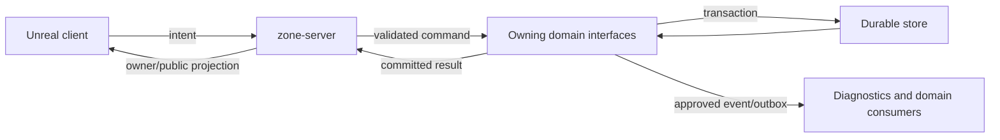
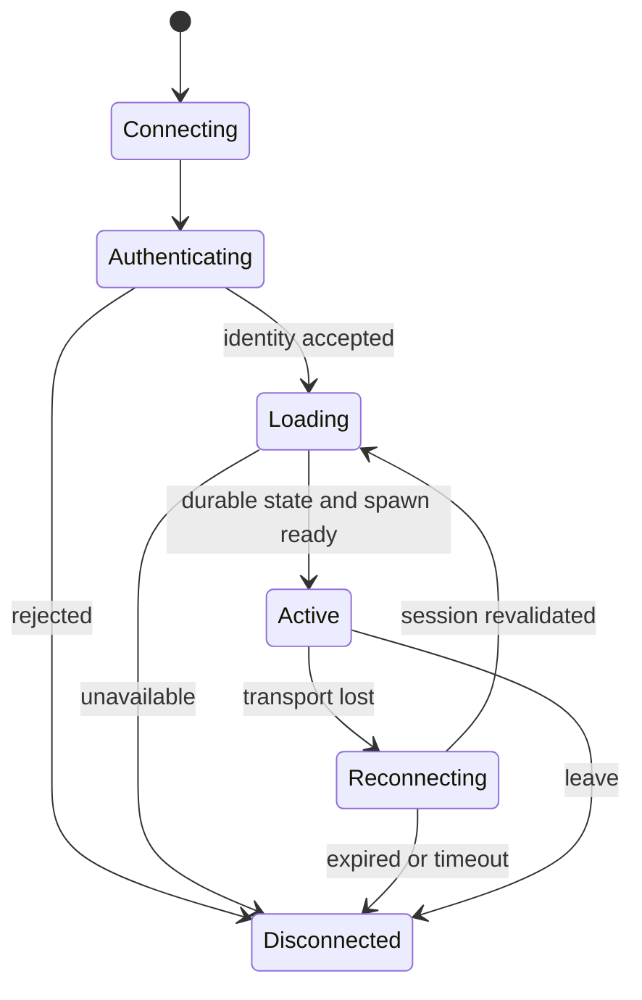

# First MVP Milestone

## Objective and status

Prove that a small group can enter one authoritative Greenlands region, gather and craft, build a persistent home, fight one starter enemy, complete a short quest, and exchange resources without losing or duplicating assets across retries and restarts.

This is an expanded planning contract, not a release claim. Keep the current filename for existing links; no new documentation version is required. The current implementation remains the browser harness documented in [alpha plan](../alpha-plan.md). Unreal project creation and integration are future work.

Read [backlog](Legends_Shattered_Frontier_Gameplay_Feature_Backlog_v1.0.md) for work IDs, [Unreal layout](Legends_Shattered_Frontier_UE58_Project_Layout_v1.0.md) for code/replication ownership, and [registry](Legends_Shattered_Frontier_Shared_Registry_v1.0.md) for names. Domain specifications own formulas, item ledgers, quests, security, and analytics. This milestone selects a subset of those contracts; it does not rewrite them.

## Three evidence levels

| Level | Meaning | What it cannot claim |
| --- | --- | --- |
| Browser PoC | Existing local Node/SQLite tile harness | Unreal integration, public security, voxel geometry, or measured MMO capacity |
| Engine milestone E1 | Dedicated authority, third-person controls, targeting, two clients | Durable economy, 100-player capacity, or release readiness |
| Persistent-world MVP | Integrated contracts and gates below have recorded evidence | Launch-scale operations, four biomes, seamless multi-region world |

An editor demonstration is useful evidence for E1. The final MVP requires packaged client and dedicated server evidence. The historical “100 concurrent players” scope is a final measured gate, not a precondition for the first playable build.

## Included experience

| System | Minimum included | Explicit bounds |
| --- | --- | --- |
| World | One Greenlands region, safe spawn, claimable area, resource area, enemy area | No continent travel or seamless handoff |
| Player | Third-person movement, interaction, inventory, starter equipment, reconnect | One starter profile; character customization can remain basic |
| Gathering | One wood and one ore node type, depletion, regeneration policy | No entire gathering profession catalog |
| Crafting | Material conversion and a small useful recipe set | No quality ladder or legendary acquisition requirement |
| Housing | Personal claim, foundation, wall, door, roof, access/reclaim rules | No guild politics, taxes, siege, or structural physics simulation |
| Terrain | Bounded editable test area with saved deltas | No promise of arbitrary fully destructible terrain |
| Progression | Valid gathering/crafting actions integrate with approved use-based skills | No need to expose mastery/prestige |
| Combat | One starter attack, one enemy, defeat/respawn, reward integration | No PvP, dungeon, raid, or broad class balance |
| Quest | Short authored chain linking gathering, crafting, building, and reward | No runtime generative quest dependency |
| Exchange | Direct trade plus restricted fixed-price marketplace | No auctions, shipping, contracts, or global exchange |
| Persistence | Acknowledged durable state, migration compatibility, backup/restore | No requirement for all proposed distributed services to run |
| Delivery | Repeatable packaged build, compatible client/server, bounded update/repair path | No commercial launcher polish |
| Capacity | Progressive 10, 25, 50, 100 participant gates | 200+ is exploratory; not required to exit this MVP |

The fixed-price marketplace remains included because the starter MVP named it. Removing it requires an explicit scope amendment, not relabeling NPC vendor sales as a market.

## Player journey and traceability

1. Start a compatible build, join the test region, and receive a valid session/character.
2. Move to a resource, see interaction eligibility, gather wood and ore.
3. Craft building materials while observing inventory and skill changes.
4. Claim a permitted plot and place the four supported building pieces.
5. Another player sees the construction and is denied unauthorized reclaim.
6. Fight the starter enemy, recover after defeat, and receive eligible rewards once.
7. Complete the starter quest and trade or buy one allowed resource.
8. Disconnect, restart the server in a controlled rehearsal, reconnect, and verify ownership/state.

| Journey step | Backlog owners | Required evidence |
| --- | --- | --- |
| Join and move | ENV, MOV, INT | Two independent client sessions and server log |
| Gather/craft | INV, GAT, CRF, PER | Committed quantities and retry receipt |
| Claim/build/edit | BLD, TER, PER | Recovered revisions, permission denial, cost reconciliation |
| Combat/quest | CBT, QST | Server outcome and one reward grant |
| Exchange | TRD, MKT | Settlement ledger and concurrent buyer result |
| Restart and package | PER, CAP, DEL | Restore report, compatible artifacts, measured gate report |

## Operational architecture proposal

For MVP, prefer one simulation region and the smallest operational deployment that preserves domain interfaces. Logical services may be cohosted. The final choice between an in-process backend and separately deployed services is a recorded decision, not implied by folder names.

The simulation server owns spatial eligibility, movement, live actor state, and interaction ordering. Domain owners own durable inventories, progression, currency, quests, and world records. The client sends intent and renders confirmed results. It has no database credentials.



Do not add a new service merely to match this diagram. The shape describes responsibilities. Before an asset-changing implementation, PER-01 must select transaction topology and confirm who coordinates a world write with inventory cost.

## Required invariants

| Invariant | Failure that must be prevented |
| --- | --- |
| Authority | Client-supplied identity, quantity, damage, ownership, or price becomes trusted state |
| Durable acknowledgement | UI says a structure exists but a process crash removes it |
| Idempotency | Network retry creates a second reward, item, purchase, or structure |
| Conservation | Placement loses inputs with no result; trade delivers to only one party |
| Conflict safety | Stale revision overwrites a later accepted edit |
| Privacy | Other players receive private inventory, session tokens, or credentials |
| Compatibility | New code opens an unsupported schema and silently corrupts it |
| Safe failure | Backend outage accepts mutations that cannot be made durable |

Cosmetic feedback may be immediate. Durable success is distinct from predicted feedback. A mutation with an unknown outcome is resolved with the same operation key, not resent under a fresh key.

## Command sequence: persistent placement

```mermaid
sequenceDiagram
  participant C as Client
  participant Z as Zone authority
  participant D as Domain coordinator
  participant DB as Durable store
  C->>Z: Place intent(key, target, expected revision)
  Z->>Z: Derive identity; check range and permission
  Z->>D: Validated operation and trusted inputs
  D->>DB: Look up key and request digest
  alt Existing same request
    DB-->>D: Stored terminal result
  else New request
    D->>DB: Revalidate versions; commit cost, structure, receipt
    DB-->>D: Durable result
  end
  D-->>Z: Committed result or rejection
  Z-->>C: Owner outcome and relevant world revision
```

This sequence assumes a selected atomic storage boundary. If domain stores are separate, replace the combined commit with a documented reservation/settlement protocol and recovery worker. Do not claim an atomic distributed transaction without implementing one.

For construction, the [DEC-02 reconciliation proposal](../decisions/DEC-02-durable-actions.md) maps this example to Construction Integration's existing prepare/decision/completion protocol, including cohosted participants. It remains proposed pending architecture/persistence acceptance; this illustration does not supersede that domain contract.

### Failure handling

| Failure point | Required behavior |
| --- | --- |
| Validation fails | Return a stable rejection; no cost or world mutation |
| Two commands contend | Lock or compare revisions; one valid winner; loser refreshes |
| Store unavailable before commit | Fail closed for asset mutation; report retryable unavailability |
| Reply lost after commit | Query/retry same key returns the committed result |
| Process dies during commit | Recovery determines committed or rolled back; no guessed refund |
| Publication fails after commit | Durable result remains valid; outbox/rebuild repairs projections |
| Player disconnects | Committed work persists; uncommitted work resolves by operation state |
| Malformed chunk/save | Isolate affected state and prevent new writes; recover from validated backup |

## Persistence schema requirements

This is a schema checklist and a proposed coordination record, not a migration. Use the owning domain's canonical schemas when available. Do not add conflicting item, wallet, quest, or progression tables here.

| Record family | Required constraints | Owner |
| --- | --- | --- |
| Character identity/location | Valid identity; location revision; safe restore fallback | character-service / authoritative zone |
| Inventory/ledger | Item/container ownership, nonnegative quantities, unique operation effects | inventory-service |
| Recipe execution | Trusted recipe, consumed input references, committed output references | crafting-service + inventory-service contract |
| Claim/structure | Owner/permissions, supported transform, revision, cost receipt reference | World/Building owner confirmed in PER-01 |
| Terrain delta | Zone/chunk key, ordered revision, validated delta encoding | World owner |
| Currency/trade/listing | Nonnegative balances, escrow ownership, terminal settlement uniqueness | economy-service |
| Progress/reward | Unique originating fact/grant, domain state transition | progression-service / reward-service / quest-service |
| Schema state | Migration identity, compatible build range, applied timestamp | Persistence implementation |
| Operation outcome | Identity-scoped key, immutable request digest, committed/rejected result | Coordinator selected in PER-01 |

Proposed operation outcome fields:

```text
principal_id       canonical authenticated actor/account reference
operation_key      opaque retry key scoped to principal and operation family
operation_kind     local discriminator; not a registry event name
request_digest     digest of normalized semantic inputs
state              accepted | committed | rejected | recovery_required
expected_revision  optimistic concurrency input where relevant
result_reference   immutable result or references sufficient to reconstruct it
created_at         server time
finished_at        terminal time, if any
UNIQUE(principal_id, operation_kind, operation_key)
```

These are proposed local storage names pending PER-01. They are not new public registry entities. An “accepted” record alone cannot prove a cost was charged or refunded. Unknown partially completed operations enter recovery; only reconciled terminal outcomes may expire. Retention must exceed supported retries and offline recovery intervals; exact limits are an open operational decision.

The [DEC-02 schema mapping](../decisions/DEC-02-durable-actions.md#mvp-schema-reconciliation) distinguishes a construction commit decision from completed success and references canonical action receipts rather than introducing a second authoritative outcome.

### Proposed coordination schema

The following PostgreSQL-shaped schema makes the receipt constraints explicit. It is an illustrative candidate for PER-01, not an installed migration or a decision to replace the current SQLite harness. The final implementation must reconcile it with the selected domain storage and registry naming before use.

```sql
CREATE TABLE operation_receipts (
    principal_id       text NOT NULL,
    operation_kind     text NOT NULL,
    operation_key      text NOT NULL,
    request_digest     bytea NOT NULL,
    state              text NOT NULL,
    expected_revision  bigint,
    result             jsonb,
    created_at         timestamptz NOT NULL,
    finished_at        timestamptz,
    PRIMARY KEY (principal_id, operation_kind, operation_key),
    CHECK (octet_length(request_digest) = 32),
    CHECK (expected_revision IS NULL OR expected_revision >= 0),
    CHECK (state IN ('accepted', 'committed', 'rejected', 'recovery_required')),
    CHECK (
        (state IN ('committed', 'rejected')
            AND result IS NOT NULL AND finished_at IS NOT NULL)
        OR
        (state IN ('accepted', 'recovery_required') AND finished_at IS NULL)
    )
);
```

The digest covers normalized semantic inputs and operation type; it excludes transport timestamps and transient session secrets. A reconnect by the same authenticated principal can query its original operation. An unrelated principal cannot use another player's key to inspect results.

For a cohosted single-store implementation, claim the unique key and validate the request digest under transaction control. Mutate costs, resource/structure revisions, and the terminal receipt in the same transaction through the owning domain repositories. Publish only after commit. Do not perform an external side effect inside that transaction and assume rollback can undo it.

If an accepted record is persisted before work executes, it needs an explicit processing lease/recovery protocol; the receipt schema alone does not supply that protocol. If durable writes span independent stores, this table is insufficient: PER-01 must select reservation, settlement, compensation, and reconciliation owned by those domains. No asset-changing ticket is ready while that boundary is unspecified.

### Command boundary and errors

| Input | Trust / validation |
| --- | --- |
| Operation key | Client-generated opaque retry token; bounded size and stable across retries |
| Operation type | Allowlisted server action; same key scope includes type |
| Target reference | Resolve on server; verify existence, visibility policy, range, and allowed target type |
| Proposed transform/recipe/quantity | Validate finite values, bounds, supported definition, and server-derived cost |
| Expected revision | Compare with current record; stale versions cannot overwrite state |
| Principal/session | Derived from validated server context; never accepted from an arbitrary payload field |

Proposed error classes are validation, permission, conflict, capacity, unavailable, incompatible, and outcome-unknown. They are local contract categories pending the selected transport, not registry enum additions. Validation/permission failures are terminal for that request; conflict requires refresh and a new intentional operation; unavailability may be retried with the original key. Outcome-unknown first queries or retries the original operation and must not generate a replacement grant.

Exact wire field names, size/rate limits, error codes, and request normalization are required outputs of INT-02/PER-01. Test malformed/nonfinite inputs, stale revisions, cross-principal receipt access, and changed-payload key reuse for the affected mutation.

## Session and server state machines



Only one active authoritative character presence may hold the simulation lease. Reconnect invalidates or replaces the old presence through the agreed session policy; it must not create two writable inventories.

The [DEC-04 applicability proposal](../decisions/DEC-04-session-applicability.md) maps this lifecycle to existing Backend/Security authority. Ticket-caller reconciliation, atomic admission/fencing and connected-server revocation remain owner/evidence gates; documentation review does not establish an implemented lease.

Server lifecycle: starting → loading → ready → draining → stopped. Failed load enters unavailable, not ready. Draining rejects new joins and mutations, resolves outstanding operations, writes compatible checkpoints, then stops. Abrupt shutdown recovery remains mandatory; graceful shutdown is not the only persistence test.

These lifecycle labels are local planning descriptions. Canonical public enum values remain owned by the registry.

## Proposed performance budgets

All numbers below are initial targets, not measurements. Ratify reference client/server hardware and content density at E1. A result without build, hardware, network conditions, actor counts, and scenario identity is incomplete.

| Measure | Proposed target | Measurement condition / interpretation |
| --- | --- | --- |
| Server simulation | 30 Hz; p95 simulation frame ≤ 33.3 ms | Warm server, defined mixed workload; report p99/hitches too |
| Client frame | p95 ≤ 16.7 ms at 1080p target settings | Reference machine; report render/game thread and shader warmup separately |
| Interaction feedback | Pending feedback ≤ 100 ms locally | Does not imply durable commit |
| Durable action response | p95 ≤ 250 ms at 50 ms round-trip latency | End-to-end from request to confirmed outcome; report actual RTT |
| Durable action failure | < 1% unexpected failures | Exclude deliberate denials; include timeout/unavailability; denominator required |
| Replication traffic | Average ≤ 50 KB/s outbound per active player, p95 ≤ 100 KB/s over 1 s windows | Record packets/overhead and server total; loading bursts separate |
| Reconnect | p95 ≤ 10 s once transport/backend available | Auth plus durable load and safe spawn; excludes downloading updates |
| Server restart recovery | ≤ 60 s for defined MVP dataset | Launch to ready; failed/corrupt states must not be declared ready |
| Soak stability | 2-hour mixed workload; no invariant violation | Compare post-warmup memory trend and work-normalized retained objects |
| Final MVP capacity | 100 concurrent active participants | Same declared workload/density; pass only with all integrity and performance gates |
| Data loss | Zero loss of acknowledged durable economic/world commands | Kill/restart evidence; telemetry loss treated separately |
| Backup restore rehearsal | ≤ 30 min for defined dataset | Human/runbook time included; actual result retained |

The 30-minute restore target is an MVP operational proposal; it does not redefine the Database specification's longer-term RPO/RTO objectives. Network traffic targets are provisional until the first representative Unreal capture. Exceeding a provisional target triggers measurement and a decision, not hidden data omission.

## Capacity scenario

Use 10, 25, 50, then 100 participants. At each stage, record 15 minutes of measured activity after a declared warmup. The final gate adds a two-hour soak. Synthetic participants validate server behavior; a separate real-client sample validates graphics, input, UI, and client resource use. A headless load agent is not a graphics benchmark.

For each 100-participant workload cycle: 40 gather/craft, 20 build or edit, 20 fight the starter enemy, 10 trade or use the market, 10 move/reconnect. Rotate roles so every feature sees activity. Record accepted command rates; idle connections alone do not establish active capacity.

Include a separate crowded scene, sparse scene, reconnect burst, contested resource, and simultaneous market purchase. State target density and total actors before running; increased actor density changes the scenario.

Do not advance after a data-integrity failure. A performance miss may yield a profiling task and rerun at the same tier. A successful tier does not prove the next tier. Select the load tier and scenarios relevant to the change; run a full test suite only at explicit user request.

## Acceptance matrix

| Gate | Pass evidence | Blocking result |
| --- | --- | --- |
| E1 engine movement | Independent clients, authoritative possession, collision/target validation, project/build identities | Client-only demo; no server authority |
| Persistent construction | Cost/structure atomicity, permission denial, stale-revision rejection, recovered terrain | Lost/duplicated materials or ownership |
| Small-group play | Complete journey, starter combat, one reward, reconnect and trade | Duplicate reward, one-sided trade, unrecoverable player |
| Market | Fixed-price listing/purchase/cancel contention and reconciliation | Double sell, balance mismatch, orphan escrow |
| Recovery | Crash cuts before/after commit, backup restore, schema compatibility check | Acknowledged loss, unsupported schema mutation |
| Capacity | Saved 10/25/50/100 reports; final soak; declared hardware and mix | Active load replaced by idle sockets or unexplained invariant failure |
| Delivery | Compatible packaged client/server, update interruption/repair, secrets check | Editor-only artifact, invalid manifest accepted, exposed credential |

### Minimum targeted checks for a changed feature

For a new persistent mutation, select its success, denial, duplicate retry, changed-payload key reuse, concurrent conflict, and crash-boundary cases. Run only the relevant cases. For cosmetic content, verify only affected maps/widgets/assets unless another dependency actually changes.

Milestone-wide verification needs a declared scenario set tied to the requested gate. These criteria do not authorize routine full-suite runs.

## Milestone evidence record

Record gate, build/content/schema identifiers, environment, dataset, scenario, selected checks, actual measurements, pass/fail, linked defect/debt items, and limitations. Sensitive account or session data must be removed. A screenshot is presentation evidence; authoritative state and receipt reconciliation establish persistence correctness.

Retain reports with the candidate build. Decide their storage path before automation is written; proposed repository location is `docs/evidence/` for small summaries, with large artifacts outside Git and links/hashes in summaries.

The [DEC-08 compatibility proposal](../decisions/DEC-08-compatibility.md) binds release/client/server/content identities to proposed schema, terrain and action-recovery evidence. The record format, executable codec and actual update/rollback rehearsals remain pending; signed client files alone do not prove compatible persistent state.

## Decisions required before implementation

| Decision | Owner role | Blocks |
| --- | --- | --- |
| Confirm installed engine/source path and packaged-server toolchain — [post-install evidence](../decisions/DEC-01-engine-evidence.md), payload confirmed; actual compile/targets and server route pending | Engine implementation | ENV-02, final delivery |
| Reference client/server hardware and target settings | Project direction + performance owner | Ratified budgets and capacity claim |
| Atomic world/inventory write topology and recovery semantics | Architecture + persistence owner | PER-01, persistent gathering/building/trade |
| Terrain representation, chunk limits, support and collision policy — [adoption proposal](../decisions/DEC-03-terrain.md), acceptance/evidence pending | World + Unreal owner | TER-01 |
| Account/session mechanism and active-character lease — [applicability proposal](../decisions/DEC-04-session-applicability.md), acceptance/evidence pending | Backend + Security owner | Reconnect and remote testers |
| Market escrow/settlement and item subset | Economy + Itemization owner | MKT-01 |
| Receipt retention and backup schedule — [reconciled profile proposal](../decisions/DOC-08-recovery-profile.md), acceptance/evidence pending | Persistence + operations owner | Recovery/duplicate protection in long-running tests |

A blocked decision gates only dependent work. Movement, graybox content, and targeted editor checks may proceed when their own prerequisites are satisfied.

## Completion and scope change

The MVP exits only when included systems and required gates have evidence, known critical integrity/security issues are closed, and remaining debt has explicit owners and bounded impact. A missed date does not waive the integrity gates.

The human project owner chooses scope and release timing. Agents may prepare fixes, artifacts, and reports; this document does not authorize public deployment, spending, or external messages.

## Registry additions

No new public services, entities, events, enums, or constants are introduced. Proposed operation storage and budgets require review at PER-01/E1 and domain alignment before becoming executable contracts.
