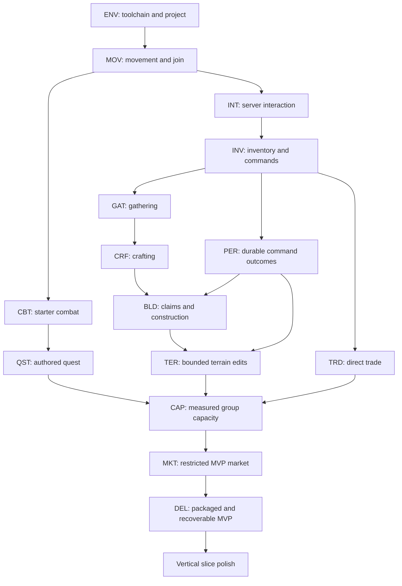
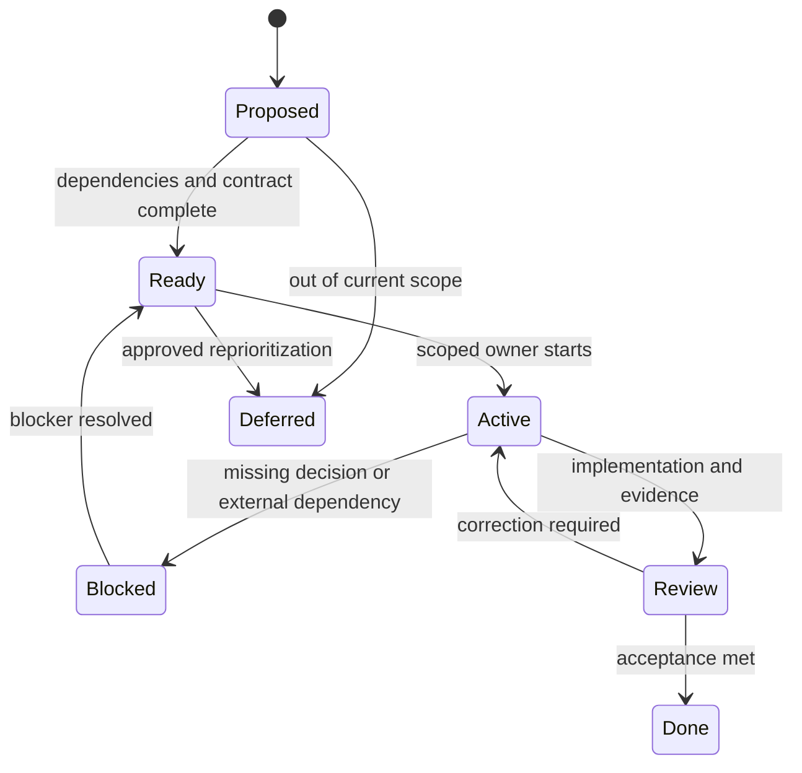

# Gameplay Feature Backlog

## Purpose and reading guide

This is the production work breakdown for the Greenlands proof of concept, persistent-world MVP, and later content. Use the milestone sections to select work; use the ticket contract to make one task executable. Read only the epic being changed and its dependencies.

Status: expanded planning baseline. Scope and criteria below are proposed implementation contracts, not evidence of delivered features. Existing filename suffixes are retained for link stability; no new document versions are being introduced.

Related references: [current alpha plan](../alpha-plan.md), [MVP](Legends_Shattered_Frontier_First_MVP_Milestone_v1.0.md), [vertical slice](Legends_Shattered_Frontier_Vertical_Slice_Specification_v1.0.md), [registry](Legends_Shattered_Frontier_Shared_Registry_v1.0.md), [Unreal ownership](Legends_Shattered_Frontier_UE58_Project_Layout_v1.0.md). Domain formulas and schemas remain owned by their domain references.

## Delivery rules

The browser harness is the current implementation: shared tile actions, crafting, ownership, a founder quest, skills, SQLite persistence, and SSE. It is a reference for behavior and failure cases; its protocol and storage format are not the Unreal architecture.

The next milestone remains engine movement. Do not start marketplaces, raids, or production infrastructure simply because they appear in this backlog. A feature starts only when its dependency gate and focused acceptance criteria are ready.

Logical service ownership does not require one deployed service per feature. MVP deployment topology must be decided before implementing cross-domain writes. No agent may silently replace registry names, invent a second inventory authority, or treat client animation as proof of a durable action.

### Priority and milestone vocabulary

| Label | Meaning |
| --- | --- |
| P0 | Blocks the current milestone or protects authoritative state and recovery |
| P1 | Required to exit its assigned milestone |
| P2 | Valuable after the critical path; cut before weakening a P0 invariant |
| Deferred | Outside MVP; requires a later scope decision |
| E1 | Engine and movement gate |
| H2 | Persistent housing/terrain gate (alpha-plan milestone 2) |
| G3 | Playable small-group alpha gate |
| C4 | Measured capacity gate and final MVP integration |
| VS | Vertical slice presentation and integrated experience |

Work IDs below are planning identifiers, not runtime entity IDs or registry additions.

## Dependency graph

PER must be available before a mutable feature is described as persistent. Gathering may be demonstrated in memory before PER, but that demonstration cannot satisfy durable gathering acceptance. Security and diagnostics are cross-cutting dependencies of every node.

## Epic ENV — reproducible engine foundation

| ID | Priority / gate | Deliverable | Acceptance / evidence | Depends on |
| --- | --- | --- | --- | --- |
| ENV-01 | P0 / E1 | Record engine path/build, compiler, SDK, source revision | New developer can identify the exact installed toolchain; no guessed paths | First-time setup |
| ENV-02 | P0 / E1 | C++ project with client/editor/server targets | One shared gameplay source tree; clean editor build; dedicated-server feasibility recorded | ENV-01 |
| ENV-03 | P1 / E1 | Greenlands graybox map and startup settings | Correct map starts in editor and intended test launch; no missing asset errors | ENV-02 |
| ENV-04 | P1 / E1 | Server/client launch instructions | Independent clients join a separately running server; ports and log locations documented | ENV-02 |
| ENV-05 | P1 / E1 | Scoped compile and test selection | Changed module can be checked without a full project test run | ENV-02 |

Packaged dedicated-server support and engine source availability are evidence requirements, not assumptions from having the editor installed. Editor-server smoke results and packaged-server results must be labeled separately.

## Epic MOV — player control and network presence

| ID | Priority / gate | Deliverable | Acceptance / evidence | Depends on |
| --- | --- | --- | --- | --- |
| MOV-01 | P0 / E1 | Third-person character, camera, input mapping | Move, turn, jump, collide, and recover camera in the graybox | ENV-03 |
| MOV-02 | P0 / E1 | Dedicated authority and possession | Two clients see each other; server owns spawning and accepted movement | ENV-04, MOV-01 |
| MOV-03 | P1 / E1 | Join/leave lifecycle | Repeated disconnect/rejoin does not leave duplicate active pawns | MOV-02 |
| MOV-04 | P1 / E1 | Local interaction target feedback | Invalid/out-of-range targets display an unavailable state | MOV-01 |
| MOV-05 | P1 / G3 | Reconnect with durable character identity | Session is revalidated; character restores to safe authorized location | MOV-03, PER-02 |

A local movement prediction error may correct visually. It must not authorize remote gathering, teleportation, or placement. Authentication integration is a separate backend contract from controller ownership.

## Epic INT/INV — command boundary and inventory

| ID | Priority / gate | Deliverable | Acceptance / evidence | Depends on |
| --- | --- | --- | --- | --- |
| INT-01 | P0 / E1 | Server interaction validation | Server derives actor identity, checks target, distance, visibility policy, and cooldown | MOV-02, MOV-04 |
| INT-02 | P0 / H2 | Idempotent command envelope | Same request and payload returns original outcome; changed payload with same key is rejected | INT-01, PER-01 |
| INV-01 | P0 / H2 | Inventory read model and capacity checks | Owner receives private contents; full inventory rejects before consuming inputs | INT-02 |
| INV-02 | P0 / H2 | Domain mutation interface | Quantities cannot go negative; creation/removal has a durable ledger outcome | INV-01 |
| INV-03 | P1 / G3 | Equipment adapter | Server owns equipped item references; public appearance excludes private inventory | INV-02, Itemization contract |
| INV-04 | P1 / G3 | Inventory feedback | Client distinguishes pending, committed, rejected, and unknown outcome | INV-01 |

Consume the Itemization specification's IDs, containers, stack rules, and ledger contract when implementation reaches these tickets. This backlog does not redefine them.

## Epic PER — persistence and recovery

| ID | Priority / gate | Deliverable | Acceptance / evidence | Depends on |
| --- | --- | --- | --- | --- |
| PER-01 | P0 / H2 | Select atomic command storage topology | Decision names transaction boundary, reservation owner, durability point, retry rules | ENV-02, INT-01 |
| PER-02 | P0 / H2 | Character/world durable load and save | Acknowledged mutable state survives process kill after commit | PER-01 |
| PER-03 | P0 / H2 | Ownership/revision conflicts | Stale expected revision cannot overwrite another player's committed change | PER-02 |
| PER-04 | P0 / H2 | Migration and restore rehearsal | Backup restored into an isolated environment; schema/build compatibility checked | PER-02 |
| PER-05 | P1 / C4 | Recovery observability | Pending/failed operations, save latency, restore duration, and last durable sequence visible | PER-02 |
| PER-06 | P1 / C4 | Graceful drain and restart | New writes stop; in-flight outcomes settle; restart does not duplicate grants | PER-04 |

The operation receipt, inventory ledger, structure write, and publication must have a stated relationship. “Save periodically” is insufficient for asset-changing actions. Client response loss after commit is tested by querying or retrying the same operation.

## Epic GAT/CRF — gather, refine, craft

| ID | Priority / gate | Deliverable | Acceptance / evidence | Depends on |
| --- | --- | --- | --- | --- |
| GAT-01 | P1 / H2 | Mining and logging nodes | Two simultaneous final-harvest requests yield one authorized depletion/result | INV-02, PER-03 |
| GAT-02 | P1 / H2 | Node durability/regeneration state | Restart preserves depletion; regeneration cannot grow through protected structures | GAT-01, BLD-01 |
| GAT-03 | P1 / G3 | Use-based skill progression integration | Approved action yields one domain progression receipt; rejection yields none | GAT-01, Character contract |
| CRF-01 | P1 / H2 | Raw-to-building-material recipe | Inputs and outputs commit together; retry does not multiply output | GAT-01, INV-02 |
| CRF-02 | P1 / G3 | Station/range/capacity enforcement | Leaving station or filling output capacity cannot consume inputs without result | CRF-01 |
| CRF-03 | P2 / VS | Quality and richer recipes | Quality derives from approved domain inputs; UI explains required inputs | CRF-02, Crafting contract |

MVP requires one useful ore and one useful wood chain. Fishing, farming, alchemy, engineering, and legendary crafting remain deferred until the core transaction pattern is proven.

## Epic BLD/TER — a persistent home

| ID | Priority / gate | Deliverable | Acceptance / evidence | Depends on |
| --- | --- | --- | --- | --- |
| BLD-01 | P0 / H2 | Personal claim ownership | Only authorized users mutate within the claim; overlap rejected | INT-02, PER-03 |
| BLD-02 | P1 / H2 | Foundation, wall, door, roof | Valid pieces snap/place; invalid collision/support/range rejected server-side | BLD-01, CRF-01 |
| BLD-03 | P0 / H2 | Durable material/placement transaction | No structure without paid cost; no duplicate charge on retry | BLD-02, PER-01 |
| BLD-04 | P1 / H2 | Door and reclaim permissions | Stranger cannot toggle restricted access or reclaim another player's pieces | BLD-03 |
| BLD-05 | P1 / C4 | Limits and safe spawn | Claim/piece limits enforced; reconnect cannot strand a character inside new collision | BLD-04, MOV-05 |
| TER-01 | P1 / H2 | Bounded chunk edits | Only supported cells/radius can change; modified chunks survive restart | PER-03, BLD-01 |
| TER-02 | P0 / H2 | Structure/terrain conflict policy | Excavation cannot invalidate another owner's protected structure | TER-01, BLD-04 |
| TER-03 | P1 / C4 | Recovery from edit failure | Last committed chunk revision loads; corrupt/unavailable chunk rejects edits | TER-01, PER-04 |

MVP terrain is a bounded editable test area, not the promise that any mountain can be mined. Terrain representation, collision rebuild budget, chunk format, and support policy are explicit technical decisions before TER-01 starts.

## Epic CBT/QST — purpose and danger

| ID | Priority / gate | Deliverable | Acceptance / evidence | Depends on |
| --- | --- | --- | --- | --- |
| CBT-01 | P1 / G3 | One weapon attack and one enemy | Server validates attack and damage; remote client cannot assert a hit result | MOV-02, INV-03 |
| CBT-02 | P1 / G3 | Death and safe recovery | One defeat transition, bounded respawn, no duplicate rewards | CBT-01, PER-02 |
| CBT-03 | P1 / G3 | Reward handoff | Enemy defeat grants once through approved reward ownership | CBT-02, Itemization contract |
| QST-01 | P1 / G3 | Short authored gather/craft/build chain | Objectives respond to committed facts; no credit from denied actions | GAT-01, CRF-01, BLD-03 |
| QST-02 | P1 / G3 | Claim/reward retry safety | Turn-in interrupted after commit grants once after reconnect | QST-01, PER-02, Quest contract |
| QST-03 | P2 / VS | Presentation and guidance | New tester completes the chain without developer console assistance | QST-02 |

Character progression, itemization, quests, dungeons, and raids are maintained by the other session. Integrate those contracts at ticket preparation; do not expand or override them here.

## Epic TRD/MKT — safe exchange

| ID | Priority / gate | Deliverable | Acceptance / evidence | Depends on |
| --- | --- | --- | --- | --- |
| TRD-01 | P1 / G3 | Direct two-player trade | Offer changes clear consent; disconnect before commit leaves ownership consistent | INV-02, PER-01 |
| TRD-02 | P0 / G3 | Atomic exchange and recovery | No one-sided delivery, double-spend, or duplicated settlement on retry | TRD-01 |
| MKT-01 | P1 / C4 | Restricted fixed-price market | One allowed item class; listing reserves/escrows supply; no auctions or bids | TRD-02, Economy contract |
| MKT-02 | P0 / C4 | Concurrent purchase and cancellation | Competing buyers/cancel produce exactly one valid terminal result | MKT-01 |
| MKT-03 | P1 / C4 | Currency and audit reconciliation | Wallet/item deltas reconcile with receipts, costs, and approved source/sink codes | MKT-02 |

The restricted market preserves the original MVP marketplace requirement while bounding risk. If scope must move later, record that decision; direct trade alone does not satisfy MKT acceptance.

## Epic CAP/DEL — prove and deliver

| ID | Priority / gate | Deliverable | Acceptance / evidence | Depends on |
| --- | --- | --- | --- | --- |
| CAP-01 | P1 / G3 | Instrumentation and load scenario | Record frame/tick, command durability, bandwidth, memory, errors, and actor counts | MOV-02, PER-05 |
| CAP-02 | P1 / C4 | 10/25/50/100 concurrent-client gates | Each step has a saved workload, hardware/build identity, and pass/fail report | CAP-01, core G3 loop |
| CAP-03 | P1 / C4 | Soak and adverse network checks | No invariant violation or unbounded memory growth; delays handled visibly | CAP-02 |
| DEL-01 | P1 / C4 | Packaged client and dedicated server | Reproducible compatible artifacts; no editor content dependency | ENV-02 |
| DEL-02 | P1 / C4 | Signed manifest/update contract | Wrong/incomplete package rejected; failed download recoverable | DEL-01, Client delivery contract |
| DEL-03 | P0 / C4 | Backup, rollback, tester handoff | Recover compatible code/data pair in rehearsal; credentials excluded from packages | PER-04, DEL-02 |

Select only load tiers and scenarios relevant to the capacity change being verified. Full-suite testing requires an explicit user request.

## Feature ticket contract

A ticket is ready only with the following fields:

| Field | Required content |
| --- | --- |
| Identity | Work ID, concrete player/operator outcome, milestone, priority |
| Scope | In/out, exact files or modules, owner and affected domain owners |
| Inputs/outputs | Request fields, trusted/untrusted values, errors, visible feedback |
| Authority | Server validation, persistent owner, replication audience |
| Data | Records/IDs touched, atomic boundary, migration and rollback effect |
| Lifecycle | States, allowed transitions, retry/cancel/disconnect behavior |
| Dependencies | Blocking IDs, linked contract sections, unresolved decisions |
| Acceptance | Given/when/then positive, denied, contention, and recovery cases |
| Budget | Relevant numerical target and reproducible measurement context |
| Validation | Exact targeted checks, fixtures, evidence location; no default full suite |
| Completion | Code/doc/graph updates, remaining debt, evidence and reviewer |

### Worked ticket: BLD-03 durable placement

Given a player with enough materials and a valid claim, when the server accepts a new placement operation, then materials, structure revision, and stored outcome become durable as one defined operation. The client receives success only after that durability point.

Given two requests with the same identity/key/payload, when either reply is lost, then retry returns the same structure and cost, not a second structure. Given a reused key with a different transform, reject it before mutation.

Given simultaneous placements against the same conflicting revision, at most one commits. The loser receives a conflict and refreshes the preview. Given storage outage before commit, the preview reverts and no success is displayed. Given crash after commit, recovery reproduces the structure and original cost.

Dependencies: BLD-01, BLD-02, PER-01 through PER-03. Targeted checks: placement success; duplicate retry; changed-payload retry; claim denial; overlap contention; crash before/after commit. Network feedback and persistence budget are in the MVP gate table.

## Deferred epics

| Area | Why deferred | Entry condition |
| --- | --- | --- |
| Multiple biomes and seamless zone handoff | Expands state ownership and content costs | Single-region durability/capacity proven |
| Guild settlements, taxes, sieges, governance | Multi-owner permissions and economic risk | Personal claims and ledger reconciliation pass |
| Dungeons, raids, matchmaking | Separate instance/group lifecycle | Protected domain specs ready and a later milestone authorized |
| Dynamic AI quests/world director | Requires bounded generation and moderation | Authored quest loop and domain validation proven |
| Full voxel destruction | Collision, streaming, and persistence cost | Bounded terrain test demonstrates safe budgets |
| Prestige/mastery, advanced loot | Large balance surface | Starter progression and item lifecycle stable |
| Voice, store, multi-region infrastructure | Not needed to validate core sandbox loop | Demonstrated product/operational need |

## Backlog state machine and change control

A blocked ticket names the missing decision and what independent work remains possible. “Done” requires evidence, not agent confidence. A change to the core invariants reopens affected tickets and updates the MVP gate. Schedule reductions cut optional content before durability or server authority.

## Budgets and validation routing

Use the MVP budget table for shared performance targets. Feature-specific budgets belong in the ticket and owning spec; do not independently tune contradictory limits across documents. Capture baseline and changed measurement on the same build configuration/hardware.

For the current browser harness, map action changes to relevant cases in `tests/world.test.js`; map HTTP/session/persistence changes to relevant cases in `tests/server.test.js`. Future Unreal tests must be created and named when the feature exists; do not list fabricated commands as runnable today.

## Registry additions

None merged or proposed by this document. Work IDs, gate names, and backlog states are planning metadata only. Runtime events, service IDs, and content IDs must come from the shared registry or be proposed there through the owning domain.
