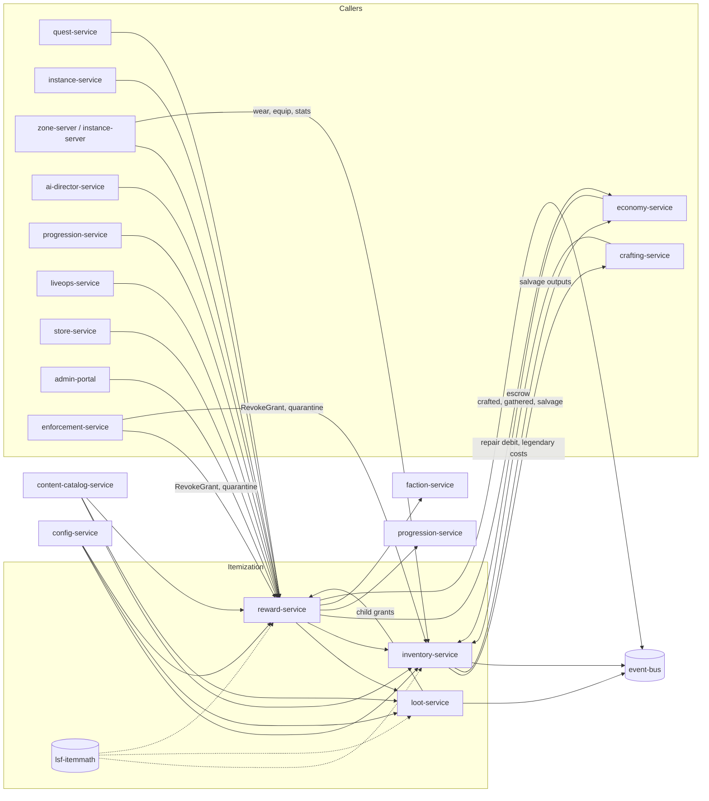

# Legends of the Shattered Frontier — Itemization Architecture
### Version 1.0 — Expanded Technical Design Authority edition (2026-10-17)

Status: Design target; not implemented. Names per Shared Registry v1.0.

Registry: [Shared Registry](Legends_Shattered_Frontier_Shared_Registry_v1.0.md) · Part folder: [`Itemization/`](Itemization/)

---

## Table of contents

| Part | Covers |
| --- | --- |
| This entry file | goals, scope, architecture and service ownership, core model summary, cross-domain contracts, tuning key index, Registry additions |
| [Item Model, Lifecycle, Durability and Legendary Paths](Itemization/Legends_Shattered_Frontier_Itemization_Item_Model_and_Lifecycle_v1.0.md) | item definitions and instances, categories and slots, rarity rules, containers, `item_status` state machine, binding, item ledger, duplication prevention and escrow, durability (wear, repair cost, broken, salvage, destroy), legendary path state machine and 465 → 475 upgrades, item sources, `inventory` DDL, `lsf.inventory_service.v1`, `item.*` / `inventory.*` payloads |
| [Stat Budget, Affixes, Sets and Crafted Quality](Itemization/Legends_Shattered_Frontier_Itemization_Stat_Budget_and_Affixes_v1.0.md) | budget curve from the power ladder, slot weights, rarity multipliers, weapon damage and armor, stat cost weights, affix definitions, pools, tiers, exclusivity groups, roll algorithm, worked examples, item sets, crafted-item integration with crafting-service, content validator |
| [Loot Tables, Pity, Reward Bundles and Grants, Economic Balancing](Itemization/Legends_Shattered_Frontier_Itemization_Loot_and_Rewards_v1.0.md) | nested weighted loot tables, conditions, drop-rate math, luck, deterministic seeded rolls, group loot modes, pity, reward bundles, reward grant lifecycle and delivery saga, revocation, balancing targets, `loot` / `reward` DDL, `lsf.loot_service.v1`, `lsf.reward_service.v1`, `loot.*` / `reward.*` payloads |
| [Analytics, Security and Agent Implementation Guide](Itemization/Legends_Shattered_Frontier_Itemization_Agent_Implementation_Guide_v1.0.md) | analytics hooks and metrics, security considerations and anticheat signals, repository layout, build order, invariants checklist, test matrix, acceptance criteria, pitfalls, Do/Don't |

Glossary: all terms (Affix, Binding, Escrow, Item Instance, Item Level, Legendary Item, Loot Table, Pity, Rarity, Reward Bundle, Reward Grant, Stat Budget) are defined in the Registry, Glossary. This spec adds no new glossary terms beyond the proposals under Registry additions.

## 1. Goals

1. **Support crafted economies.** Crafted gear reaches ilvl 450 — within one power-ladder step of raid `heroic` — so "most items crafted by players" (Economy principle) holds through mid-endgame.
2. **Long-term progression.** A monotonic power ladder (registry power ladder) from ilvl 4 to 475 with predictable, formula-driven item power.
3. **Mathematical transparency.** Every number an item carries is computed from one budget formula with published tuning keys (Combat design philosophy: "predictable balancing").
4. **Duplication-proof ownership.** Single writer, append-only hash-chained ledger, escrow for every cross-owner move, idempotency everywhere.
5. **Fair, auditable randomness.** Deterministic, seeded, server-side rolls with replay for audit; pity for rare personal drops.
6. **Economic health.** Item and gold sinks (repair, salvage, destroy, legendary upgrades) sized against faucets with measurable targets.

## 2. Scope and non-goals

In scope: everything the registry assigns to Itemization (Registry, Concept ownership): item definitions, rarity, stat budget, affixes, sets, durability, binding, legendary paths, loot tables, pity, reward bundles and grants; and the three services `inventory-service`, `loot-service`, `reward-service`.

Non-goals (owned elsewhere, referenced here):

| Topic | Owner |
| --- | --- |
| What stats do (attribute/rating conversions, damage, mitigation, luck formula) | Combat spec |
| Recipes, crafting quality computation, salvage output tables, gathering | Crafting spec (`crafting-service`) |
| Wallets, currency ledger, trades, market listings, taxes, repair scaling multiplier | Economy spec (`economy-service`) |
| XP, LP, skills, account unlocks and their revocation | Character spec (`progression-service`) |
| Encounter loot assignment, lockouts, mythic scaling, dungeon loot policy | Dungeon spec |
| Raid loot mode policy, raid `items_per_kill` | Raid spec |
| Reputation | AI spec (`faction-service`) |
| Enforcement decisions, detectors, risk score | Security spec |
| Feature flags, tuning publication, compensation decisions | LiveOps spec |
| Warehouse tables and dashboards | Analytics spec |
| Premium store catalog | LiveOps spec (`store-service`); Itemization only enforces the `currency/crowns` rule on grants |

## 3. Architecture and service ownership



| Service | Owns (authoritative) | Store | Publishes | gRPC package |
| --- | --- | --- | --- | --- |
| `inventory-service` | item instances, containers, equipment, durability, binding, item ledger, escrow holds, legendary progress | PostgreSQL `inventory` | `item`, `inventory` | `lsf.inventory_service.v1` |
| `loot-service` | loot rolls (`lrl_`), group drops, pity counters | PostgreSQL `loot` | `loot` | `lsf.loot_service.v1` |
| `reward-service` | reward grants (`rwg_`) and delivery plans | PostgreSQL `reward` | `reward` | `lsf.reward_service.v1` |

Authority rules applied (Registry, Service registry): item creation only in inventory-service with a `source` code and `causation_id`; currency only in economy-service; all quest, dungeon, raid, world event, achievement, season, compensation, store, and GM rewards flow through reward-service; zone and instance servers decide kills and hits but only *request* durable changes.

Runtime characteristics: all three services are stateless and horizontally scaled per realm; each realm has its own PostgreSQL databases for the three schemas (items never cross realms). Content definitions are cached per `content_version` from content-catalog-service; tuning values come from config-service push and are snapshotted into each roll/grant context so retries are stable.

## 4. Core model summary

### 4.1 Rarities

`common`, `uncommon`, `rare`, `epic`, `legendary`, `mythic` (registry `rarity`). Rarity multiplies the budget (0.70 / 0.85 / 1.00 / 1.15 / 1.30) and sets the affix shape (1 → 6 affixes). `legendary` comes only from legendary paths. `mythic` is reserved and rejected at launch. Source ceilings from the power ladder clamp every roll. Details: Stat budget part, Rarity multipliers and affix shape; Item model part, Rarity rules.

### 4.2 Item types

Registry `item_category`: `weapon`, `armor`, `accessory`, `consumable`, `tool`, `siege_equipment`, `material`, `token`, `quest_item`, `cosmetic`, `container`; 18 `equip_slot` values. Weapons, armor and accessories carry stat budgets; tools carry a profession budget; the rest carry none. Details: Item model part, Categories and slots.

### 4.3 Stat budget system

```text
item_budget = B(ilvl) × slot_weight × rarity_mult × set_factor
B(ilvl)     = 1 + 0.075 × ilvl (ilvl ≤ 400);  31 × 1.005^(ilvl − 400) above
```

One budget point buys one primary attribute; secondary ratings cost 0.25 per point; health 1/15 (matching Combat's `Constitution × 15`). A raid-mythic epic chest (ilvl 460) has budget 48.087. Weapon damage and armor scale with the same curve outside the budget. Details and worked examples: Stat budget part.

### 4.4 Affixes

Kinds `primary`, `secondary`, `utility`, `set`. Affixes are drawn from computed pools by weight without replacement, at most one per exclusivity group, with each affix getting a fixed share of the budget times a roll factor `r ∈ [roll_floor, 1.0]` (default floor 0.92; crafted quality raises it). Rolls are deterministic from a server seed. Sets tax each piece 8 % and return 125 % of the tax as 2/4/6-piece bonuses.

### 4.5 Durability

Use → Wear → Repair → Salvage → Destroy, mapped to `item_status` (`active` → `broken` → `active`, or → `salvaged` / `destroyed`). Wear is batched from the simulating server; NPC repair is a gold sink sized at 10–20 % of gold income (`REPAIR_K` 1,300 copper per budget point); player repair consumes crafted kits. Details: Item model part, Durability.

### 4.6 Item sources

Crafting, loot, quests, dungeons, raids, world events, achievements, seasons, compensation, store (cosmetic only), GM, and legendary forging — each with a registry source code and power-ladder ilvl rule. Details: Item model part, Item sources; Loot and Rewards part.

### 4.7 Legendary items

Multi-stage `legendary_path` content (quest, materials, world events, encounters, mythic dungeons, master-crafter forging) with a weekly stage gate, producing a `legendary` item at ilvl 465, upgradeable to 470 and 475 with gold, frontier marks, and essence (sink `legendary_upgrade_cost`). Progress is an `lgp_` record with its own state machine. Details: Item model part, Legendary items.

### 4.8 Loot and rewards

Nested weighted loot tables with conditions, luck influence capped by `LUCK_MAX_INFLUENCE`, rarity ceilings, HMAC-seeded `xoshiro256**` rolls, four group loot modes, and a grace-then-ramp pity formula with a hard guarantee. Reward bundles combine items, loot, currency, XP, LP, reputation, unlocks and choices, delivered by an idempotent forward-recovery saga and revocable for enforcement rollbacks. Details: Loot and Rewards part.

## 5. Cross-domain contracts

| Counterparty | Direction | Contract | Where specified |
| --- | --- | --- | --- |
| Combat | reads | stat keys and meanings; luck cap; rating conversions | Stat budget part, Stat cost weights |
| crafting-service | both | `CreateCraftedItem` (skill, `quality_bonus` 0–50, rarity ≤ epic), `ComputeSalvage`, gathering outputs, reroll recipes | Stat budget part, Crafted-item quality integration; Item model part, Salvage |
| economy-service | both | escrow (`EscrowItems`/`TransferEscrow`/`ReleaseEscrow`), currency `Credit`/`Debit` with source/sink codes, repair scaling multiplier, NPC price multiplier | Item model part, Escrow; Repair cost |
| progression-service | out | XP/LP/unlock grants (`GrantXp`, `GrantLp`, `GrantTitle`, `GrantAccountUnlock`) and revocations (`ApplyRollback` with `reward_grant_id` scope), skill snapshots | Loot and Rewards part, Reward bundles |
| faction-service | out | standing adjustments via `AdjustStanding` (proposed contract for the AI spec) | Loot and Rewards part |
| instance-service / instance-server | in | encounter participants, lockout validation, `items_per_kill`, loot mode | Loot and Rewards part, Group loot modes |
| zone-server | in | wear batches, kill credit, equip out-of-combat token; reads equipment stats | Item model part, Wear; API |
| enforcement-service | in | reward-service `RevokeGrant`; inventory-service `QuarantineItems`, `ReleaseQuarantine`, `RevokeItems` (`mode = destroy` / `quarantine`); ledger queries | Loot and Rewards part, Revocation |
| config-service | in | `tune.item.*`, `tune.loot.*`, `tune.reward.*`, `ff.item.*`, `ff.loot.*` | all parts |
| content-catalog-service | in | `item`, `affix`, `item_set`, `legendary_path`, `loot`, `reward` kinds + validator hook | Stat budget part, Validator rules |
| Analytics | out | events and metrics | Agent implementation guide part, Analytics hooks |

## 6. Tuning key index

| Prefix | Examples (defaults) |
| --- | --- |
| `tune.item.*` | `budget_base` 1.0, `budget_linear` 0.075, `budget_knee` 400, `budget_endgame_growth` 1.005, `slot_weight.<slot>`, `rarity.<rarity>.*`, `stat_cost.<stat>`, `weapon_dps_k` 4.0, `armor_k` 30, `roll_floor` 0.92, `set_item_budget_factor` 0.92, `set_bonus_efficiency` 1.25, `crafted_ilvl_max` 450, `dur_base.<class>`, `wear_weapon_hits` 75, `wear_armor_hits` 12, `death_wear_fraction` 0.10, `repair_k` 1300, `repair_rarity_mult.<rarity>`, `broken_repair_surcharge` 1.25, `repair_newbie_mult` 0.5, `vendor_k` 120, `legendary_equipped_max` 1 |
| `tune.loot.*` | `max_depth` 4, `luck_reference` 150, `pity_grace_mult` 1.0, `pity_step` 0.5, `pity_hard_mult` 2.5, `roll_window_seconds` 60, `master_loot_window_minutes` 15, `trade_window_minutes` 120 |
| `tune.reward.*` | `max_attempts` 8, `choice_timeout_days` 30 |
| Flags | `ff.loot.pity_enabled`, `ff.item.vendor_stock_enabled`, `ff.item.creation_<definition_slug>` |

## 7. Registry additions and open issues

> **Merge status (2026-10-17):** the additions below were merged into the Shared Registry (see its change log), with these rulings: LiveOps `gm_role` → Security `staff_role`; trade window uses `tune.loot.trade_window_minutes` only. The registry is now authoritative for these names; rows here remain as justification.

The additions below were merged into the Shared Registry (change log, phase-1 row); the Registry is authoritative and these rows remain as rationale.

### 7.1 Merged additions

| # | Addition | Kind | Justification |
| --- | --- | --- | --- |
| 1 | `container_kind`: `equipment`, `backpack`, `bag`, `bank`, `account_bank`, `guild_bank`, `mailbox`, `escrow`, `buyback` | enum | Containers (`ctn_`) are registry entities but have no kind enum; Economy (mail, market), Building (storage), and UI need shared names. |
| 2 | `legendary_progress_state`: `in_progress`, `stage_ready`, `forged`, `maxed`, `suspended` | enum (lifecycle) | `LegendaryProgress` (`lgp_`) is a registry entity without canonical states; Analytics and Security reference them. |
| 3 | `loot_drop_state`: `pending`, `rolling`, `assigned`, `expired` | enum (lifecycle) | Group drops are referenced by Raid (council UI) and Analytics. |
| 4 | `armor_material`: `cloth`, `leather`, `mail`, `plate` | enum | Used by Combat (mitigation targets), Crafting (recipes), UI. |
| 5 | Source code `vendor_stock` | source code | Registered item provenance for NPC vendor purchases; paired with currency sink `vendor_purchase`. |
| 6 | Power ladder rows: world events at cap ilvl 405 (`rare`); world bosses at cap ilvl 415 (`epic`) | power ladder | World event rewards at cap have no ladder row; AI/World and LiveOps need them. |
| 7 | Item stat key catalog (Stat budget part, Stat cost weights: attributes, ratings, utility bp stats, profession stats) | shared names | Combat, Crafting, UI, and analytics must use identical stat identifiers. |
| 8 | Constants `LEGENDARY_EQUIPPED_MAX` = 1 (`tune.item.legendary_equipped_max`), `LOOT_TRADE_WINDOW` = 120 min (`tune.loot.trade_window_minutes`) | constants | Referenced by Raid (loot trading) and Combat (legendary powers). |
| 9 | Tuning domains `tune.item.*`, `tune.loot.*`, `tune.reward.*` and flag domain `ff.item.*` | naming | Registry shows `ff.loot.*` only as an example; confirm domain segments. |
| 10 | Anticheat signals `itemization.*` (Agent implementation guide part, Signals reported to anticheat-service) | detector catalog | Security spec owns detector names; these are proposals. |

### 7.2 Open issues

1. **Combat rating constants.** Combat defines `ScalingConstant` 500 only for dodge, block, parry. Itemization prices all ratings at 0.25 budget per point; Combat must define crit, haste, armor and magic penetration constants consistent with that price. Resolved (2026-10-17): Combat spec, Combat Rating System sets level-scaled constants `K(L) = K_cap × B(4L)/B(400)` priced so 87.5 budget (350 rating) gives +20 % at level 100: crit 1,400, haste 1,750, dodge/parry 1,400, block 700, armor/magic pen 385 (cap 60 %), crit damage 146 (`tune.combat.rating_k_*`).
2. **Crafted quality mapping.** The registry fixes `quality bonus (0–50)`; this spec assumes Crafting's default `quality_bonus = floor(quality_score / 2)`. Crafting owns the mapping; inventory only validates 0–50. Resolved (2026-10-17): Crafting spec, Quality → item level makes `quality_bonus = floor(quality_score / 2)` canonical and defines the 0–100 `quality_score` formula (reproduces Example D: score 77 → bonus 38 → ilvl 418); crafted items are created through `inventory-service.CreateCraftedItem`.
3. **Luck curve.** Combat owns luck but gives only the 10 % cap; this spec proposes `LUCK_REFERENCE` = 150 (the natural attribute cap) for drops. Combat should confirm or supply its own curve. Resolved (2026-10-17): Combat spec, Luck confirms `LUCK_REFERENCE` = 150 with `luck_factor = LUCK_MAX_INFLUENCE × min(luck, 150) / 150`, applied as `(1 + luck_factor)` on eligible drop chances.
4. **Progression revocation RPCs.** Resolved (2026-10-17): Character spec, Service interfaces defines `ApplyRollback` with a `reward_grant_id` scope that reverses the grant's XP/LP ledger entries and revokes its titles, account unlocks and achievements; `RevokeGrant` calls it.
5. **Raid loot policy.** `items_per_kill(group_size)` defaults to `group_size / 5` here; Raid owns the final values and mode-by-difficulty rules.
6. **Internal `split` source.** Stack-split rows use an internal `source = 'split'` that is never published as a registry source code; if the registry prefers a canonical code, it should add one.
