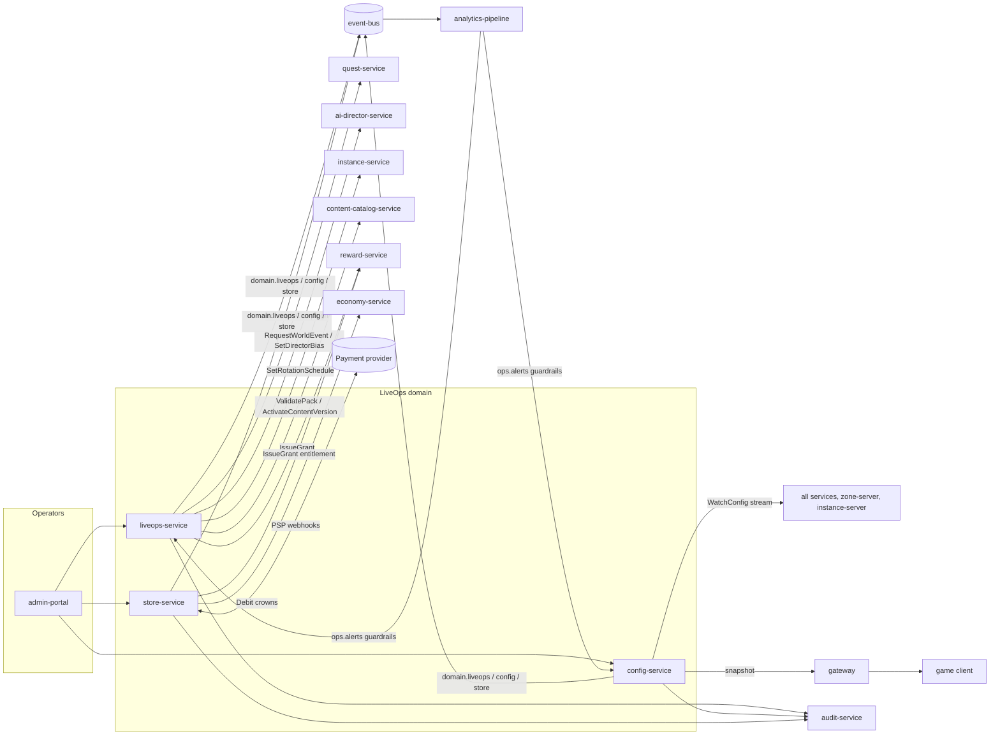
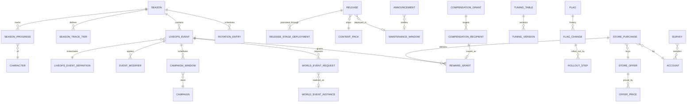
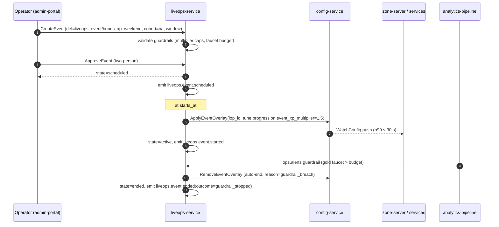

# Legends of the Shattered Frontier — Live Operations Architecture
## Version 1.0 — Expanded Technical Design Authority edition (2026-10-17)

Status: Design target; not implemented. Names per Shared Registry v1.0.

- Registry: [Shared Registry v1.0](Legends_Shattered_Frontier_Shared_Registry_v1.0.md)
- Short name: **LiveOps**. Part folder: [`LiveOps/`](LiveOps/)

---

## 1. Objectives

Live Operations turns a shipped MMO into an operated service. The LiveOps spec owns the tools, data, and rules that let a small operations team change the running game safely, on a schedule, and with measurable effect.

Objectives, in priority order:

1. **Safety before speed.** Every live change (event, flag, tuning value, release, store offer, compensation) is versioned, reviewed according to its blast radius, auditable, and reversible. A misconfiguration must be containable within seconds (kill switches) and reversible within minutes (rollback).
2. **A living calendar.** Players always have something time-limited to look forward to: one season active at all times, a weekly rotation of dungeon affixes, at least one LiveOps event per fortnight, and campaigns that make the server feel shared.
3. **Economic integrity.** LiveOps is the largest discretionary faucet in the game (event multipliers, compensation, season rewards). Every LiveOps faucet has a budget, a cap, and a guardrail metric, and economic review is mandatory for anything above them (Registry, Shared reward scaling functions: weights ≥ 5.0 need LiveOps economy review).
4. **No pay-to-win.** `currency/crowns` and the premium store sell cosmetics and convenience only. Crowns never convert into gold, stat-budget items, XP, or skill gains (Registry, Currencies). This rule is enforced in code, in content validation, and in review.
5. **Data-driven operation.** Every LiveOps action emits a domain event; Analytics measures outcome against KPI targets (retention, DAU/MAU, churn, engagement) and guardrails trigger automatic rollback.
6. **Agent-implementable.** The design is precise enough for coding agents to implement services, schemas, and tests without inventing names.

## 2. Scope and non-goals

### 2.1 In scope

| Area | Summary | Part |
| --- | --- | --- |
| Event framework | LiveOps events (`liveops_event_kind`: `scheduled`, `triggered`, `dynamic`), definition schema, trigger rule language, state machine, interplay with world events and campaigns | [Events and Seasons](LiveOps/Legends_Shattered_Frontier_LiveOps_Events_and_Seasons_v1.0.md) |
| Seasons | 12-week structure, season track, `currency/season_tokens` lifecycle, affix and raid-tier rotations | Events and Seasons |
| Event economy | XP/loot multiplier caps, gold faucet budget, frontier marks during events | Events and Seasons |
| Balancing operations | Feature flags, tuning tables, targeting, propagation, kill switches, safe rollout, automatic rollback | [Config and Releases](LiveOps/Legends_Shattered_Frontier_LiveOps_Config_and_Releases_v1.0.md) |
| Release management | dev → ptr → staging → prod, maintenance windows, canary realms, hotfix path, content packs, launcher coordination | Config and Releases |
| Premium store | Crowns, offer schema, pricing guardrails, purchases, refunds, fraud | [Store, Compensation and Community](LiveOps/Legends_Shattered_Frontier_LiveOps_Store_Compensation_Community_v1.0.md) |
| Compensation | Idempotent single and mass grants via `reward-service` | Store, Compensation and Community |
| Community tools | Announcements, message of the day, surveys, status dashboards | Store, Compensation and Community |
| GM tools | `admin-portal` GM section: roles, approvals, audit | Store, Compensation and Community |
| KPIs and operations | KPI targets, operations calendar, on-call | Store, Compensation and Community |
| Interfaces | gRPC APIs, event payloads, analytics hooks, security, agent implementation guide | [APIs, Events and Implementation](LiveOps/Legends_Shattered_Frontier_LiveOps_APIs_Events_Implementation_v1.0.md) |

### 2.2 Non-goals

- **World simulation events.** Invasions, world bosses, and caravan attacks are World Events owned by the AI spec and run by `ai-director-service`. LiveOps may *request* or *bias* them but never runs simulation logic.
- **Campaign logic.** Campaign stages, contribution rules, and communal progress belong to the Quest spec (`quest-service`). LiveOps only schedules campaign windows.
- **Build and deploy pipelines.** CI, artifact building, Kubernetes rollout mechanics, and infrastructure are DevOps spec territory. LiveOps owns the *release record*, promotion gates, and the operator-facing decision to promote or roll back.
- **Client file delivery.** Manifests, patches, and the launcher are owned by the Client delivery spec. LiveOps coordinates timing and minimum client build.
- **Metric definitions.** Analytics owns metric formulas, pipelines, dashboards, and alert evaluation. LiveOps sets *targets* and *guardrails* using Analytics metric names.
- **Payment processing.** Card handling is delegated to an external payment service provider (PSP). `store-service` never sees raw card data (PCI scope reduction).
- **Enforcement.** Sanctions and rollbacks are Security spec; LiveOps reports signals and consumes sanctions (e.g., store restrictions).
- **Power ladder changes.** The ilvl ladder is fixed by the Registry; seasonal ilvl uplift is out of scope for v1.0 (see Registry additions / open issues).

## 3. Glossary pointer

All shared terms (LiveOps Event, World Event, Campaign, Season, Feature Flag, Kill switch, Tuning Table, Content Pack, Realm, Datacenter Region, Reset) are defined in the Registry glossary. Terms local to this spec:

| Term | Definition |
| --- | --- |
| Blast radius | The share of players or economy affected by a change: `realm`, `dc_region`, `global`. Determines approval tier. |
| Bake time | Minimum observation time at a rollout step before advancing. |
| Canary realm | A production realm designated to receive releases and rollouts first in its `dc_region`. |
| Cohort | Targeting selector: set of (`environment`, `dc_region`, `realm_id`, percentage bucket, allowlist). |
| Event modifier | A typed effect a LiveOps event applies while active (XP multiplier, loot multiplier, vendor, campaign window, …). |
| Faucet budget | Maximum event-attributable creation of a currency per realm per day. |
| Guardrail | A metric threshold that, when breached during a rollout or event, triggers automatic pause or rollback. |
| Offer | A purchasable store item defined by a `store_offer/<slug>` content definition plus a runtime price. |
| Operations calendar | The merged, time-ordered view of seasons, events, campaigns, rotations, releases, maintenance windows, and store promotions. |
| Season points (SP) | Non-currency progress counter that advances the season track. |
| Two-person rule | A mutating admin action requires an approver distinct from the requester. |

## 4. Architecture and service ownership

### 4.1 Services owned

| Service | Kind | Owns | Publishes | Schema |
| --- | --- | --- | --- | --- |
| `liveops-service` | stateless + DB | LiveOps events (`lop_`), seasons (`ssn_`), season progress, campaign schedule entries, releases (`rel_`), maintenance windows, announcements (`ann_`), surveys (`srv_`), compensation (`cmpg_`), operations calendar | `liveops` | `liveops` |
| `config-service` | stateless + DB + push | Feature flags (`ff.*`), tuning tables (`tune.*`), kill switches, reset schedules, rollouts, flag/tuning change history (`cfg_`) | `config` | `config` |
| `store-service` | stateless + DB | Store catalog (runtime prices and placements for `store_offer/*`), purchases (`pur_`), entitlement delivery orchestration, refunds | `store` | `store` |
| `admin-portal` (GM tools part) | web UI | none — calls admin APIs of the above and of other services; every action audited | — | — |

### 4.2 Dependencies

| Depends on | Why | Direction |
| --- | --- | --- |
| `reward-service` | Season track rewards, event rewards, compensation; all grants with source `season_reward`, `liveops_compensation`, or authoring source | LiveOps → reward |
| `economy-service` | Crowns and season token wallets; crowns debit on purchase; faucet telemetry (`economy.currency.credited`) | store/liveops → economy |
| `inventory-service`, `progression-service` | Entitlements via `reward-service` only (cosmetics, account unlocks); never called directly for grants | indirect |
| `quest-service` | Campaign windows (`ScheduleCampaign`, `CancelCampaign`) | liveops → quest |
| `ai-director-service` | World event requests and bias windows (`RequestWorldEvent`, `SetDirectorBias`) | liveops → director |
| `instance-service` | Affix and raid-tier rotation schedules (`SetRotationSchedule`) | liveops → instance |
| `content-catalog-service` | Content pack validation, pack activation per cohort | liveops → catalog |
| `world-service` | Realm list, realm status, maintenance drain/lock | liveops → world |
| `auth-service` | Account lookup, session history for compensation targeting, login gate during maintenance | liveops → auth |
| `audit-service` | Every privileged action appended | all → audit |
| `anticheat-service`, `enforcement-service` | Fraud and abuse signals; store and gifting restrictions from sanctions | bidirectional |
| `analytics-pipeline` | Guardrail metric evaluation feeds (`ops.alerts`), KPI dashboards | analytics → config/liveops |
| `gateway` | Client config snapshot, MOTD, store browse, status page | gateway → liveops/config/store |

### 4.3 Component diagram

### 4.4 Authority rules specific to LiveOps

1. **LiveOps never creates items or currency directly.** All rewards flow through `reward-service`; crowns are credited and debited by `economy-service` on request from `store-service`.
2. **config-service is the only runtime source of `ff.*` and `tune.*` values.** Services may not hard-code an override; compiled defaults are used only when the config snapshot is unavailable and must equal the Registry default.
3. **LiveOps schedules; owners execute.** `quest-service` runs campaigns, `ai-director-service` runs world events, `instance-service` applies affix rotations at reset, `content-catalog-service` serves packs.
4. **Every admin mutation** carries an `idempotency_key`, an `actor` (operator account), a `reason_code`, and, where required, an `approver`; it produces an `audit.record.appended`.
5. **Economy review gate.** Any LiveOps event whose computed faucet exceeds its budget, any reward weight ≥ 5.0, any compensation above tier limits, and any store offer touching a new item category requires `economy_analyst` approval in `admin-portal`.

## 5. Core model

### 5.1 Entity relationships

### 5.2 Runtime entities (Registry prefixes)

| Entity | Prefix | Service | Notes |
| --- | --- | --- | --- |
| LiveOpsEvent | `lop_` | liveops-service | Runtime schedule entry for a `liveops_event/<slug>` definition, scoped to a cohort. |
| Season | `ssn_` | liveops-service | Runtime season for a `season/<slug>` definition; one `active` per environment. |
| Release | `rel_` | liveops-service | A versioned bundle of server build, client build, and content version promoted across `release_stage`. |
| Announcement | `ann_` | liveops-service | MOTD, banners, launcher news, status notes. |
| Survey | `srv_` | liveops-service | Targeted in-game survey; responses arrive as `client.survey.submitted`. |
| CompensationGrant | `cmpg_` | liveops-service | A campaign of grants to a recipient set; each recipient becomes one `rwg_`. |
| FlagChange / TuningVersion | `cfg_` | config-service | Every change to a flag or tuning table, including rollout steps and rollbacks. |
| StorePurchase | `pur_` | store-service | One purchase of one offer (real money or crowns). |

Keyed rows without prefixes: `season_progress` (`season_id` + `character_id`), `flag` (key), `tuning_table` (key), `offer_price` (`offer_id` + `currency` + `effective_from`), `compensation_recipient` (`compensation_id` + `character_id`), `maintenance_window` (proposed prefix `mnt_`, see Registry additions).

### 5.3 Content definition kinds owned

| Kind | Example | Schema location |
| --- | --- | --- |
| `liveops_event` | `liveops_event/harvest_festival` | Events and Seasons, Event definition schema |
| `season` | `season/s1_shattered_dawn` | Events and Seasons, Season definition |
| `store_offer` | `store_offer/frost_wolf_mount` | Store, Compensation and Community, Offer schema |

All three are authored in the content repository, validated by `content-catalog-service` validators supplied by LiveOps, and published in content packs. Runtime scheduling (`lop_`, `ssn_`) and pricing (`offer_price`) are operational data, not content, so they can change without a content pack.

### 5.4 Canonical lifecycle states used

| Enum | Values | Defined in |
| --- | --- | --- |
| `liveops_event_kind` | `scheduled`, `triggered`, `dynamic` | Events and Seasons |
| `liveops_event_state` | `draft`, `scheduled`, `active`, `ended`, `cancelled`, `archived` | Events and Seasons, Event state machine |
| `season_state` | `upcoming`, `active`, `ended` | Events and Seasons, Season state machine |
| `campaign_state` | owned by Quest; LiveOps reads `scheduled`, `active`, `completed`, `failed`, `archived` | Quest spec, Campaigns |
| `release_stage` / `environment` | `dev`, `ptr`, `staging`, `prod` | Config and Releases |
| `reward_grant_state` | owned by Itemization; LiveOps reads all values | Itemization spec, Reward grants |

Registered enums (`release_state`, `compensation_state`, `purchase_state`, `rollout_state`, `service_status`) are listed in the Shared Registry. Staff roles use the Security spec's `staff_role` enum.

### 5.5 End-to-end flow: a bonus weekend

## 6. Table of contents

| Part | File | Contents |
| --- | --- | --- |
| Entry | this file | Objectives, scope, architecture, core model, Registry additions |
| 1 | [Events and Seasons](LiveOps/Legends_Shattered_Frontier_LiveOps_Events_and_Seasons_v1.0.md) | Event framework, definition schema, trigger rule language, event state machine, world event and campaign interplay, seasons, season track, season tokens, rotations, event economy guardrails, `liveops` schema (events/seasons) |
| 2 | [Config and Releases](LiveOps/Legends_Shattered_Frontier_LiveOps_Config_and_Releases_v1.0.md) | Feature flags, tuning tables, targeting, propagation, kill switches, safe rollout and automatic rollback, release management, maintenance, canary realms, hotfixes, content pack publication, launcher coordination, `config` schema, `liveops` release tables |
| 3 | [Store, Compensation and Community](LiveOps/Legends_Shattered_Frontier_LiveOps_Store_Compensation_Community_v1.0.md) | Premium store, crowns, offers, pricing guardrails, refunds, compensation grants, community tools, GM tools, KPIs and targets, operations calendar, on-call, `store` schema, `liveops` community and compensation tables |
| 4 | [APIs, Events and Implementation](LiveOps/Legends_Shattered_Frontier_LiveOps_APIs_Events_Implementation_v1.0.md) | gRPC APIs for all three services, payloads for every `liveops.*`, `config.*`, `store.*` event, analytics hooks, security considerations, agent implementation guide |

Cross-references to other specs: Economy spec (Currency model, Inflation controls), Quest spec (Campaigns), AI spec (World Director), Dungeon spec (Dungeon affixes, Mythic scaling), Raid spec (Raid tiers), Itemization spec (Reward bundles and grants), Security spec (Audit, Enforcement), Analytics spec (Metric definitions, Alerting), DevOps spec (Deployment Flow), Client delivery spec (Release Channels, Master Manifest Definition).

## 7. Design principles (summary)

1. **Overlay, never mutate.** Events change behavior by layering time-boxed config overlays on top of base tuning; ending an event removes its overlay, so "undo" is structural.
2. **Every number has a key.** All LiveOps constants are `tune.liveops.*`, `tune.store.*`, or `tune.config.*` keys with defaults in this spec.
3. **Budgets are computed, not guessed.** Faucet impact of an event is estimated before approval with the formulas in Events and Seasons, Event economy guardrails, and measured live against the same budget.
4. **Fail closed for money, fail safe for gameplay.** If `store-service` cannot confirm a crowns debit, no entitlement is granted; if `config-service` is unreachable, services run on the last known snapshot and kill switches default to their safe value.
5. **One active season, many small events.** The season is the backbone; events are seasoning.

## 8. Registry additions

> **Merge status (2026-10-17):** the additions below were merged into the Shared Registry (see its change log), with these rulings: LiveOps `gm_role` → Security `staff_role`; trade window uses `tune.loot.trade_window_minutes` only. The registry is now authoritative for these names; rows here remain as justification.

The additions below have been merged into the Shared Registry (change log, phase-1 row). The Registry is authoritative; the rows remain as rationale and ownership notes.

### 8.1 Entities and ID prefixes

| Addition | Justification |
| --- | --- |
| Entity `MaintenanceWindow`, prefix `mnt_`, owner `liveops-service`, schema `liveops` | Maintenance windows are referenced by releases, announcements, compensation targeting, and status pages; they need a stable ID. |
| Entity `RolloutPlan`, no prefix (keyed by `cfg_` of the change it rolls out) | Documented here to make clear no new prefix is required. |

### 8.2 Enums

| Enum | Values | Justification |
| --- | --- | --- |
| `release_state` | `draft`, `candidate`, `deploying`, `deployed`, `rolled_back`, `superseded` | Release lifecycle per stage; Registry fixes stages but not release states. |
| `rollout_state` | `pending`, `in_progress`, `paused`, `completed`, `rolled_back` | Shared by flag/tuning rollouts and canary release bake; Analytics alerting needs stable names. |
| `compensation_state` | `draft`, `pending_approval`, `approved`, `issuing`, `completed`, `partially_failed`, `cancelled` | Mass grant progress tracking. |
| `purchase_state` | `pending`, `authorized`, `completed`, `failed`, `refunded`, `charged_back` | Store purchase lifecycle; Security and Analytics consume it. |
| `service_status` | `operational`, `degraded`, `partial_outage`, `major_outage`, `maintenance` | Status dashboard; also useful to `world-service` realm status. |
| `announcement_channel` | `motd`, `login_banner`, `in_game_toast`, `launcher_news`, `status_page` | Shared with gateway and client UI. |
| `event_modifier_kind` | see Events and Seasons, Event modifiers | Consumers (progression, loot, economy) must recognize the overlay kinds. |

### 8.3 Events

| Event | Owner | Justification |
| --- | --- | --- |
| `liveops.event.cancelled` | liveops-service | `liveops_event_state` has `cancelled` but no event; consumers (quest-service, client calendar) must retract scheduled windows. |
| `liveops.release.rolled_back` | liveops-service | Rollbacks must be distinguishable from deployments for incident analytics. |
| `liveops.maintenance.scheduled` | liveops-service | Gateway login gate and launcher news consume it. |
| `config.rollout.rolled_back` | config-service | Automatic rollback must be alertable separately from ordinary `config.flag.changed`. |

Until merged, cancellation is communicated by `liveops.event.ended` with `outcome = cancelled`, rollbacks by `liveops.release.deployed` with `deployment_kind = rollback`, and config rollbacks by `config.flag.changed` / `config.tuning.published` with `change_kind = auto_rollback`.

### 8.4 Source and sink codes

| Code | Kind | Justification |
| --- | --- | --- |
| `store_spend` | sink | Crowns debited for an offer. No canonical sink fits; using `vendor_purchase` would pollute gold-sink analytics. **Blocking for store launch.** |
| `store_refund` | source | Crowns re-credited when a crowns purchase is refunded. |
| `store_chargeback` | sink | Crowns clawed back after a real-money chargeback. |
| `season_conversion` | source | Gold credited when leftover season tokens convert at season end. Interim: `season_reward` with `reason_code = season_token_conversion`. |

### 8.5 Tuning keys and constants proposed as cross-domain

| Key | Default | Consumers | Justification |
| --- | --- | --- | --- |
| `tune.progression.event_xp_multiplier` | 1.0 | progression-service | Event overlay for XP; must be read by Character spec XP grant path. |
| `tune.loot.event_drop_multiplier` | 1.0 | loot-service | Event overlay for eligible drop chances (Itemization). |
| `tune.economy.event_marks_multiplier` | 1.0 | economy-service / reward-service | Event overlay on `marks_reward(w)`; weekly cap unchanged. |
| `tune.liveops.season_length_weeks` | 12 | Character, Quest, Analytics | Season cadence assumptions. |
| `tune.liveops.season_token_conversion_cap` | 1,000 | Economy | Gold faucet from season end. |
| `tune.liveops.max_combined_xp_multiplier` | 2.5 | Character | Ceiling on event × catch-up XP (Character's `M_COMBINED_CAP`); rested and diversity stack on top only up to Character's activity cap 3.0 (Character spec, Leveling part, Multiplier caps). |
| `tune.economy.event_gold_reward_multiplier` | 1.0 | economy-service / reward-service | Event overlay on `gold_reward(L, w)`. |
| `tune.gathering.event_yield_multiplier` | 1.0 | crafting-service, zone-server | Event overlay on gathering yield (Crafting spec). |
| `tune.progression.event_skill_gain_multiplier` | 1.0 | progression-service | Event overlay on skill gain; Character anti-grind still applies. |
| `ff.content.disabled_definitions` (`set`) | empty | all content-consuming services | Content-level kill switch by content ID. |
| `ff.store.purchases_enabled`, `ff.liveops.compensation_enabled` | true | store-service, liveops-service | Kill switches (LiveOps-owned). |

### 8.6 Entity additions (store)

| Addition | Justification |
| --- | --- |
| Account-level store hold (row in `store`, no prefix) | Lets store-service block purchases pending enforcement without inventing a sanction type; Security may later map it to a `sanction_type`. |

### 8.7 Open issues

1. **Seasonal power progression.** The Registry power ladder is static. New raid tiers in later seasons will need either a ladder revision (e.g., +15 ilvl per season) or a season-scoped ladder; raised for Registry/Itemization/Raid decision.
2. **Crowns purchase source.** Registry lists `store_purchase` as a source; this spec uses it for crowns credited after a real-money purchase *and* for items granted by a store purchase. If Analytics needs to separate them, add `crown_topup`.
3. **Season token scope.** Registry says season tokens are earned and spent within a season; this spec holds them per character (wallet owner = `character_id`). Economy spec should confirm. Resolved (2026-10-17): Economy spec, Season tokens confirms the wallet owner is the character, realm-scoped and not tradeable.
4. **Metric names.** Metric names in this spec beyond `m_d7_retention` are proposed until defined in the Analytics spec.
5. **Staging launcher channel.** The Client delivery spec lists Production, Public Test Realm, and Internal Development channels; `release_stage` also has `staging`. This spec assumes an internal staging channel with production-format manifests; Client delivery should confirm.
6. **Cross-spec RPCs.** RPCs this spec calls on other services (`ScheduleCampaign`, `RequestWorldEvent`, `SetRotationSchedule`, `ActivateContentVersion`, `CheckRollbackSafety`, `DrainRealms`, `ReportSignal`, `RevokeGrant`) are requirements on those specs and must be confirmed there.
