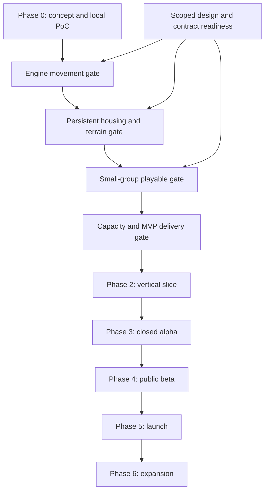
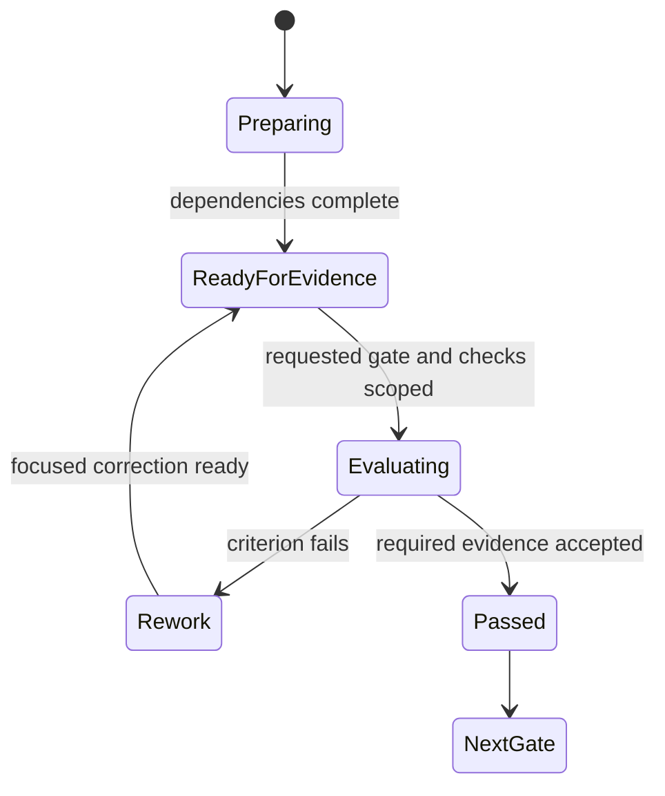

# Production Roadmap

## Purpose and decision model

This roadmap sequences technical proof, integrated gameplay, presentation, and operational scale. It is gate-driven because team capacity, reference hardware, engine build availability, and implementation velocity are not yet established. It contains no committed delivery dates or staffing estimates.

The current code is the local browser PoC. The next authorized development direction is the engine/movement milestone in [alpha plan](../alpha-plan.md). This document expands planning in place; existing filenames remain stable without introducing another version series.

Related contracts: [backlog](Legends_Shattered_Frontier_Gameplay_Feature_Backlog_v1.0.md), [MVP](Legends_Shattered_Frontier_First_MVP_Milestone_v1.0.md), [vertical slice](Legends_Shattered_Frontier_Vertical_Slice_Specification_v1.0.md), [debt standards](Legends_Shattered_Frontier_Technical_Debt_Standards_v1.0.md). The shared registry and owning domain specifications control names/behavior.

## Starting evidence

| Area | Current evidence | Unproven |
| --- | --- | --- |
| Sandbox loop | Browser gather/craft/build/dig and shared updates | Unreal equivalent |
| Persistence | Local SQLite snapshot/session implementation and existing checks | Production recovery, distributed transactions, long-running scale |
| Movement | Tile movement in browser | Third-person Unreal input/collision/replication |
| Ownership | Browser wall ownership/reclaim rules | Claims, doors, roofs, support, larger permission model |
| Progression/quest | Prototype skill counters and founder quest | Integration of expanded domain contracts |
| Networking | Local HTTP/SSE | Unreal replication and active-player capacity |
| Toolchain | [Read-only 2026-10-18 snapshot](../decisions/DEC-01-engine-evidence.md): VS/VC and SDK files found; inspected UE_5.8 root has only .egstore | Usable engine root/build, compatibility and successful project targets; no engine payload at the inspected root |
| Production design | Expanded planning plus domain references | Implemented services, measured budgets, launch capability |

Do not collapse “specified,” “implemented,” and “measured” into one percentage complete.

## Milestone dependency graph

Phase 1 is the persistent-world MVP and contains E1, H2, G3, and C4. These gate names are planning identifiers; H2 refers to the alpha plan's persistent housing/terrain milestone.

Design work happens just ahead of dependent implementation, not as an indefinite requirement to finish every launch document first. Missing terrain transaction semantics block terrain writes; they need not block camera movement.

## Phase 0 — architecture and local proof

### Goal

Prove the core gather → craft → build → shared observation → restart loop and identify the first engine risks.

### Deliverables and exit evidence

- Runnable browser harness with bounded rules and explicit limitations.
- Task/dependency map, conditional setup guide, and indexed design references.
- Local multiplayer and restart behavior evidence.
- Engine direction, toolchain discovery, and immediate E1 acceptance.
- List of unanswered architecture decisions with named dependent work.

The existing browser harness substantially covers this phase. Do not claim phase completion for unavailable environment evidence. Keep it runnable as a behavioral reference until an explicit retirement decision.

### Deferred

Final art, production microservice deployment, multi-region hosting, broad class balance, raids, sieges, and full voxel destruction.

## Phase 1A / E1 — engine and movement

### Entry

Known installed engine/build path, usable compiler/SDK, selected project directory, and relevant Unreal tool access. Project source-build requirements and dedicated-server feasibility must be recorded.

### Deliverables

| Work | Backlog link | Exit |
| --- | --- | --- |
| C++ project and target setup | ENV-01/02 | Reproducible editor build; server-target feasibility explicit |
| Greenlands graybox | ENV-03 | Safe spawn and movement/interaction fixtures |
| Separate authority and two clients | ENV-04, MOV-01/02 | Shared movement and correct possession |
| Join/leave and target validation | MOV-03/04, INT-01 | No duplicate active pawn; invalid interaction denied |
| Baseline measurement | CAP-01 initial subset | Build/hardware identity and initial tick/frame/network capture |

### Gate review

The gate asks whether the engine foundation supports an authoritative movement slice. It does not require a market or durable terrain. If packaged dedicated-server build is not yet possible, distinguish the editor-server demonstration and leave final packaged readiness open rather than concealing it.

The [E1 implementation packet](../e1-implementation-packet.md) prepares proposed project/authority boundaries, the Greenlands fixture and focused evidence cards while installation completes. It does not satisfy DEC-01 entry, create a project or certify target/launch behavior.

### Primary risks

Engine installation/source availability, target compatibility, session assumptions, and premature plugin coupling. Mitigate by building the smallest map and shared gameplay target before importing large content packages.

## Phase 1B / H2 — persistent housing and bounded terrain

### Entry

E1 movement/interaction is stable. PER-01 has selected transaction topology, command receipts, durable state owners, migration approach, and recovery semantics.

### Deliverables

- Inventory and trusted command boundary.
- Mining/logging, one material recipe chain.
- Personal claims with foundation/wall/door/roof.
- Ownership/access/reclaim and support/collision policy.
- Bounded terrain representation and saved chunk revisions.
- Duplicate/conflict/crash tests for each new persistent mutation.
- Isolated backup/restore rehearsal.

### Exit

Two clients observe construction/resource changes; unauthorized mutation rejects; acknowledged changes survive abrupt restart; inventory/material/structure effects reconcile; protected terrain cannot invalidate another owner's structure.

### Scope cuts

Reduce supported recipes, piece variants, or edit radius before cutting transaction safety, permission checks, or recovery. Tile or simple chunk experiments may inform terrain design, but final H2 claims must identify the actual representation and limitations.

## Phase 1C / G3 — playable small-group alpha gate

### Entry

Persistent inventory/world contracts pass focused recovery cases. Character, Itemization, Quest, Security, and Analytics integration points are ready for the subset used here.

### Deliverables

| Area | Minimum |
| --- | --- |
| Combat | One attack, one enemy, server result and defeat/recovery |
| Progression | Approved use-based skill integration |
| Quest | Authored chain and one-time reward through owning domains |
| Social exchange | Direct trade with atomic settlement |
| Session | Reconnect, safe spawn, single writable presence |
| Observability | Tick/frame/response/bandwidth/errors and durable operation outcomes |
| Tester operations | Known candidate, fixture, recovery instructions, limitations |

### Exit

A small invited group completes the core journey without hidden repair. Contention and disconnect cases do not duplicate assets or rewards. Record actual group size rather than presenting the 100-player target as already achieved.

The term “small-group alpha” is an internal technical gate inside MVP. It is distinct from the later closed-alpha product phase.

## Phase 1D / C4 — measured capacity and MVP delivery

### Entry

The G3 loop is stable. Scope includes a restricted fixed-price marketplace, compatible packaged client/server, and bounded update/repair delivery. Reference hardware/workload and numerical budgets are ratified.

### Deliverables

- Market listing/purchase/cancel with escrow/ledger reconciliation.
- Active workload scenarios at 10, 25, 50, then 100 concurrent participants.
- Final two-hour mixed soak and representative client measurement.
- Packaged dedicated server and compatible client.
- Update interruption/repair and wrong-version rejection.
- Backup, schema compatibility, drain/restart, and rollback rehearsal.
- Candidate report linking actual measurements and remaining debt.

### Exit

All required MVP gates have evidence; 100-player active capacity is measured under declared density/workload; no critical/uncontained high risk affects the release path. The 200-player tier is optional investigation. Thousands of concurrent users remain future scale targets.

Select only scenarios and capacity tiers relevant to the requested gate or change. Preparing this plan does not authorize a full-suite test run.

### Infrastructure policy

Introduce PostgreSQL, caching, additional zones, queues, or separate services when persistence requirements or measured load justify them. The long-term backend design is direction, not a requirement to provision every system before the first test group.

## Phase 2 — vertical slice

### Goal

Make the validated technology and core loop understandable and coherent for a new tester.

### Entry and deliverables

Enter after the MVP's authority/recovery paths are stable. Follow the Vertical Slice Specification for Greenlands content, first-session journey, UI feedback, readable combat, audio/visual coherence, and revisit behavior.

Add representative content density without weakening budgets. Preserve one known stable fixture and one fresh-player fixture. Test the complete experience with selected participants and retain product findings separately from technical defects.

### Exit

A tester can join, gather, craft, build, fight/recover, complete the quest, exchange, and revisit without console assistance. The candidate is reproducible, privacy-safe, recoverable, and measured with representative content.

### Deferred

Large content quantity, four biomes, raid progression, guild governance, live store, and commercial-scale operations.

## Phase 3 — closed alpha

### Goal

Validate repeated play, social behavior, progression, and operational learning with a bounded invited population.

### Entry

Vertical slice acceptance; trusted account/session/admin mechanisms; explicit tester/data handling plan; recoverable deployed environment; support/incident owners; approved scope and hosting cost.

### Deliverables

- Longer-running world with controlled content/config rollout.
- Progression/economy monitoring and reconciliation.
- Onboarding, bug reporting, moderation/incident escalation.
- Bounded additional content selected from measured player needs.
- Capacity growth only through recorded workload gates.
- Restore and incident drills on representative data.
- Defined policy for wipes, resets, and compensation before inviting players.

### Exit

Repeat sessions are usable and stable; critical data-integrity/security issues are resolved; retention/experience findings guide scope; operations can detect and recover from failures. No fixed retention percentage is invented before population and measurement design are defined.

Dungeons, additional professions, and richer events may enter here only through their domain readiness and approved backlog scope.

## Phase 4 — public beta

### Goal

Validate broader access and operational readiness at a measured population.

### Entry

Explicit approval for public access, privacy/security review of exposed systems, capacity and cost plan, support coverage, compatibility/update process, and incident/recovery evidence.

### Deliverables

- Enrollment/load admission limits based on evidence.
- Public delivery and repair workflow.
- Reliable updates with code/data compatibility.
- Abuse handling, moderation, audit, and support procedures.
- Representative load/failure campaigns requested and recorded.
- Product balance/content readiness for the advertised beta scope.

### Exit

The advertised beta behavior, population, reliability, and recovery expectations are supported by evidence. Feature flags and emergency procedures are tested. Remaining launch blockers have named owners and bounded closure plans.

Public beta is not a license to expose a local-only prototype or rely on trusted testers.

## Phase 5 — launch

### Goal

Operate the explicitly approved launch product with sustainable support, delivery, and recovery.

The concept proposes four biomes. Treat that as a launch-scope target requiring content, performance, and operational evidence; do not quietly redefine one Greenlands region as a four-biome launch.

### Entry requirements

| Dimension | Required decision/evidence |
| --- | --- |
| Product | Approved launch features and content boundaries |
| Capacity | Admission/load targets and measured headroom |
| Data | Migration, restore, compatibility and incident rehearsal |
| Security | Exposed-path review, privileged access, abuse response |
| Delivery | Compatible signed artifacts, update/rollback, repair |
| Operations | Named incident/support ownership and cost controls |
| Content | Maps/quests/items validated against canonical definitions |
| Communications | Claims match supported behavior and measured population |

No launch date or concurrency number is committed by this roadmap. An agent may prepare a candidate; release/publication requires the actual task authorization.

## Phase 6 — expansion pipeline

### Goal

Add regions, professions, events, and endgame without arbitrary destructive resets or incompatible character data.

Entry: the live product's update, restore, compatibility, and capacity processes are stable. New content must use existing ID/ownership rules and migration-compatible definitions.

Each expansion proposal includes access path, region ownership/handoff policy, terrain/save compatibility, progression/economy impact, content budget, test scenarios, rollout/rollback, and operational cost.

A portal or ship is not sufficient evidence of seamless cross-zone transfer. If handoff is introduced, its lease, transfer receipt, disconnect, and recovery contract must be designed and measured first.

## Cross-cutting workstreams

| Workstream | E1 | H2/G3 | C4/VS | Alpha onward |
| --- | --- | --- | --- | --- |
| Architecture | Movement/target ownership | Atomic writes and domain adapters | Capacity and compatibility | Extraction/handoff as evidence requires |
| Data | Build/config identity | Durable schemas/receipts | Restore and migration | Retention, larger datasets, operations |
| Security | Trusted input boundary | Session, ownership, private projection | Packaged/exposed-path checks | Abuse/admin/incident processes |
| Content | Graybox fixtures | Minimal useful definitions | Coherent first journey | Broader validated content |
| Diagnostics | Initial timings | Operation failures/queues | Load/soak reports | Operational alerts and product metrics |
| Delivery | Repeatable local build | Candidate manifests | Packaged update/repair | Controlled public release |
| Documentation | Actual dependency map | Contracts and recovery | Evidence/runbooks | Keep current; retire stale references |

The protected domain documents are inputs maintained by the other session. Coordinate interface readiness through the shared registry; do not rewrite them in this planning task.

## Decision register

These are planning decision IDs, not public entities.

| ID | Decision | Owner role | Needed by |
| --- | --- | --- | --- |
| DEC-01 | Installed engine/source path and reproducible server target — [evidence snapshot](../decisions/DEC-01-engine-evidence.md), usable engine-root prerequisite blocked | Engine owner | E1 / final packaged gate |
| DEC-02 | MVP backend topology and atomic world/inventory coordination — [reconciled proposal](../decisions/DEC-02-durable-actions.md), acceptance pending | Architecture + persistence | H2 |
| DEC-03 | Terrain format, support/collision, chunk/edit limits — [adoption proposal](../decisions/DEC-03-terrain.md), acceptance/evidence pending | World + engine | H2 |
| DEC-04 | Session/authentication and active-character lease — [applicability proposal](../decisions/DEC-04-session-applicability.md), acceptance and admission/revocation evidence pending | Backend + Security | G3 |
| DEC-05 | Reference machines, density, workload and ratified budgets | Performance + project owner | C4 |
| DEC-06 | Restricted market item subset and escrow settlement | Economy + Itemization | C4 |
| DEC-07 | Binary asset storage and artifact hosting | Repository + operations | Content growth / delivery |
| DEC-08 | Compatibility/update and rollback contract — [compatibility proposal](../decisions/DEC-08-compatibility.md), schema/codec choices, acceptance and C4 evidence pending | Delivery + persistence | C4 |
| DEC-09 | Exposed alpha hosting, cost and data handling | Project owner + operations | Closed alpha |

A decision is ready when the selected option, alternatives, evidence, consequences, and revisit trigger are recorded. Until then, dependent work remains blocked or explicitly experimental.

## Risk register

| Risk | Early signal | Mitigation / trigger | Owner role |
| --- | --- | --- | --- |
| Scope expands before core proof | Many new systems, no recovered shelter | Keep E1/H2/G3 dependencies; cut optional content | Project direction |
| Cross-domain duplication | Inventory/world owners differ without protocol | Resolve DEC-02 before durable mutations | Architecture |
| Engine/server build unavailable | Editor runs but target cannot build | Confirm source/toolchain feasibility early | Engine |
| Unreal performance unknown | No representative trace | Baseline at E1; measure before advanced stack changes | Performance |
| Competing specs | Names/states differ by document | Use registry; record local proposals and reconcile | Domain owners |
| Concurrent document overwrite | Shared index loses another session's rows | Reread and patch only owned section | Editing agent |
| Content hides broken mechanics | Demo requires admin fixes | Acceptance journey without hidden repair | Slice owner |
| Capacity overclaim | Idle sockets reported as active players | Declare workload/density and retain report | Validation |
| Recovery unproven | Backups exist but never restored | Isolated rehearsal before persistent testers | Persistence |
| Operational overload | No owner for incidents/support | Bound population and assign roles before exposure | Operations |
| Agent cost/context growth | Repeated broad reads and speculative tasks | Dependency map, narrow checks, short handoffs | Coordinating agent |

Risks are not automatically accepted debt. Create debt records when a compromise is knowingly retained; create feature/decision work when capability is simply unimplemented.

## Planning cadence and scheduling

Use short milestone planning intervals chosen by the project owner. Review the current gate, critical path, blockers, evidence, and scope changes; do not generate a recurring automation without a request.

Estimate a work item only after its acceptance and dependencies are clear. Separate implementation, content, verification, integration, and uncertainty. Use ranges based on actual completed work when available. Do not fabricate developer weeks or percentage completion from document length.

Work-in-progress limit proposal: one primary integration path per active gate, plus independent bounded tasks whose file ownership is clear. Finish the authoritative vertical path before starting multiple partially integrated variants.

## Gate review state machine

A gate can pass only with its actual criteria and limitations recorded. An early prototype may be useful without passing a later gate. If criteria change, record the scope decision and reassess affected evidence; do not silently move the finish line.

## Change and retirement policy

Changing milestone scope requires the human project owner's direction when it alters the promised outcome. Update backlog dependencies, gate criteria, and affected reference summaries together. Preserve evidence explaining the old/current behavior where needed for compatibility.

Retire the browser harness only when its useful behavioral checks are replaced or intentionally abandoned and the user approves that scope. Do not remove it as collateral of creating GameClient.

Do not rename all design files solely to remove suffixes. Stable links and Git history suffice while the project is starting; filename cleanup is a separate optional task.

## Registry additions

None. Gate, phase, risk, and decision IDs are planning metadata. All runtime names remain registry/domain-owned.
