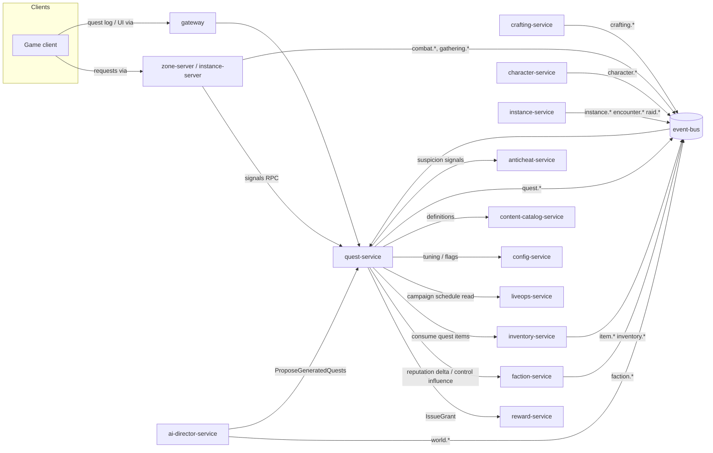
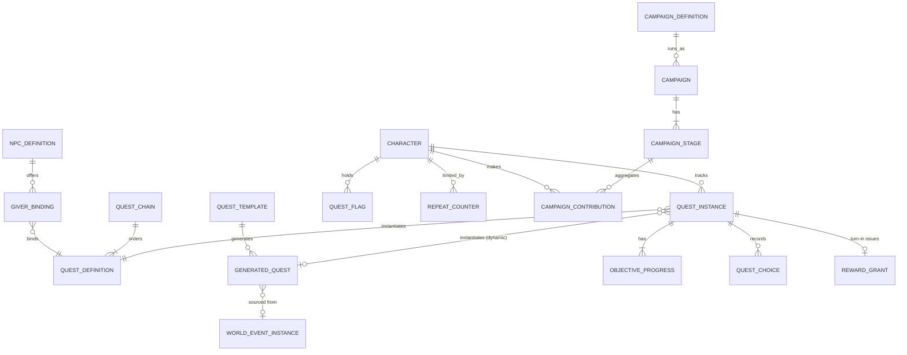

# Legends of the Shattered Frontier — Quest Architecture

Version 1.0 — Expanded Technical Design Authority edition (2026-10-17)

Status: Design target; not implemented. Names per Shared Registry v1.0.

Back-links: this is the Quest entry file. Binding names: [Shared Registry](Legends_Shattered_Frontier_Shared_Registry_v1.0.md).

---

## 1. Overview

Quests are the main structured progression path of the Shattered Frontier. They give players direction while the persistent world (World spec), factions and the world director (AI spec), the player economy (Economy spec), and settlements (Building spec) keep changing underneath them. The quest system therefore has two jobs:

1. **Authored progression**: story chains, profession (crafting) introductions, exploration arcs, faction storylines, and dungeon or raid attunement quests. These are hand-written content definitions (`quest/<slug>`, `quest_chain/<slug>`) published in content packs.
2. **Reactive progression**: dynamic quests generated at runtime (`gqd_` GeneratedQuest) from templates (`quest_template/<slug>`), driven by world state from `ai-director-service` and `faction-service`. Server-wide **Campaigns** (`campaign/<slug>`, runtime `cmp_`) pool the effort of a whole realm toward shared stages.

The skeleton's structure still applies to every quest: **Trigger → Objectives → Rewards → World Impact**. This expanded edition makes each step precise:

- **Trigger**: what makes a quest available to a character (giver NPC, item, zone entry, world event, chain step, generator).
- **Objectives**: typed, server-evaluated conditions whose progress comes only from authoritative domain events or server signals.
- **Rewards**: always a **Reward Bundle** issued through `reward-service`, scaled by the registry reward functions (`xp_reward`, `gold_reward`, `marks_reward`, `lp_reward`).
- **World impact**: bounded, idempotent effects such as faction reputation, faction-control influence, world flags, chain unlocks, and campaign contribution, requested from the owning services.

The only canonical quest today is `quest/frontier_founder`. In the proof of concept (`server/world.js`) it is a boolean `questDone` flag. The player builds three walls (`skills.building >= 3`), returns within 2 tiles of the settlement beacon, and receives 10 coins. The **Quest Model and Objectives** part re-expresses it in the target model as a `story` quest with one `build` objective and a reward bundle.

## 2. Scope and non-goals

In scope (owned by `quest-service`, Quest spec):

- Quest types (registry `quest_type`), the quest definition schema, and authoring rules.
- The objective type catalog and server-side progress evaluation.
- The quest instance lifecycle (registry `quest_instance_state`).
- Chains, branching narrative, choices, and how choices persist.
- Dynamic quest generation: templates, grammar, validation, deduplication, expiry, and LLM-assisted text with guardrails.
- How quest-giver NPCs bind to quests and project their dialog state.
- Quest reward weights and modifiers on top of the registry reward functions, and repeatable and daily/weekly limits.
- Campaign runtime: communal progress, stage thresholds, contribution caps, and the campaign state machine (registry `campaign_state`).
- Group quest sharing and shared credit.
- Economic balancing targets for the quest faucet.
- The `quest` PostgreSQL schema, the `lsf.quest_service.v1` gRPC API, and payloads for all `quest.*` events.
- Quest analytics hooks and quest-specific security.

Non-goals (owned elsewhere; Quest consumes them):

| Concern | Owner |
| --- | --- |
| XP curve `xp_to_next(L)`, LP, level and skill gain, anti-grind for skills | Character spec (`progression-service`) |
| Reward bundle schema, grant fan-out, loot tables, item stat budgets | Itemization spec (`reward-service`, `loot-service`) |
| Currency caps (including `FRONTIER_MARKS_WEEKLY_CAP` enforcement), gold ledger, inflation index | Economy spec (`economy-service`) |
| World events, spawn pressure, NPC behaviour trees, faction AI, faction control resolution | AI spec (`ai-director-service`, `faction-service`) |
| Campaign scheduling, seasons, kill switches, compensation | LiveOps spec (`liveops-service`, `config-service`) |
| Instance runs, lockouts, encounters | Dungeon and Raid specs |
| Structures, settlements, claims | Building spec |
| Detectors, risk score, sanctions | Security spec |
| Quest UI layout, dialog presentation, voice-over | Client (not specified here) |

Quests never create items or currency directly. Quests never write another service's data. Quests never accept progress reported by a game client.

## 3. Glossary pointer

All shared terms (Campaign, Reward Bundle, Reward Grant, Difficulty, Progression Band, Reset, and so on) are defined in the Shared Registry glossary. The following quest-local terms are used in this spec only and are **not** registry entities:

| Term | Meaning |
| --- | --- |
| Objective | One typed completion condition inside a quest definition (e.g. `kill` 8 × `npc/ash_wolf`). Not a separate entity; progress rows are keyed by `quest_instance_id` + `objective_key`. |
| Objective key | Stable slug of an objective within its quest definition (e.g. `build_walls`). Immutable once published. |
| Signal | An authoritative server report (from `zone-server` or `instance-server`) that is not a domain event, used for `escort`, `defend`, `interact`, `explore` sub-zone points and similar objectives. |
| Choice node | A `choose` objective with mutually exclusive options and consequences. |
| Exclusive group | A set of quests or options where taking one permanently locks the others for the character. |
| Quest flag | A character-scoped boolean or integer that quests set and read (e.g. `greenhold.sided_with_wardens`). |
| Effective weight `w_eff` | The content weight passed to the registry reward functions after quest type, difficulty, repeat, and group modifiers. |
| Contribution point (CP) | The normalised unit of campaign progress. |
| Giver binding | The link between an NPC definition (`npc/<slug>`) and the quests it offers and accepts for turn-in. |

## 4. Architecture and service ownership

Ownership summary:

| Data | Owner | Store |
| --- | --- | --- |
| QuestInstance (`qst_`), objective progress, choices, quest flags, repeat counters | `quest-service` | PostgreSQL `quest` |
| GeneratedQuest (`gqd_`), generation requests, text variants | `quest-service` | PostgreSQL `quest` |
| Campaign runtime (`cmp_`), stages, contributions | `quest-service` | PostgreSQL `quest` (+ Redis counters) |
| Quest, chain, template, and campaign definitions | `content-catalog-service` (authored by the Quest domain) | content packs |
| Campaign schedule entries | `liveops-service` | PostgreSQL `liveops` |
| Reward grants | `reward-service` | PostgreSQL `reward` |
| Faction standing and control | `faction-service` | PostgreSQL `faction` |

Processing model:

- **Inbound events** are consumed from `domain.*` topics through a transactional inbox, deduplicated on `event_id`, and matched against an in-memory and Redis index of active objective subscriptions. See the Model and Objectives part, section "Progress evaluation".
- **Outbound events** use a transactional outbox: the state change and its `quest.*` event commit in one PostgreSQL transaction. A relay then publishes them to `domain.quest`, keyed by `character_id`. Campaign events are keyed by `campaign_id`.
- **Rewards** are requested with `idempotency_key = <qst_id>:turn_in` (or `<cmp_id>:<stage>:<chr_id>` for campaigns), so retries cannot double-grant.
- **Horizontal scale**: `quest-service` is stateless apart from PostgreSQL and Redis. Event consumers are partitioned by `character_id`, matching the topic key, so all events for one character are processed in order by one consumer.

## 5. Core model

Core invariants (the full checklist is in the Agent Implementation Guide part):

1. A character has at most one non-terminal instance per quest definition (or per generated quest).
2. Objective progress is monotonic non-decreasing and clamped to `required`. The only exception is `deliver`/`gather` "hold" checks, which are re-verified at turn-in.
3. Every reward goes through `reward-service` with a deterministic idempotency key.
4. Every choice is append-only. A choice is never deleted, only superseded by a GM action, which is audited.
5. Campaign progress equals the sum of accepted, capped contributions. The total is recomputable from the contribution rows.
6. Generated content never carries a weight above `tune.quest.generated_max_weight` (1.5) and never references content that is not in the current content pack.

## 6. Table of contents

| Part | File | Covers |
| --- | --- | --- |
| 1 | [Quest Model and Objectives](Quests/Legends_Shattered_Frontier_Quest_Model_and_Objectives_v1.0.md) | Quest types, definition schema, triggers and prerequisites, objective catalog, progress evaluation, instance state machine, chains and branching, quest-giver behaviour, `quest/frontier_founder` |
| 2 | [Quest Generation and Campaigns](Quests/Legends_Shattered_Frontier_Quest_Generation_and_Campaigns_v1.0.md) | Dynamic generation pipeline, template grammar, constraints, validation, rate limits, dedup, expiry, LLM text guardrails and fallback, safety review, live events and campaigns, communal progress formulas, group sharing |
| 3 | [Quest Rewards, Data and API](Quests/Legends_Shattered_Frontier_Quest_Rewards_Data_and_API_v1.0.md) | Reward formulas and limits, economic balancing targets, PostgreSQL DDL, gRPC API, `quest.*` event payloads, analytics hooks, security considerations |
| 4 | [Quest Agent Implementation Guide](Quests/Legends_Shattered_Frontier_Quest_Agent_Implementation_Guide_v1.0.md) | Module layout, build order and milestones, invariants, test matrix, acceptance criteria, pitfalls, Do/Don't |

Related specs: AI spec (World director, Faction AI, Agentic quest generation), World spec (World events, zone handoffs), Economy spec (Gold sources and sinks), Building spec (Guild settlements, Siege system), Itemization spec (Reward bundles and grants), Character spec (XP curve), LiveOps spec (Event calendar), Security spec (Detections).

## 7. Key design decisions

| Decision | Rationale |
| --- | --- |
| Quests reuse the registry `difficulty` enum (`story`…`mythic`) instead of adding a quest-tier enum. | Avoids a new enum. Instance-linked quests naturally share their instance's difficulty. |
| Progress comes only from domain events and server signals. | Server authority; the client never reports progress. |
| `reward-service` evaluates the registry scaling functions from `(level, weight)` that `quest-service` passes. | Keeps the formulas in one place. Quest owns the weights. |
| `quest.instance.completed` fires on every entry into `completed`. `quest.instance.turned_in` fires only for turn-in quests, immediately before it. | Consumers (achievements, analytics) get one canonical "done" fact. Turn-in details stay in their own event. |
| Generated quests are instantiated from immutable `gqd_` rows, not mutated templates. | Reproducible, auditable, and safe to roll back. |
| An LLM produces flavour text only, never mechanics, and always has a precomputed fallback. | Mechanics stay deterministic and validated. Text generation can fail closed. |
| Campaign stage thresholds lock at stage activation. | Keeps the target stable; avoids "moving goalposts" as population changes mid-stage. |

## 8. Registry additions and open issues

> **Merge status (2026-10-17):** the additions below were merged into the Shared Registry (see its change log), with these rulings: LiveOps `gm_role` → Security `staff_role`; trade window uses `tune.loot.trade_window_minutes` only. The registry is now authoritative for these names; rows here remain as justification.

Proposed additions. None of these is used as canonical by other specs until it is merged.

| # | Addition | Kind | Justification |
| --- | --- | --- | --- |
| 1 | `world.structure.placed`, `world.structure.destroyed` (publisher `zone-server`, payload owned by Building spec) | events | `build` objectives (including canonical `quest/frontier_founder`) and `defend` structure objectives need an authoritative structure fact. The registry has no building or structure event. |
| 2 | `world.poi.discovered` (publisher `zone-server`) | event | `explore` objectives for points of interest smaller than a zone. `character.zone.changed` is too coarse. |
| 3 | Sink code `quest_turn_in` | sink | Quest items and delivered goods consumed at turn-in need a sink distinct from `item_destroyed`. |
| 4 | Sink code `campaign_contribution` | sink | Items and gold donated to campaigns or settlement projects. |
| 5 | `structure` content kind (`structure/<slug>`) | content kind | `build` objective targets. The registry lists no structure kind; the Building spec should own it. Until merged, `build` targets use tag filters. |
| 6 | Detector `detector/quest_rate_anomaly` | detector content | Quest-completion rate and AFK-pattern detection (Security spec owns implementation). |
| 7 | Tuning keys `tune.quest.*` listed in the Rewards, Data and API part | tuning keys | Quest-local. Listed for config-service registration. Cross-domain readers: Economy (faucet share) and LiveOps. |
| 8 | Feature flags `ff.quest.generation_enabled`, `ff.quest.llm_text_enabled`, `ff.quest.sharing_enabled`, `ff.quest.campaigns_enabled` | flags | Kill switches required by LiveOps for generated content and LLM text. |
| 9 | Metric names `m_quest_*`, `m_campaign_*`, `m_generated_quest_*` (Rewards, Data and API part, Analytics hooks) | metrics | Analytics registration. |

Open issues (for the registry maintainer and adjacent specs):

1. **Instance entering `ready_to_turn_in` has no dedicated event.** This spec signals it through `quest.objective.completed` with `instance_ready = true`. If consumers need a separate fact, add `quest.instance.ready` (not used here).
2. **Combat events are listed as zone-server telemetry.** Kill objectives need `combat.npc.killed` on a durable domain topic (`domain.combat`) with credited participants. The Combat/World specs must confirm the topic and the `credited_character_ids` payload field. Resolved (2026-10-17): `combat.npc.killed` is durable on `domain.combat` with `credited_character_ids`; canonical payload in Combat spec, Combat events (moved from the Dungeon spec 2026-10-17) (Quest `kill` target `npc_id` matches its `npc_definition_id`).
3. **Reward bundle formula entries.** Itemization must let bundle entries reference `xp_reward`, `gold_reward`, `marks_reward`, and `lp_reward` with a caller-supplied `(level, weight)`. If Itemization instead requires literal amounts, `quest-service` computes them with the same registry formulas and passes literals. The formulas are unchanged either way.
4. **Faction-service RPCs.** This spec assumes a reputation-delta RPC and a bounded control-influence RPC on `faction-service`. Their exact names belong to the AI spec. Resolved (2026-10-17): all specs use the proposed contract names `GetStanding`, `AdjustStanding` (reputation delta, idempotent) and `AddControlInfluence` (bounded influence points) on `lsf.faction_service.v1`; the AI spec must ratify them. Ratified (2026-10-17): AI spec, Faction service, gRPC contract defines all three with idempotency keys, exact-reversal semantics (`reverses_idempotency_key`) and a backstop influence cap of 20 per character per region per week.
5. **PoC divergence.** The PoC reward is 10 coins (PoC `coin` ≠ registry `currency/gold`). The target reward for `quest/frontier_founder` is defined by registry formulas (see the Model and Objectives part). The PoC needs no change until the Node prototype is retired.
