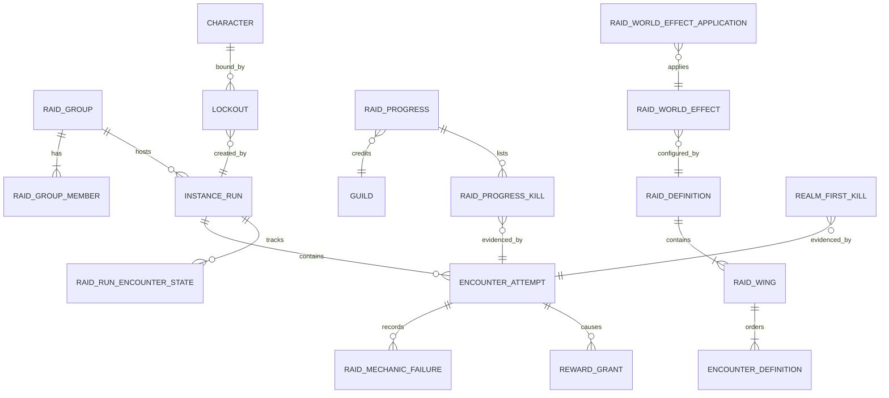
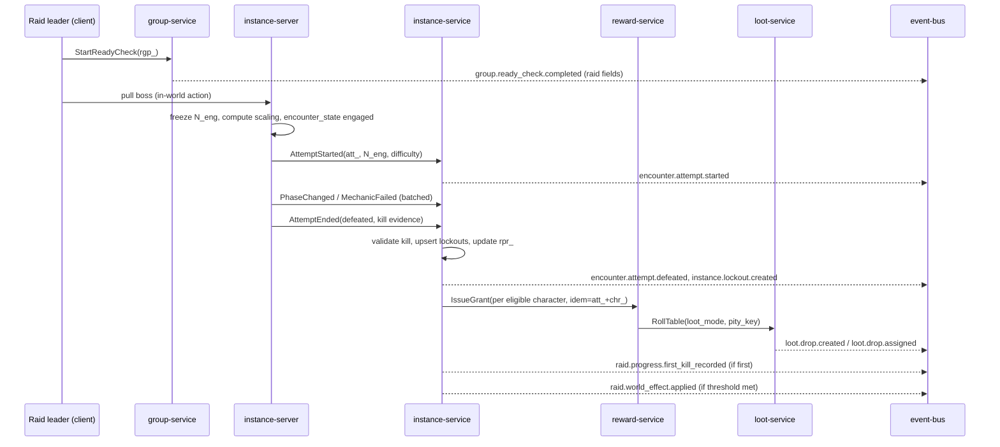

# Legends of the Shattered Frontier — Raid Architecture
### Version 1.0 — Expanded Technical Design Authority edition (2026-10-17)

> Status: Design target; not implemented. Names per Shared Registry v1.0.
>
> Registry: [Shared Registry](Legends_Shattered_Frontier_Shared_Registry_v1.0.md) · Short name: **Raid** · Part folder: [`Raids/`](Raids/)

---

## 1. Overview

Raids are the large-scale, instanced, cooperative endgame of the Shattered Frontier: 10- and 20-player challenges (flexible below mythic) built around multi-phase bosses, team mechanics, and role coordination. They are the top rung of the PvE power ladder below legendary items, the main source of tier sets and legendary components, and the content whose outcomes visibly change the persistent world: a raid that falls on a realm shifts faction control and advances world narrative.

The skeleton topics of the original v1.0 outline are all kept and expanded:

| Skeleton topic | Expanded in |
| --- | --- |
| Goals | §2 below |
| Sizes (10, 20, flexible) | [Part 1 — Groups, Scaling and Encounters](Raids/Legends_Shattered_Frontier_Raid_Groups_Scaling_Encounters_v1.0.md), Raid size classes; Flexible scaling |
| Raid tiers (Normal, Veteran, Heroic, Mythic) | Part 1, Difficulty tiers and tuning deltas |
| Encounter design (multi-phase, team mechanics, role coordination) | Part 1, Encounter design; Mechanic catalog; Boss behavior models |
| Progression (weekly lockouts, achievements, legendary components) | [Part 2 — Lockouts, Progression, Loot and World](Raids/Legends_Shattered_Frontier_Raid_Lockouts_Progression_Loot_World_v1.0.md) |
| World integration (faction control, world narratives) | Part 2, World integration |

### 1.1 Design goals

1. **Coordination is the challenge, not attendance.** Difficulty comes from mechanics that require roles, subgroups, and the raid leader to act together; gear checks exist (enrage) but are never the only wall.
2. **Every size is legitimate.** Flexible scaling makes a 14-player normal raid as viable per player as a 20-player one; small guilds are not forced to recruit to see content. Mythic is the one fixed-size, fixed-tuning competitive format.
3. **Fair, transparent progression.** Weekly per-boss lockouts, deterministic catch-up, published nerf schedules, and pity-backed loot make time-to-power predictable (balancing targets in Part 2, Economic targets).
4. **Server authority over every mechanic.** Every mechanic's success or failure is decided by `instance-server`; every reward flows through `reward-service`; first kills and world effects are recorded only from validated attempts.
5. **Raids matter to the world.** Kills feed `faction-service` control and the AI world director through `raid.world_effect.applied`, so raiders and non-raiders share consequences.
6. **Built on the dungeon frameworks.** Raids extend, never fork, the Dungeon spec's instance run lifecycle, lockout framework, encounter framework, and group-service parties/LFG.

### 1.2 Scope

In scope: raid content definitions (`raid/<slug>`, raid `encounter/<slug>`), raid size classes and flexible scaling, raid difficulties `normal`/`veteran`/`heroic`/`mythic` and their tuning deltas, the **RaidGroup** (`rgp_`) and its subgroups, ranks, and ready checks, raid lockout policy, raid encounter design and the raid mechanic catalog, raid progression (tiers, wings, gating, attunement, catch-up, nerfs, **RaidProgress** `rpr_`, realm firsts), raid loot assignment (modes including `council`, tokens, ilvl, pity keys, legendary components), raid world effects, raid economic targets, the raid parts of `instance-service` and `group-service`, raid event payloads, raid analytics, and raid security.

### 1.3 Non-goals

- Generic instance run lifecycle, generic lockout records, the encounter framework and boss state machine, party and LFG queue mechanics, dungeon affixes, and mythic-level scaling — owned by the **Dungeon spec** and only extended here.
- Item stat budgets, affix rolling, loot table structure, pity math, reward bundle schema, legendary path stage logic — **Itemization spec**.
- Damage, mitigation, threat, and attribute formulas — **Combat spec** (used unchanged; raids tune NPC inputs only).
- NPC behavior tree/utility AI runtime, faction control math beyond the raid's input, world director — **AI spec** / **World spec**.
- Detector implementation, risk scoring, sanctions — **Security spec**.
- Calendar scheduling of tier releases and zone-buff steps — **LiveOps spec** executes; this spec defines the policy.
- Raid-finder (cross-realm random matchmaking) for raids: not at launch. Raids are formed by premade groups and the group-service raid listing board (Part 1, Raid group). A queued raid finder is a candidate for a later tier and would extend Dungeon spec, LFG.

### 1.4 Glossary pointer

All terms (Raid, Raid Group, Lockout, Encounter, Encounter Attempt, Instance Run, Difficulty, Pity, Reset, Legendary Item) are defined in the Shared Registry, Glossary. Raid-local terms:

| Term | Meaning |
| --- | --- |
| Raid tier | A content period's set of 1–3 raids sharing one ilvl ladder and one tier set (Part 2, Tier structure). |
| Wing | An ordered subset of a raid's encounters released and gated together. |
| Reference size `N_ref` | The size a raid is authored for: 10 (`raid_small`) or 20 (`raid_large`). |
| Engaged size `N_eng` | Living, in-instance raid members at the moment an encounter enters `engaged`; frozen for that attempt. |
| Loot lockout | Per-character, per-encounter, per-difficulty record that the character has received its weekly reward eligibility. |
| Progress lockout | A mythic (and optionally heroic) binding of a character to one specific instance run's boss-kill state for the week. |
| Frontier Resolve | The raid catch-up "zone buff" applied inside a raid instance on `normal`–`heroic`. |
| Realm first | First validated kill of an encounter at a difficulty on a realm (and in a datacenter region). |
| Council | `loot_mode` `council`: a loot master plus council members vote on item assignment. |

---

## 2. Architecture and service ownership

### 2.1 Ownership map

| Concern | Owner (service) | Spec | Raid role |
| --- | --- | --- | --- |
| Raid groups, subgroups, ranks, ready checks, raid listings | `group-service` | Raid (raid parts) | **Owns** |
| Party, LFG queue, generic ready-check plumbing | `group-service` | Dungeon | Extends |
| Raid instance runs (`run_`) with raid fields, raid lockouts (`lck_`), RaidProgress (`rpr_`), realm firsts, world-effect requests | `instance-service` | Raid (raid parts) | **Owns** |
| Instance run lifecycle, lockout framework, encounter framework | `instance-service` / `instance-server` | Dungeon | Extends |
| Live encounter simulation, phases, mechanic validation, scaling at engage | `instance-server` | Dungeon / Raid | Raid owns raid encounter scripts and mechanic validators |
| Loot rolls, pity counters, loot modes incl. council execution | `loot-service` | Itemization | Raid defines council rules and raid pity keys |
| Reward grants (items, gold, marks) | `reward-service` | Itemization | Raid authors `reward/<slug>` bundles |
| Faction control changes | `faction-service` | AI | Raid supplies influence input |
| World narrative/director reaction | `ai-director-service` | AI | Consumes `raid.world_effect.applied` |
| Raid ranks/guild identity | `guild-service` | Backend | Read-only (guild membership for RaidProgress credit) |
| Tuning, zone-buff steps, kill switches | `config-service` | LiveOps | Raid defines keys under `tune.raid.*`, `ff.raid.*` |
| Detections, enforcement | `anticheat-service`, `enforcement-service` | Security | Raid reports detections |

### 2.2 Component view

```mermaid
flowchart LR
  C[Game client] -- UDP --> IS[instance-server<br/>raid encounter runtime]
  C -- WebSocket via gateway --> GS[group-service<br/>RaidGroup rgp_]
  GS -- RequestRaidRun --> INS[instance-service<br/>runs, lockouts, rpr_]
  INS -- AllocateServer / ReleaseServer --> WS[world-service]
  WS --> IS
  IS -- attempt results, phase, mechanic failures --> INS
  INS -- IssueGrant --> RS[reward-service]
  RS --> LS[loot-service<br/>modes, council, pity]
  RS --> INV[inventory-service]
  RS --> ECO[economy-service]
  INS -- raid.world_effect.applied --> BUS[(event-bus)]
  BUS --> FS[faction-service]
  BUS --> AID[ai-director-service]
  BUS --> AC[anticheat-service]
  BUS --> AN[analytics-pipeline]
  CFG[config-service] -. tune.raid.* .-> IS & INS & GS
  CC[content-catalog-service] -. raid/encounter defs .-> IS & INS
```

### 2.3 Authority rules (raid-specific restatement)

1. `instance-server` is the sole judge of mechanic outcomes, phase transitions, enrage, and kill. Clients send inputs only.
2. `instance-service` is the only writer of raid lockouts, RaidProgress, realm-first records, and world-effect requests.
3. `group-service` is the only writer of RaidGroup membership, subgroup layout, rank, loot-mode setting, and council roster.
4. No raid code path creates items or currency directly; every reward is a `reward-service` grant with source `raid_reward` and the attempt's `event_id` as `causation_id`.
5. A kill only counts (lockout, RaidProgress, first kill, world effect, rewards) once the `EncounterAttempt` is persisted with outcome `defeated` and has passed kill validation (Part 3, Security considerations). Attempts later marked `invalidated` trigger compensating actions.

---

## 3. Core model

### 3.1 Entities



| Entity | ID | Owner | Defined in |
| --- | --- | --- | --- |
| RaidGroup | `rgp_` | group-service | Part 1, Raid group; Part 3, Schemas |
| InstanceRun (raid extension fields) | `run_` | instance-service | Dungeon spec, Instance run lifecycle; Part 3 adds `raid_runs` |
| EncounterAttempt (raid extension fields) | `att_` | instance-service | Dungeon spec, Encounter framework; Part 3 adds `raid_attempt_details` |
| Lockout (raid policy) | `lck_` | instance-service | Dungeon spec, Lockout framework; Part 2, Lockout policy |
| RaidProgress | `rpr_` | instance-service | Part 2, Guild raid progress records |
| Realm first kill, world effect application | (rows keyed by `rpr_`/`att_`) | instance-service | Part 2; Part 3 |

### 3.2 Canonical states used

- `instance_run_state`: `requested`, `provisioning`, `ready`, `in_progress`, `completed`, `failed`, `abandoned`, `closed` (Dungeon spec defines transitions; raid adds the rule that a raid run stays `in_progress` across disconnects for up to `tune.raid.run_idle_close_minutes` = 60 and that a mythic run reopens under a progress lockout, Part 2).
- `encounter_state`: `dormant`, `idle`, `engaged`, `defeated`, `resetting` (raid adds phase sub-states inside `engaged`, Part 1).
- `encounter_attempt_outcome`: `defeated`, `wiped`, `abandoned`, `invalidated`.
- `lockout_state`: `active`, `extended`, `expired`.
- `loot_mode`: `personal`, `group_need_greed`, `master_loot`, `council`.
- `difficulty` (raids): `normal`, `veteran`, `heroic`, `mythic`.
- `group_size_class` (raids): `raid_small`, `raid_large`.

### 3.3 Core flow (one boss kill)



---

## 4. Table of contents

| Part | File | Contents |
| --- | --- | --- |
| Entry | this file | Overview, scope, architecture, core model, registry additions |
| 1 | [Groups, Scaling and Encounters](Raids/Legends_Shattered_Frontier_Raid_Groups_Scaling_Encounters_v1.0.md) | Raid size classes; flexible scaling formula; difficulty tiers and tuning deltas; raid group, subgroups, ranks, ready checks, permissions; encounter design; phases, intermissions, enrage; mechanic catalog with server validation; boss behavior models; encounter definition JSON |
| 2 | [Lockouts, Progression, Loot and World](Raids/Legends_Shattered_Frontier_Raid_Lockouts_Progression_Loot_World_v1.0.md) | Lockout policy (loot vs progress, save/extend, cross-difficulty); tier structure, wings, gating, attunement and skip; realm firsts; catch-up and Frontier Resolve; nerf schedule; RaidProgress; loot modes, council, tokens, ilvl, pity, legendary components; world integration; economic targets |
| 3 | [Data, API, Events, Analytics and Security](Raids/Legends_Shattered_Frontier_Raid_Data_API_Events_Security_v1.0.md) | PostgreSQL DDL (`group`, `instance` raid tables); gRPC extensions (`lsf.group_service.v1`, `lsf.instance_service.v1`); `raid.*` payloads and raid fields on `encounter.*`/`instance.*`/`group.*`; analytics hooks; security considerations |
| 4 | [Agent Implementation Guide](Raids/Legends_Shattered_Frontier_Raid_Agent_Implementation_Guide_v1.0.md) | Module layout, build order and milestones, invariants, test matrix, acceptance criteria, pitfalls, Do/Don't |

Cross-spec references used throughout: Dungeon spec (Instance run lifecycle, Lockout framework, Encounter framework, Group service and LFG), Itemization spec (Loot tables, Pity, Reward bundles, Legendary paths, Item sets, Stat budget), Combat spec (Damage formula, Threat & Aggro System, NPC Attribute Generation), AI spec (NPC AI, Faction AI, World Director), Character spec (Achievements, Account-wide unlocks), Economy spec (Currency sources and sinks), Security spec (Detections, Risk score), LiveOps spec (Event calendar, Tuning), Analytics spec (Metric definitions).

---

## 5. Key numbers at a glance

| Item | Value | Key |
| --- | --- | --- |
| Raid group max | 25 (`RAID_GROUP_MAX`) | `tune.group.raid_group_max` |
| Subgroups | 5 × 5 | `tune.raid.subgroup_size` |
| `raid_small` | ref 10; flex 6–10 (`normal`–`heroic`); no mythic at launch | `tune.raid.small_flex_min` |
| `raid_large` | ref 20; flex 10–25 (`normal`–`heroic`); mythic fixed 20 | `tune.raid.large_flex_min`, `tune.raid.mythic_size` |
| ilvl by difficulty | 420 / 430 / 445 / 460 | Registry power ladder |
| Boss health mult vs normal | 1.00 / 1.20 / 1.43 / 1.69 | `tune.raid.difficulty_hp_mult` |
| Boss damage mult vs normal | 1.00 / 1.20 / 1.45 / 1.75 | `tune.raid.difficulty_dmg_mult` |
| Lockout | weekly per boss per difficulty; mythic progress-locked | Part 2 |
| Personal loot chance | 0.22 per boss per eligible character (before pity) | `tune.raid.personal_loot_chance` |
| Weeks to 4-piece tier set (heroic, full clear) | target 7–9 | Part 2, Economic targets |
| Frontier Resolve | +5% every 3 weeks from tier week 10, cap 30%, not mythic | `tune.raid.resolve_*` |

---

## 6. Registry additions

> **Merge status (2026-10-17):** the additions below were merged into the Shared Registry (see its change log), with these rulings: LiveOps `gm_role` → Security `staff_role`; trade window uses `tune.loot.trade_window_minutes` only. The registry is now authoritative for these names; rows here remain as justification.

The additions below have been merged into the Shared Registry (change log, phase 2). The Registry is authoritative; the rows remain as rationale and ownership notes.

| # | Kind | Proposed name / value | Justification |
| --- | --- | --- | --- |
| 1 | Event | `group.raid_group.formed`, `group.raid_group.disbanded` | `group.party.formed/disbanded` describe parties (`pty_`); raid groups have their own entity (`rgp_`) and analytics need formation/disband funnels distinct from parties. |
| 2 | Event | `group.raid_group.updated` | Rank, subgroup, loot-mode and council roster changes must be auditable (loot ninja investigations, Part 3). |
| 3 | Event | `raid.progress.updated` | `rpr_` changes on every validated boss kill; the registry only has the first-kill event. Guild sites, achievements, and analytics need every progress step. |
| 4 | Event | `raid.first_kill.revoked` | Required compensating event when an attempt that produced a realm first is later `invalidated`. |
| 5 | Enum | `lockout_kind`: `loot`, `progress` | Distinguishes per-encounter loot eligibility from mythic run binding; both use `lockout_state`. Dungeon lockout framework may adopt `loot` as its only kind. |
| 6 | Enum | `raid_rank`: `leader`, `assistant`, `member` | Permission model for raid groups. |
| 7 | Enum | `raid_group_state`: `forming`, `active`, `disbanded` | RaidGroup lifecycle has no canonical state list. |
| 8 | Enum | `ready_check_response`: `ready`, `not_ready`, `no_response` | Ready-check payloads (shared with Dungeon). |
| 9 | Enum | `raid_mechanic_kind` (14 values, Part 1, Mechanic catalog) | Shared by `encounter.mechanic.failed` payloads and analytics dimensions. |
| 10 | Entity | LootCouncilSession `lcs_`, owned by loot-service (Itemization) | Council voting needs a durable, auditable session; Itemization owns loot-service. |
| 11 | Sink | `raid_bonus_roll` | Frontier marks spent on bonus rolls need a distinct sink for economy reporting. |
| 12 | Constants | `RAID_SMALL_REF_SIZE` 10, `RAID_LARGE_REF_SIZE` 20, `RAID_MYTHIC_SIZE` 20 (`tune.raid.small_ref_size`, `tune.raid.large_ref_size`, `tune.raid.mythic_size`) | Referenced by Itemization (loot counts) and LiveOps (tuning reviews). |
| 13 | Tuning keys | `tune.raid.*` keys listed in Parts 1–2 | Raid-local; listed for config-service registration. |
| 14 | Feature flags | `ff.raid.council_loot_enabled`, `ff.raid.world_effects_enabled`, `ff.raid.resolve_enabled`, `ff.raid.realm_first_enabled` | Kill switches for risky raid subsystems. |

### Open issues

- **Mythic size vs `raid_small`.** Registry `group_size_class` says `raid_small` is "10; flex 6–10 below mythic", implying a fixed-10 mythic. This spec ships mythic only for `raid_large` (fixed 20) at launch, which honors both the registry and the fixed-20 mythic rule; if a 10-player mythic is wanted later, it would be fixed at 10. Registry wording may be clarified.
- **Raid group capacity 25 vs mythic 20.** `RAID_GROUP_MAX` 25 allows benching: up to 5 extra members may be in the group but outside the instance on mythic (Part 1, Raid group).
- **`loot.drop.assigned` for council.** Council decisions reuse `loot.drop.assigned`; Itemization must add `assignment_method` and `lcs_` fields to that payload (requested, not assumed). Resolved (2026-10-17): Itemization's payload carries `assignment_method`, `council_session_id` (`lcs_`) and `council_override`; LootCouncilSession is owned by loot-service (`loot.council_sessions`).
- **Ready check event scope.** `group.ready_check.completed` is owned by group-service under the Dungeon spec; raid fields are additive (Part 3).
- **Requests to Itemization (not assumed canonical):** an eligible-trade window for `on_pickup` raid loot (120 min, kill participants only), the weekly raid-item → tier-set conversion operation and its source/sink codes, and raid pity keys `raid:<raid_slug>:<difficulty>` with a group-mode threshold rule (Part 2, Loot). Resolved (2026-10-17): Itemization uses `LOOT_TRADE_WINDOW` (`tune.loot.trade_window_minutes` = 120) with `trade_eligible_character_ids` on `IssueGrant`/`GrantItems`; adds inventory-service `ConvertTierItem` (`tier_conversion_input` / `tier_conversion_output`); and adopts the `raid:` pity profile and group threshold (Loot and Rewards part, Pity).
- **Requests to Dungeon:** base `lockouts` unique index must accept a `scope_key` (encounter ID or `progress`) so raid per-encounter loot lockouts fit the framework; base payloads must tolerate the additive `raid` object. Resolved (2026-10-17): Dungeon's lockout framework adds `scope_key text NOT NULL DEFAULT 'instance'` to the live-lockout uniqueness rule and an optional `scope_key` on `instance.lockout.*`, and states the additive-extension rule for the `raid` object.
- **Reference DPS curve** (`tune.raid.dps_ref_*`) is a raid-local proxy; it must be recalibrated against Itemization stat budgets and Combat formulas by simulation before content ships.
