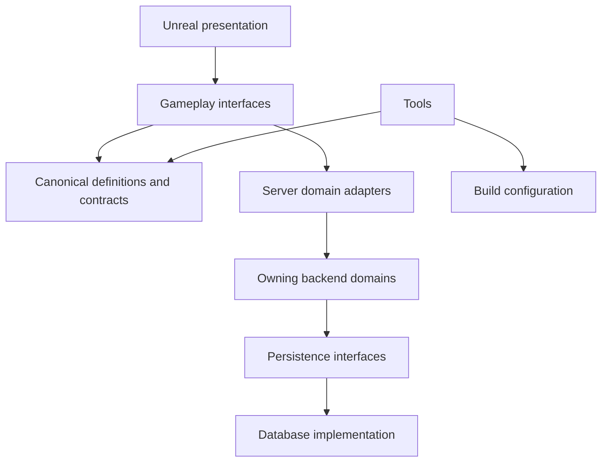
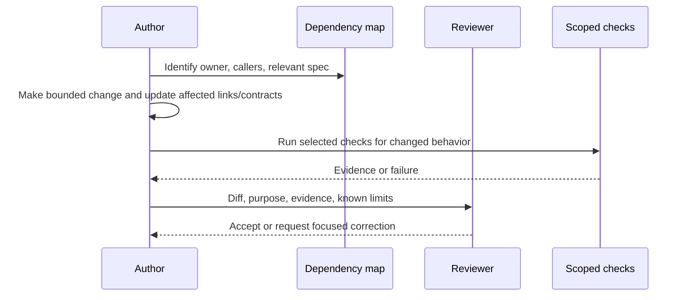

# Repository Structure

## Purpose, status, and scope

This document describes how to grow the current browser PoC into an Unreal game without losing navigability, ownership, or repeatable builds. It is an expanded planning baseline. The proposed folders below do not exist merely because they appear here. Do not create empty scaffolding for unstarted services.

The current tree is the authoritative description of what can run today. Read [dependency map](../dependency-map.md) first, [project layout](Legends_Shattered_Frontier_UE58_Project_Layout_v1.0.md) for Unreal internals, and [agent responsibilities](Legends_Shattered_Frontier_AI_Agent_Responsibilities_v1.0.md) for task ownership.

Existing filename suffixes remain for link compatibility. Git history should record changes when the repository is initialized; this document does not require a new naming/version series.

## Current working set

```text
Shattered-Frontier/
  AGENTS.md                  session/task instructions
  README.md                  local browser launch and limitations
  concept.md                 product vision
  package.json               dependency-free Node >=24 commands
  server/
    index.js                 HTTP, SQLite, sessions, SSE
    world.js                 tile rules and state
  public/
    index.html               browser structure
    app.js                   browser actions/rendering
    style.css                presentation
  tests/
    world.test.js            rule cases
    server.test.js           HTTP/persistence integration
  data/                      local runtime database; ignored
  docs/
    dependency-map.md        task routing and actual dependencies
    alpha-plan.md            current implementation and next gates
    first-time-setup.md      conditional onboarding guide
    Game-Design/             indexed design references and topic parts
```

Do not rename `docs/` to `Docs/` or move the current runtime as part of an unrelated feature. Case differences become significant on some machines and in CI.

## Target tree: create incrementally

```text
GameClient/
  ShatteredFrontier.uproject
  Config/
  Content/
  Source/
  Plugins/                   only selected project plugins
BackendServices/             introduced only with a chosen backend implementation
  <domain>/                  registered logical ownership, if independently built
  Shared/                    small transport primitives, not gameplay authority
Infrastructure/              deployment definitions once a target is selected
Launcher/                    delivery client once its milestone begins
Tools/                       repeatable build/content/verification utilities
docs/
  decisions/                 small consequential architecture decisions
  evidence/                  compact verification/measurement summaries
  Game-Design/               existing reference paths retained
server/, public/, tests/     browser harness until an explicit retirement decision
```

`GameClient/` is a proposed project root. Client, editor, and dedicated-server targets share its gameplay source. A parallel `GameServer/` copy of gameplay code is intentionally excluded from this proposal because it creates divergent authority logic. If a separate server deployment directory is later needed, it holds packaging/configuration rather than copied gameplay.

A logical registry service need not receive a directory or deployment until implementation needs it. Co-location is permitted; authority must remain explicit through interfaces and tests.

## File placement rules

| Change | Destination | Required companion |
| --- | --- | --- |
| Existing tile gameplay | Current server/world.js and relevant browser caller | Targeted rule check; dependency map if contract changes |
| Current HTTP/session/save | Current server/index.js | Relevant integration case |
| Unreal runtime code | GameClient/Source, module chosen by project layout | Owning feature test and build check |
| Unreal map/mesh/material/widget | GameClient/Content, owned feature area | Map/asset reference check |
| Editor utility | Editor-only module or Tools | No runtime dependency on editor modules |
| Backend domain | Chosen BackendServices implementation | Domain schema/contract and focused integration check |
| Persistence migration | Owning persistence implementation's migration directory | Compatibility, backup, and rollback procedure |
| Shared transport schema | Single canonical contract location selected in a decision | Generator/compiler version and consumer compatibility |
| Build/packaging helper | Tools or owning package | Inputs, outputs, exit codes, secret-free usage |
| Design contract | Existing relevant design document or linked topic part | Updated index and affected cross-reference |
| Large generated artifact | Artifact storage chosen by operations | Small evidence summary with build identity/hash |
| Local sessions/databases | Ignored local path | Backup instructions; never a source fixture by accident |

No command should depend on a developer's absolute engine or credential path committed to source. Use user-local environment/configuration and document the variable name when introduced.

## Dependency boundaries



Transport schemas may be shared; database models must not be imported into widgets or client gameplay. Presentation requests work through a controller/component interface. Runtime modules cannot import editor-only modules. Shared utilities cannot import a feature that imports them.

If feature A and B need each other, extract the minimal contract or introduce an orchestrator above them. Do not create `Shared/` as an escape hatch for cyclic dependencies or move domain rules there to avoid identifying an owner.

### Dependency review checklist

Before adding a dependency, state the actual symbol or asset needed, who owns it, whether it is required at runtime/server/editor, and whether an interface avoids the coupling. Check license and engine compatibility only for the actual selected package. A proposed plugin name in an outline is not authorization to install it.

After a change, update the dependency map only for real runtime/file-role/command changes. Planned folder trees belong here until implemented.

## Authority and ownership map

| Area | Write owner | Consumers |
| --- | --- | --- |
| Live movement, spatial checks, actor state | zone-server implementation | Relevant clients and domain command coordinators |
| Inventory, containers, equipment state | inventory-service contract | Crafting, rewards, economy, owner projection |
| Recipe execution | crafting-service contract | Zone action adapter and inventory |
| Currency/trade/market | economy-service contract | Owner UI, reward integration |
| Progression | progression-service contract | Character UI, eligibility checks |
| Quest state | quest-service contract | Quest UI and approved fact consumers |
| Terrain/claims/structures | World/Building owner, finalized at PER-01 | Simulation and persistence projections |
| Authentication/session | auth-service contract | Join adapter and privileged operations |
| Names and event taxonomy | Shared registry | All domains |
| Current task routing | dependency-map.md | Session agents and developers |

These are logical owners from the registry/domain design. They do not claim these services exist in the runtime.

## Persistence and schema placement

The owner of a durable record owns its migration. There must be one place that applies each migration and records its identity. Two packages cannot independently alter the same table.

Before the first backend migration, record the language, migration tool, store topology, local provisioning, and command in a decision. Until then, paths such as `BackendServices/<domain>/Migrations/` are proposals only.

Each migration set must define:

1. Supported source schema and resulting schema.
2. Compatibility with current and rollback binaries.
3. Whether it is additive, requires backfill, or blocks older clients.
4. Preconditions and estimated dataset cost.
5. Backup/restore boundary and rehearsal.
6. Targeted success, repeated-run, interrupted-run, and incompatible-schema checks.
7. Who can apply it and which environment is targeted.

Do not equate reverting source with reverting a schema. For irreversible changes, rollback means restoring a compatible code/data pair or executing a reviewed forward repair.

### Proposed shared contract manifest

```text
build_identity
content_catalog_identity
contract_schema_identity
minimum_compatible_client
minimum_compatible_server
persistence_schema_identity
engine_build_identity
```

This is a packaging contract proposal, not a runtime database table. Define exact types and compatibility rules in DEL-01 before generating files. Existing artifact or registry naming wins where already defined.

## Source, generated output, and local state

| Category | Commit policy |
| --- | --- |
| Source, build definitions, reviewed config defaults | Commit |
| Authored Unreal assets required to open/build | Commit with chosen binary strategy |
| Unreal caches, intermediate objects, local editor state | Ignore |
| Cooked/staged/package output | Publish as artifacts, not source |
| Project descriptors and module build rules | Commit |
| Local databases, WALs, logs, session cookies | Ignore; use explicit sanitized fixtures |
| Private keys, passwords, access tokens | User/service-local secret storage only |
| Public sample configuration | Commit placeholders and safe defaults |
| Generated bindings | Choose one policy per generator; record generator and deterministic regeneration command |
| Performance captures | External artifact by default; summary/hashes in docs |

Before adopting Git LFS, confirm hosting limits, collaboration workflow, and retrieval on clean clones. Do not convert an existing asset history without a scoped migration. Until binary storage is decided, avoid bulk asset imports.

## Branch and review workflow

For the current small team, propose short-lived feature branches from a stable main branch once Git/remote setup is confirmed. The earlier main/develop/release/hotfix list is a future workflow option, not a requirement to maintain five branch families immediately.

Use a release branch only when maintaining a separate shipped line is necessary. A hotfix targets that line and is reconciled back to active development. Do not introduce a merge train or mandatory bot accounts before there is a collaboration need.

A reviewable change should have one player/operator outcome, bounded files, a clear contract impact, and precise evidence. Avoid bundling asset reorganization, runtime implementation, and format-only changes in one PR.



Creating a PR or merging is not implied by writing this document. Follow the current task's actual authorization and remote availability.

## Build and test entry points

Today, `npm start` is the only application launch entry point and `node --test` is the test runner. Node tests are selected by exact file and/or test-name pattern in the dependency map. `npm test` runs the full suite and requires explicit user request.

Future Unreal/backend commands must be added only after they have been run in the actual configured environment. Record working directory, required local variables, output location, and expected exit code. A command copied from a different engine build is not automatically valid here.

### Change-based verification matrix

| Changed area | Minimum relevant verification |
| --- | --- |
| Game rule | Positive and negative rule cases for that action |
| Persisted mutation | Mutation-specific retry/conflict/crash checks |
| Networking projection | Owning-client, remote-client, and late-join state for changed fields |
| Unreal Build.cs/target | Compile affected target/module; packaged target if conditional dependencies changed |
| Asset reference/path | Open affected map/asset and check missing references; cook relevant package when available |
| Schema migration | Compatibility and data transformation checks for that migration |
| Docs/link/index | Resolve changed links and compare intended file set |
| Cosmetic UI | Inspect changed viewport/widget at relevant resolutions |

This is not a requirement to run every row. Select only rows affected by the change. Full-suite runs need an explicit user request; load checks and automated pipelines should state their selected scope rather than quietly substituting a full suite.

## Repository migration procedure

Do not move the browser harness simply to match the target tree. If a move becomes necessary:

1. Inventory exact sources, imports, static routes, tests, commands, ignored data paths, and doc links.
2. Capture the current targeted behavior relevant to the move.
3. Move the smallest cohesive package using path-aware tools.
4. Update imports and launch/configuration references in the same change.
5. Verify startup, the affected test entry point, and changed links.
6. Update dependency-map.md to reflect actual paths.
7. Preserve local data separately; a source reorganization must not delete runtime saves.
8. Record rollback as an inverse path change, not a reset of unrelated work.

Folder creation is reversible. Moving/deleting a directory with active user data or another agent's work requires exact scope and preservation evidence.

## Concurrent work and protected files

A task declares its write set before editing. Overlapping agents coordinate by explicit file ownership or serialize edits; independent file changes can proceed.

The other session owns the Character, Itemization, Quest, Dungeon, Raid, Security, LiveOps, and Analytics specifications and their parts during this expansion. This work does not edit those documents or the shared registry. Link to them and record integration gaps locally.

Before changing a shared index, reread its latest contents and patch only the owned section. Do not replace the entire dependency map from an earlier snapshot. If another session adds rows or part folders, preserve them.

## Evidence and maintenance budgets

These are proposed workflow budgets:

| Concern | Target |
| --- | --- |
| Ordinary agent tool output | About 1,000 tokens unless evidence requires more |
| Initial working set | Mapped owner and direct callers; expand with a stated reason |
| Durable handoff note | Goal, paths, evidence, blocker/next step; no copied logs |
| Dependency map | One concise row per useful reference; actual runtime edges only |
| Feature decision | One concrete decision with alternatives, evidence, and consequences |
| Artifact summary | Build/environment/scenario/result plus link/hash; raw logs external |

No global documentation page quota is needed. Split long documents into linked topic parts when readers cannot efficiently select a section; avoid creating a second competing index for the same contracts.

## Acceptance and open decisions

This repository plan is operationally ready when a new developer can identify today's runnable command, locate the correct feature owner, distinguish proposed paths from real paths, and run a precise changed-feature check. The eventual Unreal addition must preserve browser startup and reference links unless retirement is explicitly approved.

Open before their dependent work: Git remote/branch protection; binary asset storage; backend language and migration tool; contract generator; artifact host; reference build agents; chosen engine source checkout. These do not block reading/design or the existing browser harness.

## Registry additions

None. Folder/module names are repository-local proposals. External service/entity/event names remain registry-owned.
