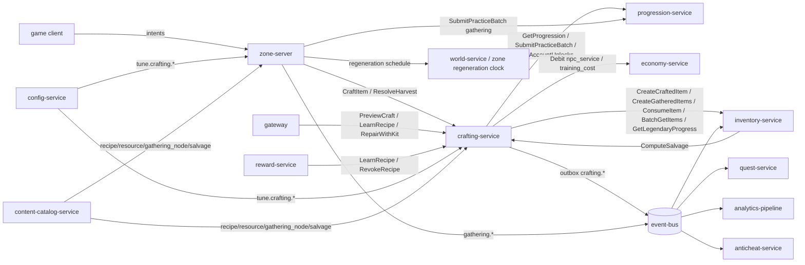
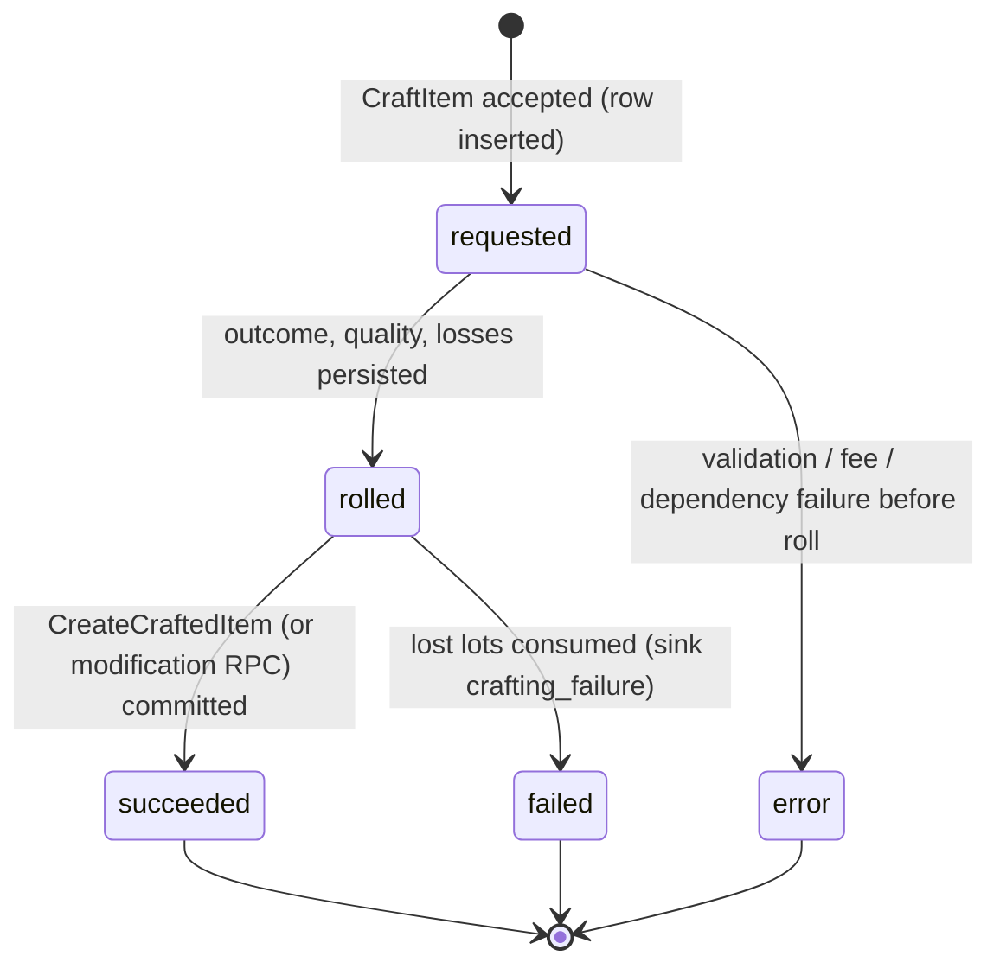

# Legends of the Shattered Frontier - Resource and Crafting Architecture
## Version 1.0
Version 1.0 — Expanded Technical Design Authority edition (2026-10-17)

Design target; not implemented. Names per Shared Registry v1.0.

Registry: [Shared Registry](Legends_Shattered_Frontier_Shared_Registry_v1.0.md). This file is the Crafting spec entry (short name **Crafting**). It supersedes the 2026-10-17 contract patch; every RPC name, formula, constant, payload field, enum value and tuning key of that patch is kept (sections C1–C11 below), enlarged, and complemented by four parts.

## Table of contents

| Part | Contents |
| --- | --- |
| This entry file | Philosophy, scope, architecture and ownership, core model, construction supply object, crafting-service contract C1–C11 (quality formula, quality → ilvl mapping, attempt flow, gathering contract, events, security, analytics, tuning keys, registry additions, open issues) |
| [Gathering, Resources and Nodes](Crafting/Legends_Shattered_Frontier_Crafting_Gathering_and_Resources_v1.0.md) | Resource and material catalogue, tiers by biome and band, gathering node definitions, node lifecycle, harvest flow, yield and lot quality, tools, regeneration parameters and World coordination, farming/fishing/hunting specifics, gathering balancing targets |
| [Recipes, Workshops and Learning](Crafting/Legends_Shattered_Frontier_Crafting_Recipes_Workshops_and_Learning_v1.0.md) | Recipe content model and kinds, difficulty bands, refinement chains, rarity and potency of outputs, workshops/stations and tiers, recipe learning and discovery, repair kits, reforge and reroll, legendary forging, construction materials and the Builder's Cache |
| [Salvage and Economic Balancing](Crafting/Legends_Shattered_Frontier_Crafting_Salvage_and_Economic_Balancing_v1.0.md) | Reference material values, crafted-value function, recipe cost validator, salvage profiles meeting Itemization return targets, dungeon material tables, time-to-craft, crafting gold sinks, balancing target tables and alerts |
| [Data, API and Agent Implementation Guide](Crafting/Legends_Shattered_Frontier_Crafting_Data_API_and_Implementation_Guide_v1.0.md) | erDiagram, full PostgreSQL DDL, gRPC API `lsf.crafting_service.v1`, consumers and producers, privacy participation, module layout, milestones, invariants, test matrix, acceptance criteria, pitfalls, Do/Don't |

---

# Resource Philosophy
Everything originates from the world. Crafted items drive the economy.

Design pillars (normative intent; numbers live in the parts):

1. **The world is the only faucet of raw materials.** Every material item enters through `gathering_output`, `salvage_output`, `loot_drop` (dungeon/raid material tables), or vendor stock of basic reagents (`vendor_stock`). Crafting never creates materials from nothing; refinement transforms them.
2. **Crafting is the main item sink.** Every craft consumes inputs (`crafting_consumed`, `crafting_failure`); salvage returns well below input value; repair kits consume materials. Material stock per realm should stay flat over a season (Salvage and Economic Balancing part, Balancing targets).
3. **Skill is a commitment, quality is earned.** Crafter skill sets the item level; quality (0–100) is made of skill margin, tools, materials, workshop and mastery, and luck only multiplies what was earned. Endgame crafted gear (ilvl 411–450) requires a specialization (C3.1).
4. **Crafted gear is competitive, never mandatory.** Crafted items reach ilvl 450 (Registry, Power ladder) with a higher roll floor than drops, at a material cost comparable to the time it takes to earn the same tier from content.
5. **Server-rolled, replay-safe, auditable.** Every roll is seeded from the attempt ID and a server secret, persisted before side effects, and recorded with full lineage for rollbacks.

---

# Scope and non-goals

In scope (Crafting owns behavior):

- `crafting-service` (stateless + DB, schema `crafting`): recipe execution, crafting quality, success/failure, output rarity and potency, recipe knowledge (learning, discovery, revocation), salvage outputs (`ComputeSalvage`), repair-kit, reforge and reroll *costs and validation*, legendary forging attempts, crafting attempt and harvest records.
- Gathering rules executed on `zone-server`: resource tiers, node definitions, harvest requirements, yield and lot quality (`ResolveHarvest`), tool requirements, harvest time, node regeneration *parameters* (charges, respawn times, pressure modulation).
- Content kinds `recipe`, `resource`, `gathering_node` (Registry), and the proposed content kind `salvage` (salvage profiles, already referenced by Itemization item definitions).
- Economic balancing targets for crafted goods and materials: reference material values, material cost vs vendor and market value, time-to-craft, gathering income, crafting gold sinks.
- Events `crafting.*` and `gathering.*` payloads (Registry event catalog).

Non-goals (owned elsewhere):

| Concern | Owner |
| --- | --- |
| Item creation, stat budget, affixes, roll floor, durability, binding, repair gold cost, legendary path progress, container behavior | Itemization spec (`inventory-service`) |
| Skill values, skill gain, specializations, mastery trees, account unlocks | Character spec (`progression-service`) |
| Luck curve, consumable effects in combat | Combat spec (Luck) |
| Wallets, gold debits, market prices, inflation index | Economy spec (`economy-service`) |
| Regeneration clock, spawn scheduling, regional scarcity index, cell IDs | World spec (Resource regeneration) |
| Workshop structures, settlement stages, claims, construction placement and build transactions | Building spec / Construction concept |
| Interaction validation (range, timers, combat state) and detectors | Security spec (Interaction-level authority; Detection) |
| Event and gathering-yield multipliers schedule | LiveOps spec (Events and seasons) |
| Metric definitions, warehouse models | Analytics spec |

---

# Glossary pointer

Shared terms are in the Registry glossary. Crafting-specific terms:

| Term | Definition |
| --- | --- |
| Lot | One input item stack consumed by a recipe, carrying a lot quality 0–100 in `provenance.quality_score` |
| Lot quality | Quality of a material lot (C2.3; gathered lots C5.2; salvage lots in Salvage part) |
| Quality score | `quality_score` 0–100 produced by a crafting attempt (C2.1) |
| Quality bonus | `quality_bonus = floor(quality_score / 2)`, 0–50 (C3) |
| `S` / `S_item` | Crafter's effective skill for the recipe / the skill value applied to item level, `min(S, D + MARGIN_FULL)` (C3) |
| `D` | Recipe difficulty on the 0–1100 skill scale |
| Station | The skill-specific bench inside a workshop (anvil, jeweler's bench, loom, …); identified by the recipe's `skill_id` within its `workshop_kind` |
| Workshop tier `W` | 1–5 (`WORKSHOP_TIER_MAX`); public NPC workshops ≤ 3 |
| Charge | One harvest available on a node before it depletes |
| Reference value | `ref_value_copper` of a material: static, content-derived value used for validation and salvage (never a market price) |
| `C_mat` | Reference value of a recipe's inputs |
| `C_equiv` | Crafted-value function: the reference material cost of an item of a given ilvl, slot and rarity (Salvage and Economic Balancing part) |
| Recipe kind | `refine`, `component`, `gear`, `tool`, `consumable`, `structure_material`, `reforge`, `reroll`, `legendary_forge` (proposed enum `recipe_kind`) |

---

# Architecture and service ownership



Ownership rules:

1. `crafting-service` is the only writer of schema `crafting`. It never writes inventory, progression or economy data; it requests changes through the RPCs in C1.
2. `zone-server` is the simulation authority for harvest timing, range, depletion and craft channel time; `crafting-service` is the authority for every random roll (success, quality, yield, bonus outputs, salvage rounding, discovery).
3. Items are created only by `inventory-service` (Registry authority rule 3) with sources `crafting_output`, `gathering_output`, `salvage_output`, or `legendary_upgrade` (legendary forging), and `causation_id` = the `crf_` / `hrv_` ID or the salvage idempotency key.
4. Content is published by `content-catalog-service`. Recipes, resources, nodes and salvage profiles are client-visible (players see recipes and node names); the derived reference-value table, bonus-output chances and the server secret are server-only.

---

# Resource Tiers
- Common
- Uncommon
- Rare
- Epic
- Legendary

These are the registry enum `resource_tier` (`common`, `uncommon`, `rare`, `epic`, `legendary`). Resources are content kind `resource` (`resource/iron_ore`) and become `material` items through inventory-service.

| `resource_tier` | `tier_index` | Node difficulty `D_node` | Typical character levels | Reference value per raw unit (copper) |
| --- | --- | --- | --- | --- |
| `common` | 0 | 0 | 1–20 | 120 |
| `uncommon` | 1 | 200 | 20–45 | 600 |
| `rare` | 2 | 400 | 40–70 | 2,000 |
| `epic` | 3 | 600 | 65–100 | 6,000 |
| `legendary` | 4 | 800 | 100, world events | 18,000 |

Biome distribution, the full catalogue and the value model are in the Gathering, Resources and Nodes part and the Salvage and Economic Balancing part.

# Gathering Systems
- Mining
- Logging
- Farming
- Herbalism
- Fishing
- Hunting

Each system maps to the gathering skill of the same name (Registry, Canonical skills: `mining`, `logging`, `farming`, `herbalism`, `fishing`, `hunting`). Mining, logging and herbalism use spawned nodes; fishing uses fishing-spot nodes with catch tables; hunting uses corpse nodes created when a creature with a `hunting` profile dies (difficulty `10 × npc_level`, Character spec); farming uses plots on owned or permitted land (Building claims). Details: Gathering, Resources and Nodes part.

# Node System
Each node tracks:
- Resource type
- Quality
- Quantity
- Regeneration state

Node rules are in "Gathering contract" below. Runtime node state is the proposed enum `gathering_node_state` (`pending_spawn`, `available`, `depleted`, `retired`); the state machine and regeneration parameters are in the Gathering, Resources and Nodes part. The regeneration *clock* is run by World (World spec, Resource regeneration); Crafting supplies the parameters by content and tuning-key name.

# Refinement
Raw -> Refined -> Component -> Finished Product

Every step is a `recipe`; the output's `quality_score` becomes the input lot quality of the next step (C2.3), so quality carries through the chain. Refinement recipes (`recipe_kind = refine`) are low-difficulty relative to their tier, fast (3 s per unit), batchable, and never consume more value than they produce: the reference value of a refined unit is `REFINE_VALUE_MULT` (1.15) × its inputs. Chains: Recipes, Workshops and Learning part, Refinement chains.

# Workshops
- Forge
- Sawmill
- Alchemy Lab
- Tailor Shop
- Engineering Workshop

Workshop ↔ skill mapping (Registry, Canonical skills): Forge → `smithing`, `jewelcrafting`; Sawmill → `carpentry`; Alchemy Lab → `alchemy`, `cooking`; Tailor Shop → `tailoring`, `inscription`; Engineering Workshop → `engineering`. Workshop tier is 1–5 (`WORKSHOP_TIER_MAX`); player-built workshops take their tier from the Building spec structure; NPC town workshops are tier `tune.crafting.public_workshop_tier` (default 2).

Expanded rule (closes C11 #1): public workshops are authored per placement with tier ≤ `PUBLIC_WORKSHOP_TIER_MAX` (3); player workshops are Building `structure/<slug>` functional objects carrying `workshop_kind` and `workshop_tier`, with the effective tier capped by the claim or settlement stage (personal housing 3; guild camp 2, village 3, town 4, city 5, capital 5) and reduced by 1 while the structure is below 50 % health. Recipes require `min_workshop_tier` by difficulty band (D < 300 → 1, < 550 → 2, < 800 → 3, < 950 → 4, ≥ 950 → 5). Full rules: Recipes, Workshops and Learning part, Workshops and stations.

# Crafting Quality
Factors:
- Skill
- Tool quality
- Materials
- Workshop tier

Luck also applies, capped by `LUCK_MAX_INFLUENCE`. The normative formula is in "C2. Crafting quality". Quality also selects output rarity (C2.6) and consumable potency (C2.7).

# Item Lifecycle
Create -> Use -> Repair -> Salvage -> Destroy

Lifecycle states and durability are owned by Itemization (Item Model and Lifecycle part). Crafting owns recipes for creation, repair kits, reforge, and salvage output profiles (`ComputeSalvage`).

| Lifecycle step | Crafting role | Itemization role |
| --- | --- | --- |
| Create | `CraftItem` rolls success, quality, rarity; calls `CreateCraftedItem` | computes ilvl, budget, affixes, roll floor |
| Use | tool quality `T` feeds quality; consumable potency from `quality_score` | equip rules, wear |
| Repair | repair-kit recipes, kit capacity and skill gate (`RepairWithKit`); reforge recipe cost (`ReforgeItem`) | gold repair (`RepairItems`), durability changes |
| Modify | reroll cost and validation (`RerollItemAffix`) | executes the reroll (`item.instance.modified`) |
| Salvage | `ComputeSalvage` outputs per profile | state change and output creation in one transaction |
| Destroy | — | `DestroyItem` |

# Legendary Crafting
Requires:
- Rare resources
- Special recipes
- Advanced stations
- World event materials

The forging stage of a legendary path runs a crafting-service recipe, but the item is created at the fixed ladder ilvl 465 with source `legendary_upgrade` (Itemization spec, Item Model and Lifecycle part, Legendary items); the quality formula below does not set legendary ilvl.

Expanded rules (Recipes, Workshops and Learning part, Legendary forging): forging recipes are `recipe_kind = legendary_forge`, require a tier-5 workshop, the path's `crafter_skill_min` (900, i.e. specialized), and the path owner's progress to be at its final stage with every other requirement met. Forging always succeeds (`p_success = 1`, all inputs protected) so weeks of progress cannot be lost to a roll. The crafter may be another player: the path owner is the **beneficiary** and receives the item; both must be present at the same workshop and the owner confirms.

# Construction supply object

The Construction spec defines the **Builder's Cache**, a placeable container that can supply construction and repair materials to nearby authorized build actions. Crafting owns the cache's acquisition recipe and any recipe progression or skill requirements; item storage behavior is owned by Itemization, while Construction chooses eligible caches and Building and Territory validates claim permissions.

The following launch recipe is the authoritative acquisition contract. Its values are content defaults, subject to the publishing controls below; it requires no rare drop or metalworking progression.

| Field | Design contract |
| --- | --- |
| Definition | `recipe/builders_cache`; `recipe_kind = component`; output one `item/builders_cache`, placeable as `structure/builders_cache`. These are concrete content catalogue declarations awaiting asset implementation. |
| Workshop | Sawmill, using `carpentry`. |
| Recipe inputs | 20 units of `item/worked_timber` and 10 units of `item/rough_timber`, the construction-material definitions in Recipes §9.1. No currency fee at a private workshop. Public workshop fees follow the normal crafting fee policy. |
| Tier and unlock | Difficulty 40, workshop tier 1, `learn_source = default`; known on character creation and backfilled for existing characters when the recipe activates. No separate character level or minimum skill gate; standard crafting success rules apply. |
| Attempt | Base channel time 10 seconds per cache; batch maximum 1; standard component failure rules apply. Craft preview displays success chance, material loss risk and final effective time before confirmation. |
| Quality | Standard crafting quality and provenance are retained. Quality changes appearance only; it does not increase storage capacity, supply radius, access rights, support, health or salvage return. The placeable item has no equipment affixes. |
| Placement | A 2 m by 1 m footprint with 1.5 m clearance, on a supported floor or foundation inside a permitted claim; free rotation follows functional-object placement rules. Validate collision, permissions and the active claim cache limit before consuming the placeable. Placeable consumption and container creation succeed together or leave the item unchanged. |

Construction consumes materials directly through its all-or-nothing build transaction; it does not invoke crafting-service to create a structure. Crafting-service is used only to produce the Builder's Cache itself or other crafted construction inputs.

Every construction material item carries the content tag `construction_material` that the cache's storage filter uses. Construction owns material quantities for build actions; a cache does not discount those costs or extend workshop access. The cache recipe must never require another cache as an ingredient or material source.

Moving a cache requires manual storage access and construction modification permission. An empty cache can be packed into its placeable item; a nonempty cache must be emptied first. Packing and unpacking preserve provenance and never duplicate a container or its contents. Taking damage cancels packing; packing is unavailable during an active siege. Destruction and salvage use the rules in [Construction](Legends_Shattered_Frontier_Construction_System_Architecture_v0.1.md) and Building and Territory, including their loot protections.

### Cache integration delivery contract

Itemization owns the container definition, capacity, stack policy and ledger implementation. The required behavior is decided: a single build transaction reserves and consumes the complete selected material set across the actor inventory and up to the Construction-defined number of eligible caches, revalidating permissions, source revisions, range and claim state at commit. Competing withdrawals cannot spend the same units. Permission loss, source destruction, insufficient materials or construction rejection aborts all reservations and consumes nothing. A durable action ID makes retries return the original result. Crash recovery reconciles the inventory receipt with the construction commit before releasing reservations; a timeout alone cannot infer success or refund an already committed action.

The ledger must identify actor, claim, each source container, item definition, quantity, content/configuration version and construction action ID. Placement, packing, destruction and overflow likewise require replay-safe receipts. Capacity overflow and mixed-source refunds follow [Construction Integration Contracts](Legends_Shattered_Frontier_Construction_Integration_Contracts_v0.1.md): shared materials return to their controlling authority or restricted recovery, never the acting builder through supply-only permission. The UI previews shortages and source contributions and reports a clear reason when a changed source requires a new preview. These are integration requirements for the owning domain; this document introduces no implemented inventory RPC or database schema. The feature stays disabled until these guarantees and the owning container definition exist.

### Recipe and supply tuning

Apply [Tuning and Configuration](Legends_Shattered_Frontier_Tuning_and_Configuration_Architecture_v0.1.md). The web console presents recipe inputs as named materials and integer quantities, duration in seconds, required station tier and unlock method, with a complete cost preview. The initial recipe quantities may range from 1 to 100 per listed material and duration from 1 to 60 seconds; changing ingredient identity, output count, workshop, unlock or difficulty requires a reviewed content publication. Recipe previews and attempts pin the same content version; an already accepted attempt finishes under that version. Changes affect future crafts and never alter existing cache provenance or contents.

Supply radius, claim limits and source ordering are governed by Construction, rather than duplicate crafting controls. In-game GMs may inspect the effective recipe and publish an authorized temporary preset through the common configuration workflow; they cannot edit recipe expressions, bypass inventory transactions, mint free caches through a recipe, or change quality/ilvl equations. Formula structure, RNG algorithm, rounding, transaction semantics and security boundaries require a coordinated code release and client update when client behavior changes. Legacy `tune.crafting.*` coefficients may remain named in the catalog for compatibility, but formula coefficients are engineering controls and are not exposed as free-form GM sliders.

---

# Crafting service contract

## C1. Ownership

| Item | Value |
| --- | --- |
| Service | `crafting-service` (stateless + DB) |
| gRPC package | `lsf.crafting_service.v1` |
| Database schema | `crafting` |
| Publishes | `crafting.item.crafted`, `crafting.attempt.failed` (topic `domain.crafting`, key `character_id`). `gathering.node.harvested` and `gathering.node.depleted` are emitted by `zone-server` (topic `domain.gathering`) with payloads defined here (Registry, Event catalog). Proposed: `crafting.recipe.learned` (C10) |
| Owns | Recipe execution, crafting quality, success rolls, gathering yield and lot quality, salvage outputs, crafting attempt records; recipe knowledge (`known_recipes`); material reference values (derived from content) |
| Calls | `progression-service` (`GetProgression`, `SubmitPracticeBatch`, `ListAccountUnlocks`), `inventory-service` (`CreateCraftedItem`, `CreateGatheredItems`, `ConsumeItem`, `BatchGetItems`, `GetLegendaryProgress`; requested: `RepairItems` kit mode, `RestoreMaxDurability`, `RerollAffix` — C10 cross-spec requests), `economy-service` (`Debit` with sinks `npc_service`, `training_cost`) |
| Consumes | `progression.account_unlock.granted` (`unlock_kind = recipe`) into the account recipe projection; `config.tuning.published`; content pack activation from `content-catalog-service` |
| Does not own | Item creation and stat budget (Itemization), skill values and gains (Character), luck curve (Combat), interaction validation such as range and timers (zone-server per Security spec, Interaction-level authority), regeneration clock (World) |

## C2. Crafting quality

### C2.1 Formula (normative)

```text
d          = S − D
Q_skill    = Q_SKILL_MAX × clamp((d + MARGIN_LOW) / (MARGIN_LOW + MARGIN_FULL), 0, 1)
Q_tool     = Q_TOOL_MAX × T / 100
Q_material = Q_MATERIAL_MAX × M / 100
Q_workshop = Q_WORKSHOP_MAX × (W − 1) / (WORKSHOP_TIER_MAX − 1)
Q_flat     = min(Q_FLAT_CAP, F)
Q_base     = Q_skill + Q_tool + Q_material + Q_workshop + Q_flat          (0–100 with defaults)
luck_factor = min(luck, LUCK_REFERENCE) / LUCK_REFERENCE × LUCK_MAX_INFLUENCE
v          = uniform integer in [−QUALITY_VARIANCE, +QUALITY_VARIANCE]   (seeded RNG)
quality_score = clamp(round_half_up(Q_base × (1 + luck_factor) + v), 0, 100)
quality_bonus = floor(quality_score / 2)                                  (0–50)
```

The luck curve is Combat's (Combat spec, Luck: `luck_factor = min(luck, 150)/150 × 0.10`); Crafting applies it as a multiplier on `Q_base`, so luck can add at most 10% of the earned quality and never creates quality from nothing.

### C2.2 Variables

| Symbol | Definition | Range | Source |
| --- | --- | --- | --- |
| `S` | Crafter's effective skill for the recipe's skill, including tool `skill_bonus_<skill>` affixes | 0–1000 | progression-service effective value (Character spec, Skills and Mastery part: `min(value, effective cap)`) plus inventory equipment stats. The value sent to `CreateCraftedItem.crafter_skill_value` is `S_item = min(S, D + MARGIN_FULL)` (C3) |
| `D` | Recipe difficulty on the skill scale | 0–1100 | `recipe` content `difficulty` (also used by Character for skill gain) |
| `T` | Equipped tool's quality: the tool item's `provenance.quality_score` when crafted, else the definition's `tool_quality` (default `DEFAULT_TOOL_QUALITY`); 0 when the recipe needs no tool and none is equipped | 0–100 | inventory-service `BatchGetItems` (tool slot) |
| `M` | Quantity-weighted mean lot quality of the recipe's `quality_inputs` (C2.3) | 0–100 | input item provenance |
| `W` | Workshop tier at the crafting location; must be ≥ recipe `min_workshop_tier` | 1–5 | zone-server request (Building structure tier or public default) |
| `F` | Flat quality points: sum of mastery nodes with `effect_type = quality_bonus` for that skill (Character spec, Node effect types) plus equipped `craft_quality_bonus` affix points (Itemization spec, Stat cost weights) | ≥ 0 | progression snapshot + equipment stats |
| `luck` | Character's effective `luck` attribute | ≥ 0 | progression snapshot + equipment stats |
| `v` | Variance roll; RNG seeded by `hash(crafting_attempt_id, server_secret)` so replays reproduce the result | integer | crafting-service |

### C2.3 Material lot quality

Each input stack ("lot") carries a quality 0–100:

```text
lot_quality = min(100, base_q + MATERIAL_TIER_STEP × max(0, tier_index(lot) − tier_index(required_tier)))
```

- `base_q` = the lot's `provenance.quality_score` (refined and crafted materials) or its gathered lot quality (C5.2). Vendor-stock materials use `tune.crafting.vendor_material_quality` (default 30).
- `tier_index`: `common` 0, `uncommon` 1, `rare` 2, `epic` 3, `legendary` 4. A recipe slot may accept higher tiers than `required_tier` (`accepts_higher_tier = true`); each tier above adds `MATERIAL_TIER_STEP`.
- `M` averages only slots flagged `quality_input = true` (primary materials); catalysts, fuel and flux do not dilute quality.
- Salvage outputs carry a lot quality too (Salvage part, Salvage output lots): `floor(quality_score / 2)` of a crafted source, 25 for a dropped source.

### C2.4 Defaults and tuning keys

| Constant | Default | Tuning key |
| --- | --- | --- |
| `Q_SKILL_MAX` | 50 | `tune.crafting.q_skill_max` |
| `MARGIN_LOW` | 100 (skill may be up to 100 below `D`) | `tune.crafting.skill_margin_low` |
| `MARGIN_FULL` | 200 (full skill term at `S = D + 200`) | `tune.crafting.skill_margin_full` |
| `Q_TOOL_MAX` | 10 | `tune.crafting.q_tool_max` |
| `DEFAULT_TOOL_QUALITY` | 50 | `tune.crafting.default_tool_quality` |
| `Q_MATERIAL_MAX` | 20 | `tune.crafting.q_material_max` |
| `MATERIAL_TIER_STEP` | 10 | `tune.crafting.material_tier_step` |
| `Q_WORKSHOP_MAX` | 10 | `tune.crafting.q_workshop_max` |
| `WORKSHOP_TIER_MAX` | 5 | `tune.crafting.workshop_tier_max` |
| `Q_FLAT_CAP` | 10 | `tune.crafting.q_flat_cap` |
| `QUALITY_VARIANCE` | 5 | `tune.crafting.quality_variance` |
| `LUCK_MAX_INFLUENCE` | 10% | `tune.combat.luck_max_influence` (Combat) |
| `LUCK_REFERENCE` | 150 | `tune.loot.luck_reference` (shared with Itemization drops) |

The weights sum to 100 so each factor's share is readable: skill 50%, materials 20%, tool 10%, workshop 10%, mastery/affixes 10%. The ilvl mapping divisor is **not** tunable (C3). Publishing a tuning version in which `Q_SKILL_MAX + Q_TOOL_MAX + Q_MATERIAL_MAX + Q_WORKSHOP_MAX + Q_FLAT_CAP ≠ 100` is rejected by the crafting tuning validator (config-service schema hook).

### C2.5 Worked example

Matches Itemization spec, Stat Budget and Affixes part, Example D. A specialized smith crafts an epic two-hand greatsword:

| Input | Value | Term |
| --- | --- | --- |
| `S` = 950, `D` = 850 | `d = 100`, `(100 + 100)/300 = 0.667` | `Q_skill = 33.33` |
| Tool quality `T` = 90 | | `Q_tool = 9.00` |
| Lots: 6 × steel ingot q 80 (required tier `rare`, lots `rare`) | `M = 80` | `Q_material = 16.00` |
| Workshop tier 5 | `(5 − 1)/4 = 1` | `Q_workshop = 10.00` |
| Mastery node +5, no affix | `F = 5` | `Q_flat = 5.00` |
| | | `Q_base = 73.33` |
| `luck` 75 | `75/150 × 0.10 = 0.05` | `× 1.05 = 77.00` |
| Variance roll `v` = 0 | | `quality_score = 77` |

`quality_bonus = floor(77 / 2) = 38` → `crafted_ilvl = floor(950/1000 × 400) + 38 = 418`, `roll_floor = 0.92 + 0.08 × 38/50 = 0.9808` (Itemization). With `v` at its extremes the score is 72–82, i.e., ilvl 416–421. `S_item = min(950, 850 + 200) = 950`, so the item-level cap of C3 does not bind. `p_success = min(0.98, (0.75 + 100/400) × 1.05) = 0.98`. Rarity: base `rare`, `quality_score` 77 ≥ 60 → one step → `epic` (C2.6). The full recipe (`recipe/emberforged_greatsword`, Recipes part) also consumes non-quality inputs (ember essence, abyssal shards, rubies) that carry most of its value; they do not change `M`.

Itemization's journeyman example (skill 400, `quality_bonus` 10) corresponds to `quality_score` 20–21, e.g., `D` = 450 (`Q_skill` 8.33), `T` 50 (5), `M` 30 (6), tier 1 (0), `F` 0, luck 30 (×1.02) → 19.72 + `v` 1 = 21.

### C2.6 Output rarity (budgeted categories)

```text
n_steps = [quality_score ≥ RARITY_STEP_Q1] + [quality_score ≥ RARITY_STEP_Q2]
rarity  = min(recipe.rarity_max, CRAFTED_RARITY_CEILING, step(recipe.base_rarity, n_steps))
```

`step` advances along `common → uncommon → rare → epic`. `CRAFTED_RARITY_CEILING` = `epic` (Registry, Power ladder: crafted ceiling); `legendary` is produced only by `legendary_forge` recipes. Defaults: `RARITY_STEP_Q1` 60 (`tune.crafting.rarity_step_q1`), `RARITY_STEP_Q2` 85 (`tune.crafting.rarity_step_q2`). Expected share of attempts stepping up at least once at an on-band recipe (`d` = +50…+100, average tools/materials): 25–40 %; twice: < 3 %.

### C2.7 Consumable and material outputs

Non-budget outputs use `quality_score` directly:

```text
potency_mult = POTENCY_MIN + (POTENCY_MAX − POTENCY_MIN) × quality_score / 100     (0.90–1.10)
output lot quality (materials) = quality_score
```

`POTENCY_MIN` 0.90 (`tune.crafting.potency_min`), `POTENCY_MAX` 1.10 (`tune.crafting.potency_max`). Combat applies `potency_mult` to the consumable's authored effect magnitude (healing, buff value); duration is not scaled. The value is derived from `provenance.quality_score`, so it is not stored separately. Example: a potion at `quality_score` 64 → `0.90 + 0.20 × 0.64 = 1.028`.

## C3. Quality → item level (canonical mapping)

```text
quality_bonus = floor(quality_score / 2)      quality_score 0–100 → quality_bonus 0–50
crafted_ilvl  = min(CRAFTED_ILVL_MAX, floor(S / 1000 × 400) + quality_bonus)
```

This is the canonical mapping behind the Registry power ladder row "Crafted gear: `floor(skill / 1000 × 400) + quality bonus (0–50)`". Crafting computes `quality_score` and `quality_bonus` and passes both to `inventory-service.CreateCraftedItem`; Itemization computes ilvl and `roll_floor` and validates `quality_bonus ≤ 50` and `quality_bonus = floor(quality_score / 2)`. Later raid tiers raise the crafted ceiling by the seasonal offset (Registry, Power ladder); the mapping itself does not change. Non-budget outputs (consumables, materials) use `quality_score` directly for potency or as lot quality.

**Skill applied to item level (normative clarification).** The `S` in the ilvl formula is the skill value Crafting sends as `crafter_skill_value`, which is `S_item = min(S, D + MARGIN_FULL)`. A recipe therefore produces items up to `floor((D + 200)/1000 × 400) + 50`; a master smith making a low-difficulty iron sword creates it at that recipe's top item level, not at endgame ilvl from cheap materials. The formula, the divisor and the 0–50 bonus are unchanged; quality and success still use the full `S`. Every worked example in this spec and in Itemization has `S ≤ D + 200` and is unaffected.

| Recipe difficulty `D` | Max `S_item` | Max crafted ilvl (`quality_bonus` 50) |
| --- | --- | --- |
| 100 | 300 | 170 |
| 300 | 500 | 250 |
| 500 | 700 | 330 |
| 700 | 900 | 410 |
| ≥ 800 | 1000 | 450 (`CRAFTED_ILVL_MAX`) |

### C3.1 Unspecialized ceiling (confirmed intended)

With `UNSPECIALIZED_SKILL_CAP` = 900, an unspecialized crafter's ilvl is at most `floor(900/1000 × 400) + 50 = 360 + 50 = 410`: above levelling and dungeon `normal` gear (405) but below dungeon `veteran` (415). Crafted gear from 411 to 450 requires a specialization (skill above 900). This is **intended**: endgame crafting is a deliberate commitment, as Character spec open issue 2 assumes. Top recipes reinforce it: at `D` ≥ 1000 an unspecialized crafter (`S` 900) is at the `MARGIN_LOW` limit (`Q_skill` = 0, success 50%).

## C4. Attempt flow and success

### C4.1 Success and failure

```text
attemptable  ⇔ S ≥ D − MARGIN_LOW and W ≥ min_workshop_tier and recipe known and inputs present
p_success    = min(P_SUCCESS_MAX, (P_SUCCESS_BASE + d / P_SUCCESS_DIV) × (1 + luck_factor))
lost_i       = floor(q_i × FAILURE_LOSS) + bernoulli(frac(q_i × FAILURE_LOSS))   per input stack i on failure
```

| Constant | Default | Tuning key |
| --- | --- | --- |
| `P_SUCCESS_BASE` | 0.75 (at `S = D`) | `tune.crafting.success_base` |
| `P_SUCCESS_DIV` | 400 (−100 skill → 0.50) | `tune.crafting.success_slope_div` |
| `P_SUCCESS_MAX` | 0.98 | `tune.crafting.success_max` |
| `FAILURE_LOSS` | 0.5 of each input quantity | `tune.crafting.failure_material_loss` |

The success roll and `bernoulli` draws use the same seeded RNG stream as `v`. Recipes may flag inputs `protected_on_failure` (e.g., legendary path materials, world event materials), which are never lost. Lost inputs are consumed with sink `crafting_failure`; remaining inputs stay in the inventory untouched. On success all inputs are consumed with sink `crafting_consumed` inside `CreateCraftedItem`. Both outcomes submit a practice record (`SubmitPracticeBatch`, difficulty `D`, outcome success/failure) so Character's failure gain factor applies.

RNG stream order (normative, so every implementation reproduces the same result from one seed): draw 1 = success (`u < p_success`); draws 2… = `v` (on success) or the `bernoulli` per input stack in recipe slot order (on failure); then discovery (Recipes part) on success. `legendary_forge` attempts skip draw 1 (`p_success = 1`). Modification recipes (`reforge`, `reroll`) never risk the target item; only their material inputs can be lost.

| `p_success` reference | `d` = −100 | −50 | 0 | +50 | +100 |
| --- | --- | --- | --- | --- | --- |
| luck 0 | 0.50 | 0.625 | 0.75 | 0.875 | 0.98 (cap) |
| luck 150 (×1.10) | 0.55 | 0.6875 | 0.825 | 0.9625 | 0.98 (cap) |

### C4.2 Flow

```mermaid
sequenceDiagram
    participant C as client
    participant ZS as zone-server
    participant CS as crafting-service
    participant P as progression-service
    participant I as inventory-service
    C->>ZS: craft intent (recipe_id, input item_ids, quantity)
    ZS->>ZS: validate workshop in range, not in combat (Security, Interaction-level authority)
    ZS->>CS: CraftItem(idem, character, recipe, inputs, workshop_kind, workshop_tier)
    CS->>CS: insert crf_ attempt (requested); validate recipe known, inputs, tier
    CS->>P: GetProgression(character) — S, luck, mastery nodes
    CS->>I: BatchGetItems(inputs + tool) — lot quality, tool quality, equipment stats
    CS->>CS: roll success, quality_score, quality_bonus (seeded)
    alt success
        CS->>I: CreateCraftedItem(idem = crf_id, quality_score, quality_bonus, material_lots) — source crafting_output, inputs sink crafting_consumed
        I-->>CS: item_id
        CS->>CS: attempt succeeded + outbox crafting.item.crafted
    else failure
        CS->>I: ConsumeItem per lost lot (idem = crf_id:fail:n, sink crafting_failure)
        CS->>CS: attempt failed + outbox crafting.attempt.failed
    end
    CS->>P: SubmitPracticeBatch(skill, D, outcome)
    CS-->>ZS: CraftResult
```

Registry authority rule 3 holds: the item is created only by inventory-service, with source `crafting_output` and `causation_id = crf_id`. `CreateCraftedItem` (not reward-service's `GrantItems`) is used because it consumes `material_lots` in the same transaction (Itemization spec, Item Model and Lifecycle part, API). The attempt row persists the rolled outcome before any side effect, so retries with the same `crf_id` never re-roll.

Additional steps (normative, shown in full in the Data, API and Agent Implementation Guide part):

1. **Craft channel.** zone-server runs the craft channel (`craft_time_s` per unit; moving, entering combat or leaving range cancels) before calling `CraftItem`. For a batch it channels `batch_count × craft_time_s × batch_time_factor` and, if interrupted, calls `CraftItem` with the number of completed units.
2. **Public workshop fee.** At a public workshop and for `D ≥ PUBLIC_FEE_MIN_D` (300), crafting-service debits the fee (Salvage and Economic Balancing part, Crafting gold sinks) through `economy-service.Debit` (sink `npc_service`, idempotency `crf_id:fee`) after validation and before the roll. Insufficient funds → `INSUFFICIENT_FUNDS`, attempt `error`, nothing consumed.
3. **Practice.** crafting-service is the practice producer for crafting (`action_seconds = craft_time_s`, `input_at` from the `CraftItem` request, `context_hash = hash(recipe_id, workshop placement or structure id)`); records are flushed every `tune.progression.practice_flush_ms`. Gathering practice is produced by zone-server (C5.2).

### C4.3 RPCs — `lsf.crafting_service.v1`

| RPC | Caller(s) | Request (key fields) | Response |
| --- | --- | --- | --- |
| `CraftItem` | zone-server | `idempotency_key`, `character_id`, `recipe_id`, `inputs[{item_id, quantity}]`, `workshop_kind`, `workshop_tier`, `workshop_ref?`, `batch_count` (1–`tune.crafting.max_batch` 20; each unit is its own `crf_` attempt); additive: `input_at`, `public_workshop` (bool), `beneficiary_character_id?` (legendary forging), `beneficiary_consent_token?` | `attempts[{crafting_attempt_id, outcome, item_id?, quality_score?, quality_bonus?, lost[]}]` |
| `PreviewCraft` | gateway (via zone-server context) | `character_id`, `recipe_id`, inputs, workshop tier | `p_success`, `quality_score` range (min/max over `v`), ilvl range — no roll |
| `ResolveHarvest` | zone-server | `harvest_id` (idempotency), `character_id`, `node_entity_id`, `node_definition_id`, `node_quality`, `tool_item_id?`; additive: `world_region_id`, `yield_context{event_mult, buff_mult}`, `npc_level?` (hunting), `rich` | `outputs[{definition_id, quantity, lot_quality}]`, `item_ids[]` |
| `ComputeSalvage` | inventory-service | per Itemization, Salvage | outputs |

Expanded API (Data, API and Agent Implementation Guide part): `LearnRecipe`, `RevokeRecipe`, `ListKnownRecipes`, `RepairWithKit`, `ReforgeItem`, `RerollItemAffix`, `GetCraftLineage`, and `PrivacyParticipant.ExportSubject` / `EraseSubject` (Registry, every data-owning service). The new names are proposed in C10.

Errors (`google.rpc.ErrorInfo.reason`): `RECIPE_NOT_FOUND`, `RECIPE_NOT_KNOWN`, `SKILL_TOO_LOW` (`S < D − MARGIN_LOW`), `WORKSHOP_TIER_TOO_LOW`, `WORKSHOP_KIND_MISMATCH`, `INPUT_MISSING`, `INPUT_LOCKED` (escrowed/quarantined), `TOOL_REQUIRED`, `IDEMPOTENCY_MISMATCH`, `CALLER_NOT_ALLOWED`. Zone-server maps validation failures to `reject_reason = craft_invalid` (Security). Additional reasons: `INSUFFICIENT_FUNDS`, `RECIPE_DISABLED` (`ff.content.disabled_definitions`), `NODE_QUALITY_OUT_OF_BAND`, `BENEFICIARY_INVALID`, `LEGENDARY_STAGE_NOT_READY`, `ALREADY_KNOWN`, `SALVAGE_NOT_ALLOWED`, `TARGET_ITEM_INVALID`, `FEATURE_DISABLED`.

### C4.4 Data (schema `crafting`)

```sql
CREATE TABLE crafting.attempts (
  crafting_attempt_id text PRIMARY KEY,             -- crf_
  idempotency_key     text NOT NULL UNIQUE,
  character_id        text NOT NULL,
  recipe_id           text NOT NULL,
  skill_id            text NOT NULL,
  state               text NOT NULL,                -- requested, rolled, succeeded, failed, error
  outcome             text NULL,                    -- success, failure
  inputs              jsonb NOT NULL,               -- lots with lot_quality
  quality_components  jsonb NULL,                   -- S, D, T, M, W, F, luck_factor, v, Q_* terms
  p_success           numeric(5,4) NULL,
  quality_score       smallint NULL CHECK (quality_score BETWEEN 0 AND 100),
  quality_bonus       smallint NULL CHECK (quality_bonus BETWEEN 0 AND 50),
  output_item_id      text NULL,
  lost                jsonb NULL,
  config_version      text NOT NULL,
  created_at          timestamptz NOT NULL DEFAULT now(),
  completed_at        timestamptz NULL
);
CREATE TABLE crafting.harvests (
  harvest_id          text PRIMARY KEY,             -- hrv_ (issued by zone-server)
  character_id        text NOT NULL,
  node_definition_id  text NOT NULL,
  outputs             jsonb NOT NULL,
  item_ids            text[] NOT NULL,
  created_at          timestamptz NOT NULL DEFAULT now()
);
-- plus crafting.outbox (same shape as other services)
```

Attempts and harvests are retained 13 months for rollback lineage (Security spec, Rollback) and then archived. The full schema (additional columns for recipe kind, beneficiary, target item, fee, discovery; `known_recipes`, `account_recipes`, `material_values`, `outbox`, privacy tombstones; indexes and partitions) is in the Data, API and Agent Implementation Guide part, PostgreSQL schema.



Attempt states are the proposed enum `crafting_attempt_state` (`requested`, `rolled`, `succeeded`, `failed`, `error`); `outcome` uses the registry enum `crafting_outcome`. A `rolled` attempt is resumed by retry or by the recovery sweeper with the stored roll; it never returns to `requested` and never re-rolls.

## C5. Gathering contract

### C5.1 Nodes

Nodes are authored as content kind `gathering_node` (`gathering_node/iron_vein`) and spawned by zone-server as `WorldEntity` (`ent_`). Each definition sets `resource_id`, `skill_id`, `resource_tier`, `charges` (harvests before depletion), `respawn_s`, `tool_category?`, and a `quality_band` from which each spawned node rolls `node_quality` (0–100). Node difficulty by tier (Character spec uses it for gains):

| `resource_tier` | Node difficulty `D_node` (`tune.crafting.node_difficulty.<tier>`) | Default `quality_band` |
| --- | --- | --- |
| `common` | 0 | 20–50 |
| `uncommon` | 200 | 35–65 |
| `rare` | 400 | 50–80 |
| `epic` | 600 | 65–90 |
| `legendary` | 800 | 80–100 |

Harvesting requires `S_gather ≥ D_node − MARGIN_LOW`. Zone-server owns timing, range and depletion (simulation authority); crafting-service owns yield and lot quality. Hunting corpse nodes use `D_node = min(1000, 10 × npc_level)` (Character spec, skill catalogue); fishing spots and farm plots author `D_node` per definition. Node definition schema, regeneration parameters (`respawn_s` defaults by tier, jitter, pressure modulation, rich nodes) and the node state machine: Gathering, Resources and Nodes part.

### C5.2 Yield and lot quality

```text
quantity    = floor(base_yield × (1 + yield_bonus) × event_mult × buff_mult + u)     u ∈ [0,1) seeded
lot_quality = clamp(node_quality + GATHER_SKILL_QUALITY × clamp((S_gather − D_node) / 200, 0, 1), 0, 100)
```

`yield_bonus` = mastery `yield_bonus` nodes (Character spec, within its tree budget); `event_mult` = LiveOps `gathering_yield_multiplier` (LiveOps spec); `buff_mult` = Raid `regional_buff` when active; `GATHER_SKILL_QUALITY` = 10 (`tune.crafting.gather_skill_quality`). Items are created by `inventory-service.CreateGatheredItems` (source `gathering_output`) with `lot_quality` stored as `provenance.quality_score`. Each harvest submits a practice record with `D_node`.

Normative refinements:

- `yield_bonus` also includes the tool's `yield_bonus_bp / 10000` (Itemization spec, Profession stats). `event_mult` is the value of `tune.gathering.event_yield_multiplier` (LiveOps overlay, hard cap 1.5) when the harvested skill is in the event's skill scope, else 1.0. The product `(1 + yield_bonus) × event_mult × buff_mult` is capped at `YIELD_MULT_CAP` 2.0 (`tune.crafting.yield_multiplier_cap`).
- `u` is drawn from the RNG seeded by `hash(harvest_id, server_secret)`; bonus outputs (gems from ore veins, rare pelts) use the same stream after `u`.
- The practice record for a harvest is produced by **zone-server** (it owns `action_seconds`, the cell for `context_hash`, and the 2 s flush), with `difficulty = D_node`, `outcome = success`. crafting-service produces practice only for crafting attempts.

Worked example: Gathering, Resources and Nodes part, Yield worked example (epic starmetal vein, 4 units at lot quality 84).

## C6. Event payloads

Envelope per Registry, Envelope (`character_id`, `zone_id`, `realm_id` in the envelope). All four events are durable domain events; Analytics models them as `modeled.fact_crafting` and `modeled.fact_gathering`. Fields marked *(additive, v1)* were added by this expansion within `schema_version` 1 before first publication; consumers treat them as optional.

### C6.1 `crafting.item.crafted`

| Field | Type | Required | Description | privacy_class |
| --- | --- | --- | --- | --- |
| `crafting_attempt_id` | string | yes | `crf_` | p1_pseudonymous |
| `recipe_id` | string | yes | `recipe/<slug>` | p0_public |
| `skill_id` | string | yes | Crafting skill used | p0_public |
| `workshop_kind` | string | yes | `workshop_kind` | p0_public |
| `workshop_tier` | int | yes | 1–5 | p0_public |
| `workshop_ref` | string | no | Building structure instance when player-owned | p1_pseudonymous |
| `crafter_skill_value` | int | yes | `S` | p1_pseudonymous |
| `recipe_difficulty` | int | yes | `D` | p0_public |
| `p_success` | number | yes | Chance used for the roll | p1_pseudonymous |
| `quality_score` | int | yes | 0–100 | p1_pseudonymous |
| `quality_bonus` | int | yes | 0–50 | p1_pseudonymous |
| `quality_components` | object | yes | `{q_skill, q_tool, q_material, q_workshop, q_flat, luck_factor, variance}` | p1_pseudonymous |
| `output_item_id` | string | yes | `itm_` | p1_pseudonymous |
| `output_definition_id` | string | yes | `item/<slug>` | p0_public |
| `output_quantity` | int | yes | Stack size produced | p0_public |
| `item_category` | string | yes | Registry `item_category` | p0_public |
| `ilvl` | int | cond | Budgeted categories | p0_public |
| `rarity` | string | yes | ≤ `epic` (legendary only for forging stages) | p0_public |
| `inputs` | array | yes | `[{definition_id, quantity, resource_tier, lot_quality}]` consumed (sink `crafting_consumed`) | p0_public |
| `tool_item_id` | string | no | Tool used | p1_pseudonymous |
| `config_version` | string | yes | Tuning version used | p0_public |
| `recipe_kind` | string | yes *(additive, v1)* | Proposed `recipe_kind` | p0_public |
| `skill_item_value` | int | cond *(additive, v1)* | `S_item` sent to inventory (budgeted categories) | p1_pseudonymous |
| `beneficiary_character_id` | string | cond *(additive, v1)* | Legendary forging: the path owner who receives the item | p1_pseudonymous |
| `legendary_path_id` | string | cond *(additive, v1)* | `legendary_path/<slug>` for `legendary_forge` | p0_public |
| `public_workshop_fee_copper` | int | no *(additive, v1)* | Fee debited (sink `npc_service`) | p0_public |
| `input_ref_value_copper` | int | yes *(additive, v1)* | `C_mat` of consumed inputs at reference values | p0_public |
| `discovered_recipe_id` | string | no *(additive, v1)* | Recipe discovered by this attempt | p0_public |
| `batch_index` / `batch_count` | int | yes *(additive, v1)* | Position in the batch | p0_public |

Quest's `craft` objective credits the envelope `character_id` (the crafter), counting `output_quantity`; `min_quality` compares `quality_score`. Itemization's `crafted_by` legendary requirement matches `recipe_id` and `beneficiary_character_id` (or the crafter when the owner forges for themself).

### C6.2 `crafting.attempt.failed`

| Field | Type | Required | Description | privacy_class |
| --- | --- | --- | --- | --- |
| `crafting_attempt_id` | string | yes | `crf_` | p1_pseudonymous |
| `recipe_id` | string | yes | | p0_public |
| `skill_id` | string | yes | | p0_public |
| `workshop_kind`, `workshop_tier` | string, int | yes | | p0_public |
| `crafter_skill_value` | int | yes | `S` | p1_pseudonymous |
| `recipe_difficulty` | int | yes | `D` | p0_public |
| `p_success` | number | yes | | p1_pseudonymous |
| `failure_reason` | string | yes | `roll_failed` (validation rejects are `security.action.rejected`, not this event) | p0_public |
| `inputs_lost` | array | yes | `[{definition_id, quantity, resource_tier}]` (sink `crafting_failure`) | p0_public |
| `inputs_kept` | array | yes | `[{definition_id, quantity}]` | p0_public |
| `config_version` | string | yes | | p0_public |
| `recipe_kind` | string | yes *(additive, v1)* | | p0_public |
| `lost_ref_value_copper` | int | yes *(additive, v1)* | Reference value of lost inputs | p0_public |
| `target_item_id` | string | cond *(additive, v1)* | `reforge` / `reroll` target (never lost) | p1_pseudonymous |
| `public_workshop_fee_copper` | int | no *(additive, v1)* | Fee still charged | p0_public |

### C6.3 `gathering.node.harvested` (zone-server)

| Field | Type | Required | Description | privacy_class |
| --- | --- | --- | --- | --- |
| `harvest_id` | string | yes | `hrv_` | p1_pseudonymous |
| `node_entity_id` | string | yes | `ent_` | p0_public |
| `node_definition_id` | string | yes | `gathering_node/<slug>` (Analytics required) | p0_public |
| `resource_id` | string | yes | `resource/<slug>` (Analytics required) | p0_public |
| `resource_tier` | string | yes | | p0_public |
| `quantity` | int | yes | Units produced (Analytics required) | p0_public |
| `skill_id` | string | yes | Gathering skill (Analytics required) | p0_public |
| `skill_value` | int | yes | `S_gather` | p1_pseudonymous |
| `node_difficulty` | int | yes | `D_node` | p0_public |
| `node_quality` | int | yes | 0–100 | p0_public |
| `lot_quality` | int | yes | 0–100 | p0_public |
| `item_ids` | string[] | yes | Created `itm_` (source `gathering_output`) | p1_pseudonymous |
| `yield_multiplier` | number | yes | `(1 + yield_bonus) × event_mult × buff_mult` | p0_public |
| `tool_item_id` | string | no | | p1_pseudonymous |
| `world_region_id` | string | yes | | p0_public |
| `charges_remaining` | int | yes | After this harvest | p0_public |
| `bonus_outputs` | array | yes *(additive, v1)* | `[{definition_id, quantity}]` secondary outputs (may be empty) | p0_public |
| `harvest_seconds` | number | yes *(additive, v1)* | Server-measured channel time | p0_public |
| `spawn_point_id` | string | yes *(additive, v1)* | Authored spawn point | p0_public |
| `rich` | bool | yes *(additive, v1)* | Node spawned as a rich variant | p0_public |

Quest's `gather` objective counts `quantity` (bonus outputs excluded) and compares `resource_tier` with `min_tier`.

### C6.4 `gathering.node.depleted` (zone-server)

Key `node_entity_id`; `character_id` in the envelope is the final harvester.

| Field | Type | Required | Description | privacy_class |
| --- | --- | --- | --- | --- |
| `node_entity_id` | string | yes | `ent_` | p0_public |
| `node_definition_id` | string | yes | | p0_public |
| `resource_id` | string | yes | | p0_public |
| `world_region_id` | string | yes | | p0_public |
| `spawn_point_id` | string | yes | Authored spawn point | p0_public |
| `harvest_count` | int | yes | Harvests since spawn | p0_public |
| `distinct_harvesters` | int | yes | Distinct characters since spawn | p0_public |
| `spawned_at` | timestamp | yes | | p0_public |
| `respawn_at` | timestamp | yes | Scheduled regeneration | p0_public |
| `total_quantity` | int | yes *(additive, v1)* | Units produced since spawn | p0_public |
| `scarcity_index` | number | no *(additive, v1)* | World's regional value applied to the respawn (0–2) | p0_public |

### C6.5 `crafting.recipe.learned` (proposed, crafting-service)

Topic `domain.crafting`, key `character_id`. Emitted once per newly stored `(character_id, recipe_id)` row. Account-wide recipes are not copied into per-character rows, so an account unlock emits no per-character event (progression already emits `progression.account_unlock.granted`).

| Field | Type | Required | Description | privacy_class |
| --- | --- | --- | --- | --- |
| `recipe_id` | string | yes | `recipe/<slug>` | p0_public |
| `skill_id` | string | yes | | p0_public |
| `recipe_difficulty` | int | yes | `D` | p0_public |
| `learn_source` | string | yes | Proposed `recipe_learn_source`: `default`, `trainer`, `scroll`, `reward`, `account_unlock`, `discovery`, `gm` | p0_public |
| `cost_copper` | int | cond | Trainer price (sink `training_cost`) | p0_public |
| `scroll_item_id` | string | cond | Consumed scroll `itm_` | p1_pseudonymous |
| `reward_grant_id` | string | cond | `rwg_` for `reward` | p1_pseudonymous |
| `discovered_from_attempt_id` | string | cond | `crf_` for `discovery` | p1_pseudonymous |
| `skill_value` | int | yes | Skill at learn time | p1_pseudonymous |
| `config_version` | string | yes | | p0_public |

## C7. Security considerations

1. **Server-rolled outcomes.** The client sends only an intent; zone-server validates range, workshop and combat state, and crafting-service rolls success and quality with a server-secret seed. The client never sees the seed; `PreviewCraft` returns ranges only.
2. **Exactly-once.** `crf_` and `hrv_` IDs are the idempotency keys for every downstream call; the rolled outcome is stored before side effects, so retries cannot re-roll for a better result.
3. **Inputs are locked.** `CreateCraftedItem` and `ConsumeItem` reject escrowed or quarantined lots (`INPUT_LOCKED`); quality inputs are read from item provenance, never from the request.
4. **Caller allowlist (mTLS).** `CraftItem` and `ResolveHarvest` from zone-server only (servers registered in world-service); `ComputeSalvage` from inventory-service only.
5. **Rollback lineage.** Attempts record input lots and output items so enforcement can taint crafted outputs of duplicated inputs (Security spec, Rollback).
6. **Bot signals.** `gathering.node.harvested` feeds `detector/bot_gather_yield`; craft cadence per account is available for exploit detectors. Batch size is capped (`tune.crafting.max_batch`).

Additional rules from this expansion:

7. **Trusted-server inputs are still bounded.** `ResolveHarvest.node_quality` must lie within the node definition's `quality_band` shifted by the regeneration modifiers (Gathering part, Regeneration parameters) and `+10` for rich nodes; otherwise `NODE_QUALITY_OUT_OF_BAND` and an `ops.alert.fired` (sev3) because only a buggy or compromised zone-server can send it. `workshop_tier` > 5, or > 3 with `public_workshop = true`, is rejected the same way.
8. **No market input to any roll.** Salvage outputs, recipe validation and fees use static reference values from content, never market prices, so market manipulation cannot move crafting outputs.
9. **Loop economics are lossy by construction.** Craft → salvage returns ≤ 40 % of input reference value; refinement is value-neutral except the 1.15 labor premium, which is only realised by selling; materials have no salvage profile. Therefore no closed loop creates value or skill without consuming materials (Character spec, anti-macro: `AM_rep` crafting N0 = 60 applies on top).
10. **Seed secrecy and rotation.** `server_secret` is held in the service's KMS-backed secret store, versioned; the version is stored on each attempt (`quality_components.seed_version`) so audits can recompute rolls. Rotation never changes past results.
11. **Beneficiary consent.** Legendary forging for another character requires a zone-server-issued `beneficiary_consent_token` (both characters at the same workshop within `interact_range`, owner accepted the prompt, token TTL 60 s, single use). Without it → `BENEFICIARY_INVALID`.
12. **What to report to anticheat-service.** Nothing is called synchronously; anticheat consumes `crafting.*` and `gathering.*` from the bus. Crafting proposes to Security the detector `detector/craft_salvage_loop` (C10 cross-spec requests) using `crafting.item.crafted` + `item.instance.salvaged` pairs on the same `itm_` within 24 h. Validation rejects surface as `security.action.rejected` with `reject_reason = craft_invalid` (crafting) or `interact_range` / `interact_state` / `interact_timing` (harvest), emitted by zone-server.
13. **Privileged operations.** `RevokeRecipe` and GM `LearnRecipe` (`learn_source = gm`) require the caller's audited admin path (admin-portal → audit-service record) and are rejected from gateway sessions.

## C8. Analytics hooks

Interim fields required by Analytics (Analytics spec, Warehouse and Metrics part, Inputs from specs that are not yet expanded) are all present: `node_definition_id`, `resource_id`, `quantity`, `skill_id` on `gathering.node.harvested`. Proposed metrics: `m_craft_success_rate` (by recipe, skill band), `m_quality_score_distribution` (by skill band and recipe tier), `m_crafted_ilvl_share` (share of equipped endgame items that are crafted, validating the Economy principle), `m_crafting_material_sink_value` (inputs consumed via `crafting_consumed` + `crafting_failure`, valued at the Economy price index), `m_gathering_yield_per_hour`. Payloads contain p0/p1 only.

Additional metrics, all with targets and alert bands in the Salvage and Economic Balancing part, Balancing targets: `m_crafted_margin_ratio`, `m_salvage_return_ratio`, `m_material_stock_growth`, `m_recipe_learn_rate`, `m_workshop_tier_usage`, `m_node_depletion_rate`, `m_repair_kit_share`, `m_crafting_gold_sink_share`, `m_craft_time_share`. Warehouse: `modeled.fact_crafting` (grain: attempt; from `crafting.item.crafted` + `crafting.attempt.failed`), `modeled.fact_gathering` (grain: harvest), proposed `modeled.fact_recipe_learned` (grain: learn event).

## C9. Tuning keys

All `tune.crafting.*` keys listed in C2.4, C4.1, C4.3, C5.1 and C5.2: `q_skill_max`, `skill_margin_low`, `skill_margin_full`, `q_tool_max`, `default_tool_quality`, `q_material_max`, `material_tier_step`, `q_workshop_max`, `workshop_tier_max`, `q_flat_cap`, `quality_variance`, `vendor_material_quality`, `public_workshop_tier`, `success_base`, `success_slope_div`, `success_max`, `failure_material_loss`, `max_batch`, `node_difficulty.<tier>`, `gather_skill_quality`.

Added by this expansion (defaults in the section named):

| Key | Default | Section |
| --- | --- | --- |
| `tune.crafting.rarity_step_q1` / `rarity_step_q2` | 60 / 85 | C2.6 |
| `tune.crafting.potency_min` / `potency_max` | 0.90 / 1.10 | C2.7 |
| `tune.crafting.yield_multiplier_cap` | 2.0 | C5.2 |
| `tune.crafting.public_workshop_tier_max` | 3 | Recipes part, Workshops and stations |
| `tune.crafting.min_workshop_tier_bands` | `[300, 550, 800, 950]` | Recipes part |
| `tune.crafting.settlement_tier_cap.<stage>` | camp 2, village 3, town 4, city 5, capital 5; `housing` 3 | Recipes part |
| `tune.crafting.batch_time_factor.<recipe_kind>` | refine 0.8, others 1.0 | Recipes part |
| `tune.crafting.discovery_base` | 0.02 | Recipes part, Discovery |
| `tune.crafting.trainer_cost_weight` | 1.0 | Recipes part, Recipe learning |
| `tune.crafting.refine_value_mult` | 1.15 | Salvage part |
| `tune.crafting.ref_value.<tier>` | 120 / 600 / 2,000 / 6,000 / 18,000 | Salvage part |
| `tune.crafting.craft_value_weight` | 0.25 | Salvage part, Crafted-value function |
| `tune.crafting.endgame_cost_ramp` / `endgame_cost_slope` | 30 / 1.0 | Salvage part, Crafted-value function |
| `tune.crafting.vendor_floor_mult` | 2.5 | Salvage part |
| `tune.crafting.recipe_cost_band` | `[0.75, 1.25]` | Salvage part, Recipe cost validator |
| `tune.crafting.salvage_return.crafted` / `.dropped` | `[0.25, 0.40]` / `[0.15, 0.25]` | Salvage part |
| `tune.crafting.salvage_broken_mult` | 0.5 | Salvage part |
| `tune.crafting.public_fee_rate` / `public_fee_min_d` / `public_fee_cap_copper` | 0.01 / 300 / 50,000 | Salvage part, Crafting gold sinks |
| `tune.crafting.dungeon_mats_weight` | 0.4 | Salvage part, Dungeon and raid material tables |
| `tune.crafting.kit_capacity.<tier>` | 2,000 / 8,000 / 25,000 / 60,000 / 150,000 | Recipes part, Repair kits |
| `tune.crafting.reforge_cost_fraction` / `reroll_cost_fraction` / `reroll_escalation` | 0.10 / 0.15 / 1.5 | Recipes part |
| `tune.crafting.quality_pressure_k` (respawn timing under pressure is World-owned: `tune.world.scarcity_respawn_k`) | 10 | Gathering part, Regeneration parameters |
| `tune.crafting.rich_node_chance` | 0.05 | Gathering part |
| `tune.crafting.respawn_s.<tier>` | 300 / 450 / 600 / 900 / 3,600 | Gathering part |
| `tune.crafting.harvest_s.<tier>` | 3 / 3.5 / 4 / 5 / 8 | Gathering part |
| `tune.crafting.harvest_speed_cap` | 0.5 | Gathering part |
| `tune.crafting.carcass_exclusive_s` / `tend_bonus` | 30 / 0.10 | Gathering part, Hunting / Farming |
| `tune.crafting.salvage_dropped_lot_quality` | 25 | Salvage part, `ComputeSalvage` algorithm |
| `tune.crafting.max_batch.<recipe_kind>` | 20 (refine, component, consumable, structure_material); 5 (gear, tool); 1 (reforge, reroll, legendary_forge) | Recipes part, Recipe kinds |

Consumed (owned elsewhere): `tune.gathering.event_yield_multiplier` (LiveOps), `tune.combat.luck_max_influence` (Combat), `tune.loot.luck_reference`, `tune.item.crafted_ilvl_max`, `tune.item.tier_ilvl_step`, `tune.item.vendor_k` (Itemization), `tune.progression.practice_flush_ms` (Character). Feature flags: `ff.crafting.discovery_enabled` (default on), `ff.crafting.repair_kits_enabled` and `ff.crafting.recipe_scrolls_enabled` (default off until sink `consumable_used` is merged, C10), `ff.crafting.beneficiary_forging_enabled` (default off until Itemization confirms the `CreateCraftedItem` fields).

## C10. Registry additions

> **Merge status (2026-10-17):** merged into the Shared Registry (change log, phase-2 row) with these maintainer decisions: `npc_archetype` is the 11-value union; AI kinds `bt`/`up` are `behavior_tree`/`utility_profile`; Backend `guild.guild.*` events are `guild.profile.*`; world events split between AI (lifecycle, payloads) and World (placement, fixed windows, `trigger_kind = world_schedule`); World owns respawn timing under scarcity. Cross-spec requests below were applied to the owning specs or remain listed as open issues there.

> **Merge status (2026-10-17):** merged into the Shared Registry (see its change log). The registry is now authoritative for these names; rows here remain as justification.

| Kind | Addition |
| --- | --- |
| Entity / prefix | `CraftingAttempt` `crf_` — crafting-service, Crafting, PostgreSQL `crafting` |
| Entity / prefix | `HarvestRecord` `hrv_` — issued by zone-server, stored by crafting-service, PostgreSQL `crafting` |
| Content kind | `gathering_node` (`gathering_node/iron_vein`) — Crafting |
| Enum | `workshop_kind`: `forge`, `sawmill`, `alchemy_lab`, `tailor_shop`, `engineering_workshop` |
| Enum | `crafting_outcome`: `success`, `failure` |
| Constants | `QUALITY_SCORE_MAX` 100; `QUALITY_BONUS_MAX` 50 with fixed mapping `quality_bonus = floor(quality_score / 2)`; `WORKSHOP_TIER_MAX` 5 (`tune.crafting.workshop_tier_max`) |
| Constant note | `LUCK_REFERENCE` (150) is also used by crafting quality and success |
| RPC table | `crafting-service`: `CraftItem`, `PreviewCraft`, `ResolveHarvest`, `ComputeSalvage` (Crafting) |
| Tuning domain | `tune.crafting.*` |

**Merge status (2026-10-17):** additions below are merged into the Shared Registry (change log, phase-2 row). The Registry is authoritative; the rows remain as rationale and ownership notes.

| Kind | Name | Value / definition | Justification |
| --- | --- | --- | --- |
| Keyed entity | `KnownRecipe` (keyed by `character_id`+`recipe_id`) | crafting-service, Crafting, PostgreSQL `crafting` | Recipe knowledge is checked on every craft (`RECIPE_NOT_KNOWN`); closes C11 #2 |
| Content kind | `salvage` (`salvage/metal_weapon`) | Salvage profile, Crafting | Itemization item definitions already reference `salvage_profile: "salvage/metal_weapon"`; the kind is missing from Registry §3.2 |
| Enum | `recipe_kind` | `refine`, `component`, `gear`, `tool`, `consumable`, `structure_material`, `reforge`, `reroll`, `legendary_forge` | Selects validation, batching, failure and value rules; payload field |
| Enum | `recipe_learn_source` | `default`, `trainer`, `scroll`, `reward`, `account_unlock`, `discovery`, `gm` | Payload of `crafting.recipe.learned`; analytics |
| Enum | `crafting_attempt_state` | `requested`, `rolled`, `succeeded`, `failed`, `error` | Canonical state names (stateDiagram C4.4); the C4.4 column already uses them |
| Enum | `gathering_node_state` | `pending_spawn`, `available`, `depleted`, `retired` | Shared by zone-server and World's regeneration clock |
| Event | `crafting.recipe.learned` | crafting-service, payload C6.5 | Quest, achievements and analytics need recipe acquisition |
| Sink code | `consumable_used` | Item-side sink for consumables used up (repair kits, recipe scrolls; also usable for potions/food by Itemization/Combat) | Canonical sink for consumable use; Itemization's `consumed` sink list remains distinct |
| Constant | `PUBLIC_WORKSHOP_TIER_MAX` | 3 (`tune.crafting.public_workshop_tier_max`) | Tiers 4–5 require player/guild workshops (Building) |
| Constant | `CRAFTED_RARITY_CEILING` | `epic` (restates the power-ladder crafted ceiling) | C2.6 |
| Constant (re-request) | `QUALITY_SCORE_MAX` 100; `WORKSHOP_TIER_MAX` 5 | listed in the patch's C10, absent from Registry §7.1 (only `QUALITY_BONUS_MAX` merged) | completeness |
| RPC table | `crafting-service` | add `LearnRecipe`, `RevokeRecipe`, `ListKnownRecipes`, `RepairWithKit`, `ReforgeItem`, `RerollItemAffix`, `GetCraftLineage` (Crafting spec, Data, API and Agent Implementation Guide part) | Consumers: reward-service, loot-service, gateway, enforcement-service |
| Tuning domain note | `tune.gathering.*` | LiveOps uses `tune.gathering.event_yield_multiplier`; Crafting consumes it; no other `tune.gathering.*` keys | Confirms domain segment |
| Content tag | `construction_material` | Item-definition tag on structural materials | Builder's Cache storage filter (Construction concept) |

**Cross-spec requests** (owner must confirm; this spec works with the stated fallback until then):

| Owner | Request | Fallback |
| --- | --- | --- |
| Itemization | `CreateCraftedItem`: clarify `crafter_skill_value` = `S_item` (C3); add optional `beneficiary_character_id`, `legendary_path_id` (legendary forging) | `ff.crafting.beneficiary_forging_enabled` off; owners forge their own legendary |
| Itemization | `inventory-service.RepairItems` kit mode (`payment_kind = kit`, `kit_item_id`, `capacity_copper`, caller crafting-service; kit consumed with sink `consumable_used`); `RestoreMaxDurability(item_id, idempotency_key)`; `RerollAffix(item_id, affix_ref, idempotency_key = crf_id)` | `RepairWithKit`, `ReforgeItem`, `RerollItemAffix` return `FEATURE_DISABLED` |
| Itemization | reward-service routes `unlock` lines with `unlock_id` `recipe/<slug>` and `account_wide = false` to `crafting-service.LearnRecipe` (`learn_source = reward`); `RevokeGrant` calls `RevokeRecipe` | Character-scoped recipe rewards authored as scroll items |
| World | Apply Crafting's regeneration parameters (Gathering part, Regeneration parameters) in the regeneration clock; define `scarcity_index` 0–2 per `(world_region_id, resource_id)`; proposed definition `clamp(harvested_24h / supply_24h, 0, 2)` | Crafting uses `scarcity_index = 1` (no modulation) |
| Building | Workshop functional objects `structure/<kind>_t<n>` with `workshop_kind`, `workshop_tier`; settlement-stage caps (Recipes part) | All workshops use `public_workshop_tier` |
| Security | Detector `detector/craft_salvage_loop` (C7 #12) | Analytics alert only |
| Character | None new: `GetProgression` must return effective skill, specialization flag, active `quality_bonus` / `yield_bonus` node totals per skill, effective luck (all already in its snapshot) | — |

## C11. Open issues

1. **Workshop tier source.** Player-built workshop tiers come from the Building spec, which has not yet defined workshop structures with tiers 1–5; until then all workshops use `public_workshop_tier`. Resolved (2026-10-17) on the Crafting side: Recipes, Workshops and Learning part, Workshops and stations defines tiers, caps and the zone-server resolution; Building must author the structures (C10 cross-spec request).
2. **Recipe learning.** How recipes become known (trainer, drop, `account_unlock_kind = recipe`) is not specified here; `RECIPE_NOT_KNOWN` assumes a progression-service projection. Resolved (2026-10-17): Recipes, Workshops and Learning part, Recipe learning — crafting-service owns `known_recipes`; account-wide recipes are projected from progression account unlocks.
3. **Luck source.** Combat must confirm whether effective (gear-inclusive) or natural luck feeds `luck_factor`; this spec assumes effective luck, matching drops. Resolved (2026-10-17): Combat spec, Luck uses effective luck for every consumer.
4. **Salvage profiles.** `ComputeSalvage` must meet Itemization's return targets (25–40% crafted, 15–25% dropped); profile tables are not yet authored. Resolved (2026-10-17): Salvage and Economic Balancing part, Salvage profiles.
5. **Item creation RPCs.** Crafted items use `CreateCraftedItem` and gathered items `CreateGatheredItems`; `GrantItems` is reserved for reward-service (Itemization API). No registry change is needed.
6. **Item-level clarification (new).** `S_item = min(S, D + MARGIN_FULL)` (C3) needs an Itemization text note on `crafter_skill_value`; no formula changes.
7. **Consumable sink (new).** `consumable_used` must be merged before repair kits and recipe scrolls are enabled.
8. **Scarcity index (new).** World owns the definition; Crafting's regeneration modulation is inert (`scarcity_index = 1`) until World publishes it.
