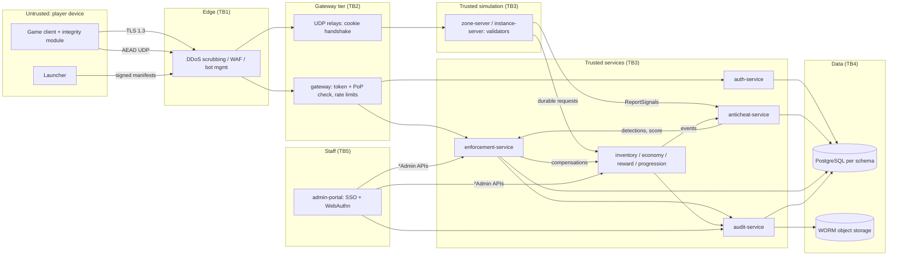
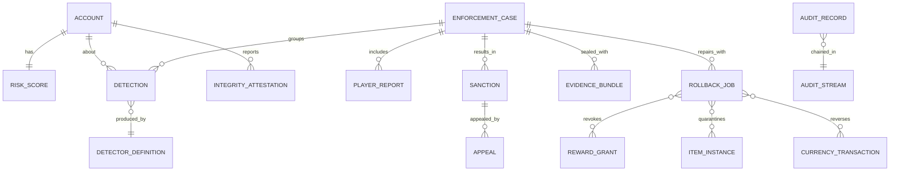

# Legends of the Shattered Frontier — Security and Anti-Cheat Architecture

Version 1.0 — Expanded Technical Design Authority edition (2026-10-17)

Status: Design target; not implemented. Names per Shared Registry v1.0.

Registry: [Shared Registry v1.0](Legends_Shattered_Frontier_Shared_Registry_v1.0.md) · Part folder: [`Security/`](Security/)

---

## 1. Overview

Legends of the Shattered Frontier is a persistent, player-driven economy MMO. Its biggest security risks are not stolen passwords alone but **cheats that change the shared world**: duplicated items and gold, bots farming resources around the clock, real-money trading funnels, and exploits that inflate rewards. This specification defines a defense-in-depth architecture built on one rule from the Registry glossary: **server authority**. The server validates and decides every gameplay-relevant outcome; the client only requests.

The design has five pillars:

1. **Prevent** — server-side validation of movement, combat, interactions, inventory and economy (invariants that make duplication impossible by construction rather than detectable after the fact).
2. **Detect** — versioned detectors (`detector/<slug>`) producing detections (`det_`) from server signals, economy graphs, client attestation and reports.
3. **Score** — a rolling 0–1000 Risk Score per account that prioritizes review and drives reversible interim controls.
4. **Enforce and repair** — enforcement cases (`cas_`), sanctions (`snc_`), appeals (`apl_`) with human review, and rollbacks that undo damage through owning services.
5. **Prove** — an append-only, hash-chained, WORM-anchored audit trail (`aud_`) of every privileged and economic action, including those of staff.

### 1.1 Scope

* Threat model (STRIDE per component, MMO-specific threats) with likelihood/impact ratings and mitigations.
* Server authority rules and validation formulas; the `security.action.rejected` flow.
* Client integrity: signed manifests, attestation (`client.integrity.reported`), client trust limits.
* Detector catalog, risk score, enforcement ladder, case state machine, appeals, evidence retention.
* Rollback and restore sagas with invariants.
* Audit trail; `admin-portal` staff permission model.
* Account security (credentials, MFA, session binding, login risk) for `auth-service` and `gateway`.
* Privacy and data protection for security data; incident response; monitoring and alerts.
* Schemas, gRPC APIs, event payloads for `security.*`, `enforcement.*`, `audit.*`, security-relevant `auth.*`, `client.integrity.reported`; analytics hooks; implementation guide.

### 1.2 Non-goals

* Combat formulas (Combat spec), item/currency schemas (Itemization, Economy specs), account profile core and service topology (Backend spec), transport protocol details (Network spec), launcher internals (Client delivery spec), alert pipeline implementation (Analytics spec).
* Chat content moderation classifiers (chat-service, Backend spec); Security only consumes their outputs as reports/evidence.
* Payment fraud and chargebacks in `store-service` (LiveOps spec); Security receives signals only.
* A kernel-mode anti-cheat driver (explicitly out of version 1; see Part 1, Client integrity).

### 1.3 Glossary

All terms follow the [Shared Registry](Legends_Shattered_Frontier_Shared_Registry_v1.0.md) glossary (Detection, Enforcement Case, Risk Score, Sanction, Server authority, Escrow). Security-local terms: **taint set** (items/currency derived from an illegitimate origin), **interim restriction** (a reversible sanction pending review), **audit-before-act** (append an audit record before performing a privileged action), **teleport token** (server-issued permission for a large displacement), **deterministic detector** (an invariant check with confidence 1.0).

---

## 2. Security layers and trust boundaries

| Layer | Contents | Key controls |
| --- | --- | --- |
| Client | UE5.8 game client, launcher, integrity module | Signed manifests and paks, attestation, no authoritative state, debug code stripped |
| Network | Edge (Cloudflare), load balancers, `gateway`, UDP relays | TLS 1.3, AEAD UDP with replay window, PoP session binding, rate limits, DDoS scrubbing, WAF |
| Backend | Game servers and services | Server authority validators, mTLS service identity, per-RPC authorization, idempotency, invariants, detectors, enforcement |
| Database | PostgreSQL per service schema, Redis, object storage | Per-service credentials, append-only ledgers and audit, encryption at rest, WORM anchors, immutable backups |

Boundary rules TB1–TB5 are detailed in Part 1 (Trust boundaries). Principle: **everything left of the gateway is hostile; everything right of it is authenticated but still least-privilege.**

---

## 3. Service ownership

| Service | Security-spec responsibility | Schema | Publishes |
| --- | --- | --- | --- |
| `anticheat-service` | Signal intake, detectors, detections, risk scores, integrity attestations, deny-list | `anticheat` | `security.*` |
| `enforcement-service` | Cases, sanctions, restrictions lookup, appeals, evidence, rollback/restore orchestration, player reports | `enforcement` | `enforcement.*` |
| `audit-service` | Append-only hash-chained audit, anchors, verification | `audit` + WORM | `audit.*` |
| `auth-service` (security parts) | Credentials, MFA, devices, session binding, login risk, cooling-off, connect tickets | `auth` | `auth.*` |
| `gateway` (security parts) | PoP verification, rate limits, build gating, route allow-list | — | — |
| `zone-server` / `instance-server` (validators) | Movement/combat/interaction validation, reject rollups, signal summaries | — | via anticheat-service |
| `admin-portal` (enforcement console) | UI only; every action via audited `*Admin` APIs | — | — |

Collaborators that **own the data** touched by enforcement: `inventory-service` (`QuarantineItems`, `ReleaseQuarantine`, `RevokeItems`), `reward-service` (`RevokeGrant`), `economy-service` (debits/credits, trade holds, restrictions), `progression-service` (`ApplyRollback`), `chat-service` (mutes), `liveops-service` (compensation), `config-service` (kill switches, flags).

---

## 4. Core model

Flow in one sentence: **signals → detections → risk score → case → human review → sanctions (+ rollback) → appeal → closed**, with every privileged step written to the audit chain first.

| Concept | Defined in |
| --- | --- |
| Threat ratings, STRIDE, MMO threats | Part 1 |
| Movement envelope, combat checks, invariants INV-1..13, rate limits | Part 1 |
| Reject reason codes and rollup flow | Part 1 |
| Client trust limits, attestation | Part 1 |
| Login risk, MFA, session binding | Part 1 |
| Detector definitions and catalog | Part 2 |
| Risk score formula `R(t)` and bands | Part 2 |
| Enforcement ladder, case state machine (`enforcement_case_state`), appeals | Part 2 |
| Rollback taint trace, saga, invariants RB-1..8 | Part 2 |
| Audit hash chain, staff roles, runbooks, alerts | Part 3 |
| DDL, gRPC, event payloads, analytics metrics | Part 3 |
| Build order, test matrix, secure coding rules | Part 4 |

### 4.1 Key numbers at a glance

| Item | Default | Tuning key |
| --- | --- | --- |
| Movement tolerance ε / slack / burst | 0.08 / 0.5 m / 1.0 s | `tune.security.move_tolerance`, `…move_slack_m`, `…move_burst_seconds` |
| Lag compensation cap | 200 ms | `tune.security.lag_comp_max_ms` |
| Cooldown tolerance | 50 ms | `tune.security.cooldown_tolerance_ms` |
| Severity base points (low/med/high/crit) | 25 / 75 / 200 / 450 | `tune.security.risk_severity_base` |
| Half-lives (low/med/high/crit) | 7 / 14 / 30 / 60 d | `tune.security.risk_half_life_days` |
| Bands | watch 200, elevated 400, high 600, severe 800 | `tune.security.risk_bands` |
| Interim review deadline | 24 h | `tune.security.interim_review_hours` |
| Appeal window | 30 d | `tune.security.appeal_window_days` |
| Audit anchor interval | 300 s | `tune.security.audit_anchor_interval_s` |

---

## 5. Table of contents

| Part | File | Topics |
| --- | --- | --- |
| 1 | [Threat Model, Server Authority, Client Integrity, Account Security and Privacy](Security/Legends_Shattered_Frontier_Security_Threat_Model_and_Server_Authority_v1.0.md) | Rating scales; trust boundaries; STRIDE per component; MMO threat catalog; server authority (movement envelope formulas, combat validation, inventory/economy invariants, interaction checks, rate limits); `security.action.rejected` flow; client integrity (trust limits, signed manifests, attestation); account security (credentials, MFA, session binding, login risk, ATO, credential stuffing); privacy and data protection; DDoS controls |
| 2 | [Detectors, Risk Score, Enforcement and Rollbacks](Security/Legends_Shattered_Frontier_Security_Detection_Risk_and_Enforcement_v1.0.md) | Detection pipeline; detector definition schema; detection lifecycle; detector catalog (movement, combat, integrity, dupes, bots, trade/RMT graph, market manipulation, exploits, conduct, ATO, staff); risk score formula with worked examples; enforcement ladder; case state machine; human review; appeals; evidence retention; rollback types, taint trace, saga, invariants, restore saga |
| 3 | [Audit, Staff Permissions, Operations and Interfaces](Security/Legends_Shattered_Frontier_Security_Audit_Operations_and_Interfaces_v1.0.md) | Audit trail (hash chain, WORM anchoring, verification); GM/admin-portal permission model; incident response runbooks; monitoring and alerts; PostgreSQL schemas; gRPC APIs; event payloads; analytics hooks |
| 4 | [Agent Implementation Guide and Secure Coding Rules](Security/Legends_Shattered_Frontier_Security_Agent_Implementation_Guide_v1.0.md) | Module layout; build order and milestones; invariants checklist; test matrix (unit, property, integration, load); acceptance criteria; secure coding rules for all repositories; Do/Don't; pitfalls |

---

## 6. Security considerations (summary for other specs)

Every domain spec should apply these rules; details in Part 1 and Part 4:

* Validate intents, never accept outcomes; report rejects through the rollup flow to `anticheat-service`.
* Keep item/currency creation inside `inventory-service`/`economy-service` with `source`/`sink` codes and `causation_id`; preserve INV-1..INV-13.
* Expose compensation APIs (quarantine, revoke, debit, reverse) so enforcement can repair without direct writes.
* Call `enforcement-service.CheckRestrictions` before trade, market, mail-with-attachment and chat actions.
* Append audit records before privileged or high-value economic actions.
* Classify every event field with `privacy_class`.

## 7. Analytics hooks (summary)

Key metrics: `m_detector_precision`, `m_false_positive_overturn_rate`, `m_case_time_to_action_p50`, `m_bot_prevalence_estimate`, `m_rmt_flagged_value_copper`, `m_rollback_net_created_copper`, `m_action_reject_rate`, `m_integrity_fail_rate`, `m_ato_rate`, `m_mfa_adoption`. Full list in Part 3 (Analytics hooks).

---

## 8. Registry additions

> **Merge status (2026-10-17):** the additions below were merged into the Shared Registry (see its change log), with these rulings: LiveOps `gm_role` → Security `staff_role`; trade window uses `tune.loot.trade_window_minutes` only. The registry is now authoritative for these names; rows here remain as justification.

All items below were proposed by this spec and are now merged (see note above); consume them from the Registry.

### 8.1 Entities and ID prefixes

| Entity | Prefix | Owner / store | Justification |
| --- | --- | --- | --- |
| IntegrityAttestation | `iat_` | anticheat-service, `anticheat` | Nonce-bound attestation records referenced by `security.integrity.failed` and evidence. (`att_` is taken by EncounterAttempt.) |
| EvidenceBundle | `evd_` | enforcement-service, `enforcement` + object storage | Sealed, hashed evidence with its own retention class; referenced from audit. |
| RollbackJob | `rbk_` | enforcement-service, `enforcement` | Saga identity; used in idempotency keys and `causation_id` for compensating ledger entries across inventory/economy/reward/progression. |
| PlayerReport | `rpt_` | enforcement-service, `enforcement` | Input to `detector/report_cluster` and cases. |
| ElevationGrant | `elv_` | auth-service (staff access tables), `auth` | Just-in-time staff elevation referenced by audit records. Ownership could alternatively sit with a future staff-identity service — see open issues. |

### 8.2 Events

| Event | Owner | Justification |
| --- | --- | --- |
| `enforcement.appeal.resolved` | enforcement-service | Appeal decision is a distinct fact from case resolution (re-appeals, partial overturns); needed for SLA metrics. |
| `auth.mfa.removed` | auth-service | MFA removal is a key takeover indicator; input to `detector/login_anomaly`. |
| `auth.credential.changed` | auth-service | Password/email change; input to ATO detection and cooling-off. Payload: `credential_kind` (`password`, `email`), `via_recovery` (bool), `login_risk`. |

### 8.3 Enumerations

| Enum | Values | Justification |
| --- | --- | --- |
| `reject_reason` | Part 1 list (27 values) | Shared by zone/instance servers, gateway, economy/inventory producers and Analytics. |
| `detector_category` | `movement`, `combat`, `integrity`, `network`, `economy`, `botting`, `rmt`, `market`, `exploit`, `conduct`, `account_security`, `staff` | Used in detector content definitions and events. |
| `detection_status` | `shadow`, `active`, `confirmed`, `false_positive`, `expired` | Detection lifecycle state (canonical-state style). |
| `risk_band` | `normal`, `watch`, `elevated`, `high`, `severe` | Consumed by Economy (trade holds) and Analytics. |
| `offense_category` | `cheat_software`, `botting`, `duplication`, `exploit_abuse`, `rmt_seller`, `rmt_buyer`, `market_abuse`, `harassment`, `griefing`, `account_sale_or_sharing` | Enforcement ladder and reporting. |
| `sanction_scope` | `account`, `character` | Character-scoped rollbacks and mutes vs account-wide suspensions. |
| `appeal_state` | `submitted`, `in_review`, `upheld`, `partially_overturned`, `overturned` | Appeal lifecycle. |
| `rollback_state` | `planned`, `approved`, `executing`, `completed`, `compensating`, `failed` | Saga lifecycle. |
| `staff_role` | `support_agent`, `game_master`, `senior_game_master`, `enforcement_reviewer`, `enforcement_lead`, `security_analyst`, `economy_analyst`, `liveops_operator`, `liveops_lead`, `store_manager`, `release_manager`, `auditor`, `break_glass_admin` | Shared by every service's `*Admin` API policy; LiveOps admin-portal capabilities per LiveOps spec, Roles and permissions. |

### 8.4 Source/sink codes

| Code | Kind | Justification |
| --- | --- | --- |
| `enforcement_restore` | source | Restoring items/currency after an overturned appeal and refunding innocent holders during dupe rollbacks; distinct from `gm_grant` so economy reports separate it. |

### 8.5 Tuning keys and flags consumed cross-domain

| Key | Default | Consumers | Justification |
| --- | --- | --- | --- |
| `tune.security.trade_hold_value_copper` | 100,000 | Economy | Trade/mail/market hold threshold for `elevated`+ accounts. |
| `tune.security.cooloff_value_copper` | 50,000 | Economy, Inventory | Value threshold for 72 h cooling-off after risky login. |
| `tune.security.audit_value_threshold_copper` | 10,000,000 | Economy, Inventory, Reward | Single transfers at or above this are audited. |
| `tune.security.min_client_build` | per release | gateway, Client delivery | Block vulnerable client builds. |
| `ff.security.economy_freeze` | off | Economy, Inventory | Realm-wide freeze of trade/market/mail attachments during dupe incidents. |
| `ff.security.kernel_anticheat_enabled` | off | Client delivery | Placeholder for future evaluation; requires privacy review. |

### 8.6 Open issues and cross-domain dependencies

1. **Economy:** wallet liens to settle `rollback_deficit`; trade-hold mechanism using `GetRiskScore`/`CheckRestrictions`. Until available, deficit accounts stay trade/market restricted (Part 2, RB-7). Resolved (2026-10-17): Economy spec, Wallet liens defines `PlaceLien` / `ReleaseLien` / `WriteOffLien` (`wln_`, `wallet_lien_state`; garnishes 50 % of later faucet credits and 100 % of incoming transfers with sink `enforcement_rollback`, 180-day limit), and Economy spec, Transfer holds defines 24 h holds (max 72 h) driven by `GetRiskScore` / `CheckRestrictions`. RB-7's interim wording is superseded: deficit accounts get a lien, and deficit-driven restrictions may be lifted once it is active.
2. **Character:** `progression-service` admin RPC to reverse `pgl_` entries and recompute dependent unlocks for `progression_rollback`. Resolved (2026-10-17): Character spec, Service interfaces defines `ApplyRollback` (scopes `rollback_to`, `entries`, `reward_grant_id`; revokes mastery nodes newest-first if LP < 0).
3. **Itemization:** `inventory-service` `QuarantineItems`, `ReleaseQuarantine`, `DestroyItems(sink=enforcement_rollback)`; `reward-service` `RevokeGrant` compensation semantics for already-consumed rewards. Resolved (2026-10-17): Itemization defines `QuarantineItems` / `ReleaseQuarantine` and `RevokeItems(mode = destroy | quarantine)` (destroy step: `quarantined → destroyed`, sink `enforcement_rollback`) in Item model part, API; `RevokeGrant` returns per-shortfall `deficits[]` for consumed/salvaged/spent rewards (Loot and Rewards part, Revocation), which enforcement turns into `currency_rollback` or `rollback_deficit`.
4. **World / Network / Combat:** authoritative `v_eff` (base, mount and buff speeds), teleport tokens issued for every server-initiated displacement, cell IDs for path digests, and an explicit statement of how haste applies to cooldowns and GCD (Combat spec currently lists only the 75% haste maximum). Resolved (2026-10-17): World spec, Authoritative movement speed and Teleport tokens define `v_eff` (base, mount, buff speeds, Combat `combat_move_mult`, hard caps), single-use teleport tokens for every server-initiated displacement, and deterministic cell keys for path digests (Cell ID format); Combat spec, Haste defines `h` as a time-reduction fraction (≤ 0.75) applied to casts, channels, swings, haste-scaled cooldowns (`cd ≤ 30 s` by default) and the GCD as `gcd_eff = max(0.75 s, 1.5 s × (1 − h))`, which the GCD check must use.
5. **Backend:** `content-catalog-service` support for **server-only** content packs (for `detector/` definitions); split of `auth-service` ownership — Backend owns account core, Security owns credentials/MFA/session binding/login risk. Resolved (2026-10-17): Backend spec defines the auth-service ownership split and server-only content packs (`content_pack_visibility`, separate signing key, bucket and KMS key, never delivered to clients); `auth.login.failed` uses field `reason` with `login_failure_reason`.
6. **Registry naming:** `security.trade.flagged` is used for trade, mail and market transfers; the name is kept and `transfer_kind` distinguishes them.
7. **Analytics:** `client.integrity.reported` is produced by the client via `telemetry-ingest`; its payload is defined in Part 3 by Security, and `telemetry-ingest` must strip `report_signature` before the warehouse.
8. **Staff identity:** if a dedicated staff-identity service is later introduced, `elv_` ownership moves there.
9. **Phase-2 cross-spec confirmations.** Resolved (2026-10-17): GCD / cooldown validation follows Combat spec, Haste (Part 1, Combat validation); `detector/damage_envelope` defined from Combat spec, Security considerations (Part 2, §3.1); `leash_abuse` signals from the AI and Dungeon specs feed `detector/leash_abuse` (Part 2, §3.6); `enforcement-service.GetLegalHold` / `HoldReleased`, `hld_`, `legal_hold_scope`, `legal_hold_basis` ratified per Backend spec, Legal holds (Part 3, §7.2); login check order and `auth.login.failed.decided_by` confirmed per Backend spec, Login path and Backend hooks (Part 1, §9.3; Part 3, §8.13); `world:weather:override`, `world:spawn:bounded`, `world:terrain:revert` added to the permission matrix (Part 3, §3.2); garnish audit batching confirmed and RB-7 points at Economy spec, Wallet liens and Transfer holds (Part 2, §6.5). `detector/craft_salvage_loop` defined at Crafting's request (Part 2, §3.6; Crafting spec, Security considerations), the Security item in the phase-2 closure list's "Crafting items" section. Still open: Economy's request for an item-deficit → gold-lien policy.
