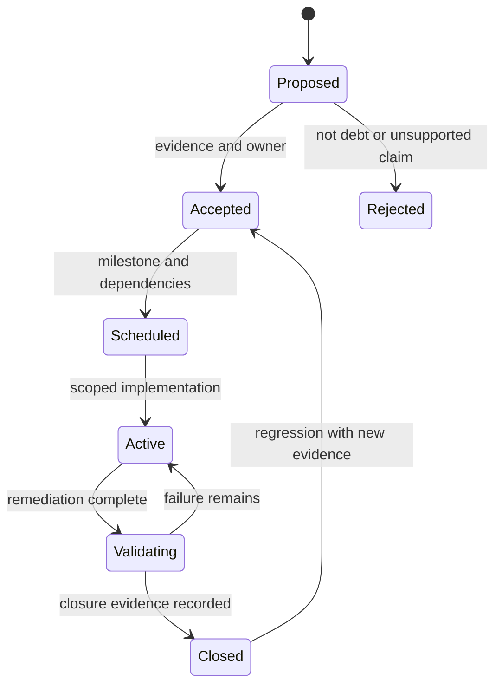
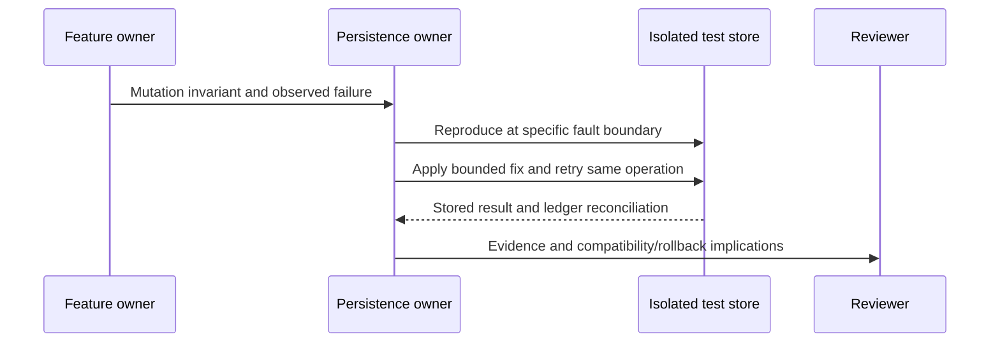

# Technical Debt Standards

## Purpose and scope

Technical debt is a known compromise that increases future change cost or operational risk. Track it with an owner, bounded impact, mitigation, and closure evidence. This document governs how debt is identified and prioritized; it does not turn every future feature into a defect.

This is an expanded working standard retained under its existing filename. It does not authorize full-suite testing, infrastructure purchases, deployment, or unrelated refactors. User instructions and AGENTS.md govern execution.

Related references: [backlog](Legends_Shattered_Frontier_Gameplay_Feature_Backlog_v1.0.md), [MVP gates](Legends_Shattered_Frontier_First_MVP_Milestone_v1.0.md), [repository](Legends_Shattered_Frontier_Repository_Structure_v1.0.md), [agent workflow](Legends_Shattered_Frontier_AI_Agent_Responsibilities_v1.0.md).

## Classify the work correctly

| Category | Definition | Example | Handling |
| --- | --- | --- | --- |
| Defect | Current behavior violates its accepted contract | Duplicate retry grants twice | Fix against acceptance; debt record if knowingly deferred |
| Debt | Known compromise with future/risk cost | Blocking persistence call on simulation thread | Owner, mitigation, trigger, closure evidence |
| Product backlog | Deliberately unimplemented scope | Raids absent from local PoC | Feature backlog, not defect count |
| Design gap | Required contract lacks a decision | Terrain chunk representation undecided | Block dependent implementation; prepare decision |
| Operational risk | Environment/process can harm state or availability | No rehearsed restore for invited alpha | Gate owner and mitigation |
| Experiment | Disposable scoped investigation | Try two chunk encodings on fixtures | Timebox, evidence, explicit retain/discard decision |

The browser harness's lack of MMO-scale authentication or full voxel terrain is an explicit PoC boundary. It becomes a blocking gap when preparing a milestone that requires those properties. Do not inflate debt metrics with every aspirational concept feature.

## Non-negotiable invariants

The following cannot be waived for an exposed candidate merely to meet a schedule:

1. Server-derived authority for identity, ownership, economic cost, and combat outcome.
2. No direct database access or credentials in the client.
3. No acknowledged economic/world mutation that knowingly lacks its promised durability.
4. Idempotent asset-changing operations and protected ownership.
5. No one-sided trade, double-spend, or untracked item/currency creation.
6. Supported schema/content compatibility before loading writable state.
7. Secrets excluded from source, logs, and client packages.
8. Known restore/repair path before destructive state migration.
9. Honest reporting of tested capacity and implementation status.

An internal disposable experiment may omit persistence only if its boundaries and disposable data are explicit. It cannot be relabeled a persistent-world MVP.

## Severity and urgency

Severity measures consequence. Priority additionally considers exposure, likelihood, detection, recoverability, and milestone dependency.

| Severity | Typical consequence | Release/milestone policy |
| --- | --- | --- |
| Critical | Repeatable asset duplication/loss, credential exposure, unauthorized durable write, unrecoverable corruption | Block affected candidate; disable affected path and fix/reconcile |
| High | Broad join failure, severe server stall, missing restore capability, private state leak | Block affected milestone or exposure until fixed/contained with explicit owner decision |
| Medium | Bounded performance regression, fragile coupling, incomplete diagnostics that hinder recovery | May defer with mitigation, owner, trigger, and review milestone |
| Low | Local maintainability issue with small known impact | Batch only with related work or scheduled cleanup |

Do not label an exploitable mutation “low” because few testers are invited. Conversely, a local naming inconsistency without a behavioral consequence is not critical.

### Exposure-adjusted priority

For each record, write a plain-language priority rationale:
- Which users, data, environments, and feature paths are affected?
- Is the failure deterministic, likely under contention, or hypothetical?
- Can the system detect and isolate it?
- Can recovery restore ownership without guessing?
- Is the feature required in the current gate?
- What new change would increase exposure?

A numeric score may assist sorting but must not hide a critical invariant violation.

## Debt record schema

Use the existing issue tracker if one is selected; otherwise a small local ledger may be introduced when the first actual debt item is accepted. This document does not create a tracker or fabricate issues.

| Field | Required content |
| --- | --- |
| debt_id | Stable local tracking ID, independent of runtime entity IDs |
| title | Concrete compromise and consequence |
| category | Code, architecture, persistence, performance, security, content, tooling, operations, documentation |
| severity / priority | Classification and rationale |
| status | Proposed, accepted, scheduled, active, validating, closed, or rejected |
| affected_scope | Exact files/modules/data/environment |
| owner | Responsible role/person; “AI” alone is insufficient |
| evidence | Reproduction, profile, incident, or contract discrepancy |
| invariant | Violated or threatened invariant; “none” allowed for maintainability |
| mitigation | What currently bounds the risk |
| remediation | Smallest credible closure plan and dependencies |
| acceptance | Observable closure cases |
| review_trigger | Milestone/date/change that forces reconsideration |
| expiry | Required for temporary exceptions |
| related_work | Feature/decision/incident links |
| closure_evidence | Checks/results/build and residual limitations |

### Example record template

```yaml
debt_id: TD-EXAMPLE
title: "<specific compromise and consequence>"
category: persistence
severity: high
status: proposed
affected_scope: ["<actual file or store>"]
owner: "<assigned role>"
evidence: "<reproduction or measured result>"
mitigation: "<existing containment, not a promise>"
remediation: "<bounded change>"
acceptance:
  - "<failure no longer reproduces under stated conditions>"
review_trigger: "<milestone or dependency change>"
expiry: "<required for temporary waiver>"
closure_evidence: null
```

This is a template, not an active issue. Local statuses do not add canonical gameplay enums or registry entities.

## Debt lifecycle



An “accepted” debt item acknowledges a compromise; it does not mean the feature is approved for release. A critical item remains blocking even if it has an owner.

“Won't fix” requires a rationale and scope change showing why the risk no longer applies. Deleting a test, suppressing a diagnostic, or raising a budget without evidence is not closure.

## Intake and triage procedure

1. Capture a short reproduction or profile; do not dump sensitive state.
2. Identify the owning contract and current scope.
3. Classify defect/debt/design gap/backlog correctly.
4. Assess severity and exposure.
5. Identify immediate containment if an integrity/security invariant is threatened.
6. Create or update one record; link duplicates rather than multiplying them.
7. Assign owner, trigger, remediation, and precise closure evidence.
8. Update the affected gate/backlog if it is blocked.

For a newly discovered critical issue, stop expanding exposure of that path. Preserve enough evidence to investigate, prepare a bounded fix, and communicate the actual consequence. Do not undertake unrelated global refactors under the banner of incident response.

## Exception policy

Only the human project owner can accept a scope/release risk requiring that decision. Agents can document options and implement authorized mitigations. No permanent blanket waivers.

An exception records the exact environment/feature, known consequence, compensating control, owner, expiry, review trigger, and why a safer alternative is not currently available. It must not weaken the non-negotiable exposed-candidate invariants.

Example: a debug-only expensive visualization can remain in an internal editor configuration if it is excluded from packaged targets and has a removal gate. Example that is not acceptable: allowing client-provided item quantities in an invited test build because participants are trusted.

## Architecture debt

| Smell | Required review | Closure evidence |
| --- | --- | --- |
| Circular module dependency | Extract contract or higher-level coordinator | Dependency graph has no prohibited cycle; affected targets build |
| Multiple writers for same durable field | Select domain owner and route mutations | Concurrent/retry checks show one authority |
| Shared utility contains gameplay rules | Return behavior to owning domain | Callers use explicit contract; rules tested there |
| Duplicate client/server gameplay implementation | Consolidate shared rule definitions and authority checks | Same definition version; no client-trusted outcome |
| Spec contradicts implementation | Decide whether code or accepted contract changes | Updated caller behavior and documentation |
| New service without operational need | Compare cohosting vs extraction costs | Measured need or clear independent ownership/deployment requirement |

A “clean architecture” rewrite needs a concrete pain/invariant and acceptance case. Do not introduce layers that have no consumer or remove working behavior merely to match a diagram.

## Persistence and schema debt

Every asset-changing path needs a defined transaction/settlement boundary. Common blocking examples:
- Cost write and structure write can diverge.
- Request keys are not scoped to authenticated principal.
- Retrying after timeout creates a fresh grant.
- A migration can be applied by two independent runners.
- Backup existence is claimed without restore evidence.
- Snapshots lack schema/content identity.

The owner supplies a fault matrix spanning before validation, after reservation, before commit, after commit/before reply, after publication, and during recovery as applicable. Only the affected command scenarios need to run.



Do not “repair” durable data by recomputing ownership from the client's last display. Repair uses authoritative receipts, ledgers, and compatible backups.

## Performance debt

Shared performance budgets live in the MVP specification. A performance debt item includes scenario, reference hardware, build/content identity, actor counts, command mix, warmup, measurement window, and before/after distributions.

Report p95 and significant tails, not only averages. Distinguish game-thread, rendering, network, backend, queueing, and instrumentation cost. A synthetic server result cannot prove client frame rate.

| Regression | Required response |
| --- | --- |
| Budget miss in representative workload | Profile and create scoped optimization or revise scope through a recorded decision |
| Memory rises with completed operations | Check retained objects/receipts/cache bounds; repeat relevant soak only |
| Growing persistence queue | Bound admission and investigate service time; do not hide backlog |
| Excess actor replication | Inspect relevancy/audience and update rates before changing network stack |
| Terrain edit hitch | Bound work and collision rebuild scheduling; reject oversized edits |
| Slow clean build | Measure changed target and dependency cost before module reorganization |

Changing a performance target requires evidence and project-direction agreement where it changes the player experience or capacity claim. Do not alter acceptance thresholds to turn a failed run into a pass.

## Security, privacy, and diagnostics debt

Security and Analytics domain owners define the detailed contracts. This standard governs triage and evidence only and does not edit those specifications.

Private data leakage, credential logging, missing authorization, and unsafe admin mutation need bounded containment and focused reproduction. Security checks must use controlled identities and isolated data. Do not publish secrets or raw player/session data in an evidence summary.

Telemetry is not a substitute for durable audit/ledger records. Diagnostics can be sampled or delayed according to their contract; economic ownership cannot depend on a best-effort analytics event.

## Documentation and content debt

Documentation debt is actionable when stale guidance can cause a wrong build, unsafe mutation, conflicting ownership, or wasted repeated discovery. Fix exact references and index summaries rather than copying the same contract into more documents.

Content debt includes missing asset provenance, unstable IDs, broken map references, unusable collision, and server-only definitions in client packs. The closure case is concrete: known source/license information, valid references, relevant map behavior, or clean client-safe packaging.

Do not impose page-count targets as evidence of design completeness. A short complete state machine is more useful than many pages that omit retry ownership.

## Metrics and review cadence

Proposed cadence: review blocking debt at each milestone gate and revisit accepted exceptions before their expiry or exposure changes. Do not create a recurring automation without user request.

| Metric | Interpretation |
| --- | --- |
| Open critical/high items affecting current gate | Release risk, reviewed item by item |
| Debt age by severity/owner | Triage signal; old low-impact debt need not outrank fresh corruption |
| Reopened defects | Closure evidence quality |
| Invariant violations per scenario | Data integrity gate; target zero |
| Unexpected error/timeout rate | Availability under declared workload |
| Performance regression against same scenario | Capacity/experience risk |
| Build failures by changed target | Tooling stability |
| Relevant test coverage of failure modes | Whether plausible failures are checked |

Line coverage is a diagnostic, not a universal release percentage. No numeric code-coverage target is established here; prevent agents from adding trivial tests to meet an arbitrary percentage.

## Gate and capacity budgeting

Plan debt remediation alongside feature work. Reserve capacity based on measured risk and dependencies, not an invented fixed staffing percentage.

Before a gate, classify each open item as blocking, contained with bounded exception, or outside that milestone. A blocker must point to the failed criterion. A contained item must include mitigation evidence. An out-of-scope feature remains backlog, not hidden debt.

For early work, highest-value investment is usually authority, transaction correctness, recovery, and targeted diagnostics. Large microservice platforms or generalized content frameworks need their own justification.

## Precise validation and closure

Run checks that can falsify the claim:
- A permission fix checks allowed and denied actors.
- An idempotency fix repeats the same operation before/after lost reply.
- A migration fix checks the affected source schema and interruptions.
- A coupling fix builds affected module targets.
- A doc fix resolves changed links and checks contradictory claims.

Full-suite execution occurs only at explicit user request. A debt closure record cannot cite an unrun campaign. If tooling is unavailable, record the limitation and do not mark an evidence-dependent item closed.

## Initial risk inventory — observations, not created issues

| Current condition | Classification now | Becomes blocking when |
| --- | --- | --- |
| Node/browser harness is local-only | Accepted PoC boundary | Remote invited tests need authentication/hardening |
| Unreal project not yet in repository | Planned next milestone | E1 implementation begins |
| No measured 100-player capacity | Unverified target | MVP capacity claim |
| Terrain is tile excavation | Accepted prototype representation | Bounded Unreal terrain acceptance |
| No packaged client updater | Deferred delivery work | Final MVP delivery |
| Advanced domain specs not integrated | Planned implementation | Dependent feature gate |

This table prevents confusing current limitations with delivered production capability. Create actual debt records only when evidence shows an accepted compromise or violated contract.

## Registry additions

None. Debt IDs and statuses are local workflow metadata, not runtime entities, events, or public enums.
