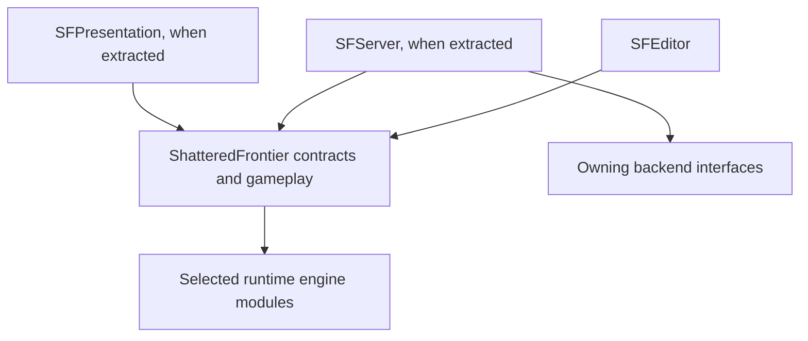
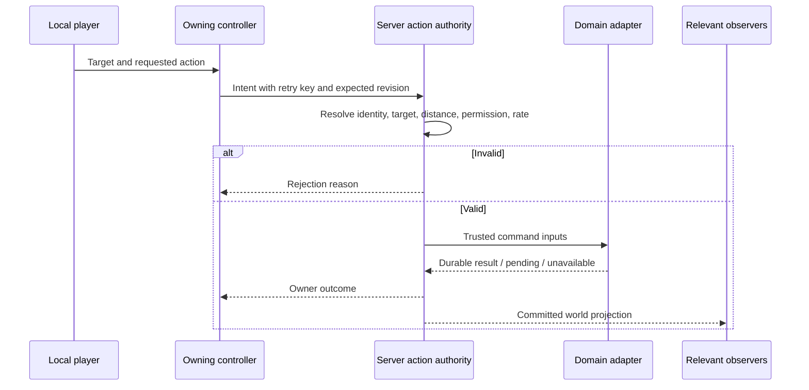
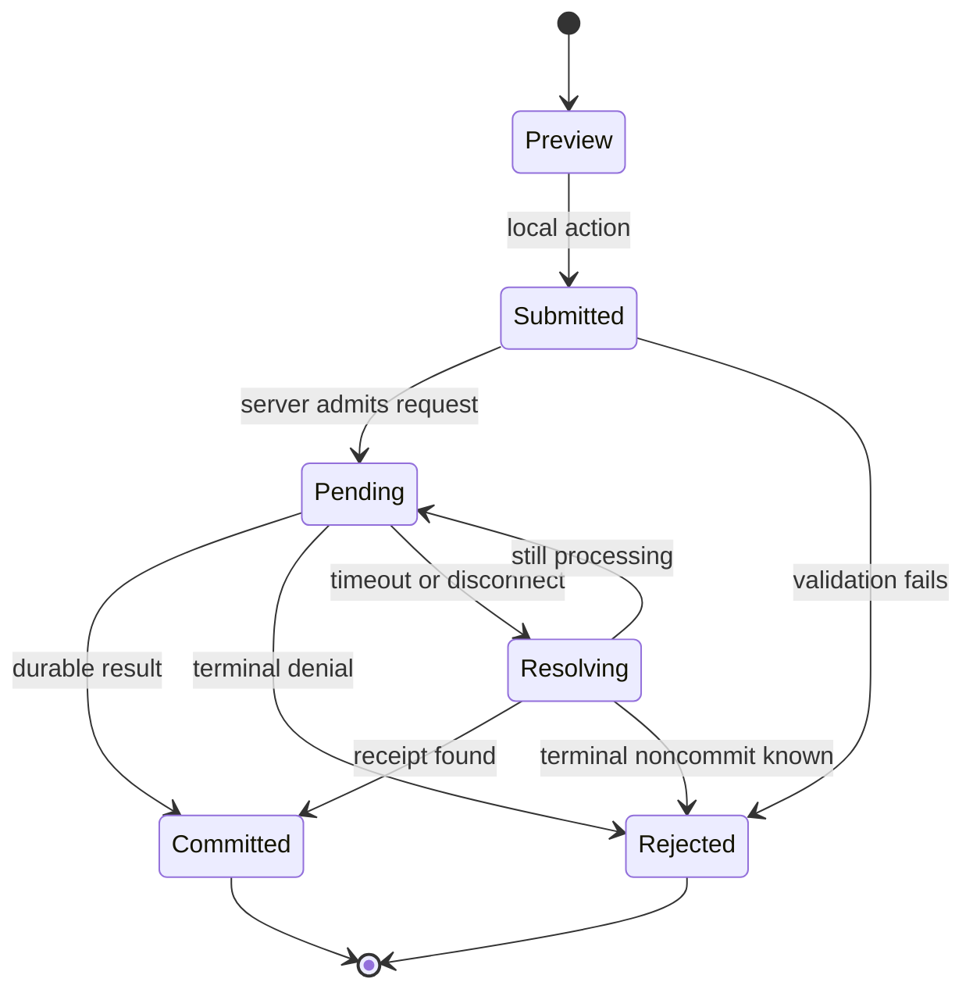

# UE5.8 Project Layout

## Purpose and status

This is the proposed code, asset, lifecycle, and replication layout for the first Unreal movement slice and later persistent-world MVP. It does not create a project or certify an installed engine. The actual repository currently contains the Node/browser PoC.

Keep the existing filename while expanding in place. Read the relevant sections only. Related references: [repository](Legends_Shattered_Frontier_Repository_Structure_v1.0.md), [MVP](Legends_Shattered_Frontier_First_MVP_Milestone_v1.0.md), [backlog](Legends_Shattered_Frontier_Gameplay_Feature_Backlog_v1.0.md), [registry](Legends_Shattered_Frontier_Shared_Registry_v1.0.md).

Engine API/build compatibility must be checked against the actual installed build before implementation. The names prefixed SF below are proposed project classes and interfaces, not generated code or registry services.

## Foundation decisions

| Topic | Proposed baseline | Boundary |
| --- | --- | --- |
| Project | C++ third-person game under GameClient/ShatteredFrontier.uproject | Confirm engine path and project creation location before editing engine configuration |
| Client/server source | Shared gameplay code with distinct build targets | No copied server gameplay project |
| Simulation | One zone-server running Greenlands | No seamless handoff requirement for E1/MVP |
| Input | Local input adapter invokes movement/interaction interfaces | Client cannot supply authoritative outcomes |
| Persistence | Server adapter to owning domain interfaces | No DB driver or credentials in client modules |
| Presentation | Data-driven Blueprints/widgets and local feedback | No authoritative inventory/cost logic in widgets |
| Network features | Start with engine-supported character replication and measured actor relevance | Advanced replication system choice follows profiling |
| Terrain | Small bounded test area with explicit edit/collision budgets | Representation undecided until TER-01 design |
| Plugins | Add only when a specific task needs them | No blanket install of “MMO Framework”, voice, or anti-cheat products |

The initial module may remain small. Introduce separate runtime modules when a real dependency boundary or build exclusion is needed; a folder per feature is not itself a reason for a module.

## Proposed tree

```text
GameClient/
  ShatteredFrontier.uproject
  Config/
    DefaultEngine.ini
    DefaultGame.ini
    DefaultInput.ini             when used by selected input setup
  Source/
    ShatteredFrontier.Target.cs
    ShatteredFrontierEditor.Target.cs
    ShatteredFrontierServer.Target.cs
    ShatteredFrontier/
      ShatteredFrontier.Build.cs
      Public/
        Framework/
        Characters/
        Interaction/
        World/
        DomainContracts/
      Private/
        Framework/
        Characters/
        Interaction/
        World/
    SFServer/                   introduce for server-only domain adapters
    SFPresentation/             introduce for UI if separation is useful
    SFEditor/                   editor utilities only
  Content/Frontier/
    Maps/
    Characters/
    Interaction/
    Building/
    Resources/
    Combat/
    UI/
    Data/
    Audio/
    Art/
  Plugins/                      selected project plugins only
```

This is a proposal, not a command to create all directories. Map paths and exact class names become stable only when ENV-02/03 implement them.

## Dependency layers



Core exposes gameplay intents and projections. It does not reference the concrete SFServer implementation. A server-only adapter installs interface implementations at startup. UI does not import SFServer. SFEditor must not appear in client or dedicated-server runtime dependencies.

Every Build.cs dependency must have an actual included symbol/use. Keep implementation-only dependencies private where possible. Avoid adding online, editor, HTTP, or database modules speculatively. Verify exact module names and target guards against the installed engine when implemented.

## Unreal framework ownership

The framework distinctions below follow Epic's [Gameplay Framework](https://dev.epicgames.com/documentation/en-us/unreal-engine/gameplay-framework-in-unreal-engine) and [Game Mode / Game State](https://dev.epicgames.com/documentation/en-us/unreal-engine/game-mode-and-game-state-in-unreal-engine) documentation. The SF responsibilities are this project's design proposal.

| Class / type | Proposed responsibility | Lifetime and visibility | Must not own |
| --- | --- | --- | --- |
| SFGameMode | Join/spawn policy, simulation readiness, authority-only rules | Server world | Private UI state or durable account database |
| SFGameState | Public region phase and small shared replicated facts | World; replicated audience | All inventories, session secrets, full terrain database |
| SFPlayerController | Owning-client intent endpoint, interaction requests, owner feedback | Controller/connection | Trusted client price/damage/identity |
| SFPlayerState | Public identity/appearance and minimal player facts | Connected player; controlled replication | Full private progression/inventory by default |
| SFCharacter | Avatar movement/collision and visible equipment representation | Pawn; relevancy-controlled | Durable character ownership or session credentials |
| Interaction component | Target capability and action request integration | Attached actor/component | Final authority solely from a local trace |
| Session subsystem | Join orchestration, connection status, request bookkeeping | Game instance on each process | Replication transport or persistent database authority |
| World action subsystem | Server interaction scheduling and live-world lookup | World | Automatic durable storage simply by existing |
| Persistence adapter | Async domain calls and reconciliation | Server-only service lifetime | UI or client-side credential storage |
| UI/local-player adapter | Input prompts, inventory projection, pending/error state | Local player/view | Mutating committed inventory |

GameMode is server-only; GameState provides replicated shared state. GameInstance exists independently per process and is not replicated. Subsystems coordinate lifecycles; expose network state through appropriate replicated actors/components rather than assuming a subsystem replicates automatically.

A PlayerState is not durable database storage. Pawn destruction must not destroy the durable inventory. Character disconnect and respawn are separate transitions from account logout.

## Spatial and persistence ownership

| State | Authority | Durable owner | Client projection |
| --- | --- | --- | --- |
| Position/velocity | Server character movement | Selected character location checkpoints | Relevant movement state |
| Interaction target | Server validation after local targeting | Usually none for targeting itself | Local highlight and outcome |
| Inventory/equipment | inventory-service contract through server adapter | Itemization store/ledger | Private contents to owner; visible equipped appearance as allowed |
| Health/combat result | zone-server simulation | Domain-approved recovery/reward records | Relevant health/combat cues; no private tables |
| Claim/structure | Authoritative world/building command owner | World/Building persistence contract | Relevant owner/access/render state |
| Terrain | Server chunk owner | Ordered chunk deltas/checkpoints | Relevant bounded geometry revision |
| Skill/quest/reward | Respective registry domain owner | Domain durable state | Owner progress and permitted public facts |
| Currency/market | economy-service | Ledger and escrow | Authorized balances/listings |
| Static definitions | content-catalog-service contract | Published catalog | Client-safe definitions only |

No actor directly updates another domain's tables. The adapter invokes the owning domain contract. Live simulation may cache approved state, but the cache cannot acknowledge an economic mutation without a durable outcome.

## Replication contract

Epic's [networking overview](https://dev.epicgames.com/documentation/unreal-engine/networking-overview-for-unreal-engine?lang=en-US) describes server/client state exchange. The following audience and rate rules are project targets.

| Data | Audience | Update approach | Late-join requirement |
| --- | --- | --- | --- |
| Movement | Nearby relevant clients | Engine movement path; rate measured | Current pose/position, not replay of all inputs |
| Public identity | Relevant players | Change-driven | Current identity and appearance |
| Private inventory | Owning authenticated player | Committed deltas plus resync snapshot | Snapshot at known revision |
| Claim/structure | Relevant observers | Change-driven committed state | Existing pieces and allowed access presentation |
| Terrain | Relevant chunk viewers | Bounded delta or refreshed chunk | Consistent base plus accepted revision |
| Quest/skill | Owner | Change-driven domain result | Current progress snapshot |
| Combat visual cue | Relevant observers | Transient event where loss is tolerable | No need to replay old effects |
| Authoritative health/death | Relevant observers/owner | State with explicit lifecycle | Correct current state even if cue was missed |
| Session secrets | No replication | Never part of actor projection | Not applicable |

Durable state must not depend on a one-time multicast visual effect. A late joiner must see the current wall even if it missed placement. Relevancy and owner-only replication must be explicitly tested for private data.

Start with the simplest supported configuration. Choosing Iris, Replication Graph, ability-system replication modes, or custom serialization requires a scoped compatibility/performance decision and representative capture, not a design-outline mention.

## Interaction sequence and request trust



The client may provide a proposed transform, target reference, and recipe selection. The server validates allowed values and derives material cost, damage, permissions, and identity. Never trust a client “hit confirmed”, “paid”, or “admin” flag.

A local highlight is advisory and can become stale. Revalidation happens when processing the command, including range after movement and revisions after contention.

## Asynchronous persistence behavior

Do not block the simulation thread on network/database I/O. Server adapters return pending work and marshal finalized results back through the agreed engine-safe path. Confirm the threading API against the actual engine before coding.

Pending operations have bounded queues, per-player admission limits, cancellation semantics, and timeout handling. A timeout is an unknown outcome until the operation receipt is queried; do not auto-refund or generate a new key.

World transitions must cancel presentation work and detach stale callbacks. Durable commands may still complete after a player disconnects. Reconcile them by authenticated identity and operation, not by a destroyed pawn pointer.

### Proposed local operation lifecycle



These labels describe UI/control flow, not new canonical registry enums. Pending timeouts and retry backoff need bounded values selected in INT-02; log queue depth and receipt lookup outcomes.

## Content and asset conventions

Use feature-owned content folders. Proposed prefixes: BP_ for Blueprint, WBP_ for widget, M_/MI_ for material/material instance, SM_/SK_ for static/skeletal mesh, ABP_ for animation Blueprint, and DA_ for project data assets. Apply consistently to new project assets; do not bulk-rename imported packages without reference checks.

The graybox should contain safe spawn, movement obstacles, two resource targets, a build plot, enemy space, and readable landmarks. These are implementation test fixtures before they become final art.

Store balance/content definitions as domain-owned data assets or catalog inputs with immutable definition IDs. Do not make Blueprint object paths the canonical persistent item IDs. Saves use stable registry/content references; asset lookup can change without rewriting player ownership.

Client-safe packs omit server-only loot weights, credentials, privileged settings, and internal routing. Validate missing/unknown definition IDs before a map or save becomes active.

## Configuration and environments

| Configuration | Purpose | Sensitive values |
| --- | --- | --- |
| Committed project defaults | Maps, rendering/input defaults, safe feature settings | None |
| Developer-local | Engine path, local service endpoint, editor preferences | Local-only credentials if needed |
| Dedicated server runtime | Region, backend endpoint, capacity, log destination | Retrieved from chosen secret mechanism |
| Test fixture | Deterministic seed, bounded actor/node counts, fault controls | Isolated test identities |
| Packaged client | Public endpoint discovery and compatibility identity | No signing private keys or DB credentials |

Startup must fail clearly when a required server adapter, content catalog, or schema compatibility check is unavailable. Development stubs must announce themselves and cannot silently run in a release candidate.

## Build targets and packaging

| Target | Includes | Excludes |
| --- | --- | --- |
| Editor | Runtime gameplay plus editor tools | Production credentials |
| Client/game | Presentation, client-safe definitions, network intents | Database drivers, server secrets, editor-only code |
| Dedicated server | Authority, domain adapters, simulation content | Client UI dependency, editor utilities, unnecessary presentation content |
| Test candidate | Relevant fixtures/diagnostics chosen for check | Production accounts/data |

Exact target types and build switches are validated when ENV-02 is implemented. Record actual commands after a successful local run. Do not publish speculative command lines with hard-coded engine paths as established setup.

Epic's [dedicated server guide](https://dev.epicgames.com/documentation/en-us/unreal-engine/setting-up-dedicated-servers-in-unreal-engine) describes a source-build workflow. Installed editor availability alone does not prove packaged-server readiness. Track the engine build and distinguish editor server tests from packaged dedicated-server evidence.

## Performance and resource budgets

Shared targets live in the MVP document: 30 Hz simulation, provisional client/response/network budgets, and final measured 100-player gate. Do not duplicate conflicting numerical limits here.

Before adding a hot path, state its maximum active actors/requests, tick frequency, allocation behavior, and relevance scope. Prefer change-driven updates and bounded work over scanning every actor every frame. This is a design rule, not a claim about current measured cost.

Terrain changes must bound per-command edited cells, collision work, queued rebuilds, and chunk transfer size. The exact numbers remain TER-01 decisions. A large edit must be rejected or segmented through a defined operation; it must not freeze the game thread unpredictably.

Collect per-feature counters/timings and network captures using actual supported tools. Analytics event names/envelopes follow the shared registry and Analytics owner; do not invent a second telemetry pipeline here.

## Targeted verification matrix

| Change | Focused checks |
| --- | --- |
| Movement/input | Local control, collision, remote observation, correction under chosen latency |
| Spawn/session | Two clients, reconnect, duplicate-presence rejection, safe restore |
| Interaction | Valid target, out-of-range, stale target, denied permission |
| Persistent action | Specific commit/retry/contention/crash cases |
| Owner projection | Owner sees private update; other client and late join see only permitted state |
| Actor lifecycle | Destroy/respawn/travel clears callbacks and stale references |
| Module dependency | Build only affected targets required by changed conditional code |
| Map/content | Open relevant map, validate references, cook affected content if packaging changes |
| Server packaging | Launch packaged dedicated target and compatible clients when that target changes |

Do not run the full suite by default. An Unreal automation test name is not established until code exists and the exact local command has been verified.

## Implementation order and readiness

1. Confirm toolchain/build path; implement ENV-01/02.
2. Create map and movement only; prove two clients against separate authority.
3. Add interaction interface and invalid-target cases.
4. Select backend transaction and session contracts.
5. Add one durable inventory/gather/craft action before generalizing.
6. Add claims/building and bounded terrain with explicit failure cases.
7. Integrate the protected domain contracts through adapters.
8. Measure representative load before selecting advanced replication or service decomposition.

Unresolved decisions: exact module extraction point; terrain representation; backend topology; session provider; catalog delivery format; save migration implementation; reference machines. Name the blocking decision in its feature ticket rather than resolving it through an unreviewed plugin install.

## Registry additions

None. SF class/module names are local proposals. Use existing registered service and entity IDs at domain boundaries. Any new public event or runtime ID must be proposed to the registry owner before cross-domain consumption.
