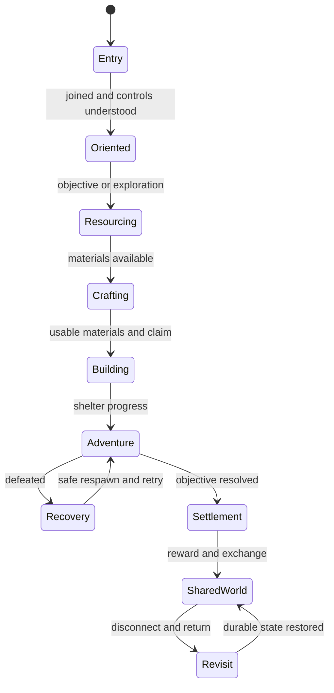
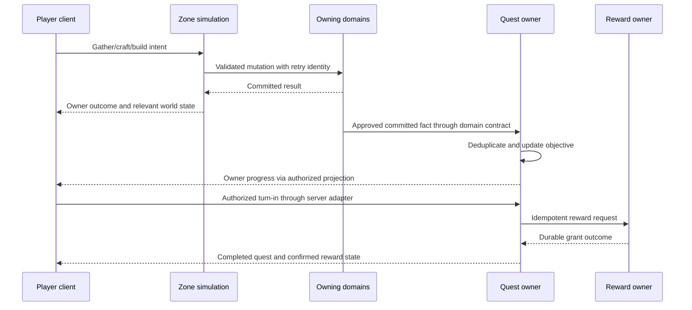

# Vertical Slice Specification

## Purpose and readiness

The vertical slice is a coherent Greenlands experience demonstrating that the game's sandbox loop, progression, danger, persistence, and social exchange fit together. It follows the persistent-world MVP and adds usability, content coherence, and presentation quality. It is not a promise of launch content volume or a substitute for capacity evidence.

This is an expanded planning specification retained under its current filename. Current implementation remains the browser PoC; none of the Unreal content below is claimed complete.

Read [MVP](Legends_Shattered_Frontier_First_MVP_Milestone_v1.0.md) for technical invariants/budgets, [backlog](Legends_Shattered_Frontier_Gameplay_Feature_Backlog_v1.0.md) for work dependencies, [Unreal layout](Legends_Shattered_Frontier_UE58_Project_Layout_v1.0.md) for runtime ownership, and [roadmap](Legends_Shattered_Frontier_Production_Roadmap_v1.0.md) for entry/exit gates.

## Intended audience and outcome

Internal testers and project decision-makers should be able to assess:
- Whether gathering, crafting, and construction are understandable and rewarding.
- Whether one region communicates safe settlement versus dangerous exploration.
- Whether the player can recover from failure and return to a persistent home.
- Whether another player meaningfully shares the world.
- Whether the same build can be reproduced and recovered without a developer manually repairing state.

Investor-facing presentation is a possible later use of the same experience. Do not prioritize a staged video over reproducible behavior or imply that scripted footage proves multiplayer capacity.

## Scope and exclusions

| Included | Minimum content | Excluded from this slice |
| --- | --- | --- |
| Entry | Compatible packaged client, session/join, basic character selection | Extensive appearance editor, account monetization |
| Greenlands | Settlement, resource loop, build plots, enemy area, landmarks | Other biomes, world travel, ocean/airship systems |
| Gathering | Wood and ore with distinct readable feedback | Every profession or tier |
| Crafting | Useful refinement and building/equipment recipes | Full crafting economy and legendary paths |
| Housing | Claim plus foundation/wall/door/roof and permissions | Guild city governance or siege |
| Combat | Starter weapon/attack, one readable enemy, defeat/recovery | PvP, dungeon, raid, full ability catalog |
| Quest | Authored short chain with objective/reward integration | Runtime generated quests |
| Economy | Direct trade and restricted fixed-price market | Auctions, contracts, banking |
| Persistence | Reconnect, restart, backup/restore evidence | Global high availability or zero-downtime multiregion operations |
| Presentation | Coherent UI/audio/animation and clear feedback | Final launch-level art breadth |

Unimplemented domain features remain controlled by their owners. This document specifies how a subset is experienced and accepted, not new progression formulas or reward tables.

## Proposed session structure

Target a first successful loop of 20–30 minutes for a new internal tester, excluding installation/update time. This is a usability hypothesis to measure, not a guaranteed completion time.

| Segment | Approximate target | Player question |
| --- | --- | --- |
| Join and orientation | 2–3 min | Where am I, how do I move, and what can I do? |
| Gather and refine | 4–6 min | What do these resources become? |
| Claim and build | 6–8 min | Can I make something that belongs to me? |
| Fight and recover | 4–6 min | What is the risk, and can I learn from defeat? |
| Complete/exchange/revisit | 4–7 min | Did I progress, can I exchange, and does my home remain? |

The timer does not force rushed interaction. Record where testers stop, misunderstand, need assistance, or encounter a blocker. Failure recovery and permission denial must remain comprehensible even if they lengthen a session.

## Region layout and encounter envelope

Use one contiguous Greenlands graybox promoted gradually to coherent art. Proposed zones within the region:

| Area | Function | Safety/ownership |
| --- | --- | --- |
| Arrival landmark | Spawn, orientation, reconnect fallback | Safe from starter enemy aggression |
| Settlement beacon | Quest contact, crafting station, market access | No destructive terrain edits |
| Resource route | Logging and mining tutorial | Regeneration respects protected geometry |
| Build plots | Personal claim and construction | Clear boundaries; access rules enforced |
| Enemy clearing | Starter combat and defeat/recovery | Legible entry/exit; no spawn camping |
| Return overlook | View shared structures and navigate home | Stable landmark and readable route |

Do not implement safe-zone immunity solely as a client visual. Eligibility and damage policies are server-owned. Exact area dimensions, resource counts, and respawn timing are tuning decisions after a graybox traversal test; record them with the content fixture before capacity measurement.

### Content inventory

| Asset/definition | Required role | Validation |
| --- | --- | --- |
| Main region map | Connect the full loop | Opens/cooks with no missing required references |
| Player pawn/animation | Movement, interaction, attack, defeat | Remote view and collision are credible |
| Wood/ore nodes | Distinguishable resource opportunities | Depletion and restored state are consistent |
| Craft station | Explain recipe inputs/output | Unavailable/capacity/range feedback |
| Four building pieces | Complete a recognizable shelter | Placement, door, collision, reclaim |
| Enemy archetype | Readable attack and response | No unavoidable spawn damage; authoritative results |
| Quest contact/objectives | Link actions into purpose | Progress derives from committed domain facts |
| Market UI | One safe exchange | Price/item/confirmation clear; no trust in client price |
| HUD/widgets | Health, inventory, action, objective | Owner privacy; readable pending/error states |
| Audio cues | Action confirmation and danger | Visual alternative for essential information |

This is a role inventory, not permission to generate or import assets indiscriminately. Select sources, record provenance, and introduce art only when the graybox behavior is stable.

## Narrative and content constraints

Use a small authored “establish a foothold” thread: collect materials, refine supplies, build a shelter, help the settlement with the starter threat, and exchange a surplus resource. Exact quest IDs, text, branching, objective types, and rewards come from the Quest/Itemization/Character contracts.

The founder wall quest in the browser harness is a behavioral reference, not automatically the final quest definition. Do not copy its local counters into a second quest authority.

Avoid lore claims that imply systems outside scope. A closed gate can communicate future lands, but it must not advertise a traversable biome or live faction war that is not implemented.

## Player experience state machine

Players may explore out of order. These are evaluation stages, not mandatory hard-coded quest states. The domain quest lifecycle remains authoritative.

## Integrated durable-action sequence

This diagram is conceptual routing. The concrete transport, event names, and payloads come from the shared registry/domain contracts. The client does not connect directly to a privileged internal service because an arrow names it here. Out-of-order delivery and retries must not duplicate objective credit or grants.

If a reward is pending, display pending progress and preserve a recoverable operation. Do not grant locally to make the sequence appear immediate.

## UI and feedback contract

| Condition | Player sees | Authority requirement |
| --- | --- | --- |
| Target eligible | Action label, required item/tool if any | Server still revalidates |
| Out of range/blocked | Clear reason, no success animation implying commit | No mutation |
| Command submitted | Bounded pending indicator | Retry keeps original key |
| Command committed | Inventory/world/progress refresh from result | Correct revision and owner projection |
| Permission denied | Ownership/access explanation without private details | Server enforcement |
| Backend unavailable | Action unavailable or unresolved outcome with safe retry | No fake success or guessed refund |
| Inventory full | Capacity reason and possible recovery action | No consumed inputs without output |
| Defeated | Clear recovery option and consequence | One authoritative defeat/reward transition |
| Reconnected | Restored character/world and any resolved pending outcome | Session revalidated |

An animation/sound may preview an action. Durable success language and quantity changes follow confirmation. Essential feedback must have a visual channel; do not rely solely on color or audio. Support readable text at the chosen target resolution and practical UI scaling; exact accessibility settings are evaluated in the UI task.

## Multiplayer visibility and privacy

For the shared-world demonstration, at least two independent clients observe resource depletion, structure placement, enemy behavior, and trade. A third client joins later to verify current state without replaying the initial session.

Other players see permitted public identity/equipment and relevant world changes. They do not receive private inventory, quest choices, currency balances, session tokens, or internal server routing. Use the domain's disclosure policy where a social feature intentionally exposes information.

A claim denial is a planned behavior, not a defect. The test asks another player to try reclaiming the shelter and verifies both denial and intact ownership.

## Acceptance scenarios

| ID | Given / when | Required result and evidence |
| --- | --- | --- |
| VS-01 First entry | New tester starts a compatible candidate | Joins without console commands; understands movement and first action |
| VS-02 Shared resource | Two clients contend for final node yield | One authorized outcome, consistent depletion, no duplicated quantity |
| VS-03 Craft | Inputs sufficient, output space available | Correct recipe commits once; owner UI matches durable state |
| VS-04 Denied craft | Inputs/capacity/range invalid | Clear reason; no partial consumption |
| VS-05 Shelter | Owner places foundation/wall/door/roof | Costs reconcile; collision/access work; remote client sees it |
| VS-06 Claim safety | Stranger tries restricted reclaim/edit | Denied; original owner's state unchanged |
| VS-07 Terrain boundary | Player edits allowed area then protected area | Allowed edit persists; protected edit rejects; collision remains usable |
| VS-08 Combat | Player fights and is defeated/retries | Readable enemy; server damage; safe recovery; one eligible reward |
| VS-09 Quest | Complete objectives and interrupt turn-in reply | Progress/reward resolves once through owning domains |
| VS-10 Trade | Offer changes after consent, then participants retry | Consent resets; final settlement atomic or safe cancellation |
| VS-11 Market | Two buyers/cancel race on one listing | One terminal ownership transfer; balance/escrow reconcile |
| VS-12 Revisit | Disconnect, restart, reconnect | Shelter, ownership, inventory, terrain and progress restore |
| VS-13 Late join | Third client enters after changes | Current state and privacy correct; no historical replay dependency |
| VS-14 Outage | Store unavailable during mutation | No false durable success; recovery resolves unknown outcome |
| VS-15 Delivery | Update is interrupted or incompatible | Partial build not launched; retry/repair returns to compatible candidate |

Each scenario is a separately selectable check. Select cases for the changed or requested gate; this specification is not a standing full-suite authorization.

## Presentation quality gates

| Dimension | Minimum gate |
| --- | --- |
| Navigation | Landmarks and objective feedback allow return to settlement and home |
| Readability | Wood/ore/build pieces/enemy state can be distinguished in representative lighting |
| Interaction | Target prompt and denial/pending/commit are distinguishable |
| Movement | No common route traps or blocking camera collision |
| Combat | Attack cue and consequence have understandable timing |
| Building | Preview approximates actual placement; rejection explains correction |
| Audio | Essential information also represented visually |
| UI | No clipped required controls at chosen supported settings |
| Consistency | Content uses one intended style and avoids unexplained placeholder transitions |
| Recovery | Defeat/disconnect/outage behavior is part of the experience, not a developer workaround |

“Polished” is too vague as acceptance. Record the specific clip, route, widget, or behavior that passes/fails. Avoid adding final art to a mechanic whose authority or collision still changes frequently.

## Performance and dataset contract

Use the shared MVP numerical targets for simulation, client frame time, response, bandwidth, and restore. Do not create a second conflicting budget table.

The slice adds representative content density and visual load to the same workload. Before comparing captures, record map/content identity, active node count, structure pieces, enemy count, visible players, target settings, hardware, and network conditions. A beautiful empty scene does not validate the complete loop.

Client frame evidence is collected on a real rendered client. Server capacity evidence uses active workloads. Targeted graphical captures, network stress, and full load campaigns are distinct activities.

Proposed usability measures: completion rate without assistance; time to first successful gather/craft/build; count of misleading feedback states; number/location of navigation failures; successful recovery after defeat/disconnect. Define the test participant cohort and observation method before using these as product claims.

## Save and fixture requirements

The candidate needs:
- A clean new-player fixture.
- A previously established character/claim fixture.
- A contested-resource and contested-market fixture.
- A depleted-node and edited-terrain fixture.
- A known compatible backup.
- Controlled permission-denied identities.

Fixtures use canonical IDs and domain schemas. Do not commit production/player data. A reset is an explicit fixture operation in an isolated environment, not a surprise wipe of an ongoing world.

A candidate's data manifest records build/content/schema identity and dataset origin. It is a proposed artifact contract aligned with DEL-01, not a new global database schema.

## Failure rehearsal

| Injection | Observe | Acceptance |
| --- | --- | --- |
| Reply loss after placement commit | Same operation retried after reconnect | One structure/cost |
| Storage failure before craft commit | Pending action resolves | No lost inputs |
| Quest reward request duplicated | Grant receipt and inventory/currency | One grant |
| Server process killed | Restart and recover | All acknowledged state preserved |
| Resource contention | Node and inventory revisions | Single valid depletion |
| Network delay/disconnect in trade | Consent/escrow/terminal state | No one-sided exchange |
| Invalid catalog/schema combination | Startup/load guard | Fail clearly before writable state |
| Interrupted client update | Manifest and installed files | Last compatible install or safe repair |

Failure cases are run only for the changed/integrated path in scope. Do not repeatedly execute the entire failure matrix after cosmetic changes.

## Production handoff and evaluation

A slice candidate includes compatible artifacts, selected verification evidence, known limitations, recovery instructions, and a short session script. The script may guide evaluation but must not depend on hidden admin item grants to conceal a broken economy.

After a tester session, separate defects, usability findings, performance misses, and future wishes. Map them to backlog/debt owners. Do not merge all feedback into an unprioritized “polish” ticket.

The human owner decides whether the slice communicates the desired product. Technical pass evidence remains necessary even if the presentation is compelling.

## Entry and exit criteria

Entry: MVP authority/durability contracts and basic loop are stable enough to integrate content; reference environment and fixture can be reproduced; protected domain integration points are ready.

Exit: a new tester can complete and revisit the loop; multiplayer/private projections are correct; selected recovery cases pass; representative performance meets ratified targets; no critical/high uncontained issue blocks the demonstrated path; candidate and evidence can be reproduced.

A failed presentation gate returns to targeted content/UI work. A data-integrity failure returns to the owning technical gate. Do not obscure either with a staged recording.

## Registry additions

None. VS scenario IDs and journey states are evaluation metadata. Domain events, rewards, item definitions, and quest states remain owned by the registry and protected domain documents.
