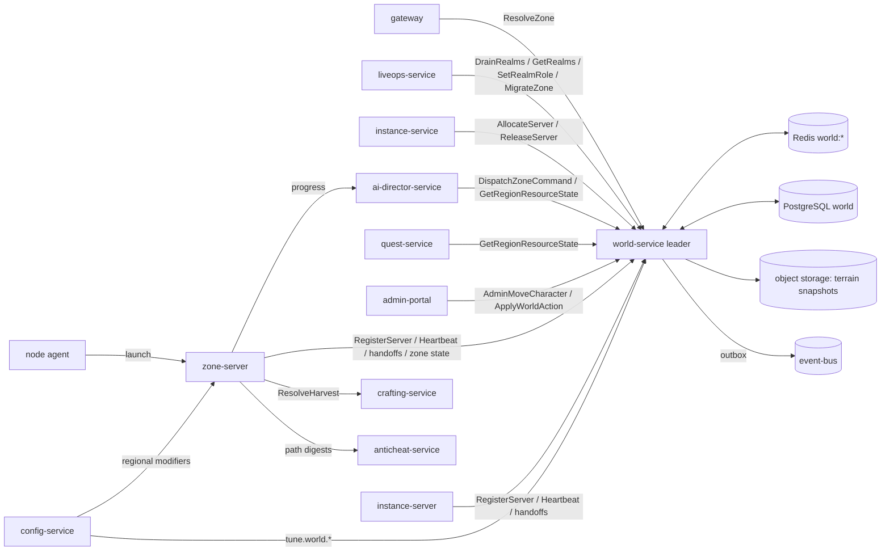

# Legends of the Shattered Frontier - World Simulation Architecture
### Version 1.0 — Expanded Technical Design Authority edition (2026-10-17)

Status: Design target; not implemented. Names per Shared Registry v1.0.

Names: [Shared Registry](Legends_Shattered_Frontier_Shared_Registry_v1.0.md). Where this specification and the Registry disagree on a name, the Registry wins. Registry additions below record merged names and their rationale. This edition expands the 2026-10-17 contract patch. Every RPC name, formula, constant, payload field, enum value and tuning key of the patch is kept. Contract sections moved into the parts below under their original titles.

---

## Overview

A single persistent, living world that combines MMO play, building, gathering, destruction, economy and exploration. World Simulation is the layer that makes that world exist: which server process simulates which place, how characters move and cross between places, what the ground looks like after players have shaped it, where resources and creatures appear, and what time and weather it is.

Design goals:

1. **One owner for everything live.** Every character, zone and terrain chunk has exactly one authoritative writer at any moment.
2. **Server authority.** Speed, displacement, terrain edits, spawns and discoveries are decided on the server. The client only sends intent.
3. **Seamless at the player's scale.** Border crossings and rolling restarts cost one hitch of at most 300 ms.
4. **Deterministic where it matters.** Cell keys, terrain replay, weather, respawn jitter and world-boss windows are reproducible offline from seeds and stored state.
5. **Bounded cost.** Simulation scales with occupied cells. Terrain storage is compacted and healed. NPC and event budgets are explicit.

## Scope and ownership

### World ownership model

- **World Service owns global state.** `world-service` (stateful, gRPC package `lsf.world_service.v1`) owns: the server registry (`ServerInstance`, `srvi_`), process allocation and warm pools for both `zone-server` and `instance-server`, zone-to-server assignment and layers, zone handoffs, the single-owner record for each character's live simulation, cross-server teleport claims, the world clock and weather, realm runtime state, and the durable world state in PostgreSQL schema `world` (terrain deltas, spawn timers, regional resource state, point-of-interest discoveries, world actions, world-boss schedules; Part 3). Its working state lives in Redis (Part 1).
- **Zone Servers own active simulation.** `zone-server` (UE5.8 dedicated server) is the simulation authority for everything inside its zone: movement, `v_eff`, in-zone teleport tokens, hits, node harvests, terrain edit validation, spawns, cell activation, event hosting and NPCs (`WorldEntity`, `ent_`, memory only). `instance-server` is the instance mode of the same build and follows the same movement and token rules.
- **Persistence Services own stored data.** Characters, inventory, structures and so on are written only by their owning services (Registry, Service registry). `world-service` never writes another service's database.

### What World does not own

| Concept | Owner |
| --- | --- |
| Instance run lifecycle, join tickets, `instance_run_state` | `instance-service` (Dungeon spec, Instance runtime) |
| Movement speed modifier `combat_move_mult` (Dexterity, item `movement_speed_bp`) | Combat spec, Movement speed |
| Movement validation algorithm, tolerances, reject rollups, detectors | Security spec, Threat model and server authority (Movement envelope validation) |
| NPC behaviour decision models, perception, leash and evade behaviour, faction AI | AI spec (NPC AI, Faction AI) |
| World-event instances (`wev_`), `world_event_state` transitions, `world.event.*` payloads, director decisions and spawn pressure values | AI spec (World director, Dynamic events) |
| Gathering yield, lot quality, `gathering_node` definitions, `gathering.*` payloads | Crafting spec, Gathering contract |
| Claims, structures, structural integrity, upkeep, sieges, `world.structure.*` payloads | Building spec |
| Character location snapshot, `character.zone.changed` | `character-service` (Backend spec; World supplies the facts) |
| Realm roles, maintenance windows, login gates | LiveOps spec |
| Host fleet, node images, autoscaling groups | DevOps spec |
| UDP transport, interest management | Network spec |

### Non-goals at launch

Flight and gliding; seamless zone splitting at runtime (splits are content changes); layering of zones with claimable land; persistent NPC positions; weather-driven spawns; dynamic terrain erosion.

### Glossary

Shared terms are in the Registry glossary. World-specific terms:

| Term | Definition |
| --- | --- |
| Alloc token | Ed25519-signed claim proving a `srvi_` was assigned a run or zone (Part 1). |
| Cell key | uint64 `zone_index | cx | cy` identifying a 64 m cell (Part 2, Cell ID format). |
| Chunk | 16 m cube of terrain voxels; unit of terrain persistence (Part 3). |
| Ghost band | 48 m strip on both sides of a border where neighbours replicate read-only proxies (Part 2). |
| Handoff ticket | Signed, single-use claim set that moves character ownership between servers (Part 2). |
| Layer | Additional process simulating the same layerable zone (Part 2, Layering and overflow). |
| Map index | `zone_index`, stable uint16 per simulated map, never reused. |
| Scarcity index | σ ∈ [0, 2] per region and resource; 1 = healthy (Part 3). |
| Spawn group / slot | Authored set of points with `K` concurrent slots for nodes or NPCs (Part 3). |
| Teleport token | Single-use permission for a server-initiated displacement (Part 2). |
| World action | Bounded, audited staff or event change to weather, spawns or terrain (`wac_`, Part 3). |

## Architecture and service ownership



| Component | Kind | Owns | Store |
| --- | --- | --- | --- |
| world-service (leader + 2 standbys per realm) | stateful gRPC | server registry, allocation, pools, zone owners, layers, character owners, handoffs, realm state, clock, weather, durable world state | Redis (`world:*`), PostgreSQL `world`, object storage |
| zone-server | UE5.8 dedicated server | live zone simulation, `v_eff`, in-zone tokens, terrain validation, spawns, events hosting, POI detection | memory; persists through world-service |
| instance-server | UE5.8 (instance mode) | live run simulation; same movement and token rules | memory; run state through instance-service |
| node agent | infrastructure (DevOps) | process launch, launch nonces, clock offset enforcement | — |

## Core model

### Hierarchy

```
World (realm)            realm_id, e.g. na-1
- Continents             content kind `continent`
- Biomes                 attribute of a world_region (enum `biome`)
- Regions                content kind world_region, e.g. world_region/greenlands_south
- Zones                  content kind zone, e.g. zone/greenlands_01
- Cells                  computed, deterministic grid (Part 2, Cell ID format)
```

| Level | Identifier | Defined in | Notes |
| --- | --- | --- | --- |
| Realm | `realm_id` (Registry envelope field) | `config-service` | One world-service deployment per realm. |
| Continent | `continent/<snake>` | content pack | Owns a continent-space coordinate frame (metres, +X east, +Y north, +Z up). |
| Region | `world_region/<snake>` | content pack | Fields: `continent_id`, `biome`, `zone_ids[]`, faction control key (`FactionControl` is keyed by `world_region_id`). |
| Zone | `zone/<snake>` | content pack | Fields: `world_region_id`, `zone_index` (uint16), `origin` (continent-space metres of the zone's local origin), `extent` (local AABB), `map_id`, `capacity_soft`, `capacity_hard`, `neighbors[]` with border polylines. Added in this edition: `level_range`, `level_areas[]` (Part 2, Zone content level), `layerable`, `spawn_groups[]` (Part 3), `respawn_points[]`, `border_entry` anchors, volumes (`speed`, `water`, `roof`, `no_mount`, `no_edit`, `protected`), `min_dig_z`, terrain material palette, `default_spawn`, `retired_redirect`. |
| Cell | `cell_key` (uint64) / text form | computed | Never stored as content; derived from position. |

A zone is one unit of simulation run by exactly one `zone-server` process at a time (per layer, for layerable zones). Zone shapes are authored polygons within their extent; neighbouring zones share border polylines. Defaults: `capacity_soft` 200 (`tune.world.zone_capacity_soft`), `capacity_hard` 250 (`tune.world.zone_capacity_hard`).

Initial biomes (Registry `biome`): Greenlands (`greenlands`), Frozen North (`frozen_north`), Desert Wastes (`desert_wastes`), Corrupted Frontier (`corrupted_frontier`).

### World-owned content kinds

| Kind | Status | Part |
| --- | --- | --- |
| `continent`, `world_region`, `zone` | Registry | entry |
| `world_event` (placement and schedule fields; AI co-owns) | Registry | Part 3 |
| `mount` | proposed | Part 2 |
| `poi` | proposed | Part 3 |

### Runtime entities used or owned

| Entity | Prefix | Store | Part |
| --- | --- | --- | --- |
| ServerInstance | `srvi_` | Redis | 1 |
| Handoff | `hof_` | Redis | 2 |
| TeleportToken | `tpt_` | zone/instance-server memory | 2 |
| WorldEntity | `ent_` | zone-server memory (AI behaviour) | 3 |
| TerrainEdit | `ted_` (proposed) | PostgreSQL `world` | 3 |
| WorldAction | `wac_` (proposed) | PostgreSQL `world` | 3 |
| SpawnSlotState, RegionResourceState, PoiDiscovery, WeatherState, WorldBossSchedule, Realm | keyed (proposed) | PostgreSQL `world` | 3 |

## Table of contents

| Part | File | Contents |
| --- | --- | --- |
| 1 | [Server Fleet and Realms](World-Simulation/Legends_Shattered_Frontier_World_Server_Fleet_and_Realms_v1.0.md) | world-service API and server allocation (full RPC surface, caller matrix, AllocateServer, alloc token, placement and warm pools, ServerInstance lifecycle, ReleaseServer, heartbeats and Redis record, zone scheduler, server identity, ResolveZone, AdminMoveCharacter); Realm operations (`realm_state`, DrainRealms, GetRealms, SetRealmRole, rolling restart and zone migration); world-service high availability; `world.server.*` and `world.realm.state_changed` payloads. |
| 2 | [Cells, Movement, Handoffs and World Clock](World-Simulation/Legends_Shattered_Frontier_World_Cells_Movement_and_Handoffs_v1.0.md) | Cell ID format and path digests; Zone content level; Authoritative movement speed (`v_eff`, modes, mounts); Teleport tokens; Zone Handoffs (border model, protocol, ticket, handoff kinds, failure); Layering and overflow; World clock and day/night; Weather; `world.handoff.*` and `world.weather.changed` payloads. |
| 3 | [Terrain, Resources, Population and World Events](World-Simulation/Legends_Shattered_Frontier_World_Terrain_Resources_and_Population_v1.0.md) | Schema `world` (ER, DDL); Terrain and voxel modification (chunks, ops, validation, commits, compaction, rebase, revert, healing); Structure persistence hooks; Cell activation; Resource regeneration (spawn groups, respawn timing, scarcity index, balancing); Regional modifiers; NPC spawn and population simulation; World events (hosting contract, world boss scheduling); Points of interest; World actions; `world.poi.discovered`, `world.terrain.modified` payloads; privacy participation. |
| 4 | [Agent Implementation Guide](World-Simulation/Legends_Shattered_Frontier_World_Agent_Implementation_Guide_v1.0.md) | Module layout, milestones, invariants, test matrix, acceptance criteria, pitfalls, Do/Don't. |

Each part has its own Analytics hooks and Security considerations sections. The summaries below index them.

## Scalability phases

Design points per realm (World spec phase 1–3; Analytics derives event volumes from the same CCU figures). Assumptions: average zone population 150 at peak, one border crossing per player every 6 minutes, 15 % of players in instances, instance processes average 4 players.

| | Phase 1 | Phase 2 | Phase 3 |
| --- | --- | --- | --- |
| CCU per realm | 500 | 5,000 | 10,000+ (plan for 25,000 across a region's realms) |
| Zones (layer 0) | 6–8 | 24 | 40 |
| Layering | off | on for layerable zones | on; `layers_max` 4 |
| Instance processes at peak | ≈ 20 | ≈ 190 | ≈ 380–600 |
| Heartbeats to world-service | ≈ 6/s | ≈ 45/s | ≈ 128/s |
| Handoffs (border + instance) | ≈ 1.5/s | ≈ 14/s | ≈ 28/s |
| world-service topology | leader + 1 standby | leader + 2 standbys | leader + 2 standbys; read RPCs on standbys |
| Redis | primary + replica | primary + replica | primary + replica, ≤ 50 % CPU at peak |
| Terrain op log growth | < 10 MB/day | ≈ 50 MB/day | ≈ 104 MB/day (Part 3 example) |

A single world-service leader per realm is sufficient at all three phases (Part 4, load test L1). Scale-out is by realm. Within a realm it is by layers, and by content (more, smaller zones), not by runtime zone splitting.

## Expansion integration

New continents are attached through portals, ships, exploration gates and quest chains. Portal and ship transitions between continents are zone handoffs (Part 2, Zone Handoffs) with `handoff_kind = fast_travel` and cause `fast_travel` or `vehicle`. A new continent is a content release: its zones get new `zone_index` values, the zone scheduler allocates them on activation, and borders into it stay closed until all its zones are `ready`.

## Security considerations

World-specific threats and mitigations are tabulated per part:

- Part 1: forged servers and hijacked allocations (node-attested registration, SPIFFE `srvi_` identity, alloc tokens), allocation floods, drain abuse, registry loss.
- Part 2: speed hacks (`v_eff`), teleports (tokens), handoff duplication (single owner, commit-only moves), ticket replay, cross-border exploits, layer hopping, mode spoofing.
- Part 3: terrain griefing, DoS and under-map exploits, node camping and bots, crash-to-respawn, POI spoofing, GM abuse, director command forgery, regional modifier abuse.

GM abuse controls (all parts): `AdminMoveCharacter` and world actions require specific permissions (Security spec, Audit, permission matrix), write a `staff_action` audit record before execution, and carry the audit record id as `source_ref` or `audit_record_id`. Key compromise: the world-service signing key is in KMS, rotated quarterly with a 2-key overlap; emergency rotation invalidates outstanding tickets.

Report to `anticheat-service`: path digests, `teleport_token_expired` rate per character, handoff rejects with subreason, `v_eff` cap clips, terrain edit rejects, harvest and discovery rate outliers, layer hops, unknown server identities.

## Analytics hooks

World events and their topics:

| Event | Producer | Topic | Payload |
| --- | --- | --- | --- |
| `world.server.allocated`, `world.server.released` | world-service | `telemetry.server` | Part 1 |
| `world.server.lost` | world-service | `domain.world` (+ `ops.alerts`) | Part 1 |
| `world.realm.state_changed` (proposed) | world-service | `domain.world` | Part 1 |
| `world.handoff.completed`, `world.handoff.failed` | world-service | `telemetry.server` | Part 2 |
| `world.weather.changed` (proposed) | world-service | `domain.world` | Part 2 |
| `world.poi.discovered` | world-service | `domain.world` | Part 3 |
| `world.terrain.modified` (proposed) | world-service | `domain.world` | Part 3 |
| `ops.zone.load_sampled`, `ops.server.tick_sampled` | zone-server | `telemetry.server` | Analytics spec; World defines `cells_active`, `cells_total`, `gathering_nodes_available_ratio` (Part 3) |
| `world.event.*` | ai-director-service | — | AI spec |
| `world.structure.*` | zone-server | — | Building spec |

Dashboards: warm-hit rate ≥ 90 %, `provisioning → ready` p95 (Dungeon targets), handoff success ≥ 99.9 % and p95 ≤ 300 ms, token expiry < 0.5 % of issued, zone recovery p95 ≤ 20 s, scarcity median 0.6–1.2, active-cell ratio, terrain storage. Metric definitions (`m_warm_hit_rate`, `m_alloc_ready_p95_s`, `m_handoff_p95_ms`, `m_server_lost_rate`, `m_zone_recovery_p95_s`, `m_drain_duration_s`, `m_teleport_token_expiry_rate`, `m_v_eff_cap_clip_rate`, `m_layer_count`, `m_weather_share`, `m_scarcity_index`, `m_node_utilization`, `m_cells_active_ratio`, `m_npc_budget_saturation`, `m_terrain_ops_per_hour`, `m_terrain_storage_bytes`, `m_world_boss_attendance`, `m_poi_discovery_rate`) are in the parts. `character_id` fields are `p1_pseudonymous`.

## Contracts closed for other specifications

| Citing spec | Need | Resolved in |
| --- | --- | --- |
| Dungeon, Raid | `AllocateServer` / `ReleaseServer`, warm pools, alloc token | Part 1, world-service API and server allocation |
| Dungeon | Duplicate heartbeat question; recovery trigger | Part 1, ServerInstance lifecycle (heartbeat ownership) |
| Dungeon | "zone content level" for open-world dungeons | Part 2, Zone content level |
| Security, Combat | `v_eff`, teleport tokens, cell IDs | Part 2, Authoritative movement speed; Teleport tokens; Cell ID format |
| Security | Server identity ("world-service issues server identity certificates") | Part 1, Server identity and registration |
| Character, Crafting | "Producer registered in world-service" | Part 1, Server identity and registration |
| LiveOps | `DrainRealms`, `GetRealms`, `SetRealmRole`; rolling restarts with session handoff | Part 1, Realm operations; Part 2, Zone Handoffs |
| Quest | `world.poi.discovered` payload | Part 3, Points of interest |
| Quest | `scarcity_index`, `node_yield_per_hour` | Part 3, Resource regeneration |
| Quest | Phase 3 CCU | Scalability phases |
| Analytics | `cells_active`, `cells_total`, gathering availability ratio, world-service payloads | Part 3, Cell activation; Parts 1–3 payloads |
| Raid | `regional_buff` applied "zone-server via config-service" | Part 3, Regional modifiers |
| Game Master | Weather override ≤ 60 min, bounded spawns, terrain operations | Part 2, Weather; Part 3, World actions |
| Construction | Terrain delta persistence, brush and volume limits | Part 3, Terrain and voxel modification |

## Registry additions

> **Merge status (2026-10-17):** merged into the Shared Registry (change log, phase-2 row) with these maintainer decisions: `npc_archetype` is the 11-value union; AI kinds `bt`/`up` are `behavior_tree`/`utility_profile`; Backend `guild.guild.*` events are `guild.profile.*`; world events split between AI (lifecycle, payloads) and World (placement, fixed windows, `trigger_kind = world_schedule`); World owns respawn timing under scarcity. Cross-spec requests below were applied to the owning specs or remain listed as open issues there.

Merge status (2026-10-17): additions from this edition are merged into the Shared Registry (change log, phase-2 row). The Registry is authoritative; these rows remain as rationale and ownership notes. The 2026-10-17 contract-patch additions (`server_kind`, `server_instance_state`, `server_release_reason`, `movement_mode`, `displacement_cause`, `biome`, `tpt_`, `hof_`, `continent`, `world.server.*`, `world.handoff.*`, `CELL_SIZE_M`, `TELEPORT_TOKEN_TTL`, world-service RPC table) are also merged.

| Kind | Name | Value / definition | Justification |
| --- | --- | --- | --- |
| Service ownership | `world-service` owns PostgreSQL schema `world` | terrain deltas, spawn slot state, regional resource state, POI discoveries, weather state/history, world actions, world-boss schedules, realms | Construction requires World to persist terrain deltas; rare timers must survive crashes. |
| RPCs | `world-service`: `DrainRealms`, `GetRealms`, `SetRealmRole`, `MigrateZone`, `LoadZoneState`, `CommitTerrainEdits`, `ReportZoneState`, `RecordDiscovery`, `GetRegionResourceState`, `GetWeather`, `GetWorldBossSchedule`, `DispatchZoneCommand`, `ApplyWorldAction`, `CancelWorldAction`, `RevertTerrainEdits` | Part 1 | LiveOps, Quest, AI, Construction and Game Master requirements. |
| ID prefix | `ted_` | TerrainEdit, world-service, PostgreSQL `world` | Terrain lineage, revert, privacy. |
| ID prefix | `wac_` | WorldAction, world-service, PostgreSQL `world` | Bounded GM/event world changes. |
| Entities (keyed) | SpawnSlotState, RegionResourceState, PoiDiscovery, WeatherState, WorldBossSchedule, Realm | Part 3 DDL | Durable world state. |
| Content kinds | `mount` (World), `poi` (World) | Parts 2, 3 | Closes mount open issue; Quest explore objectives. |
| Enums | `realm_state` | `offline`, `locked`, `open`, `draining`, `drained` | DrainRealms. |
| Enums | `handoff_kind` | `border`, `instance_entry`, `instance_exit`, `fast_travel`, `migration`, `layer_change`, `admin_move`, `login` | Handoff payloads. |
| Enums | `handoff_failure_reason` | the seven `handoff_invalid` subreasons + `target_full`, `target_unavailable`, `world_unavailable`, `ticket_expired_uncommitted`, `owner_conflict_resolved`, `client_timeout` | `world.handoff.failed`. |
| Enums | `day_phase` | `dawn`, `day`, `dusk`, `night` | Spawn filters, schedules. |
| Enums | `weather_kind` | `clear`, `overcast`, `rain`, `storm`, `fog`, `snow`, `blizzard`, `sandstorm`, `heatwave`, `ashfall` | Weather model. |
| Enums | `terrain_edit_kind` | `dig`, `raise`, `flatten`, `smooth`, `paint`, `restore` | Terrain ops. |
| Enums | `terrain_edit_state` | `committed`, `reverted`, `healed`, `rebase_dropped` | Terrain lineage. |
| Enums | `spawn_slot_state` | `active`, `respawning`, `dormant`, `disabled` | Regeneration. |
| Enums | `poi_kind` | `landmark`, `settlement`, `dungeon_entrance`, `vista`, `ruin`, `resource_site` | POI payload. |
| Enums | `world_action_kind` | `weather_override`, `spawn_entities`, `despawn_entities`, `terrain_revert`, `edit_window` | World actions. |
| Enums | `world_action_state` | `pending`, `active`, `expired`, `cancelled`, `failed` | World actions. |
| Events | `world.realm.state_changed`, `world.weather.changed`, `world.terrain.modified` | world-service, `domain.world` | Realm ops, Building wear and quest triggers, terrain lineage. |
| Constants | `DAY_LENGTH_MIN` 240 (`tune.world.day_length_minutes`); `ZONE_CAPACITY_SOFT` 200 / `ZONE_CAPACITY_HARD` 250 (`tune.world.zone_capacity_soft/hard`); `V_CAP_FOOT` 12.0, `V_CAP_MOUNTED` 20.0, `V_CAP_ABSOLUTE` 20.0 m/s; `BASE_RUN_SPEED` 7.0 m/s; `TERRAIN_MAX_VOLUME_M3` 100 | World | Cross-domain readers: Security, Analytics, Construction, Combat. |
| Tuning keys | `tune.world.*` as listed in Parts 1–3 | World | config-service registration. |
| Feature flags | `ff.world.layering_enabled`, `ff.world.terrain_edits_enabled`, `ff.world.terrain_healing_enabled`, `ff.world.dynamic_respawn_enabled`, `ff.world.world_boss_schedule_enabled` | World | Kill switches for risky subsystems. |
| Metrics | the `m_` names in Analytics hooks | World | Analytics registration. |

**Cross-spec requests** (names owned by other specs):

| Owner | Request |
| --- | --- |
| AI | Resolved at registry merge: progress travels as `EventProgress` on `ZoneLink`; `RequestWorldEvent` from world-service uses `trigger_kind = world_schedule`. Still open; confirm `world_event` placement and schedule fields are co-owned; spawn pressure `π_dir` range [−0.5, 1.0]. |
| Building | Resolved: Registry registers building-service as durable owner; Construction Integration defines permission evaluation, fenced commit decisions, structure event payloads and the Part 3 hooks. |
| Construction | Confirmed: unclaimed edits heal after seven elapsed real days with current-claim/support/provenance safeguards; depth/raise bounds are 8 m / 12 m from the immutable baseline. Construction and Part 3 specify lifecycle adoption and durable commit behavior. |
| Analytics | `ops.server.tick_sampled.server_kind` uses `zone_server`/`instance_server`; the Registry enum `server_kind` is `zone`/`instance` (align); add `layer_index` to `ops.zone.load_sampled` and a `teleport_tokens` counter map to `ops.server.tick_sampled`. |
| LiveOps | Register enum `realm_role` (`canary`, `standard`) in the Registry (used by `SetRealmRole`). |
| Character | Whether discovery XP (`xp_source_kind = discovery`) is granted by consuming `world.poi.discovered`. Mount ownership as `account_unlock_kind = mount`. |
| Combat | Effect fields `move_speed_delta` and `applies_mounted` read by `v_eff`; Raid regional buffs use the registered `effect/<slug>` content kind. |
| Security | Add permissions `world:weather:override`, `world:spawn:bounded`, `world:terrain:revert` to the permission matrix. |
| Economy | None required: fast travel charges `fast_travel` after the move, so no refund code is needed. |

## Open issues

Resolved in this edition: duplicate heartbeats (kept separate, Part 1); mounts (content kind `mount`, Part 2); layering and overflow (Part 2); flight and gliding (non-goal, Part 2); zone rebalance and bulk moves (`MigrateZone`, Part 1); world-service HA (lease with epoch fencing, Part 1). Combat confirmed earlier that `combat_move_mult` applies on foot only.

Remaining:

1. **Structure owner — resolved.** building-service owns durable structures and permission evaluation; zone-server owns live validation and replication. See Construction Integration and Part 3.
2. **Unclaimed terrain healing — resolved.** Seven real days, with safe restoration and claim-adoption rules in Part 3 and Construction.
3. **Zone splitting.** Splitting a hot non-layerable zone is a content change only. A runtime split protocol is not planned for launch.
4. **World-boss rewards path.** World schedules the window; the AI spec must define how participation turns into reward grants (through reward-service).
