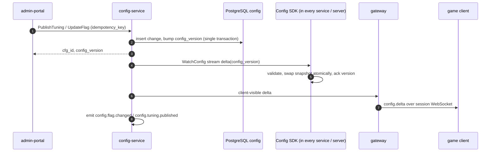
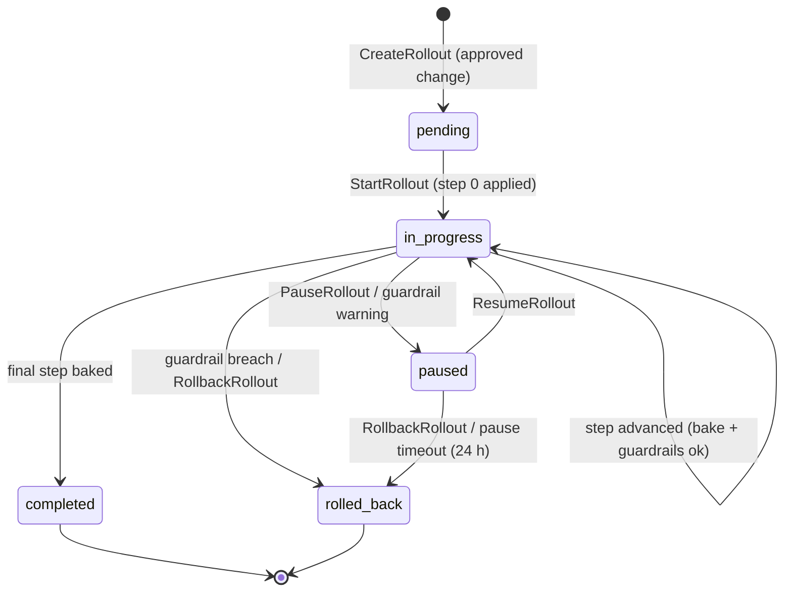
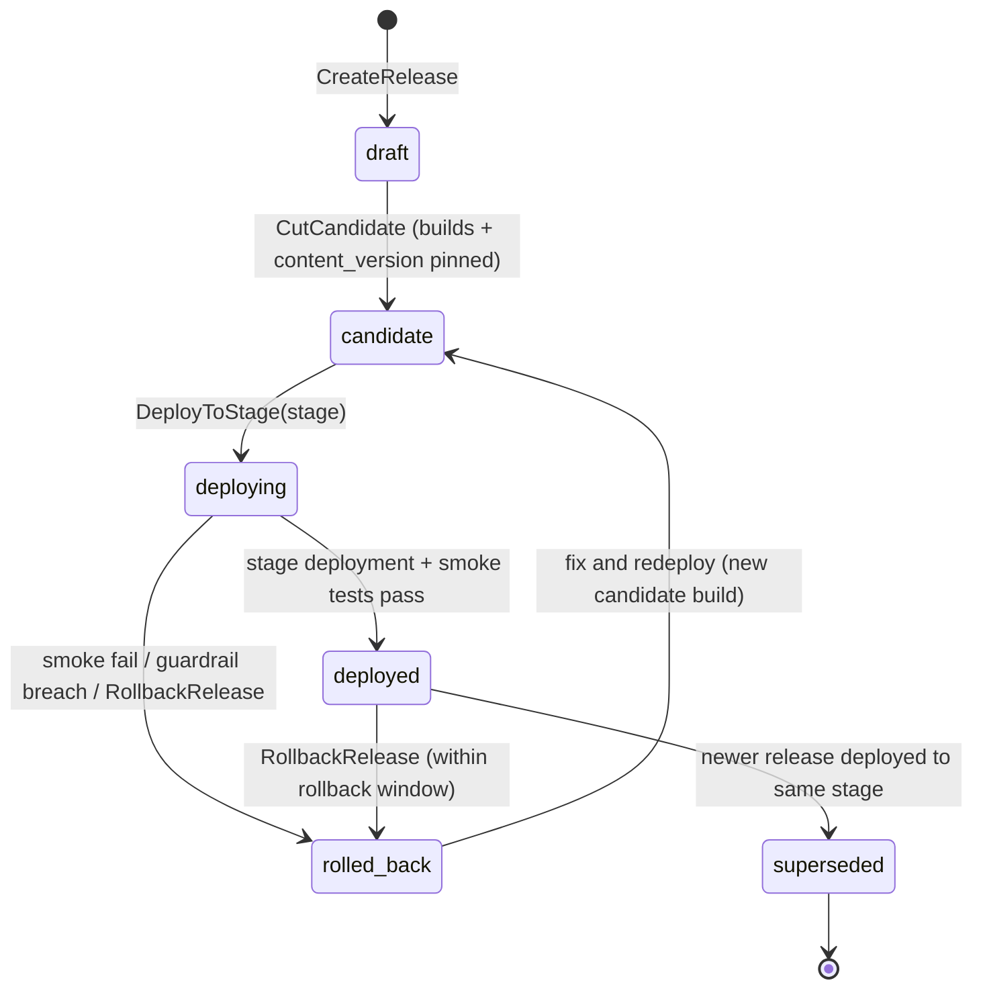

# Legends of the Shattered Frontier — LiveOps Part 2: Config and Releases
## Version 1.0 — Expanded Technical Design Authority edition (2026-10-17)

Status: Design target; not implemented. Names per Shared Registry v1.0.

- Entry file: [LiveOps Architecture](../Legends_Shattered_Frontier_LiveOps_Architecture_v1.0.md)
- Registry: [Shared Registry v1.0](../Legends_Shattered_Frontier_Shared_Registry_v1.0.md)

---

## 1. Balancing operations with `config-service`

`config-service` is the only runtime source of feature flags (`ff.<domain>.<snake_name>`) and tuning values (`tune.<domain>.<snake_name>`). Every domain spec publishes its constants as tuning keys (Registry, Constants); this part defines how those keys are declared, versioned, targeted, propagated, rolled out, and rolled back.

| Object | Key form | Purpose | Example |
| --- | --- | --- | --- |
| Feature flag | `ff.<domain>.<name>` | On/off, percentage, or variant gate | `ff.loot.pity_enabled` |
| Kill switch | `ff.<domain>.<name>` with `kill_switch = true` | Disable a feature within seconds | `ff.economy.market_enabled` |
| Tuning table | `tune.<domain>.<name>` | Scalar or tabular balance values | `tune.progression.xp_curve` |
| Overlay | (on a `tune.*`/`ff.*` key) | Time-boxed value owned by a LiveOps event | `tune.progression.event_xp_multiplier = 1.5` |
| Change | `cfg_<ULID>` | Immutable record of any change (flag, tuning version, overlay, rollback) | `cfg_01JA…` |

Ownership: each key's `owner_domain` (the segment after `ff.`/`tune.`) names the domain spec that defines its semantics. LiveOps owns the mechanism and the `liveops`, `store`, and `config` domain keys.

### 1.1 Flag declaration schema

Flags are declared in the owning service's repository as YAML and registered with `config-service` at build time (declaration ≠ value; values are operational data).

```json
{
  "key": "ff.economy.market_enabled",
  "type": "bool",
  "description": "Global exchange and regional markets accept new listings and purchases.",
  "owner_domain": "economy",
  "owner_team": "economy",
  "default": true,
  "safe_value": false,
  "kill_switch": true,
  "liveops_overridable": false,
  "client_visible": true,
  "apply_on": "immediate",
  "temporary": false,
  "expires_review_at": null
}
```

| Field | Type | Rule |
| --- | --- | --- |
| `type` | `bool` \| `percentage` \| `variant` \| `set` | `percentage` is basis points 0–10,000; `variant` lists allowed string values; `set` is a set of strings (e.g., content IDs) |
| `default` | per type | Must equal the Registry default where one exists |
| `safe_value` | per type | Value used when killed and when the SDK has no snapshot at all; required for `kill_switch` |
| `liveops_overridable` | bool | Only these flags may be targets of event `feature_toggle` modifiers |
| `client_visible` | bool | Included in the client snapshot served via `gateway`; otherwise server-only |
| `apply_on` | `immediate` \| `next_instance` \| `next_reset` \| `restart` | When consumers apply a change (e.g., instance-server applies dungeon tuning only to new runs) |
| `temporary` / `expires_review_at` | bool / date | Temporary flags (rollout gates) must be removed or made permanent by review date; `config-service` raises an `ops.alerts` warning 14 days after |

### 1.2 Tuning table declaration

```json
{
  "key": "tune.economy.gold_reward_scale",
  "shape": "scalar",
  "value_schema": { "type": "integer", "minimum": 50, "maximum": 200 },
  "default": 100,
  "owner_domain": "economy",
  "apply_on": "immediate",
  "client_visible": false,
  "change_class": "economy"
}
```

Tabular example (`shape: "table"`): `tune.progression.xp_curve` with rows `{level, xp_to_next}`, `primary_key: ["level"]`, row schema, and table-level invariants (e.g., strictly increasing `xp_to_next`). `change_class` ∈ `gameplay`, `economy`, `performance`, `ops` selects the default guardrail set and approval tier (§4.5).

### 1.3 Versioning

- Every publish of a tuning table creates `tuning_version = previous + 1` for that key; versions are immutable.
- A global monotonically increasing `config_version` (bigint) increments on every change of any flag rule, tuning version, overlay, or kill; snapshots and deltas are expressed in `config_version`.
- Rollback publishes a **new** version whose content equals an earlier version (`change_kind = rollback`, `rollback_of = cfg_…`). History is never rewritten.
- Every change carries: `cfg_` id, `actor`, `approvers`, `reason_code`, `ticket_ref`, `idempotency_key`, diff, and `change_kind` ∈ `create`, `update`, `rollout_step`, `overlay_apply`, `overlay_remove`, `kill`, `unkill`, `rollback`, `auto_rollback`.

### 1.4 Targeting

Evaluation context (supplied by the consuming SDK):

| Field | Source | Notes |
| --- | --- | --- |
| `environment` | deployment | `dev`, `ptr`, `staging`, `prod` |
| `dc_region` | deployment | `na`, `eu`, `apac`, `sa` |
| `realm_id` | process / request | e.g., `na-1` |
| `account_id` | request (optional) | For percentage and allowlist |
| `client_build` | request (optional) | For client-gated features |
| `realm_role` | world-service | `canary` or `standard` |

A flag/tuning value has an ordered list of **rules**; each rule = `(priority, cohort, value)`. Cohort fields (all optional, AND-combined): `environments[]`, `dc_regions[]`, `realm_ids[]`, `realm_roles[]`, `percentage_bp` (0–10,000), `allow_accounts[]` (≤ 1,000, test/QA only), `min_client_build`.

**Resolution order** (first match wins at each level):

1. Kill: if the key is killed for a cohort matching the context → `safe_value`.
2. Overlays: active, unexpired overlays matching the context; multiple overlays on a multiplier key → max; on bool → OR.
3. Rules by ascending `priority` number; first rule whose cohort matches → its value.
4. Declared `default`.

**Percentage bucketing.** `bucket(account_id, key) = xxhash64(salt(key) ‖ ":" ‖ account_id) mod 10,000`; matched when `bucket < percentage_bp`. `salt(key)` defaults to the key name, so different flags bucket independently; a rollout increasing from 5 % to 25 % keeps the original 5 % inside (monotone). When no `account_id` is available (server-global evaluation), percentage rules match only at 10,000 bp.

Worked example: `ff.loot.pity_enabled` rules: `p10: {realm_roles:[canary]} → true`, `p20: {dc_regions:[eu], percentage_bp: 2500} → true`, default `false`. Context `{prod, eu, eu-3, standard, acc_X}` with `bucket = 1,873` → rule p10 fails (not canary), p20 matches (1,873 < 2,500) → `true`.

### 1.5 Propagation



- **SDK model.** Each process keeps the full snapshot in memory and evaluates locally (no per-request RPC). On boot it fetches `GetSnapshot`; then opens `WatchConfig(since_version)`. On stream loss it reconnects with backoff 1–30 s and resumes from its version.
- **Persistence fallback.** SDK writes the last good snapshot to local disk; if `config-service` is unreachable at boot, it uses the disk snapshot if younger than 24 h, else `safe_value`/`default` with a critical health status that blocks the process from joining load balancers (fail safe; world servers will not open a zone without a valid snapshot).
- **Acks.** SDKs report applied `config_version`; `config-service` exposes per-key propagation progress used by rollouts and kill switch confirmation.

| Target | p50 | p99 | Measured by |
| --- | --- | --- | --- |
| Kill switch → all server processes | ≤ 2 s | ≤ 5 s | `m_config_kill_propagation_seconds` |
| Flag / tuning → all server processes | ≤ 5 s | ≤ 30 s | `m_config_propagation_seconds` |
| Client-visible change → connected clients | ≤ 10 s | ≤ 60 s | `m_config_client_propagation_seconds` |
| Max tolerated SDK lag before health = degraded | — | 120 s | SDK health |

`apply_on` semantics: `immediate` keys swap at the next tick boundary in zone/instance servers (never mid-tick); `next_instance` keys are bound at instance run creation and recorded in the run (reproducibility); `next_reset` keys switch at the dc_region daily reset; `restart` keys require a rolling restart (release management).

### 1.6 Kill switches

A kill switch is a `bool` flag declared with `kill_switch = true` and `safe_value = false` (feature off). Each domain declares at least one kill switch per player-facing feature with economic or security impact. Illustrative catalog (semantics owned by each domain spec):

| Key | Effect when killed |
| --- | --- |
| `ff.economy.market_enabled` | Markets reject new listings and purchases; existing escrow untouched |
| `ff.economy.trade_enabled` | Direct trades rejected |
| `ff.store.purchases_enabled` | Store accepts no new purchases; browsing continues |
| `ff.liveops.compensation_enabled` | Compensation issuance pauses |
| `ff.crafting.crafting_enabled` | Crafting stations refuse new crafts |
| `ff.group.queue_enabled` | Matchmaking queues closed |
| `ff.content.disabled_definitions` (`set`) | Listed content IDs (quests, dungeons, recipes, offers) are not offered/started; in-progress state preserved |

Rules:

1. **Fast path.** Killing requires one on-call `liveops_operator`, `release_manager`, or `enforcement_lead` with a mandatory reason; no second approver (speed beats ceremony). It pages the owning team and `liveops_lead`, and posts an internal status note.
2. **Unkill** requires two-person approval (requester + owning-domain lead or `liveops_lead`).
3. Kills can be scoped to a cohort (realm, dc_region) or global.
4. Consumers must check kill switches at the server authority point (e.g., `economy-service` checks `ff.economy.market_enabled` on every listing RPC), not only in the client.
5. Kills never delete data; they only stop new actions.

### 1.7 Reset schedule

`tune.liveops.reset_schedule` (Registry, Resets) is a `table` keyed by `dc_region`:

```json
[
  { "dc_region": "na",   "daily_utc": "15:00", "weekly_day": "tuesday",   "weekly_utc": "15:00" },
  { "dc_region": "eu",   "daily_utc": "04:00", "weekly_day": "wednesday", "weekly_utc": "04:00" },
  { "dc_region": "apac", "daily_utc": "22:00", "weekly_day": "wednesday", "weekly_utc": "22:00" },
  { "dc_region": "sa",   "daily_utc": "18:00", "weekly_day": "tuesday",   "weekly_utc": "18:00" }
]
```

Changes are `change_class = ops`, tier 3 approval, and take effect only after the next weekly reset (`apply_on = next_reset`) to avoid double or skipped resets.

## 2. Safe rollout and automatic rollback

### 2.1 Rollout plans

Any change with `change_class` ∈ `gameplay`, `economy`, `performance` to a `prod` key is applied through a **rollout plan** unless marked `emergency` (kill, or `liveops_lead` + `enforcement_lead` approved hotfix). Default plan:

| Step | Cohort | Bake time | Advance |
| --- | --- | --- | --- |
| 0 | Canary realms (one per dc_region) | 30 min | auto if guardrails pass |
| 1 | 5 % accounts (or 1 realm per region for server-global keys) | 60 min | auto |
| 2 | 25 % | 120 min | auto |
| 3 | 50 % | 120 min | operator confirm |
| 4 | 100 % | — | completes rollout |

Keys: `tune.config.rollout_default_steps`, `tune.config.rollout_min_bake_minutes` (30). Economy-class changes use 24 h bake at step 2 (`tune.config.economy_bake_minutes` = 1,440) because economic effects accumulate slowly.

### 2.2 Rollout state machine (proposed `rollout_state`)



### 2.3 Guardrail evaluation

During each bake the rollout compares **treatment** (cohort receiving the new value) with **control** (same environment and regions, not yet receiving it). For server-global keys where treatment is whole realms, control is the remaining realms in the same dc_region.

For a rate metric where higher is worse (errors, crashes, failures):

- `p_t = x_t / n_t`, `p_c = x_c / n_c`, pooled `p = (x_t + x_c) / (n_t + n_c)`
- `z = (p_t − p_c) / sqrt(p × (1 − p) × (1/n_t + 1/n_c))`
- `rel = (p_t − p_c) / max(p_c, ε)`, `ε` = 10⁻⁶
- **Breach** if `n_t ≥ N_MIN` and `z ≥ Z_CRIT` and `rel ≥ θ`. **Warning** if `z ≥ Z_WARN` and `rel ≥ θ/2`.

For continuous metrics (latency p99, gold per active hour): `rel = (m_t − m_c) / m_c` over the bake window with ≥ `N_MIN` samples per side; breach if `rel ≥ θ` for 3 consecutive evaluations (evaluated every 60 s).

Defaults: `Z_CRIT` = 3.0, `Z_WARN` = 2.0, `N_MIN` = 2,000 (`tune.config.guardrail_z_crit`, `tune.config.guardrail_z_warn`, `tune.config.guardrail_min_samples`).

| Guardrail metric | Higher is worse | θ (relative) | Applies to change_class |
| --- | --- | --- | --- |
| `m_server_error_rate` | yes | 0.25 | all |
| `m_client_crash_rate` | yes | 0.20 | gameplay, performance, client-visible |
| `m_zone_tick_p99_ms` | yes | 0.15 | gameplay, performance |
| `m_login_success_rate` | no (lower is worse; invert sign) | 0.02 | all |
| `m_gold_created_per_active_hour` | yes | 0.10 | economy |
| `m_items_created_per_active_hour` | yes | 0.10 | economy |
| `m_store_purchase_failure_rate` | yes | 0.25 | `store` domain keys |
| `m_session_length_minutes_p50` | no | 0.10 | gameplay |

Each tuning/flag declaration may add key-specific guardrails (e.g., Itemization adds `m_legendary_drop_rate` for loot keys).

Worked example: rollout of `tune.loot.boss_material_bonus` at step 1. Treatment: 2,400 sessions, 31 server errors (p_t = 0.01292). Control: 46,000 sessions, 345 errors (p_c = 0.0075). Pooled p = 376/48,400 = 0.007769. `sqrt(0.007769 × 0.992231 × (1/2,400 + 1/46,000)) = sqrt(0.0077086 × 0.00043841) = sqrt(3.3795 × 10⁻⁶) = 0.0018383`. `z = 0.00542 / 0.0018383 = 2.95` (< 3.0), `rel = 0.723` ≥ 0.25 → **warning** (≥ 2.0): rollout auto-pauses and pages; at the next evaluation with more samples, z = 3.4 → **breach** → automatic rollback.

### 2.4 Automatic rollback

```mermaid
sequenceDiagram
    autonumber
    participant AN as analytics-pipeline
    participant CS as config-service
    participant SDK as Config SDKs
    participant OC as On-call (pager)
    AN->>CS: guardrail sample (rollout_id, metric, z, rel) every 60 s
    CS->>CS: evaluate → breach
    CS->>CS: create change cfg_ (change_kind = auto_rollback, value = pre-rollout version)
    CS->>SDK: WatchConfig delta (priority lane)
    SDK-->>CS: acks (target p99 ≤ 30 s)
    CS->>OC: page owning team + liveops on-call
    CS->>CS: rollout_state = rolled_back; emit config.tuning.published / config.flag.changed (change_kind = auto_rollback)
```

Rollback is always to the exact pre-rollout value for every cohort (stored at `StartRollout`). If acks for the rollback do not reach 99 % of processes within 120 s, `config-service` escalates to sev-2. A rolled-back change cannot be restarted without a new approval and a changed value or an explicit "false positive" annotation by the owning lead.

### 2.5 Approval tiers for config changes

| Tier | Condition | Approvers |
| --- | --- | --- |
| 0 | `dev`/`ptr` environments | Owner team member (self) |
| 1 | `staging`; or `prod` `ops`-class within existing ranges | Owner team member + any second engineer |
| 2 | `prod` gameplay/performance | Owner team lead + `liveops_operator` |
| 3 | `prod` economy-class, any reset/season constant, any change exceeding 25 % relative change of a numeric value | Tier 2 + `economy_analyst` |
| Kill | any | one on-call (see Kill switches) |

`config-service` refuses values outside the declared `value_schema` regardless of approvals.

### 2.6 Config freeze

During a maintenance window deployment and the first 2 hours after a `prod` release (`tune.config.post_release_freeze_minutes` = 120), only kills, rollbacks, and emergency changes are allowed. Season end jobs also impose a freeze on `economy`-class keys in the affected region from 1 h before to 1 h after.

## 3. Release management

### 3.1 Release model

A **Release** (`rel_`) binds together what ships:

| Field | Meaning |
| --- | --- |
| `version` | Semantic version, e.g., `1.5.2` (matches launcher master manifest `version`) |
| `server_build` | Build identifier of backend services and dedicated servers (`1.5.2+b10542`) |
| `client_build` | Launcher `build` number (Client delivery spec, Master Manifest Definition) |
| `min_client_build` | Oldest client build accepted by `gateway` after activation |
| `content_version` | Content pack activated with the release |
| `migrations[]` | Database migrations by schema, each flagged `expand` (backward compatible) or `contract` |
| `config_changes[]` | `cfg_` changes or rollout plans bundled with the release |
| `requires_maintenance` | true if any `contract` migration, `restart`-class key, or incompatible protocol change |
| `kind` | `scheduled`, `hotfix`, `content_only`, `server_only` |
| `release_notes_ann_id` | Linked announcement (`ann_`) |

### 3.2 Stages (`release_stage`)

Promotion order is fixed: `dev → ptr → staging → prod`. A release may skip `ptr` only if `kind = hotfix` or `server_only` with no player-facing change.

| Stage | Purpose | Entry gate | Exit gate (to next) |
| --- | --- | --- | --- |
| `dev` | Continuous integration environment | CI green (DevOps spec, Automated Testing) | Automated suites pass; content validators pass; release candidate cut |
| `ptr` | Public Test Realm for players | Release notes draft; PTR client build published on PTR launcher channel | ≥ 3 days soak (`tune.liveops.ptr_min_soak_hours` = 72) for scheduled releases; no open S1/S2 bugs; `m_client_crash_rate` ≤ prod baseline × 1.2 |
| `staging` | Production-like rehearsal with prod-scale data snapshot | Migrations rehearsed on anonymized snapshot | Load test at 1.2 × prod peak CCU passes; rollback rehearsal passes; `release_manager` sign-off |
| `prod` | Live | Maintenance window or rolling plan approved; client build pre-downloaded ≥ 24 h (if client changes) | Canary bake passes; full rollout |

Launcher channel mapping (Client delivery spec, Release Channels): `dev` ↔ Internal Development, `ptr` ↔ Public Test Realm, `prod` ↔ Production. `staging` uses an internal channel with production manifests; the Client delivery spec currently lists no staging channel (coordination item listed under the entry file's open issues).

### 3.3 Release state machine (proposed `release_state`, per stage)



State is tracked per `(release_id, stage)` in `release_stage_deployments`; the release's overall state is its state in the highest stage reached. `liveops.release.deployed` is emitted on each `deploying → deployed` (payload includes `stage`).

### 3.4 Canary realms

- One production realm per `dc_region` is designated `realm_role = canary` (stored in `liveops.realm_roles`, mirrored to `world-service`). Canary realms are normal live realms with transparent player opt-out: realm selection UI shows a "Canary" tag and players accept that changes reach them first (cosmetic reward each season for canary residents, granted via `reward-service`, `season_reward`).
- Prod deployments (rolling or maintenance) reach canary realms first, then bake 60 min (`tune.liveops.canary_bake_minutes`) with release guardrails (§2.3 metrics, treatment = canary realm, control = other realms in region) before the rest.
- Config rollouts' step 0 uses canary realms.

### 3.5 Maintenance windows

Default weekly window per `dc_region` starts at the weekly reset and lasts at most 120 min (`tune.liveops.maintenance_max_minutes`). Target is zero-downtime: releases without `requires_maintenance` are rolled out with rolling restarts and session handoff (World spec, Zone Handoffs) and do not open a window.

`MaintenanceWindow` (proposed `mnt_`): `scope` (realms or dc_region), `starts_at`, `expected_end_at`, `kind` (`planned`, `emergency`), `release_id`, `status` (`scheduled`, `in_progress`, `completed`, `extended`, `cancelled`).

Notice: planned ≥ 72 h ahead (launcher news, MOTD, status page); emergency ≥ 15 min in-game notice except security emergencies.

```mermaid
sequenceDiagram
    autonumber
    participant LS as liveops-service
    participant GW as gateway
    participant WS as world-service
    participant ZS as zone/instance servers
    participant CCS as content-catalog-service
    participant DEP as deploy pipeline (DevOps)
    LS->>LS: T-72h publish announcement (launcher_news, status_page)
    LS->>GW: T-15m in_game_toast countdown (15, 5, 1 min)
    LS->>GW: T-0 SetLoginGate(scope, allow_roles=[gm, qa])
    LS->>WS: DrainRealms(scope) → save characters, close instances gracefully
    WS-->>LS: drained
    LS->>DEP: DeployRelease(rel_, stage=prod, scope)
    DEP-->>LS: deployed (migrations applied)
    LS->>CCS: ActivateContentVersion(content_version, scope)
    LS->>LS: smoke tests (synthetic login, zone entry, quest accept, store browse)
    LS->>GW: open canary realms; bake 60 min (or 15 min if window time-limited)
    LS->>GW: open remaining realms; status_page = operational
    LS->>LS: emit liveops.release.deployed
```

If the window will overrun, `liveops-service` extends it in 30-minute steps (max 2 without `liveops_lead`) and the status page updates automatically. Overruns above 60 min trigger compensation evaluation (Store, Compensation and Community, Compensation triggers).

### 3.6 Hotfix path

| Severity | Definition | Preferred remedy | Path | Target time to mitigation |
| --- | --- | --- | --- | --- |
| S1 | Exploit duplicating items/currency, data loss, security breach, realm down | Kill switch first, then fix | Kill → `hotfix/*` → dev CI → staging 30 min → canary 30 min → prod | Kill ≤ 5 min; fix ≤ 12 h |
| S2 | Major feature broken for many players, severe economy imbalance | Tuning rollback or kill; then fix | `hotfix/*` → dev → staging 60 min → canary 60 min → prod | ≤ 24 h |
| S3 | Non-blocking bug with workaround | Next scheduled release | normal | next release |
| S4 | Cosmetic | backlog | normal | — |

Remedy preference ladder: (1) kill switch or `ff.content.disabled_definitions`; (2) tuning rollback; (3) content pack hotfix (`content_only` release, no restart); (4) server-only rolling hotfix; (5) client patch (requires launcher patch publication and `min_client_build` bump). Hotfix releases skip `ptr` and carry `kind = hotfix`; they still require `release_manager` + owning lead approval and post-incident review within the next operations review.

### 3.7 Content pack publication with `content-catalog-service`

1. Authors merge content; CI builds the pack; `content-catalog-service.ValidatePack` runs all domain validators (including LiveOps validators for `liveops_event`, `season`, `store_offer`: modifier caps, reward weight limits, crowns-offer item category restrictions).
2. The catalog signs the pack and assigns `content_version` (monotonic integer). Packs are immutable.
3. The release pins `content_version`. `liveops-service` calls `ActivateContentVersion(content_version, cohort)` per stage and realm cohort. Activation is a pointer switch; all versions remain stored.
4. **Compatibility rule:** a pack may add definitions and add optional fields; it may not delete or rename a published content ID (Registry: slugs immutable). Retirement uses `ff.content.disabled_definitions` or definition `retired: true`.
5. **Content rollback** = activating the previous `content_version`. Allowed only if no persisted runtime state references definitions introduced by the newer pack; the catalog computes this via `CheckRollbackSafety(from, to)` querying owning services' reference counts (quest instances, item instances, campaigns). If unsafe, the remedy is disabling the new definitions instead.
6. Clients receive `content_version` in the envelope context and in the login handshake; client-side data packs (if any) follow the launcher path.

### 3.8 Coordination with launcher patching

```mermaid
sequenceDiagram
    autonumber
    participant RM as release_manager
    participant LS as liveops-service
    participant CD as Client delivery pipeline
    participant L as Launcher
    participant GW as gateway
    RM->>LS: CutCandidate(rel_, client_build=10542, min_client_build=10530)
    LS->>CD: request manifest publication (channel=production, predownload=true)
    CD-->>L: master manifest with predownload section (≥ 24 h before)
    L->>L: background predownload; not yet active
    Note over LS: maintenance / rolling deploy
    LS->>CD: activate manifest (version 1.5.2)
    LS->>GW: SetMinClientBuild(10542 if breaking, else keep 10530)
    GW-->>L: older clients get upgrade_required at login
```

Rules: the server supports the previous client build (N−1) for at least the rolling window unless the protocol changes; `min_client_build` bumps are part of the release record and announced; launcher manifests must be published and verified (Client delivery spec, Validation Architecture) before the server switches. Target: ≥ 90 % of returning players have the build pre-downloaded at release (`m_predownload_ratio`).

### 3.9 Release calendar policy

- Scheduled releases: every 2 weeks (minor), with a content update at season start and mid-season (weeks 0 and 6).
- No scheduled prod releases within 48 h before a season end, during major event openings, or in region-specific holiday freezes listed in the operations calendar.
- Every prod release has a named `release_manager` on duty for 4 h after activation.

## 4. Schemas

### 4.1 `config` schema

```sql
CREATE SCHEMA IF NOT EXISTS config;

CREATE TABLE config.keys (
  key              text PRIMARY KEY CHECK (key ~ '^(ff|tune)\.[a-z0-9_]+\.[a-z0-9_]+$'),
  kind             text NOT NULL CHECK (kind IN ('flag','tuning')),
  flag_type        text CHECK (flag_type IN ('bool','percentage','variant','set')),
  shape            text CHECK (shape IN ('scalar','table')),
  value_schema     jsonb NOT NULL,
  default_value    jsonb NOT NULL,
  safe_value       jsonb,
  kill_switch      boolean NOT NULL DEFAULT false,
  liveops_overridable boolean NOT NULL DEFAULT false,
  client_visible   boolean NOT NULL DEFAULT false,
  apply_on         text NOT NULL CHECK (apply_on IN ('immediate','next_instance','next_reset','restart')),
  change_class     text NOT NULL CHECK (change_class IN ('gameplay','economy','performance','ops')),
  owner_domain     text NOT NULL,
  temporary        boolean NOT NULL DEFAULT false,
  expires_review_at date,
  CHECK (NOT kill_switch OR safe_value IS NOT NULL)
);

CREATE TABLE config.changes (
  change_id        text PRIMARY KEY CHECK (change_id LIKE 'cfg\_%'),
  config_version   bigint NOT NULL UNIQUE,
  key              text NOT NULL REFERENCES config.keys(key),
  environment      text NOT NULL CHECK (environment IN ('dev','ptr','staging','prod')),
  change_kind      text NOT NULL CHECK (change_kind IN ('create','update','rollout_step','overlay_apply','overlay_remove','kill','unkill','rollback','auto_rollback')),
  before_value     jsonb,
  after_value      jsonb,
  rules_after      jsonb,                      -- full ordered rule list after change
  rollout_id       text,
  rollback_of      text REFERENCES config.changes(change_id),
  owner_ref        text,                       -- lop_ for overlays, rel_ for releases
  actor_account_id text NOT NULL,
  approver_account_ids text[] NOT NULL DEFAULT '{}',
  reason_code      text NOT NULL,
  ticket_ref       text,
  idempotency_key  text NOT NULL,
  created_at       timestamptz NOT NULL DEFAULT now(),
  UNIQUE (idempotency_key)
);
CREATE SEQUENCE config.config_version_seq;
CREATE INDEX changes_key_env ON config.changes (key, environment, config_version DESC);

CREATE TABLE config.flag_rules (           -- current state, derived from latest change
  key          text NOT NULL REFERENCES config.keys(key),
  environment  text NOT NULL,
  priority     integer NOT NULL,
  cohort       jsonb NOT NULL,
  value        jsonb NOT NULL,
  PRIMARY KEY (key, environment, priority)
);

CREATE TABLE config.tuning_versions (
  key            text NOT NULL REFERENCES config.keys(key),
  environment    text NOT NULL,
  tuning_version integer NOT NULL,
  value          jsonb NOT NULL,             -- scalar or rows
  change_id      text NOT NULL REFERENCES config.changes(change_id),
  is_current     boolean NOT NULL DEFAULT false,
  PRIMARY KEY (key, environment, tuning_version)
);
CREATE UNIQUE INDEX one_current_tuning ON config.tuning_versions (key, environment) WHERE is_current;

CREATE TABLE config.overlays (
  overlay_id   text PRIMARY KEY,           -- = cfg_ of overlay_apply
  key          text NOT NULL REFERENCES config.keys(key),
  environment  text NOT NULL,
  cohort       jsonb NOT NULL,
  value        jsonb NOT NULL,
  owner_ref    text NOT NULL,              -- lop_
  starts_at    timestamptz NOT NULL,
  expires_at   timestamptz NOT NULL,       -- hard expiry
  removed_at   timestamptz
);
CREATE INDEX overlays_active ON config.overlays (key, environment) WHERE removed_at IS NULL;

CREATE TABLE config.kills (
  key          text NOT NULL REFERENCES config.keys(key),
  environment  text NOT NULL,
  cohort       jsonb NOT NULL,             -- {} = global
  killed_change_id text NOT NULL REFERENCES config.changes(change_id),
  unkilled_change_id text REFERENCES config.changes(change_id),
  PRIMARY KEY (key, environment, killed_change_id)
);

CREATE TABLE config.rollouts (
  rollout_id   text PRIMARY KEY,           -- = cfg_ of the originating change
  key          text NOT NULL REFERENCES config.keys(key),
  environment  text NOT NULL,
  state        text NOT NULL CHECK (state IN ('pending','in_progress','paused','completed','rolled_back')),
  plan         jsonb NOT NULL,             -- steps, bake minutes, guardrails
  current_step smallint NOT NULL DEFAULT 0,
  pre_rollout_snapshot jsonb NOT NULL,     -- exact rules/version to restore
  step_started_at timestamptz,
  last_guardrail jsonb,
  updated_at   timestamptz NOT NULL DEFAULT now()
);

CREATE TABLE config.sdk_acks (
  process_id     text PRIMARY KEY,         -- srvi_ or service instance id
  service        text NOT NULL,
  environment    text NOT NULL,
  realm_id       text,
  config_version bigint NOT NULL,
  acked_at       timestamptz NOT NULL
);
```

### 4.2 `liveops` schema, release tables

```sql
CREATE TABLE liveops.releases (
  release_id       text PRIMARY KEY CHECK (release_id LIKE 'rel\_%'),
  version          text NOT NULL UNIQUE,
  kind             text NOT NULL CHECK (kind IN ('scheduled','hotfix','content_only','server_only')),
  server_build     text NOT NULL,
  client_build     integer,
  min_client_build integer,
  content_version  bigint NOT NULL,
  migrations       jsonb NOT NULL DEFAULT '[]'::jsonb,
  config_changes   text[] NOT NULL DEFAULT '{}',
  requires_maintenance boolean NOT NULL,
  release_notes_ann_id text,
  release_manager_account_id text NOT NULL,
  created_at       timestamptz NOT NULL DEFAULT now()
);

CREATE TABLE liveops.release_stage_deployments (
  release_id   text NOT NULL REFERENCES liveops.releases(release_id),
  stage        text NOT NULL CHECK (stage IN ('dev','ptr','staging','prod')),
  state        text NOT NULL CHECK (state IN ('draft','candidate','deploying','deployed','rolled_back','superseded')),
  scope        jsonb NOT NULL,             -- realms / dc_regions
  maintenance_window_id text,
  gate_results jsonb NOT NULL DEFAULT '{}'::jsonb,
  approved_by  text[] NOT NULL DEFAULT '{}',
  deployed_at  timestamptz,
  rolled_back_at timestamptz,
  PRIMARY KEY (release_id, stage)
);

CREATE TABLE liveops.maintenance_windows (
  maintenance_window_id text PRIMARY KEY CHECK (maintenance_window_id LIKE 'mnt\_%'),
  kind           text NOT NULL CHECK (kind IN ('planned','emergency')),
  scope          jsonb NOT NULL,
  starts_at      timestamptz NOT NULL,
  expected_end_at timestamptz NOT NULL,
  actual_end_at  timestamptz,
  status         text NOT NULL CHECK (status IN ('scheduled','in_progress','completed','extended','cancelled')),
  release_id     text REFERENCES liveops.releases(release_id),
  announcement_ids text[] NOT NULL DEFAULT '{}'
);

CREATE TABLE liveops.realm_roles (
  realm_id   text PRIMARY KEY,
  dc_region  text NOT NULL,
  realm_role text NOT NULL CHECK (realm_role IN ('canary','standard')),
  updated_by text NOT NULL,
  updated_at timestamptz NOT NULL DEFAULT now()
);
CREATE UNIQUE INDEX one_canary_per_region ON liveops.realm_roles (dc_region) WHERE realm_role = 'canary';
```

## 5. Balancing operations targets

| Target | Value | Metric |
| --- | --- | --- |
| Config changes rolled back automatically that were true positives | ≥ 80 % (reviewed) | `m_config_auto_rollback_precision` |
| Mean time from guardrail breach to rollback applied (p99) | ≤ 90 s | `m_config_rollback_seconds` |
| Kill switch propagation p99 | ≤ 5 s | `m_config_kill_propagation_seconds` |
| Prod releases requiring maintenance | ≤ 25 % | `m_release_maintenance_ratio` |
| Maintenance window overrun rate | ≤ 10 % | `m_maintenance_overrun_rate` |
| Change failure rate (releases rolled back) | ≤ 10 % | `m_release_change_failure_rate` |
| Temporary flags past review date | 0 | `m_config_stale_temporary_flags` |
