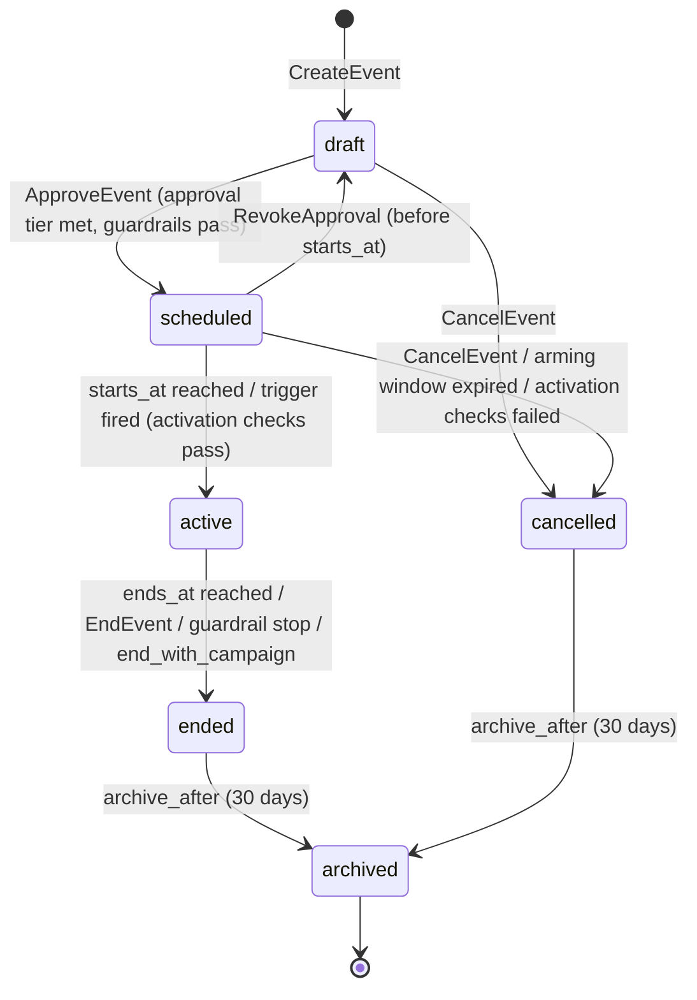
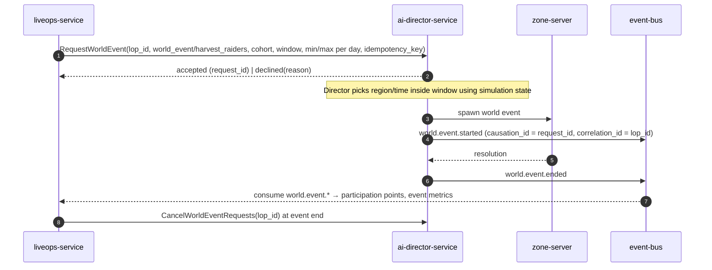
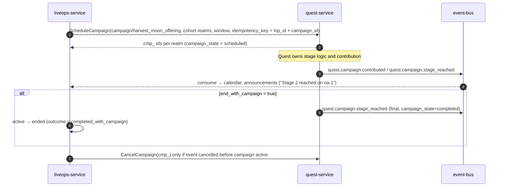
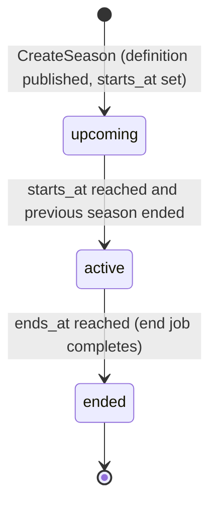

# Legends of the Shattered Frontier — LiveOps Part 1: Events and Seasons
## Version 1.0 — Expanded Technical Design Authority edition (2026-10-17)

Status: Design target; not implemented. Names per Shared Registry v1.0.

- Entry file: [LiveOps Architecture](../Legends_Shattered_Frontier_LiveOps_Architecture_v1.0.md)
- Registry: [Shared Registry v1.0](../Legends_Shattered_Frontier_Shared_Registry_v1.0.md)

---

## 1. Event framework overview

A **LiveOps Event** is an operated, time-boxed change to the game for a cohort of players. It is defined once as content (`liveops_event/<slug>`) and instantiated any number of times as runtime schedule entries (`lop_<ULID>`) owned by `liveops-service`.

A LiveOps event does **not** contain gameplay code. It is a bundle of typed **event modifiers** that `liveops-service` translates into actions on other services:

| Modifier family | Realized as | Executor |
| --- | --- | --- |
| Rate modifiers (XP, loot, gold, marks, season points, gathering yield, skill gain) | Time-boxed config overlay on a `tune.*` key | `config-service` → consuming service |
| Feature toggles (event vendor, decorations, seasonal dungeon) | Time-boxed overlay on an `ff.*` key | `config-service` → consuming service |
| Campaign windows | `ScheduleCampaign` RPC | `quest-service` |
| World event requests and director bias | `RequestWorldEvent`, `SetDirectorBias` RPCs | `ai-director-service` |
| Participation and login rewards | `IssueGrant` RPC | `reward-service` |
| Announcements | Linked `ann_` entries | `liveops-service` |

Because every effect is an overlay or a request with its own lifecycle, ending or cancelling an event is structurally reversible: removing overlays restores base tuning, cancelling requests retracts future world events and campaign windows. Rewards already delivered are not revoked (except by Security rollback).

### 1.1 Event kinds (`liveops_event_kind`)

| Kind | Start condition | Parameters | Approval | Examples |
| --- | --- | --- | --- | --- |
| `scheduled` | Fixed `starts_at` / `ends_at` | Fixed at approval | Per blast radius (see Approval tiers) | Harvest festival, bonus XP weekend, anniversary |
| `triggered` | A trigger rule becomes true inside an arming window | Fixed at approval | At arming; firing needs none if within envelope | Celebration after a realm-first mythic raid kill; double-marks after an outage |
| `dynamic` | Trigger rule, or operator start | Computed at activation from data, clamped to an approved envelope | Envelope approved once; each activation auto-approved inside envelope | Catch-up XP boost when realm DAU drops; gathering yield boost when a resource price index spikes |

### 1.2 LiveOps events vs World Events vs Campaigns

| Concept | Owner | Lives where | Decides | LiveOps role |
| --- | --- | --- | --- | --- |
| LiveOps Event (`lop_`) | LiveOps / `liveops-service` | Calendar + config overlays | When, for whom, which modifiers | Owner |
| World Event (`wev_`) | AI / `ai-director-service` | Simulation in zone-servers | Where, what spawns, how it resolves | Requests or biases, never forces |
| Campaign (`cmp_`) | Quest / `quest-service` | Quest runtime | Stages, contributions, communal goals | Schedules window, reads state |

Rule: a LiveOps event may reference world events and campaigns but must remain valid if the director declines a request or a campaign fails. Event definitions declare whether they `end_with_campaign` (event ends when the campaign reaches `completed`, `failed`, or `archived`).

## 2. Event definition schema

Event definitions are JSON content inside content packs, validated by the LiveOps validator in `content-catalog-service`.

```json
{
  "id": "liveops_event/harvest_festival",
  "schema_version": 1,
  "kind": "scheduled",
  "display": {
    "name_key": "loc.liveops.harvest_festival.name",
    "description_key": "loc.liveops.harvest_festival.desc",
    "calendar_icon": "ui/icons/events/harvest",
    "visible_in_calendar_days_before": 7
  },
  "default_duration": "P10D",
  "min_content_version": 1842,
  "cohort_constraints": {
    "environments": ["ptr", "staging", "prod"],
    "dc_regions": ["na", "eu", "apac", "sa"],
    "min_character_level": 10
  },
  "modifiers": [
    { "kind": "gathering_yield_multiplier", "value": 1.25, "scope": { "skills": ["skill/farming", "skill/herbalism"] } },
    { "kind": "season_points_multiplier", "value": 1.2 },
    { "kind": "feature_toggle", "flag": "ff.liveops.harvest_festival_decorations", "value": true },
    { "kind": "vendor_unlock", "vendor_npc": "npc/harvest_quartermaster", "price_currency": "currency/season_tokens" },
    { "kind": "campaign_window", "campaign_id": "campaign/harvest_moon_offering", "offset_start": "PT0H", "offset_end": "PT0H" },
    { "kind": "world_event_request", "world_event_id": "world_event/harvest_raiders",
      "constraints": { "biomes": ["greenlands"], "min_occurrences_per_day": 2, "max_occurrences_per_day": 6 } }
  ],
  "participation": {
    "points_source": "event_points",
    "earn_rules": [
      { "on_event": "gathering.node.harvested", "filter": "skill_id in ('skill/farming','skill/herbalism')", "points": 1, "daily_cap": 200 },
      { "on_event": "quest.instance.completed", "filter": "quest_type == 'dynamic'", "points": 10, "daily_cap": 100 }
    ],
    "tiers": [
      { "points": 100,  "reward": "reward/harvest_festival_t1" },
      { "points": 500,  "reward": "reward/harvest_festival_t2" },
      { "points": 1500, "reward": "reward/harvest_festival_t3" }
    ]
  },
  "login_reward": { "reward": "reward/harvest_festival_login", "max_claims": 1 },
  "economy": {
    "expected_participation_rate": 0.55,
    "expected_daily_completions_per_participant": 4,
    "reward_weight_per_completion": 1.0
  },
  "end_with_campaign": false,
  "announcements": [
    { "channel": "launcher_news", "offset": "-P3D", "template": "ann_tpl/event_upcoming" },
    { "channel": "motd", "offset": "PT0H", "template": "ann_tpl/event_live" }
  ]
}
```

Triggered and dynamic definitions add:

```json
{
  "kind": "dynamic",
  "trigger": {
    "rule": "delta_pct(metric(\"m_dau\", realm), 7d, 28d) <= -10 for 2d",
    "evaluation_interval": "PT1M",
    "cooldown": "P14D",
    "max_activations_per_season": 2
  },
  "dynamic_params": {
    "xp_multiplier": {
      "formula": "clamp(1 + 2 * max(0, -dau_delta_pct / 100), 1.0, 1.5)",
      "inputs": { "dau_delta_pct": "delta_pct(metric(\"m_dau\", realm), 7d, 28d)" },
      "round_to": 0.05
    },
    "duration": { "formula": "PT72H" }
  }
}
```

### 2.1 Field rules

| Field | Type | Required | Validation |
| --- | --- | --- | --- |
| `id` | content ID | yes | `liveops_event/<slug>`, immutable |
| `kind` | `liveops_event_kind` | yes | `trigger` required for `triggered`/`dynamic`; forbidden for `scheduled` |
| `default_duration` | ISO 8601 duration | yes | `PT1H` ≤ d ≤ `P42D` (`tune.liveops.event_max_duration_days` = 42) |
| `min_content_version` | int | yes | Activation refused on cohorts whose active `content_version` is lower |
| `modifiers[]` | array | yes (may be empty) | Each `kind` ∈ `event_modifier_kind`; value within caps (§6) |
| `participation` | object | no | `points` strictly increasing; each `reward` is a `reward/<slug>` whose weight sum respects §6 |
| `economy` | object | yes if any reward or rate modifier | Inputs to faucet estimate (§6.4) |
| `trigger.rule` | string | conditional | Must compile under the trigger rule language (§3) |
| `dynamic_params.*.formula` | string | conditional | Expression language subset (§3) plus `clamp`, `max`, `min`; result clamped to modifier caps |

### 2.2 Event modifier kinds (registered enum `event_modifier_kind`, Shared Registry)

| Kind | Overlay key / action | Cap (hard) | Notes |
| --- | --- | --- | --- |
| `xp_multiplier` | `tune.progression.event_xp_multiplier` | 2.0 | Non-stacking across events (max wins); event × catch-up ceiling 2.5 (Character spec, Multiplier caps) |
| `loot_multiplier` | `tune.loot.event_drop_multiplier` | 1.5 | Eligible loot entries only (§6.2) |
| `gold_reward_multiplier` | `tune.economy.event_gold_reward_multiplier` | 1.25 | Multiplies `gold_reward(L, w)`; subject to faucet budget |
| `marks_multiplier` | `tune.economy.event_marks_multiplier` | 1.5 | Weekly cap unchanged |
| `season_points_multiplier` | `tune.liveops.event_sp_multiplier` | 2.0 | Weekly SP activity cap scales by the same factor |
| `gathering_yield_multiplier` | `tune.gathering.event_yield_multiplier` | 1.5 | Scoped to listed skills; Crafting spec consumes |
| `skill_gain_multiplier` | `tune.progression.event_skill_gain_multiplier` | 1.5 | Scoped to listed skills; Character anti-grind rules still apply |
| `feature_toggle` | any `ff.*` key declared `liveops_overridable` | — | Flag must be registered as overridable in `config-service` |
| `vendor_unlock` | `ff.liveops.vendor_<slug>` overlay | — | Prices only in `currency/season_tokens` or `currency/gold` |
| `campaign_window` | `quest-service.ScheduleCampaign` | — | Window clamped to event window |
| `world_event_request` | `ai-director-service.RequestWorldEvent` | ≤ 12 occurrences per region per day | Director may decline |
| `director_bias` | `ai-director-service.SetDirectorBias` | weight ≤ 3.0 | Bias on world event category selection in scope |
| `seasonal_dungeon` | `ff.dungeon.<slug>_open` overlay | — | Opens a `dungeon_type = seasonal` dungeon |

## 3. Trigger rule language (TRL)

The trigger rule language is a small, side-effect-free, typed expression language evaluated by `liveops-service` over aggregated metrics and domain event counts. It is the same expression subset used in `dynamic_params` formulas.

### 3.1 Grammar (EBNF)

```ebnf
rule        = expr [ "for" duration ] ;
expr        = or_expr ;
or_expr     = and_expr { "or" and_expr } ;
and_expr    = not_expr { "and" not_expr } ;
not_expr    = [ "not" ] cmp_expr ;
cmp_expr    = add_expr [ cmp_op add_expr ] ;
cmp_op      = "==" | "!=" | "<" | "<=" | ">" | ">=" | "in" ;
add_expr    = mul_expr { ("+" | "-") mul_expr } ;
mul_expr    = unary { ("*" | "/") unary } ;
unary       = [ "-" ] primary ;
primary     = number | string | duration | bool | list | ident
            | call | "(" expr ")" ;
call        = fname "(" [ arg { "," arg } ] ")" ;
arg         = expr | named_arg ;
named_arg   = ident "=" expr ;
list        = "(" expr { "," expr } ")" ;
duration    = digit { digit } ( "m" | "h" | "d" ) ;
scope       = "realm" | "dc_region" | "global" ;
```

### 3.2 Functions

| Function | Returns | Meaning |
| --- | --- | --- |
| `metric(name, scope)` | number | Latest value of an Analytics metric `m_<snake>` at `scope` for the event's cohort member (one evaluation per realm when `realm`). Only metrics on the TRL allowlist (`tune.liveops.trl_metric_allowlist`). |
| `avg(metric(...), window)` | number | Time-weighted mean over window. |
| `delta_pct(metric(...), recent, baseline)` | number | `100 × (avg(recent) − avg(baseline)) / avg(baseline)`; 0 when baseline = 0. |
| `count(event_name, window, filters...)` | int | Count of domain events of that name in window, filtered by payload equality `field = value` named args. Only events on the allowlist. |
| `now()` | timestamp | Evaluation time (UTC). |
| `hour_of_day()`, `day_of_week()` | int | In the cohort's `dc_region` reset timezone (UTC offset of daily reset). |
| `campaign_state(campaign_id)` | string | Latest `campaign_state` from `quest-service` for the cohort realm. |
| `clamp(x, lo, hi)`, `min`, `max`, `round(x, step)` | number | Arithmetic helpers (formulas only). |

`for <duration>` adds hysteresis: the expression must be true at every evaluation over the duration. Evaluation interval defaults to 60 s (`tune.liveops.trl_eval_interval_seconds` = 60).

### 3.3 Semantics and safety

1. Rules compile to a typed AST at definition validation; type errors fail the content pack.
2. No user-defined functions, loops, or I/O. Evaluation cost bounded: ≤ 16 calls, ≤ 64 AST nodes (`tune.liveops.trl_max_nodes`).
3. Metric staleness: if any referenced metric is older than 3 × its publish interval, the rule evaluates to **false** and an `ops.alerts` warning is raised (fail closed: no accidental firing on missing data).
4. Each evaluation result transition (false→true) is persisted in `liveops.trigger_evaluations` with input values, for audit and replay tests.
5. Firing respects `cooldown` and `max_activations_per_season`; firing creates a new `lop_` in `scheduled` with `starts_at = now()` (or `now() + start_delay`).

### 3.4 Examples

| Purpose | Rule |
| --- | --- |
| Celebrate a realm's first mythic kill of the current raid | `count("raid.progress.first_kill_recorded", 1h, difficulty="mythic") >= 1` |
| Catch-up boost when DAU sags | `delta_pct(metric("m_dau", realm), 7d, 28d) <= -10 for 2d` |
| Outage make-good weekend | `metric("m_realm_unplanned_downtime_minutes", realm) >= 30` |
| Resource shortage relief | `delta_pct(metric("m_resource_price_index_iron_ore", dc_region), 3d, 28d) >= 40 for 12h` |
| Weekend prime time only | `day_of_week() in (6, 7) and hour_of_day() >= 18` |

### 3.5 Worked example: dynamic parameter

Realm `eu-2`: 28-day average `m_dau` = 40,000; last 7 days = 35,200. `delta_pct = 100 × (35,200 − 40,000)/40,000 = −12`. Rule `<= −10 for 2d` held for two days → fires. `xp_multiplier = clamp(1 + 2 × max(0, 12/100), 1.0, 1.5) = clamp(1.24, 1.0, 1.5) = 1.24 → round to 0.05 = 1.25`. A 72-hour `lop_` is created for cohort `realm = eu-2` with `xp_multiplier = 1.25`, auto-approved because 1.25 ≤ envelope max 1.5.

## 4. Event lifecycle

### 4.1 State machine (`liveops_event_state`)



| Transition | Guard | Side effects | Event emitted |
| --- | --- | --- | --- |
| `draft → scheduled` | Definition valid for cohort `content_version`; caps (§6) satisfied; faucet estimate ≤ budget or economy approval present; approver ≠ creator when tier ≥ 2; no conflicting exclusive event | Persist approval; schedule announcements; for `triggered`/`dynamic`, arm trigger | `liveops.event.scheduled` |
| `scheduled → active` | `now ≥ starts_at`; cohort realms online; config overlays accepted by `config-service` | Apply overlays (one `cfg_` per key), issue RPCs (campaign, director), open participation tracking | `liveops.event.started` |
| `active → ended` | ends_at, manual end, guardrail breach, campaign end | Remove overlays, cancel pending director requests, finalize participation, deliver tier rewards not yet granted | `liveops.event.ended` |
| `→ cancelled` | Not yet active | Retract announcements, cancel campaign window if not started | `liveops.event.ended` with `outcome = cancelled` (proposed `liveops.event.cancelled`) |
| `→ archived` | 30 days after terminal (`tune.liveops.event_archive_after_days`) | Compact participation rows to aggregates | none |

An **active event cannot be cancelled**; it is ended early (`outcome = ended_early`). This keeps "cancelled" meaning "never affected players", which compensation and analytics rely on.

### 4.2 Activation checks

At `scheduled → active` the service re-verifies: realm cohort resolves to ≥ 1 realm; `min_content_version` satisfied; combined multiplier ceilings hold given *other* active events (§6.1); faucet budget re-estimated with current baselines. Failure on any realm excludes that realm (event starts elsewhere, `excluded_realms` in payload); failure on all realms cancels.

### 4.3 Overlay mechanics

Each rate modifier becomes a config **overlay** in `config-service`: `(key, value, cohort, priority, owner_ref = lop_id, expires_at = ends_at + 5 min)`. Overlays have a hard `expires_at` so that a `liveops-service` crash cannot leave a multiplier on indefinitely. Resolution when several events target the same key: for multiplier keys, **max** wins (non-stacking); for boolean flags, any `true` wins; conflicts on non-multiplier tuning keys are rejected at approval.

### 4.4 Interplay with `ai-director-service`



Rules: the director owns placement, frequency within bounds, and difficulty; it may decline requests that conflict with faction wars or invasion cooldowns (AI spec, World Director). LiveOps measures `m_world_event_request_fulfillment_rate` and never retries a declined request automatically more than once per day. Rewards from world events remain `world_event_reward` (AI spec); LiveOps only adds participation points.

### 4.5 Interplay with `quest-service` campaigns



LiveOps never mutates campaign progress. If an event ends early while a campaign is `active`, LiveOps asks `quest-service.EndCampaignWindow` and Quest decides how to resolve (Quest spec, Campaigns).

### 4.6 Participation tracking

`liveops-service` consumes the domain events listed in `participation.earn_rules`, keyed by `character_id`, and maintains `event_participation(lop_id, character_id, points, points_today, last_day)`. Tier rewards are issued through `reward-service.IssueGrant` with `idempotency_key = "lop:" + lop_id + ":" + character_id + ":t" + tier_index`, source `season_reward` (a season is always active, so every LiveOps participation reward is a season reward). Consumption is at-least-once; dedup by `event_id` in `liveops.consumed_events` (retention 14 days, matching domain topic retention).

## 5. Seasons

### 5.1 Structure

A season is a ≈12-week period (`tune.liveops.season_length_weeks` = 12) defined by `season/<slug>` and run as `ssn_`. Exactly one season is `active` per environment; the next is `upcoming` at least 21 days before the current season ends.

| Week | Beat | Mechanism |
| --- | --- | --- |
| 0 (launch, at weekly reset) | Season starts; track resets; new affix rotation; raid tier `normal`+`veteran` open | `season_state = active`, `liveops.season.started` |
| 1 | Raid `heroic` opens | Rotation entry `raid_difficulty_open` |
| 2 | Raid `mythic` opens; mythic dungeon seasonal affix starts | Rotation entries |
| 3–5 | Event cadence: one major event, one minor | `lop_` scheduled |
| 6 | Mid-season update (content pack); seasonal dungeon opens | Release + `seasonal_dungeon` modifier |
| 7–9 | Event cadence; catch-up gear vendor upgrade | `vendor_unlock` |
| 10 | Catch-up SP multiplier enabled for players behind | §5.3 |
| 11 | "Final call" announcements; token conversion warning | Announcements |
| 12 (end, at weekly reset) | Season ends; tokens converted/expired; titles granted | `season_state = ended`, `liveops.season.ended` |

### 5.2 Season state machine (`season_state`)



Season start and end happen at the weekly reset of each `dc_region` (Registry, Resets), so `starts_at`/`ends_at` are stored per region in `season_region_windows`. A region's season is `active` from its own reset. The global `ssn_` state is `active` once any region is active and `ended` once all regions are ended. There is no cancellation; a broken season is fixed by extension (`ExtendSeason`, max +4 weeks, `liveops_lead` + `economy_analyst` approval).

End job (idempotent, keyed by `ssn_id:dc_region`): (1) freeze track progress; (2) grant end-of-season rewards (titles, cosmetics based on final tier); (3) convert and expire season tokens (§5.4); (4) archive leaderboards; (5) emit `liveops.season.ended`.

### 5.3 Season track

The track has 100 tiers (`tune.liveops.season_track_tiers` = 100) on two lanes:

| Lane | Access | Rewards allowed |
| --- | --- | --- |
| Free lane | All characters ≥ level 10 | Season tokens, cosmetics, consumables, titles, catch-up materials |
| Premium lane ("Frontier Pass") | Account unlock bought with crowns (store offer) | Cosmetics, cosmetic currencies, convenience (extra appearance slots) — **never** stat-budget items, XP, LP, skill gains, gold, frontier marks, or season tokens beyond the free lane |

Progress is **per character** in `season_progress(season_id, character_id)`; premium lane is account-wide (account unlock) and applies to every character's track.

**Season points (SP).** Each tier costs `SP_TIER = 1000` (`tune.liveops.sp_per_tier`). Sources:

| Source | SP | Cap | Key |
| --- | --- | --- | --- |
| Activity completion with weight `w` (quest, dungeon run, world event participation, campaign contribution) | `sp_activity(w) = round(SP_BASE × w)`, `SP_BASE` = 100 | Activity SP weekly cap 5,000 | `tune.liveops.sp_base`, `tune.liveops.sp_activity_weekly_cap` |
| Weekly challenges (7 per week, rotate at weekly reset) | 1,000 each | 7,000 per week; unfinished challenges carry forward up to 2 weeks | `tune.liveops.sp_weekly_challenge` |
| Event participation tiers | as authored, ≤ 2,000 per event | — | — |
| Catch-up multiplier | `× 1.5` on activity SP from week 10 if tier < expected tier | — | `tune.liveops.sp_catchup_multiplier` |

Activity weights follow the Registry reward scaling convention (standard quest `w` = 1.0); dungeon and raid weights are defined by Dungeon and Raid specs.

**Expected tier** `T_exp(week) = min(100, floor(week × 8.5))`; catch-up applies when `tier < T_exp(week) − 10`.

**Balancing targets** (one character):

| Player profile | Hours/week | Weekly SP (challenges + activity) | Tier 100 reached |
| --- | --- | --- | --- |
| Engaged | 10 | 7,000 + 5,000 = 12,000 | Week 9 (≈ 85 h) |
| Regular | 6 | 6,000 + 3,600 = 9,600 | Week 11 (≈ 63 h, with catch-up) |
| Casual | 3 | 4,000 + 1,800 = 5,800 | Tier ≈ 72 by week 12 (69 without catch-up) |

Target distribution at season end: ≥ 35 % of season-active characters reach tier 100 (`m_season_track_completion_rate`), median tier ≥ 60.

Worked example: a regular player in week 10 at tier 72. `T_exp(10) = 85`; `72 < 75`, so catch-up applies. A dungeon run with `w = 3` yields `round(100 × 3) × 1.5 = 450` SP.

Beyond tier 100, each further 1,000 SP grants 25 season tokens (overflow tiers), limited by the activity weekly cap.

### 5.4 Season tokens lifecycle (`currency/season_tokens`)

| Phase | Rule |
| --- | --- |
| Earn | Only during the character's region-active season. Sources: free-lane tiers (20 per tier → 2,000 per season), overflow tiers, event participation tiers. All via `reward-service` with source `season_reward`. Wallet owner = `character_id`. |
| Spend | Season vendor (`vendor_unlock` + season vendor NPCs): cosmetics, mounts, recipes without stat budget, consumables, and catch-up gear capped at ilvl 405 (Registry power ladder, Dungeon `normal` at cap) and rarity `rare`. Sink `vendor_purchase`. |
| Not allowed | Crowns cannot buy season tokens; season tokens cannot be traded or mailed; no stat-budget item above ilvl 405 is sold for season tokens. |
| Warning | Days −14, −7, −1 before region season end: MOTD + in-game toast for characters with balance > 0. |
| Conversion | At season end, `convert = min(balance, CONV_CAP)` is debited and gold is credited: `gold_copper = convert × token_value(L)`, `token_value(L) = gold_reward(L, W_TOKEN)`; `CONV_CAP` = 1,000 (`tune.liveops.season_token_conversion_cap`), `W_TOKEN` = 0.02 (`tune.liveops.season_token_conversion_weight`), `L` = character level at conversion. Debit sink `season_expiry`; credit source `season_conversion` (proposed; interim `season_reward` with `reason_code = season_token_conversion`). |
| Expiry | Remaining `balance − convert` debited with sink `season_expiry`. Balance becomes 0. |

Worked example: level 100 character with 1,640 tokens. `token_value(100) = round(0.02 × 100 × 101^1.5) = round(2 × 1015.04) = 2,030` copper. Convert 1,000 → 2,030,000 copper (203 gold 0 silver). Expire 640. At level 30: `round(2 × 31^1.5) = round(2 × 172.60) = 345` copper/token → 1,000 tokens = 34.5 gold.

Gold faucet bound: with 50,000 season-active characters per realm, worst case all at cap and level 100 → 101.5 × 10⁹ copper ≈ 10.15 M gold one-off; expected (35 % with ≥ 1,000 leftover, median level 80 → `round(2 × 81^1.5) = 1,458`) ≈ 50,000 × 0.35 × 1,000 × 1,458 ≈ 25.5 × 10⁹ copper ≈ 2.55 M gold, which must be ≤ 3 days of realm baseline gold creation (`G_base`, §6.3); the season end job checks this and requires `economy_analyst` sign-off if exceeded (conversion weight can be lowered per season).

### 5.5 Rotations with `instance-service`

LiveOps owns the **calendar** of rotations; `instance-service` owns rotation **state** and applies it at weekly reset (Dungeon spec, Dungeon affixes; Raid spec, Raid tiers).

Season definition fragment:

```json
{
  "id": "season/s1_shattered_dawn",
  "length_weeks": 12,
  "track": { "tiers": 100, "free_rewards": "reward_table/s1_free", "premium_rewards": "reward_table/s1_premium" },
  "raid_tier": {
    "raids": ["raid/ashen_citadel"],
    "difficulty_open_week": { "normal": 0, "veteran": 0, "heroic": 1, "mythic": 2 }
  },
  "dungeon_affix_rotation": [
    { "week": 0, "affixes": ["dungeon_affix/volcanic", "dungeon_affix/bolstering"] },
    { "week": 1, "affixes": ["dungeon_affix/frostbite", "dungeon_affix/sanguine"] }
  ],
  "seasonal_affix": "dungeon_affix/shattered_echo",
  "mythic_dungeon_pool": ["dungeon/sunken_vault"],
  "weekly_challenge_pool": "challenge_pool/s1",
  "token_conversion": { "cap": 1000, "weight": 0.02 }
}
```

(`reward_table/` and `challenge_pool/` are sub-structures inside the season definition, not content kinds; they reference `reward/<slug>` bundles.)

Flow: on `CreateSeason`, liveops calls `instance-service.SetRotationSchedule(season_id, entries[])` with absolute week indices; instance-service validates affix and raid IDs against the active content version, persists, and at each region weekly reset emits `instance.affix.rotated`. Changes to a published schedule after season start require `liveops_lead` approval and are limited to future weeks. If `SetRotationSchedule` fails validation, the season cannot leave `upcoming`.

## 6. Event economy guardrails

### 6.1 Multiplier caps

| Multiplier | Single event cap | Combined ceiling (all sources) | Key |
| --- | --- | --- | --- |
| XP | 2.0 | 2.5 (event × catch-up; rested/diversity on top up to 3.0 — Character spec, Leveling part, Multiplier caps) | `tune.liveops.max_event_xp_multiplier`, `tune.liveops.max_combined_xp_multiplier` |
| Loot drop chance | 1.5 | 1.5 | `tune.liveops.max_event_loot_multiplier` |
| Gold reward | 1.25 | 1.25 | `tune.liveops.max_event_gold_multiplier` |
| Frontier marks rate | 1.5 | 1.5; weekly cap `FRONTIER_MARKS_WEEKLY_CAP` (1,500) never raised | `tune.liveops.max_event_marks_multiplier` |
| Season points | 2.0 | 2.0 | `tune.liveops.max_event_sp_multiplier` |
| Gathering yield, skill gain | 1.5 | 1.5 | `tune.liveops.max_event_yield_multiplier`, `tune.liveops.max_event_skill_gain_multiplier` |

Events do not stack with each other on the same key (max wins, §4.3).

### 6.2 Loot multiplier eligibility

`p' = min(p × M_loot, P_MAX)`, `P_MAX` = 0.95 (`tune.liveops.event_loot_p_max`), applied by `loot-service` only to loot entries tagged `event_eligible` by Itemization: materials, consumables, cosmetics, season items, and gear with ilvl ≤ 405. **Never** to legendary path items, epic boss drops in veteran+ content, pity counters, or items with rarity ≥ `epic`. Example: material entry p = 0.30, `M_loot` = 1.5 → 0.45.

### 6.3 Gold faucet budget

Let `G_base(r)` = trailing 28-day median of daily gold created on realm `r` from NPC sources (sum of `economy.currency.credited` for `currency/gold` with sources other than `market_sale`, `trade_receive`, `vendor_sale`), in copper.

Event-attributable gold budget per realm per day: `B_gold(r) = F_GOLD × G_base(r)`, `F_GOLD` = 0.15 (`tune.liveops.event_gold_faucet_fraction`). Sum over all concurrent events on a realm must stay ≤ `B_gold(r)`.

### 6.4 Faucet estimate (pre-approval)

For each event `e` on realm `r`:

`E_gold(e, r) = N_active(r) × ρ × c × [ gold_reward(L̄, w) × (M_gold − 1) + g_bundle ]`

| Variable | Meaning | Source |
| --- | --- | --- |
| `N_active(r)` | Trailing 7-day average daily active characters on `r` | `m_dau_characters` |
| `ρ` | Expected participation rate | `economy.expected_participation_rate` |
| `c` | Expected daily rewarded completions per participant | `economy.expected_daily_completions_per_participant` |
| `L̄` | Median level of active characters | `m_median_active_level` |
| `w` | Reward weight per completion | `economy.reward_weight_per_completion` |
| `M_gold` | Event gold multiplier | modifier (1.0 if absent) |
| `g_bundle` | Expected gold per participant per day from event reward bundles, in copper | computed from bundles ÷ duration days |

Worked example: realm `na-1`, `G_base` = 4.0 × 10⁹ copper/day (400,000 gold) → `B_gold` = 6.0 × 10⁸ (60,000 gold). Bonus gold weekend: `N_active` = 30,000, `ρ` = 0.6, `c` = 6, `L̄` = 70, `w` = 1, `M_gold` = 1.25, `g_bundle` = 5,000. `gold_reward(70, 1) = round(100 × 71^1.5) = round(100 × 598.26) = 59,826`. Per completion bonus `59,826 × 0.25 = 14,956.5`. `E_gold = 30,000 × 0.6 × 6 × 14,956.5 + 30,000 × 0.6 × 5,000 ≈ 1.615 × 10⁹ + 0.09 × 10⁹ = 1.705 × 10⁹` copper → **exceeds** budget (6.0 × 10⁸). The tool proposes the largest compliant `M_gold`: solve `30,000 × 0.6 × 6 × 59,826 × (M − 1) + 9 × 10⁷ ≤ 6 × 10⁸` → `M − 1 ≤ 0.0789` → `M_gold = 1.05` (rounded down to 0.05), or economy reviewer approval.

**Live guardrail.** `analytics-pipeline` computes `m_event_gold_created` per realm hourly (gold credited with `correlation_id` or `causation_id` chain to an active `lop_`, plus multiplier-attributed share `(M−1)/M` of base rewards). If cumulative event gold for the realm day exceeds `1.2 × B_gold` (`tune.liveops.event_gold_guardrail_ratio` = 1.2), `liveops-service` removes the gold overlay for that realm and records `guardrail_stopped` on the modifier; if it exceeds `1.5 × B_gold`, the whole event ends on that realm.

### 6.5 Frontier marks during events

Marks per activity: `marks_reward(w) × M_marks` for Character Level ≥ 60 (Registry). The weekly cap of 1,500 is absolute; events only shorten time-to-cap.

| Scenario | Marks per standard activity (w = 1) | Activities to cap |
| --- | --- | --- |
| No event | 50 | 30 |
| `marks_multiplier` 1.25 | 63 | 24 |
| `marks_multiplier` 1.5 (cap) | 75 | 20 |

Target: median time-to-weekly-cap for capped characters ≥ 6 player-hours without events, ≥ 4 with a marks event (`m_marks_time_to_cap_hours`).

### 6.6 XP time-to-level targets under events

With `xp_reward(L, w) = round(w × xp_to_next(L) / 12)`, one level costs 12 standard quests. With `xp_multiplier` 1.5: 8; at 2.0: 6. Target: event XP weekends shorten levelling time 1→100 by at most 15 % across a season (`m_time_to_level_cap_hours` p50 measured per season cohort; Character spec owns the base target). Limit: at most 4 XP-multiplier event-days per 2 weeks per realm (`tune.liveops.xp_event_days_per_14d` = 4).

### 6.7 Approval tiers

| Tier | Condition | Approvers |
| --- | --- | --- |
| 1 | Single realm, no rate modifiers, no rewards | `liveops_operator` (self-approve) |
| 2 | Any rate modifier or reward, blast radius ≤ `dc_region` | `liveops_operator` + `liveops_lead` |
| 3 | Global, or faucet estimate > budget, or any reward weight ≥ 5.0, or caps exceeded via override | Tier 2 + `economy_analyst` |

Overrides above hard caps are impossible; caps are enforced in `liveops-service` and again in consuming services (`config-service` refuses overlay values beyond the key's declared `max`).

## 7. Schema (`liveops`, events and seasons)

```sql
CREATE SCHEMA IF NOT EXISTS liveops;

CREATE TYPE liveops.liveops_event_kind  AS ENUM ('scheduled','triggered','dynamic');
CREATE TYPE liveops.liveops_event_state AS ENUM ('draft','scheduled','active','ended','cancelled','archived');
CREATE TYPE liveops.season_state        AS ENUM ('upcoming','active','ended');

CREATE TABLE liveops.events (
  event_id            text PRIMARY KEY CHECK (event_id LIKE 'lop\_%'),
  definition_id       text NOT NULL CHECK (definition_id LIKE 'liveops_event/%'),
  kind                liveops.liveops_event_kind NOT NULL,
  state               liveops.liveops_event_state NOT NULL DEFAULT 'draft',
  season_id           text,                    -- FK added below
  environment         text NOT NULL CHECK (environment IN ('dev','ptr','staging','prod')),
  cohort              jsonb NOT NULL,          -- {dc_regions[], realm_ids[], min_character_level}
  starts_at           timestamptz,
  ends_at             timestamptz,
  arming_ends_at      timestamptz,             -- triggered/dynamic only
  resolved_params     jsonb NOT NULL DEFAULT '{}'::jsonb, -- modifier values after dynamic calc
  faucet_estimate     jsonb,                   -- per realm E_gold, B_gold
  approval_tier       smallint NOT NULL CHECK (approval_tier BETWEEN 1 AND 3),
  created_by          text NOT NULL,           -- acc_ of operator
  approved_by         text[] NOT NULL DEFAULT '{}',
  outcome             text CHECK (outcome IN ('completed','ended_early','guardrail_stopped','completed_with_campaign','cancelled')),
  excluded_realms     text[] NOT NULL DEFAULT '{}',
  parent_trigger_event_id text REFERENCES liveops.events(event_id), -- armed definition that fired it
  content_version     bigint NOT NULL,
  version             integer NOT NULL DEFAULT 1, -- optimistic concurrency
  created_at          timestamptz NOT NULL DEFAULT now(),
  updated_at          timestamptz NOT NULL DEFAULT now(),
  CHECK (ends_at IS NULL OR starts_at IS NULL OR ends_at > starts_at)
);
CREATE INDEX events_state_starts ON liveops.events (state, starts_at);
CREATE INDEX events_season ON liveops.events (season_id);

CREATE TABLE liveops.event_overlays (
  event_id     text NOT NULL REFERENCES liveops.events(event_id),
  config_key   text NOT NULL,                  -- tune.* or ff.*
  value        jsonb NOT NULL,
  cfg_change_id text,                          -- cfg_ returned by config-service
  status       text NOT NULL CHECK (status IN ('pending','applied','removed','guardrail_stopped','failed')),
  realm_id     text NOT NULL DEFAULT '*',      -- '*' = whole cohort
  PRIMARY KEY (event_id, config_key, realm_id)
);

CREATE TABLE liveops.trigger_evaluations (
  event_id      text NOT NULL REFERENCES liveops.events(event_id),
  realm_id      text NOT NULL,
  evaluated_at  timestamptz NOT NULL,
  result        boolean NOT NULL,
  inputs        jsonb NOT NULL,
  PRIMARY KEY (event_id, realm_id, evaluated_at)
);  -- only transitions and every 60th evaluation are stored

CREATE TABLE liveops.event_participation (
  event_id      text NOT NULL REFERENCES liveops.events(event_id),
  character_id  text NOT NULL,
  account_id    text NOT NULL,
  realm_id      text NOT NULL,
  points        integer NOT NULL DEFAULT 0 CHECK (points >= 0),
  points_today  integer NOT NULL DEFAULT 0,
  day_key       date NOT NULL,                 -- reset-day in dc_region
  tiers_granted smallint NOT NULL DEFAULT 0,
  PRIMARY KEY (event_id, character_id)
);

CREATE TABLE liveops.campaign_windows (
  event_id     text NOT NULL REFERENCES liveops.events(event_id),
  campaign_definition_id text NOT NULL CHECK (campaign_definition_id LIKE 'campaign/%'),
  realm_id     text NOT NULL,
  campaign_id  text CHECK (campaign_id LIKE 'cmp\_%'),
  starts_at    timestamptz NOT NULL,
  ends_at      timestamptz NOT NULL,
  last_campaign_state text,
  PRIMARY KEY (event_id, campaign_definition_id, realm_id)
);

CREATE TABLE liveops.world_event_requests (
  request_id   text PRIMARY KEY,               -- returned by ai-director-service
  event_id     text NOT NULL REFERENCES liveops.events(event_id),
  world_event_definition_id text NOT NULL CHECK (world_event_definition_id LIKE 'world_event/%'),
  constraints  jsonb NOT NULL,
  status       text NOT NULL CHECK (status IN ('requested','accepted','declined','cancelled','expired')),
  decline_reason text,
  realized_world_event_ids text[] NOT NULL DEFAULT '{}'
);

CREATE TABLE liveops.seasons (
  season_id      text PRIMARY KEY CHECK (season_id LIKE 'ssn\_%'),
  definition_id  text NOT NULL UNIQUE CHECK (definition_id LIKE 'season/%'),
  environment    text NOT NULL,
  state          liveops.season_state NOT NULL DEFAULT 'upcoming',
  ordinal        integer NOT NULL,             -- 1,2,3...
  length_weeks   smallint NOT NULL DEFAULT 12,
  extended_weeks smallint NOT NULL DEFAULT 0 CHECK (extended_weeks BETWEEN 0 AND 4),
  token_conversion jsonb NOT NULL,
  UNIQUE (environment, ordinal)
);
CREATE UNIQUE INDEX one_active_season ON liveops.seasons (environment) WHERE state = 'active';

CREATE TABLE liveops.season_region_windows (
  season_id   text NOT NULL REFERENCES liveops.seasons(season_id),
  dc_region   text NOT NULL CHECK (dc_region IN ('na','eu','apac','sa')),
  starts_at   timestamptz NOT NULL,
  ends_at     timestamptz NOT NULL,
  state       liveops.season_state NOT NULL DEFAULT 'upcoming',
  end_job_completed_at timestamptz,
  PRIMARY KEY (season_id, dc_region)
);

CREATE TABLE liveops.season_progress (
  season_id     text NOT NULL REFERENCES liveops.seasons(season_id),
  character_id  text NOT NULL,
  account_id    text NOT NULL,
  sp_total      bigint NOT NULL DEFAULT 0 CHECK (sp_total >= 0),
  tier          smallint NOT NULL DEFAULT 0,
  activity_sp_week integer NOT NULL DEFAULT 0,
  week_index    smallint NOT NULL DEFAULT 0,
  free_tier_granted    smallint NOT NULL DEFAULT 0,
  premium_tier_granted smallint NOT NULL DEFAULT 0,
  updated_at    timestamptz NOT NULL DEFAULT now(),
  PRIMARY KEY (season_id, character_id)
);

CREATE TABLE liveops.season_sp_ledger (
  season_id    text NOT NULL,
  character_id text NOT NULL,
  source_event_id text NOT NULL,               -- evt_ consumed; dedup key
  sp           integer NOT NULL,
  reason       text NOT NULL,                  -- activity|challenge|event_tier|catchup|admin
  created_at   timestamptz NOT NULL DEFAULT now(),
  PRIMARY KEY (season_id, character_id, source_event_id)
);

CREATE TABLE liveops.rotation_entries (
  season_id   text NOT NULL REFERENCES liveops.seasons(season_id),
  week_index  smallint NOT NULL CHECK (week_index BETWEEN 0 AND 15),
  entry_kind  text NOT NULL CHECK (entry_kind IN ('dungeon_affixes','raid_difficulty_open','mythic_pool','seasonal_affix')),
  payload     jsonb NOT NULL,
  pushed_to_instance_at timestamptz,
  PRIMARY KEY (season_id, week_index, entry_kind)
);

CREATE TABLE liveops.consumed_events (
  event_id    text PRIMARY KEY,                -- envelope event_id
  consumed_at timestamptz NOT NULL DEFAULT now()
);  -- purge after 14 days

ALTER TABLE liveops.events
  ADD CONSTRAINT events_season_fk FOREIGN KEY (season_id) REFERENCES liveops.seasons(season_id);
```

## 8. Balancing summary table

| Target | Value | Metric |
| --- | --- | --- |
| Active events per realm at any time | 1–3 (≥ 1 for ≥ 70 % of season days) | `m_event_coverage_ratio` |
| Event participation (characters active during event who earned ≥ 1 point) | ≥ 50 % major, ≥ 25 % minor | `m_event_participation_rate` |
| Season track completion (tier 100) | ≥ 35 % of season-active characters | `m_season_track_completion_rate` |
| Median season tier | ≥ 60 | `m_season_tier_p50` |
| Event-attributable gold share of NPC gold creation | ≤ 15 % per realm-day | `m_event_gold_created` / `G_base` |
| Leftover tokens expired | 20–40 % of tokens earned (a sink, but not a feel-bad) | `m_season_tokens_expired_ratio` |
| World event request fulfillment | ≥ 80 % | `m_world_event_request_fulfillment_rate` |
