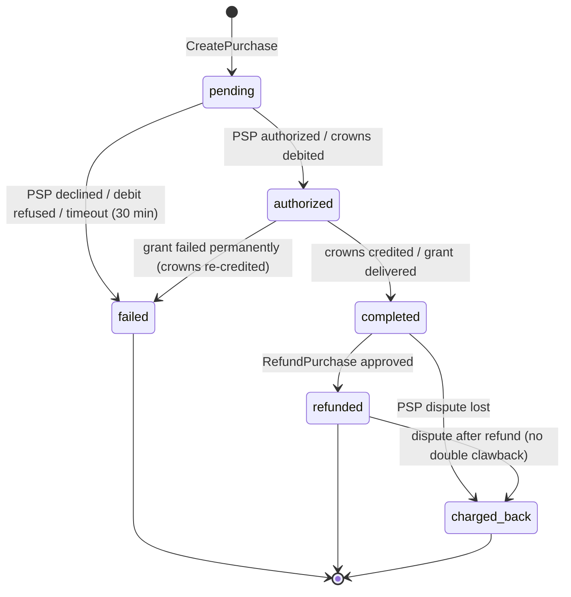
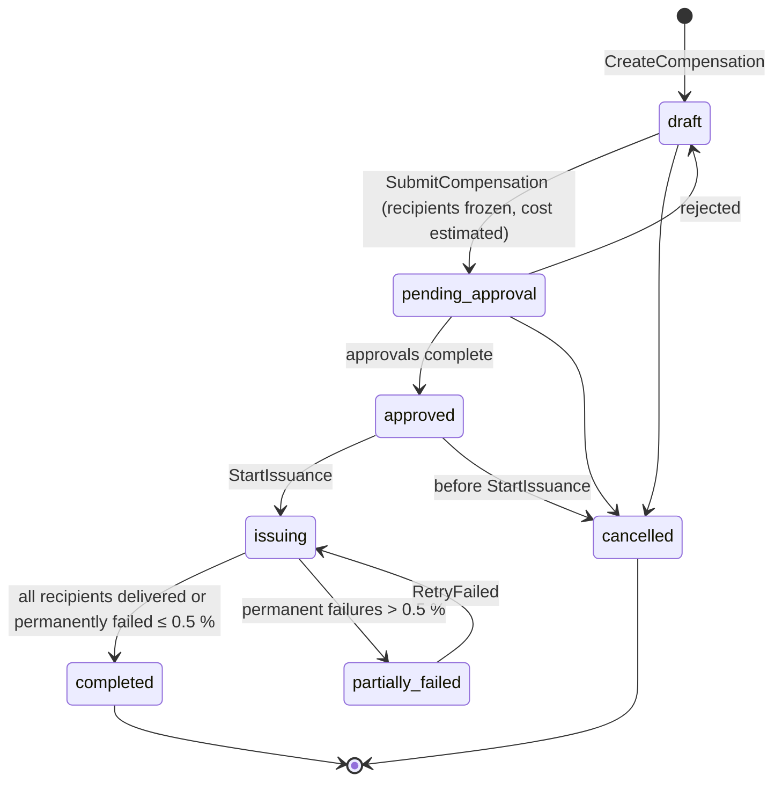

# Legends of the Shattered Frontier — LiveOps Part 3: Store, Compensation and Community
## Version 1.0 — Expanded Technical Design Authority edition (2026-10-17)

Status: Design target; not implemented. Names per Shared Registry v1.0.

- Entry file: [LiveOps Architecture](../Legends_Shattered_Frontier_LiveOps_Architecture_v1.0.md)
- Registry: [Shared Registry v1.0](../Legends_Shattered_Frontier_Shared_Registry_v1.0.md)

---

## 1. Premium store

### 1.1 Principles

1. **No pay-to-win (Registry rule).** `currency/crowns` never converts into gold, items with stat budgets, XP, or skill gains. This spec extends the rule to: LP, frontier marks, season tokens, season points, crafting materials, resources, consumables with combat or progression effects, lockout bypasses, pity or loot manipulation, and anything tradeable for gold.
2. **Allowed offer categories:** `cosmetic` (appearances, dyes, mount skins, housing decorations, emotes, titles without stats), `convenience` (character slots, name/appearance change, extra wardrobe slots, cosmetic bag skins, an account-wide bank tab capped by Economy spec storage rules), `season_pass` (premium lane of the season track, cosmetic only), `crown_pack` (crowns for real money).
3. **No paid randomness at launch.** No offer may contain a loot table roll (`loot/*`) or randomized contents. Every offer shows exactly what is granted.
4. **Enforced three times:** content validation (offer validator in `content-catalog-service`), purchase-time validation in `store-service`, and grant-time validation in `reward-service` (a grant with source `store_purchase` is rejected if it contains an item whose definition has a stat budget > 0 or whose `item_category` is not `cosmetic`, any XP/LP/skill/reputation entry, or any currency other than `currency/crowns` for crown packs).
5. **Account scope.** Crowns wallet owner = `account_id`. Crowns are not tradeable, mailable, or giftable as currency. Store entitlements are account unlocks (`progression.account_unlock.granted`) or account-bound items (`binding = account`).

### 1.2 Offer schema (`store_offer/<slug>`)

```json
{
  "id": "store_offer/frost_wolf_mount",
  "schema_version": 1,
  "category": "cosmetic",
  "display": {
    "name_key": "loc.store.frost_wolf_mount.name",
    "description_key": "loc.store.frost_wolf_mount.desc",
    "preview_asset": "ui/store/previews/frost_wolf",
    "tags": ["mount", "winter"]
  },
  "contents": { "reward": "reward/store_frost_wolf_mount" },
  "contents_summary": [ { "kind": "account_unlock", "unlock_key": "mount_skin.frost_wolf", "display_key": "loc.store.frost_wolf_mount.contents" } ],
  "base_price": { "currency": "currency/crowns", "amount": 1800 },
  "purchase_limit": { "per_account": 1 },
  "giftable": true,
  "refund_policy": "self_service_if_unused",
  "min_account_age_days": 0,
  "restricted_dc_regions": [],
  "requires_content_version": 1842
}
```

Crown pack offers:

```json
{
  "id": "store_offer/crowns_2750",
  "category": "crown_pack",
  "crowns": { "base": 2500, "bonus": 250 },
  "price_point": "pp_25",
  "purchase_limit": { "per_account_per_day": 5 },
  "giftable": false,
  "refund_policy": "psp_and_law"
}
```

| Field | Rule |
| --- | --- |
| `category` | `cosmetic`, `convenience`, `season_pass`, `crown_pack` |
| `contents.reward` | `reward/<slug>` resolvable to non-random entries; validator expands and checks each entry against §1.1 |
| `base_price` | Crowns, integer, 50 ≤ amount ≤ 5,000 (`tune.store.max_offer_price_crowns`) |
| `price_point` | Crown packs only; references the price point table (real-money price per currency in minor units) |
| `purchase_limit` | Required; at least one limit; `per_account` for non-consumable unlocks must be 1 |
| `giftable` | `false` for crown packs and season passes for other accounts in their first 14 days |
| `refund_policy` | `self_service_if_unused`, `support_only`, `psp_and_law`, `none` (only for consumed name changes, displayed before purchase) |

Runtime **pricing and placement** (sale price, featured slot, availability window) live in `store.offer_prices` and `store.placements`, editable without a content pack but subject to guardrails.

### 1.3 Pricing guardrails

| Guardrail | Rule | Key |
| --- | --- | --- |
| Crown reference rate | 100 crowns ≈ 1.00 USD reference; each currency's price point table derived from it with regional price index | `tune.store.crowns_per_usd_reference` (100) |
| Pack bonus | `bonus / base ≤ 0.20` | `tune.store.max_pack_bonus_ratio` |
| Discount | Sale price ≥ 50 % of `base_price` | `tune.store.max_discount_ratio` (0.5) |
| Reference price honesty | A "was" price may be shown only if the offer sold at that price for ≥ 28 of the last 90 days | `tune.store.reference_price_min_days` (28) |
| Regional parity | Local price after tax within ±15 % of reference × regional index | `tune.store.regional_parity_tolerance` (0.15) |
| Concurrent promotions | ≤ 2 discounted featured offers per dc_region at once | `tune.store.max_concurrent_promotions` |
| Leftover crowns | Crown pack sizes and offer prices chosen so the most common bundle leaves ≤ 250 crowns stranded | review rule |
| Countdown honesty | Timers shown only if the end time is real and not extended | review rule |
| Price change approval | `store_manager` + second `store_manager` or `liveops_lead`; economy review not required (crowns are isolated) | — |

Worked example: offer base 1,800 crowns; promotion at 30 % off → 1,260 (≥ 900 floor ✓). Crown pack 2,500 + bonus 250: ratio 0.10 ✓. Player buys pack (2,750) and the offer at 1,260 → 1,490 left; a 1,500-crown offer would strand them 10 short; store UI shows "crowns needed: 10" and the smallest pack (500) — acceptable, but the review flags bundles where the typical leftover exceeds 250.

### 1.4 Purchase flows

**Crown pack (real money):**

```mermaid
sequenceDiagram
    autonumber
    participant CL as client
    participant GW as gateway
    participant SS as store-service
    participant PSP as payment provider
    participant ES as economy-service
    participant AC as anticheat-service
    CL->>GW: BeginCrownPurchase(offer, idempotency_key)
    GW->>SS: CreatePurchase(account_id, offer, ...)
    SS->>SS: checks: kill switch, sanctions, limits, risk score
    SS->>PSP: create hosted checkout (pur_ id as merchant reference)
    SS-->>CL: checkout URL (pending)
    CL->>PSP: pays (3-D Secure as required)
    PSP->>SS: webhook payment_succeeded (signed)
    SS->>SS: verify signature, amount, currency; state authorized → completed
    SS->>ES: Credit(currency/crowns, owner=account_id, amount, source=store_purchase, causation_id=pur_, idempotency_key=pur_)
    ES-->>SS: txn_
    SS->>SS: emit store.purchase.completed
    SS->>AC: ReportSignal(store_velocity) when thresholds crossed
```

**Crowns offer:**

1. `CreatePurchase` validates offer availability, limits, sanctions (`market_restriction`/`trade_restriction` do not block cosmetics; `temporary_suspension`, `permanent_ban` do), and the offer's no-pay-to-win validation hash (matches the active content version).
2. `economy-service.Debit(currency/crowns, amount, sink=store_spend, idempotency_key = pur_ + ":debit")` (registered sink; Shared Registry, Currencies, sources and sinks).
3. `reward-service.IssueGrant(reward bundle, account or selected character, source = store_purchase, idempotency_key = pur_)`.
4. On `reward.grant.delivered` → `completed`, emit `store.purchase.completed`. On `reward.grant.failed` after retries (max 10 over 1 h) → re-credit crowns (`store_refund`, registered source) and set `failed`.

Saga invariant: at every point either (crowns debited AND grant pending/delivered) or (no debit), verified by a reconciliation job every 15 min comparing `store.purchases` against `economy` transactions with `causation_id = pur_`.

### 1.5 Purchase state machine (proposed `purchase_state`)



### 1.6 Refunds and chargebacks

| Case | Policy | Mechanics |
| --- | --- | --- |
| Crowns offer, unused | Self-service within 14 days, max 3 self-refunds per account per 365 days (`tune.store.self_refunds_per_year`) | `reward-service.RevokeGrant(rwg_)` → if revocation succeeds, crowns re-credited (source `store_refund`) |
| Crowns offer, used (e.g., name change applied) | Support only | Case-by-case; `store_manager` |
| Crown pack, crowns unspent | Per law and PSP (e.g., EU 14-day withdrawal); refunds via PSP | Crowns debited back (sink `store_chargeback` or reversal); then PSP refund |
| Crown pack, crowns spent | Not refundable unless required by law; support review | — |
| Chargeback / dispute | Treated as fraud signal | Debit up to the purchased crowns from wallet (sink `store_chargeback`, wallet not allowed negative); revoke most recent crowns-bought entitlements up to the shortfall; block further store purchases for the account (store-local hold) and open an enforcement case request; `enforcement-service` decides any sanction (Security spec); report to `anticheat-service` |

Targets: `m_store_refund_rate` ≤ 1.5 % of purchases; `m_store_chargeback_rate` ≤ 0.3 % of real-money purchases (PSP programs typically flag around 0.9–1 %).

### 1.7 Fraud controls

- New accounts (< 30 days): real-money spend cap 100 USD-equivalent per 24 h (`tune.store.new_account_daily_cap_usd_cents` = 10,000), ≤ 5 crown pack purchases per 24 h.
- Risk gating: account risk score ≥ 600 (Security spec, Risk score) → purchases require step-up MFA; ≥ 800 → purchases blocked pending review.
- Gifting: sender account age ≥ 14 days, MFA enrolled, ≤ 5 gifts per day, ≤ 20 per 30 days; recipient must not be under sanction. Gift graphs (many senders → one recipient) reported as `store_gift_graph` signals.
- Payment: card data only at PSP; webhooks verified with PSP signatures and replay window ≤ 5 min; amounts and currency re-checked against `store.offer_prices` snapshot recorded at `CreatePurchase`.
- Account takeover: new device + purchase within 1 h of password change → step-up.

## 2. Compensation grants

### 2.1 Model

A **CompensationGrant** (`cmpg_`) is a campaign that issues one reward bundle per eligible recipient through `reward-service` with source `liveops_compensation`. It is idempotent end-to-end.

| Field | Meaning |
| --- | --- |
| `reason_code` | `unplanned_downtime`, `maintenance_overrun`, `bug_loss`, `event_malfunction`, `goodwill`, `store_incident` |
| `incident_ref` | Incident or `mnt_` / `rel_` / `lop_` id |
| `targeting` | Rule producing recipients (below) |
| `bundle` | `reward/<slug>` from the compensation catalog |
| `crowns_amount` | Optional; only for `store_incident` or tier 4; ≤ 500 per account (`tune.liveops.compensation_max_crowns`) |
| `recipient_level` | `character` (default) or `account` |

### 2.2 Compensation tiers

Bundle content scales with the Registry reward scaling functions, evaluated at each recipient's level `L`:

| Tier | Downtime / impact | Weight `w` | XP | Gold (copper) | Season points | Cosmetic |
| --- | --- | --- | --- | --- | --- | --- |
| 1 | 30–119 min | 1 | `xp_reward(L, 1)` | `gold_reward(L, 1)` | 1,000 | — |
| 2 | 120–359 min | 2 | `xp_reward(L, 2)` | `gold_reward(L, 2)` | 2,000 | — |
| 3 | 360–1,439 min | 4 | `xp_reward(L, 4)` | `gold_reward(L, 4)` | 4,000 | Title or dye |
| 4 | ≥ 1,440 min or data loss | 8 (economy review required, `w ≥ 5.0`) | `xp_reward(L, 8)` | `gold_reward(L, 8)` | 6,000 | Mount skin + optional crowns |

`tier(D) = 0 if D < 30; 1 if D < 120; 2 if D < 360; 3 if D < 1440; else 4`, where `D` = unplanned downtime minutes on the realm, or maintenance overrun minutes beyond `expected_end_at` minus 30 (grace). Keys: `tune.liveops.compensation_tier_thresholds_minutes` = [30, 120, 360, 1440].

Worked example: `eu-1` down 145 min unplanned → tier 2. Level 60 recipient: `gold_reward(60, 2) = round(2 × 100 × 61^1.5) = round(200 × 476.425) = 95,285` copper (≈ 9.53 gold); XP = `round(2 × xp_to_next(60) / 12)` = one sixth of a level; 2,000 SP. Frontier marks are **not** included (weekly cap integrity).

Economy bound: tier-2 gold to 40,000 recipients with median level 60 ≈ 3.8 × 10⁹ copper ≈ 0.95 × `G_base` of a 4 × 10⁹ realm — acceptable once per incident; a realm may receive at most 2 tier ≥ 2 grants per season without economy review.

### 2.3 Targeting

Recipient rules (evaluated by `liveops-service` against `character-service` and `auth-service` data):

| Rule | Eligible characters |
| --- | --- |
| `realm_active_window` (default) | Characters on affected realms with `character.world.entered` within 7 days before incident start, or during it |
| `session_overlap` | Characters with a session overlapping the incident window (stricter; for bug_loss) |
| `explicit_list` | Uploaded list of `chr_`/`acc_` ids (≤ 100,000), e.g., from an Itemization bug query |
| `event_participants` | Characters with participation rows in a `lop_` |

Recipient set is **frozen** at approval (snapshot stored), so re-running cannot expand it. Characters created after incident start are excluded.

### 2.4 Issuance and idempotency

- One row per `(compensation_id, recipient_id)`; `idempotency_key = "cmpg:" + compensation_id + ":" + recipient_id`; `reward-service` returns the original `rwg_` on replay.
- Issuance worker processes recipients in batches of 500 ordered by `recipient_id` with a persisted cursor; global rate ≤ 2,000 grants/s (`tune.liveops.compensation_grants_per_second`), shared token bucket with other mass grants.
- Retries: exponential backoff (1 s → 5 min, 8 attempts) for transient failures; permanent failures (deleted character, sanctioned account) are recorded with reason and not retried.
- Offline recipients receive grants through reward-service delivery rules (Itemization spec, Reward grants: delivery to mailbox/claim when inventory unavailable).
- Kill switch `ff.liveops.compensation_enabled` pauses the worker without losing position.
- `liveops.compensation.granted` is emitted once per compensation campaign completion (aggregate), not per recipient; per-recipient facts are `reward.grant.*` events with `causation_id = cmpg_`.

### 2.5 Compensation state machine (proposed `compensation_state`)



Approvals: tier 1–2 single realm → `liveops_operator` + `liveops_lead`; tier ≥ 3, multi-region, or > 100,000 recipients → + `economy_analyst`; any crowns → + `store_manager`.

### 2.6 Individual (ticket) compensation

`senior_game_master` may issue catalog tier-1 bundles to a single character from a support ticket, max 1 per character per 30 days and 20 per GM per day, without approval. Anything else, including restoring lost items, goes through `enforcement-service` rollback orchestration (Security spec) — LiveOps never recreates specific items by hand. `gm_grant` source is reserved for QA environments and audited exceptional grants with two-person approval.

## 3. Community tools

### 3.1 Announcements (`ann_`)

| Channel (proposed `announcement_channel`) | Surface | Limits |
| --- | --- | --- |
| `motd` | Shown at login and via `/motd`; one active per realm | ≤ 280 chars per locale |
| `login_banner` | Character select banner | ≤ 3 concurrent |
| `in_game_toast` | Realm-wide toast (maintenance countdown, event live) | ≤ 1 per 10 min per realm except countdowns |
| `launcher_news` | Launcher news feed | Markdown subset, images from CDN allowlist |
| `status_page` | Public status page note | Plain text |

Schema: `{ann_id, channels[], cohort, locales{locale: {title, body}}, priority (info|important|critical), starts_at, ends_at, linked_ref (lop_|ssn_|rel_|mnt_|cmpg_), template_id, state (draft|scheduled|published|expired|withdrawn)}`. Required locales: all languages enabled for the targeted dc_regions (`tune.liveops.required_locales`); missing locale → publish blocked (fallback to `en` only for `critical`). Global or `critical` announcements need two-person approval. Templates (`ann_tpl/*`) carry variables (`{event_name}`, `{starts_at_local}`) rendered per locale and timezone by the client.

`liveops.announcement.published` is emitted when an announcement becomes visible (state `published`).

### 3.2 Surveys (`srv_`)

- Definition: up to 10 questions (`single_choice`, `multi_choice`, `scale_1_5`, `nps_0_10`, `free_text` ≤ 500 chars), cohort, sample rate (0–1), trigger moment (`login`, `after_event:<lop_>`, `after_dungeon_run`, `season_end`).
- Frequency cap: ≤ 1 survey offer per account per 14 days (`tune.liveops.survey_min_interval_days`); never during combat or instance runs.
- Responses arrive as `client.survey.submitted` telemetry (owned by Analytics); free text is classified `p2_personal` and scrubbed by `telemetry-ingest`. LiveOps reads aggregates only from the warehouse.
- Incentives: optional, cosmetic only (`reward/<slug>` containing account unlocks with no stat budget and no currency), granted once per survey via `reward-service` with source `season_reward`. Surveys never grant currency, XP, or items with stat budgets, so the incentive cannot bias responses toward farming.
- `liveops.survey.published` emitted when a survey becomes active.

### 3.3 Status dashboards

Public status page per `dc_region` with components: `login`, each realm, `store`, `market`, `launcher_cdn`, `chat`. Each component has a proposed `service_status` (`operational`, `degraded`, `partial_outage`, `major_outage`, `maintenance`).

Derivation (automatic, overridable by `liveops_operator` with reason):

| Input | Status |
| --- | --- |
| Active `mnt_` covering component | `maintenance` |
| `ops.service.health_changed` unhealthy for > 2 min on critical path | `major_outage` |
| Login success `m_login_success_rate` < 95 % (5-min window) | `degraded`; < 80 % → `partial_outage` |
| Realm unreachable from synthetic probes in 2 of 3 locations | `major_outage` for that realm |

The status page is static-hosted (independent of game infrastructure) and updated by `liveops-service` push; the internal operations dashboard additionally shows CCU, queue lengths, active events, rollouts, and guardrails.

### 3.4 In-game message of the day

The gateway serves `GetMotd(realm_id, locale)` from a cached liveops snapshot (refreshed by `liveops.announcement.published`). The client shows MOTD after login and in the social panel. Maintenance countdowns override MOTD as `in_game_toast`.

## 4. GM tools (`admin-portal`, GM section)

### 4.1 Roles (`staff_role`, Security spec) and permissions

| Capability | game_master | senior_game_master | liveops_operator | liveops_lead | economy_analyst | store_manager | release_manager | enforcement_lead |
| --- | --- | --- | --- | --- | --- | --- | --- | --- |
| View character/account summary (p1 fields) | ✓ | ✓ | ✓ | ✓ | ✓ | ✓ | — | ✓ |
| View p2/p3 fields (email, payment refs) | — | reason + JIT | — | — | — | purchases only | — | ✓ |
| Teleport/unstuck character | ✓ | ✓ | — | — | — | — | — | — |
| Ticket compensation (tier 1) | — | ✓ | ✓ | ✓ | — | — | — | — |
| Create/approve LiveOps events | — | — | create, approve tier 1 | approve tier 2 | approve tier 3 | — | — | — |
| Kill switch | — | — | ✓ | ✓ | — | store keys | ✓ | ✓ |
| Config change (prod) | — | — | ✓ (tier ≤ 2 with second) | ✓ | approve economy | store keys | ops keys | — |
| Announcements | — | — | create | approve global | — | store promos | maintenance | security |
| Store offers & prices | — | — | — | approve | — | ✓ | — | — |
| Refunds | — | — | — | — | — | ✓ | — | ✓ |
| Mass compensation | — | — | create | approve | approve | approve crowns | — | — |
| Releases & maintenance | — | — | — | approve | — | — | ✓ | approve emergency |
| Enforcement console | — | — | — | — | — | — | — | Security spec |

### 4.2 Controls

- SSO with hardware-key MFA; access only from corporate network/VPN; session timeout 30 min idle.
- **Just-in-time elevation** for any p2/p3 view or prod mutation: max 8 h, reason and ticket required.
- **Two-person rule** where marked; the approver must be a different person (different `account_id` and different SSO identity) and may not be the requester's delegate.
- Every action calls a service admin RPC with `actor`, `approvers`, `reason_code`, `ticket_ref`, `idempotency_key`; the service writes `audit-service` (`audit.record.appended`). `admin-portal` itself stores nothing authoritative.
- Bulk actions show a dry-run preview (counts, estimated faucet) before submission.
- GMs cannot act on their own accounts or on accounts flagged as related (shared device/payment) — enforced server-side by comparing `actor` against relation graph from `anticheat-service`.

## 5. KPIs and targets

Metric definitions are owned by the Analytics spec (Warehouse and metrics, Canonical metric catalog); names below reference catalog entries. Targets are for `prod`, per dc_region unless stated.

| KPI | Metric | Target | Alert (ops.alerts) |
| --- | --- | --- | --- |
| Day-1 retention (new accounts) | `m_d1_retention` | ≥ 45 % | < 38 % for 3 cohorts |
| Day-7 retention | `m_d7_retention` | ≥ 25 % | < 20 % |
| Day-30 retention | `m_d30_retention` | ≥ 12 % | < 9 % |
| Monthly active accounts | `m_mau` | Growth ≥ 0 % season-over-season after launch season | −10 % month-over-month |
| Daily active accounts | `m_dau` | Per plan | −15 % vs 28-day baseline for 2 days (also a TRL input) |
| Stickiness | `m_dau_mau_ratio` | ≥ 0.30 | < 0.22 |
| 30-day churn (active last month, not this month) | `m_churn_rate_30d` | ≤ 30 % | > 38 % |
| Returning players (lapsed ≥ 30 d who returned) | `m_reactivation_rate_30d` | ≥ 8 % of lapsed per season | — |
| Session length median | `m_session_length_minutes_p50` | 60–120 min | < 45 |
| Sessions per DAU | `m_sessions_per_dau` | ≥ 1.4 | — |
| Weekly play hours per WAU | `m_weekly_hours_per_wau` | 8–14 h | — |
| Event participation | `m_event_participation_rate` | ≥ 50 % major / 25 % minor | < 30 % major |
| Season track completion | `m_season_track_completion_rate` | ≥ 35 % | — |
| Store conversion (payers / MAU) | `m_store_payer_conversion` | 4–8 % | — (no pressure tactics to raise it) |
| Refund rate | `m_store_refund_rate` | ≤ 1.5 % | > 3 % |
| Chargeback rate | `m_store_chargeback_rate` | ≤ 0.3 % | > 0.5 % |
| Survey satisfaction (NPS) | `m_survey_nps` | ≥ +20 | < 0 |
| Unplanned downtime | `m_realm_unplanned_downtime_minutes` | ≤ 60 min per realm per season | ≥ 30 min incident |
| Login success | `m_login_success_rate` | ≥ 99.5 % | < 98 % |

Engagement health targets include `m_gold_inflation_index_wow` (Economy spec, Inflation controls) within ±2 % week-over-week during events.

## 6. Operations calendar

The operations calendar is a merged view computed by `liveops-service` (`ListCalendar`) from seasons, events, campaign windows, rotation entries, releases, maintenance windows, store promotions, and freeze periods. Players see a filtered version (seasons, events, campaigns, maintenance).

### 6.1 Conflict rules (enforced at scheduling)

| Rule | Check |
| --- | --- |
| Max 1 major event per realm at a time | `events.tags` contains `major` |
| No XP multiplier events in season week 0 | rotation/season windows |
| ≤ 4 XP event-days per 14 days per realm | §6.6 of Events and Seasons |
| No prod scheduled release within 48 h before season end | release calendar policy |
| Store promotions ≤ 2 concurrent per region | pricing guardrails |
| Maintenance not overlapping event start ± 2 h | maintenance scheduling |
| Freeze periods (holiday freezes, tournaments) | only kills/rollbacks/emergencies |

Conflicts are errors for operators below `liveops_lead`; `liveops_lead` may override with reason (except hard caps).

### 6.2 Season cadence template

| Season week | Event plan (illustrative) | Store plan | Release |
| --- | --- | --- | --- |
| 0 | Season launch (no XP events) | Season pass | Season content release |
| 2 | Minor: gathering festival | — | Minor |
| 3–4 | Major: holiday / campaign event | Themed cosmetics | — |
| 6 | Mid-season update | Mid-season cosmetics | Content release |
| 7 | Minor: bonus marks weekend | — | Minor |
| 9–10 | Major: invasion series (director-assisted) + catch-up | — | Minor |
| 11 | Final call | — | Freeze from week 11 day 5 |

## 7. On-call and incident response

| Rotation | Coverage | Responsibilities |
| --- | --- | --- |
| LiveOps primary | 24/7, follow-the-sun across dc_regions | Events, guardrail alerts, kill switches, status page, compensation decisions |
| LiveOps secondary | 24/7 | Backup, second approver for urgent two-person actions |
| Release manager on duty | Each prod release + 4 h | Promotion, rollback decision |
| Economy on-call | Business hours + pager for economy guardrails | Faucet breaches, inflation alerts |
| Store on-call | Business hours + pager for store failures | PSP outages, fraud spikes |

| Severity | Ack | Mitigation target | Comms |
| --- | --- | --- | --- |
| S1 | 5 min | 30 min (kill/rollback) | Status page within 10 min; MOTD/toast |
| S2 | 15 min | 4 h | Status page if player-visible |
| S3 | next business day | next release | Patch notes |

Runbooks (maintained with the service code): kill switch use, config rollback, event early end, season end job failure, compensation retry, PSP outage (disable crown packs via `ff.store.purchases_enabled` scoped to PSP), status page manual override, maintenance overrun. Every S1/S2 gets a blameless post-incident review recording timeline, compensation decision, and follow-ups.

## 8. Schemas

### 8.1 `store` schema

```sql
CREATE SCHEMA IF NOT EXISTS store;

CREATE TABLE store.offers (                 -- runtime view of store_offer definitions
  offer_id         text PRIMARY KEY CHECK (offer_id LIKE 'store_offer/%'),
  category         text NOT NULL CHECK (category IN ('cosmetic','convenience','season_pass','crown_pack')),
  content_version  bigint NOT NULL,
  validation_hash  text NOT NULL,           -- no-pay-to-win validator result hash
  enabled          boolean NOT NULL DEFAULT true
);

CREATE TABLE store.price_points (
  price_point   text NOT NULL,              -- pp_25
  currency_code char(3) NOT NULL,           -- ISO 4217
  amount_minor  bigint NOT NULL CHECK (amount_minor > 0),
  effective_from timestamptz NOT NULL,
  PRIMARY KEY (price_point, currency_code, effective_from)
);

CREATE TABLE store.offer_prices (
  offer_id       text NOT NULL REFERENCES store.offers(offer_id),
  dc_region      text NOT NULL,
  price_crowns   integer NOT NULL CHECK (price_crowns BETWEEN 50 AND 5000),
  base_price_crowns integer NOT NULL,
  effective_from timestamptz NOT NULL,
  effective_to   timestamptz,
  change_actor   text NOT NULL,
  approvers      text[] NOT NULL,
  PRIMARY KEY (offer_id, dc_region, effective_from),
  CHECK (price_crowns * 2 >= base_price_crowns)
);

CREATE TABLE store.placements (
  placement_id  text PRIMARY KEY,
  offer_id      text NOT NULL REFERENCES store.offers(offer_id),
  dc_region     text NOT NULL,
  slot          text NOT NULL,              -- featured_1, featured_2, category_grid
  starts_at     timestamptz NOT NULL,
  ends_at       timestamptz NOT NULL
);

CREATE TABLE store.purchases (
  purchase_id     text PRIMARY KEY CHECK (purchase_id LIKE 'pur\_%'),
  account_id      text NOT NULL,
  recipient_account_id text,               -- gifts
  recipient_character_id text,
  offer_id        text NOT NULL REFERENCES store.offers(offer_id),
  state           text NOT NULL CHECK (state IN ('pending','authorized','completed','failed','refunded','charged_back')),
  price_crowns    integer,
  price_minor     bigint,
  currency_code   char(3),
  psp_reference   text UNIQUE,
  debit_txn_id    text,                     -- txn_
  credit_txn_id   text,                     -- txn_ for crown packs
  reward_grant_id text,                     -- rwg_
  dc_region       text NOT NULL,
  risk_score_at_purchase smallint,
  idempotency_key text NOT NULL UNIQUE,
  created_at      timestamptz NOT NULL DEFAULT now(),
  updated_at      timestamptz NOT NULL DEFAULT now(),
  CHECK ((price_crowns IS NULL) <> (price_minor IS NULL))
);
CREATE INDEX purchases_account ON store.purchases (account_id, created_at DESC);

CREATE TABLE store.refunds (
  purchase_id   text PRIMARY KEY REFERENCES store.purchases(purchase_id),
  kind          text NOT NULL CHECK (kind IN ('self_service','support','psp','chargeback')),
  crowns_reversed integer NOT NULL DEFAULT 0,
  entitlements_revoked text[] NOT NULL DEFAULT '{}',
  actor         text NOT NULL,
  reason_code   text NOT NULL,
  created_at    timestamptz NOT NULL DEFAULT now()
);

CREATE TABLE store.psp_webhooks (
  psp_event_id  text PRIMARY KEY,           -- dedup
  purchase_id   text,
  kind          text NOT NULL,
  signature_ok  boolean NOT NULL,
  received_at   timestamptz NOT NULL DEFAULT now(),
  body_hash     text NOT NULL               -- raw body kept in encrypted object storage
);
```

### 8.2 `liveops` schema, compensation and community

```sql
CREATE TABLE liveops.compensations (
  compensation_id text PRIMARY KEY CHECK (compensation_id LIKE 'cmpg\_%'),
  reason_code     text NOT NULL,
  incident_ref    text,
  targeting       jsonb NOT NULL,
  bundle_id       text NOT NULL CHECK (bundle_id LIKE 'reward/%'),
  tier            smallint NOT NULL CHECK (tier BETWEEN 1 AND 4),
  crowns_amount   integer NOT NULL DEFAULT 0 CHECK (crowns_amount BETWEEN 0 AND 500),
  recipient_level text NOT NULL CHECK (recipient_level IN ('character','account')),
  state           text NOT NULL CHECK (state IN ('draft','pending_approval','approved','issuing','completed','partially_failed','cancelled')),
  recipients_total integer,
  delivered_count integer NOT NULL DEFAULT 0,
  failed_count    integer NOT NULL DEFAULT 0,
  cursor          text,
  cost_estimate   jsonb,
  created_by      text NOT NULL,
  approved_by     text[] NOT NULL DEFAULT '{}',
  created_at      timestamptz NOT NULL DEFAULT now(),
  completed_at    timestamptz
);

CREATE TABLE liveops.compensation_recipients (
  compensation_id text NOT NULL REFERENCES liveops.compensations(compensation_id),
  recipient_id    text NOT NULL,            -- chr_ or acc_
  account_id      text NOT NULL,
  realm_id        text,
  status          text NOT NULL CHECK (status IN ('pending','issued','delivered','failed_transient','failed_permanent')),
  reward_grant_id text,
  attempts        smallint NOT NULL DEFAULT 0,
  last_error      text,
  PRIMARY KEY (compensation_id, recipient_id)
);

CREATE TABLE liveops.announcements (
  announcement_id text PRIMARY KEY CHECK (announcement_id LIKE 'ann\_%'),
  channels        text[] NOT NULL,
  cohort          jsonb NOT NULL,
  locales         jsonb NOT NULL,
  priority        text NOT NULL CHECK (priority IN ('info','important','critical')),
  state           text NOT NULL CHECK (state IN ('draft','scheduled','published','expired','withdrawn')),
  starts_at       timestamptz NOT NULL,
  ends_at         timestamptz,
  linked_ref      text,
  template_id     text,
  created_by      text NOT NULL,
  approved_by     text[] NOT NULL DEFAULT '{}'
);

CREATE TABLE liveops.surveys (
  survey_id     text PRIMARY KEY CHECK (survey_id LIKE 'srv\_%'),
  questions     jsonb NOT NULL,
  cohort        jsonb NOT NULL,
  sample_rate   numeric(5,4) NOT NULL CHECK (sample_rate > 0 AND sample_rate <= 1),
  trigger_moment text NOT NULL,
  state         text NOT NULL CHECK (state IN ('draft','scheduled','published','closed')),
  starts_at     timestamptz NOT NULL,
  ends_at       timestamptz NOT NULL,
  incentive_reward_id text
);

CREATE TABLE liveops.survey_offers (           -- frequency capping
  account_id  text NOT NULL,
  survey_id   text NOT NULL REFERENCES liveops.surveys(survey_id),
  offered_at  timestamptz NOT NULL,
  PRIMARY KEY (account_id, survey_id)
);
CREATE INDEX survey_offers_recent ON liveops.survey_offers (account_id, offered_at DESC);

CREATE TABLE liveops.status_components (
  component_id text NOT NULL,                -- login, realm:na-1, store ...
  dc_region    text NOT NULL,
  status       text NOT NULL CHECK (status IN ('operational','degraded','partial_outage','major_outage','maintenance')),
  derived_status text NOT NULL,
  override_by  text,
  override_reason text,
  updated_at   timestamptz NOT NULL DEFAULT now(),
  PRIMARY KEY (component_id, dc_region)
);
```
