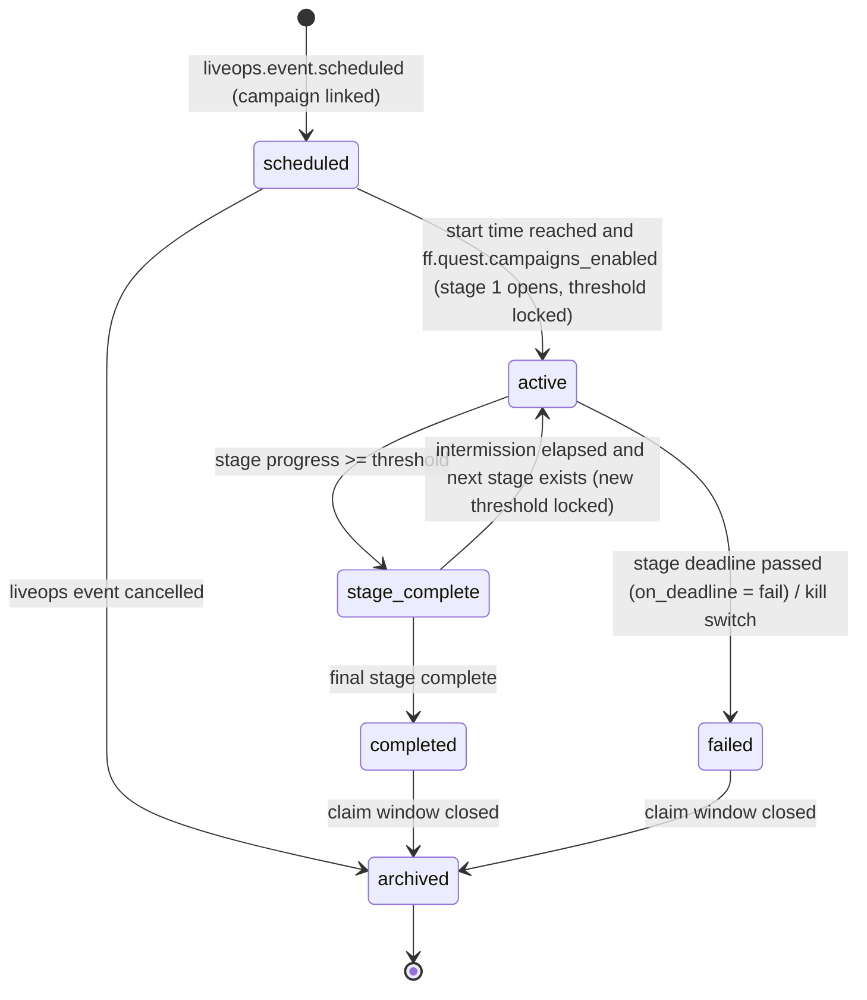

# Legends of the Shattered Frontier — Quest Generation and Campaigns

Version 1.0 — Expanded Technical Design Authority edition (2026-10-17)

Status: Design target; not implemented. Names per Shared Registry v1.0.

Back-links: [Quest entry](../Legends_Shattered_Frontier_Quest_Architecture_v1.0.md) · [Shared Registry](../Legends_Shattered_Frontier_Shared_Registry_v1.0.md)

---

## 1. Dynamic quest generation

### 1.1 Goals and responsibilities

Dynamic quests make the world feel reactive. The AI spec ("Agentic quest generation") lists the inputs (region, faction state, resources, player level) and outputs (objectives, rewards, narrative). This part makes that pipeline deterministic, validated, and safe.

| Step | Owner |
| --- | --- |
| Decide *that* a region needs quests and *why* (event, shortage, faction pressure) | `ai-director-service` (and `faction-service` for faction needs) |
| Choose templates, fill slots, compute weights, validate, dedup, persist `gqd_`, attach to givers | `quest-service` |
| Flavour text: precomputed variants, optional LLM rewrite, safety checks | `quest-service` (text worker) |
| Spawning targets needed by the quest (bandits, escort NPC) | `ai-director-service` / `zone-server` at accept or at generation (template flag `spawn_on`) |
| Kill switch, tuning | `config-service` (`ff.quest.generation_enabled`, `tune.quest.gen_*`) |

The generator never invents mechanics. Every objective, target, and reward comes from a **template** authored and reviewed as content (`quest_template/<slug>`). Generation only selects and binds.

### 1.2 Inputs

`ai-director-service` calls `ProposeGeneratedQuests(GenerationRequest)`:

| Field | Type | Description |
| --- | --- | --- |
| `request_id` | string (idempotency key) | Director-side ULID. Replays return the same result. |
| `realm_id` | string | e.g. `na-1` |
| `world_region_id` | content id | Region scope |
| `zone_ids[]` | content id | Zones where objectives may be placed |
| `reason` | enum: `world_event`, `resource_shortage`, `faction_pressure`, `population_gap`, `ambient` | Why quests are needed |
| `source_ref` | `wev_…` \| `faction/<slug>` \| `resource/<slug>` \| null | Source to bind expiry to |
| `faction_context` | `{controlling_faction_id, contested: bool, war_state}` | From faction-service |
| `resource_context[]` | `{resource_id, scarcity_index 0–2}` | Regional scarcity (World spec "Resource regeneration") |
| `level_band` | `{min, max}` | Observed player levels in the region (director telemetry) |
| `active_players_estimate` | int | Players in region over the last 15 min |
| `desired_count` | int 1–20 | Upper bound. quest-service may return fewer. |
| `ttl_s` | int | Requested lifetime (clamped) |
| `template_hints[]` | `quest_template/<slug>` | Optional. Constrains selection. |

`faction-service` does not call quest-service at launch. `ai-director-service` obtains faction control and pressure context from faction-service, then proxies any `reason = faction_pressure` request to quest-service (AI spec, Factions part, Faction AI).

Realm transfer: `PrepareTransfer` abandons active realm-bound generated quest instances with `state_reason = realm_transfer`; realm-agnostic authored instances, chain progress and choices transfer. Campaign contributions remain in their source realm. Resolved (2026-10-17): Backend spec, Realm and character transfer, What moves.

### 1.3 Template definition and grammar

```json
{
  "id": "quest_template/caravan_escort",
  "revision": 3,
  "quest_type": "dynamic",
  "eligible_reasons": ["world_event", "faction_pressure", "ambient"],
  "biomes": ["greenlands", "desert_wastes"],
  "level_range": { "min": 10, "max": 100 },
  "difficulty_options": ["normal", "veteran"],
  "weight_base": 1.0,
  "slots": {
    "route":   { "kind": "route", "from": "zone_routes", "constraint": "length_m between 400 and 1500" },
    "escortee":{ "kind": "npc", "from": "faction_npcs(controlling_faction)", "tags": ["merchant"] },
    "enemy":   { "kind": "npc_tag_set", "from": "region_spawn_table", "tags": ["bandit", "beast"], "level": "band" },
    "count":   { "kind": "int", "range": [4, 10], "scale": "difficulty" }
  },
  "objectives": [
    { "key": "escort", "type": "escort", "target": { "npc_ref": "$escortee", "route_ref": "$route" }, "required": 1 },
    { "key": "kill", "type": "kill", "target": { "npc_tags": "$enemy" }, "required": "$count", "optional": true }
  ],
  "failure_conditions": ["escort_target_died"],
  "completion": "auto",
  "time_limit_s": 1200,
  "spawn_on": "accept",
  "reward_bundle_id": "reward/dynamic_standard",
  "text": {
    "title_variants": ["quest.tpl.caravan_escort.title.1", "quest.tpl.caravan_escort.title.2"],
    "summary_pattern": "quest.tpl.caravan_escort.summary",
    "llm_rewrite_allowed": true,
    "tone": "frontier_grim"
  },
  "dedup_scope": "region",
  "max_concurrent_per_region": 3
}
```

The slot grammar (EBNF) is deliberately small:

```
template      := header slots objectives constraints text
slot          := name ":" "{" "kind" ":" slot_kind "," "from" ":" source ("," modifier)* "}"
slot_kind     := "npc" | "npc_tag_set" | "resource" | "item" | "recipe" | "route" | "poi" | "area" | "structure_tag" | "int"
source        := "region_spawn_table" | "region_nodes" | "zone_routes" | "zone_pois" | "faction_npcs(" faction_ref ")"
               | "recipes_by_skill(" skill_id "," band ")" | "literal(" value ")"
modifier      := "tags" ":" tag_list | "level" ":" ("band" | int) | "range" ":" "[" int "," int "]"
               | "scale" ":" ("difficulty" | "scarcity" | "none") | "constraint" ":" predicate
objective_ref := "$" name                 ; binds a slot value
predicate     := field op value ("and" predicate)?
```

Slot resolution draws only from world data published in the pinned content pack and from live World/AI projections (spawn tables, node registries, routes). It never draws from free text.

`int` scaling:

```
count = clamp( round( lerp(range.min, range.max, s) ), range.min, range.max )
s = 0.5 for normal, 0.8 for veteran, 1.0 for heroic   (scale = difficulty)
count = clamp( round( lerp(range.max, range.min, s) ), range.min, range.max )   (scale = scarcity; note reversed ends)
s = clamp(scarcity_index / 2, 0, 1)                   (scale = scarcity; gather/deliver amounts fall as scarcity rises)
```

Gather and deliver counts fall when scarcity rises, so quests do not drain scarce regions. The incentive is carried by a weight bonus instead: `w_scarcity = 1 + 0.25 × clamp(scarcity_index − 1, 0, 1)`.

### 1.4 Selection

1. Filter templates by `eligible_reasons`, biome, level overlap, the `template_hints` allowlist, and `max_concurrent_per_region`.
2. Score each candidate: `score = 1.0 × reason_match + 0.5 × freshness + 0.3 × diversity − 1.0 × recent_use_penalty`, where:
   - `freshness = 1 − uses_in_region_last_24h / 10` (floored at 0);
   - `diversity = 1` if the objective type is not among the region's currently active generated types, else 0;
   - `recent_use_penalty = 1` if the same template was generated in the region within `tune.quest.gen_template_cooldown_s` (900).
3. Sample without replacement with probability ∝ `max(score, 0.05)`, using a deterministic PRNG seeded with `hash(request_id)`. A replayed request therefore produces identical output.
4. Bind slots by deterministic sampling from each slot's source using the same seed.
5. Difficulty comes from `difficulty_options` weighted by the request's level band spread. `veteran` is chosen only if `active_players_estimate ≥ 8`.

### 1.5 Constraints

Hard constraints. A candidate violating any of them is rejected.

| Constraint | Rule |
| --- | --- |
| Content existence | Every bound id exists in the pinned content pack. |
| Feasibility: kill | Region spawn table contains `≥ count` concurrent spawns of the tag set, or a respawn rate supporting `count × expected_takers` within 50 % of `time_limit_s`. |
| Feasibility: gather | Node regeneration supports `count × expected_takers` within the TTL: `Σ node_yield_per_hour × ttl_h ≥ 1.5 × count × expected_takers`, where `expected_takers = min(active_players_estimate × 0.3, max_concurrent_per_region × 5)`. |
| Feasibility: route/poi | Path length ≤ template limit. Route is not inside an active siege area (Building spec "Siege system") unless the template has `allow_contested`. |
| Level | Objective NPC levels within `[band.min − 2, band.max + 3]`. |
| Reward weight | `w_base × w_type × d_mult × w_scarcity ≤ tune.quest.generated_max_weight` (1.5). Item rewards limited to ilvl `4 × L`, rarity ≤ `rare` (registry power ladder). |
| Essential NPCs | Escort, kill, and deliver targets cannot be essential or giver NPCs. |
| PvP | Objectives in PvP-flagged areas require template flag `pvp_ok`. |
| Currency | Generated quests may grant `currency/gold`, `currency/frontier_marks` (L ≥ 60), and `currency/season_tokens` (only during an active season and if the template is season-tagged). Never `currency/crowns`. |
| Count | Objectives 1–3 per generated quest. |

### 1.6 Validation pipeline

```mermaid
sequenceDiagram
    participant AID as ai-director-service
    participant QS as quest-service (generator)
    participant VAL as validator
    participant TXT as text worker
    participant DB as PostgreSQL quest
    AID->>QS: ProposeGeneratedQuests(request_id, context)
    QS->>QS: rate-limit check (realm, region, reason)
    QS->>QS: select templates + bind slots (seeded)
    QS->>VAL: schema, referential, feasibility, economy checks
    VAL-->>QS: pass / reject(reasons)
    QS->>QS: dedup signature check
    QS->>TXT: resolve text (precomputed variant; optional LLM rewrite)
    TXT-->>QS: text + safety verdict (or fallback)
    QS->>DB: INSERT generated_quests (state=published) + outbox quest.template.generated
    QS-->>AID: GenerationResult(gqd_ ids, rejected[] with reasons)
```

Validation stages, in order. Each stage stops at its first failure.

1. **Schema**: the same JSON schema as authored quests.
2. **Referential**: content ids resolve. Template revision is current.
3. **Feasibility**: the §1.5 rules, using live projections.
4. **Economy**: weight cap; reward bundle in the `tune.quest.generated_bundle_allowlist`.
5. **Dedup**: signature uniqueness (§1.8).
6. **Text**: text resolution with a safety verdict (§1.10). A text failure never rejects the quest; it forces the fallback text.

Rejections are counted in `m_generated_quest_rejection_rate` by stage and reason. If more than 30 % of a template's candidates are rejected over 1 h, an ops alert names the template.

### 1.7 Rate limits

| Limit | Default | Tuning key |
| --- | --- | --- |
| Generation requests per region per minute | 6 | `tune.quest.gen_requests_per_region_min` |
| Published active generated quests per region | `min(40, 4 + ceil(active_players_estimate / 5))` | `tune.quest.gen_region_active_max` (40), `tune.quest.gen_players_per_quest` (5) |
| Published active generated quests per realm | 1,500 | `tune.quest.gen_realm_active_max` |
| Generated offers visible per character per board | 3 | binding `generated_slots.max_offers` |
| Full-reward dynamic completions per character per day | 15 | `tune.quest.dynamic_daily_full_reward` |
| Abandon-reroll cooldown per generated quest per character | 900 s | `tune.quest.abandon_cooldown_dynamic_s` |
| LLM text calls per realm per minute | 120 | `tune.quest.llm_calls_per_min` |

A request that exceeds a limit returns `RESOURCE_EXHAUSTED` with the remaining budget. The director is expected to back off; it is not queued.

### 1.8 Deduplication

```
signature = sha256( template_id | template_revision | world_region_id | sorted(bound_slot_values) | difficulty | floor(now / dedup_bucket_s) )
```

The default `dedup_bucket_s` is 1800 (`tune.quest.gen_dedup_bucket_s`). The signature has a unique index among generated quests in state `published`. On a collision the generator re-binds with seed + 1, up to 3 attempts, and then drops the candidate. `dedup_scope = "realm"` templates (for example, a realm-wide hunt) omit `world_region_id`.

### 1.9 Expiry and source invalidation

A GeneratedQuest has its own lifecycle (quest-service internal; not a registry enum): `published` → `withdrawn` | `expired`.

- `expires_at = min(now + clamp(ttl_s, 600, 7200), source_end)`.
- On `world.event.ended` for a `source_ref` `wev_`, or on `faction.control.changed` that removes the reason, the gqd moves to `expired` and its instances resolve:
  - `offered` → `expired`.
  - `active` with progress ratio `p = Σ current / Σ required` over non-optional objectives:
    - If `p ≥ tune.quest.consolation_threshold` (0.5), the instance becomes `completed` with consolation weight `w_eff × p × 0.75`.
    - Otherwise the instance becomes `expired` with no reward.
  - `ready_to_turn_in` → turn-in allowed for `tune.quest.turn_in_grace_s` (600) more, then `expired`.
- GM or LiveOps can withdraw a gqd (`AdminWithdrawGenerated`) with the same resolution. With `refund = false` the consolation rule is skipped.

Worked consolation example: a player has 4/6 kills and the escort not done (objectives: escort 1, kill 6, both non-optional). `p = (0 + 4)/(1 + 6) = 0.571 ≥ 0.5`, so consolation applies. With `w_eff = 0.8`, consolation weight = 0.8 × 0.571 × 0.75 = 0.343.

### 1.10 LLM-assisted text and guardrails

LLM assistance is **optional flavour**. Mechanics, numbers, ids, and rewards are never produced by a model.

**What may be generated:** `title` (≤ 60 chars), `summary` (≤ 280 chars), `giver_lines[]` (≤ 3 lines × 200 chars), `completion_line` (≤ 200 chars). Everything else comes from template text keys.

**Precomputed first:** every template ships ≥ 3 human-written variants per field, with `{slot}` placeholders filled from localised display names. This is the **offline fallback**, always available, and it is the default when `ff.quest.llm_text_enabled` is off.

**Optional rewrite flow:**

1. **Cache lookup.** Key `(template_id, revision, locale, tone, slot_signature)`. A hit on approved text is used directly. The target cache-hit ratio is ≥ 80 % (`m_llm_text_cache_hit_rate`).
2. **Prompt construction** from a fixed system prompt per template and tone. The structured context contains only display names of bound slots, the faction name, the region name, and the event type. It contains no player names, chat, or player-authored text, so no player data reaches the model.
3. **Model call** with a structured output schema (JSON with the four fields), temperature ≤ 0.7, a timeout of `tune.quest.llm_timeout_ms` (1500), and `max_tokens` 400. The generator does **not** block on it: the gqd publishes with fallback text, and approved rewritten text replaces it before first offer if it arrives within the budget. Otherwise it is applied to subsequent offers only.
4. **Automatic checks**, all of which must pass:
   - JSON schema and length limits.
   - **Entity allowlist**: every capitalised proper noun must be one of the provided display names or the lore glossary. Unknown names → reject (prevents invented places and characters).
   - **Mechanics consistency**: numbers in text must equal bound counts; no mention of rewards or currencies.
   - **Safety classifier**: no hate, harassment, sexual content, self-harm, extremist content, real-world persons or brands, or out-of-setting references (blocklists per locale).
   - **Similarity**: cosine similarity to recent outputs for the same template ≤ 0.95 (avoids repetition); similarity to the fallback ≥ 0.3 (stays on topic).
5. **Fail closed.** Any failure, timeout, or classifier uncertainty → precomputed variant. The failure is recorded in `m_llm_text_fallback_rate`.

**Safety review:**

- A sample of `tune.quest.llm_review_sample_rate` (5 %) of approved rewrites, plus 100 % of texts flagged "borderline" by the classifier, enters a review queue in `admin-portal`.
- A reviewer rejection deletes the cache entry. Live gqds using it revert to fallback text. A rejection rate > 2 % per template per day automatically disables LLM rewrite for that template (template flag `llm_rewrite_allowed` overridden through `config-service`).
- Players can report quest text. Three reports from distinct accounts within 24 h hide the text (revert to fallback) pending review.
- Model, prompt version, and classifier version are stored on each text row for audit and rollback.

**Precomputed batch mode.** Offline jobs can pre-generate rewrite candidates for common slot signatures in staging environments (`release_stage` `dev`/`ptr`). Humans review them and ship them in content packs as additional variants. This is the preferred path for launch. Production calls are then the exception.

### 1.11 Generation worked example

Request: `reason = resource_shortage`, `resource_context = [{resource/iron_ore, scarcity 1.6}]`, `level_band = {20, 28}`, `active_players_estimate = 30`, `desired_count = 4`.

- Region active cap = `min(40, 4 + ceil(30/5)) = 10`. 7 are currently published, so 3 may be generated.
- Candidate `quest_template/ore_convoy_guard`: its `count` slot uses `scale = scarcity` with range [5, 15]. `s = clamp(1.6/2, 0, 1) = 0.8`, so `count = round(lerp(15, 5, 0.8)) = 7` (the scarcity scale interpolates from max down to min).
- `w_scarcity = 1 + 0.25 × clamp(0.6, 0, 1) = 1.15`. With `w_base 1.0 × w_type 0.8 × d_mult 1.0 × 1.15 = 0.92 ≤ 1.5`, the economy check passes.

## 2. Live quest events and campaigns

### 2.1 Roles

| Concern | Owner |
| --- | --- |
| Campaign definition content (`campaign/<slug>`): stages, actions, rewards | Quest domain (authored) |
| Schedule: start/end, realm targeting, announcements | `liveops-service` (LiveOps spec "Event calendar") |
| Runtime `cmp_`: state, stage thresholds, progress, contributions, stage rewards | `quest-service` |
| World effects on stage completion (e.g. a world boss spawn, a region buff) | `ai-director-service` reacts to `quest.campaign.stage_reached` |

### 2.2 Campaign definition

```json
{
  "id": "campaign/shattering_anniversary",
  "revision": 1,
  "scope": "realm",
  "eligibility": { "level_min": 10 },
  "stages": [
    {
      "stage": 1, "key": "gather_relics",
      "target_hours_per_participant": 1.5,
      "deadline_h": 72,
      "on_deadline": "fail",
      "actions": [
        { "action": "deliver_item", "item_tags": ["shard_relic"], "cp_per_unit": "value" },
        { "action": "kill", "npc_tags": ["shardspawn"], "cp_per_unit": 3 },
        { "action": "complete_quest", "quest_tags": ["anniversary"], "cp_per_unit": "quest_weight" }
      ],
      "stage_reward_tiers": [
        { "tier": "bronze", "min_share": 0.10, "bundle_id": "reward/anniversary_stage_bronze", "weight": 0.5 },
        { "tier": "silver", "min_share": 0.50, "bundle_id": "reward/anniversary_stage_silver", "weight": 1.0 },
        { "tier": "gold",   "min_share": 1.00, "bundle_id": "reward/anniversary_stage_gold",   "weight": 1.5 }
      ],
      "world_effect_hint": "spawn_world_event:world_event/shard_titan"
    }
  ],
  "completion_reward": { "bundle_id": "reward/anniversary_complete", "weight": 2.0, "min_stages_participated": 2 },
  "intermission_h": 12,
  "claim_window_days": 14
}
```

### 2.3 Campaign state machine (registry `campaign_state`)



| Transition | Side effects | Events |
| --- | --- | --- |
| `scheduled → active` | Compute `P_s` and lock `T_s`. Open contribution actions. Auto-offer the campaign quests (trigger `campaign_stage`). | (none in the quest domain; liveops emits `liveops.event.started`) |
| `active → stage_complete` | Freeze stage contributions. Compute tiers. Issue stage rewards asynchronously (batch, idempotent per character). | `quest.campaign.stage_reached` |
| `stage_complete → active` | Next stage threshold locked | `quest.campaign.stage_reached` is not re-emitted; next-stage opening is visible via campaign API and LiveOps announcement |
| `→ completed` | Issue completion rewards | `quest.campaign.stage_reached` with `final = true` |
| `active → failed` | Contributions in the failed stage still receive tier rewards at a 50 % weight (`tune.quest.campaign_fail_reward_factor`), so effort is never wasted | `quest.campaign.stage_reached` with `outcome = failed` |
| `→ archived` | Stop claims. Compact contribution rows to per-character totals. | — |

`on_deadline` options: `fail`, or `extend` (one extension of `extend_h`, after which the stage fails).

### 2.4 Communal progress formulas

**Active population at stage activation**

```
P_s = count of distinct characters on the realm with level ≥ eligibility.level_min
      and ≥ 30 minutes online time in the trailing 7 days
      (source: analytics serving layer daily aggregate; fallback: character-service world-entered counts)
```

**Stage threshold**, locked at activation:

```
F_s = target_hours_per_participant_s × r_cp          (fair share per participant, CP)
T_s = max( T_min, round( ρ × P_s × F_s ) )
```

| Symbol | Meaning | Default | Tuning key |
| --- | --- | --- | --- |
| ρ | Expected participation rate among active characters | 0.35 | `tune.quest.campaign_participation_rate` |
| r_cp | CP earned per hour by a median participant | 100 | `tune.quest.campaign_cp_per_hour` |
| T_min | Floor for low-population realms | 20,000 | `tune.quest.campaign_threshold_min` |
| target_hours | Authored per stage | 1.0–3.0 | definition |

**Contribution points per action**

```
kill:          cp = cp_per_unit × clamp(npc_level / character_level, 0.5, 1.0)
deliver_item:  cp = floor( qty × unit_value_copper / copper_per_cp(L) )   when cp_per_unit = "value"
               unit_value_copper = min( item_vendor_base_value, market_median_7d(item) )   (Economy index; vendor base if unlisted)
donate_gold:   cp = floor( amount_copper / copper_per_cp(L) )
complete_quest:cp = round( 25 × w_eff )                                    when cp_per_unit = "quest_weight"
copper_per_cp(L) = max(1, round( gold_reward(L, 1.0) / 25 ))
```

`copper_per_cp(L)` ties gold-equivalent contributions to the contributor's own level income, so high-level wealth cannot dominate. Using the min of vendor value and market median means cheap market purchases cannot be inflated into CP.

**Per-character caps (per stage)**

```
raw_cp_c          = Σ cp of character c in stage
accepted_cp_c     = min(raw, F_s) + 0.5 × clamp(raw − F_s, 0, 2 F_s)       (max accepted = 2 F_s)
hourly rate gate  = cp accepted in any rolling hour ≤ 4 × r_cp              (excess rejected, flagged)
share_c           = accepted_cp_c / F_s
```

Contributions beyond 3 F_s raw are recorded (as overflow) but accept no CP. A rate gate breach increments a counter that is reported to `anticheat-service`.

Stage progress is `Σ_c accepted_cp_c`. The authoritative total is recomputed from `campaign_contributions` every 5 min. The hot path uses a Redis counter (`INCRBY`) for display. Display drift between the counter and the recomputed total is corrected at each recompute.

**Tier assignment**: character tier = the highest tier with `share_c ≥ min_share`. Reward weight per tier is passed to `reward-service` with L = the character's level at stage completion.

**Worked example**

- Realm `na-1`: `P_1 = 8,000`, `target_hours = 1.5`, so `F_1 = 150 CP`.
- `T_1 = max(20,000, round(0.35 × 8,000 × 150)) = 420,000 CP`.
- Expected time to complete if the participation assumptions hold: 2,800 participants × 1.5 h of play spread across the 72 h deadline. On a quieter realm with `P = 600`, `T = max(20,000, 31,500) = 31,500`.
- Character at L 40 delivers 30 relics valued at min(vendor 1,500, market 1,100) = 1,100 copper each. `gold_reward(40, 1.0) = round(100 × 41^1.5) = round(26,252.6) = 26,253`, so `copper_per_cp(40) = round(26,253/25) = 1,050`. `cp = floor(30 × 1,100 / 1,050) = 31`.
- The same character also kills 40 shardspawn at level parity, `3 × 1.0 × 40 = 120` CP. Raw = 151, so accepted = min(151, 150) + 0.5 × 1 = 150.5 (stored as integer half-points; see DDL `cp_x2`). Share = 1.003, so the character reaches gold tier.

**Population drift.** The threshold is locked. If the realm population drops by more than 40 % during a stage (measured hourly), LiveOps may run `AdminAdjustCampaignThreshold`, but only downward and audited. Thresholds never increase mid-stage.

### 2.5 Balancing targets for campaigns

| Metric | Target |
| --- | --- |
| Stage completion time (median realm) | 40–70 % of `deadline_h` |
| Stage participation (`m_campaign_participation_rate`) | 30–45 % of `P_s` |
| Gold-tier share among participants | 20–35 % |
| Characters hitting the 2 F cap | ≤ 5 % |
| Campaign reward share of weekly gold faucet during campaign weeks | ≤ 10 % |

### 2.6 Sequence: contribution

```mermaid
sequenceDiagram
    participant ZS as zone-server
    participant QS as quest-service
    participant INV as inventory-service
    participant R as Redis
    participant DB as PostgreSQL quest
    ZS->>QS: ContributeToCampaign(cmp, chr, deliver_item, items, idem)
    QS->>QS: validate state=active, eligibility, action allowed in stage
    QS->>QS: compute cp, apply caps and rate gate
    QS->>INV: ConsumeItems(sink=campaign_contribution, idem)
    INV-->>QS: ok
    QS->>DB: UPSERT campaign_contributions; outbox quest.campaign.contributed
    QS->>R: INCRBY cmp:stage:progress accepted_cp
    alt progress >= T_s
        QS->>DB: CAS state active -> stage_complete (single winner)
        QS->>DB: outbox quest.campaign.stage_reached
    end
    QS-->>ZS: ContributionResult(accepted_cp, share, tier_preview)
```

The stage-complete transition uses a compare-and-set on `(campaign_id, stage, state)`, so concurrent final contributions produce exactly one transition. Contributions after the transition return `FAILED_PRECONDITION` and are not consumed.

## 3. Group quest sharing

### 3.1 Sharing rules

- `ShareQuest(quest_instance_id)` from a party member (`pty_`), when the definition has `shareable = true` and the sharer's instance is `active`.
- Recipients are party members within the same zone (`tune.quest.share_same_zone_only` = true) and online.
- For each recipient, run the normal offer guards (prerequisites, repeat limits, exclusive groups, active cap). On success, create an `offered` instance with `shared_by_character_id`. Recipients must accept explicitly.
- Generated quests share the same `gqd_`. Sharing does not consume extra region quota.
- Sharing never bypasses daily or weekly limits. A recipient over the limit sees "already completed this period".
- Feature flag: `ff.quest.sharing_enabled`.

### 3.2 Shared progress

| Objective type | Party behaviour |
| --- | --- |
| `kill` | Shared credit within `shared_credit_radius_m` (100 m) for party members with the same objective active |
| `gather`, `craft`, `collect`, `deliver` | Individual |
| `escort`, `defend` | One signal credits all present party members who meet the presence rule |
| `explore`, `interact` | Individual (each must reach or interact) |
| `complete_instance`, `defeat_encounter` | All run participants |
| `contribute` | Individual |
| `choose` | Individual. Each character chooses independently, even in groups. |

### 3.3 Group bonus

```
g_mult = 1 + tune.quest.group_bonus_per_member (0.05) × (n_credited − 1),   n_credited ∈ [1, PARTY_MAX]
```

`n_credited` counts party members who completed the same quest within `tune.quest.group_bonus_window_s` (300 s) of each other. The bonus is applied at turn-in and capped at 1.20. Quests at difficulty `heroic` require `n_credited ≥ 3` for any reward above 50 % weight. Turn-in is still allowed below that, with `w_eff × 0.5`.

Worked example: 4 party members complete a veteran faction quest together. `g_mult = 1 + 0.05 × 3 = 1.15`.
