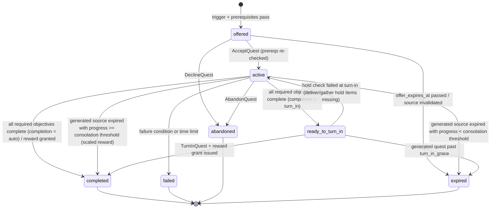
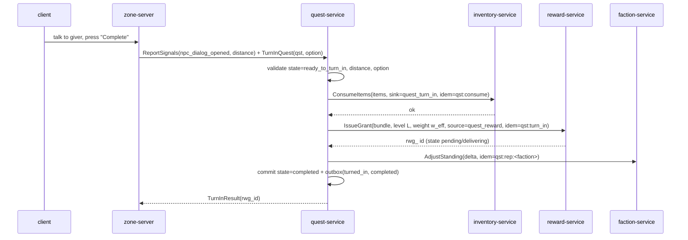

# Legends of the Shattered Frontier — Quest Model and Objectives

Version 1.0 — Expanded Technical Design Authority edition (2026-10-17)

Status: Design target; not implemented. Names per Shared Registry v1.0.

Back-links: [Quest entry](../Legends_Shattered_Frontier_Quest_Architecture_v1.0.md) · [Shared Registry](../Legends_Shattered_Frontier_Shared_Registry_v1.0.md)

---

## 1. Quest types

Every quest definition has exactly one `quest_type` from the registry enum. The type sets authoring defaults, reward weight, repeatability defaults, and UI grouping. It never changes how objectives are evaluated; all types share one objective engine.

| `quest_type` | Purpose | Source | Typical objectives | Default repeat | Base type weight `w_type` | Notes |
| --- | --- | --- | --- | --- | --- | --- |
| `story` | Main and regional narrative, onboarding (including `quest/frontier_founder`) | Authored, usually in a `quest_chain` | interact, explore, kill, build, choose | once | 1.25 | May grant LP. Drives chain unlocks and world flags. |
| `dynamic` | Reactive tasks from world state | Generated (`gqd_`) from `quest_template` | kill, gather, deliver, escort, defend, contribute | per generated instance | 0.8 | Expires with its source. Has its own daily cap. |
| `exploration` | Discovery of regions, points of interest, ruins | Authored or generated | explore, interact, gather (archaeology finds) | once | 0.9 | Feeds the `exploration` track skills via domain events, not via rewards. |
| `crafting` | Profession introduction and work orders | Authored (intro) or generated (work orders) | craft, gather, deliver | once (intro) or daily (work orders) | 0.9 | Crafted-item delivery uses quality floors (Crafting spec). |
| `faction` | Reputation storylines and faction dailies | Authored or generated | any; frequently choose, defend, contribute | once or daily | 1.0 | Primary reputation source. Choices have faction consequences. |
| `dungeon` | Attunement, dungeon storylines, "clear X" weeklies | Authored | complete_instance, defeat_encounter, gather (dungeon drops) | once or weekly | 2.0 | Credit comes from `instance.run.completed` and `encounter.attempt.defeated`. |
| `raid` | Raid attunement and raid storyline | Authored | defeat_encounter, complete_instance, contribute | once or weekly | 3.0 | Respects raid lockouts (Raid spec). Never bypasses lockout. |

Campaigns are **not** a `quest_type`. A campaign is a separate runtime entity (`cmp_`) with its own state machine. Individual characters take part through ordinary quests (usually `faction` or `dynamic`) whose `contribute` objectives feed campaign progress. See the Generation and Campaigns part.

### 1.1 Difficulty

Quests reuse the registry `difficulty` enum:

| `difficulty` | Open-world meaning | Instance-linked meaning | Multiplier `d_mult` | Group expectation |
| --- | --- | --- | --- | --- |
| `story` | Trivial and narrative; never fails from combat | Dungeon story mode | 0.75 | solo |
| `normal` | Standard solo quest at level | normal | 1.00 | solo |
| `veteran` | Elite targets; duo recommended | veteran | 1.30 | 2–3 |
| `heroic` | Group quest; full party recommended | heroic (raid) | 1.60 | 5 |
| `mythic` | Reserved for raid and mythic-dungeon storylines | mythic | 2.00 | instance group |

Tuning keys: `tune.quest.difficulty_mult_<value>`.

## 2. Quest definition schema

Quest definitions are content definitions (`quest/<slug>`). They are published in content packs by `content-catalog-service` and validated at pack build time by the quest validator. The same validator runs inside `quest-service` for generated quests. Slugs and objective keys are immutable once published. Changing objective semantics requires a new slug, or a new definition `revision` that applies only to new instances; existing instances keep the revision they were created with.

### 2.1 JSON shape

```json
{
  "id": "quest/frontier_founder",
  "revision": 1,
  "quest_type": "story",
  "difficulty": "story",
  "title_key": "quest.frontier_founder.title",
  "summary_key": "quest.frontier_founder.summary",
  "level_range": { "min": 1, "max": 5 },
  "zone_id": "zone/greenlands_01",
  "giver": { "npc_id": "npc/settlement_steward", "turn_in_npc_id": "npc/settlement_steward", "turn_in_fallbacks": [] },
  "triggers": [ { "kind": "giver_dialog" }, { "kind": "zone_entered", "zone_id": "zone/greenlands_01", "auto_offer": true } ],
  "prerequisites": { "all": [ { "kind": "level_at_least", "value": 1 } ] },
  "objectives": [
    {
      "key": "build_walls",
      "type": "build",
      "target": { "structure_tags": ["wall"], "within": { "anchor": "settlement_beacon", "radius_m": 60 } },
      "required": 3,
      "order": 1,
      "optional": false
    },
    {
      "key": "return_to_beacon",
      "type": "interact",
      "target": { "npc_id": "npc/settlement_steward", "max_distance_m": 4 },
      "required": 1,
      "order": 2,
      "optional": false,
      "is_turn_in": true
    }
  ],
  "completion": "turn_in",
  "failure_conditions": [],
  "time_limit_s": null,
  "repeat": { "policy": "once" },
  "shareable": false,
  "reward": {
    "bundle_id": "reward/frontier_founder_completion",
    "weight": 1.0,
    "options": []
  },
  "world_impact": [
    { "kind": "set_flag", "flag": "onboarding.founder_done", "value": 1 },
    { "kind": "unlock_quest", "quest_id": "quest/greenhold_first_harvest" }
  ],
  "chain": { "chain_id": "quest_chain/founding_of_greenhold", "step": 1 },
  "exclusive_group": null,
  "tags": ["onboarding", "building"]
}
```

(`npc/settlement_steward`, `quest/greenhold_first_harvest` and the `wall` tag are illustrative. Only `quest/frontier_founder` is canonical.)

### 2.2 Field reference

| Field | Type | Req | Rule |
| --- | --- | --- | --- |
| `id` | content id | yes | `quest/<slug>`. |
| `revision` | int ≥ 1 | yes | Bumped for objective or reward changes. Instances pin `definition_revision`. |
| `quest_type` | enum `quest_type` | yes | — |
| `difficulty` | enum `difficulty` | yes | `mythic` is allowed only for `dungeon` and `raid` types. |
| `level_range` | `{min,max}` 1–100 | yes | Reward level L is clamped to this range (registry §7.4). |
| `giver` | object | no | Absent for auto-offered or item-started quests. |
| `triggers[]` | Trigger | yes (≥ 1) | See §3. |
| `prerequisites` | boolean tree | no | See §3.2. |
| `objectives[]` | Objective | yes (1–8) | Keys unique. `order` defines sequential groups: objectives with the same `order` run in parallel. |
| `completion` | `turn_in` \| `auto` | yes | `auto` skips `ready_to_turn_in`. |
| `failure_conditions[]` | FailureCondition | no | e.g. `escort_target_died`, `left_area`, `timer`, `source_resolved`. |
| `time_limit_s` | int \| null | no | Starts at accept. When the timer expires, the instance fails. |
| `repeat.policy` | `once` \| `daily` \| `weekly` \| `repeatable` \| `per_source` | yes | `per_source` is for generated quests (one per `gqd_`). |
| `repeat.max_per_period` | int | if daily/weekly | Default 1. |
| `shareable` | bool | yes | Party sharing (Generation and Campaigns part, Group quest sharing). |
| `reward.bundle_id` | `reward/<slug>` | yes | Bundle schema owned by Itemization. |
| `reward.weight` | number 0.1–5.0 | yes | The authored `w_base`. A weight ≥ 5.0 needs `economy_review_id` (registry rule). |
| `reward.options[]` | `reward/<slug>`[] | no | "Choose one" bundles. All options must share the same weight class. |
| `world_impact[]` | WorldImpact | no | See §6.4. |
| `chain` | `{chain_id, step}` | no | Must match the chain definition. |
| `exclusive_group` | string | no | Quests sharing a group are mutually exclusive per character. |

### 2.3 Chain definition

```json
{
  "id": "quest_chain/founding_of_greenhold",
  "revision": 1,
  "steps": [
    { "step": 1, "quest_id": "quest/frontier_founder" },
    { "step": 2, "quest_id": "quest/greenhold_first_harvest" },
    { "step": 3, "branch": [
        { "quest_id": "quest/greenhold_side_with_wardens", "exclusive_group": "greenhold_allegiance" },
        { "quest_id": "quest/greenhold_side_with_prospectors", "exclusive_group": "greenhold_allegiance" } ] },
    { "step": 4, "quest_id": "quest/greenhold_charter", "requires_any_of_step": 3 }
  ],
  "completion_reward": { "bundle_id": "reward/greenhold_founding_chain", "weight": 2.0 }
}
```

A chain is a directed acyclic graph laid out in steps. A step is either one quest or a `branch` of alternatives. The validator rejects cycles, unreachable steps, and branches whose options are not in the same exclusive group.

## 3. Triggers and prerequisites

### 3.1 Trigger kinds

A trigger causes `quest-service` to create an instance in `offered` state for a character, after the prerequisites pass.

| Trigger `kind` | Fired by | Evidence | Auto-offer default |
| --- | --- | --- | --- |
| `giver_dialog` | The player opens dialog with a giver NPC (zone-server signal `npc_dialog_opened`) | signal with `npc_entity_id`, `npc_id`, distance | no (shown in the giver's offer list) |
| `zone_entered` | `character.zone.changed` | event | configurable |
| `poi_discovered` | `world.poi.discovered` (World spec, Points of interest; published by world-service) | event | yes |
| `item_acquired` | `item.instance.created` with `item_category = quest_item` and a `starts_quest` property | event | yes |
| `chain_step` | The previous chain step reaches `completed` | internal | yes |
| `world_event` | `world.event.started` and `world.event.stage_changed` in the character's region | event + region membership | yes, for characters in the region |
| `faction_threshold` | `faction.reputation.changed` crosses a threshold | event | yes |
| `level_reached` | `progression.level.reached` | event | yes |
| `generated_offer` | A GeneratedQuest is attached to a quest board or giver | internal | no |
| `campaign_stage` | A campaign stage becomes `active` | internal | yes, for eligible characters online in scope |

### 3.2 Prerequisites

Prerequisites form a boolean tree (`all`, `any`, `not`) over these predicates:

| Predicate | Data source |
| --- | --- |
| `level_at_least`, `level_at_most` | progression snapshot (cached `progression.level.reached`) |
| `skill_at_least {skill_id, value}` | `progression.skill.gained` cache |
| `quest_completed {quest_id}` / `quest_not_completed` | `quest` schema |
| `chain_step_completed` | `quest` schema |
| `flag_equals {flag, value}` | `quest.character_flags` |
| `choice_made {quest_id, choice_key, option}` | `quest.choices` |
| `faction_standing_at_least {faction_id, value}` | `faction.reputation.changed` cache, with a fallback `faction-service.GetStanding` RPC |
| `region_controlled_by {world_region_id, faction_id}` | `faction.control.changed` cache |
| `world_event_active {world_event_id or wev_}` | `world.event.*` cache |
| `exclusive_group_free {group}` | `quest.exclusive_locks` |
| `settlement_stage_at_least {stage}` | Building spec projection (via `guild-service`) |

Prerequisites are evaluated at offer time and again at accept time. Projections can lag by up to a few seconds. When a cached value is within one unit of the threshold, the accept path re-reads it from the owner by RPC.

## 4. Objective type catalog

Every objective has `type`, `target`, `required` (an integer count, or 1 for boolean objectives), and optional `filters`. Each type maps to one or more **evidence sources**. Progress is evaluated only in `quest-service`.

| `type` | Meaning | Evidence source | Target fields | Credit rule |
| --- | --- | --- | --- | --- |
| `kill` | Defeat NPCs | `combat.npc.killed` (payload: Combat spec, Combat events; `npc_id` matches `npc_definition_id`) | `npc_id` or `npc_tags[]`, optional `zone_id`, `world_region_id`, `min_npc_level` | The character is in `credited_character_ids`. Party members within `tune.quest.shared_credit_radius_m` (100 m) and in the same party also receive credit when `shared_kill_credit = true` (default). |
| `gather` | Harvest resources from the world | `gathering.node.harvested` | `resource_id`, `min_tier`, area | Counts harvested quantity. With `hold: true`, also requires possession at turn-in. |
| `collect` | Obtain items from any source (loot, purchase, trade) | `item.instance.created`, `inventory.item.moved` | `item_id` or tags | Counted from inventory possession at evaluation (snapshot RPC). Not cumulative. |
| `craft` | Produce items | `crafting.item.crafted` | `recipe_id` or `item_id`, `min_quality` | Crafter must be the character. Counts output quantity. |
| `deliver` | Hand items to an NPC | turn-in interaction + inventory-service consume | `item_id`, `quantity`, `npc_id` | At turn-in, items are consumed with registered sink `quest_turn_in` (Shared Registry, Currencies, sources and sinks) in the same saga as the reward. |
| `escort` | Keep an NPC alive along a path | zone-server signals `escort_checkpoint`, `escort_arrived`, `escort_target_died` | `npc_id`, `route_id` | Requires presence within `tune.quest.escort_presence_radius_m` (40 m) for ≥ 60 % of route time. |
| `explore` | Reach a place | `character.zone.changed`, `world.poi.discovered` (World spec, Points of interest), signal `area_reached` | `zone_id`, `poi_id`, or `{area_id}` | First qualifying event. Resolved (2026-10-17): world-service publishes the canonical POI discovery event. |
| `interact` | Talk to an NPC or use a world object | signal `npc_dialog_opened`, `object_used` | `npc_id`, `object_tag`, `max_distance_m` | The signal carries a server-measured distance ≤ `max_distance_m`. |
| `build` | Place structures | `world.structure.placed` (Shared Registry, World / faction events; Building producer) | `structure_tags[]` or `structure_id`, area, `owner_scope` (`self`, `party`, `guild`) | Placer is the character (or in scope). Structures destroyed within `tune.quest.build_min_lifetime_s` (60 s) are subtracted. |
| `defend` | Hold an area, structure, or NPC through waves | signals `defend_wave_cleared`, `defend_target_destroyed`; `world.event.ended` | `area_id` or `structure_ref`, `waves` | Participation ≥ `tune.quest.defend_min_participation` (0.4) of wave time inside the area. |
| `contribute` | Donate items, gold, or actions to a campaign or settlement project | `ContributeToCampaign` RPC (quest-service internal) + inventory/economy debit | `campaign_id` or `project_ref`, `cp_required` | Counts accepted contribution points after caps. |
| `choose` | Make a narrative decision | `MakeChoice` RPC (giver dialog), producing `quest.choice.made` | `choice_key`, `options[]` | Exactly one option, recorded permanently. |
| `complete_instance` | Finish a dungeon or raid run | `instance.run.completed` | `dungeon_id` or `raid_id`, `min_difficulty`, `mythic_level_min` | The character is a run member at completion. |
| `defeat_encounter` | Defeat a specific boss | `encounter.attempt.defeated` | `encounter_id`, `min_difficulty` | Participant list in the payload. Respects lockout (no credit if the character's lockout was already consumed for loot-locked encounters, unless `ignore_lockout`). |
| `reach_skill` | Reach a skill value | `progression.skill.gained` | `skill_id`, `value` | Current value ≥ target. Evaluated against the current value, not deltas. |
| `reach_standing` | Reach faction standing | `faction.reputation.changed` | `faction_id`, `value` | Same as `reach_skill`. |
| `participate_event` | Take part in a world event | `world.event.ended` (participants and outcome) | `world_event_id`, `outcome` (`resolved` or any) | Character listed as participant with ≥ minimum contribution. |
| `trade` | Sell or buy through the market | `market.listing.sold`, `economy.trade.completed` | `item tags`, `min_value_copper` | Counterparty must be a different account. Trades between linked accounts are ignored (§9 exploit rules). |

Rules that apply to all objectives:

- `required` must be between 1 and `tune.quest.max_objective_count` (500). The validator warns if an estimated completion time exceeds the type's time target (Rewards, Data and API part, Balancing targets).
- `optional: true` objectives never block completion. They may add a bonus bundle (`bonus_bundle_id`, weight ≤ 0.25).
- `order` groups: an objective in group n+1 does not accept progress until every non-optional objective in group n is complete. Events that arrive early are ignored, not buffered. This prevents "pre-farming" order-dependent story beats.
- **Retroactive credit**: `collect`, `reach_skill`, and `reach_standing` evaluate current state at accept time. All other types count only events with `occurred_at ≥ accepted_at`.

## 5. Progress evaluation

### 5.1 Pipeline

```mermaid
sequenceDiagram
    participant ZS as zone-server
    participant BUS as event-bus
    participant QC as quest-service consumer
    participant IDX as objective index (Redis)
    participant DB as PostgreSQL quest
    participant RS as reward-service
    ZS->>BUS: combat.npc.killed (credited_character_ids)
    BUS->>QC: deliver (partition by character_id)
    QC->>DB: INSERT inbox(event_id) ON CONFLICT DO NOTHING
    alt duplicate
        QC-->>BUS: ack (no-op)
    else new
        QC->>IDX: lookup subs[chr][combat.npc.killed]
        IDX-->>QC: [(qst_A, kill_wolves), (qst_B, kill_beasts)]
        QC->>QC: match filters, compute delta
        QC->>DB: UPDATE objective_progress SET current=LEAST(required, current+delta) ... ; outbox quest.objective.progressed
        opt objective reaches required
            QC->>DB: outbox quest.objective.completed
        end
        opt all required objectives complete
            QC->>DB: state active -> ready_to_turn_in (or completed if auto)
        end
        QC-->>BUS: ack after commit
    end
    Note over QC,RS: auto-complete quests call IssueGrant after commit (idempotent)
```

### 5.2 Objective index

- Key: `qidx:{realm}:{character_id}` → hash of `event_name` → list of `(quest_instance_id, objective_key, filter_hash)`.
- Built on accept, removed on terminal state, and rebuilt from PostgreSQL on cache miss. The index is advisory: the database row is authoritative, and a stale index entry fails the filter re-check.
- Kill objectives that use tags compile to a set of `npc_id`s at accept time, using the pinned content version. An NPC added in a later content pack is not counted unless the instance is re-pinned. Re-pinning is allowed only for `dynamic` quests.

### 5.3 Delta computation

```
delta = min( required − current, evidence_quantity × credit_factor )
credit_factor = 1   (all types), except:
  kill:    1 if character ∈ credited_character_ids, or (party shared credit and within radius) else 0
  gather:  harvested quantity of matching resource
  build:   +1 on placed, −1 on destroyed within build_min_lifetime_s (never below 0)
```

Progress never decreases except through the `build` subtraction and the `collect` snapshot (which can drop if items leave the inventory). For `collect`, `current = min(required, count_in_inventory)`, recomputed on every relevant inventory event.

### 5.4 Ordering, lateness, and replays

- Events are partitioned by `character_id`. Multi-character facts (`combat.npc.killed` with several credited characters, `instance.run.completed`) arrive on the producer's topic key. The consumer fans them out internally to per-character work items. Each work item is processed in a per-character transaction with an inbox key of `event_id + character_id`.
- **Late events.** An event with `occurred_at < accepted_at` is ignored for cumulative types. An event that arrives after the instance became terminal is ignored.
- **Clock source.** `occurred_at` comes from the producing server. Up to 5 s of skew between producers is tolerated: an event with `occurred_at` ≥ `accepted_at − 5 s` and processed after accept still counts. This covers a player who accepts and kills within the same second.
- **Replays.** Re-delivering the same event is a no-op through the inbox. Rebuilding a character's quest state from the warehouse is a GM tool. It recomputes progress from archived events and is audited.

### 5.5 Server signals

Signals are synchronous RPCs (`ReportSignals`) from `zone-server` or `instance-server` over mTLS with service identity. Each signal carries:

`signal_id` (ULID, dedup key), `signal_kind`, `character_ids[]`, `npc_entity_id` / `object_ref`, `server_measured` (positions, distance, presence ratio), `occurred_at`, `server_instance_id` (`srvi_`).

`quest-service` keeps an allowlist mapping signal kinds to producer service identities (zone-server, instance-server). A signal from any other identity is rejected and reported to `anticheat-service` (Rewards, Data and API part, Security considerations).

## 6. Quest instance state machine

### 6.1 States and transitions



| Transition | Guard | Side effects | Event(s) |
| --- | --- | --- | --- |
| → `offered` | Prerequisites pass. No non-terminal instance of the same definition exists. Repeat limit not reached. Exclusive group free. | Instance row created with `offer_expires_at` (default 30 min for proximity offers, null for log offers). | `quest.instance.offered` |
| `offered` → `active` | Re-check prerequisites. Active-quest cap `tune.quest.max_active` (25) not exceeded. | Pin `definition_revision` and `content_version`. Create progress rows. Index subscriptions. Grant starter items (via reward-service, bundle `start_bundle_id`). Evaluate retroactive objectives. | `quest.instance.accepted` |
| `offered` → `abandoned` | Player declines | No cooldown for declined offers. | `quest.instance.abandoned` (`reason = declined`) |
| `offered` → `expired` | Timer or source invalidated | — | `quest.instance.expired` |
| `active` → `ready_to_turn_in` | All non-optional objectives complete | — | `quest.objective.completed` (`instance_ready = true`) |
| `active`/`ready_to_turn_in` → `completed` | Auto completion, or a valid turn-in (giver interaction within distance, hold checks pass, choice made if a reward option is required) | Consume deliver items (saga). IssueGrant. Apply world impact. Record repeat counter. Advance chain. | `quest.instance.turned_in` (turn-in only), then `quest.instance.completed` |
| `active` → `failed` | Failure condition | Revoke quest items (sink `quest_turn_in`). Set the retry cooldown. | `quest.instance.failed` |
| `active` → `abandoned` | Player abandons | Remove quest items. Retry cooldown `tune.quest.abandon_cooldown_s` (0 for authored, 900 for dynamic). | `quest.instance.abandoned` |
| `ready_to_turn_in` → `active` | Hold check fails | Recompute `collect` and `gather` hold objectives. | `quest.objective.progressed` (negative delta flagged `recheck`) |

Terminal states are immutable. Retrying a `failed`, `abandoned`, or `expired` quest creates a **new** instance (a new `qst_` id). `once` quests may be retried after failure or abandonment; the repeat counter only counts `completed`.

### 6.2 Turn-in saga

Turn-in touches inventory, rewards, and faction state. It runs as an orchestrated saga with a persisted step log (`quest.turn_in_steps`):



Failure handling:

- If consume fails because items are missing, transition `ready_to_turn_in → active` and stop.
- If `IssueGrant` fails transiently, keep the instance in `ready_to_turn_in` with `turn_in_pending = true` and retry from the step log. Items already consumed are not returned, because the reward is guaranteed by retry with the same idempotency key.
- If `IssueGrant` fails permanently (bundle invalid), raise an ops alert, keep `turn_in_pending`, and allow GM resolution. The player is never left without both the items and the reward: after `tune.quest.turn_in_max_retry_s` (3600) a compensating `RestoreItems` is issued by inventory-service through the GM tool path.
- The reputation delta is applied after the reward and retried independently. It is idempotent per faction.

## 7. Chains and branching narrative

### 7.1 Choice model

A `choose` objective presents options in giver dialog. Each option declares its consequences:

```json
{
  "key": "allegiance",
  "type": "choose",
  "required": 1,
  "options": [
    {
      "option": "wardens",
      "text_key": "quest.greenhold.allegiance.wardens",
      "consequences": [
        { "kind": "reputation", "faction_id": "faction/greenhold_wardens", "delta": 250 },
        { "kind": "reputation", "faction_id": "faction/free_prospectors", "delta": -150 },
        { "kind": "set_flag", "flag": "greenhold.allegiance", "value": 1 },
        { "kind": "lock_exclusive_group", "group": "greenhold_allegiance" },
        { "kind": "control_influence", "world_region_id": "world_region/greenlands_south", "faction_id": "faction/greenhold_wardens", "points": 5 },
        { "kind": "unlock_quest", "quest_id": "quest/greenhold_side_with_wardens" }
      ],
      "requirements": { "all": [ { "kind": "faction_standing_at_least", "faction_id": "faction/greenhold_wardens", "value": 0 } ] }
    },
    { "option": "prospectors", "text_key": "quest.greenhold.allegiance.prospectors", "consequences": [ ] }
  ],
  "default_on_expire": null
}
```

Consequence kinds:

| Kind | Effect | Owner called | Bounds |
| --- | --- | --- | --- |
| `reputation` | Change faction standing | faction-service `AdjustStanding` (proposed contract for the AI spec) | \|delta\| ≤ `tune.quest.max_choice_rep_delta` (500) per option |
| `set_flag` / `clear_flag` | Character quest flag | quest-service | — |
| `lock_exclusive_group` | Permanently closes the other branch quests | quest-service | — |
| `unlock_quest` / `lock_quest` | Changes the availability of definitions | quest-service | — |
| `control_influence` | Adds influence points toward faction control of a region | faction-service `AddControlInfluence` (proposed contract for the AI spec) | Per character per region per week ≤ `tune.quest.max_control_influence_weekly` (20). faction-service decides control; quests only contribute. |
| `world_event_bias` | Requests that ai-director weight a world event chain | ai-director-service (`SubmitQuestOutcome`, AI spec, World Director and Dynamic Events, SubmitQuestOutcome) | Aggregated across the realm. Single players cannot force events. Resolved (2026-10-17): the AI RPC contract is canonical. |
| `campaign_contribution` | Adds CP to a campaign | quest-service | Subject to contribution caps. |
| `grant_reward` | Option-specific bundle | reward-service | Weight ≤ 0.5. Counted in the quest's total weight. |

### 7.2 Persistence of choices

- `quest.choices` is append-only: `(character_id, quest_id, choice_key) → option, made_at, quest_instance_id`. The unique key prevents a second choice.
- Choices survive abandonment. Abandoning a quest after a choice does not reset the choice. Re-taking the quest shows the recorded choice and auto-satisfies the `choose` objective.
- Exclusive locks are rows in `quest.exclusive_locks (character_id, group, chosen_ref)`.
- Choice reversal exists only as a GM action (`AdminRevertChoice`). It writes an audit record and emits `quest.choice.made` with `reverted = true`. It does not reverse reputation automatically; the GM tool proposes compensating deltas.
- Account-wide propagation: none. Choices are per character, so alts can explore other branches.

### 7.3 Territory and event chains

Choices and completions affect the shared world only through **aggregation** owned by other services:

1. A quest emits `control_influence` or `world_event_bias` consequences.
2. faction-service or ai-director-service sums them per region and decides outcomes on its own cadence. Example: ai-director starts `world_event/prospector_uprising` when prospector-aligned influence in a region exceeds its threshold.
3. The resulting `faction.control.changed` and `world.event.started` events re-enter quest-service as triggers and prerequisites. They unlock the next chain steps for everyone in the region.

This loop keeps narrative branching player-driven without letting `quest-service` write world state. "Event chain" quests use `world_event_active` prerequisites and `participate_event` objectives keyed to `wev_` ids passed at offer time.

### 7.4 Mutually exclusive branches

- At offer time: exclude the definition if its `exclusive_group` is locked to a different ref.
- At choice time: the `lock_exclusive_group` consequence is written in the same transaction as the choice row.
- If a character holds offered or active instances of other quests in the group, those instances move to `failed` with `reason = exclusive_branch_taken`.
- The validator checks that every chain step after a branch has `requires_any_of_step`, so the chain stays completable from every branch.

## 8. Quest-giver NPC behaviour

The AI spec owns NPC behaviour (behaviour trees, schedules, combat). `quest-service` owns **giver bindings** and computes each giver's **dialog state** per character. zone-server uses that state to render quest markers and dialog.

### 8.1 Giver binding

```json
{
  "npc_id": "npc/settlement_steward",
  "offers": ["quest/frontier_founder", "quest/greenhold_first_harvest"],
  "accepts_turn_in": ["quest/frontier_founder"],
  "quest_board": false,
  "availability": {
    "schedule": [ { "from": "06:00", "to": "22:00", "clock": "world" } ],
    "requires": { "all": [ { "kind": "region_controlled_by", "world_region_id": "world_region/greenlands_south", "faction_id": "faction/greenhold_wardens" } ] },
    "when_unavailable": "relocate",
    "relocate_to_npc_id": "npc/warden_quartermaster"
  },
  "generated_slots": { "max_offers": 3, "templates": ["quest_template/caravan_escort", "quest_template/clear_infestation"] }
}
```

Bindings ship in content packs alongside quest definitions. Quest boards are object-type givers (`quest_board: true`) that show generated quests.

### 8.2 Dialog states (quest-service internal projection)

| Dialog state | Condition (for this character) | Marker |
| --- | --- | --- |
| `unavailable` | Outside schedule, availability requirement failed, NPC dead or despawned | none |
| `idle` | Available; no eligible offers, no active quests bound | none |
| `offering` | ≥ 1 eligible offer | offer marker |
| `in_progress` | ≥ 1 active instance bound to this giver; nothing ready | grey marker |
| `awaiting_turn_in` | ≥ 1 instance `ready_to_turn_in` with this giver as turn-in NPC (or fallback) | turn-in marker |
| `post_completion` | All bound quests completed; flavour dialog only | none |
| `hostile` | Character's standing with the giver's faction is below `hostile_threshold` | none; dialog refused |

Priority when several conditions hold: `hostile` > `unavailable` > `awaiting_turn_in` > `offering` > `in_progress` > `post_completion` > `idle`.

These states are local to quest-service and are not registry enums. zone-server requests them in batches (`GetGiverStates`) for the NPCs near a player and caches them for 10 s. It also invalidates its cache on any `quest.*` event for that character.

### 8.3 Reaction to world state

| World change (event) | Giver reaction |
| --- | --- |
| `faction.control.changed`: region lost by the giver's faction | `when_unavailable` policy: `relocate` (turn-ins move to `relocate_to_npc_id`), `hide` (offers hidden; active instances keep `turn_in_fallbacks`), or `flee` (AI moves the NPC; dialog `unavailable` until respawn). |
| `world.event.started` in the giver's area (e.g. invasion) | Offers of event-linked quests become eligible (trigger `world_event`). Normal offers are suppressed while `tune.quest.suppress_offers_during_event` (true). |
| NPC killed (`combat.npc.killed` with a giver `npc_id`) | Dialog `unavailable` until respawn. Active turn-ins resolve through fallbacks. Giver NPCs with `essential: true` cannot be killed (AI spec flag). |
| `world.event.ended` with outcome `failed` | Generated quests sourced from that event expire (Generation and Campaigns part, Expiry). |
| Settlement stage change (Building spec) | Unlocks bindings with `settlement_stage_at_least`. |

Invariant: every quest with `completion = turn_in` has at least one reachable turn-in NPC under every world state. The validator requires either an `essential` giver or a non-empty `turn_in_fallbacks` list. If every turn-in NPC is unavailable for longer than `tune.quest.turn_in_unreachable_s` (1800), the quest switches to remote turn-in from the quest log.

## 9. Canonical quest: `quest/frontier_founder`

| Aspect | PoC (`server/world.js`) | Target |
| --- | --- | --- |
| Storage | `player.questDone` boolean | `quest.quest_instances` row, `quest_type = story` |
| Trigger | Implicit; available always | `zone_entered` auto-offer in the starting zone + `giver_dialog` |
| Objective | `skills.building ≥ 3`, a proxy for three walls | `build` × 3 structures tagged `wall` within 60 m of the settlement beacon, placed by the character |
| Turn-in | Within Manhattan distance 2 of beacon (16,16) | `interact` with the steward, `max_distance_m = 4`, server-measured |
| Reward | +10 `coin` | `reward/frontier_founder_completion`: `xp_reward(L,1.0)`, `gold_reward(L,1.0)`, `lp_reward(1.0)`, plus a starter tool item at ilvl `4 × L` (rarity ≤ `uncommon`) |
| Repeat | once (flag) | `repeat.policy = once` |
| World impact | none | `set_flag onboarding.founder_done`, unlock chain step 2 |

Worked reward example (formulas are in the Rewards, Data and API part, Effective weight): at L = 1, `w_eff = w_base 1.0 × w_type(story) 1.25 × d_mult(story) 0.75 × r_mult(first) 1.0 × g_mult 1.0 = 0.9375`.

- `gold_reward(1, 0.9375) = round(0.9375 × 100 × 2^1.5) = round(265.2) = 265` copper (2 s 65 c).
- `xp_reward(1, 0.9375) = round(0.9375 × xp_to_next(1) / 12)`. If the Character spec sets `xp_to_next(1) = 600` (illustrative only), the result is round(46.9) = 47 XP.
- `lp_reward(0.9375) = round(1.875) = 2` LP.
- Marks: none (L < 60).

## 10. Worked example: dynamic quest lifecycle

1. `ai-director-service` starts `wev_…` `world_event/caravan_attack` in `world_region/greenlands_south`.
2. It calls `ProposeGeneratedQuests`. quest-service instantiates `quest_template/caravan_escort` as `gqd_01J…` with `escort` (route `route/south_road_3`) and `kill` 6 × `npc_tags:[bandit]`, `w_base = 1.0`, expiring when the event ends or after 45 min.
3. The quest board at the outpost shows the offer. A character at L = 22 accepts → `active`.
4. Kills arrive through `combat.npc.killed`. The escort signal `escort_arrived` arrives with `presence_ratio = 0.78`. Both objectives complete; `completion = auto`, so the instance becomes `completed`.
5. `w_eff = 1.0 × w_type(dynamic) 0.8 × d_mult(normal) 1.0 = 0.8`. `gold_reward(22, 0.8) = round(0.8 × 100 × 23^1.5) = round(0.8 × 100 × 110.30) = 8,824` copper (≈ 88 silver).
6. Events emitted: `quest.instance.accepted`, `quest.objective.progressed` ×N, `quest.objective.completed` ×2, `quest.instance.completed`.
